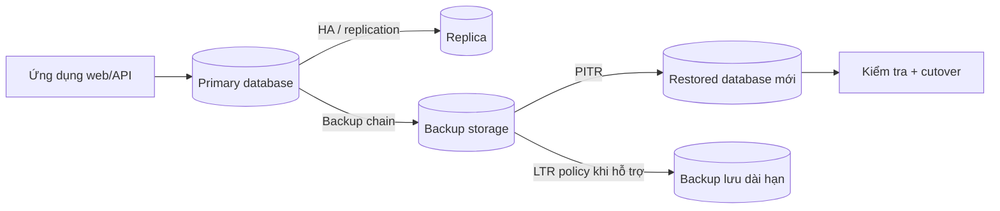
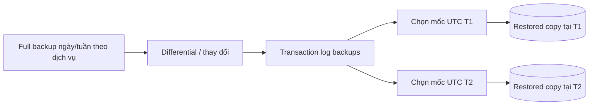
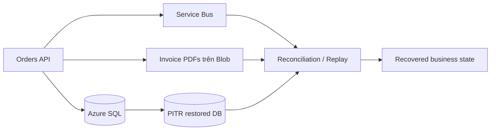

# Backup tự động, point-in-time restore và lưu giữ dài hạn

Một ứng dụng trên Microsoft Azure có thể chạy ổn định nhiều năm nhưng vẫn mất dữ liệu chỉ trong vài giây: một lệnh `DELETE` thiếu điều kiện, migration sai, tài khoản quản trị bị lạm dụng, hoặc ứng dụng ghi đè lên bản ghi hợp lệ. **High availability (HA)** có thể duy trì dịch vụ khi một máy chủ hoặc vùng khả dụng gặp lỗi, nhưng thường **sao chép cả thao tác xóa và cập nhật sai**. Vì thế, vận hành **cơ sở dữ liệu quan hệ** cần ba năng lực độc lập nhưng bổ trợ:

- **Backup tự động (automated backup):** tạo và quản lý các bản sao/lịch sử dữ liệu theo chính sách của dịch vụ.
- **Point-in-time restore (PITR):** khôi phục trạng thái nhất quán của dữ liệu tới một thời điểm đã chọn trong khoảng thời gian được hỗ trợ.
- **Long-term retention (LTR):** lưu bản backup trong thời hạn dài hơn vòng đời backup ngắn hạn, đáp ứng kiểm toán, quy định hoặc phục hồi các sự kiện được phát hiện muộn.

Bài học thuộc chương **Cơ sở dữ liệu quan hệ** của mô-đun `CLOUD_PROVIDERS_AZURE`, trong bối cảnh xây dựng, bảo vệ, giám sát và kiểm soát chi phí ứng dụng trên Azure. Trọng tâm là **Azure SQL Database**, **Azure SQL Managed Instance** và **Azure Database for PostgreSQL – Flexible Server**; đồng thời phân biệt với **Azure Database for MySQL – Flexible Server** và **SQL Server tự quản trên Azure VM**. Các dịch vụ có cơ chế, giới hạn, thời hạn và tùy chọn phục hồi **không hoàn toàn giống nhau**. Mỗi thao tác trong ví dụ cần được kiểm tra theo SKU, vùng Azure, phiên bản CLI/API và chính sách tổ chức đang sử dụng.

## Mục tiêu học tập

Sau bài học, bạn có thể:

1. Phân biệt backup, snapshot, HA, replication, geo-restore, PITR, LTR và export logic.
2. Giải thích tại sao backup tự động dùng một **chuỗi bản sao và transaction logs/WAL** để hỗ trợ chọn thời điểm khôi phục.
3. Chọn thời hạn PITR, chính sách backup storage redundancy và phương án lưu giữ dài hạn theo RPO/RTO/compliance.
4. Thực hiện tư duy **restore sang tài nguyên mới → xác minh dữ liệu → chuyển kết nối có kiểm soát**, thay vì ghi đè production ngay.
5. Hiểu các bước cấu hình/kiểm tra trên Azure Portal và Azure CLI cho Azure SQL Database, cùng các khác biệt chính của PostgreSQL Flexible Server.
6. Thiết kế kiểm thử restore, đối chiếu tính nhất quán, giới hạn truy cập, mã hóa và khả năng phục hồi trước thao tác sai.
7. Lập bảng runbook vận hành khi mất dữ liệu, từ cô lập sự cố đến chọn điểm phục hồi và kiểm tra sau cutover.
8. Dự toán chi phí và tránh nhầm backup retention với khả năng khôi phục thực tế.

## 1. Khung tư duy: backup không phải là high availability

Xét ứng dụng bán hàng có Azure App Service gọi Azure SQL Database. Một người vận hành chạy nhầm:

```sql
-- Ví dụ nguy hiểm: không được chạy trên cơ sở dữ liệu thực.
DELETE FROM orders;
```

Nếu Azure SQL Database có HA replica, thao tác hợp lệ ở mức SQL có thể được đồng bộ sang replica: **HA không tự quay lại trước câu DELETE**. Tương tự, active geo-replication và read replica có thể đưa thay đổi sai sang bản sao. Nếu chỉ dựa vào replica, có thể không còn bản dữ liệu sạch để phục hồi.



| Cơ chế | Mục tiêu chính | Điểm cần lưu ý |
|---|---|---|
| **HA / standby** | Duy trì hoặc khôi phục dịch vụ khi node/zone lỗi. | Thường sao chép cập nhật/xóa sai; không thay thế backup. |
| **Read replica** | Mở rộng đọc, có thể hỗ trợ một số chiến lược DR. | Không tự đảm bảo trạng thái trước lỗi logic. |
| **Geo-replication** | Sẵn sàng hoặc DR giữa các vùng theo dịch vụ. | Lỗi dữ liệu có thể được nhân bản; failover không phải PITR. |
| **Backup tự động** | Bảo lưu các phiên bản lịch sử theo retention. | Cần biết nguồn, lịch, mức bảo vệ, cửa sổ và chi phí. |
| **PITR** | Phục hồi tới thời điểm được chọn trong retention. | Khôi phục cần thời gian, thường tạo DB/server mới. |
| **LTR** | Giữ các bản backup lâu hơn để kiểm toán/phục hồi muộn. | Không đảm bảo khôi phục tới **mọi giây** trong nhiều năm. |
| **Export BACPAC/pg_dump** | Xuất schema + dữ liệu ở mức logic khi phù hợp. | Không đồng nghĩa bản backup PITR tích hợp của dịch vụ. |

**Ví dụ:** dữ liệu bị xóa lúc 14:32 UTC, phát hiện lúc 15:10. Nếu PITR retention còn bao phủ 14:31 và transaction log cần thiết còn khả dụng, có thể khôi phục một bản mới ở 14:31:xx. Nếu chỉ có bản LTR từ tối qua, chỉ có một mốc lịch sử thưa hơn. Hai phương án có **mức mất dữ liệu (RPO)** khác nhau dù đều gọi là “restore”.

### 1.1. Cơ chế bảo vệ phải đi theo từng nguyên nhân lỗi

- **Lỗi máy/chủ thể hạ tầng:** ưu tiên HA và failover, kết hợp backup để bảo vệ dữ liệu.
- **Xóa nhầm/migration lỗi:** PITR hoặc restore từ một backup có thời điểm trước lỗi.
- **Lỗi được phát hiện sau nhiều tháng:** LTR hoặc hệ thống lưu trữ ngoài theo chính sách.
- **Mất cả region:** cần phương án geo-resilience/geo-restore phù hợp đã được bật và thử nghiệm; backup local không tự đáp ứng.
- **Ransomware/quyền quản trị bị chiếm:** cần identity isolation, giám sát thay đổi, quyền hạn hạn chế và khả năng phục hồi bản backup được bảo vệ; không chỉ dựa vào một tài khoản admin.

## 2. Hiểu chuỗi backup và transaction log

Cơ chế backup trong các dịch vụ quan hệ được quản lý khác nhau, nhưng ý tưởng phục hồi theo thời gian thường gồm **một trạng thái nền** và **lịch sử thay đổi**.

### 2.1. Full, differential và transaction log backup

Với **Azure SQL Database**, một cách hiểu ở mức khái niệm:

- **Full backup:** trạng thái đầy đủ của dữ liệu tại một mốc.
- **Differential backup:** những thay đổi so với full backup nền tương ứng, giúp rút ngắn thao tác cần thiết.
- **Transaction log backups:** giữ lịch sử transaction cần để tiến về thời điểm khôi phục mong muốn.

Dịch vụ tự quản lý nhịp sao lưu theo tier và điều kiện vận hành, thường gồm full theo chu kỳ, differential định kỳ và log backups thường xuyên. **Không cần tự xây SQL Agent job để duy trì chuỗi backup PITR chuẩn của Azure SQL Database.** Tuy nhiên, tần suất thực tế và độ trễ khả dụng của điểm phục hồi phụ thuộc dịch vụ/tier. Không khẳng định một log backup “mỗi đúng 5 phút” cho mọi SKU hoặc mọi thời điểm.



**PITR cần cả chuỗi backup hợp lệ**, không chỉ một file bất kỳ. Vì vậy, vận hành không nên tùy ý xóa những đối tượng quản lý bởi dịch vụ hoặc nghĩ rằng sao chép một `.bak` rời rạc sẽ cho phép phục hồi tới mọi thời điểm.

### 2.2. WAL trong PostgreSQL Flexible Server

PostgreSQL ghi thay đổi vào **Write-Ahead Log (WAL)**. Dịch vụ **Azure Database for PostgreSQL – Flexible Server** kết hợp các bản backup nền và lịch sử WAL để hỗ trợ PITR trong khoảng thời gian retention được cấu hình. Cơ chế/schedule chi tiết phụ thuộc phương thức backup của dịch vụ và tier.

Với PostgreSQL, **logical dump** (`pg_dump`) hữu ích để chuyển dữ liệu hoặc giữ một bản logic theo policy, nhưng không thay cho cơ chế khôi phục **physical backup + WAL** được dịch vụ quản lý khi cần PITR. Không tự xóa WAL hoặc can thiệp vào hệ thống backup được quản lý để giải phóng dung lượng.

### 2.3. Điểm phục hồi sớm nhất và muộn nhất

Tại thời điểm sự cố, phải xác nhận:

- **Earliest restore point:** mốc cũ nhất còn được hỗ trợ trong retention.
- **Latest available restore point:** mốc gần hiện tại nhất có đủ backup/log để phục hồi.
- **Timezone:** các mốc phục hồi trong công cụ Azure thường được nhập/hiển thị bằng **UTC**; không dùng giờ địa phương mà không chuyển đổi.
- **Consistency:** hệ quản trị bảo đảm phục hồi trạng thái transaction-consistent theo cơ chế của dịch vụ; một giao dịch chưa commit ở mốc T có thể không hiện trong bản restore.

Giả sử lỗi xảy ra **14:32:10 UTC**: chọn **14:31:55 UTC** là điểm ứng viên, nhưng vẫn phải kiểm tra **lỗi đã bắt đầu từ lúc nào**, khoảng restore được Azure công bố và yêu cầu nghiệp vụ. Nếu migration chạy nhiều bước trước 14:32, chỉ lùi 15 giây có thể vẫn chứa dữ liệu sai.

## 3. Retention: ngắn hạn, dài hạn và việc lựa chọn chính sách

### 3.1. Short-term backup retention cho PITR

**PITR retention** quyết định bạn còn khả năng chọn điểm phục hồi bao xa về quá khứ, trong giới hạn dịch vụ. Với Azure SQL Database, cửa sổ PITR thường từ **1–35 ngày** tùy service tier/chính sách; các tier, loại cơ sở dữ liệu hoặc chế độ triển khai có thể có ràng buộc riêng. Một giá trị mặc định thường gặp là **7 ngày**, nhưng **đừng dùng mặc định như một cam kết SLA**.

Với PostgreSQL Flexible Server, retention backup tự động thường có khoảng cấu hình **7–35 ngày**. Giá trị cụ thể cần xem trên **đúng server** và kiểm tra thời gian điểm restore được dịch vụ cho phép. Nếu cần phục hồi sau 90 ngày, không thể chỉ tăng PITR 35 ngày mà đáp ứng yêu cầu đó.

### 3.2. Long-term retention không phải PITR vô hạn

**LTR** giữ các bản backup được chọn theo kỳ như hàng tuần, hàng tháng, hàng năm trong một khoảng dài. Trên **Azure SQL Database** và những dịch vụ SQL được hỗ trợ, một chính sách LTR có thể lưu bản sao theo tuần/tháng/năm tới **nhiều năm, có thể lên đến 10 năm theo giới hạn tính năng**.

Ví dụ chính sách nghiệp vụ minh họa:

- Giữ bản backup tuần trong **12 tuần**.
- Giữ bản backup tháng trong **12 tháng**.
- Giữ bản backup năm trong **7 năm**.
- Giữ PITR gần nhất trong **14 ngày** để sửa lỗi vận hành thường xuyên.

Tính năng LTR không có nghĩa mọi backup được chọn sẽ tạo ra khả năng chọn **bất kỳ giây nào trong quá khứ bảy năm**. LTR restore đưa bạn về **mốc backup được lưu**. Những thay đổi giữa các mốc có thể cần được tái tạo từ log, nguồn dữ liệu hoặc nghiệp vụ khác nếu có.

### 3.3. Bảng so sánh các lớp retention

| Câu hỏi | PITR ngắn hạn | LTR | Logical export / custom archive |
|---|---|---|---|
| Cửa sổ phục hồi | Những ngày gần đây theo tier. | Những điểm backup đã chọn từ xa hơn. | Theo lịch xuất riêng. |
| Độ chi tiết thời gian | Chọn một thời điểm trong khoảng hợp lệ. | Thường theo bản backup kỳ. | Phụ thuộc thời điểm tạo bản export. |
| Quản lý | Nền tảng database tự quản lý. | Chính sách LTR của dịch vụ khi hỗ trợ. | Đội ngũ vận hành tự xây/giám sát. |
| Khả năng phục hồi | Restore DB/server theo semantics dịch vụ. | Restore từ bản backup đã giữ. | Import dữ liệu/schema theo định dạng. |
| Chi phí | Theo retention, redundancy và chính sách dịch vụ. | Dung lượng lâu dài tăng theo kỳ lưu. | Storage + compute + công quản lý. |
| Hạn chế | Không kéo dài vô hạn. | Không giải quyết mọi mốc PITR. | Có thể thiếu bảo đảm transaction consistency nếu quy trình export sai. |

### 3.4. Retention nên bắt nguồn từ yêu cầu nào?

Đặt ra ba câu hỏi trước khi cấu hình:

1. **Phát hiện lỗi muộn nhất sau bao lâu?** Lỗi từ hôm qua cần PITR ngày; lỗi kế toán phát hiện quý sau cần LTR/archival.
2. **Mất dữ liệu tối đa chấp nhận được là bao nhiêu?** Phải xác định RPO và điểm phục hồi thật sự khả dụng.
3. **Cần hoạt động trở lại sau bao lâu?** RTO bao gồm thời gian phục hồi **và** thời gian xác minh/cutover, không chỉ thời gian Azure báo resource ở trạng thái Ready.

## 4. RPO, RTO và độ tin cậy của bản khôi phục

**RPO (Recovery Point Objective)** là mức mất dữ liệu tối đa doanh nghiệp chấp nhận tính theo thời gian. **RTO (Recovery Time Objective)** là thời gian tối đa để dịch vụ nghiệp vụ có thể hoạt động lại ở mức được chấp nhận sau gián đoạn.

```text
14:00  Dữ liệu hợp lệ đã tồn tại
14:32  Migration xóa nhầm bảng
14:40  Alert phát hiện sự cố
14:50  Đội DBA xác định mốc khôi phục 14:31
15:05  Bản restore bắt đầu sẵn sàng
15:25  Kiểm tra/đối chiếu hoàn thành
15:40  Ứng dụng cutover xong

Điểm dữ liệu được chọn: 14:31
Thời gian phục hồi nghiệp vụ: phụ thuộc mốc sự cố và cutover thực tế
```

Không lấy các mốc ví dụ trên làm SLA của Azure. Độ dài restore phụ thuộc dung lượng database, workload, tier, loại restore, log history, capacity dịch vụ, vùng Azure và thời gian kiểm chứng.

### 4.1. Backups không bảo đảm RPO=0

Ngay cả khi backup/log được tạo thường xuyên, có thể tồn tại khoảng chênh giữa thời điểm lỗi và **latest available restore point**. Với thảm họa mất region, RPO của **geo-restore** còn chịu độ trễ sao chép backup giữa các vùng. Nếu một nghiệp vụ đòi **không mất một transaction nào**, cần xem xét kiến trúc HA/DR, xác nhận giao dịch, synchronous replication trong phạm vi được hỗ trợ và quy trình thiết kế nghiệp vụ, thay vì chỉ ghi trong tài liệu “PITR mỗi phút là RPO 0”.

### 4.2. Restore có thể cần tài nguyên bổ sung

PITR thường tạo **bản database/server mới**, tiêu tốn compute và storage trong lúc chạy song song. Nếu subscription hết quota, tên server mới trùng, firewall/private DNS không phù hợp hoặc database target không có key/identity cần thiết, thời gian khôi phục thực tế kéo dài. Một runbook cần dự trù quota, ngân sách, tên tài nguyên, quyền và network trước sự cố.

## 5. Bảng đối chiếu các dịch vụ cơ sở dữ liệu Azure

| Dịch vụ | Backup tự động | PITR | LTR/archival | Điểm khác biệt cần ghi nhớ |
|---|---|---|---|---|
| **Azure SQL Database** | Được dịch vụ quản lý cho DB. | Restore **database mới** tại thời điểm hợp lệ. | **LTR policy** được hỗ trợ với backup kỳ. | Có tính năng cấu hình backup redundancy; mức hỗ trợ phụ thuộc tier. |
| **Azure SQL Managed Instance** | Backup tự động theo cơ chế Managed Instance. | Restore database vào môi trường/instance được hỗ trợ theo tùy chọn. | SQL MI có chính sách LTR theo khả năng hỗ trợ. | Phạm vi là managed instance với network/instance-level constraints khác single DB. |
| **Azure Database for PostgreSQL – Flexible Server** | Backup tự động nền + WAL theo dịch vụ. | Thường phục hồi **thành server mới** tại mốc hợp lệ. | Không mặc định cùng giao diện/chính sách LTR của Azure SQL Database. | Retention, geo options, tier/region và HA cần kiểm tra riêng. |
| **Azure Database for MySQL – Flexible Server** | Backup tự động theo dịch vụ. | PITR theo retention/cấu hình MySQL được hỗ trợ. | Long-term policy/backup solution cần xác minh theo dịch vụ và thời điểm. | Không sao chép nguyên lệnh SQL Database sang MySQL. |
| **SQL Server trên Azure VM** | Có thể tự quản SQL backup, Azure Backup/VM backup tùy thiết kế. | Phụ thuộc backup chain và recovery model tự cấu hình. | Xây retention qua Azure Backup/Backup vault/Storage theo thiết kế. | VM/IaaS không tự có cùng chính sách PITR/LTR PaaS như Azure SQL Database. |

**Bảng này là ranh giới sản phẩm.** Một Azure SQL Database LTR policy không tự bật backup 10 năm cho PostgreSQL Flexible Server. Khi chọn giải pháp LTR/geo backup, kiểm tra documentation và tính năng khả dụng của **đúng dịch vụ/tier/region** tại thời điểm thiết kế.

## 6. Thiết kế backup cho Azure SQL Database

### 6.1. Backup mặc định được nền tảng quản lý

Azure SQL Database tự duy trì các backup cần cho khả năng PITR, theo retention và tier. Trong vận hành, nhóm DBA thường cần quyết định:

- **PITR retention**: số ngày có thể phục hồi.
- **Backup storage redundancy**: mức sao lưu cục bộ/vùng/địa lý mà tier và service hỗ trợ.
- **LTR policy**: giữ các full backups theo kỳ nếu có yêu cầu dài hạn.
- **Quyền restore và kiểm toán**: ai có thể khởi tạo bản phục hồi, thay đổi retention hoặc xóa tài nguyên.
- **Kiểm thử**: periodic restore drill để đo RTO và xác minh ứng dụng.

Với Azure SQL Database PaaS, backup được quản lý là phần của dịch vụ, không cần tạo một job tự phát `BACKUP DATABASE TO DISK` như trên SQL Server self-managed.

### 6.2. Backup storage redundancy

Azure SQL Database hỗ trợ các lựa chọn redundancy cho backup storage theo cấu hình/tier, chẳng hạn các mô hình:

| Lựa chọn (khi được hỗ trợ) | Tư duy | Khi đánh giá |
|---|---|---|
| **LRS** | Các bản sao backup trong một vùng lưu trữ cục bộ theo mô hình dịch vụ. | Chi phí và khả năng chịu lỗi trong phạm vi cục bộ. |
| **ZRS** | Phân tán backup trong các Availability Zones của một region. | Khả năng chịu lỗi ở mức zone nếu dịch vụ/tier hỗ trợ. |
| **GRS/GZRS** | Có khả năng sao chép bản backup sang vùng địa lý thứ cấp theo chính sách Storage. | Kịch bản khôi phục khi sự cố region và chi phí thêm. |

**Không coi ZRS là geo-redundancy**, và không mặc định mọi tier hỗ trợ cả bốn tên lựa chọn. Một số dịch vụ/bản triển khai có hạn chế thay đổi redundancy sau khi tạo, hoặc cần thao tác có ảnh hưởng. Phải kiểm tra **backup redundancy đang áp dụng** trong Portal/resource properties, không suy từ redundancy của data files hay HA replica.

### 6.3. LTR của Azure SQL Database

LTR policy thường lưu những **full backups được chọn** theo tuần/tháng/năm trong storage do dịch vụ quản lý, theo ISO 8601 duration như `P12W`, `P12M`, `P7Y` khi API yêu cầu. Chính sách xác định bản nào được giữ trong bao lâu; nó **không tăng trực tiếp** số ngày PITR.

Một kế hoạch vận hành cần trả lời:

1. Giữ bao nhiêu **weekly/monthly/yearly** backups?
2. Mốc chọn cho yearly backup và chính sách fiscal year là gì?
3. Dung lượng và mức tăng dữ liệu theo năm ra sao?
4. Ai có quyền xóa LTR backup hoặc thay đổi policy?
5. Khi backup đã lưu, cần restore sang tài nguyên mới theo thủ tục nào?

Ví dụ chính sách minh họa: `weekly=P12W`, `monthly=P12M`, `yearly=P7Y`. Đây **không phải** mặc định của mọi Azure SQL Database.

### 6.4. LTR và snapshot/export thủ công

BACPAC (schema/data export), dữ liệu copy thủ công hoặc database clone có thể phục vụ migration và kiểm thử, nhưng không tương đương **LTR backup được dịch vụ giữ** về consistency, restore process, operational burden và metadata. Không thay LTR của hệ thống tài chính bằng việc copy một file `.bacpac` thủ công lên tài khoản cá nhân.
## 7. Quy trình PITR Azure SQL Database qua Azure Portal

Giả sử một hệ thống thử nghiệm:

```text
Resource group:       rg-orders-lab
SQL logical server:   sql-orders-lab
Source database:      ordersdb
Database restore:     ordersdb-restored-20261120
Mốc sự cố giả định:    2026-11-20T06:30:00Z
Mốc phục hồi dự kiến:  2026-11-20T06:29:00Z
```

Các tên và timestamp **chỉ minh họa**, không phải lệnh cần chạy trên production. Điểm restore phải thực sự nằm trong **cửa sổ PITR hiện khả dụng**. Nếu một migration làm hỏng dữ liệu từ 06:15 đến 06:30, điểm 06:29 chưa chắc sạch; cần dùng logs/audit để chọn thời điểm **trước khi lỗi bắt đầu**.

### 7.1. Từng bước trên Portal

1. Xác nhận đúng **tenant, subscription, resource group, SQL server, database và owner**.
2. Kiểm tra backup retention, redundancy, earliest/latest restore points và quyền restore.
3. Trong **SQL databases**, mở database rồi chọn **Restore** và chế độ **Point-in-time restore** theo giao diện hiện có.
4. Nhập **thời điểm UTC** trước sự cố, chọn **tên database đích mới** và cấu hình tài nguyên được Portal hỗ trợ.
5. Rà soát quota compute/storage, chi phí, quyền truy cập và đường mạng, rồi xác nhận thao tác.
6. Theo dõi deployment/restore status cho đến khi database đích sẵn sàng.
7. Kết nối vào **database mới** bằng identity phù hợp, chạy kiểm tra schema/dữ liệu/business invariants.
8. Chỉ **cutover** sau khi đã kiểm chứng, điều phối writers và có phê duyệt từ chủ sở hữu nghiệp vụ.

**PITR Azure SQL Database không phải lệnh sửa tại chỗ database đang phục vụ.** Cần tính việc app vẫn ghi vào DB nguồn trong thời gian restore; những giao dịch phát sinh sau mốc phục hồi sẽ **không tự xuất hiện** ở bản mới.

### 7.2. Azure CLI kiểm tra policy — thao tác chỉ đọc

```bash
az login
az account set --subscription "<subscription-id>"

RG="rg-orders-lab"
SERVER="sql-orders-lab"
DB="ordersdb"

az sql db show -g "$RG" -s "$SERVER" -n "$DB" \
  --query "{name:name,status:status,sku:sku.name,backup:currentBackupStorageRedundancy}" \
  -o json

az sql db str-policy show -g "$RG" -s "$SERVER" -n "$DB" -o json
az sql db ltr-policy show -g "$RG" -s "$SERVER" -n "$DB" -o json
```

Giá trị thuộc tính phụ thuộc API/CLI version. Đọc thêm **earliest/latest restore time** từ giao diện/resource API hỗ trợ; không suy rằng retention 14 ngày luôn cho phép khôi phục **từng giây** tới thời điểm hiện tại. Các lệnh trên không sửa dữ liệu.

### 7.3. Azure CLI tạo một bản restore mới

Lệnh dưới đây **thay đổi tài nguyên và phát sinh chi phí**; chỉ dùng trong lab hoặc quy trình được phê duyệt. Kiểm tra `az sql db restore --help` của CLI đang dùng trước khi chạy:

```bash
SOURCE_DB="ordersdb"
TARGET_DB="ordersdb-restored-20261120"
POINT_UTC="2026-11-20T06:29:00Z"

az sql db restore \
  --resource-group "$RG" \
  --server "$SERVER" \
  --name "$SOURCE_DB" \
  --dest-name "$TARGET_DB" \
  --time "$POINT_UTC"
```

Đây là ví dụ PITR cho Azure SQL Database. Với restore liên server/cross-region, Managed Instance hoặc cơ chế long-term backup, cú pháp và điều kiện khác. Không áp nguyên lệnh cho PostgreSQL/MySQL.

### 7.4. Kiểm chứng bản restore trước khi cutover

Kết nối **database đích**, dùng truy vấn read-only trên schema thật. Ví dụ:

```sql
SELECT DB_NAME() AS checked_database;

-- Bảng chỉ là tên minh họa, cần thay bằng schema thực tế:
SELECT COUNT_BIG(*) AS order_count FROM dbo.Orders;

SELECT TOP (20) OrderId, Status, UpdatedAtUtc
FROM dbo.Orders
ORDER BY UpdatedAtUtc DESC;
```

Cần kiểm tra hơn cả số hàng: **mốc giao dịch gần lỗi, ledger/tổng tiền, foreign keys, số đơn được xác nhận, migration version, stored procedures/permissions** và tích hợp ứng dụng. Một transaction chưa commit trước mốc PITR có thể không hiện trong bản restore. Nếu ứng dụng dùng **nhiều databases**, phục hồi chúng cùng timestamp không tự bảo đảm consistency xuyên các DB độc lập; phải reconciliation ở cấp nghiệp vụ.

### 7.5. Kế hoạch cutover và rollback

- Ghi lại điểm khôi phục, resource ID của source/target, tình trạng writer và phê duyệt cutover.
- Tạm dừng hoặc điều phối API writes, queue consumers và jobs tạo side effects theo runbook.
- Xác định giao dịch hợp lệ phát sinh **sau điểm PITR**; cần kế hoạch nhập lại/replay hoặc chấp nhận RPO theo quyết định nghiệp vụ.
- Cập nhật connection target qua **app configuration/Key Vault** được bảo vệ; không hard-code trong image.
- Kiểm tra Entra ID auth, firewall/Private Endpoint, connection pool, schema migrations, app health và smoke tests.
- Chuyển traffic có kiểm soát, theo dõi lỗi/độ trễ và dữ liệu nghiệp vụ.
- Giữ nguồn cũ đủ thời gian để điều tra theo chính sách, tránh ghi nhầm vào cả hai nơi.
- Chỉ dọn resource khi hết thời hạn quan sát và đã được duyệt.

**Rollback connection string không tự khôi phục các bản ghi đã thay đổi ở DB đích sau cutover.** Một khi hai database đã diverge, cần kế hoạch merge/compensation; không coi đổi lại DNS là phục hồi dữ liệu hoàn chỉnh.

## 8. Thay đổi PITR retention và LTR policy trên Azure SQL

Một chính sách ví dụ: PITR **14 ngày**, giữ backup tuần **12 tuần**, tháng **12 tháng**, năm **7 năm**. Đây là lựa chọn nghiệp vụ mẫu, chỉ áp dụng khi SKU/API hỗ trợ.

### 8.1. Cấu hình trên Portal

1. Mở đúng database và trang quản lý **Backups/Retention policies** theo Portal hiện hành.
2. Đọc retention/redundancy hiện tại, đặc biệt trước khi thay đổi chính sách production.
3. Đặt **short-term retention** trong dải hợp lệ của tier.
4. Đặt **LTR weekly/monthly/yearly** cùng tuần được chọn cho yearly backup nếu cần.
5. Xem khả năng áp dụng của policy, lịch giữ, tác động chi phí/tuân thủ.
6. Lưu sau review, rồi **đọc lại** policy và kiểm tra danh sách **available LTR backups** khi kỳ giữ có bản thực.
7. Đưa một LTR restore drill vào lịch vận hành.

**LTR policy không lập tức tạo một bản backup khôi phục ở mọi ngày trong quá khứ.** Nó quy định chọn/giữ những backups theo chu kỳ. Bằng chứng đáp ứng tuân thủ cần gồm policy, các backup points còn khả dụng và kết quả thử restore.

### 8.2. CLI minh họa thay đổi chính sách

Đây là lệnh **ghi cấu hình, không chạy tự động trong bài học**:

```bash
# PITR 14 ngày:
az sql db str-policy set \
  --resource-group "$RG" --server "$SERVER" --name "$DB" \
  --retention-days 14

# LTR: duration theo ISO 8601; các giới hạn phụ thuộc tier/dịch vụ:
az sql db ltr-policy set \
  --resource-group "$RG" --server "$SERVER" --name "$DB" \
  --weekly-retention "P12W" \
  --monthly-retention "P12M" \
  --yearly-retention "P7Y" \
  --week-of-year 1
```

Cú pháp cần được đối chiếu với `az sql db str-policy --help` và `az sql db ltr-policy --help` trong môi trường trước khi sử dụng. Tránh giảm retention, xóa LTR backups hoặc thay đổi redundancy khi đang xử lý sự cố chưa xác định được điểm mất dữ liệu. Các chính sách có thể chịu hạn chế/thời gian áp dụng riêng.

### 8.3. Kiểm tra backup đã sẵn sàng

Số năm `yearly=P7Y` trong policy **không chứng minh** có ngay một backup 7 năm tuổi. Khi làm kiểm toán, cần xem available LTR backups: **backup time, nguồn database, expiration, region/backup ID** và khả năng phục hồi bằng cơ chế của dịch vụ. Nếu database/server đã bị xóa, việc tìm backup có thể cần metadata tài nguyên cũ và quyền thích hợp.

Một restore từ LTR thường hướng tới **mốc của backup được giữ**, chứ không phải chọn thời gian bất kỳ giữa hai bản backup tháng/năm. Cần xác minh chất lượng dữ liệu và các thay đổi schema/nghiệp vụ của thời điểm lịch sử đó.

## 9. PostgreSQL Flexible Server: backup và PITR

**Azure Database for PostgreSQL – Flexible Server** dùng automatic backup kết hợp WAL/history để hỗ trợ PITR, với retention phổ biến trong khoảng **7–35 ngày**. Khác Azure SQL Database ở trên, PITR PostgreSQL thường tạo **Flexible Server mới**, với endpoint riêng và những yêu cầu cấu hình mạng/identity phải xét lại.

### 9.1. Đọc backup configuration

```bash
az login
az account set --subscription "<subscription-id>"

PG_RG="rg-orders-lab"
PG_SOURCE="pg-orders-lab"

az postgres flexible-server show \
  --resource-group "$PG_RG" \
  --name "$PG_SOURCE" \
  --query "{name:name,location:location,state:state,backup:backup,ha:highAvailability}" \
  -o json
```

Kiểm tra `backupRetentionDays`, phương án geo backup/geo redundancy nếu áp dụng, các restore points được hỗ trợ và tính năng của tier/region đang dùng. **Không giả định PostgreSQL có cùng command/policy LTR tuần–tháng–năm như Azure SQL Database**.

### 9.2. Khôi phục trên Portal

1. Mở đúng **Azure Database for PostgreSQL flexible servers**, chọn server nguồn.
2. Xem **Backup and restore**, retention và khoảng PITR hợp lệ.
3. Chọn thời điểm UTC trước khi lỗi logic xảy ra, chọn restore theo phương án khả dụng.
4. Đặt **tên server mới**, kiểm tra compute/storage, tier, quota, subscription và region.
5. Kiểm tra VNet/subnet, Private DNS, firewall, TLS, managed identity/auth và các dependencies.
6. Khi server mới sẵn sàng, so sánh databases, users/roles, extensions, server parameters, schema và business data.
7. Chuyển ứng dụng tới **hostname server mới** bằng quy trình cutover, điều phối writers và kiểm chứng kết quả.

### 9.3. CLI minh họa restore

```bash
PG_TARGET="pg-orders-restore-20261120"
POINT_UTC="2026-11-20T06:29:00Z"

az postgres flexible-server restore \
  --resource-group "$PG_RG" \
  --name "$PG_TARGET" \
  --source-server "$PG_SOURCE" \
  --restore-time "$POINT_UTC"
```

Đây là thao tác **có thay đổi tài nguyên** dành cho lab, chỉ dùng khi có quyền và đã kiểm tra `az postgres flexible-server restore --help`; tùy mode, CLI có thể yêu cầu/cho phép thêm tham số liên quan tới mạng/đích. Không mặc định server mới được gắn mọi identity, secret, scheduled job hoặc cấu hình kết nối ứng dụng giống server cũ.

### 9.4. Xác minh dữ liệu PostgreSQL

```sql
SELECT current_database(),
       now() AT TIME ZONE 'UTC' AS checked_utc;

-- Ví dụ theo schema có thật của hệ thống:
SELECT COUNT(*) AS order_count FROM public.orders;

SELECT order_id, status, updated_at
FROM public.orders
ORDER BY updated_at DESC
LIMIT 20;
```

Ngoài số hàng, cần kiểm tra **sequences, constraints, extensions, version, role permissions và integrations ngoài DB**. Logical export với `pg_dump` là một lớp phục vụ migration/lưu trữ riêng, **không tự tạo PITR theo từng transaction** nếu thiếu WAL/backup chain.

### 9.5. PostgreSQL long-term archive phải được thiết kế riêng

Nếu cần dữ liệu nhiều năm, chọn một giải pháp **long-term backup được hỗ trợ cho PostgreSQL ở đúng tier/region** hoặc một pipeline logical exports/archival có mã hóa, lịch chạy, checksums, quyền tách biệt và restore drills. Không copy chính sách `az sql db ltr-policy` sang PostgreSQL rồi giả định cơ chế được hỗ trợ. Nếu dùng object storage, nhớ chi phí tiers/retrieval, quyền/immutability nếu có và nguy cơ quên kiểm thử import.

## 10. Các dịch vụ quan hệ khác cần phân biệt

**Azure SQL Managed Instance** quản lý backup tự động/PITR/LTR theo tính năng được hỗ trợ, nhưng tài nguyên đích có thể cần một managed instance phù hợp, capacity và VNet. Không dùng lệnh Azure SQL Database single-DB để kết luận restore đúng cho MI; dùng đúng Portal/API/CLI của Managed Instance.

**Azure Database for MySQL – Flexible Server** có automatic backups và PITR theo retention riêng của MySQL service. Kiểm tra Backup/Restore của MySQL; tính năng long-term retention/archive có thể khác dịch vụ SQL, cần chọn giải pháp được hỗ trợ hoặc backup logical phù hợp. Restore thường tạo một server đích theo tính năng MySQL, với kiểm tra auth/network.

**SQL Server trên Azure VM** là mô hình tự quản. Cần SQL Server backup strategy, transaction-log chain, Azure Backup hoặc SQL workload backup đúng cấu hình. Backup/snapshot cấp VM **không tự cho SQL PITR** tới mốc bất kỳ nếu thiếu backup/log semantics. Không gắn nhãn “PITR 35 ngày” cho VM chỉ vì nó chạy trên Azure.
## 11. Restore từ LTR và khôi phục dữ liệu lịch sử

**Long-term retention** giữ những bản backup ở các thời điểm **rời rạc**, thường theo lịch tuần, tháng hoặc năm. Khi restore LTR, không thể chọn một giây tùy ý trong nhiều năm như khi dùng PITR còn trong retention.

### 11.1. Quy trình LTR restore trên Azure SQL

1. Xác định đúng nguồn database, năm/kỳ kế toán và backup timestamp cần truy xuất.
2. Trong Azure Portal, mở phần **Long-term retention backups** của dịch vụ SQL.
3. Liệt kê **available backups**, kiểm tra nguồn, thời điểm backup, expiration và vị trí khả dụng.
4. Chọn bản lưu đã được phê duyệt và một **database đích mới**.
5. Kiểm tra tier, storage/capacity, quyền tạo resource, encryption key và mạng.
6. Khởi tạo restore, ghi nhận backup ID/source/target vào nhật ký thao tác.
7. Xác minh schema, số lượng, dữ liệu nhạy cảm, user permissions và compatibility với công cụ tra cứu.
8. Chỉ merge dữ liệu lịch sử vào hệ thống hiện tại qua **quy trình nghiệp vụ đã kiểm soát**.

Bản LTR cách đây ba năm có thể dùng để kiểm toán hóa đơn, nhưng schema/roles và dữ liệu của nó không tương thích ứng dụng production hiện tại. Không chuyển thẳng toàn bộ traffic sang bản lịch sử để “khôi phục” một hóa đơn bị thiếu.

### 11.2. LTR không đồng nghĩa RTO thấp

Restore database kích thước lớn có thể kéo dài đáng kể; thời gian kiểm tra và cutover cũng cần tính vào RTO. Nếu hệ thống đòi phục hồi trong thời gian rất ngắn khi máy chủ/region lỗi, kết hợp HA/DR phù hợp thay vì trông chờ một bản LTR duy nhất. Không công bố cam kết RTO nếu chưa có **restore drill** trên dữ liệu và topology đại diện.

## 12. Khôi phục khi database/server bị xóa

Một số dịch vụ Azure SQL duy trì các backup có thể dùng để restore database đã xóa trong **thời hạn và điều kiện hỗ trợ**. Điều đó không có nghĩa có thể khôi phục sau bất kỳ thao tác xóa nào hoặc sau khi hết retention.

Runbook nên lưu sẵn **subscription ID, resource group, server ID, database name, region, redundancy, backup/LTR policy, owner, identity, key và IaC**. Khi phát hiện xóa nhầm:

1. Dừng các thao tác hủy/xóa tiếp theo, xác định thời điểm và đối tượng qua Azure Activity Log/audit.
2. Kiểm tra những lựa chọn **deleted database restore / available LTR backups** của đúng sản phẩm.
3. Chưa vội tạo lại một server/database trùng tên nếu có nguy cơ xung đột định danh/restore metadata.
4. Restore sang tài nguyên mới tương thích và kiểm tra dữ liệu.
5. Dựng lại cấu hình ngoài database: network, Private DNS, authentication, secrets, applications và monitoring.
6. Xác minh read/write behavior và thực hiện cutover có phê duyệt.

**Backup của database không bao gồm toàn bộ subscription, managed identity role assignments và Key Vault settings**. Nếu tenant/Key Vault key cần giải mã không còn truy cập được, việc phục hồi có thể bị chặn dù data backup vẫn tồn tại.

## 13. Geo-restore và disaster recovery

### 13.1. Local PITR khác geo-restore

| Tình huống | Phương án cần xem | Điểm lưu ý |
|---|---|---|
| Xóa nhầm dữ liệu, region còn hoạt động. | **PITR** trước lỗi. | Có thể mất những transaction hợp lệ sau mốc restore. |
| Node/AZ gặp lỗi, dữ liệu vẫn nhất quán. | **HA/standby failover** theo tier. | HA không quay ngược thay đổi sai. |
| Region chính ngừng hoạt động. | **Geo-failover/geo-restore** theo cấu hình hỗ trợ. | Cần tính sao chép backup và khả năng region thứ cấp. |
| Cần báo cáo 5 năm trước. | **LTR backup** còn lưu. | Chọn điểm bản backup, không phải từng giây trong năm đó. |
| Mất cả database và cấu hình ứng dụng. | **Backup + IaC + secrets/identity recovery**. | Một bản DB restore không tự dựng lại hệ thống. |

### 13.2. Geo redundancy không đảm bảo RPO=0

Khi backup được sao chép sang region khác, có thể có **replication lag**. Nếu region chính mất trước khi log/backup gần nhất đến đích, có thể mất một số giao dịch so với thời điểm sự cố. Cần xác minh tính năng geo backup/restore đã được **bật trên đúng SKU/region** và thử restore thật.

**ZRS chịu lỗi zone không tương đương geo-redundancy**; read replica/active geo-replication cũng có thể nhận cả dữ liệu bị xóa sai. Một kiến trúc DR vững cần cả availability lẫn khả năng quay lại phiên bản trước khi lỗi.

### 13.3. Thử DR end-to-end

Không chỉ đo thời gian tạo database mới. Kiểm tra app routing/DNS, API connection strings, Key Vault, private endpoints/firewall, Azure SQL login/Entra auth, Service Bus/Blob phụ thuộc, schema version và khả năng xử lý hàng đợi khi cutover. Một **DR drill** phải đo **RTO nghiệp vụ**, và RPO phải được ghi nhận từ transaction thực sự còn trong bản restore.

## 14. Bảo mật backup, mã hóa và quyền restore

Backup chứa dữ liệu nhạy cảm như database nguồn; phục hồi vào một môi trường lab mở quyền quá rộng có thể là **sự cố rò rỉ dữ liệu**.

### 14.1. Encryption và customer-managed key

Azure SQL Database dùng cơ chế mã hóa at rest như **Transparent Data Encryption (TDE)**, với key do dịch vụ quản lý hoặc **customer-managed key** khi tính năng hỗ trợ. PostgreSQL/MySQL có mô hình mã hóa riêng, không thể áp y nguyên cấu hình TDE SQL vào.

Khi sử dụng **CMK**, cần đảm bảo key/version cần thiết còn khả dụng ở thời điểm restore. Một backup có thể tồn tại nhưng không dùng được nếu key bị disable/purge hoặc identity mất quyền. Cần có quy trình key rotation, Key Vault protection, quyền truy cập, audit và kiểm thử restore sau khi rotate keys.

### 14.2. Tách quyền theo chức năng

- **Management plane:** quyền cấu hình backup policy, tạo restore resource và thay đổi retention.
- **Data plane:** quyền đọc/ghi dữ liệu trong DB sau restore.
- **Key management:** quyền Key Vault/Managed HSM với key liên quan.
- **Audit:** quyền xem evidence và cấu hình, không nhất thiết quyền đọc tất cả PII.
- **Break-glass:** truy cập khẩn cấp có phê duyệt, expiry, logging và review.

Không cấp `Owner` trên toàn subscription chỉ để đọc backup policy. Restore production nên có owner/approver rõ; việc tạo bản restore có dữ liệu thật tại môi trường kiểm thử cần kiểm soát bảo mật như production hoặc dùng dữ liệu đã được phép masking.

### 14.3. Backup chống lỗi logic nhưng không đủ chống mọi tấn công

Để giảm nguy cơ thay đổi/xóa bản backup trái phép, cần giám sát các thao tác quản trị, giới hạn quyền xóa/chỉnh retention, bảo vệ key và xem những phương án backup isolation/immutability được **dịch vụ đích thực sự hỗ trợ**. Không khẳng định tất cả automatic backups của mọi Azure relational database đều mặc định immutable theo cùng một cơ chế.

## 15. Dữ liệu nhất quán xuyên database, queue và Blob Storage

Một hệ thống đơn hàng có thể sử dụng:



Giả sử PITR khôi phục SQL về **10:00 UTC** nhưng Service Bus/Blob còn dữ liệu đến **10:30**. Nếu consumer khởi động lại và tạo hóa đơn từ tất cả messages mà không kiểm tra business key, có thể phát hành trùng.

### 15.1. Reconciliation sau restore

1. Xác định điểm PITR và những transactions đã bị bỏ lại so với production hiện tại.
2. Đối chiếu **paymentId/orderId, ledger entries, outbox messages, Service Bus events** và invoice files.
3. Dùng unique constraints/idempotency keys để replay các công việc cần bù.
4. Không tạo lại giao dịch payment mới chỉ vì database sau restore thiếu trạng thái, khi phía payment provider có thể đã thu tiền.
5. Kiểm tra số liệu và ký xác nhận trạng thái cuối cùng bởi owner nghiệp vụ.

### 15.2. Không có transaction phân tán tự động

Khôi phục SQL tới 10:00 **không** kéo Event Hubs, Cosmos DB, PostgreSQL khác và Blob Storage về cùng mốc. Các hệ thống cần thiết kế **transactional outbox/inbox, saga, reconciliation** hoặc phương án phục hồi xuyên nhiều nguồn. Khi khôi phục nhiều databases độc lập, cùng timestamp cũng chưa chắc đủ consistency nghiệp vụ.

## 16. Runbook sự cố mất dữ liệu

| Giai đoạn | Việc cần thực hiện | Bằng chứng/đầu ra |
|---|---|---|
| **Phát hiện** | Ghi incident ID, thời điểm, nguồn alert và phạm vi ảnh hưởng. | Incident log và stakeholder. |
| **Cô lập** | Dừng job/migration lỗi, điều phối writers khi cần. | Trạng thái thay đổi của hệ thống. |
| **Xác định điểm sạch** | Phân tích SQL audit/ứng dụng, chọn UTC trước **lỗi đầu tiên**. | Timestamp và RPO dự kiến. |
| **Chọn phương án** | PITR, LTR, HA failover, geo-restore hoặc recovery nghiệp vụ. | Phê duyệt recovery strategy. |
| **Restore mới** | Tạo resource đích, theo dõi restore operation. | Source/target resource IDs. |
| **Xác minh** | Schema, số lượng, ledger, constraints, app compatibility. | Kiểm tra pass/fail. |
| **Cutover** | Điều phối writers/consumers, đổi cấu hình kết nối. | RTO thực tế, health checks. |
| **Theo dõi** | Exceptions, latency, dữ liệu divergence và nguồn side effects. | Alert/rollback criteria. |
| **Hậu kiểm** | Root cause, điều chỉnh policy/permissions và drill. | Postmortem/action items. |

**Không chọn mốc “một giây trước cảnh báo” khi không biết lỗi bắt đầu lúc nào.** Migration có thể làm sai dữ liệu từ nhiều phút trước. Hãy phục hồi một candidate vào môi trường cách ly, so business invariants và audit, rồi mới công bố mốc an toàn.
## 17. Restore drill: chứng minh bản backup thực sự có thể dùng

Một policy báo `retentionDays=14` và màn hình hiển thị backup thành công là **bằng chứng cấu hình**, chưa phải bằng chứng ứng dụng sẽ phục hồi đúng khi có sự cố. Cần tổ chức **restore drill định kỳ** theo môi trường và mức độ quan trọng.

### 17.1. Thiết kế drill có thể lặp lại

- **Scope:** một database hoặc server đại diện cho workload, có dữ liệu kiểm thử/đã được bảo vệ phù hợp.
- **Scenario:** restore về một mốc UTC thuộc retention; một lần khác restore từ bản LTR.
- **Baseline:** ghi row counts, checksums/business totals, schema version và test dataset trước drill.
- **Process:** tạo resource mới, dựng network/auth/keys, xác minh dữ liệu, chạy app smoke test.
- **Measurement:** tổng thời gian restore, thời gian xác minh, RTO end-to-end, khoảng dữ liệu đã phục hồi.
- **Cleanup:** xóa resource đích theo approval; không xóa source hay backup dùng chung.

### 17.2. Ma trận kiểm thử

| Test | Kỳ vọng |
|---|---|
| Restore một điểm PITR trước thay đổi sai. | Dữ liệu ở mốc sạch hiện diện, thay đổi sai không được áp dụng. |
| Restore khi DB source vẫn có traffic (lab). | Database đích tách biệt, không vô tình nhận writes từ source. |
| Restore LTR backup của kỳ lịch sử. | Mở được bản dữ liệu đúng thời điểm backup và xác minh schema. |
| Mã hóa bằng CMK đã rotate. | Đủ key/identity để truy xuất và kiểm tra bản khôi phục. |
| Database có private networking. | App test có thể kết nối qua DNS/firewall/TLS phù hợp. |
| Có Service Bus/Blob side effects sau điểm PITR. | Reconciliation phát hiện giao dịch đã nằm ngoài DB restore. |
| Restore sang vùng đích DR được hỗ trợ. | Các phụ thuộc ứng dụng và quyền hoạt động trong region thay thế. |
| Dọn tài nguyên restore theo lịch. | Không xóa nhầm source, backup LTR hoặc dữ liệu audit. |

### 17.3. Điều gì được xem là PASS?

Một drill **PASS** khi tất cả kết quả quan trọng được kiểm chứng:

1. **Backup point hợp lệ** và thao tác restore tạo tài nguyên đích được hỗ trợ.
2. **Data integrity** đạt các bất biến nghiệp vụ, schema và số liệu kỳ vọng.
3. **Application compatibility** qua xác thực, network, schema, service dependencies.
4. **RTO/RPO đo được** phù hợp mục tiêu đã thỏa thuận.
5. Có **audit trail**: người thực hiện, UTC timestamps, source/target, các lỗi và cách xử lý.

Không dùng câu “Azure báo restore succeeded” thay cho toàn bộ checklist. Một resource Ready nhưng ứng dụng không thể kết nối vì Private DNS sai **chưa hoàn thành phục hồi**.

## 18. Monitoring backup và khả năng phục hồi

Backup PaaS được Azure tự quản lý không có nghĩa DBA không cần quan sát. Dashboard cần nhìn cả **policy**, **restore capability**, **activity**, **cost** và **chất lượng drill**.

### 18.1. Những tín hiệu cần theo dõi

| Tín hiệu | Nguồn xem xét | Cảnh báo/điều cần xác minh |
|---|---|---|
| PITR retention | SQL Database/PG/MySQL backup policy. | Retention bị giảm ngoài phê duyệt. |
| Backup storage redundancy | Resource properties, policy. | Redundancy không đáp ứng geo-DR requirement. |
| LTR policy và available backups | SQL backup management. | Thiếu backup kỳ bắt buộc, policy bị tắt. |
| Restore operations | Azure Activity Log/Deployment operations theo dịch vụ. | Restore lỗi, bị hủy hoặc kéo dài bất thường. |
| Xóa database/server | Azure Activity Log và audit. | Delete bất thường hoặc không có change ticket. |
| CMK/Key Vault | Key availability, audit access logs, identity. | Key disabled, purge/permission/network changes. |
| Drill results | Runbook/test report, business invariants. | RTO vượt SLO hoặc test integrity thất bại. |
| Storage/backup cost | Azure Cost Management và báo cáo dịch vụ. | Backup/LTR storage tăng nhanh hoặc phí restore vượt dự báo. |

Tên cụ thể của **Azure Monitor metrics, dimensions và diagnostic categories** khác nhau theo tài nguyên/tier. Không dựng alert giả dựa trên một tên metric chưa có trên resource; trước hết kiểm tra metrics/diagnostic settings hiện được cung cấp.

### 18.2. Nhật ký chính sách và thay đổi

Cần phát hiện ai đã chỉnh backup retention, redundancy, LTR policy hoặc xóa server. Azure Activity Log hữu ích cho các thao tác management-plane; database audit phục vụ câu lệnh và truy cập dữ liệu theo dịch vụ. Cả hai cùng cần thiết: một câu `DELETE` gây sự cố có thể không hiện như resource deletion trong Activity Log.

### 18.3. Cảnh báo muộn là một rủi ro lớn

Nếu lỗi bắt đầu 20 ngày trước nhưng PITR retention chỉ 14 ngày, phát hiện hôm nay có thể đã quá hạn PITR. Monitoring quality, audit ứng dụng, data validation/reconciliation và cảnh báo bất thường giúp **phát hiện sớm đủ để còn lựa chọn điểm phục hồi**. Backup policy không thay thế nghiệp vụ kiểm tra dữ liệu hằng ngày.

## 19. Kiểm soát chi phí PITR, LTR và restore drills

Các thành phần có thể phát sinh chi phí:

- Backup storage theo **retention và phần storage vượt mức bao gồm** nếu có, chính sách/tier cụ thể.
- Redundancy cao hơn như geo-redundant storage theo mô hình dịch vụ.
- **LTR backups** lưu nhiều kỳ trong nhiều tháng/năm.
- **Database/server restore mới** dùng compute, storage và network riêng.
- Data transfer/cross-region recovery, Key Vault, giám sát và logs.
- Công suất chạy parallel trong thời gian thử nghiệm, reconciliation và cutover.

### 19.1. Ước lượng dung lượng LTR sơ bộ

Giả sử trung bình mỗi bản backup LTR có dung lượng tính phí khoảng **200 GiB**, và bạn giữ tối đa **12 bản được chọn** ở một giai đoạn:

```text
Ước lượng logic: 200 GiB × 12 = 2.400 GiB bản backup lưu giữ
```

**Đây không phải hóa đơn hay công thức áp cho mọi Azure backup**: dịch vụ có thể tính phí khác dựa trên backup size, incrementals, dedup/compression, retention, miễn phí bao gồm, redundancy và tier. Các bản LTR tuần/tháng/năm có thể cùng mốc hoặc được lựa chọn theo quy tắc, không nhất thiết có `12+12+7` bản độc lập cộng đơn giản.

### 19.2. Restore drill có chi phí nhưng đáng đo

Một database restored chạy 24 giờ để kiểm thử tiêu thụ tài nguyên riêng. Đừng để bản restore bị quên nhiều tuần và phát sinh chi phí ngoài kế hoạch. Tạo owner/tag/expiration, cảnh báo ngân sách, quy trình cleanup có phê duyệt và **không xóa backup nguồn hoặc dữ liệu kiểm toán**.

### 19.3. Chọn retention theo rủi ro, không chỉ theo giá

Rút ngắn PITR từ 14 ngày xuống 7 ngày có thể giảm chi phí theo mô hình cụ thể, nhưng làm mất khả năng quay về một số ngày trước nếu lỗi được phát hiện muộn. Đối với giao dịch tài chính, thiệt hại do mất dữ liệu có thể lớn hơn nhiều lần phí lưu bản backup. Quyết định retention cần có data owner, security/compliance và SRE/DBA cùng phê duyệt.

### 19.4. Tổng chi phí sở hữu

Không chỉ tính dung lượng backup. Một mục tiêu RTO 15 phút có thể buộc thiết kế HA/DR, standby capacity, automation và network phức tạp hơn rất nhiều so với hệ thống chấp nhận vài giờ. Hãy dùng **Azure Pricing Calculator và Azure Cost Management** với đúng service/tier/region, đồng thời ghi rõ RPO/RTO và phạm vi trách nhiệm.

## 20. Troubleshooting: khôi phục không thành công

| Triệu chứng | Nguyên nhân thường gặp | Cách xử lý an toàn |
|---|---|---|
| Không thấy PITR option/restore time. | Sai dịch vụ/tier, source state, ngoài retention hoặc thiếu quyền. | Xác minh backup policy và khoảng restore được công bố. |
| Restore timestamp bị từ chối. | Mốc chưa khả dụng, quá cũ hoặc sai timezone. | Dùng UTC, đọc earliest/latest restore points. |
| Restore DB đang chạy nhưng rất lâu. | Dung lượng/log history, quota, backend load. | Xem operation/progress và resource health; không hủy vội. |
| Tên DB/server đích không hợp lệ. | Trùng tên, không đúng scope hoặc hạn chế naming. | Chọn tên mới, không xóa source chỉ để giải phóng tên. |
| Restore không tạo được tài nguyên. | Thiếu RBAC/quota/SKU/region. | Kiểm tra error cụ thể, permissions và quota. |
| DB restored nhưng app không kết nối. | Firewall/Private DNS/TLS/auth/connection config. | Test connectivity ở môi trường đích; không mở public access vô điều kiện. |
| LTR policy có nhưng không thấy backup cần. | Backup chưa được tạo/chọn, sai server, sai kỳ hoặc đã hết retention. | Liệt kê available backups và metadata nguồn. |
| Restore CMK-encrypted DB thất bại. | Key bị disabled/deleted hoặc identity mất quyền. | Phối hợp Key Vault owner và security runbook; không xuất key thủ công. |
| PostgreSQL restore mới thiếu cấu hình mong đợi. | Server-level settings, extensions hoặc network không như source. | So sánh cấu hình và tái lập phần ngoài database có kiểm soát. |
| Có dữ liệu thiếu sau restore. | Mốc PITR trước transaction hợp lệ. | Reconciliation theo business keys, quyết định RPO và replay. |
| Có giao dịch/hóa đơn trùng sau cutover. | Consumers reprocess events không idempotent. | Đóng writers khi cần, inbox/outbox, ledger conflict detection. |
| Chi phí tăng bất thường. | LTR tăng trưởng, restore test DB chưa dọn, geo redundancy. | Phân tích Cost Management và tags, cleanup có approval. |

### 20.1. Quy trình debug theo từng lớp

```text
Không thể phục hồi database
  |
  +-- Có backup/restore point phù hợp không?
  |     +-- Không: retention, LTR availability, thời điểm lỗi
  |
  +-- Tài nguyên đích tạo được không?
  |     +-- Không: RBAC, quota, tier, region, name conflict
  |
  +-- Dữ liệu mở/đọc được không?
  |     +-- Không: key, auth, schema, consistency
  |
  +-- Ứng dụng kết nối được không?
  |     +-- Không: firewall, VNet, DNS, TLS, secrets
  |
  +-- Nghiệp vụ đã nhất quán chưa?
        +-- Không: mốc phục hồi, queue/Blob, replay và reconciliation
```

**Không giải quyết restore lỗi bằng cách cấp Owner toàn subscription hoặc tắt mọi firewall.** Xác định failure domain trước và sử dụng quyền tối thiểu, kèm phê duyệt.

## 21. Tình huống thiết kế: migration làm sai dữ liệu đơn hàng

Một công ty có API đặt hàng trên Azure App Service, Azure SQL Database cho Orders và Service Bus cho việc phát hành hóa đơn. Họ đặt PITR retention **14 ngày** và LTR giữ weekly/monthly/yearly theo chính sách kế toán. Lúc 09:10 giờ Việt Nam, migration cập nhật sai `discount_rate` cho 30.000 đơn; lỗi được phát hiện sau 25 phút. API vẫn nhận một số giao dịch trong thời gian đó.

### 21.1. Xác định vùng rủi ro

- 09:10 ICT tương ứng **02:10 UTC** khi Việt Nam theo UTC+7.
- Migration có thể bắt đầu trước 09:10; cần đọc query audit/deployment logs.
- Nếu điểm sạch là **02:09:00Z**, PITR phục hồi DB mới về đó sẽ bỏ những giao dịch mới sau 02:09.
- Service Bus/Blob vẫn có thể chứa hóa đơn hoặc message của những giao dịch đó.
- Một bản LTR từ tuần trước gây mất dữ liệu quá nhiều và **không phải lựa chọn đầu tiên** khi PITR phù hợp còn sẵn.

### 21.2. Cách khôi phục đề xuất

1. Dừng migration và điều phối những jobs đang tiếp tục ghi dữ liệu sai.
2. Xác định mốc giao dịch sạch bằng audit/SQL metrics và deployment timestamps.
3. Restore database mới ở mốc UTC hợp lệ trong PITR.
4. Kiểm tra số đơn, giá/discount, ledger và dữ liệu ở thời điểm trước lỗi.
5. Đối chiếu những đơn/giao dịch hợp lệ tạo sau điểm PITR với event IDs trong outbox/Service Bus.
6. Nếu có thể, **sửa đúng 30.000 records bị ảnh hưởng** theo quy trình đối chiếu an toàn thay vì thay cả database, vì PITR còn có thể làm mất những giao dịch hợp lệ. Việc chọn sửa có mục tiêu hay cutover DB restored phải do data owner/DBA quyết định trên bằng chứng.
7. Nếu cutover, bảo đảm events được replay bằng idempotency keys, không thu tiền/phát hành hóa đơn trùng.
8. Theo dõi business metrics và lập postmortem, thêm kiểm thử migration/guardrails.

**Bài học:** PITR cung cấp một lựa chọn phục hồi mạnh, nhưng không mặc định là phương án có ít mất dữ liệu nhất cho mọi sự cố. Một bản restore tách biệt còn có thể dùng để **trích dữ liệu sạch và sửa những dòng sai** mà không chuyển production sang một trạng thái cũ toàn bộ.

### 21.3. Câu hỏi tự kiểm tra

1. Vì sao HA replica không bảo vệ khỏi câu `DELETE` hợp lệ nhưng sai?
2. PITR 14 ngày có nghĩa tất cả các giây trong 14 ngày luôn restore được ngay lúc này không?
3. LTR weekly 12 tuần có cho phép chọn điểm bất kỳ 11 tuần trước không?
4. Azure SQL Database PITR thường tạo resource mới hay ghi đè DB cũ?
5. Vì sao cần kiểm tra **UTC** khi chọn thời điểm khôi phục?
6. PostgreSQL Flexible Server PITR có thể khác SQL Database ở tài nguyên đích như thế nào?
7. Geo-redundant backups có chắc RPO=0 khi mất region không?
8. Nếu app ghi vào Service Bus sau điểm PITR, khi restore SQL cần xử lý gì?
9. Vì sao Key Vault key mất có thể khiến backup không thể sử dụng?
10. Điều gì phân biệt “Azure restore succeeded” với “doanh nghiệp phục hồi thành công”?

**Gợi ý:** HA có thể sao chép lỗi logic; PITR chịu earliest/latest availability và log history; LTR là mốc backup kỳ; SQL PITR tạo DB mới; UTC tránh sai timezone; PG thường restore server mới; geo có lag; cần reconciliation/replay; CMK phải khả dụng; phải test dữ liệu, quyền, network, app và RTO end-to-end.

## 22. Checklist trước khi production

- [ ] Đã phân biệt rõ HA/failover, backup, PITR, geo-restore, LTR và logical export.
- [ ] Đã ghi RPO/RTO cho từng workload với owner/phê duyệt, không dựa vào con số suy đoán.
- [ ] Biết retention và **earliest/latest restore points** của đúng database/server.
- [ ] Đã chọn backup storage redundancy theo tier, AZ/region DR và ngân sách.
- [ ] SQL Database LTR policy có weekly/monthly/yearly theo compliance nếu cần.
- [ ] Đã xác minh **available LTR backups**, không chỉ cấu hình policy.
- [ ] Không áp nhầm lệnh hoặc backup policy SQL Database cho PostgreSQL/MySQL/Managed Instance.
- [ ] Có quyền restore tối thiểu, separation of duties, audit và break-glass process.
- [ ] CMK/TDE/Key Vault identity và key versions có recovery plan đã được kiểm thử.
- [ ] Restore drill định kỳ tạo tài nguyên đích mới, test data integrity và app connectivity.
- [ ] Cutover có kế hoạch điều phối writers, connections, queue consumers và rollback.
- [ ] Có reconciliation với các Service Bus messages, Blob objects và payment provider.
- [ ] Có chính sách bảo vệ PII khi phục hồi vào môi trường lab; không tự mở quyền public.
- [ ] Monitoring cho retention changes, backup availability, restore operations và resource deletions.
- [ ] DR drill kiểm tra region, VNet, DNS, identity, Key Vault và downstream dependencies.
- [ ] Đã dự toán PITR/LTR storage, redundancy, restore compute và chi phí kiểm thử.
- [ ] Có người chịu trách nhiệm cleanup restored resources sau khi hoàn tất.
- [ ] Có runbook xác định mốc UTC sạch bằng audit, chứ không chỉ chọn trước thời điểm alert.
- [ ] Backup/source cũ không bị xóa trước khi chủ sở hữu xác nhận kết quả recovery.
- [ ] Restore test evidence và postmortem được lưu an toàn theo quy trình tổ chức.

## Kết luận

**Backup tự động** bảo vệ trạng thái dữ liệu trong một cửa sổ retention; **point-in-time restore (PITR)** cho phép phục hồi về thời điểm nhất quán đã chọn trong khoảng được hỗ trợ; **long-term retention (LTR)** lưu những bản backup lịch sử theo chính sách dài hạn nhưng không có độ chi tiết thời gian như PITR. Trên Azure, phải phân biệt khả năng của **Azure SQL Database, SQL Managed Instance, PostgreSQL/MySQL Flexible Server và SQL Server trên VM**, đặc biệt về thời hạn, tài nguyên khôi phục, geo-redundancy và chính sách LTR. Một chiến lược bảo vệ dữ liệu đáng tin cậy cần hơn việc bật backup: **chọn RPO/RTO có căn cứ, quản lý quyền/khóa mã hóa, xác minh điểm restore, thử khôi phục định kỳ, cutover an toàn, đối chiếu hệ thống liên quan và kiểm soát chi phí**. Chỉ khi dữ liệu và ứng dụng hoạt động đúng sau drill, backup mới thực sự trở thành khả năng phục hồi của doanh nghiệp.


