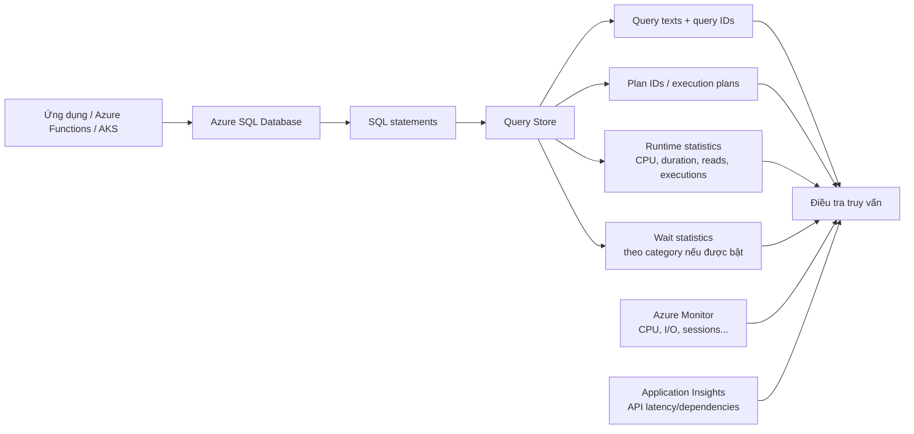
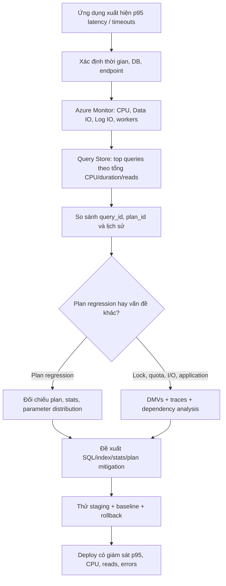

# Tối ưu truy vấn bằng Query Store và công cụ giám sát

Một hệ thống đặt hàng vận hành ổn định nhiều tháng bỗng có API tra cứu đơn từ 80 ms tăng lên 4 giây sau khi dữ liệu lớn dần hoặc một bản triển khai mới được phát hành. CPU của Azure SQL Database tăng, số request timeout nhiều hơn, nhưng câu lệnh SQL nhìn qua vẫn giống trước đây. Vấn đề có thể là **query plan thay đổi**, thống kê dữ liệu không còn phản ánh phân bố thực, chỉ mục chưa phù hợp, tranh chấp khóa hoặc tài nguyên database đã bão hòa. Muốn xử lý đúng, nhóm kỹ thuật cần **bằng chứng theo thời gian**, không chỉ nhìn một câu SQL hoặc tăng cấu hình máy.

**Query Store** là một tính năng của họ SQL Server/Azure SQL dùng để lưu lịch sử **truy vấn, execution plans và thống kê thực thi** nhằm tìm truy vấn tốn tài nguyên, so sánh các plan, nhận diện hồi quy hiệu năng và hỗ trợ điều chỉnh có kiểm soát. Khi kết hợp với **Query Performance Insight**, **Azure Monitor**, **Application Insights**, execution plan và các **dynamic management views (DMVs)**, bạn có thể liên kết triệu chứng ở API với hành vi truy vấn và giới hạn tài nguyên của dịch vụ dữ liệu.

Trong module **CLOUD_PROVIDERS_AZURE**, bạn khám phá Azure từ subscription, resource group và Microsoft Entra ID đến networking, compute, storage và data, đồng thời học triển khai, giám sát, bảo vệ và kiểm soát chi phí kiến trúc ứng dụng. Bài thuộc chương **Cơ sở dữ liệu quan hệ**, tập trung vào **Azure SQL Database** và những khả năng tương ứng trên **Azure SQL Managed Instance** khi được hỗ trợ. Phần cuối giải thích cách áp dụng nguyên lý giám sát tương tự cho PostgreSQL, tránh nhầm Query Store của SQL Server với các công cụ PostgreSQL.

> **Phạm vi an toàn:** Các câu lệnh truy vấn thống kê chủ yếu là read-only. Lệnh bật/tắt Query Store, tạo chỉ mục, cập nhật statistics, force plan hoặc sửa cấu hình đều **có thể thay đổi hiệu năng và trạng thái database**; chỉ thử trên môi trường lab/staging được phép, kiểm tra quyền và đánh giá phương án rollback trước khi triển khai production. Cú pháp và tính năng phụ thuộc phiên bản engine, database compatibility level, service tier và cấu hình.

## 1. Mục tiêu học tập

Sau bài học, bạn có thể:

- Phân biệt **query latency, CPU, logical reads, physical reads, wait time, blocking** và tài nguyên tổng thể của Azure SQL.
- Giải thích **Query Store** lưu query text, query ID, plan ID, runtime statistics, wait statistics và khoảng thống kê theo thời gian như thế nào.
- Kiểm tra trạng thái Query Store; nhận diện tình trạng `READ_WRITE`, `READ_ONLY` hoặc dung lượng đạt giới hạn.
- Tìm các truy vấn có **tổng CPU, tổng duration, số lần chạy và logical reads** lớn từ hệ thống Query Store views.
- Phân tích một truy vấn có **nhiều execution plans** và sự thay đổi hiệu năng trước/sau sự kiện.
- Sử dụng **Query Performance Insight, Azure Monitor, Application Insights** và execution plan để khoanh vùng nguyên nhân.
- Lựa chọn giữa chỉnh SQL, tạo index, cập nhật statistics, thay đổi workload hoặc **force plan tạm thời** có kiểm soát.
- Đặt baseline, thử nghiệm cải tiến, theo dõi hồi quy và rollback mà không làm lộ SQL text/dữ liệu nhạy cảm.

## 2. Truy vấn “chậm” có thể do nhiều nguyên nhân

Một request API bị chậm 2 giây không nhất thiết do bản thân câu SQL dùng 2 giây CPU. Tổng thời gian có thể bao gồm:

```text
Client / API nhận request
    |
    +-- Chờ lấy DB connection trong connection pool
    +-- Network round-trip và xác thực
    +-- SQL compile / execute
    |      +-- CPU để lọc, join, sort, aggregate
    |      +-- Logical reads (đọc trang trong buffer)
    |      +-- Physical I/O (cần lấy trang từ lưu trữ)
    |      +-- Chờ lock / latch / memory / worker / log I/O
    +-- Truyền kết quả về client
    +-- Serialize JSON và xử lý nghiệp vụ
```

| Chỉ số | Ý nghĩa | Lưu ý khi diễn giải |
|---|---|---|
| **Duration / elapsed time** | Thời gian trôi qua để hoàn thành execution | Bao gồm thời gian chờ, không đồng nghĩa CPU |
| **CPU time** | Thời gian CPU được dùng bởi truy vấn | Cao có thể do scan, sort, hash, function hoặc quá nhiều executions |
| **Logical reads** | Số trang dữ liệu/index được truy cập trong buffer | Cao gợi ý truy cập dữ liệu lớn, chưa chắc có physical I/O |
| **Physical reads** | Trang cần đọc từ hệ thống lưu trữ | Phụ thuộc cache và I/O, cần xem thời gian cùng lúc |
| **Executions count** | Số lần truy vấn được thực thi | Truy vấn rất nhanh nhưng gọi hàng triệu lần vẫn tốn tài nguyên |
| **Waits** | Thời gian đợi khóa, CPU scheduler, I/O, memory... | Cần đọc theo loại wait và bối cảnh |
| **Blocking** | Session chờ lock do session khác đang giữ | Tăng timeout dù execution plan có thể hợp lý |
| **Resource utilization** | CPU%, data I/O%, log write%, workers, sessions | Giúp xác định database đạt ngưỡng dịch vụ hay không |

### Ví dụ định lượng

Query A mất trung bình **10 ms** nhưng được chạy **200.000 lần/giờ**: tổng duration xấp xỉ 2.000 giây thực thi cộng dồn. Query B mất **2 giây** nhưng chỉ chạy **10 lần/giờ**: tổng duration 20 giây. Nếu chỉ xếp hạng theo **trung bình duration**, đội kỹ thuật có thể bỏ qua Query A dù nó tạo tải tích lũy lớn.

Đó là lý do Query Store cần được đọc theo nhiều góc nhìn: **total resource consumption**, **per-execution latency**, **frequency** và **thay đổi theo thời gian**.

## 3. Query Store hoạt động như thế nào?

Query Store thu thập và lưu trong database thông tin liên quan đến query text, truy vấn, execution plan và kết quả thống kê theo **runtime stats intervals**. Thay vì chỉ nhìn snapshot hiện tại như nhiều DMVs, Query Store cho phép phân tích **lịch sử theo những khoảng thời gian được lưu giữ**.



### Các định danh quan trọng

| Thành phần | Vai trò | Ví dụ |
|---|---|---|
| **Query text** | Văn bản SQL được Query Store ghi nhận | `SELECT ... FROM dbo.Orders ...` |
| **query_id** | Định danh một thực thể truy vấn trong Query Store | `123` |
| **plan_id** | Định danh một plan đã được ghi nhận cho query | `456` |
| **runtime stats interval** | Cửa sổ thời gian mà số liệu execution được tổng hợp | 10:00–11:00 UTC |
| **count_executions** | Số executions đóng góp vào hàng thống kê | `3500` |
| **avg_duration** | Duration trung bình trong một hàng thống kê; thường có đơn vị **microseconds** | `120000 µs = 120 ms` |
| **avg_cpu_time** | CPU time trung bình; thường là **microseconds** | `45000 µs = 45 ms` |
| **wait category** | Nhóm loại wait của query theo dữ liệu Query Store wait stats khi hỗ trợ | Lock, CPU, I/O... |

**Không mặc định một query text chỉ có một query ID, hoặc một query ID chỉ có một plan ID.** Sự khác nhau về context settings, parameterization, engine behavior và kế hoạch thực thi có thể khiến một mẫu SQL xuất hiện dưới nhiều định danh/plan khác nhau. Khi điều tra, đối chiếu cả text, query ID, context và time window.

### Query Store không phải trace từng request

Query Store lưu **dữ liệu tổng hợp** theo interval và những query/plan được capture. Nó không thay thế **Application Insights distributed tracing**, không mặc định ghi từng parameter value, client user, HTTP request ID hoặc mọi truy vấn đã từng chạy. Các plan và thống kê có thể bị loại bỏ theo retention/cleanup hoặc do cấu hình giới hạn dung lượng.

**Muốn biết request nào của khách hàng bị chậm,** dùng telemetry ứng dụng để tìm dependency/trace tương ứng, rồi kết hợp với Query Store để thấy SQL nào/plan nào có xu hướng xấu trong cùng thời gian.

## 4. Bắt đầu từ nguồn dữ liệu nào?

| Công cụ | Câu hỏi trả lời tốt | Giới hạn cần nhớ |
|---|---|---|
| **Query Store** | Query nào tốn CPU/duration, có plan regression không, thay đổi theo thời gian ra sao? | Lịch sử phụ thuộc capture/retention, không phải per-request trace |
| **Query Performance Insight** | Trong Azure portal, query nào đang nặng theo tiêu chí và thời gian được hỗ trợ? | Chủ yếu dựa trên Query Store, tính năng/UI phụ thuộc Azure SQL offering |
| **Azure Monitor metrics** | Database có CPU, Data I/O, log writes hoặc session/worker pressure không? | Metric cấp database không luôn chỉ ra query gây ra |
| **Application Insights** | API endpoint/dependency nào chậm, lỗi xảy ra ở request nào? | Cần instrumentation và sampling đúng |
| **Execution plan** | Query scan/seek/join/sort thế nào, ước lượng hàng có lệch thực tế không? | Plan chỉ là một phần bằng chứng; query phải có dữ liệu/tình huống đại diện |
| **Dynamic management views (DMVs)** | Đang có request nào chạy, wait/blocking nào xảy ra ngay bây giờ? | Snapshot/live data, nhiều DMV mất dữ liệu qua restart hoặc scope có giới hạn |
| **Intelligent Insights / automatic tuning** | Nền tảng có gợi ý vấn đề/tuning hoặc cơ chế tự tối ưu nào? | Khả năng tùy Azure SQL tier/cấu hình, phải theo dõi hiệu quả và rủi ro |
| **Database logs / audit** | Có thay đổi bảo mật/schema hoặc lỗi được ghi nhận không? | Không tự ghi tất cả parameter/payload và không nên chứa PII |

Một nguyên tắc hữu ích: **Azure Monitor chỉ ra “khi nào và mức độ”**, **Query Store chỉ ra “truy vấn/plan nào”**, còn **execution plan và application context** giúp đánh giá **“vì sao và cần sửa gì”**.

## 5. Kiểm tra Query Store đã bật chưa

Ở **Azure SQL Database**, Query Store thường được bật mặc định cho nhiều loại database hiện hành, nhưng trạng thái thực tế cần kiểm tra. Với SQL Server/Managed Instance, cấu hình và các giá trị mặc định có thể khác theo phiên bản.

Chạy trong **đúng database đích** bằng công cụ SQL được phê duyệt:

```sql
SELECT
    DB_NAME() AS database_name,
    desired_state_desc,
    actual_state_desc,
    readonly_reason,
    current_storage_size_mb,
    max_storage_size_mb,
    query_capture_mode_desc,
    interval_length_minutes,
    stale_query_threshold_days
FROM sys.database_query_store_options;
```

### Diễn giải kết quả

| Cột | Điều cần hiểu |
|---|---|
| `desired_state_desc` | Trạng thái mong muốn do cấu hình |
| `actual_state_desc` | Trạng thái hoạt động thực tế, ví dụ `READ_WRITE` / `READ_ONLY` / `OFF` |
| `readonly_reason` | Bitmask lý do không ghi tiếp, cần phân tích theo tài liệu/version |
| `current_storage_size_mb` | Dung lượng Query Store đang dùng |
| `max_storage_size_mb` | Giới hạn dung lượng của Query Store |
| `query_capture_mode_desc` | Chính sách capture truy vấn, ví dụ AUTO/ALL/CUSTOM khi hỗ trợ |
| `interval_length_minutes` | Độ dài interval dùng tổng hợp runtime statistics |
| `stale_query_threshold_days` | Thời gian giữ query statistics theo cleanup policy |

**Đừng chỉ xem `desired_state_desc`.** Nếu đặt mong muốn `READ_WRITE` nhưng thực tế là `READ_ONLY`, Query Store có thể không ghi thêm dữ liệu mới; kết luận “không còn truy vấn chậm” từ lịch sử đã dừng cập nhật sẽ sai.

### Bật Query Store trên database lab (có thay đổi cấu hình)

Lệnh dưới đây chỉ dùng khi database/tier/engine được hỗ trợ và bạn có quyền:

```sql
-- Chỉ chạy khi được phép thay đổi database lab.
ALTER DATABASE CURRENT
    SET QUERY_STORE = ON;

ALTER DATABASE CURRENT
    SET QUERY_STORE (
        OPERATION_MODE = READ_WRITE
    );
```

Không tự ý bật `QUERY_CAPTURE_MODE = ALL` trên production nhiều truy vấn ad-hoc: khối lượng metadata/capture có thể tăng. Nếu Query Store đang `READ_ONLY` vì dung lượng, hãy xác định nguyên nhân và cân nhắc **retention, capture policy, storage cap, workload** thay vì xóa dữ liệu lịch sử không có kế hoạch.

## 6. Một số Query Store views cần biết

| View | Nội dung |
|---|---|
| `sys.query_store_query_text` | Văn bản truy vấn và `query_text_id` |
| `sys.query_store_query` | Metadata/query ID, tham chiếu query text |
| `sys.query_store_plan` | Plan ID, query ID, metadata của plan, trạng thái force |
| `sys.query_store_runtime_stats` | Những hàng thống kê tổng hợp theo plan và khoảng thời gian |
| `sys.query_store_runtime_stats_interval` | Start/end của các khoảng thống kê |
| `sys.query_store_wait_stats` | Wait statistics theo plan/interval/category khi được capture |
| `sys.database_query_store_options` | Cấu hình/trạng thái Query Store hiện tại |

Các Query Store catalog views là **database-scoped**. Câu SQL chạy trong `db-orders-dev` sẽ không tự đọc Query Store của `db-orders-prod`. Phải xác nhận database context trước khi phân tích, đặc biệt nếu cùng server chứa nhiều database có tên giống nhau giữa các môi trường.

### Đọc dữ liệu Query Store đúng về mặt thống kê

Một hàng runtime stats thường có `count_executions` và `avg_duration`. Để tính average cho nhiều interval/hàng thống kê, không nên dùng `AVG(avg_duration)` đơn giản vì một interval có 2 executions và interval khác có 20.000 executions.

Trung bình có trọng số:

\[
\text{Weighted avg duration} =
\frac{\sum_i(\text{avg_duration}_i \times \text{count_executions}_i)}
{\sum_i\text{count_executions}_i}
\]

Với các cột duration/CPU của Query Store, cần **đổi microseconds sang milliseconds** khi hiển thị:

\[
\text{Milliseconds} = \frac{\text{Microseconds}}{1000}
\]

Khi lọc interval, số liệu thường phản ánh **các executions được gom trong khoảng thống kê**, không nhất thiết chính xác đến từng microsecond ở ranh giới thời gian. Những interval chưa đóng và dữ liệu đang được flush có thể khiến kết quả thay đổi.

## 7. Quy trình tìm “truy vấn gây tải” trước khi tối ưu

Một luồng điều tra thực dụng:



**Không bắt đầu bằng việc tạo index hoặc force plan ngay khi thấy một query chậm.** Trước hết cần biết query đó có đóng góp đáng kể vào vấn đề sản xuất hay không, bản chất thay đổi diễn ra từ khi nào, và có phải tài nguyên tổng thể/đường mạng đang gây ra độ trễ không.

## 8. T-SQL: Top queries theo tổng duration, CPU và logical reads

Ví dụ sau chạy trên Azure SQL Database có Query Store đang thu thập dữ liệu. Nó tổng hợp thống kê trong **24 giờ gần đây** theo `query_id` và tính average có trọng số theo số lần chạy. Kết quả chỉ đọc dữ liệu Query Store, không thực thi lại các query gốc.

```sql
-- Read-only; chạy trong database đang điều tra.
-- Các avg_* của Query Store thường tính bằng microseconds,
-- riêng logical reads được biểu diễn theo số trang.
WITH Aggregated AS
(
    SELECT
        q.query_id,
        SUM(CONVERT(bigint, rs.count_executions)) AS executions,
        SUM(CONVERT(float, rs.avg_duration)
            * rs.count_executions) AS duration_us,
        SUM(CONVERT(float, rs.avg_cpu_time)
            * rs.count_executions) AS cpu_us,
        SUM(CONVERT(float, rs.avg_logical_io_reads)
            * rs.count_executions) AS logical_reads
    FROM sys.query_store_query AS q
    JOIN sys.query_store_plan AS p
        ON p.query_id = q.query_id
    JOIN sys.query_store_runtime_stats AS rs
        ON rs.plan_id = p.plan_id
    JOIN sys.query_store_runtime_stats_interval AS i
        ON i.runtime_stats_interval_id = rs.runtime_stats_interval_id
    WHERE i.end_time > DATEADD(hour, -24, SYSUTCDATETIME())
    GROUP BY q.query_id
)
SELECT TOP (20)
    a.query_id,
    LEFT(qt.query_sql_text, 1500) AS query_sample,
    a.executions,
    CAST(a.duration_us / 1000000.0 AS decimal(18, 2))
        AS total_duration_sec,
    CAST(a.duration_us / NULLIF(a.executions, 0) / 1000.0
         AS decimal(18, 2)) AS avg_duration_ms,
    CAST(a.cpu_us / 1000000.0 AS decimal(18, 2))
        AS total_cpu_sec,
    CAST(a.cpu_us / NULLIF(a.executions, 0) / 1000.0
         AS decimal(18, 2)) AS avg_cpu_ms,
    CAST(a.logical_reads / NULLIF(a.executions, 0)
         AS decimal(18, 2)) AS avg_logical_reads
FROM Aggregated AS a
JOIN sys.query_store_query AS q
    ON q.query_id = a.query_id
JOIN sys.query_store_query_text AS qt
    ON qt.query_text_id = q.query_text_id
ORDER BY a.duration_us DESC;
```

### Cách đọc kết quả

- **`total_duration_sec` cao:** query gây nhiều thời gian tích lũy trong khoảng đã chọn; cần xem nó có nằm trên đường request quan trọng không.
- **`avg_duration_ms` cao:** mỗi execution chậm; chú ý p95/p99 phía ứng dụng vì Query Store average không phản ánh đầy đủ tail latency.
- **`total_cpu_sec` cao:** query dùng nhiều CPU tổng cộng; có thể là do số lần chạy quá nhiều chứ không phải plan xấu.
- **`avg_logical_reads` cao:** mỗi lần đọc nhiều trang; nên kiểm tra predicate, index, join và plan, không mặc định tạo index ngay.
- **`executions` rất cao:** có thể do anti-pattern **N+1 queries**, polling quá dày hoặc ORM sinh cùng truy vấn lặp.

Muốn tìm “top CPU” hãy thay `ORDER BY a.duration_us DESC` bằng `ORDER BY a.cpu_us DESC`. Muốn tìm query có logical reads tích lũy lớn, xếp theo `a.logical_reads DESC`.

### Các bẫy khi tổng hợp

1. **Không `GROUP BY` trực tiếp `query_sql_text` kiểu `nvarchar(max)`.** Câu ví dụ tổng hợp theo `query_id` trước, sau đó mới nối text.
2. Thống kê Query Store có thể có **nhiều hàng cho cùng plan/interval** khi interval đang hoạt động hoặc dữ liệu được flush; tổng có trọng số từ các hàng hợp lệ phù hợp hơn việc chỉ lấy một hàng.
3. Các hàng thuộc interval cắt ngang ranh giới 24 giờ được tính theo cửa sổ interval, **không phải phép đo từng execution chính xác đến giây**.
4. Query Store capture policy có thể bỏ qua query ít quan trọng hoặc query ad-hoc tùy cấu hình; “không thấy query” không đồng nghĩa query không chạy.
5. Tránh công bố `query_sql_text` nguyên bản ra ticket/log nếu chứa literal nhạy cảm; ví dụ sử dụng `LEFT(..., 1500)` để giới hạn độ dài, **không phải cơ chế che PII**.

## 9. Truy tìm hồi quy: query_id ổn định nhưng plan_id thay đổi

**Plan regression** xảy ra khi truy vấn từng chạy tốt nhưng một plan mới khiến latency/CPU/reads tăng đáng kể. Một nguyên nhân phổ biến là thay đổi phân bố dữ liệu hoặc cardinality estimates, nhưng cũng có thể do compatibility level, cập nhật statistics, index changes hoặc parameter-sensitive behavior.

### Ví dụ diễn tiến

| Thời điểm | Query ID | Plan ID | Số lần chạy | Avg duration | Avg logical reads |
|---|---:|---:|---:|---:|---:|
| Trước deploy | 105 | 302 | 50.000 | 24 ms | 180 |
| Sau deploy | 105 | 417 | 30.000 | 920 ms | 52.000 |

Giả sử application request rate và khối lượng dữ liệu không thay đổi tương xứng, đây là tín hiệu đáng xem **hai execution plans**, không phải bằng chứng tuyệt đối plan mới là nguyên nhân. Cần đối chiếu CPU/IO tổng thể, skew của parameters, wait stats, lock và thời điểm cập nhật thống kê.

### 9.1. Truy vấn thống kê theo từng plan

```sql
DECLARE @QueryId bigint = 105; -- Thay bằng query_id tìm được.

SELECT
    p.query_id,
    p.plan_id,
    p.is_forced_plan,
    SUM(CONVERT(bigint, rs.count_executions)) AS executions,
    CAST(
        SUM(CONVERT(float, rs.avg_duration) * rs.count_executions)
        / NULLIF(SUM(rs.count_executions), 0) / 1000.0
        AS decimal(18, 2)
    ) AS avg_duration_ms,
    CAST(
        SUM(CONVERT(float, rs.avg_cpu_time) * rs.count_executions)
        / NULLIF(SUM(rs.count_executions), 0) / 1000.0
        AS decimal(18, 2)
    ) AS avg_cpu_ms,
    CAST(
        SUM(CONVERT(float, rs.avg_logical_io_reads)
            * rs.count_executions)
        / NULLIF(SUM(rs.count_executions), 0)
        AS decimal(18, 2)
    ) AS avg_logical_reads,
    MIN(i.start_time) AS first_interval_start,
    MAX(i.end_time) AS last_interval_end
FROM sys.query_store_plan AS p
JOIN sys.query_store_runtime_stats AS rs
    ON rs.plan_id = p.plan_id
JOIN sys.query_store_runtime_stats_interval AS i
    ON i.runtime_stats_interval_id = rs.runtime_stats_interval_id
WHERE p.query_id = @QueryId
  AND i.end_time > DATEADD(day, -7, SYSUTCDATETIME())
GROUP BY p.query_id, p.plan_id, p.is_forced_plan
ORDER BY avg_duration_ms DESC;
```

Nếu thấy một query ID có nhiều plan ID, cần so sánh **cùng thời gian tải tương đương** hoặc theo giai đoạn trước/sau một thay đổi cụ thể. Chỉ lấy average 7 ngày có thể che khuất hồi quy xảy ra trong 30 phút vừa qua.

### 9.2. Xem execution plan của query

```sql
DECLARE @QueryId bigint = 105;

SELECT
    plan_id,
    is_forced_plan,
    force_failure_count,
    last_force_failure_reason_desc,
    query_plan
FROM sys.query_store_plan
WHERE query_id = @QueryId
ORDER BY plan_id DESC;
```

`query_plan` có thể xem bằng SSMS/công cụ được hỗ trợ để phân tích graphical/XML plan. Khi xem plan, đánh dấu query ID, plan ID và thời điểm chạy; không chỉ gửi ảnh chụp một operator mà thiếu SQL text và điều kiện thực tế.

### 9.3. So sánh hai khoảng thời gian

Để tránh trộn dữ liệu trước/sau deploy, có thể phân nhóm interval theo một timestamp:

```sql
DECLARE @QueryId bigint = 105;
DECLARE @ChangeUtc datetimeoffset = '2026-11-19T12:00:00+00:00';

WITH PeriodStats AS
(
    SELECT
        CASE WHEN i.start_time >= @ChangeUtc
             THEN 'AFTER' ELSE 'BEFORE' END AS period,
        p.plan_id,
        CONVERT(float, rs.avg_duration) * rs.count_executions
            AS duration_us,
        CONVERT(bigint, rs.count_executions) AS executions
    FROM sys.query_store_plan AS p
    JOIN sys.query_store_runtime_stats AS rs
        ON rs.plan_id = p.plan_id
    JOIN sys.query_store_runtime_stats_interval AS i
        ON i.runtime_stats_interval_id = rs.runtime_stats_interval_id
    WHERE p.query_id = @QueryId
      AND i.start_time >= DATEADD(hour, -24, @ChangeUtc)
      AND i.end_time < DATEADD(hour, 24, @ChangeUtc)
)
SELECT
    period,
    plan_id,
    SUM(executions) AS executions,
    CAST(SUM(duration_us) / NULLIF(SUM(executions), 0) / 1000.0
         AS decimal(18, 2)) AS weighted_avg_duration_ms
FROM PeriodStats
GROUP BY period, plan_id
ORDER BY period, plan_id;
```

**Giới hạn:** interval cắt qua thời điểm đổi có thể bị xếp vào `BEFORE`/`AFTER` theo `start_time`, nên nên loại những interval giao nhau với mốc thay đổi hoặc dùng cửa sổ đủ rộng khi cần kết luận chính xác. Thời gian `@ChangeUtc` là mốc giả định; thay bằng thời điểm deploy/cấu hình thật.

## 10. Đọc Query Store wait statistics

Khi CPU/duration tăng nhưng logical reads không tăng tương ứng, cần xem liệu truy vấn đang **chờ** gì. Query Store wait statistics (nếu bật và được hỗ trợ) giúp nhóm thời gian chờ theo **category** cho query/plan.

```sql
DECLARE @QueryId bigint = 105;

SELECT
    p.query_id,
    p.plan_id,
    w.wait_category_desc,
    CAST(SUM(CONVERT(float, w.total_query_wait_time_ms))
         AS decimal(18, 2)) AS total_wait_ms
FROM sys.query_store_plan AS p
JOIN sys.query_store_wait_stats AS w
    ON w.plan_id = p.plan_id
JOIN sys.query_store_runtime_stats_interval AS i
    ON i.runtime_stats_interval_id = w.runtime_stats_interval_id
WHERE p.query_id = @QueryId
  AND i.end_time > DATEADD(hour, -6, SYSUTCDATETIME())
GROUP BY p.query_id, p.plan_id, w.wait_category_desc
ORDER BY total_wait_ms DESC;
```

> **Lưu ý:** wait statistics trong Query Store có thể không được thu thập trên mọi version/cấu hình. Nếu view trống, kiểm tra Query Store options và tính năng được hỗ trợ trước khi suy ra “không có waits”. Chỉ số wait category có thể chứa nhiều loại wait events khác nhau.

| Wait category hoặc hiện tượng | Giả thuyết nên kiểm tra |
|---|---|
| **Lock** | Transaction giữ lock lâu, cập nhật cùng hàng/bảng, deadlock hoặc isolation level |
| **CPU** | Truy vấn bị chờ CPU scheduler, CPU database cao, quá nhiều workload đồng thời |
| **Buffer I/O / Other Disk I/O** | Đọc/ghi storage, cold cache, scan nhiều trang hoặc giới hạn I/O |
| **Memory** | Memory grant, query sort/hash lớn, áp lực bộ nhớ |
| **Parallelism** | Parallel plan imbalance, exchange overhead, skew |
| **Transaction log** | Log write throughput, transaction quá lớn hoặc liên tục |

**Không phải mọi wait đều là vấn đề cần “sửa”.** Query có thể chờ I/O bình thường; cần xem tỷ trọng wait, duration, workload và biến động theo thời gian. Cũng không nên dùng `NOLOCK` bừa để né lock vì có thể chấp nhận đọc dữ liệu sai và ảnh hưởng tính đúng đắn.

## 11. Phân tích actual/estimated execution plan

Sau khi tìm ra query ID/plan ID đáng nghi, xem execution plan bằng SQL Server Management Studio (SSMS) hoặc công cụ SQL tương thích.

### Những operator và hiện tượng nên nhận biết

| Tín hiệu trong plan | Ý nghĩa có thể | Bước xác minh |
|---|---|---|
| **Clustered Index Scan / Table Scan** | Đọc nhiều hàng hoặc optimizer thấy scan rẻ hơn seek | Đo số hàng thực, selectivity, logical reads |
| **Index Seek** | Tìm theo index range/key | Không mặc định luôn tốt; lookup theo mỗi hàng có thể tốn kém |
| **Key Lookup / RID Lookup** | Cần tra thêm cột không có trong index | Cân nhắc covering index hoặc giảm cột SELECT |
| **Sort / Hash Match** | Join/order/aggregate cần memory và CPU | Xem memory grant, spills, số hàng |
| **Nested Loops** | Thích hợp đầu vào nhỏ nhưng có thể tệ khi ước lượng sai | So sánh estimated vs actual rows |
| **Hash Join / Merge Join** | Có thể hợp cho tập dữ liệu lớn hoặc đã sắp xếp | Xem memory, spilling, join predicate |
| **Implicit conversion** | Ép kiểu có thể khiến predicate khó dùng index | Đồng bộ kiểu cột/parameter |
| **Warnings về spill** | Sort/hash không đủ memory, phải dùng tempdb | Kiểm tra thống kê, row estimates, memory grant |
| **Estimated vs Actual Rows lệch lớn** | Cardinality estimation chưa phù hợp | Xem statistics, parameter skew, predicates |

### Estimated và actual plan

- **Estimated plan** cho biết optimizer dự tính thực hiện query như thế nào; thường không cần chạy câu lệnh để xem plan.
- **Actual plan** cho biết plan cùng một số runtime details **sau khi thực thi**; có thể phát sinh overhead và câu SQL có thể **thay đổi dữ liệu** nếu là DML.

**Không chạy `UPDATE`/`DELETE` của production chỉ để lấy actual plan.** Với query tốn kém, cần lab/replica và kỹ thuật đo được phê duyệt. Nếu chạy SELECT trên production, giới hạn phạm vi và quyền để tránh gây tải quá lớn hoặc vô tình tiết lộ dữ liệu.

### Đo SQL trong lab bằng STATISTICS

```sql
-- Chỉ chạy một truy vấn SELECT đã biết là an toàn trên database lab.
SET STATISTICS IO ON;
SET STATISTICS TIME ON;

DECLARE @CustomerId bigint = 1001;
DECLARE @FromUtc datetime2(3) = '2026-11-01T00:00:00';
DECLARE @ToUtc   datetime2(3) = '2026-12-01T00:00:00';

SELECT o.OrderId, o.CreatedAt, o.Status, o.TotalAmount
FROM dbo.Orders AS o
WHERE o.CustomerId = @CustomerId
  AND o.CreatedAt >= @FromUtc
  AND o.CreatedAt < @ToUtc
ORDER BY o.CreatedAt DESC;

SET STATISTICS IO OFF;
SET STATISTICS TIME OFF;
```

Đây là **truy vấn ví dụ** yêu cầu bảng `dbo.Orders` và các cột tương ứng đã tồn tại trong lab. Trong SSMS, xem số **logical reads** và CPU/elapsed time ở phần Messages, kèm actual execution plan nếu đã bật trước khi thực thi. Dùng nhiều lần chạy với parameter/data đại diện; cache nóng/lạnh và concurrent workload có thể làm kết quả khác nhau.

## 12. Query Performance Insight trong Azure portal

**Query Performance Insight** cung cấp giao diện phân tích các truy vấn tốn tài nguyên theo Query Store cho những Azure SQL Database offering được hỗ trợ. Thay vì tự viết ngay T-SQL, có thể dùng UI để xác định top queries trong một cửa sổ thời gian.

Quy trình tham khảo:

1. Vào [Azure portal](https://portal.azure.com/) với đúng tenant/subscription.
2. Mở **SQL databases**, chọn database đang bị chậm (không chọn nhầm logical server).
3. Tìm mục **Query Performance Insight** hoặc phần tương ứng dưới **Intelligent Performance** theo giao diện hiện hành.
4. Chọn **time range** và chỉ số phân tích như CPU, duration hoặc executions nếu UI hỗ trợ.
5. Quan sát top queries; mở một truy vấn để xem query text/plan-related information mà UI cung cấp.
6. Ghi lại **query ID, thời điểm, metric và phát hiện** để đối chiếu bằng Query Store views/actual plan.
7. So sánh biểu đồ **trước/sau** deployment, schema change hoặc sự kiện tăng tải.

**Điều kiện:** UI này phụ thuộc Query Store có dữ liệu và khả năng hỗ trợ của database/tier/portal phiên bản đang dùng. Nếu không có mục giao diện hoặc dữ liệu trống, dùng Query Store catalog views và Azure Monitor; không kết luận hệ thống không có vấn đề chỉ vì dashboard không hiện top queries.

### Khi nào UI tốt hơn T-SQL, và ngược lại?

- **UI** hữu ích cho triage nhanh, chỉ ra query cần xem và diễn biến tổng quan với nhóm vận hành.
- **T-SQL** hữu ích để tái lập phép đo, so sánh time windows cụ thể, tính average có trọng số và xuất kết quả kiểm chứng có giới hạn.
- **Cả hai** cần đi kèm bối cảnh ứng dụng, bản triển khai, instance/tier, thời điểm UTC và dữ liệu thật trong khoảng cần phân tích.

## 13. Azure Monitor: đánh giá sức khỏe database trước khi kết luận lỗi query

**Azure Monitor** giúp quan sát các metrics cấp dịch vụ Azure SQL, tạo cảnh báo và thu thập logs theo khả năng cấu hình. Khi Query Store báo duration tăng, hãy kiểm tra cùng thời điểm:

| Nhóm tài nguyên | Ví dụ chỉ số | Câu hỏi |
|---|---|---|
| Compute | CPU percentage, vCore/DTU utilization theo mô hình tính toán | Database có đang bị áp lực CPU không? |
| Storage I/O | Data I/O percentage, read/write throughput, I/O latency theo metrics có sẵn | Query đang chờ I/O hoặc bị giới hạn tier? |
| Transaction log | Log write percentage / throughput | Nhiều transaction ghi hay log bottleneck? |
| Concurrency | Workers %, sessions %, connections | Có chạm giới hạn kết nối hoặc worker? |
| Availability | Connection failures, errors, deadlocks | Sự cố kết nối hay tranh chấp lock? |
| Capacity | Storage used, allocated size, max database size | Database gần hạn mức dung lượng? |
| Cost | Compute capacity, vCore-hours, storage/backup, logging | Tăng tier có đáng giá so với tối ưu truy vấn? |

**Tên và đơn vị metrics thay đổi theo Azure SQL offering, tier và API.** Không mặc định metrics của serverless SQL Database, provisioned SQL Database và Managed Instance hoàn toàn giống nhau; hãy lấy danh sách metric definitions từ tài nguyên thực.

### 13.1. Kiểm tra bằng Azure portal

1. Mở đúng **SQL database** (hoặc Managed Instance/database tương ứng) trong Azure portal.
2. Vào **Monitoring → Metrics**.
3. Chọn cùng khoảng UTC với lúc API latency tăng; ví dụ 09:00–10:00 UTC.
4. Hiển thị CPU, data I/O, log write, workers/sessions hoặc metrics thực tế được hỗ trợ.
5. Đặt cùng biểu đồ với thời điểm deploy, maintenance/scale hoặc tăng request rate từ ứng dụng.
6. Nếu CPU gần trần trong một khoảng dài, xác định top CPU query bằng Query Store; nếu CPU thấp nhưng duration cao, ưu tiên xem blocking, waits và external dependencies.
7. Tạo alert theo ngưỡng **kết hợp duration** và ngữ cảnh, không chỉ khi CPU vượt 80% trong một phút.

### 13.2. Azure CLI — chỉ đọc dữ liệu

Các lệnh sau dùng Bash/Azure Cloud Shell và **không thay đổi Azure resources**:

```bash
az login
az account set --subscription "<subscription-id>"

RG="rg-sql-lab"
SERVER="sql-orders-lab"
DB="ordersdb"

DB_RESOURCE_ID=$(az sql db show \
  --resource-group "$RG" \
  --server "$SERVER" \
  --name "$DB" \
  --query id --output tsv)

# Xem service tier/SKU của database.
az sql db show \
  --resource-group "$RG" \
  --server "$SERVER" \
  --name "$DB" \
  --query "{name:name,location:location,sku:sku.name,tier:sku.tier,status:status}" \
  --output json

# Tra metric definitions thực tế trước khi truy vấn.
az monitor metrics list-definitions \
  --resource "$DB_RESOURCE_ID" \
  --output table

# Ví dụ metrics CPU nếu resource hỗ trợ tên cpu_percent.
az monitor metrics list \
  --resource "$DB_RESOURCE_ID" \
  --metric "cpu_percent" \
  --interval "PT5M" \
  --aggregation Average \
  --output json
```

Để điều tra khoảng thời gian lịch sử cụ thể, thêm time range theo tham số `--start-time` và `--end-time` được CLI hỗ trợ. Nếu `cpu_percent` không xuất hiện trong definitions, dùng **tên metric thực tế** của offering tương ứng. Những quyền Azure RBAC cho phép đọc Azure Monitor metrics **không tự đồng nghĩa** tài khoản có quyền xem Query Store SQL text.

### 13.3. Metric p95 của API nằm ở đâu?

Azure SQL resource metrics giúp đo **tài nguyên database**, không tự biết endpoint `GET /orders` của ứng dụng có p95 bao nhiêu. Trong Application Insights, cần instrumentation request/dependency, chọn đúng sampling/operation IDs và so sánh **p95 API request duration** với **p95 SQL dependency duration** nếu dữ liệu được thu thập.

Nếu request mất 5 giây, dependency SQL chỉ 20 ms, đừng force plan hoặc tăng tier database khi vấn đề thật nằm ở network call khác, connection pool, cache hoặc code phía API.

## 14. DMVs: điều tra điều gì đang xảy ra ngay lúc này?

Query Store đặc biệt hữu ích cho lịch sử; khi production đang có incident, **DMVs** giúp xem request/session hiện tại. Ví dụ sau chỉ đọc metadata runtime; quyền xem DMV phụ thuộc Azure SQL/engine version.

```sql
SELECT
    r.session_id,
    r.status,
    r.command,
    r.cpu_time,
    r.total_elapsed_time,
    r.logical_reads,
    r.reads,
    r.writes,
    r.wait_type,
    r.wait_time,
    r.blocking_session_id
FROM sys.dm_exec_requests AS r
WHERE r.database_id = DB_ID()
  AND r.session_id <> @@SPID
ORDER BY r.total_elapsed_time DESC;
```

### Đọc thông tin blocking

- **`blocking_session_id > 0`**: request hiện tại đang chờ một session khác; cần điều tra transaction và lock của blocker, không vội tăng CPU.
- **`wait_type`**: tín hiệu về loại tài nguyên đang đợi; cần tra ngữ nghĩa theo engine và bối cảnh.
- **`total_elapsed_time` cao nhưng `cpu_time` thấp**: có thể nhiều thời gian đợi hoặc công việc không dùng CPU; không tự kết luận nguyên nhân duy nhất là lock.
- **`logical_reads` cao**: truy vấn đang xử lý nhiều trang; dùng execution plan và Query Store để xác định vì sao.

**Không tự động `KILL <session_id>` trên production** chỉ vì session giữ lock. Đó có thể là transaction thanh toán/ghi dữ liệu quan trọng; rollback có thể tốn thời gian và tác động đến các workload khác. Trước thao tác quản trị, xác định owner, phạm vi và hậu quả.

### Xem thống kê tài nguyên gần thời gian hiện tại

Với Azure SQL Database hỗ trợ DMV này, bạn có thể dùng:

```sql
SELECT TOP (30)
    end_time,
    avg_cpu_percent,
    avg_data_io_percent,
    avg_log_write_percent
FROM sys.dm_db_resource_stats
ORDER BY end_time DESC;
```

Đây là dữ liệu tổng hợp cấp database trong cửa sổ giới hạn, không thay thế Azure Monitor lịch sử dài hạn và không có cùng schema trên mọi dịch vụ SQL. Nếu DMV không tồn tại hoặc quyền không đủ, dùng Azure Monitor của offering đang quản trị.

### Kết nối giữa Query Store và live DMVs

Một quy trình hữu ích khi API timeout:

1. Xác nhận request/correlation ID từ Application Insights.
2. Kiểm tra DMVs tại thời điểm incident để xem blocking/waits và resource pressure.
3. Tìm Query Store top duration/CPU trong cùng cửa sổ.
4. Đối chiếu query text/plan ID với câu SQL do endpoint sinh ra.
5. Kiểm tra index/stats/schema changes hoặc transaction dài; chỉ sau đó chọn biện pháp.

## 15. Tối ưu truy vấn ở tầng SQL trước khi tăng compute

Trong nhiều trường hợp, cách tối ưu lâu dài là **giảm lượng dữ liệu phải đọc, CPU cần dùng hoặc số lần truy vấn bị gọi**, chứ không ép optimizer dùng một plan cụ thể.

### 15.1. Viết điều kiện lọc SARGable

**SARGable** là cách viết predicate giúp optimizer có cơ hội tận dụng thứ tự/điều kiện tra cứu của index. Ví dụ sau có thể hạn chế index usage nếu biến đổi cột trong `WHERE`:

```sql
-- Ví dụ chưa tối ưu: biến đổi cột CreatedAt tại runtime.
DECLARE @Day date = '2026-11-20';

SELECT OrderId, CustomerId, CreatedAt, TotalAmount
FROM dbo.Orders
WHERE CAST(CreatedAt AS date) = @Day;
```

Thường nên viết dạng khoảng thời gian:

```sql
DECLARE @Day date = '2026-11-20';

SELECT OrderId, CustomerId, CreatedAt, TotalAmount
FROM dbo.Orders
WHERE CreatedAt >= @Day
  AND CreatedAt < DATEADD(day, 1, @Day);
```

**Lưu ý kỹ thuật:** SQL Server optimizer có thể tối ưu một số biểu thức `CAST` đặc biệt; không khẳng định mọi `CAST(column AS date)` đều chắc chắn scan. Điều cần làm là **đo execution plan, reads, CPU và elapsed time** trên dữ liệu thực để chọn cách viết phù hợp.

### 15.2. Chọn index dựa trên predicate và projection

Giả sử API thường tra đơn theo `CustomerId` và khoảng `CreatedAt`:

```sql
DECLARE @CustomerId bigint = 1001;
DECLARE @FromUtc datetime2(3) = '2026-11-01T00:00:00';
DECLARE @ToUtc datetime2(3) = '2026-12-01T00:00:00';

SELECT
    OrderId,
    CreatedAt,
    Status,
    TotalAmount
FROM dbo.Orders
WHERE CustomerId = @CustomerId
  AND CreatedAt >= @FromUtc
  AND CreatedAt < @ToUtc
ORDER BY CreatedAt DESC;
```

Một ứng viên index cho **database lab**:

```sql
-- Thao tác thay đổi schema: chỉ chạy trên lab được phép.
CREATE NONCLUSTERED INDEX IX_Orders_CustomerId_CreatedAt
ON dbo.Orders (CustomerId, CreatedAt DESC)
INCLUDE (Status, TotalAmount);
```

Index có thể giảm số trang đọc và tránh Key Lookup trong một số plan. Tuy nhiên:

- Thêm index làm **tăng storage và chi phí ghi** cho INSERT/UPDATE/DELETE.
- Cần xem `OrderId` có sẵn qua clustered index/row locator hay phải được đưa vào projection/index.
- Nếu `Status` là cột lọc rất quan trọng, thứ tự key/index có thể phải thiết kế khác.
- Filtered index hoặc columnstore có thể phù hợp cho các mẫu workload riêng, nhưng cần phân tích workload tổng thể.
- Một index “cover” cho một query có thể không phải lựa chọn tốt khi bảng có hàng trăm triệu rows và rất nhiều kiểu truy vấn.

**Không tạo chỉ mục trùng nhau** chỉ vì nhiều query xuất hiện trong top 20; xem chỉ mục hiện tại và tác động write amplification trước khi triển khai.

### 15.3. Tránh N+1 queries ở tầng ORM

Ví dụ API lấy 100 orders, sau đó ORM lại gọi một SQL riêng để lấy thông tin khách hàng cho từng order: tổng cộng khoảng **101 round-trips**. Mỗi query có thể nhanh nhưng tổng duration lớn.

Các lựa chọn:

- Eager loading hợp lý hoặc batch fetching của ORM.
- Join/phân trang đúng cách, tránh trả về hàng triệu rows không cần thiết.
- Cache kết quả đọc ít thay đổi, có TTL/invalidation phù hợp.
- Giới hạn số queries và theo dõi dependency calls per API request trong Application Insights.

**Query Store chỉ ra query chạy nhiều lần; application tracing cho biết đó có phải do một request gọi lặp hay hàng nghìn requests hợp lệ.** Cần kết hợp cả hai trước khi thay đổi ORM.

## 16. Statistics, parameter sensitivity và plan cache

### Vì sao statistics quan trọng?

SQL optimizer dự đoán số rows thỏa điều kiện dựa trên thống kê phân bố dữ liệu. Nếu ước lượng khác xa thực tế, optimizer có thể chọn nested loops thay hash join, cấp memory không đủ hoặc chọn scan/seek không tối ưu.

Thống kê có thể trở nên kém đại diện khi dữ liệu thay đổi nhanh hoặc phân bố lệch. Tuy nhiên, **auto-update statistics** và các tính năng engine hiện đại đã hỗ trợ rất nhiều trường hợp; không nên chạy `UPDATE STATISTICS` toàn database theo cron quá dày khi chưa đo.

### Kiểm tra trước khi cập nhật

1. Xem actual execution plan và so sánh estimated/actual rows.
2. Xem gần đây có **đợt nhập dữ liệu lớn**, thay đổi cột/index hoặc thay đổi kiểu query không.
3. Kiểm tra chính sách auto update statistics và thời điểm thống kê được cập nhật.
4. Tái hiện trên database lab có phân bố dữ liệu tương tự.
5. Nếu statistics thực sự là nguyên nhân, cập nhật **đúng statistics** dưới quy trình thay đổi được kiểm soát.

Ví dụ câu lệnh **thay đổi thống kê** trên lab:

```sql
-- Chỉ chạy nếu bảng, index/statistics thực sự tồn tại.
-- Có thể gây tải và tạo kế hoạch thực thi mới cho các truy vấn.
UPDATE STATISTICS dbo.Orders IX_Orders_CustomerId_CreatedAt;
```

Sau đó phải đọc lại Query Store/plan và thử workload đại diện: thay đổi statistics có thể giúp một query nhưng làm query khác đổi plan.

### Parameter-sensitive workload

Ví dụ `@CustomerId=1` có 2 triệu đơn hàng, còn `@CustomerId=2` chỉ có 10 đơn. Một plan tốt cho khách hàng thứ hai có thể rất kém cho khách hàng thứ nhất. Cơ chế **parameter sniffing/parameter-sensitive plan optimization** tùy engine/version/compatibility level có thể ảnh hưởng việc chọn plan.

Những hướng điều tra:

- So sánh query latency theo **nhóm parameters có phân bố khác nhau** ở môi trường bảo vệ dữ liệu.
- Kiểm tra statistics, histogram, indexes và cách parameterize.
- Xem engine có hỗ trợ **Parameter Sensitive Plan (PSP)** hoặc tính năng tương tự ở compatibility level hiện tại không.
- Xem các lựa chọn ở mức câu SQL (`OPTION (RECOMPILE)`, `OPTIMIZE FOR`...) hoặc Query Store hints **chỉ sau khi benchmark**.

**Không force một plan nhanh cho một parameter rồi coi nó tốt cho mọi parameter.** Plan forcing có thể che đậy hoặc làm nặng hơn vấn đề parameter skew.

## 17. Plan forcing: xử lý khẩn cấp một hồi quy có bằng chứng

**Plan forcing** cho phép Query Store yêu cầu optimizer thử sử dụng một plan từng được ghi lại cho truy vấn. Đây có thể là biện pháp **giảm thiểu sự cố tạm thời** khi một plan mới gây hồi quy rõ ràng và chưa thể sửa code/index ngay.

### Khi nào nên cân nhắc?

- Query Store có **ít nhất hai plan** của cùng query ID trong các khoảng tải so sánh được.
- Plan cũ ổn định và plan mới gây tăng duration/CPU/reads rõ rệt.
- Đã kiểm tra nguyên nhân khác như CPU chạm trần, blocking, dependency timeout.
- Có đủ quyền, có người phê duyệt và **phương án unforce/rollback**.
- Có dashboard theo dõi query đó và tác động tới các query khác trong giai đoạn sau thay đổi.

**Đừng force plan chỉ vì nó có average duration nhỏ nhất trong bảng.** Số executions, parameter mix, time window, dữ liệu và memory grants có thể rất khác nhau.

### Ví dụ T-SQL force plan (có thay đổi trạng thái)

```sql
-- DỪNG: ví dụ thay đổi database; chỉ chạy trong lab/staging
-- khi query_id và plan_id đã được xác minh bằng Query Store.
EXEC sys.sp_query_store_force_plan
    @query_id = 105,
    @plan_id = 302;
```

Kiểm tra trạng thái sau đó:

```sql
SELECT
    query_id,
    plan_id,
    is_forced_plan,
    force_failure_count,
    last_force_failure_reason_desc
FROM sys.query_store_plan
WHERE query_id = 105;
```

**Force plan không bảo đảm luôn dùng được plan đó.** Schema/index thay đổi, plan incompatibility hoặc các giới hạn engine có thể khiến force thất bại. Query Store lưu thông tin như `force_failure_count`/`last_force_failure_reason_desc` để hỗ trợ điều tra; hãy quan sát actual plan/runtime và lỗi, không chỉ nhìn `is_forced_plan = 1`.

### Rollback / unforce

```sql
-- Chỉ thực hiện khi có kế hoạch rollback và quyền phù hợp.
EXEC sys.sp_query_store_unforce_plan
    @query_id = 105,
    @plan_id = 302;
```

Sau unforce, optimizer có thể chọn một plan mới theo statistics và tình trạng hiện hành. Vì vậy rollback không có nghĩa tự động quay về đúng latency cũ; cần giám sát và, nếu cần, khôi phục những thay đổi schema/stats liên quan theo phương án đã duyệt.

### Force plan là biện pháp chữa triệu chứng, không phải lúc nào cũng là sửa gốc

Nên điều tra tiếp:

1. SQL có predicate hoặc join thiếu hiệu quả không?
2. Index/column statistics đã phù hợp với dữ liệu và phân bố parameters chưa?
3. Có deploy làm thay đổi schema, types, indexes hoặc query text không?
4. Có skew workload hoặc concurrency khiến plan cũ không còn tối ưu cho nhóm khách hàng lớn?
5. Có giới hạn tài nguyên cần nâng cấp để bảo vệ SLO trong ngắn hạn không?

Plan forcing nên được quản trị như một **configuration exception có owner, lý do và thời hạn xem xét lại**.

## 18. Query Store hints và Automatic Tuning

### Query Store hints

Với những engine/version hỗ trợ, **Query Store hints** cho phép áp dụng một số **query hints** cho query ID mà không cần sửa trực tiếp source SQL. Điều này hữu ích khi không thể thay đổi nhanh mã ORM hoặc ứng dụng của bên thứ ba.

Ví dụ những hướng tuning có thể liên quan:

- Hướng optimizer đánh giá cách tạo plan cho các phân bố parameters khác nhau.
- Kiểm soát lựa chọn execution strategy, recompile hoặc một số hành vi optimizer được hỗ trợ.
- Thử một hint có phạm vi **query ID cụ thể**, thay vì sửa cấu hình database toàn cục.

**Rủi ro:** hint không phải bảo đảm tốt cho mọi dữ liệu và có thể trở nên lỗi thời sau schema change. Hãy kiểm tra danh sách hint được hỗ trợ và quyền cần thiết của đúng Azure SQL version, thử lab, theo dõi Query Store runtime rồi gỡ khi không còn cần. Không dùng hint để che vấn đề thiếu index/data skew mà không có bằng chứng.

### Automatic Tuning trong Azure SQL

**Azure SQL automatic tuning** có thể hỗ trợ một số hành động như **FORCE_LAST_GOOD_PLAN** hoặc **index recommendations** theo tính năng/offering và cấu hình hiện hành. Nền tảng có thể đánh giá hiệu quả và trong một số trường hợp tự hoàn nguyên hành động tuning khi kết quả không tốt.

Không coi automatic tuning là “bật lên rồi khỏi giám sát”. Cần:

1. Xem **tính năng đang được hỗ trợ** trên database/tier của bạn.
2. Xác định chế độ `ON`/`OFF`/`INHERIT` hoặc đề xuất trong giao diện/DMV tương ứng.
3. Rà soát tác động tới thay đổi schema, quy trình migration và quyền kiểm soát index.
4. Giám sát hiệu quả và cảnh báo hồi quy sau một hành động tuning.
5. Ghi lại những thay đổi do hệ thống thực hiện để tránh người vận hành tưởng rằng “không ai sửa gì”.

**Khác biệt:** automatic plan correction là cơ chế nền tảng lựa chọn/đánh giá hành động theo chính sách; còn `sp_query_store_force_plan` là lựa chọn có chủ đích do người quản trị thực hiện với query/plan ID xác định. Cả hai đều cần dữ liệu Query Store chất lượng.

## 19. Quản lý Query Store: dung lượng, retention và capture

Query Store không có khả năng lưu vô hạn mọi query/plan. Với workload hàng trăm nghìn câu SQL ad-hoc khác nhau, việc capture và lưu quá nhiều metadata có thể tạo overhead và khiến Query Store đạt giới hạn.

### Những tham số đáng quan tâm

| Nhóm cấu hình | Mục đích | Rủi ro khi chọn không phù hợp |
|---|---|---|
| **Query capture mode** | Quyết định nhóm truy vấn được thu thập | `ALL` có thể tạo nhiều dữ liệu ad-hoc, `AUTO` có thể bỏ qua query ít gặp |
| **Data flush interval** | Khoảng đẩy thống kê trong bộ nhớ vào storage | Không phải mọi thống kê xuất hiện tức thì |
| **Statistics interval length** | Độ hạt thời gian của runtime stats | Interval quá lớn khó thấy sự cố ngắn |
| **Stale query threshold** | Retention thời gian của dữ liệu Query Store | Quá ngắn mất baseline trước deploy; quá dài tăng storage |
| **Maximum storage size** | Giới hạn metadata/data Query Store | Chạm giới hạn có thể khiến Query Store không ghi tiếp |
| **Size-based cleanup** | Chính sách tự dọn khi tiến gần giới hạn | Phải hiểu dữ liệu lịch sử nào có thể bị loại |
| **Wait stats capture** | Lưu query wait statistics khi hỗ trợ | Cần tính overhead và dữ liệu được phép thu |

### Kiểm tra cấu hình bổ sung

```sql
SELECT
    actual_state_desc,
    desired_state_desc,
    current_storage_size_mb,
    max_storage_size_mb,
    size_based_cleanup_mode_desc,
    query_capture_mode_desc,
    data_flush_interval_seconds,
    interval_length_minutes,
    stale_query_threshold_days
FROM sys.database_query_store_options;
```

Cột `wait_stats_capture_mode_desc` và các lựa chọn khác có thể hiện diện theo phiên bản engine; chỉ thêm vào truy vấn khi view thực tế hỗ trợ.

### Khi Query Store chuyển READ_ONLY

1. Ghi lại `actual_state_desc`, `readonly_reason` và dung lượng đã dùng.
2. Kiểm tra giới hạn storage, cleanup settings, workload và query capture mode.
3. Xem tính năng engine/version và tài nguyên database có cho phép tăng max storage cap không.
4. Lập phương án giảm lượng query ad-hoc/capture quá rộng hoặc điều chỉnh retention/cleanup.
5. Sau thay đổi, xác nhận Query Store thực sự quay về `READ_WRITE` và có thống kê mới.

**Không chạy `ALTER DATABASE CURRENT SET QUERY_STORE CLEAR` như bước khắc phục đầu tiên.** Clear sẽ xóa lịch sử query/plan có thể là bằng chứng duy nhất của hồi quy; trước khi làm phải có phê duyệt và giải pháp lưu baseline cần thiết.

## 20. Quyền xem Query Store và an toàn dữ liệu giám sát

**Query text** và execution plan có thể bộc lộ tên bảng/cột, cấu trúc nghiệp vụ và đôi khi **literal values** hoặc thông tin nhạy cảm. Hãy xem Query Store như nguồn dữ liệu vận hành cần phân quyền, không phải bảng thống kê vô hại.

### Những lớp quyền khác nhau

| Nhu cầu | Nhóm quyền cần đánh giá |
|---|---|
| Xem Azure SQL resource và Azure Monitor metrics | Azure RBAC management-plane Reader/Monitoring Reader phù hợp |
| Kết nối SQL database bằng Microsoft Entra ID | Tài khoản/người dùng database được cấu hình và cấp quyền tương ứng |
| Đọc Query Store catalog views | Database permissions phù hợp với SQL engine/version; có thể liên quan `VIEW DATABASE STATE` hoặc `VIEW DATABASE PERFORMANCE STATE` |
| Xem execution plans và một số DMVs | SQL permissions tương ứng với mức thông tin và phiên bản |
| Force/unforce plans, thay đổi Query Store config/index/statistics | Quyền thay đổi dữ liệu/cấu hình ở database, qua quy trình phê duyệt |
| Xem Application Insights/log analytics | Azure RBAC đối với workspace/telemetry, cùng chính sách PII |

**Azure RBAC Reader trên SQL server không tự cấp quyền SELECT Query Store bên trong database.** Khi gặp lỗi permission trong T-SQL, kiểm tra database principal và engine permission thay vì cấp Owner toàn subscription.

### Quy tắc thao tác an toàn

- Chỉ chạy truy vấn giám sát trong database được phép, không dùng credential ứng dụng production để thử nghiệm thủ công.
- Giới hạn người được xem **raw SQL text** và execution plans có thể mang giá trị nhạy cảm.
- Không xuất query text chứa email, phone, token hoặc literal bí mật ra báo cáo công khai.
- Sử dụng **Query Store query_id/plan_id** và metadata đã làm sạch khi có thể.
- Theo dõi thay đổi query hints, force plans, indexes hoặc statistics như **thay đổi cấu hình có audit**.
- Kiểm soát diagnostic settings, retention và chi phí Log Analytics; không thu thập full payload chỉ để debug.
- Phân biệt **identity của ứng dụng kết nối SQL** với **identity của người vận hành** và quyền vào portal/monitoring.

Trong môi trường có kiểm soát thay đổi nghiêm ngặt, áp dụng việc so sánh Query Store/plan và thông số đo như một phần của **performance review** trước và sau schema migration.

## 21. Phân biệt Azure SQL, Managed Instance và PostgreSQL

Tên “cơ sở dữ liệu quan hệ” không có nghĩa mọi engine dùng cùng một Query Store API.

| Dịch vụ | Khả năng giám sát đáng chú ý | Điều cần tránh |
|---|---|---|
| **Azure SQL Database** | Query Store, Query Performance Insight ở cấu hình hỗ trợ, Azure Monitor, T-SQL DMVs, execution plans | Nhầm Azure RBAC với SQL permissions; áp mọi tính năng bất kể tier |
| **Azure SQL Managed Instance** | Query Store và SQL Server tooling/DMVs theo engine version, Azure Monitor/diagnostics | Giả định portal UI và một số DMV có schema/tính năng giống hệt SQL Database |
| **SQL Server trên Azure VM** | Query Store của SQL Server version hỗ trợ, SSMS, DMVs, OS/VM monitoring | Giả định Azure tự quản lý tuning, backups, patching và capacity như PaaS |
| **Azure Database for PostgreSQL** | PostgreSQL query statistics như `pg_stat_statements` và `EXPLAIN (ANALYZE, BUFFERS)` theo extension/quyền được hỗ trợ; Azure metrics | Dùng trực tiếp `sys.query_store_*` hoặc `sp_query_store_force_plan` của T-SQL |
| **Azure Database for MySQL** | Performance Schema, slow query tools/logs và metrics theo offering | Dùng cú pháp Query Store T-SQL hoặc execution plan của SQL Server |

### PostgreSQL: nguyên lý giống nhưng công cụ khác

Trên Azure Database for PostgreSQL Flexible Server khi extension được cài đặt và cấu hình đúng, `pg_stat_statements` có thể giúp tổng hợp các truy vấn theo số lần chạy và tổng thời gian. Ví dụ **chỉ để nhận biết cú pháp PostgreSQL**:

```sql
-- PostgreSQL (không chạy trên Azure SQL Database).
-- Yêu cầu extension pg_stat_statements đã được cho phép/cấu hình.
SELECT
    queryid,
    calls,
    total_exec_time,
    mean_exec_time,
    rows,
    LEFT(query, 1000) AS query_sample
FROM pg_stat_statements
ORDER BY total_exec_time DESC
LIMIT 20;
```

Các cột/tính năng phụ thuộc phiên bản PostgreSQL và cấu hình extension. Khi điều tra plan:

```sql
-- PostgreSQL (lab): EXPLAIN ANALYZE THỰC THI câu SELECT.
EXPLAIN (ANALYZE, BUFFERS)
SELECT id, created_at
FROM orders
WHERE customer_id = 1001
  AND created_at >= TIMESTAMP '2026-11-01 00:00:00';
```

`EXPLAIN ANALYZE` **thực sự chạy query**; không dùng vô điều kiện với INSERT/UPDATE/DELETE hoặc truy vấn tốn kém trên production. PostgreSQL có cú pháp index/statistics, permission, wait events và plan khác SQL Server. Học nguyên lý **đo → xác định query → xem plan → thử tối ưu → đo lại** nhưng chọn tooling đúng engine.

## 22. Tình huống thực tế: API tra cứu đơn chậm sau một bản phát hành

### Bối cảnh

Ứng dụng Azure Functions/Java API truy vấn Azure SQL Database `ordersdb` để hiển thị danh sách đơn hàng cho khách. Sau một bản triển khai, p95 của `GET /customers/{id}/orders` tăng từ 120 ms lên gần 3 giây. Một số khách có hàng triệu đơn, đa số khách chỉ có vài chục đơn.

**Mục tiêu xử lý:** khôi phục p95 của endpoint về mức SLO đã thỏa thuận, không làm hỏng dữ liệu, không gây downtime kéo dài và hạn chế tăng chi phí compute không cần thiết.

### Bước 1. Xác nhận triệu chứng ở tầng ứng dụng

Từ Application Insights:

- Xác định p95/p99 theo endpoint, thời điểm UTC bắt đầu tăng và tỉ lệ timeout.
- Kiểm tra dependency SQL duration có tăng cùng request duration không.
- Xem deploy ID, số bản sao ứng dụng, connection pool, request rate, retry count và lỗi khác.
- Nhận diện query SQL mà endpoint sử dụng, **không log raw customer IDs hay payload nhạy cảm**.

### Bước 2. Kiểm tra Azure Monitor

Trong cùng khoảng thời gian:

- CPU database tăng từ mức 30% lên 90% hay vẫn thấp?
- Data I/O và log write có đạt ngưỡng không?
- Workers/sessions có chạm giới hạn, lỗi connection có tăng không?
- Có thay đổi service tier, schema migration, data bulk import hoặc index maintenance?

Nếu CPU cao và Query Store CPU cùng tăng, ưu tiên truy vấn CPU-heavy. Nếu CPU thấp nhưng duration cao, kiểm tra blocking, wait categories và dependency/network.

### Bước 3. Query Store chỉ ra hồi quy

Giả sử Query Store thể hiện:

| Khoảng | query_id | plan_id | Avg duration | Avg reads | Số lần chạy |
|---|---:|---:|---:|---:|---:|
| Trước deploy | 105 | 302 | 28 ms | 210 | 40.000 |
| Sau deploy | 105 | 417 | 1.400 ms | 62.000 | 35.000 |

Đây là dữ liệu **minh họa**, chưa phải phép đo trực tiếp. Bước tiếp theo là xem cả plan 302 và 417, statistics, parameter skew. Plan 417 có thể thực hiện scan trên `Orders` vì ước lượng số hàng theo `CustomerId` không còn phù hợp với những khách cực lớn.

### Bước 4. Đánh giá giải pháp

**Hướng A — Sửa SQL/index:** dùng predicate lọc theo `CustomerId` và khoảng thời gian SARGable; xét index phù hợp, pagination, giảm `SELECT *` và tránh N+1.

**Hướng B — Kiểm tra statistics:** xem estimated vs actual rows, thống kê của index/cột, thay đổi phân bố dữ liệu và khả năng parameter-sensitive plan.

**Hướng C — Giảm thiểu khẩn cấp:** nếu Query Store chứng minh plan 302 tốt hơn một cách nhất quán cho các phân bố parameter quan trọng, cân nhắc force plan có thời hạn và rollback.

**Hướng D — Capacity:** tăng tier/vCores có thể là biện pháp tạm thời khi database bị bão hòa và còn ràng buộc SLO, nhưng phải so TCO với tối ưu truy vấn lâu dài.

### Bước 5. Thử và triển khai an toàn

1. Tạo bộ test từ dữ liệu lab có phân bố giống production, gồm khách hàng nhỏ/lớn.
2. Ghi baseline: execution count, p50/p95 latency, CPU, logical reads, plan ID và errors.
3. Thử **từng thay đổi một**: rewrite predicate, index, statistics hoặc mitigation.
4. Kiểm tra tác động tới INSERT/UPDATE, kích thước index, log writes và những query khác.
5. Nếu dùng plan forcing, ghi query_id/plan_id và lệnh unforce/owner/expiry trước khi áp dụng.
6. Deploy với change window/rollback, theo dõi ít nhất một chu kỳ tải đại diện.
7. Cập nhật dashboard, runbook và tài liệu về nguyên nhân thật, tránh để biện pháp tạm trở thành cấu hình vĩnh viễn không ai sở hữu.

### Kết quả cần ghi nhận

Không chỉ ghi “latency giảm”. Một báo cáo tốt có số liệu:

| Chỉ số | Baseline | Sau sửa (ví dụ) | Diễn giải |
|---|---:|---:|---|
| Endpoint p95 | 3.000 ms | 180 ms | Đáp ứng SLO nếu ngưỡng phù hợp |
| Weighted avg query duration | 1.400 ms | 40 ms | Query Store đo trên time windows tương đương |
| Avg logical reads | 62.000 | 320 | Giảm số trang đọc |
| CPU DB giờ cao điểm | 90% | 45% | Bớt áp lực compute |
| API error rate | 4% | 0,2% | Cần kiểm tra độc lập với latency |
| Cost | Có baseline | So với cùng workload | Tránh kết luận chỉ từ vCore count |

Các con số ở đây **chỉ là ví dụ minh họa**, không phải kết quả đo của một hệ thống thật. Nếu dữ liệu production thay đổi theo mùa vụ, hãy so sánh cùng hình thái tải hoặc chuẩn hóa theo số request/event hợp lệ.

## 23. Bảng xử lý sự cố Query Store và công cụ giám sát

| Triệu chứng | Nguyên nhân có thể | Hành động kiểm tra |
|---|---|---|
| Query Store không có dữ liệu | `OFF`, `READ_ONLY`, capture mode, chưa có đủ workload/retention | Xem `sys.database_query_store_options`, chạy một workload test an toàn |
| `desired_state=READ_WRITE` nhưng thực tế `READ_ONLY` | Query Store storage cap, điều kiện engine/tài nguyên | Xem `readonly_reason`, size/cleanup policy |
| Query Performance Insight trống | Query Store chưa đủ data, UI/feature không hỗ trợ, time range sai | Kiểm tra Query Store views và portal capability |
| Top duration không khớp APIM latency | Request còn nhiều dependency, connection pool, network hoặc tracing sampling | Xem dependency traces, App Insights và time range |
| CPU cao nhưng không thấy một query rất chậm | Query ngắn gọi quá nhiều lần, nhiều queries cùng tiêu thụ | Xếp theo **total CPU** và executions |
| Duration tăng, CPU gần như không đổi | Blocking/waits, I/O pressure, external dependency | Query Store wait stats, DMVs, Monitor |
| Logical reads tăng sau deploy | Plan mới, index thay đổi, predicate/parameter skew | So plan IDs, actual plan, statistics |
| `force_plan` thành công nhưng không cải thiện | Plan không phù hợp parameters, force failure, bottleneck khác | `is_forced_plan`, failure reason, runtime sau thay đổi |
| Force plan báo lỗi | Query ID/plan ID không hợp lệ, quyền thiếu, engine/plan không hỗ trợ | Xem error, Query Store plan metadata và permissions |
| Query Store không giữ đủ lịch sử | Retention ngắn, cleanup, nhiều ad-hoc queries | Chính sách capture/cleanup và storage cap |
| Live DMV không thấy query chậm vừa xảy ra | Query đã hoàn tất, DMV là snapshot | Dùng Query Store history, App Insights |
| Query text lộ dữ liệu nhạy cảm trong ticket | Có literal SQL hoặc export quá rộng | Redact, áp access controls/retention, dùng ID thay text |
| Query chậm sau thêm index | Index mới tạo plan khác, tăng write/log cost, maintenance | Test workload tổng thể, xem Query Store và rollback index |
| Query nào cũng chậm đồng thời | Database quota, network, blocking lớn, connection pool | Azure Monitor metrics, DMVs, health/outage context |
| PostgreSQL không có `sys.query_store_plan` | Engine là PostgreSQL, không phải T-SQL | Dùng `pg_stat_statements`, EXPLAIN phù hợp |

### Quy tắc chẩn đoán nhanh

1. **Đúng database và thời gian chưa?** Subscription, environment, engine, UTC.
2. **Đây là API latency hay SQL duration?** Xem telemetry từng dependency.
3. **Database bị resource pressure?** Azure Monitor CPU/I/O/log/concurrency.
4. **Query nào có tổng tác động lớn?** Query Store weighted aggregates.
5. **Plan/ước lượng hay wait/blocking?** Execution plan, Query Store wait stats, DMVs.
6. **Thay đổi nhỏ nhất an toàn là gì?** SQL/index/stats hoặc mitigation có rollback.
7. **Sau sửa có đo lại workload thật chưa?** p95, CPU, reads, errors, write cost.

**Không xóa Query Store history, force plan ngẫu nhiên hoặc tăng vCores trước khi xác định nguyên nhân.** Một thay đổi làm mất bằng chứng có thể khiến lần hồi quy tiếp theo khó điều tra hơn.

## 24. Bài tập thực hành và câu hỏi tự kiểm tra

### Bài tập A. Tổng CPU hay duration trung bình?

Query A chạy 100.000 lần, trung bình 5 ms; Query B chạy 10 lần, trung bình 2 giây. Query nào có tổng duration lớn hơn?

*Gợi ý:* A = 500 giây, B = 20 giây. Cần xem cả tổng thời gian và mức độ quan trọng của mỗi API; trung bình chậm chưa chắc gây tải tích lũy cao.

### Bài tập B. Average có trọng số

Một query có:

- Interval 1: 5 executions, avg duration 100 ms.
- Interval 2: 95 executions, avg duration 10 ms.

Tính average đúng của 100 executions.

*Gợi ý:* `(5 × 100 + 95 × 10) / 100 = 14,5 ms`. Không dùng `(100 + 10) / 2 = 55 ms`.

### Bài tập C. Query Store không ghi dữ liệu mới

`desired_state_desc = READ_WRITE` nhưng `actual_state_desc = READ_ONLY`. Số liệu trên Query Performance Insight không đổi dù request rate đang tăng. Bạn kiểm tra gì trước?

*Gợi ý:* `readonly_reason`, current/max storage, cleanup và capture policy. Không kết luận truy vấn đã hết chậm.

### Bài tập D. SQL chậm nhưng CPU không cao

Application Insights cho thấy SQL dependency tăng lên 8 giây, nhưng Azure Monitor CPU chỉ 20%; Query Store wait stats cho thấy nhiều Lock waits. Nên bắt đầu từ đâu?

*Gợi ý:* Xem blocking sessions, transaction duration, isolation và query bị giữ lock. Đừng force plan chỉ vì duration cao.

### Bài tập E. Plan regression

Query ID 105 có plan 302 chạy trung bình 25 ms trong 40.000 executions trước deploy, còn plan 417 chạy 800 ms trong 50.000 executions sau deploy. Có nên lập tức force plan 302?

*Gợi ý:* Chưa đủ. Đối chiếu dữ liệu, parameters, time windows, waits, CPU, logical reads và actual plan; thử lab/rollback nếu dùng force plan làm mitigation.

### Bài tập F. Index cho khách hàng và ngày tạo

Một ứng dụng thường truy vấn `Orders WHERE CustomerId = ? AND CreatedAt BETWEEN ...`, nhưng plan scan bảng lớn. Bạn sẽ kiểm tra và thử index nào?

*Gợi ý:* SARGable date range, index kết hợp `(CustomerId, CreatedAt)`, cân nhắc `INCLUDE` cho projection, đo logical reads và chi phí ghi; không tạo index trùng.

### Bài tập G. Phân biệt hai hệ quản trị

Đội vận hành muốn dùng `sys.query_store_runtime_stats` trên Azure Database for PostgreSQL. Điều gì không đúng?

*Gợi ý:* View thuộc SQL Server/Azure SQL. PostgreSQL thường dùng `pg_stat_statements` và `EXPLAIN` với cú pháp khác, theo extension/configuration được hỗ trợ.

### Bài tập H. Lab end-to-end

Chỉ chạy trên Azure SQL Database **lab được phép**:

1. Xác nhận database context và Query Store `READ_WRITE`, capture mode, retention.
2. Xây workload SELECT trên bảng thử có dữ liệu khác nhau theo `CustomerId`.
3. Đo baseline bằng `STATISTICS IO/TIME`, actual execution plan và Query Store.
4. Lấy top queries theo weighted total duration/CPU; ghi query ID, plan ID, logical reads.
5. Thử predicate SARGable và một index có kiểm soát; không sửa nhiều biến cùng lúc.
6. Đọc lại Query Store theo time window sau thay đổi, so sánh với baseline.
7. Kiểm tra Azure Monitor CPU/data IO, p95 SQL dependency của ứng dụng test.
8. Mô phỏng blocking ngắn **trong lab**, quan sát DMVs và Query Store waits; dừng thử nghiệm an toàn.
9. Ghi báo cáo trước/sau và kế hoạch rollback index/plan mitigation; thu dọn **chỉ tài nguyên lab của mình**.

## 25. Checklist trước khi tối ưu query trên production

### Xác định vấn đề

- [ ] Đã xác nhận đúng database, engine, service tier, thời gian UTC và môi trường.
- [ ] Có baseline API p95/p99, số executions, CPU/reads, wait/blocking và throughput.
- [ ] Đã dùng Query Store để nhận diện query_id/plan_id và lịch sử đủ đại diện.
- [ ] Đã tính total/average duration có trọng số theo executions.
- [ ] Đã kiểm tra Query Store capture policy, `actual_state`, retention và storage cap.

### Phân tích và giải pháp

- [ ] Đã so actual/estimated plan, rows, scans/seeks/joins/lookup/spills.
- [ ] Đã xem parameter distribution, statistics và query text thay đổi.
- [ ] Đã cân nhắc sửa SQL/ORM/index trước khi tăng compute.
- [ ] Chỉ cập nhật statistics/tạo index/hints khi có giả thuyết và phép đo kiểm chứng.
- [ ] Plan forcing có query_id/plan_id chính xác, owner, lý do, thời hạn và lệnh unforce.
- [ ] Có kiểm thử tác động tới workload ghi, query khác và toàn bộ SLO ứng dụng.

### Vận hành và bảo mật

- [ ] Azure Monitor/Application Insights/Query Store có retention và quyền đọc phù hợp.
- [ ] SQL text/plan/telemetry không làm lộ credential, PII hoặc dữ liệu khách hàng.
- [ ] Có alert cho p95 latency, CPU/I/O pressure, timeout, deadlock và plan regression khi khả thi.
- [ ] Mỗi thay đổi có change record, monitoring window và rollback đã chuẩn bị.
- [ ] Không chạy truy vấn đo nặng hoặc actual DML plan trực tiếp trên production vô điều kiện.
- [ ] Không xóa Query Store history để “dọn lỗi” khi chưa lưu bằng chứng và có phê duyệt.
- [ ] Đã so chi phí tạo index/monitoring/tăng tier với lợi ích cho số giao dịch hoàn tất.

## Kết luận

**Query Store** giúp biến cảm giác “database bị chậm” thành bằng chứng cụ thể về **query ID, plan ID, CPU, duration, logical reads, wait categories và lịch sử theo thời gian**. Khi kết hợp **Query Performance Insight, Azure Monitor, Application Insights, execution plan và DMVs**, nhóm kỹ thuật có thể phân biệt query regression với blocking, áp lực I/O hoặc lỗi ứng dụng. Quy trình đáng tin cậy là **đo baseline → xác định truy vấn và plan → hiểu nguyên nhân → thử thay đổi nhỏ nhất → đo lại và chuẩn bị rollback**. Sửa SQL, index và statistics thường mang lại cải tiến bền vững; plan forcing hoặc automatic tuning cần được quản trị bằng bằng chứng và giám sát. Mục tiêu cuối cùng không phải làm đẹp một biểu đồ Query Store, mà là **đảm bảo truy vấn đúng, ứng dụng đáp ứng SLO và chi phí Azure được kiểm soát**.
