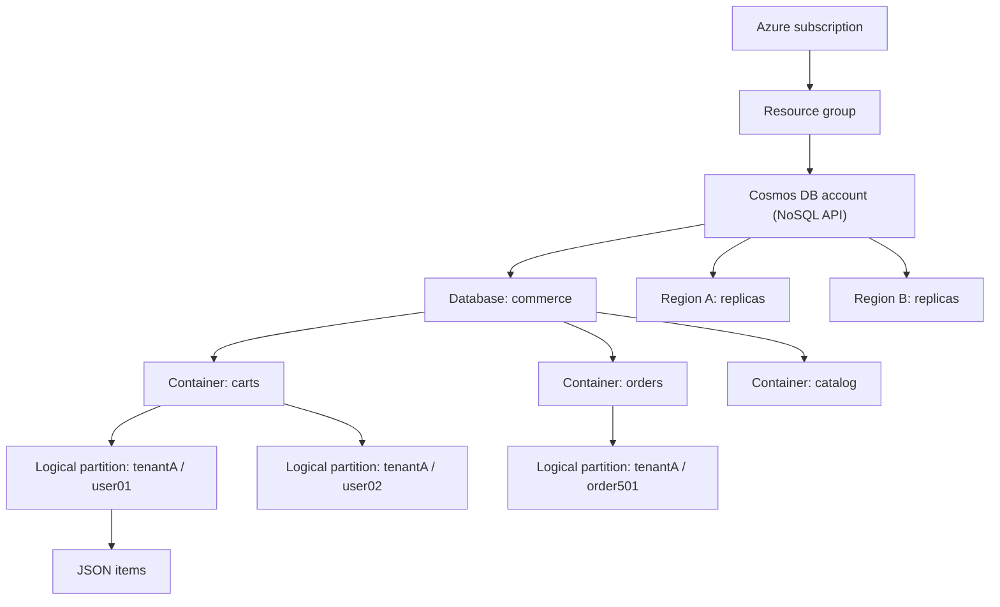
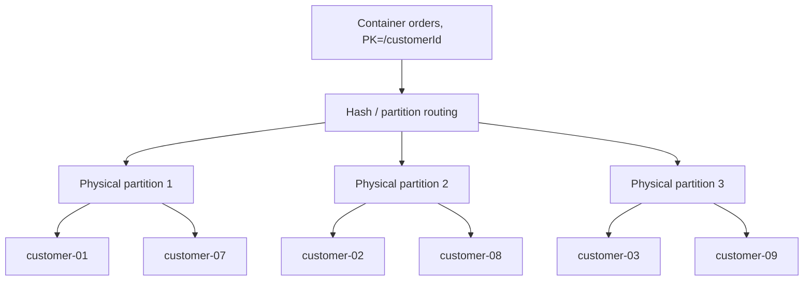
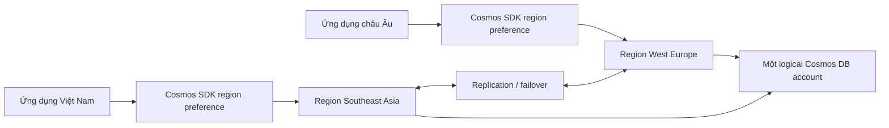
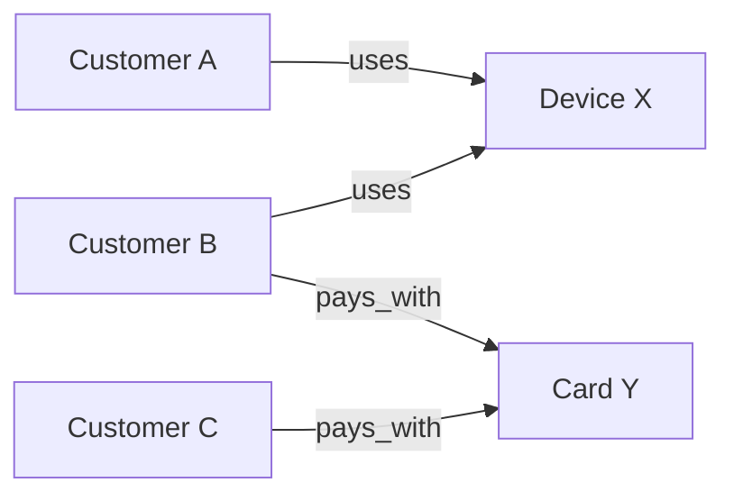
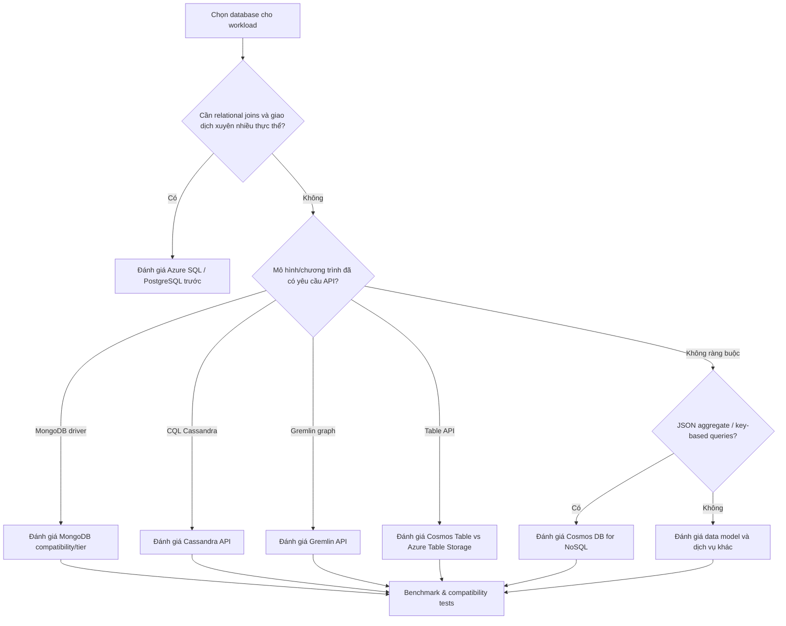
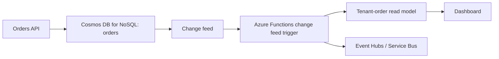
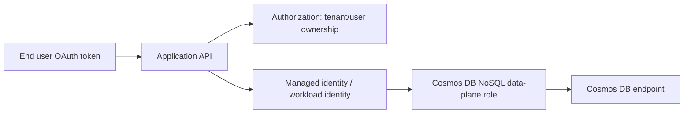
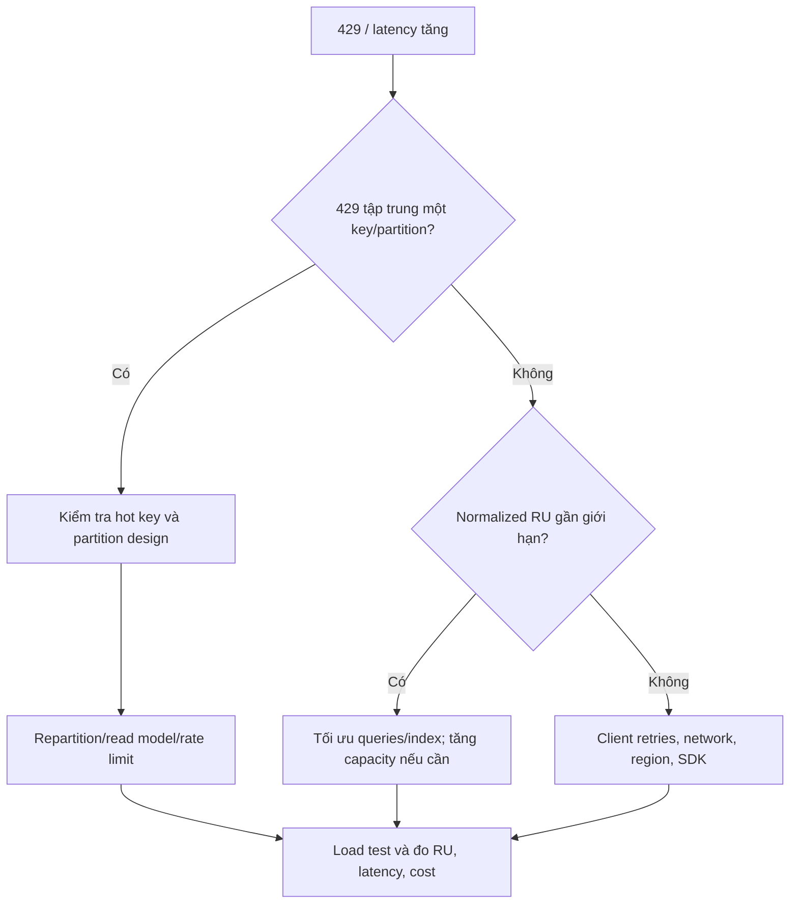
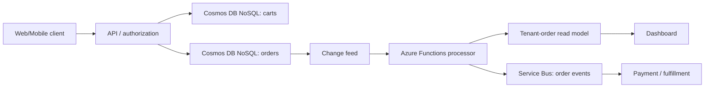

# Kiến trúc Azure Cosmos DB và lựa chọn API

Một nền tảng thương mại điện tử phục vụ khách hàng ở Việt Nam, Singapore và châu Âu cần đọc giỏ hàng với độ trễ thấp, lưu lịch sử đơn hàng, cập nhật thông tin sản phẩm và mở rộng trong các dịp khuyến mãi. Dữ liệu liên tục tăng; một bảng quan hệ tập trung có thể vẫn đáp ứng được, nhưng đội phát triển phải cân nhắc **vị trí dữ liệu, số lượng yêu cầu, mô hình truy cập, khả năng phân vùng, tính nhất quán và chi phí**. Nếu một ứng dụng khác sử dụng MongoDB driver, một hệ thống cũ sử dụng Apache Cassandra, còn kho quan hệ về mối liên hệ giữa khách hàng và sản phẩm có dạng đồ thị, việc chọn API giao tiếp cũng ảnh hưởng lớn đến kiến trúc.

**Azure Cosmos DB** là một họ dịch vụ cơ sở dữ liệu được quản lý trên Microsoft Azure, nổi bật ở khả năng phân phối dữ liệu nhiều vùng, mở rộng theo partition và nhiều giao diện truy cập dữ liệu. Với **Azure Cosmos DB for NoSQL**, dữ liệu được tổ chức thành **account → database → container → item**, truy vấn bằng ngôn ngữ truy vấn JSON theo cú pháp SQL-like, và công suất đọc/ghi thường được tính bằng **Request Units (RU)**. Các giao diện khác như **MongoDB, Apache Cassandra, Apache Gremlin và Table** phục vụ những hệ sinh thái SDK, mô hình dữ liệu và workload khác nhau.

Bài học thuộc chương **Dữ liệu NoSQL với Cosmos DB** của module `CLOUD_PROVIDERS_AZURE`. Trong lộ trình khám phá Azure từ subscription, resource group, Microsoft Entra ID tới mạng ảo, dịch vụ tính toán, lưu trữ và dữ liệu, bạn sẽ học cách **lựa chọn API và thiết kế kiến trúc Cosmos DB**, rồi kết nối những lựa chọn đó với yêu cầu triển khai, giám sát, bảo mật, tính sẵn sàng và kiểm soát chi phí.

> **Phạm vi:** Ví dụ chính sử dụng **Azure Cosmos DB for NoSQL**. Những giới hạn tài nguyên, vùng hỗ trợ, API/driver compatibility, mô hình giá và tính năng đặc biệt thay đổi theo dịch vụ và thời điểm. Các ví dụ CLI/Python dùng tên và dữ liệu giả; chỉ chạy lệnh ghi trong subscription sandbox được cấp phép. Việc chọn API ở đây dựa trên yêu cầu kỹ thuật, không mặc định Cosmos DB là lựa chọn tối ưu cho mọi ứng dụng.

## Mục tiêu học tập

Sau bài học, bạn có thể:

1. Mô tả kiến trúc **Cosmos DB account, database, container, item** và vai trò của logical/physical partitions.
2. Phân biệt **API model** với **mô hình triển khai và định giá**, đặc biệt là MongoDB-compatible RU-based và các lựa chọn MongoDB/document database khác.
3. Lựa chọn có cơ sở giữa **for NoSQL, for MongoDB, for Apache Cassandra, for Apache Gremlin và for Table** theo dữ liệu, SDK, truy vấn, migration và yêu cầu vận hành.
4. Thiết kế **partition key** dựa trên access patterns, cardinality, tính phân phối và phạm vi giao dịch.
5. Hiểu cơ chế **RU/s**, 429 throttling, manual throughput, autoscale và serverless theo khả năng hỗ trợ.
6. Giải thích **năm consistency levels**, session token, geo-replication và các đánh đổi khi multi-region writes/failover.
7. Phân biệt **point read, in-partition query, cross-partition query**, index và cách chi phí phụ thuộc kiểu truy cập.
8. Xác định ranh giới **atomic transaction**, `ETag`/optimistic concurrency, TTL và change feed.
9. Vận dụng managed identity/RBAC, private endpoint, diagnostic settings, backup/restore và kiểm soát ngân sách.
10. Thực hiện một lab tối thiểu và đọc triệu chứng vận hành để chọn lại API hoặc cải thiện thiết kế khi cần.

## 1. NoSQL không chỉ có nghĩa “không dùng SQL”

**NoSQL** là tên gọi rộng cho các cơ sở dữ liệu được thiết kế với nhiều mô hình khác nhau: document, key-value, wide-column, graph hoặc những dạng khác. Chúng thường tối ưu cho schema linh hoạt và khả năng phân tán, nhưng vẫn có thể hỗ trợ ngôn ngữ truy vấn, index, transaction và consistency.

| Mô hình | Dữ liệu | Truy vấn thường gặp | Ví dụ ứng dụng |
|---|---|---|---|
| **Document** | JSON/BSON documents | Lọc theo thuộc tính, truy cập document theo khóa | Hồ sơ khách hàng, giỏ hàng, sản phẩm |
| **Key-value** | Key và bản ghi tương ứng | Lookup theo key/partition | Cấu hình, metadata, hồ sơ đơn giản |
| **Wide-column** | Rows theo partition/clustering keys | Truy cập theo access patterns thiết kế trước | Telemetry, activity log, Cassandra workloads |
| **Graph** | Vertices, edges, properties | Traverse quan hệ nhiều bước | Fraud detection, social/recommendation relationships |
| **Relational** | Tables, rows, foreign keys | JOIN/transaction nhiều thực thể theo schema | Tài chính, sổ cái, ERP và báo cáo giao dịch |

**Azure Cosmos DB for NoSQL có ngôn ngữ truy vấn kiểu SQL**, không có nghĩa nó là Azure SQL Database hay có tất cả `JOIN`/transaction của RDBMS. Việc “có SQL syntax” không thay thế hiểu biết về **partition boundary, indexing và RU charge**.

### Khi nào nên cân nhắc Cosmos DB?

- Ứng dụng có nhiều người dùng phân bố địa lý, cần đọc/ghi với độ trễ thấp.
- Dữ liệu document phù hợp mô hình tổng hợp theo aggregate, access patterns có thể dự đoán.
- Cần tăng thông lượng theo tải mà không tự quản lý toàn bộ cluster database.
- Cần change feed, TTL, SDK đa ngôn ngữ và độ sẵn sàng theo cấu hình.
- Cần tích hợp hệ sinh thái Azure như Functions, AKS, App Service, Event Hubs hoặc Synapse/Fabric thông qua các khả năng tương thích hiện hành.

### Khi nào Cosmos DB chưa chắc phù hợp?

- Ứng dụng phụ thuộc rất nhiều vào **SQL joins** và ACID transactions xuyên nhiều bảng/khóa.
- Workload nhỏ, rất hiếm truy cập nhưng duy trì nhiều regions/năng lực dự phòng sẽ làm chi phí cao.
- Dữ liệu có một **hot key** khó tách và không có cách thay đổi mô hình nghiệp vụ.
- Cần analytical scans lớn và nhiều truy vấn ad hoc hơn là giao dịch vận hành theo partition.
- Migration yêu cầu **100% tương thích** tất cả tính năng của MongoDB/Cassandra/Gremlin/PostgreSQL mà chưa kiểm chứng.

Nên so sánh với **Azure SQL Database, Azure Database for PostgreSQL, Azure Data Explorer, Azure Table Storage, Blob Storage** hoặc những dịch vụ dữ liệu thích hợp khác trước khi chọn.

## 2. Kiến trúc tổng quan Cosmos DB for NoSQL



**Account** là ranh giới cấu hình cấp cao: API, các regions được khai báo, consistency mặc định, một số cơ chế mạng/bảo mật và billing. **Database** tổ chức collections of containers. **Container** thường là đơn vị quyết định **partition key**, indexing policy, TTL và throughput scope. **Item** là document JSON được lưu trong container.

### Ba cấp cần phân biệt

| Cấp | Thao tác chính | Điều thường không nên làm |
|---|---|---|
| **Account** | Chọn API, regions, consistency, security, backup options | Dồn mọi workload có isolation khác nhau mà không kiểm soát |
| **Database** | Gom các containers theo ứng dụng/miền, có thể là scope throughput trong một số mô hình | Coi database là logical partition |
| **Container** | Chọn partition key, indexing, TTL, throughput, logical partitions | Coi container là một bảng quan hệ có JOIN xuyên tất cả rows miễn phí |
| **Item** | JSON document với `id`, partition key và fields nghiệp vụ | Dùng một document quá lớn hoặc lồng nhiều mảng không giới hạn |

Khi tạo container, cần xác định **partition key path** theo thiết kế. Thay đổi partition key của một container đang có thường cần quy trình **tạo container mới và migrate dữ liệu** thay vì chỉ sửa một tùy chọn như đổi tên cột.

### Item JSON mẫu

```json
{
  "id": "order-2026-00501",
  "tenantId": "tenant-a",
  "customerId": "cust-19",
  "status": "Paid",
  "orderDate": "2026-11-20T09:45:00Z",
  "currency": "VND",
  "total": 1250000,
  "lines": [
    {"sku": "SKU-101", "quantity": 2, "unitPrice": 450000},
    {"sku": "SKU-204", "quantity": 1, "unitPrice": 350000}
  ]
}
```

Container `orders` có thể chọn `/tenantId` hoặc `/customerId` hoặc một khóa tổng hợp/tầng phân cấp. Không có khóa nào tốt mặc định cho mọi bài toán; lựa chọn quyết định **cách định tuyến truy vấn, khả năng phân phối tải và phạm vi giao dịch**.

### JSON không đồng nghĩa miễn schema governance

Cosmos DB for NoSQL hỗ trợ document fields linh hoạt nhưng ứng dụng vẫn nên quản lý:

- `schemaVersion`.
- Trường bắt buộc: `id`, partition key, timestamps, trạng thái.
- Định dạng tiền tệ và đơn vị đo, tránh float cho số tiền khi cần độ chính xác cao.
- Compatibility của các phiên bản SDK và consumer.
- Validation tại API/worker và quy trình migrate schema.

Một container chứa nhiều document versions không được kiểm soát có thể khó truy vấn hơn cả bảng quan hệ có schema rõ ràng.

## 3. Phân vùng là nền tảng của khả năng mở rộng

Cosmos DB tổ chức dữ liệu trong **logical partitions** và ánh xạ chúng lên **physical partitions**.

### Logical partition

Một **logical partition** chứa tất cả items có **cùng giá trị partition key** trong container. Ví dụ nếu partition key là `/tenantId`:

```text
tenant-a → order-501, order-502, order-503, ...
tenant-b → order-504, order-505, ...
tenant-c → order-506, order-507, ...
```

Mỗi logical partition có các giới hạn về dữ liệu và vận hành theo cơ chế dịch vụ. Điều đáng nhớ hơn một con số giới hạn là: **cùng một giá trị khóa quá lớn hoặc quá nóng không thể được Cosmos DB tự chia thành nhiều logical partitions mới chỉ bằng cách tăng RU/s**.

### Physical partition

Physical partition là đơn vị hạ tầng lưu trữ/công suất được dịch vụ quản lý. Nhiều logical partitions có thể nằm trên một physical partition, và Cosmos DB có thể **tự chia physical partitions** khi dữ liệu hoặc throughput tăng theo giới hạn/mô hình hỗ trợ.



Sơ đồ chỉ minh họa: Cosmos DB **không cam kết** những khóa ví dụ sẽ được ánh xạ tới physical partitions cụ thể. Đừng thiết kế ứng dụng dựa vào ID physical partition nội bộ cố định.

### Phân vùng ảnh hưởng đến điều gì?

1. **Định tuyến đọc/ghi:** request có partition key rõ thường không cần fan-out toàn container.
2. **Phân phối RU:** một giá trị key nóng có thể bị giới hạn dù tổng RU được cấp lớn.
3. **Kích thước dữ liệu:** logical partition quá lớn cần thiết kế lại khóa/hierarchical keys khi phù hợp.
4. **Giao dịch:** atomic transactional batch/stored procedure trong NoSQL API thường bị giới hạn **một logical partition**.
5. **Độ trễ truy vấn:** queries cross-partition có thể đọc nhiều partitions và tăng RU/latency.
6. **Scale:** nhiều distinct keys cân bằng hơn có thể tận dụng physical partitions tốt hơn.

## 4. Chọn partition key theo access patterns

### Quy trình suy nghĩ

Đừng chọn `/tenantId` chỉ vì ứng dụng có multi-tenant. Trước tiên hãy viết các câu hỏi:

- 70% request đọc **giỏ hàng của một user** bằng user ID?
- 20% request đọc **đơn hàng theo order ID**?
- 8% request liệt kê đơn hàng theo tenant và thời gian?
- 2% request chạy dashboard xuyên tenants?
- Tenant lớn nhất có thể tạo ra bao nhiêu GB và request/s?

Một key tốt thường có:

1. **Cardinality cao:** nhiều distinct values, tránh một hoặc vài giá trị duy nhất.
2. **Phân bố tải tương đối đều:** không có một khóa chiếm phần lớn RU.
3. **Phù hợp query filter:** nhiều request xác định được key từ đầu.
4. **Dễ duy trì khi data volume tăng:** tránh giới hạn logical partition.
5. **Có ý nghĩa với phạm vi transaction:** các items cần cập nhật atomically có cùng logical partition nếu thiết kế cho điều đó.

### So sánh các candidate keys

| Container / workload | Partition key candidate | Ưu điểm | Điểm yếu |
|---|---|---|---|
| Giỏ hàng | `/userId` | Point read/update theo user, nhiều user keys | Một user quá “nóng” có thể là hot key |
| Đơn hàng multi-tenant | `/tenantId` | Liệt kê theo tenant dễ | Tenant lớn vượt giới hạn/key hot |
| Đơn hàng | `/orderId` | Phân tán tốt, truy cập theo order ID | Liệt kê theo tenant phải cross-partition nếu không có mô hình khác |
| Telemetry | `/deviceId` | Dữ liệu của thiết bị nhóm cùng nhau | Thiết bị hoạt động lâu dài dễ tạo logical partition quá lớn |
| Sự kiện theo ngày | `/deviceDay` hoặc khóa phức hợp được thiết kế | Giới hạn tăng trưởng của một giá trị key | Truy vấn xuyên ngày có thêm bước định tuyến |
| Catalog toàn cầu | `/categoryId` | Query theo category nếu vừa kích thước | Category phổ biến dễ thành hot partition |

**Không có cách chọn “cả `/tenantId` và `/orderId`” bằng hai partition keys độc lập trên cùng một container thông thường.** Có thể thiết kế khóa tổng hợp/hierarchical partition keys khi API và môi trường hỗ trợ, hoặc tạo các read models/containers phục vụ những truy vấn khác nhau.

### Hierarchical partition keys

Azure Cosmos DB for NoSQL hỗ trợ **hierarchical partition keys** trong các cấu hình tương thích, cho phép xác định nhiều cấp khóa, ví dụ:

```text
/tenantId → /customerId → /orderId
```

Chúng có thể giúp tổ chức dữ liệu multi-tenant lớn và định tuyến queries theo **leading prefix** tốt hơn một khóa phẳng trong những tình huống được hỗ trợ. Tuy nhiên:

- Đây không phải SQL composite primary key; phải hiểu cách SDK/container khai báo nhiều key paths.
- Queries có đủ prefix phù hợp có thể hiệu quả hơn; queries chỉ biết một field không phải prefix có thể vẫn fan-out.
- Cần thiết kế kỹ phạm vi transaction/batch theo khóa phân vùng đầy đủ.
- Không phải mọi API/SDK/version đều có cùng khả năng hierarchical keys.

### Mô hình tách read model

Một ứng dụng cần đọc đơn hàng theo `orderId` rất thường xuyên và liệt kê “100 đơn gần nhất theo tenant” có thể:

- Lưu **source-of-truth orders** partition theo `orderId`.
- Tạo **tenant-order-summary** riêng, partition theo cấu trúc phù hợp tenant/date.
- Đồng bộ read model qua **change feed** hoặc luồng sự kiện có idempotency.

Đổi lại, hai representations có thể không đồng bộ tức thời; cần chấp nhận và giám sát **eventual consistency của projection**.

## 5. Point read, in-partition query và cross-partition query

Ba kiểu truy cập là trục chính của latency và RU charge.

### Point read

Lấy một item bằng **id + partition key**:

```python
# Minh họa một thao tác NoSQL SDK khi đã có container client.
order = container.read_item(
    item="order-2026-00501",
    partition_key="tenant-a"
)
```

Khi item và key đã biết, point read thường tiết kiệm RU và có độ trễ tốt hơn một truy vấn duyệt index với cùng mục đích. Tham số partition key phải **khớp cấu hình container**; nếu container dùng `/orderId` thì không thể tự truyền `tenant-a`.

### In-partition query

Lọc trong cùng logical partition:

```sql
SELECT c.id, c.status, c.total
FROM c
WHERE c.tenantId = "tenant-a"
  AND c.status = "Paid"
```

Khi SDK cung cấp chính xác partition key, request có thể giới hạn vào một logical partition. Việc một query có điều kiện `c.tenantId = ...` không tự bảo đảm SDK luôn định tuyến tối ưu trong mọi API/hình thức truy vấn; dùng query options/partition key theo SDK.

### Cross-partition query

Ví dụ hỏi tất cả đơn hàng `Paid` trên mọi tenants:

```sql
SELECT c.tenantId, c.id
FROM c
WHERE c.status = "Paid"
```

Nếu container partition theo `/tenantId` và không có filter key, query có thể cần **fan-out** qua nhiều partitions. Nó hợp lệ, nhưng có thể tăng:

- Request Units tiêu thụ.
- Latency/pagination/continuation handling.
- Tác động tới workload giao dịch nếu dùng chung throughput.

Đừng dùng cross-partition full scan cho dashboard mỗi giây nếu một projection hoặc analytical store sẽ phù hợp hơn.

## 6. Request Units: chi phí là thuộc tính của thao tác

**Request Unit (RU)** là đơn vị đo chi phí tài nguyên tổng hợp của một database operation trong Cosmos DB RU-based. Một thao tác đọc hoặc ghi có số RU khác nhau tùy kích thước item, index, loại query, consistency và những yếu tố hệ thống khác.

Ví dụ trực giác:

| Thao tác | Đặc điểm tiêu thụ RU | Khuyến nghị |
|---|---|---|
| Point read item nhỏ | Thường thấp, dễ dự đoán | Biết `id` + partition key |
| Write một document lớn | Phụ thuộc kích thước và indexing | Tránh dữ liệu thừa, kiểm soát index |
| Query theo đúng partition key | Thường hiệu quả hơn fan-out | Thiết kế access patterns trước |
| Cross-partition aggregate | Có thể tăng theo số partitions/data scanned | Read model/analytical design |
| Update một field | Có thể dùng partial document update theo API hỗ trợ | Đánh giá RU và concurrency |
| TTL expiration/delete | Có tác động lưu trữ, nền và billing theo cơ chế | Đặt TTL/retention theo yêu cầu |

**RU không phải số bytes hoặc vCPU**. Không suy “1.000 RU/s = 1.000 requests/s” nếu chưa biết mỗi request tốn bao nhiêu RU.

### Ví dụ tính thông lượng

Giả sử workload đo được:

```text
Point reads:      600 requests/s × 2 RU ≈ 1.200 RU/s
Writes:           100 requests/s × 8 RU ≈   800 RU/s
Queries:           20 requests/s × 15 RU ≈  300 RU/s
                                           -----------
Tổng tải trung bình                         2.300 RU/s
```

Đây là **ví dụ toán học** với mức RU đo giả định, không phải bảng giá/định mức đảm bảo. Nếu workload có spike gấp ba lần và truy vấn/tài liệu thay đổi, thiết kế throughput cần headroom tương ứng.

### Throttling HTTP 429

Khi vượt throughput có sẵn của partition/container/account theo cơ chế, request có thể nhận **HTTP 429 (Request rate too large)**. SDK có thể tự retry theo `Retry-After` và chính sách đã cấu hình, khiến dashboard ứng dụng vẫn thấy tỷ lệ thành công cao nhưng **latency tăng**.

Khi gặp 429:

1. Đo **Normalized RU Consumption**, RU charge và 429 distribution theo key/partition nếu có.
2. Xác định spike bình thường hay **hot partition**.
3. Kiểm tra retry policy, không tự tạo retry storm.
4. Tối ưu query/index/document size trước khi tăng RU vô giới hạn.
5. Nếu tải tăng đều, cân nhắc autoscale/manual throughput adjustment.
6. Nếu chỉ một partition nóng, thay đổi throughput tổng có thể không sửa được gốc rễ.

### RU charge có thể quan sát từ phản hồi

Với Cosmos DB for NoSQL, phản hồi của SDK/REST có thể cung cấp **request charge** hoặc diagnostics cho operation. Trong Python SDK, cách đọc charge phụ thuộc SDK/version/API; không hardcode một header access pattern mà chưa đối chiếu tài liệu/version. Đặt RU charge vào telemetry của layer dữ liệu khi cần tối ưu.

## 7. Provisioned throughput, autoscale và serverless

| Mô hình | Cách tính năng lực | Workload phù hợp | Đánh đổi |
|---|---|---|---|
| **Manual provisioned throughput** | Cấp RU/s theo mức cấu hình | Tải ổn định, dự đoán được | Trả capacity đã provision dù thời điểm nhàn rỗi |
| **Autoscale throughput** | Dịch vụ tự điều chỉnh RU/s trong phạm vi được cấu hình | Tải dao động, spike theo thời gian | Giá/cách tính theo mức autoscale và giới hạn |
| **Serverless** | Tính theo RU operations/Storage theo mô hình hỗ trợ, không phải luôn cấp RU/s cố định | Tải thưa, phát triển/thử nghiệm, traffic khó đoán nhưng phù hợp giới hạn | Có giới hạn throughput, storage, region/features theo serverless |

**Serverless không chỉ là một công tắc đổi giá trên account provisioned bất kỳ**. Các lựa chọn capacity mode, region, API và tính năng có điều kiện khi tạo account và không phải lúc nào cũng đổi trực tiếp được. Hãy xác minh compatibility trước khi chọn.

### Throughput ở database hay container?

Cosmos DB có thể hỗ trợ:

- **Dedicated throughput** cho container.
- **Shared throughput** ở database cho các containers phù hợp.

Nếu nhiều containers chia sẻ một pool RU/s, workload của một container có thể cạnh tranh năng lực với containers khác. Phù hợp khi các workloads ít tải, nhưng **một container hot** có thể làm ảnh hưởng các container dùng chung.

### Autoscale không “sửa” partition key

Ví dụ một tenant chiếm 90% số request và partition key là `/tenantId`. Tăng autoscale max RU/s có thể giúp tới một mức, nhưng logical partition đó vẫn chịu giới hạn phân phối và sử dụng công suất của physical partition tương ứng. Đừng chỉ scale up khi **điểm nóng là một partition key**.

### Ước lượng chi phí đúng

Ngoài RU/s/RU operations, cần tính:

- Số vùng địa lý được replicate và write-region configuration.
- Dung lượng dữ liệu/index và backup.
- Autoscale min/max hoặc manual provisioned hours theo billing model.
- Số lượng requests, query RU, document size.
- Private endpoints/network egress và log ingestion.
- Những tính năng bổ sung hoặc tài nguyên đi kèm như Functions/AKS/analytics.

Với nhiều regions, một cấu hình “4.000 RU/s” không đồng nghĩa hóa đơn chỉ tính một bản sao dữ liệu bất kể khu vực.

## 8. Geo-distribution: gần người dùng nhưng nhiều quyết định hơn

Azure Cosmos DB hỗ trợ triển khai **nhiều vùng Azure** theo cơ chế của API/tier được chọn. Các lựa chọn quan trọng:

- **Single-region write** với một hay nhiều read regions.
- **Multiple write regions** trong những cấu hình tương thích.
- **Automatic/manual failover**, khu vực ưu tiên và hành vi SDK.
- **Consistency level** giữa các replicas/regions.
- **Data residency**, network path, giá và quy trình xử lý xung đột.



Sơ đồ mang tính khái niệm. Việc chọn regions cụ thể phải đáp ứng availability, residency, quota và yêu cầu khách hàng; không giả định có vùng Azure tại mọi thành phố. SDK có thể điều hướng đọc/ghi theo cấu hình account và preferred regions, nhưng ứng dụng vẫn cần đánh giá lỗi mạng, chuyển vùng, retry và consistency.

### Đọc gần người dùng, ghi ở một vùng

Với ứng dụng phần lớn đọc catalog:

- Writes đi tới write region theo account configuration.
- Read replicas tại các vùng khác có thể giảm latency.
- Sự thay đổi cần thời gian replicate, tùy consistency.

Nếu ứng dụng đòi hỏi **read-your-writes** sau khi một client ghi rồi chuyển vùng, việc sử dụng **session consistency cùng session token** là chi tiết quan trọng.

### Multi-region writes và conflict resolution

Trong cấu hình nhiều vùng ghi được hỗ trợ, cùng item có thể được cập nhật gần đồng thời ở nhiều regions. Cần đánh giá **conflict resolution policy** và dữ liệu nghiệp vụ:

- Last-writer-wins dựa trên thuộc tính/chính sách có thể làm mất cập nhật nếu không có domain concurrency.
- Custom conflict resolution theo API/feature hỗ trợ cần kiểm chứng kỹ.
- Các nghiệp vụ ví tiền, đơn hàng, tồn kho không nên chỉ dựa vào “Cosmos sẽ tự chọn một bản ghi” nếu yêu cầu bất biến tài chính.
- Consistency mạnh và multi-region writes có những ràng buộc hỗ trợ; không mặc định cấu hình tùy ý mọi consistency với mọi write-region arrangement.

Đôi khi mô hình **single write region** với nghiệp vụ tài chính là quyết định có chủ ý để dễ duy trì consistency; còn đọc phân tán toàn cầu là phần riêng.

## 9. Năm mức consistency của Cosmos DB for NoSQL

| Mức | Trực giác đọc dữ liệu | Đánh đổi |
|---|---|---|
| **Strong** | Đọc quan sát phiên bản mới nhất theo semantics mạnh được hỗ trợ | Đánh đổi latency/availability và giới hạn cấu hình nhiều vùng |
| **Bounded Staleness** | Độ cũ được chặn bởi giới hạn số phiên bản hoặc thời gian theo cấu hình | Mạnh hơn các mức yếu, có overhead/giới hạn |
| **Session** | Read-your-writes, monotonic reads/writes và các bảo đảm trong một client session | Cần hiểu session token và phiên người dùng |
| **Consistent Prefix** | Thấy một tiền tố của chuỗi writes theo thứ tự, không thấy đảo thứ tự của các writes đó | Có thể chưa thấy bản mới nhất |
| **Eventual** | Replicas cuối cùng hội tụ nếu không tiếp tục ghi | Có thể tạm thấy dữ liệu cũ, thường độ linh hoạt cao |

**Không đồng nhất eventual với “không có consistency”**: nó vẫn có ngữ nghĩa hội tụ, nhưng không bảo đảm client luôn thấy write mới nhất tức thì. Ngược lại, **Strong** không tự tạo ACID transaction xuyên nhiều logical partitions.

### Session consistency: điểm giữa thường hữu ích

Một người dùng thêm sản phẩm vào giỏ rồi tải lại ngay. Ứng dụng cần đọc lại dữ liệu vừa ghi nhưng không nhất thiết yêu cầu strong consistency cho toàn thế giới. Session consistency thường hữu ích:

```text
Client ghi cart revision 12
→ nhận session token theo cơ chế SDK
→ client/session đọc lại
→ cần quan sát tiến triển phù hợp token
```

Nếu frontend dùng nhiều backend instances không duy trì/mang theo session context/token, trải nghiệm read-your-writes có thể không đúng như kỳ vọng trong một số kịch bản cross-region. Dùng Cosmos SDK và chính sách token phù hợp, kiểm thử khi failover.

### Consistency không thay partition design

Chọn Strong thay vì Session không giúp query cross-partition trở thành point read, cũng không làm hot partition tự phân tán. Consistency, indexing và partitioning là **ba quyết định khác nhau**.

## 10. Region failover, RTO/RPO và khả năng phục hồi

Một account multi-region có thể giúp duy trì hoạt động khi một region gặp sự cố, nhưng đội phát triển phải xác định:

- **RTO:** mất bao lâu để ứng dụng trở lại mức hoạt động chấp nhận được?
- **RPO:** dữ liệu có thể bị trễ/mất bao nhiêu theo mức consistency và replication/failover scenario?
- **SDK behavior:** timeout, retries, preferred regions và circuit breaker nếu có.
- **Read vs write availability:** read regions không đồng nghĩa đều là write regions.
- **Application dependencies:** App Service/AKS, Key Vault, VNet/DNS, event stream và cache có failover tương ứng không?

### Không chỉ bật thêm read region rồi xem như DR hoàn thành

Một app có Cosmos DB multi-region nhưng một Azure Function chỉ chạy tại một region vẫn có thể ngừng hoạt động khi compute region đó lỗi. Cần lập sơ đồ **toàn bộ kiến trúc**, kiểm tra failover của app, secret store, networking và những hệ thống phối hợp.

### Backup không phải replication

- **Replication** giúp availability/latency nhưng có thể replicate cả dữ liệu bị sửa/xóa nhầm.
- **Backup/PITR** phục vụ khôi phục dữ liệu theo chính sách backup mode/retention hỗ trợ.
- **Change feed** giúp phát hiện thay đổi/projection, không mặc định là backup toàn bộ lịch sử vĩnh viễn.

Chọn backup type khi tạo account và kiểm tra khả năng restore, region, retention/cost; không mặc định mọi chế độ backup có cùng tính năng.

## 11. “API” trong Cosmos DB nghĩa là gì?

**API** ở đây là **giao diện ứng dụng/giao thức và mô hình dữ liệu** mà client dùng để làm việc với cơ sở dữ liệu, không đơn thuần là URL của một REST service.

| Giao diện | Mô hình dữ liệu trọng tâm | SDK/driver/query quen thuộc | Phù hợp nhất khi |
|---|---|---|---|
| **Azure Cosmos DB for NoSQL** | JSON documents | Cosmos DB SDK, SQL-like query | Ứng dụng cloud-native cần kiểm soát RU/partition, point reads/change feed |
| **Azure Cosmos DB for MongoDB (RU-based)** | BSON/document với giao thức tương thích MongoDB | MongoDB drivers/MQL subset theo compatibility | Ứng dụng/đội ngũ đã dùng MongoDB và chấp nhận kiểm tra tương thích |
| **Azure Cosmos DB for Apache Cassandra** | Wide-column | CQL/Cassandra drivers theo compatibility | Hệ thống có data model và client Cassandra |
| **Azure Cosmos DB for Apache Gremlin** | Property graph | Gremlin traversal API/driver theo compatibility | Quan hệ nhiều bước, traversal đồ thị |
| **Azure Cosmos DB for Table** | Key-value/entities | Azure Table API/SDK | Ứng dụng dùng partition/row keys, cần mô hình bảng dạng key-value |

**Không có một API tốt cho mọi kiểu dữ liệu**. Chọn API nên đi từ **application contract, thư viện/driver, mô hình truy vấn, partitioning và requirements** chứ không phải chỉ từ việc bản ghi là JSON.

### Một Cosmos DB account chọn loại API theo mô hình resource

Thông thường, bạn chọn API khi tạo Cosmos DB account. Những APIs khác nhau có namespace/SDK/cấu trúc resource riêng. **Không thể tự đổi một account NoSQL thành account Cassandra bằng cách đổi tên endpoint** rồi kỳ vọng dữ liệu và queries giữ nguyên.

Muốn chuyển mô hình thường phải:

1. Tạo tài nguyên đích tương thích.
2. Chuyển đổi schema/document/partition keys.
3. Migrate dữ liệu với công cụ/pipeline hỗ trợ.
4. Cập nhật SDK/connection/query.
5. Kiểm tra tính đúng đắn, consistency, performance và chi phí.
6. Cutover có rollback/reconciliation.

### Chú ý về MongoDB vCore và sản phẩm document khác

Khi đánh giá hệ sinh thái MongoDB trên Azure, bạn có thể gặp **mô hình Cosmos DB for MongoDB dựa trên RU**, đồng thời gặp các dịch vụ **vCore-based MongoDB-compatible/document database** được giới thiệu hoặc đặt tên sản phẩm riêng trong từng giai đoạn. **Không coi chúng là một loại API/capacity model giống hệt nhau**: cách tính giá, execution engine, query/indexing, feature support, API versions và migration path có thể khác đáng kể.

Đối với quyết định mua sắm hoặc migration hiện tại, phải xác nhận **tên sản phẩm/tier chính xác trên Azure Portal và tài liệu phiên bản đang được hỗ trợ**, thay vì dựa vào tên “Cosmos MongoDB” chung chung. Bài học này tập trung vào **Cosmos DB for MongoDB (RU-based)** trong bảng so sánh API của Cosmos DB.

## 12. API for NoSQL: lựa chọn mặc định cho ứng dụng cloud-native mới khi phù hợp

### Mô hình dữ liệu

Ứng dụng lưu items JSON trong containers:

```json
{
  "id": "cart-19",
  "userId": "user-19",
  "tenantId": "tenant-a",
  "items": [
    {"sku": "SKU-101", "quantity": 2},
    {"sku": "SKU-204", "quantity": 1}
  ],
  "updatedAt": "2026-11-20T09:50:00Z"
}
```

Nếu container `carts` partition theo `/userId`, application có thể đọc bằng `id=cart-19` và `partition_key=user-19`, rồi cập nhật giỏ với concurrency control nếu cần.

### Điểm mạnh

- Cosmos DB SDKs và JSON model phù hợp nhiều ngôn ngữ backend.
- SQL-like query, indexing policy, point reads và partition routing.
- RU-based throughput/serverless theo mode hỗ trợ.
- Transactions trong phạm vi logical partition theo API hỗ trợ.
- Change feed để xử lý cập nhật và duy trì downstream projections.
- TTL và các tính năng cloud-native khác.
- Consistency levels, geo-distribution, backup và security theo cấu hình.

### Đánh đổi

- Không phải relational database với cross-table joins và foreign keys.
- Cross-partition queries cần tối ưu rõ ràng.
- Partition key là quyết định kiến trúc lâu dài.
- Cần đo RU charge, document size, index cost.
- Nếu nhiều document cập nhật cùng một business transaction **khác partition keys**, cần saga/idempotency hoặc thiết kế lại aggregate.

### Khi nào nên chọn?

Một ứng dụng mới viết bằng Java/Spring Boot hoặc .NET/Node/Python, có hàng triệu giỏ hàng độc lập và chủ yếu lookup bằng userId, là ứng viên tốt cho **for NoSQL**. Nhưng nếu quy tắc kế toán đòi transaction xuyên nhiều tài khoản và báo cáo SQL phức tạp, nên cân nhắc RDBMS hoặc chia rõ các service boundaries.

## 13. API for MongoDB (RU-based): tương thích driver không có nghĩa giống MongoDB hoàn toàn

### Mô hình

MongoDB dùng collections, documents kiểu BSON và các drivers/truy vấn theo hệ sinh thái MongoDB. Azure Cosmos DB for MongoDB (RU-based) cung cấp **giao diện tương thích MongoDB** trên nền tảng dữ liệu Cosmos DB, với khả năng/giới hạn phụ thuộc API version và server features được hỗ trợ.

Ví dụ một truy vấn quen thuộc trong ứng dụng MongoDB:

```javascript
db.orders.find(
  { tenantId: "tenant-a", status: "Paid" },
  { _id: 1, total: 1, orderDate: 1 }
)
```

Đoạn trên minh họa cú pháp MongoDB client, **không đảm bảo** mọi option và đặc tính của MongoDB server sẽ hành xử giống y hệt trong Cosmos DB for MongoDB. Phải chạy integration/compatibility tests với API version và indexing strategy thật.

### Chọn khi nào?

- Đội ngũ đã có MongoDB driver, schema, tools và một phần query patterns có thể chuyển được.
- Không muốn viết lại toàn bộ data access layer sang Cosmos SDK for NoSQL.
- Workload có thể đáp ứng các lệnh, index, transactions và aggregation operations mà Cosmos DB MongoDB interface hỗ trợ.
- Đã đo RU/cost/partition key với dữ liệu và query thực.

### Những điều cần kiểm chứng trước migration

| Chủ đề | Câu hỏi |
|---|---|
| **Server/API compatibility** | Driver versions, command support, MongoDB feature level nào được hỗ trợ? |
| **Query operators** | Aggregation pipeline, geospatial, text/vector search, indexes được hỗ trợ tới đâu? |
| **Transactions** | Phạm vi giao dịch và session semantics có phù hợp nghiệp vụ không? |
| **Sharding/partitioning** | Shard/partition key phải được chọn thế nào, hot keys có rủi ro không? |
| **Change streams/CDC** | Có tương đương chức năng đang dùng không, với giới hạn nào? |
| **Consistency** | Mapping giữa driver read/write semantics và Cosmos consistency ra sao? |
| **RU/cost** | Workload aggregation/index có tiêu thụ RU lớn không? |
| **Security** | Driver authentication, connection encryption, private network có phù hợp? |

**Đừng triển khai production chỉ vì `MongoClient.connect()` thành công.** Kết nối thành công chỉ kiểm tra network/auth, không chứng minh business queries, transactions, indexes và failover đúng.

## 14. API for Apache Cassandra: tối ưu cho Cassandra-oriented workloads

### Mô hình dữ liệu

Apache Cassandra sử dụng **wide-column** với **partition keys** và **clustering keys**, truy vấn bằng **CQL**. Thiết kế bảng thường xuất phát từ các truy vấn cụ thể.

Ví dụ data model hướng event:

```sql
-- Ví dụ cú pháp CQL minh họa:
CREATE TABLE device_events (
  device_id text,
  event_date date,
  event_time timestamp,
  event_id text,
  temperature double,
  PRIMARY KEY ((device_id, event_date), event_time, event_id)
);
```

Ở đây `(device_id, event_date)` là compound partition key theo mô hình CQL; các trường sau dùng sắp xếp/clustering theo quy tắc Cassandra. Cú pháp và khả năng thực thi phải được xác minh trên Cassandra API/service version hiện hành.

### Khi nào chọn Cassandra API?

- Có ứng dụng Cassandra/CQL và cần kế hoạch migration hoặc hybrid.
- Workload write-heavy với truy cập theo partition/clustering key.
- Đội ngũ đã hiểu Cassandra data modeling/denormalization.
- Muốn sử dụng dịch vụ được quản lý nhưng giữ giao diện Cassandra theo mức tương thích được xác nhận.

### Cần tránh

- Dùng CQL như SQL Server và kỳ vọng mọi JOIN/grouping ad hoc đều hoạt động.
- Giữ một partition quá lớn chỉ vì muốn đọc mọi events của một thiết bị trong mười năm.
- Coi toàn bộ driver/protocol features, LWT, materialized views, secondary indexes hoặc consistency của Apache Cassandra gốc đều giống hệt dịch vụ.

**Cassandra API tương thích một giao thức/mô hình cụ thể**. Nếu workload mới không có ràng buộc Cassandra và chủ yếu lưu document JSON, for NoSQL có thể đơn giản hơn.

## 15. API for Apache Gremlin: graph và traversal quan hệ

### Khi nào graph model hữu ích?

Một hệ thống chống gian lận muốn tìm:

```text
Customer A → dùng Device X
Customer B → dùng Device X
Customer B → thanh toán bằng Card Y
Customer C → dùng Card Y
```

Trong document database, cần thiết kế nhiều queries/joins hoặc precomputed views để lần theo quan hệ nhiều bước. Graph model biểu diễn **vertices** và **edges**, hỗ trợ traversal.



Một câu Gremlin minh họa:

```groovy
g.V().hasLabel('customer').has('customerId', 'A')
  .out('uses')
  .in('uses')
  .hasLabel('customer')
```

Ý tưởng: tìm các customer có quan hệ dùng chung device với customer A. Cú pháp phải được kiểm thử với Gremlin server/steps được Cosmos DB hỗ trợ; **không coi Gremlin API là một TinkerPop server hỗ trợ mọi step/strategy tùy ý**.

### Đánh đổi

- Traversals dài/high fan-out có thể tiêu thụ nhiều công suất và có latency lớn.
- Phải thiết kế partitioning cho graph; truy vấn xuyên partition keys có thể không rẻ.
- Không phải mọi thuật toán đồ thị chạy native trong Gremlin API.
- Index/consistency/limits khác mô hình document và API Cassandra.

**Chọn Gremlin khi câu hỏi nghiệp vụ là quan hệ/traversal**, không chỉ vì dữ liệu có hai collection Customer và Product.

## 16. API for Table: key-value/entities và Azure Table compatibility

### Mô hình

Table API làm việc với entities có các khóa như **PartitionKey** và **RowKey** cùng các properties. Một ví dụ:

```json
{
  "PartitionKey": "tenant-a",
  "RowKey": "feature-flags",
  "enabled": true,
  "updatedAt": "2026-11-20T09:55:00Z"
}
```

Một kiểu truy cập phổ biến là đọc entity bằng `PartitionKey + RowKey`, phù hợp profile lookup gần key-value.

### Cosmos DB Table API khác Azure Table Storage thế nào?

| Điểm | Cosmos DB for Table | Azure Table Storage |
|---|---|---|
| Họ dịch vụ | Cosmos DB | Azure Storage |
| Access pattern | PartitionKey + RowKey / Table SDK | PartitionKey + RowKey / Table SDK |
| Throughput/latency | Cosmos DB capacity/SLA/geo features theo mode | Azure Storage capacity/billing theo Storage |
| Consistency/regions | Các khả năng của Cosmos DB API/tier tương thích | Storage replication/consistency semantics riêng |
| Cost model | Cosmos DB RU/throughput/storage theo mode | Storage transactions/storage theo tier |
| Feature compatibility | Cần kiểm tra Table API-specific support | Cần kiểm tra Azure Table Storage-specific support |

**Tên cùng có “Table” không có nghĩa hai dịch vụ giống nhau hoàn toàn**. Nếu ứng dụng chỉ lưu ít metadata, không có yêu cầu global distribution/low latency đặc thù, Azure Table Storage có thể kinh tế hơn; phải đo thay vì đoán.

### Khi nào chọn Table API?

- Có hệ thống/SDK đang dựa vào Azure Table model và muốn tận dụng khả năng Cosmos DB được hỗ trợ.
- Truy vấn chủ yếu theo khóa, schema property linh hoạt.
- Chấp nhận các ràng buộc data model và throughput API.

Nếu ứng dụng cần truy vấn phức tạp trên JSON nested objects hoặc change feed/indexing theo mô hình for NoSQL, không nên chọn Table API chỉ vì muốn tiết kiệm công sức chọn khóa.

## 17. Bảng quyết định chọn API

| Yêu cầu chính | API/giải pháp nên đánh giá đầu tiên | Câu hỏi loại trừ |
|---|---|---|
| Ứng dụng mới, JSON items, point reads, TTL/change feed | **Cosmos DB for NoSQL** | Có cần SQL transactions/joins xuyên partition? |
| Di chuyển app đang dùng MongoDB drivers | **Cosmos DB for MongoDB (RU-based)** và các lựa chọn MongoDB-compatible khác | Có tính năng MongoDB nào không được hỗ trợ không? |
| Ứng dụng viết CQL, data model Cassandra | **Cosmos DB for Apache Cassandra** | LWT/index/driver/query compatibility ra sao? |
| Recommendation/fraud bằng graph traversals | **Cosmos DB for Apache Gremlin** | Query traversal có fan-out quá lớn hoặc bước không được hỗ trợ không? |
| Lookup entity theo partition/row key | **Cosmos DB for Table**, so với **Azure Table Storage** | Có cần SLA/global replication của Cosmos đủ để biện minh giá không? |
| ERP/ledger/SQL JOIN và ACID nhiều bảng | **Azure SQL/PostgreSQL** | Có lý do rõ để denormalize sang Cosmos không? |
| Logs/time-series analytics quy mô lớn | **Azure Data Explorer/data lake/analytics** | Đây là operational store hay analytical workload? |
| Raw file/media/document archive | **Blob Storage/Data Lake** | Có cần document database cho toàn bộ binary không? |

### Một “cây quyết định” thực dụng



### Bảy câu hỏi quyết định trước khi chọn API

1. **Data model:** document, key-value, wide-column, graph hay quan hệ?
2. **Client contract:** dự án mới hay migration? SDK/driver/query/version nào bắt buộc?
3. **Access patterns:** bao nhiêu % point read, update, range scan, JOIN/traversal?
4. **Partitioning:** khóa định tuyến là gì? hot key? multi-tenant isolation? logical partition growth?
5. **Transactional semantics:** cần atomic commit trong hay ngoài một partition?
6. **Global operations:** regions, latency, consistency, failover, backup, compliance?
7. **Economics:** RU/request, vCore/compute mode của sản phẩm cụ thể, storage, network, logs, downtime và chi phí migration?

Chỉ khi trả lời bảy câu hỏi này và chạy workload thử nghiệm mới nên chốt dịch vụ cho production.

## 18. Kiến trúc đa tenant trên Cosmos DB

### Một account chung hay nhiều accounts?

| Mô hình | Ưu điểm | Đánh đổi |
|---|---|---|
| **Một account/container dùng chung**, phân biệt tenant qua partition key | Chi phí quản trị thấp, onboarding dễ | Noisy neighbor, cần auth/tenant isolation tại ứng dụng |
| **Mỗi tenant một container** | Dễ tách chính sách index/TTL, giới hạn một số workload | Nhiều containers, overhead throughput/operations |
| **Mỗi tenant một database** | Tách quản trị theo domain/tenant | Quy mô tài nguyên, policies và shared resources |
| **Mỗi tenant một account** | Isolation mạnh hơn cho network, RBAC, regions/backup settings | Chi phí và quản trị/IaC nhiều |

**Partition key không phải security boundary.** Một credential có quyền đọc toàn container có thể truy cập dữ liệu các tenants khác; application phải kiểm tra tenantId dựa trên danh tính đăng nhập và áp dụng authorization trong mọi query/write. Với khách hàng yêu cầu isolation mạnh, account/container-per-tenant có thể phù hợp hơn.

### Noisy neighbor

Một tenant tăng traffic đột biến có thể tiêu thụ nhiều RU từ container/account shared throughput. Các biện pháp:

- Partition key phân phối tốt, hierarchical keys khi được hỗ trợ.
- Tenant-level rate limiting/quota ở API layer.
- Theo dõi RU và 429 theo tenant/key.
- Dedicated containers/accounts cho tenants lớn.
- Autoscale có headroom/budget và capacity limits rõ.

Không mặc định shared throughput bảo đảm quota công bằng riêng cho từng tenant.

## 19. Indexing: mặc định tiện lợi nhưng cần hiểu chi phí

Cosmos DB for NoSQL thường có **automatic indexing** của các thuộc tính JSON theo default indexing policy. Điều đó thuận tiện cho queries nhưng **index maintenance** có thể tăng RU của writes và chi phí lưu trữ.

### Những lựa chọn phổ biến

| Loại index/cấu hình | Mục tiêu |
|---|---|
| **Included/excluded paths** | Chỉ index các fields được truy vấn, bỏ fields payload không cần index |
| **Range indexes** | Lọc/sort theo kiểu tương thích |
| **Composite indexes** | Cải thiện queries với nhiều trường `ORDER BY` hoặc filter + sort theo tình huống hỗ trợ |
| **Spatial indexes** | Vị trí/geometry theo supported data types |
| **Các khả năng vector/full-text có điều kiện** | Dùng khi API/tier và feature hiện hành thực sự hỗ trợ |

Ví dụ query:

```sql
SELECT c.id, c.orderDate, c.total
FROM c
WHERE c.tenantId = "tenant-a"
  AND c.status = "Paid"
ORDER BY c.orderDate DESC
```

Nếu đây là query quan trọng với throughput lớn, cần xem xét **composite index** phù hợp và đo RU charge. **Không tự thêm index cho mọi tổ hợp field**; index có giá lưu trữ và write overhead.

### Indexing policy thay đổi có thể cần xây lại

Khi cập nhật indexing policy, Cosmos DB có thể cần index transformation/rebuild theo cơ chế dịch vụ, ảnh hưởng truy vấn/chi phí/monitoring. Không thay chính sách lớn trong production mà chưa có test, rollback và performance baseline.

### Mọi item không nhất thiết là một hàng analytics

Một document có mảng `lines` và nhiều properties lồng nhau; truy vấn liên quan các phần tử mảng, JOIN trong item hoặc flatten phải phân biệt với join giữa các containers. Khi cần thống kê tổng doanh thu qua hàng triệu orders, thiết kế **analytical pipeline/read model** chứ không quét operational container vô hạn.

## 20. Transaction boundaries và optimistic concurrency

### Giao dịch trong một logical partition

Trong **Cosmos DB for NoSQL**, **Transactional Batch** và một số server-side operations (ví dụ stored procedures) hỗ trợ atomic operations **trong cùng logical partition**, theo các giới hạn kích thước/thời gian được dịch vụ áp dụng.

Giả sử container `orders` có partition key `/orderId` và lưu:

```text
PK=order-501:
  item id="order-501": Order status
  item id="payment-501": Payment tracking
  item id="audit-501": Order audit metadata
```

Những items có cùng partition key có thể là ứng viên cho batch atomic được hỗ trợ. Nhưng nếu payment thực tế do ngân hàng hoặc Azure SQL riêng quản lý, transaction Cosmos DB **không tự bao trùm** ngân hàng/SQL.

### Giao dịch giữa hai logical partitions?

Ví dụ chuyển tiền từ wallet A sang wallet B ở hai partitions:

```text
Debit(wallet-A) → Credit(wallet-B)
```

Không được giả định một Cosmos DB NoSQL transactional batch có thể bảo đảm ACID xuyên các khóa partition khác nhau. Cân nhắc:

- Tái thiết kế aggregate nếu cùng một transaction có thể gom trong một partition mà không tạo hot key.
- Transactional outbox + saga/compensation.
- Một relational database cho sổ cái tài chính.
- Idempotent event processing và hệ thống reconciliation.

### Optimistic concurrency bằng `_etag`

Cosmos DB items có metadata hệ thống như `_etag`, cho phép thực hiện **conditional updates**/compare-and-swap theo điều kiện SDK/API được hỗ trợ.

Ví dụ:

```text
Client A đọc cart revision ETag=abc
Client B đọc cart revision ETag=abc
Client A cập nhật giỏ với If-Match: abc → thành công, ETag đổi xyz
Client B cập nhật với If-Match: abc → thất bại precondition
Client B đọc lại, merge thay đổi và retry có kiểm soát
```

**Không chỉ đọc rồi ghi không điều kiện** khi nhiều clients có thể sửa cùng item; last-write-wins có thể làm mất thay đổi. Conditional write cần SDK/REST option phù hợp và xử lý HTTP `412 Precondition Failed` theo logic ứng dụng.

## 21. TTL, change feed và event-driven architecture

### Time-to-live (TTL)

TTL giúp hết hạn items sau thời gian quy định khi container/item TTL được cấu hình hỗ trợ. Ví dụ:

- Giỏ hàng tạm thời hết hạn sau thời gian không sử dụng.
- Session metadata không cần giữ lâu.
- Event cache theo retention policy.

Nhưng TTL **không phải công cụ pháp lý thay thế toàn bộ retention/deletion governance**:

- Có thể tồn tại dữ liệu tương ứng ở backup, read model, event stream hoặc logs.
- Cần hiểu thời điểm TTL bắt đầu từ metadata và hành vi cập nhật item.
- Không dùng TTL để “xóa ngay tại một thời điểm tuyệt đối” nếu ứng dụng đòi bảo đảm thời gian chính xác.
- Phải kiểm tra change feed mode nếu muốn quan sát deletes/TTL expirations.

### Change feed

**Change feed** cho phép xử lý thay đổi trong một container theo cơ chế API hỗ trợ. Một architecture phổ biến:



Một container có thể dùng change feed để:

- Duy trì materialized view/read model.
- Đồng bộ dữ liệu sang search index.
- Kích hoạt workflow xử lý thay đổi.
- Tạo downstream event pipeline.

### Những giới hạn quan trọng

- Change feed **không mặc định là queue exactly-once**. Consumers phải idempotent vì có thể xử lý lại khi checkpoint/lease thay đổi.
- Chế độ change feed phổ biến **latest-version mode** có semantics khác với những chế độ **all versions and deletes** được hỗ trợ có điều kiện; không mặc định quan sát mọi lần xóa/sửa lịch sử trên mọi account.
- Thứ tự xử lý có ranh giới liên quan **logical partition**; không suy ra thứ tự toàn cục giữa mọi partition keys.
- Không lưu sensitive data vô hạn chỉ vì đã phát event.
- Nếu cần publish events đúng khi transaction DB commit, đánh giá outbox/change feed patterns cùng trạng thái business và downstream idempotency.

### Change feed và Stream Analytics khác nhau

**Change feed** phản ánh thay đổi dữ liệu trong container; **Azure Stream Analytics** tính toán trực tiếp trên event streams như Event Hubs/IoT Hub. Có thể dùng cả hai, nhưng không tự coi chúng thay thế nhau: một bên hướng đến database changes, bên kia hướng đến windowed stream processing.

## 22. Bảo mật: control plane, data plane và private networking

Một Cosmos DB account chứa hồ sơ người dùng, trạng thái đơn hàng hoặc dữ liệu vận hành cần được bảo vệ ở **nhiều lớp**.

### Azure RBAC quản lý và RBAC dữ liệu không giống nhau

| Lớp | Tác vụ | Cơ chế cần xem |
|---|---|---|
| **Management/control plane** | Tạo account, đổi regions, networking, backup, tags | Azure RBAC ở subscription/resource group/account |
| **NoSQL data plane** | Đọc/ghi items, chạy queries, đọc metadata dữ liệu | Cosmos DB for NoSQL **data-plane RBAC** hoặc credential được hỗ trợ |
| **Managed identity** | Cấp danh tính workload App Service/AKS/Functions | Microsoft Entra ID/managed identity |
| **Network access** | Cho phép luồng TCP/HTTPS tới đúng endpoint | Firewall, private endpoint, VNet/DNS |
| **Application authorization** | User A chỉ đọc cart/order thuộc mình | Claims/tenant checks và logic nghiệp vụ |

Ví dụ ứng dụng có Azure role `Contributor` trên resource group **không nên được coi là** đã có quyền query mọi dữ liệu Cosmos DB for NoSQL qua Entra ID. Với NoSQL data plane, cần vai trò như **Cosmos DB Built-in Data Reader** hoặc **Cosmos DB Built-in Data Contributor** được gán theo cơ chế scope/role assignment của Cosmos DB, nếu dùng Entra data-plane authentication.

**RBAC data plane giữa các APIs khác nhau có thể không giống nhau.** Không giả định gán một NoSQL SQL role là đủ cho MongoDB, Cassandra hoặc Table API. Mỗi connector/driver có authentication scheme và network endpoints được hỗ trợ riêng.

### Managed identity từ Azure Functions/AKS



Ứng dụng phải làm **hai bước kiểm soát khác nhau**:

1. Xác minh người gọi có quyền xem/cập nhật tài liệu nghiệp vụ cụ thể.
2. Dùng workload identity với quyền dữ liệu phù hợp để thao tác Cosmos DB.

Managed identity **không tự kiểm tra** document `tenantId` có trùng tenant của người dùng hay không. Lỗ hổng multi-tenant isolation vẫn có thể xảy ra nếu API quên filter hoặc cho client tự truyền partition key của tenant khác.

### Private endpoint

Nếu account chỉ cho phép private access:

- Cần private endpoint cho đúng **Cosmos DB account/subresource API** theo khả năng hỗ trợ.
- DNS/private DNS zone phải phân giải endpoint về private IP từ môi trường application.
- NSG/UDR/firewall/VNet peering/VPN phải cho phép route.
- Client App Service/Functions/AKS/VM cần outbound networking thích hợp.
- Cosmos DB account phải cho phép phương thức mạng đã cấu hình.
- Authentication/data-plane RBAC vẫn bắt buộc.

Với **for NoSQL**, endpoint thường có miền `documents.azure.com` và private DNS configuration tương ứng; MongoDB/Cassandra/Gremlin/Table có endpoints và private link groups khác. **Không cấu hình một private DNS zone của NoSQL API rồi tự cho rằng mọi Cosmos DB API đều đi qua nó**.

### Không dùng account key vô tội vạ

Account keys/connection strings trao quyền rộng và có rủi ro lộ qua:

- source code;
- CI variables không bảo vệ;
- request URL/logs;
- browser frontend;
- screenshot/ticket support.

Ưu tiên managed identity/Entra auth nơi API/SDK hỗ trợ. Nếu phải dùng keys, lưu trong **Azure Key Vault**, hạn chế truy cập và rotation có kiểm soát. **Không gửi account key cho frontend**; frontend nên gọi API được xác thực và kiểm soát authorization.

## 23. Monitoring: chỉ số cần có trước khi tăng RU/s

Một workload tăng latency không nhất thiết do thiếu RU. Cần quan sát từ application, SDK và Azure Monitor.

| Nhóm metric | Điều muốn biết | Triệu chứng |
|---|---|---|
| **Total Requests** | Tải read/write/query theo thời gian | Spike bất thường |
| **Total Request Units** | RU tiêu thụ thực tế | Query/write đắt hơn baseline |
| **Normalized RU Consumption** | Mức sử dụng công suất theo partition/region theo metric hỗ trợ | Chạm gần 100%, có thể gây 429 |
| **Throttled Requests (429)** | Tần suất bị giới hạn | Backoff/retries, latency tăng |
| **Server-side latency** | Thời gian xử lý tại dịch vụ | Chậm ở DB hay chậm network/client? |
| **Client-side diagnostics** | End-to-end SDK latency, retry, region, connection | Network timeout, session token, retry storm |
| **Data usage/storage** | Dữ liệu/index growth | Vượt dự toán dung lượng/key |
| **Availability/failover** | Region health và SDK failover | Lỗi truy cập/độ trễ cross-region |
| **Query metrics** | Index hit/scan, query RU, pagination | Query cross-partition hoặc thiếu index |
| **Change feed lag** | Projection có theo kịp không | Dashboard/read model stale |
| **Cost/budget** | RU/s/regions/storage/egress/logs | Vượt ngưỡng ngân sách |

Tên metric và khả năng drill-down thay đổi theo API, tier và thời điểm. Không kết luận “đã bật auto-scaling là sẽ không có 429”: **autoscale vẫn có giới hạn**, nhất là khi nóng một logical partition.

### Chỉ số cấp ứng dụng

Ngoài Azure Monitor, log cấu trúc:

```json
{
  "operation": "ReadCart",
  "container": "carts",
  "requestType": "point-read",
  "tenantAlias": "tenant-a-anonymized",
  "latencyMs": 19,
  "requestChargeRU": 2.4,
  "statusCode": 200,
  "retryCount": 0,
  "clientRegion": "Southeast Asia",
  "correlationId": "trace-lab-1001"
}
```

Đây là **telemetry tự xây dựng**, không phải output mặc định của mọi SDK. Không log partition key là PII hoặc toàn bộ JSON item; `tenantAlias` nên được pseudonymize phù hợp.

### Runbook 429 throttling



### Alert nên cấu hình

- RU consumption tiến gần capacity trong thời gian đủ dài.
- 429 rate hoặc retry latency vượt SLO.
- Một tenant/device/partition key gây tỷ trọng RU bất thường.
- Storage/index tăng vượt dự báo.
- Region availability hoặc failover có dấu hiệu bất thường.
- Backup/restore job, change feed lag hoặc projection errors.
- Chi phí tăng do autoscale, thêm regions hoặc thay query/index policy.

## 24. Troubleshooting: phân biệt lỗi ứng dụng, dữ liệu và hạ tầng

| Triệu chứng | Nguyên nhân có thể | Cách điều tra |
|---|---|---|
| HTTP 401 khi dùng Entra | Sai identity, token audience, không đủ role | Workload identity, data-plane role assignment |
| HTTP 403 | Network firewall, quyền hoặc policy khác | Account networking, RBAC, error substatus |
| Endpoint timeout | Private DNS/route/NSG, SDK mode, region | DNS/route từ ứng dụng, latency diagnostics |
| HTTP 404 với item được cho là tồn tại | Sai `id`/partition key, đã TTL/delete, vùng/token | Point read key, dữ liệu item, consistency |
| HTTP 409 Conflict | Insert document trùng `id` trong cùng partition, uniqueness policy | Kiểm tra id+PK và unique key constraints |
| HTTP 412 Precondition Failed | `_etag` đã đổi | Đọc lại, merge và retry conditional update |
| Nhiều 429 | Thiếu RU, hot key hoặc query scan | RU metrics, partition usage, query diagnostics |
| Query quá tốn RU | Cross-partition, thiếu index, đọc dữ liệu quá nhiều | Query plan/metrics, filter key, projection |
| Một tenant nóng, tenants khác bình thường | Partition key `/tenantId` tạo hot logical partition | Per-key rates, hierarchical keys hoặc tách container |
| Container lớn nhưng RU không đều | Partition/data skew và hotspot | PK cardinality, physical partition usage |
| Session read thấy dữ liệu cũ | Không cùng session token, cross-region, consistency | SDK settings, token propagation, writes |
| Kết quả sau failover không như mong đợi | Consistency, write region và RPO assumption | Region config, failover drill, application retries |
| Change feed bỏ qua deletes | Mode không bao gồm deletes | Check feed mode/account prerequisites |
| Change feed xử lý lặp | Lease/checkpoint/retry behavior | Idempotency, lease container, checkpoint |
| TTL không xóa “đúng giây” | TTL expiration semantics và asynchronous cleanup | Container/item TTL config, retention |
| MongoDB driver chạy query lỗi | Unsupported command/operator/version | API version compatibility matrix + integration test |
| Cassandra app cho kết quả khác | CQL/consistency/index semantics không tương đương | API feature compatibility, model |
| Gremlin traversal chậm | Fan-out sâu, cross-partition traversal | Traversal plan, partitioning, data model |
| Table API point read không đúng | `PartitionKey`/`RowKey` sai | Key contract, encoding/casing |
| Dữ liệu analytics làm ảnh hưởng OLTP | Cross-partition scans dùng chung RU | Read model/analytics pipeline, dedicated throughput |
| Chi phí vùng mới tăng mạnh | Data/throughput replication/billing theo regions | Cost Management và account topology |

**Không sửa một lỗi bằng cách nới toàn bộ firewall hoặc bật account keys rộng rãi.** Dùng thông tin lỗi, substatus, client diagnostics và danh tính đang được sử dụng để khoanh vùng chính xác.

## 25. Lab kiến trúc: tạo account for NoSQL và hai containers

### Mục đích

Người học xây dựng một workload rất nhỏ:

- Container `carts` với partition key `/userId`.
- Container `orders` với partition key `/orderId` hoặc một khóa phù hợp theo thiết kế đã chọn.
- Thực hiện point read và query, đo request charge.
- Thử case optimistic concurrency.
- Quan sát autoscale/manual/serverless theo account mode đã chọn.
- Ghi rõ security, networking và budget.

**Không dùng dữ liệu khách hàng thật.** Nếu môi trường không được phép tạo Azure resources, có thể làm **bài thiết kế trên giấy** và chỉ phân tích query/partition access patterns.

### Bước A — Preflight

1. Chọn subscription sandbox, region và budget.
2. Xác định Cosmos DB API **for NoSQL**, không nhầm với MongoDB/Gremlin.
3. Chọn capacity mode được region/account/API hỗ trợ (serverless, manual hoặc autoscale) theo mục tiêu lab.
4. Xác nhận quyền quản trị để tạo resource và danh tính dùng data-plane.
5. Lập kế hoạch cleanup; ghi rõ account name và resource group chỉ dành cho lab.

### Bước B — Tạo account trên Azure Portal

1. Mở **Azure Cosmos DB → Create**.
2. Chọn **Azure Cosmos DB for NoSQL**.
3. Chọn subscription/resource group, ví dụ `rg-cosmos-lab`.
4. Đặt account name duy nhất theo quy tắc Azure, ví dụ `cosmos-commerce-lab-<unique>`.
5. Chọn region, geo-replication/write region, consistency và capacity mode phù hợp.
6. Chọn backup policy và network access phù hợp chính sách.
7. Xem bảng giá/estimated cost, tags, sau đó tạo.

Mục này là **quy trình Portal**, không buộc tạo command IaC với nhiều flags dễ thay đổi theo phiên bản CLI.

### Bước C — Tạo database và containers

Trong **Data Explorer** hoặc giao diện tương đương:

| Cấp | Tên | Partition key | Mục tiêu |
|---|---|---|---|
| Database | `commerce` | — | Nhóm hai containers |
| Container | `carts` | `/userId` | Point read giỏ hàng |
| Container | `orders` | `/orderId` | Point read mỗi order |

Chọn throughput mode phù hợp account và container/database scope. Nếu account là serverless, không cố gán RU/s theo một plan provisioned mà nó không hỗ trợ. Nếu dùng shared database throughput, ghi rõ hai containers sẽ chia công suất.

### Bước D — Nhập dữ liệu mẫu

Container `carts`:

```json
{
  "id": "cart-user-19",
  "userId": "user-19",
  "tenantId": "tenant-a",
  "items": [
    {"sku": "SKU-101", "quantity": 2}
  ]
}
```

Container `orders`:

```json
{
  "id": "order-501",
  "orderId": "order-501",
  "tenantId": "tenant-a",
  "customerId": "user-19",
  "status": "Paid",
  "total": 900000
}
```

Lưu ý: nếu partition key `/orderId` được chọn, **item phải có trường `orderId`**, không chỉ có `id`. Đây là lỗi rất phổ biến khi tạo container và seed dữ liệu.

### Bước E — Point read

Trong SDK/Data Explorer, truy xuất cart bằng:

```text
Item id: cart-user-19
Partition key: user-19
```

Truy xuất order bằng:

```text
Item id: order-501
Partition key: order-501
```

So sánh với query không cung cấp partition key rồi đọc RU charge/latency. Các con số có thể khác theo SDK, account mode, indexing và cache; **không cần tự tạo hàng nghìn records chỉ để minh họa**.

### Bước F — Thử query

Container `orders`:

```sql
SELECT c.id, c.status, c.total
FROM c
WHERE c.orderId = "order-501"
```

Mục tiêu học tập là hiểu vì sao biết `id + partition key` để dùng point read thường có ưu thế hơn một query text để tìm cùng item.

### Bước G — Ghi lại thông số

```text
Account name: <tên>
API: Azure Cosmos DB for NoSQL
Capacity: serverless / provisioned / autoscale
Region(s): <danh sách>
Consistency default: <mức>
Backup mode: <mức>
Container carts PK: /userId
Container orders PK: /orderId
Point-read status/latency/RU: <đo>
Query status/latency/RU: <đo>
Data-plane identity/role: <đã xác minh>
Network path: public restricted / private
Cost estimate: <giá trị>
Security/cleanup owner: <người phụ trách>
```

### Bước H — Dọn dẹp

Khi hoàn thành:

1. Kiểm tra account/containers chỉ thuộc lab và không chứa dữ liệu dùng chung.
2. Nếu được phép, xóa tài nguyên lab theo quy trình.
3. Thu hồi role assignments/credentials tạm.
4. Kiểm tra các resources khác như private endpoints, logs, Functions vẫn tồn tại không.
5. Kiểm tra Cost Management: xóa account có thể không tự xóa mọi tài nguyên liên quan ngoài resource group.

## 26. Python SDK mẫu: identity và point read

Ví dụ dùng **Azure Cosmos DB for NoSQL**, không áp dụng trực tiếp cho MongoDB/Cassandra/Gremlin/Table SDK. Để thực hành cần:

- `azure-cosmos` và `azure-identity` phiên bản tương thích.
- Account NoSQL/database/container `commerce/carts` đã có sẵn.
- Managed identity hoặc DeveloperCredential được `DefaultAzureCredential` chọn hợp lệ.
- Cosmos DB **NoSQL data-plane role assignment** với quyền đọc/ghi phù hợp và network access.

Cài package trong **môi trường học tập**, không phải workspace module này:

```bash
python -m pip install azure-cosmos azure-identity
```

Đặt endpoint trong biến môi trường:

```bash
export COSMOS_ENDPOINT="https://<cosmos-account>.documents.azure.com:443/"
```

Script minh họa:

```python
import os

from azure.cosmos import CosmosClient
from azure.identity import DefaultAzureCredential


endpoint = os.environ["COSMOS_ENDPOINT"]
credential = DefaultAzureCredential()

client = CosmosClient(url=endpoint, credential=credential)
database = client.get_database_client("commerce")
container = database.get_container_client("carts")

# Thực hành: chỉ ghi trong Cosmos DB sandbox được phép.
cart = {
    "id": "cart-user-19",
    "userId": "user-19",
    "tenantId": "tenant-a",
    "items": [{"sku": "SKU-101", "quantity": 2}]
}

container.upsert_item(body=cart)

# Point read cần cả id và partition key value.
saved = container.read_item(
    item="cart-user-19",
    partition_key="user-19"
)
print("Cart ID:", saved["id"])
print("Number of lines:", len(saved.get("items", [])))

# Query cùng partition key, có tham số để tránh nối chuỗi tùy tiện.
query = """
SELECT c.id, c.userId
FROM c
WHERE c.userId = @userId
"""
results = list(
    container.query_items(
        query=query,
        parameters=[
            {"name": "@userId", "value": "user-19"}
        ],
        partition_key="user-19"
    )
)
print("Query item count:", len(results))
```

### Những lưu ý quan trọng

- `DefaultAzureCredential` có thể chọn nhiều credential trong chuỗi, tùy môi trường. Production nên cấu hình danh tính cụ thể, không để đăng nhập dev tràn sang môi trường prod ngoài ý muốn.
- `upsert_item` **có thể ghi đè** item cùng id+partition key. Trong app thật cần xét optimistic concurrency và business ownership; lab dùng upsert để dễ seed dữ liệu.
- SDK methods/signatures có thể thay đổi; kiểm tra thư viện đã pin version trong dự án.
- In ra `saved` nguyên bản có thể lộ thông tin cá nhân; chỉ log metadata cần thiết.
- Nếu gặp HTTP 403, kiểm tra **Cosmos DB NoSQL data-plane role**, không chỉ Azure RBAC `Contributor`.
- Nếu gặp timeout từ ứng dụng chạy trong VNet, kiểm tra private DNS/network và endpoint trước khi thay đổi quyền.

### Chuyển từ khóa tĩnh sang identity

Một đoạn code có thể được viết dạng:

```python
# Không khuyến nghị lưu account key trong source code.
from azure.cosmos import CosmosClient

# Prefer:
# client = CosmosClient(url=endpoint, credential=DefaultAzureCredential())
```

Đừng đưa key thực vào test fixtures hoặc README. Nếu ứng dụng chưa có Entra data-plane auth vì API/driver chưa hỗ trợ mô hình mong muốn, phải dùng secret store và kế hoạch rotation phù hợp thay vì hardcode.

## 27. Azure CLI: kiểm tra cấu hình mà không sửa dữ liệu

Các lệnh bên dưới **chỉ đọc** những tài nguyên đã được phép truy cập:

```bash
az login --tenant "<tenant-id>"
az account set --subscription "<subscription-id>"

az cosmosdb show \
  --resource-group "rg-cosmos-lab" \
  --name "<cosmos-account>" \
  --query "{name:name,locations:locations,consistency:consistencyPolicy.defaultConsistencyLevel,kind:kind}" \
  --output json

az cosmosdb sql database list \
  --resource-group "rg-cosmos-lab" \
  --account-name "<cosmos-account>" \
  --output table

az cosmosdb sql container list \
  --resource-group "rg-cosmos-lab" \
  --account-name "<cosmos-account>" \
  --database-name "commerce" \
  --output table
```

CLI `az cosmosdb sql ...` ở đây là **nhóm dành cho Cosmos DB for NoSQL**. Với MongoDB/Cassandra/Gremlin/Table APIs, cấu trúc lệnh/khả năng quản lý khác. Đừng dùng một câu lệnh `sql container list` rồi kết luận MongoDB account không có dữ liệu.

### Kiểm tra container partition key

```bash
az cosmosdb sql container show \
  --resource-group "rg-cosmos-lab" \
  --account-name "<cosmos-account>" \
  --database-name "commerce" \
  --name "carts" \
  --query "{id:resource.id,partitionKey:resource.partitionKey,indexingPolicy:resource.indexingPolicy}" \
  --output json
```

Đường dẫn output JSON field có thể khác theo Azure CLI/API version. Nếu projection trả `null`, kiểm tra phản hồi đầy đủ và command help; không giả định partition key bị mất. Không chạy command update/replace container chỉ để “thử”.

## 28. Case study: nền tảng thương mại điện tử đa vùng

### Bối cảnh

Một sàn thương mại điện tử có:

- 800.000 người dùng đã đăng ký, khoảng 40.000 người dùng/ngày.
- Giỏ hàng được đọc/ghi thường xuyên.
- Orders cần audit và không được tạo trùng.
- Catalog được đọc nhiều hơn ghi.
- Khách hàng ở Việt Nam và châu Âu.
- Dashboard đòi báo cáo doanh thu theo ngày và tenant.

### Thiết kế đề xuất

| Dữ liệu | Giải pháp ban đầu | Partition/access pattern |
|---|---|---|
| **Giỏ hàng** | Cosmos DB for NoSQL | `/userId`; point read/update cart |
| **Danh mục sản phẩm** | Cosmos DB for NoSQL hoặc dịch vụ quan hệ/search theo yêu cầu | Đọc theo product ID; cache/search projection |
| **Đơn hàng** | Cosmos DB for NoSQL nếu transaction boundary phù hợp, hoặc RDBMS cho giao dịch phức tạp | `/orderId`, idempotency order creation |
| **Thanh toán** | Payment service/ledger riêng có transaction kiểm soát | Không coi multi-region LWW là đủ bảo đảm tiền |
| **Báo cáo doanh thu** | Data lake/analytical pipeline/read model | Không quét operational container toàn cục mỗi vài giây |
| **Thông báo sự kiện** | Change feed → Functions/Service Bus | Idempotent projection và downstream processing |

### Luồng ứng dụng



### Những quyết định không được bỏ qua

1. Giỏ hàng theo user cần **read-your-writes**: xem xét session consistency và token behavior.
2. Sản phẩm thường có traffic không đều: tránh một category hot làm nghẽn RU.
3. Orders partition theo orderId phù hợp point read nhưng liệt kê theo tenant sẽ cần read model.
4. Payment là nghiệp vụ riêng: phải idempotent/transactional, không suy từ event delivered.
5. Nhiều regions có chi phí và consistency trade-offs; chỉ thêm read region khi có SLO/latency evidence.
6. Mỗi request phải kiểm tra tenant authorization, không tin giá trị `tenantId` do client tự gửi.
7. Query RU và client latency phải có baseline trước mùa cao điểm.

### Khi nào cần thay kiến trúc?

Nếu 90% khách chỉ ở một region, số reads nhỏ và workload cần nhiều SQL joins, Azure SQL Database có thể đơn giản, rẻ và đúng transaction hơn. Ngược lại nếu giỏ hàng có hàng trăm nghìn concurrent users tại nhiều regions và chủ yếu point read, Cosmos DB for NoSQL thường đáng để benchmark.

## 29. Case study: telemetry thiết bị IoT

### Bối cảnh

Một công ty có 30.000 cảm biến, mỗi thiết bị gửi một sự kiện mỗi 10 giây. Dữ liệu cần truy cập:

- Gần nhất của một thiết bị.
- Lịch sử 24 giờ của một thiết bị.
- Phát hiện bất thường theo thời gian.
- Báo cáo thống kê hàng tháng qua toàn bộ thiết bị.

Tốc độ sự kiện trung bình:

\[
30\,000/10 = 3\,000\ \text{events/giây}.
\]

Trong một ngày:

\[
3\,000 \times 86\,400 = 259\,200\,000\ \text{events}.
\]

Đây là số lượng **events lý thuyết** nếu không mất/nhân bản/điều chỉnh tần suất, chưa tính dung lượng document hay index.

### API nào phù hợp?

Có thể cân nhắc:

- **Cosmos DB for NoSQL:** lưu trạng thái mới nhất/device document hoặc một khoảng lịch sử ngắn, với partition/key và TTL hợp lý.
- **Cosmos DB for Apache Cassandra:** nếu hệ thống và dữ liệu vốn theo mô hình wide-column/CQL và đã đánh giá compatibility.
- **Azure Data Explorer/Time-series analytics:** cho truy vấn ad hoc nhiều tháng, aggregation theo thời gian và phân tích rất lớn.
- **Event Hubs + Azure Stream Analytics/Functions:** xử lý realtime trước khi lưu projection.
- **Blob/Data Lake:** lưu raw events với chi phí lưu trữ và retention phù hợp.

**Đừng mặc định lưu toàn bộ 259 triệu events/ngày vào một container Cosmos DB rồi chạy `SELECT *` cho báo cáo năm**. Có thể kết hợp hot operational data trong Cosmos với historical analytics trong Data Lake/ADX.

### Chọn partition key

Nếu key là `/deviceId` và thiết bị chạy liên tục nhiều năm, một logical partition có thể tăng quá lớn. Thiết kế thêm bucket thời gian như `deviceId+month` hoặc hierarchical keys hỗ trợ có thể giảm growth per key, nhưng làm thay đổi cách truy vấn 24 giờ/xuyên tháng.

### TTL

Nếu chỉ cần 7 ngày operational history, cân nhắc TTL 7 ngày trong container thích hợp và archive raw data dài hạn ở kho khác. Kiểm tra dữ liệu được giữ ở backup, logs và downstream projections theo retention policy.

## 30. Case study: migration MongoDB sang Azure

Một doanh nghiệp đang có:

```text
MongoDB application:
  12 collections
  MongoDB drivers cho Java
  Aggregation pipelines + compound indexes
  Một số multi-document transactions
  Change streams để phát event
  Độ trễ SLO p95 < 100 ms
```

### Quy trình chọn API và dịch vụ

1. Liệt kê **đúng MongoDB server version, driver version, query operators, index types** đang dùng.
2. Xác định workloads phải giữ MongoDB protocol và workloads có thể viết lại sang Cosmos DB for NoSQL.
3. So sánh **Cosmos DB for MongoDB (RU-based)** và các sản phẩm MongoDB-compatible/vCore-based đang được cung cấp thực tế.
4. Kiểm tra hỗ trợ transactions, aggregation, change streams và sharding/partition behavior trên từng lựa chọn.
5. Dùng **dữ liệu mẫu có tính đại diện** để đo latency, throughput, cost, 429/retry và correctness.
6. Thiết kế migration: initial copy, incremental sync/CDC, cutover và rollback.
7. Test failover, backup/restore, secret rotation và multi-region configuration nếu cần.
8. Chỉ chốt dịch vụ khi tương thích **tính năng và business semantics**, không chỉ test kết nối thành công.

### Những thất bại phổ biến

| Dấu hiệu | Rủi ro |
|---|---|
| Driver kết nối thành công | Chưa chứng minh mọi commands được hỗ trợ |
| Query chạy nhưng không đúng sort/collation | Sai kết quả business/hiệu năng |
| Index policy không tương đương | RU/cost/latency khác |
| Multi-document transaction vượt phạm vi hỗ trợ | Mất atomicity |
| Change stream khác kỳ vọng | Mất hoặc xử lý trùng events trong migration |
| Một shard/partition key quá nóng | Scale không cải thiện như dự toán |

Đối với hệ thống cần tương thích MongoDB hoàn toàn và mong muốn bỏ ít công sức migration nhất, có thể cần cân nhắc **managed MongoDB service** hoặc cơ sở dữ liệu tương ứng thay vì cưỡng ép chọn một API có tên “MongoDB-compatible”.

## 31. Checklist thiết kế Cosmos DB trước production

### Lựa chọn dữ liệu và API

- [ ] Workload đã được phân loại operational vs analytical.
- [ ] Đã chọn đúng API dựa trên model/SDK/query/transactions.
- [ ] Có compatibility test nếu migration từ MongoDB/Cassandra/Gremlin/Table.
- [ ] Partition key có cardinality, phân phối tải và giới hạn tăng trưởng phù hợp.
- [ ] Đã tính queries point read, in-partition, cross-partition và tỷ lệ tương ứng.
- [ ] Có chiến lược giải quyết hot partition/noisy tenant.
- [ ] Có schema version, item validation và canonical IDs.
- [ ] Có index policy phù hợp với queries quan trọng.

### Availability, consistency và transaction

- [ ] Mức consistency được chọn từ SLO/business semantics.
- [ ] Session token handling được thiết kế nếu cần read-your-writes xuyên backend instances/regions.
- [ ] Read/write regions và failover/drills đã lên kế hoạch.
- [ ] Transaction boundaries đúng logical partition; không giả định global ACID.
- [ ] ETag/conditional writes hoặc business version guards bảo vệ concurrent updates.
- [ ] Duplicate/retry/change feed handlers idempotent.
- [ ] Backup mode/restore drill và retention đáp ứng RPO/RTO.

### Security, monitoring và chi phí

- [ ] Managed identity và **NoSQL data-plane RBAC** khi hỗ trợ, scope tối thiểu.
- [ ] Frontend không có account keys; tenant authorization được thực thi tại API.
- [ ] Public/private networking, Private DNS và firewall đã được kiểm tra.
- [ ] Không log raw sensitive documents/credentials.
- [ ] RU charge, normalized RU, 429, latency, storage, change feed lag có dashboard.
- [ ] Có budgets/alerts cho throughput, regions, backup, logs, egress.
- [ ] Tải sản xuất giả lập đã được test với spikes và hot keys.
- [ ] Có plan migrate/repartition containers khi access patterns đổi.

## 32. Những hiểu nhầm phổ biến

**“NoSQL nghĩa là Cosmos DB for NoSQL không có ngôn ngữ truy vấn.”** Sai. Nó có SQL-like query cho JSON documents, với semantics khác SQL Server.

**“Cosmos DB API chỉ là một endpoint, đổi driver là đổi database.”** Sai. API chọn data model, operations, compatibility và kiến trúc resource; migration cần kế hoạch riêng.

**“Một account luôn dùng đồng thời mọi API.”** Không theo mô hình account/API thông thường. Các APIs là lựa chọn giao diện/tài nguyên có đặc tính khác nhau.

**“Cosmos MongoDB for RU và mọi dịch vụ MongoDB vCore là cùng một hệ thống.”** Sai. Cần phân biệt mô hình vận hành/giá/khả năng của từng sản phẩm cụ thể.

**“MongoDB driver connect thành công bảo đảm 100% compatibility.”** Sai. Phải kiểm chứng query operators, indexes, transactions, versions và migration semantics.

**“Có trường tenantId thì chọn partition key /tenantId luôn đúng.”** Không. Tenant lớn/hot có thể tạo bottleneck; chọn key theo data distribution và access patterns.

**“Nhiều RU/s sẽ tự chia một logical partition hot thành nhiều keys.”** Không. Tăng RU không thay thiết kế partition key.

**“Point read chỉ cần id mà không cần partition key.”** Trong NoSQL API, point read tối ưu cần **id + partition key value** đúng cấu hình.

**“Cross-partition query không được phép.”** Không đúng. Nó thường được hỗ trợ nhưng có thể tốn RU/latency; cần cân nhắc.

**“1 RU tương đương 1 request.”** Sai. Một operation có thể tốn ít hoặc nhiều RU tùy loại và dữ liệu.

**“Autoscale nghĩa là không bao giờ nhận 429.”** Sai. Vẫn có giới hạn và hot partitions.

**“Serverless chỉ là luôn rẻ hơn provisioned throughput.”** Không. Workload thường xuyên lớn có thể khác, và serverless có giới hạn riêng.

**“Mọi document JSON đều miễn phí indexing.”** Không. Index maintenance có RU/storage overhead.

**“Strong consistency đảm bảo ACID transaction giữa mọi items của account.”** Sai. Consistency và transaction scope là hai chiều khác nhau.

**“Session consistency yêu cầu luôn đọc dữ liệu mới nhất toàn cầu.”** Không. Nó có bảo đảm theo session/token, không tương đương strong globally.

**“Bật multi-region là đã có disaster recovery hoàn chỉnh.”** Không. Cần đánh giá compute, network, dependencies, failover, RPO/RTO.

**“Replication là backup.”** Sai. Các sửa/xóa nhầm có thể replicate; backup/restore là cơ chế khác.

**“Change feed bảo đảm không bao giờ lặp hoặc có đủ mọi deletes.”** Không mặc định. Mode/lease/checkpoint/idempotency có điều kiện.

**“Partition key là quyền bảo mật tenant.”** Không. Authorization phải được kiểm tra riêng ở ứng dụng/data-plane access.

**“Table API và Azure Table Storage có SLA/giá/consistency như nhau.”** Sai. Cần so sánh dịch vụ cụ thể.

**“Graph Gremlin phù hợp mọi quan hệ giữa hai document.”** Chưa chắc. Graph có lợi khi cần traversal nhiều bước; truy vấn đơn giản thường không cần graph database.

**“Cosmos DB tốt hơn relational database cho mọi workload lớn.”** Không. Transaction xuyên thực thể, JOIN phức tạp và phân tích lịch sử có thể hợp với RDBMS/analytics hơn.

**“HTTP 404 luôn nghĩa document chưa từng tồn tại.”** Không chắc. Sai partition key, TTL, xóa và trạng thái đọc/consistency cũng cần kiểm tra.

**“HTTP 429 chỉ là lỗi dịch vụ.”** Không nhất thiết. Thường phản ánh throughput/partition utilization vượt mức; SDK retries có thể giúp nhưng cần tối ưu/capacity planning.

**“Sao chép account key vào frontend sẽ giảm latency.”** Không nên. Nó cấp credential rộng, tăng rủi ro rò rỉ và vượt tenant isolation.

## 33. Câu hỏi tự kiểm tra

**Câu 1.** Phân biệt account, database, container và item trong Cosmos DB for NoSQL.

**Đáp án:** Account chứa cấu hình API/regions/consistency/network; database tổ chức containers; container chọn partition key/indexing/TTL/throughput scope; item là document JSON.

**Câu 2.** Logical partition và physical partition khác nhau thế nào?

**Đáp án:** Logical partition gồm items có cùng partition key value; physical partition là đơn vị hạ tầng được dịch vụ quản lý, chứa nhiều logical partitions và có thể split theo điều kiện.

**Câu 3.** Vì sao chọn `/tenantId` làm partition key có thể gây vấn đề?

**Đáp án:** Một tenant lớn/hot có thể tập trung dữ liệu và RU vào một logical partition; cần xét cardinality, request distribution và growth.

**Câu 4.** Muốn đọc giỏ hàng bằng API for NoSQL một cách hiệu quả, cần những giá trị nào?

**Đáp án:** `id` của item và partition key value tương ứng, ví dụ `cart-user-19` và `user-19` cho container `/userId`.

**Câu 5.** Một request đọc tốn 2 RU và một write tốn 8 RU. Với 300 reads/s và 50 writes/s, tải lý thuyết là bao nhiêu?

**Đáp án:** `300×2 + 50×8 = 1.000 RU/s`, trước spikes, queries khác và headroom.

**Câu 6.** HTTP 429 trong Cosmos DB thường gợi ý điều gì?

**Đáp án:** Throughput/partition resources bị giới hạn; xem RU, hot keys, SDK retry, capacity và query design.

**Câu 7.** Tăng RU/s có làm mất hot partition key không?

**Đáp án:** Không. Logical partition key không được tự chia thành nhiều values; cần đánh giá thiết kế khóa và mô hình truy cập.

**Câu 8.** Ba mô hình capacity thường gặp của Cosmos DB for NoSQL là gì?

**Đáp án:** Manual provisioned RU/s, autoscale throughput và serverless (khi account/API hỗ trợ).

**Câu 9.** Khi nào nên chọn for NoSQL thay vì for MongoDB?

**Đáp án:** Với ứng dụng mới cần JSON, Cosmos SDK, điểm mạnh NoSQL/RU/change feed; for MongoDB hợp khi migration/driver/query contract MongoDB cần giữ và đã xác minh compatibility.

**Câu 10.** Vì sao driver MongoDB chạy được vẫn cần kiểm thử thêm?

**Đáp án:** Kết nối chỉ xác minh auth/network; operators, aggregation, transactions, indexes, change streams và phiên bản có thể khác.

**Câu 11.** Cassandra API phù hợp loại dữ liệu và query model nào?

**Đáp án:** Wide-column data model với partition/clustering keys, CQL và workloads hoặc ứng dụng đã gắn với Cassandra ecosystem.

**Câu 12.** Gremlin API giải quyết vấn đề gì tốt hơn document đơn giản?

**Đáp án:** Traverse quan hệ graph nhiều bước giữa vertices và edges, như phát hiện nhiều tài khoản dùng cùng thiết bị/thẻ.

**Câu 13.** Table API và Azure Table Storage có phải cùng một dịch vụ không?

**Đáp án:** Không. Cùng mô hình PartitionKey/RowKey nhưng khác dịch vụ nền, cost/latency/consistency/regions/tính năng.

**Câu 14.** Năm mức consistency của Cosmos DB for NoSQL là gì?

**Đáp án:** Strong, Bounded Staleness, Session, Consistent Prefix và Eventual.

**Câu 15.** Session consistency có ích cho kịch bản nào?

**Đáp án:** Giỏ hàng đọc lại ngay sau write, cần read-your-writes/monotonic behavior trong một session, với quản lý session token đúng.

**Câu 16.** Multi-region write có cần xem xét conflict resolution không?

**Đáp án:** Có, vì cùng item có thể được ghi gần đồng thời từ nhiều regions; phải hiểu policy và bảo vệ invariants nghiệp vụ.

**Câu 17.** Transactional Batch trong NoSQL API có thể thay SQL transaction xuyên nhiều partition keys không?

**Đáp án:** Không. Phạm vi atomicity chủ yếu trong một logical partition; xuyên partition cần mô hình khác như saga/idempotency.

**Câu 18.** `_etag` dùng để làm gì?

**Đáp án:** Optimistic concurrency/conditional write, tránh ghi đè mất cập nhật khi nhiều clients sửa cùng item.

**Câu 19.** Vì sao change feed consumer phải idempotent?

**Đáp án:** Có thể replay/receive duplicate theo checkpoint/lease, và mode của feed có giới hạn về versions/deletes.

**Câu 20.** Vì sao backup không giống geo-replication?

**Đáp án:** Replication phục vụ sẵn sàng/latency và có thể sao chép xóa nhầm; backup/restore phục hồi trạng thái theo chính sách.

**Câu 21.** Khi nào nên dùng Azure SQL thay Cosmos DB for NoSQL?

**Đáp án:** Khi có nhiều relational joins/foreign keys, ACID transaction giữa nhiều entities và schema/reporting phù hợp relational model.

**Câu 22.** Một ứng dụng 95% query theo orderId nhưng báo cáo theo tenant hàng ngày. Partition key và giải pháp nào hợp lý?

**Đáp án:** Cân nhắc partition theo orderId cho operational point reads và một read model/analytics pipeline riêng cho report theo tenant; cần đo và xác minh business requirements.

**Câu 23.** Vì sao managed identity chưa đủ bảo vệ dữ liệu của nhiều tenants?

**Đáp án:** Identity workload có thể có quyền toàn container; API còn phải xác thực người dùng và kiểm tra tenant ownership của từng request.

**Câu 24.** Vì sao một query mới có thể làm chi phí tăng mạnh dù lượng request không đổi?

**Đáp án:** Query chuyển từ point read/in-partition sang cross-partition scan, thiếu index hoặc trả nhiều dữ liệu hơn, khiến RU per request tăng.

**Câu 25.** Một hệ thống IoT tạo 259,2 triệu events/ngày. Có nên luôn lưu cả lịch sử vào Cosmos DB for NoSQL không?

**Đáp án:** Không mặc định; cần cân nhắc operational hot data, TTL, Event Hubs, Data Lake và Azure Data Explorer cho analytics dài hạn.

## Tổng kết

**Azure Cosmos DB** cung cấp các mô hình cơ sở dữ liệu và giao diện truy cập nhằm phục vụ những workload cần mở rộng, phân phối dữ liệu và truy vấn với độ trễ thấp. Với **API for NoSQL**, kiến trúc cốt lõi là **account → database → container → item**, trong đó **partition key** quyết định logical partition, hiệu quả định tuyến, giới hạn giao dịch và khả năng phân phối tải; **Request Units, indexing, consistency và regions** là những chiều điều chỉnh hiệu năng/chi phí khác nhau.

Khi **lựa chọn API**, hãy bắt đầu từ **data model và ứng dụng**: for NoSQL cho JSON/point reads/cloud-native patterns; for MongoDB khi cần MongoDB driver compatibility đã được kiểm chứng; for Apache Cassandra với CQL/wide-column; for Apache Gremlin với graph traversals; for Table với key-value/PartitionKey-RowKey và yêu cầu Table API. Đừng nhầm một giao diện tương thích với việc hỗ trợ mọi tính năng của engine gốc, và đừng chọn Cosmos DB chỉ vì muốn thay mọi loại database bằng một dịch vụ duy nhất.

Một kiến trúc production hiệu quả cần **partitioning có kế hoạch, idempotent/concurrency-safe writes, consistency phù hợp, kiểm chứng multi-region failover, managed identity/data-plane RBAC, bảo vệ mạng, backup/restore, query/index observability và ngân sách**. Hãy đo dữ liệu thật bằng SDK/metrics, kiểm tra hot keys và RU charge, thử failure/replay trước khi mở rộng, rồi chọn API và capacity mode đáp ứng đúng mục tiêu nghiệp vụ thay vì dựa vào một tiêu chí riêng lẻ.
