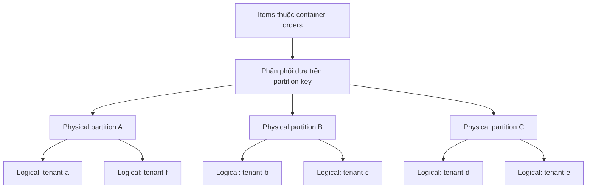
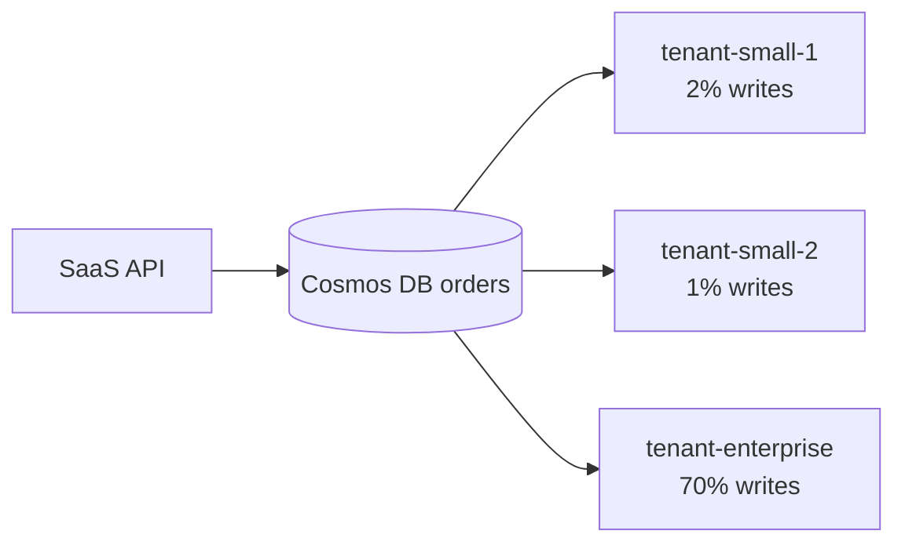
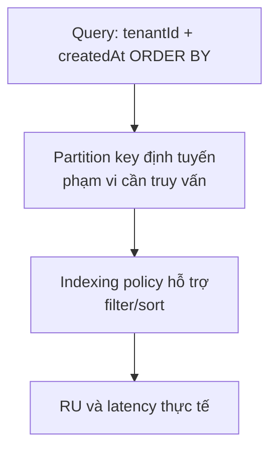
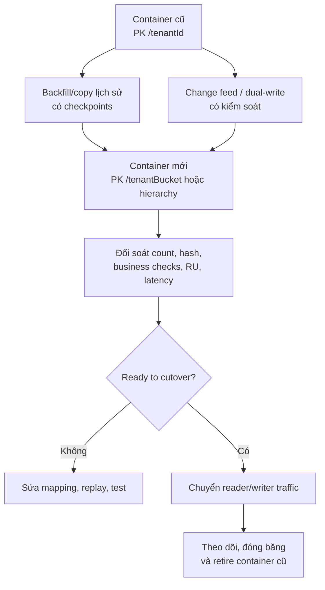

# Partition key và phân phối dữ liệu theo workload

Một hệ thống thương mại điện tử lưu hàng triệu đơn hàng trong **Azure Cosmos DB**. Người dùng thường xem một đơn hàng theo mã và doanh nghiệp, nhân viên chăm sóc khách hàng liệt kê các đơn mới của một khách hàng, còn ban điều hành cần thống kê doanh thu trên mọi doanh nghiệp. Nếu chọn **partition key** chỉ vì trường đó có sẵn trong JSON, cùng một hệ thống có thể gặp ba vấn đề: truy vấn thường xuyên phải quét nhiều partition, một khách hàng lớn chiếm phần lớn năng lực ghi, hoặc một nhóm dữ liệu tăng trưởng vượt giới hạn của một logical partition. Chọn partition key vì vậy là **quyết định kiến trúc dựa trên workload**, không phải thao tác đặt tên trường trong lúc tạo container.

Bài học thuộc chương **Dữ liệu NoSQL với Cosmos DB** trong module **CLOUD_PROVIDERS_AZURE**. Lộ trình module khám phá Microsoft Azure từ subscription, resource group và Entra ID đến mạng ảo, dịch vụ tính toán, lưu trữ và dữ liệu; đồng thời hướng dẫn triển khai, giám sát, bảo vệ và kiểm soát chi phí kiến trúc ứng dụng trên Azure. Ở chương này, partition key là yếu tố liên kết **data model**, **khả năng mở rộng**, **độ trễ**, **tính nhất quán giao dịch** và **Request Units (RU)**.

**Phạm vi:** các ví dụ tập trung vào **Azure Cosmos DB for NoSQL**, nơi container có đường dẫn partition key như `/tenantId` và truy vấn dùng Cosmos DB SQL query API. Azure Cosmos DB có các API khác như MongoDB, Cassandra, Gremlin hoặc Table với thuật ngữ/cơ chế chia shard và công cụ khác nhau; không tự suy rằng mọi câu lệnh SDK và giới hạn trong bài áp dụng nguyên xi cho các API đó.

**Sau bài học, bạn có thể:**

- Phân biệt **partition key path**, **partition key value**, **logical partition** và **physical partition**.
- Chọn khóa theo truy vấn, độ phân bố tải, tăng trưởng dữ liệu và phạm vi giao dịch.
- Phân tích vì sao **point read** cần cả `id` lẫn partition key và vì sao cross-partition query có thể tốn nhiều RU.
- Nhận diện **hot partition**, low-cardinality keys, write skew, khóa theo thời gian và noisy tenants.
- Đánh giá **synthetic partition key** và **hierarchical partition key** khi một trường đơn lẻ không đủ.
- Dùng SDK/CLI để kiểm tra partition key, đo RU charge và tối ưu quyền truy cập dữ liệu.
- Lập kế hoạch **migrating dữ liệu sang container có partition key mới** khi workload thay đổi.

## 1. Partition key là gì?

Trong Azure Cosmos DB for NoSQL, mỗi item thường có một thuộc tính `id` và giá trị cho trường được chọn làm **partition key** của container. Khi tạo container, bạn cấu hình **partition key path**, ví dụ `/tenantId`. Mỗi item lưu trong container có giá trị tương ứng tại đường dẫn đó.

Ví dụ container `orders` có partition key path `/tenantId`:

```json
{
  "id": "order-1001",
  "tenantId": "tenant-a",
  "customerId": "customer-77",
  "status": "Paid",
  "amount": 850000,
  "createdAt": "2026-11-20T09:15:00Z"
}
```

**Phân biệt hai khái niệm:**

- **Path**: `/tenantId` — được cấu hình cho container.
- **Value**: `tenant-a` — có trên item cụ thể, quyết định item thuộc logical partition nào.

Nhiều items có cùng partition key value thuộc **cùng logical partition**. Một container có thể chứa rất nhiều logical partitions, tùy số lượng giá trị khóa khác nhau.

### 1.1. `id` không tự thay thế partition key

Đối với container có `/tenantId`:

```text
(id = order-1001, partitionKey = tenant-a)  -> item A
(id = order-1001, partitionKey = tenant-b)  -> item B
```

Hai items với cùng `id` nhưng khác partition key values có thể tồn tại, do tính duy nhất của `id` được đánh giá trong phạm vi logical partition theo mô hình mặc định. Vì vậy, một `id` duy nhất **không đủ** để thực hiện point read khi SDK yêu cầu partition key.

**Quy tắc:** nếu API route là `GET /orders/{id}`, hãy xác định cách client/service tìm được **partition key value**. Đôi khi route hợp lý hơn là `GET /tenants/{tenantId}/orders/{id}`.

## 2. Logical partition và physical partition

Azure Cosmos DB dùng partitioning để phân phối dữ liệu và tài nguyên xử lý trên nhiều đơn vị vật lý.

| Khái niệm | Ý nghĩa | Ai quyết định? |
|---|---|---|
| **Partition key path** | Trường hoặc tập đường dẫn được cấu hình khi tạo container | Kiến trúc sư/nhà phát triển |
| **Partition key value** | Giá trị khóa trên item | Producer/ứng dụng |
| **Logical partition** | Tập items chia sẻ cùng partition key value | Mô hình dữ liệu ứng dụng |
| **Physical partition** | Đơn vị lưu trữ và phục vụ request do Cosmos DB quản lý | Azure Cosmos DB |
| **Throughput RU/s** | Ngân sách Request Units dùng phục vụ thao tác trên dữ liệu | Cấu hình account/database/container và dịch vụ |



Sơ đồ chỉ minh họa **một cách phân bố**, không phải quy tắc ánh xạ cố định. Cosmos DB quản lý placement, có thể thêm/chia tách physical partitions khi dữ liệu hoặc throughput tăng.

### 2.1. Một logical partition không tự bị chia nhỏ bởi physical split

Một **logical partition** tương ứng với một giá trị khóa; các item thuộc logical partition đó được đặt trên một physical partition tại một thời điểm theo mô hình partitioning cơ bản. Khi Cosmos DB split một physical partition, nó có thể phân phối **các logical partitions khác nhau** sang các physical partitions mới, nhưng **không chia một logical partition có cùng khóa** thành nhiều logical partitions chỉ để chữa một khóa quá nóng.

Hệ quả: nếu **toàn bộ 70% traffic ghi** đến khóa `tenant-giant`, việc tăng tổng RU/s hoặc số physical partitions không nhất thiết giải quyết được điểm nghẽn của **một logical partition**.

### 2.2. Giới hạn lưu trữ và throughput

Logical partition và physical partition có các **giới hạn kích thước/throughput** do dịch vụ quy định. Giá trị chính xác phụ thuộc API, tính năng (chẳng hạn hierarchical partition keys), throughput mode và thời điểm triển khai. Vì vậy:

- Phải ước lượng **dữ liệu và RU/s tối đa cho từng giá trị khóa**, không chỉ cho toàn container.
- Xem giới hạn hiện hành của Cosmos DB for NoSQL trước khi chọn một khóa có thể tăng vô hạn.
- Nếu một tenant/device có thể trở nên cực lớn, xét **phân chia thêm theo sub-key/bucket hoặc hierarchical key** từ đầu.
- Không giả định tăng container RU/s sẽ làm một logical key riêng lẻ vượt mọi giới hạn.

## 3. RU/s là gì và liên quan gì tới partition?

Azure Cosmos DB tính chi phí request bằng **Request Units (RU)**, đại diện cho tài nguyên cần thiết khi đọc, ghi, truy vấn hoặc thực thi thao tác. RU charge phụ thuộc nhiều yếu tố:

- Kích thước item và số thuộc tính.
- Point read hay query, số items và partitions phải xem xét.
- Indexing policy, filter/sort, số kết quả và tính chọn lọc.
- Consistency level, điều kiện query, serialization và các tính năng sử dụng.
- Tần suất update/upsert, TTL và những thao tác nền có chi phí theo cơ chế tương ứng.

**RU/s** là ngân sách throughput đã cấp hoặc được quản lý theo chế độ autoscale/serverless được hỗ trợ. Khi tổng request demand cao hơn năng lực được cấp hoặc dồn vào một phần hệ thống quá nóng, có thể xuất hiện **HTTP 429 / throttling** ở API/giao thức tương ứng.

### 3.1. Throughput tổng không có nghĩa mọi key đều dùng được toàn bộ

Ví dụ minh họa:

```text
Container có tổng ngân sách:     12.000 RU/s
Phân bố vật lý minh họa:         3 partitions
Khóa hot: tenant-giant          7.500 RU/s demand
Các khóa khác cộng lại:         2.000 RU/s demand
```

Dù tổng demand `9.500 RU/s` thấp hơn tổng ngân sách `12.000 RU/s`, một partition chứa `tenant-giant` vẫn có thể bị throttling nếu demand của nó vượt capacity được phân bổ ở phần vật lý đó. Đây là ví dụ để hiểu **skew và hot partition**, không mô tả thuật toán chia RU chính xác của mọi throughput/autoscale mode.

### 3.2. Indexing không thay partition key

Đánh index trên `createdAt` có thể giúp filter/sort hiệu quả hơn, nhưng không làm truy vấn không biết `tenantId` tự trở thành point read. **Partition key giúp định tuyến request**; **index giúp tìm và sắp xếp dữ liệu trong phạm vi được truy vấn**. Chọn đúng cả hai mới tối ưu tổng RU và độ trễ.

## 4. Point read, single-partition query và cross-partition query

### 4.1. Point read: truy cập chính xác một item

Với `id="order-1001"` và `tenantId="tenant-a"`, SDK có thể thực hiện **point read**:

```python
# Azure Cosmos DB for NoSQL Python SDK, minh họa.
order = container.read_item(
    item="order-1001",
    partition_key="tenant-a"
)
```

Point read thường là một trong những cách đọc có hiệu quả RU/latency tốt nhất vì cả `id` và partition key đã xác định trước. Nếu ứng dụng chỉ biết order ID, nó cần một cách **tra partition key**:

- Lưu tenantId/customerId trong route hoặc request context đã xác thực.
- Dùng ID encoding có thể xác định khóa, theo contract ổn định.
- Có bảng tra cứu/mapping phụ trợ với consistency và vòng đời được kiểm soát.
- Hoặc chấp nhận query nhiều partitions nếu không có lựa chọn khác và đã đo chi phí.

### 4.2. Query có filter partition key

Ví dụ liệt kê đơn hàng của một tenant:

```sql
SELECT c.id, c.customerId, c.status, c.amount
FROM c
WHERE c.tenantId = @tenantId
  AND c.status = @status
```

Nếu query được gửi với partition key value tương ứng, Cosmos DB có thể định tuyến đến logical partition cần thiết theo khả năng SDK/API. Mức RU còn tùy số lượng items, index và kết quả.

### 4.3. Cross-partition query

Ví dụ tổng hợp tất cả đơn đã thanh toán trong mọi tenant:

```sql
SELECT VALUE SUM(c.amount)
FROM c
WHERE c.status = "Paid"
```

Query không giới hạn `tenantId` có thể cần xem xét nhiều logical/physical partitions. Chi phí tăng theo lượng dữ liệu và cách query được thực thi; không thể nói mọi cross-partition query đều tệ, nhưng nếu nó là đường nóng phục vụ mỗi HTTP request, **có thể sai về thiết kế partition**.

Khi nhu cầu thống kê global lớn và lặp lại, cân nhắc:

- Duy trì **materialized views/aggregate containers** bằng change feed hoặc pipeline phù hợp.
- Dùng hệ analytics/ETL chuyên dụng thay vì quét operational container liên tục.
- Chạy batch báo cáo ngoài giờ cao điểm nếu SLA cho phép.
- Chỉ lưu những thuộc tính/index cần thiết để giảm RU.

### 4.4. Câu hỏi quyết định trước khi chọn khóa

Hãy ước tính ít nhất:

1. Bao nhiêu phần trăm request là **point read**?
2. Bao nhiêu phần trăm query lọc theo tenant, user, order, device hoặc thời gian?
3. Một nghiệp vụ cần cập nhật nhiều items **trong cùng transaction** không?
4. Giá trị khóa nào có thể lớn hoặc nóng hơn trung bình nhiều lần?
5. Có cần tổng hợp across tenants/regions không?

Nếu 80% traffic là `GET order by tenantId + id`, `/tenantId` đáng cân nhắc. Nếu 70% traffic là `GET event by deviceId` nhưng một vài devices cực nóng, `/deviceId` cần được stress test trước khi quyết định.

## 5. Bốn tiêu chí chọn partition key

Không có partition key tốt cho mọi workload. Một thiết kế cần cân bằng ít nhất bốn tiêu chí:

| Tiêu chí | Câu hỏi đánh giá | Kết quả mong muốn |
|---|---|---|
| **Query affinity** | Request thường biết giá trị khóa không? | Point reads/single-partition queries cao |
| **Cardinality** | Có nhiều giá trị khóa khác nhau không? | Đủ đa dạng để phân phối dữ liệu |
| **Even distribution** | Data size và write/read RU có bị một vài khóa chi phối? | Tránh hot logical partitions |
| **Transaction boundary** | Items cần transaction có cùng khóa không? | Đặt cùng logical partition khi cần atomicity |

Thêm hai ràng buộc dài hạn:

- **Stable value:** giá trị khóa không đổi theo vòng đời item.
- **Growth headroom:** mỗi khóa còn đủ dư địa cho số lượng item và tốc độ lớn nhất dự kiến.

### 5.1. Cardinality cao chưa chắc phân bố đều

Một hệ có một triệu tenant IDs nhưng tenant lớn nhất chiếm 65% write RU vẫn có thể hot. Đừng chỉ đếm số partition key values; cần xem **phân bố traffic theo giá trị khóa** ở p50/p95/p99 và các heavy hitters.

### 5.2. Stable value không có nghĩa ít giá trị

`status` có thể đổi từ `Pending` sang `Paid`, khiến nó là khóa tồi cho một item phải đổi trạng thái. `tenantId` thường ổn định; `orderId` có cardinality cao và ổn định nhưng khó liệt kê mọi đơn của tenant nếu đó là truy vấn chính.

### 5.3. Quyền truy cập không thay thế partition design

Một app sử dụng managed identity và Cosmos DB data-plane RBAC đúng cách vẫn có thể phát sinh RU cao nếu query fan-out. Ngược lại, partition key tốt không bảo vệ dữ liệu tenant A khỏi tenant B: **authentication, authorization và tenant filtering** vẫn phải thực hiện độc lập.

## 6. Những partition key thường gặp và rủi ro

| Candidate | Ưu điểm | Nhược điểm/rủi ro |
|---|---|---|
| `/tenantId` | Dễ query theo tenant, thuận tiện isolation logic và transactions trong tenant | Tenant lớn hoặc noisy tenant có thể hot/grow lớn |
| `/customerId` | Phù hợp hồ sơ/giỏ hàng theo khách hàng | Customer có lượng giao dịch rất lớn; tổng hợp tenant cần fan-out |
| `/orderId` | Cardinality cao, item của một order co-located | Liệt kê đơn theo customer/tenant cần secondary view/query |
| `/deviceId` | Hữu ích cho telemetry theo thiết bị | Một thiết bị gây lưu lượng lớn hoặc query theo thời gian rộng |
| `/region` | Đơn giản khi phân vùng nghiệp vụ theo vùng | Số values ít, dễ phân bố lệch và quá lớn |
| `/status` | Query theo trạng thái dễ hình dung | Cardinality thấp, giá trị thay đổi và hot tại `Pending` |
| `/date` | Phù hợp batch dữ liệu theo ngày về mặt tổ chức | Ngày hiện tại nhận gần mọi writes, hot key; query nhiều ngày fan-out |
| `/id` | Rất nhiều giá trị, point read biết ID | Một user/tenant/order trải nhiều partitions, không transaction cùng nhóm |
| **Synthetic key** | Chủ động tạo thêm buckets, phân bố write | Phức tạp routing/reassembly; mất co-location theo khóa gốc |
| **Hierarchical key** | Cho phép nhóm theo nhiều cấp và định tuyến theo prefix | Cần thiết kế theo query patterns và hỗ trợ SDK/API |

**Không chọn `/status` chỉ vì 70% query có `WHERE status='Pending'`.** Phần lớn writes tập trung vào vài giá trị và còn phải di chuyển item khi status thay đổi — hai dấu hiệu không phù hợp.

## 7. Transactional boundary: khi nào cần co-location?

Trong Azure Cosmos DB for NoSQL, các cơ chế như **transactional batch** và stored procedures hoạt động trong phạm vi **một logical partition**. Điều đó có nghĩa:

- Nếu một nghiệp vụ cần atomic update nhiều items, chúng phải ở **cùng giá trị partition key** để dùng những cơ chế giao dịch này.
- Hai items khác partition key values không mặc nhiên có **một ACID transaction xuyên partitions** bằng transactional batch.
- Nếu cần workflow đa partition, phải thiết kế **saga, compensating actions, outbox/change feed, idempotency hoặc lựa chọn database** tương ứng.

### 7.1. Ví dụ giỏ hàng

```text
logical partition /cartId = cart-42
  item: cart-summary
  item: cart-line-1
  item: cart-line-2
```

Nếu workflow cần thay một cart line và cập nhật tổng giỏ hàng trong cùng transaction, `/cartId` có lợi vì các items liên quan co-located.

Nhưng nếu một container chứa nhiều loại entities với kích thước/tải khác nhau, việc đặt tất cả vào một partition theo `tenantId` chỉ để “dễ dùng transaction” có thể tạo logical partition cực lớn. Cần cân bằng giới hạn kích thước, throughput và mô hình transaction.

### 7.2. Item identity + partition key trong transaction

Trong một container `/cartId`, hai items:

```json
{
  "id": "line-001",
  "cartId": "cart-42",
  "productId": "sku-7",
  "quantity": 2
}
```

```json
{
  "id": "summary",
  "cartId": "cart-42",
  "totalItems": 2
}
```

Có thể thuộc cùng transactional boundary. Nếu `cartId` khác nhau, transactional batch không tự bao phủ chúng.

### 7.3. Change feed không tự cho thứ tự toàn container

Change feed là cơ chế hữu ích để cập nhật materialized views hoặc xử lý thay đổi. Tuy nhiên, không coi thứ tự đọc event ở **mọi logical partitions** là một chuỗi global ổn định. Nếu workflow cần thứ tự nghiêm ngặt theo order/customer, phải xem **khóa và mô hình consumer** để các sự kiện có liên quan được xử lý an toàn; mỗi downstream processor vẫn cần idempotency.

## 8. Workload-first: lập ma trận truy vấn và tải

Trước khi tạo container, lập bảng cho top request paths:

| Request | Tỷ trọng ví dụ | Cần dữ liệu nào? | Partition candidate |
|---|---:|---|---|
| GET order by ID within tenant | 45% | `tenantId + id` | `/tenantId` |
| List latest orders of customer | 25% | `tenantId + customerId` | `/tenantId` hoặc key nhiều cấp |
| Update order status | 18% | Một order, trạng thái thay đổi | Key ổn định theo tenant/order |
| Monthly reporting across tenants | 10% | Tập hợp toàn tổ chức | Aggregate/analytics sink |
| Admin search across accounts | 2% | Search đa tenant | Search index/view phụ trợ |

Tỷ trọng này **giả định để minh họa phương pháp**, không phải số liệu thực tế của Azure. Trong production, đo logs/APM và tính p95/p99, byte size, query fan-out, write RU, key growth.

### 8.1. Chấm điểm candidates

Có thể chấm theo thang 1–5 cho các tiêu chí:

| Candidate | Query affinity | Load distribution | Transaction fit | Growth headroom |
|---|---:|---:|---:|---:|
| `/tenantId` | 5 | 2–4 tùy tenant skew | 4 | 2–4 |
| `/orderId` | 2–3 | 5 | 5 nếu mỗi order là một aggregate | 5 |
| `/customerId` | 4 với customer queries | 3–5 | 4 | 3–5 |
| `/status` | 2–3 | 1 | 1 | 1 |

**Điểm là heuristic**, không thay thế load test. Nên đặt trọng số theo nghiệp vụ: truy vấn p99 latency thấp của checkout có thể quan trọng hơn một báo cáo monthly chạy 30 phút.

### 8.2. Thiết kế cho tăng trưởng, không chỉ ngày đầu

Ước tính:

- Số tenants/users/devices ở thời điểm 1 năm và 3 năm.
- Số items tối đa của một **tenant lớn nhất**, không chỉ trung bình.
- Tốc độ writes và reads lớn nhất của một key trong peak.
- Xu hướng kích thước item và retention/TTL.
- Số concurrent requests đến một key và tỷ lệ cross-partition queries.
- Dữ liệu cần giữ chung để transaction.

Một key hoạt động tốt trên 1.000 items mẫu có thể gây vấn đề khi một tenant tăng lên hàng chục triệu items.

## 9. Case study 1: SaaS đa tenant, tenant lớn lấn át tenant nhỏ

**Bối cảnh:** một SaaS kế toán có nhiều doanh nghiệp nhỏ và vài khách hàng rất lớn. Ứng dụng thường đọc dữ liệu theo tenant.

**Phương án đầu tiên:** `/tenantId`.



Về query locality, `/tenantId` tốt: phần lớn requests biết tenant. Nhưng `tenant-enterprise` có thể vượt giới hạn thực tế của logical partition hoặc làm phần physical partition chứa nó quá nóng.

### 9.1. Các lựa chọn

1. **Giữ `/tenantId`** nếu load test cho thấy mỗi tenant vẫn trong ngưỡng, ưu tiên đơn giản.
2. **Hierarchical key** như `/tenantId`, `/customerId`, `/orderId` khi workload phù hợp và cần chia sâu các tenant lớn.
3. **Synthetic bucket** như `tenantId + bucket` để chia writes, với routing/reassembly có chủ đích.
4. **Tách tenant lớn** sang container/account riêng khi cần isolation mạnh về capacity, cost hoặc compliance.

Không chỉ tăng RU/s vô hạn rồi giả định một key đang nóng sẽ tự được chia thành nhiều logical partitions.

### 9.2. Noisy neighbor và fairness

Khi nhiều tenants chia container throughput, một tenant có traffic đột biến có thể ảnh hưởng các tenants khác tùy partition placement và workload. Ngoài partition key, cần:

- Rate limiting theo tenant tại API.
- Autoscale hoặc throughput provisioning phù hợp.
- SLO/metrics per tenant, không chỉ tổng RU/s.
- Capacity isolation (container/account riêng) cho tenant có cam kết SLA đặc biệt.
- Chargeback/showback theo tenant trên metrics ứng dụng.

**Partition key không phải security boundary.** API phải xác thực tenant, chỉ truy vấn tenant được phép và áp data-plane RBAC/thực thi authorization theo model ứng dụng.

## 10. Case study 2: IoT telemetry, write-heavy và time series

**Bối cảnh:** một nền tảng nhận dữ liệu từ nhiều thiết bị. Các thiết bị gửi telemetry mỗi vài giây, nhưng một số thiết bị công nghiệp gửi hàng nghìn events trong một khoảng ngắn. Query chủ yếu:

- Xem dữ liệu 15 phút gần nhất của một device.
- Tính cảnh báo theo device.
- Tính tổng theo nhà máy/ngày và dashboard fleet.

### 10.1. `/deviceId` và giới hạn

`/deviceId` có query affinity tốt, nhưng nếu một device gửi quá nhiều hoặc dữ liệu giữ rất lâu, logical partition theo device có thể quá lớn/nóng.

### 10.2. `/date` là khóa nguy hiểm cho hot writes

Nếu toàn hệ ghi vào cùng `date = "2026-11-20"`, gần như mọi writes của ngày đó thuộc cùng logical partition. Ngày mới tạo key mới nhưng không làm tải hôm nay phân bố đều. Đây là ví dụ **low effective cardinality theo thời gian hiện tại** dù về dài hạn có nhiều ngày.

### 10.3. Một thiết kế cân nhắc

```text
partition key candidate: /deviceBucket
deviceBucket = deviceId + "#" + yyyyMM

id = <eventId>
deviceId = <device-id>
eventTime = <timestamp UTC>
```

Thiết kế này cho logical partitions theo **thiết bị + tháng**, giảm tăng trưởng không giới hạn của mỗi device. Nhưng một device quá nóng trong tháng đó vẫn là một hot key; cần đánh giá thêm bucket/hash theo event hoặc hierarchical key khi cần.

Nếu truy vấn 15 phút thường biết deviceId và tháng, query có thể định tuyến; nếu cần toàn lịch sử của device, phải truy vấn nhiều buckets. Có trade-off rõ giữa **growth headroom** và **query locality**.

### 10.4. TTL và analytics

Telemetry thường phù hợp với TTL để tự hết hạn dữ liệu operational sau thời gian giữ cần thiết. Tuy nhiên:

- TTL không thay thế partition design.
- TTL deletion và write amplification có thể ảnh hưởng RU/cost tùy throughput mode.
- Dashboard fleet nên đọc từ **aggregates/analytics sink** khi dữ liệu lớn.
- Nếu cần lưu lâu cho compliance, hãy đánh giá một kho lưu trữ/analytics khác thay vì giữ mọi raw event trên operational Cosmos container với RU cao.

## 11. Case study 3: đơn hàng cần transaction theo order

**Bối cảnh:** một order có header, lines, discounts và trạng thái. Các bước cập nhật thường tác động nhiều items của **cùng order**.

Candidate `/orderId`:

```text
Logical partition order-1001:
  header
  line-001
  line-002
  discount-01

Logical partition order-1002:
  header
  line-001
  line-002
```

Ưu điểm:

- Items của một order co-located.
- Có thể sử dụng transactional batch trong phạm vi cùng order theo khả năng SDK.
- Key có cardinality cao và tăng theo số đơn.

Nhược điểm:

- Danh sách toàn bộ orders của customer sẽ phải query qua nhiều orderId partitions nếu chỉ có container này.
- Truy vấn `tenantId + createdAt` không có partition key đầy đủ.

### 11.1. Đọc model theo truy vấn

Có thể **đặt order documents và order lines trong cùng một item** nếu kích thước/atomicity cho phép, thay vì tạo nhiều items:

```json
{
  "id": "order-1001",
  "orderId": "order-1001",
  "tenantId": "tenant-a",
  "customerId": "customer-77",
  "lines": [
    {"sku": "sku-1", "qty": 2},
    {"sku": "sku-2", "qty": 1}
  ],
  "status": "Paid"
}
```

Một item với nested lines được cập nhật atomically ở mức item, nhưng phải cân nhắc **item size, write amplification, concurrency và tần suất sửa từng line**. Khi order cực lớn hoặc lines được truy cập độc lập, mô hình multi-item co-located có thể phù hợp hơn.

### 11.2. Materialized read model

Nếu yêu cầu chính là “liệt kê 20 đơn mới nhất của customer”, có thể duy trì **customer-order summaries** trong container read model partitioned theo `/customerId`, được cập nhật qua change feed/outbox.

Điều này chấp nhận một phần **data duplication** có kiểm soát để giảm RU/query latency. Cần xác định event propagation delay, eventual consistency và cơ chế sửa khi read model trễ.

## 12. Synthetic partition key (khóa tổng hợp)

**Synthetic key** là giá trị ứng dụng tính từ nhiều trường hoặc một trường cộng bucket, lưu thành **một thuộc tính** dùng làm partition key.

Ví dụ:

```text
tenantBucket = tenantId + "#" + bucketNumber
bucketNumber = hash(orderId) mod 16

tenant-a#0
tenant-a#1
...
tenant-a#15
```

Hệ thống phân phối items của tenant lớn qua tối đa 16 giá trị khóa. Số 16 chỉ là **tham số minh họa**, không phải khuyến nghị mặc định.

### 12.1. Ưu điểm

- Chia bớt writes của một tenant quá nóng nếu hash phân bố tương đối đều.
- Có thể tăng headroom của mỗi logical partition.
- Nếu biết `tenantId` và `orderId`, ứng dụng tính được bucket để **point read**.

### 12.2. Đánh đổi

- Query “tất cả orders của tenant” phải quét các buckets hoặc dùng read model.
- Transactions chỉ atomic trong cùng **tenantBucket**, không còn co-location toàn tenant.
- Nếu sau này đổi bucket count hoặc hash algorithm, routing có thể sai và cần migration/versioning.
- Nếu một entity quá nóng và tất cả writes mang cùng `orderId`, hash theo `orderId` vẫn đưa traffic của entity đó vào **một bucket**.

### 12.3. Hash phải ổn định

Không dùng `hash()` mặc định của ngôn ngữ nếu implementation có randomization giữa process/restart làm giá trị khác nhau. Dùng **thuật toán ổn định** (ví dụ SHA-256, chọn bytes và modulo theo spec) và viết test tương thích giữa các services.

Ví dụ Python minh họa:

```python
import hashlib


def stable_bucket(order_id: str, bucket_count: int = 16) -> int:
    if bucket_count <= 0:
        raise ValueError("bucket_count must be positive")
    digest = hashlib.sha256(order_id.encode("utf-8")).digest()
    number = int.from_bytes(digest[:8], byteorder="big")
    return number % bucket_count


def tenant_partition_key(tenant_id: str, order_id: str) -> str:
    return f"{tenant_id}#{stable_bucket(order_id)}"


print(tenant_partition_key("tenant-a", "order-1001"))
```

Trong production còn cần xử lý encoding, dấu phân cách trong tenant ID, version hash, mapping key cho các dịch vụ khác nhau và bảo vệ input. Đổi `bucket_count` với dữ liệu đã lưu không tự di chuyển item cũ; cân nhắc versioned key hoặc migration rõ ràng.

## 13. Hierarchical partition keys (khóa phân cấp)

Azure Cosmos DB for NoSQL hỗ trợ **hierarchical partition keys** ở những loại tài nguyên/tính năng được hỗ trợ. Thay vì một synthetic string, container có thể định nghĩa **nhiều đường dẫn cấp bậc**, ví dụ:

```text
Level 1: /tenantId
Level 2: /customerId
Level 3: /orderId
```

Một logical partition leaf được xác định bởi **tổ hợp giá trị của các cấp**. Cách này hỗ trợ phân phối dữ liệu của tenant lớn sang nhiều tổ hợp khóa hơn, đồng thời giúp queries theo **prefix hierarchy** có khả năng được định tuyến hiệu quả hơn so với fan-out không có thông tin khóa.

### 13.1. Khi nào hierarchical key hữu ích?

- Mô hình SaaS nhiều tenant, mỗi tenant có nhiều users/orders.
- Queries phổ biến biết `tenantId`, đôi khi biết thêm `customerId` hoặc `orderId`.
- Muốn tránh một logical partition duy nhất chứa toàn bộ tenant lớn.
- Có yêu cầu gom theo cấp và phân phối tải theo các cấp sâu hơn.

### 13.2. Giới hạn cần hiểu

- **Prefix query không nhất thiết chỉ chạm một logical partition**: `tenantId` có thể bao nhiều `customerId/orderId` combinations.
- Một giá trị ở cấp cuối cùng vẫn có thể nóng; hierarchical key không tự giải quyết write skew của một entity duy nhất.
- Point read/transaction cần cung cấp **đúng các thành phần partition key** theo API/SDK.
- Tính năng và định dạng SDK/version được hỗ trợ phải được xác minh trước khi viết code.
- Thứ tự các cấp **quan trọng**: keys `tenantId → customerId → orderId` khác `orderId → tenantId → customerId` về query routing.

### 13.3. So sánh synthetic và hierarchical

| Tiêu chí | Synthetic key | Hierarchical key |
|---|---|---|
| Biểu diễn trong item | Một trường ứng dụng tự tính | Nhiều trường theo các path cấp bậc |
| Routing bằng prefix | Thường phải tự biết/suy ra buckets | Có thể tối ưu prefix routing theo tính năng |
| Control bucket distribution | Linh hoạt, do app quyết định | Phụ thuộc dữ liệu thực ở từng cấp |
| Migration/version hash | Cần quản lý hash/bucket changes | Cần quản lý thay đổi schema/khóa |
| Transactions | Theo cùng synthetic value | Theo cùng tổ hợp full partition key |
| Rủi ro | Query fan-out trên buckets, tính key không nhất quán | Cấp trên quá rộng, cấp cuối hot, SDK compatibility |

Không chọn hierarchical key chỉ vì “nó mới hơn”. Nếu workload luôn dùng `/orderId` và không cần prefix tenant, một key đơn giản có thể đáp ứng tốt hơn và dễ vận hành.

## 14. Chọn cấp khóa theo truy vấn thực tế

Giả sử container đơn hàng SaaS dùng hierarchical key:

```text
(/tenantId, /customerId, /orderId)
```

| Query | Biết khóa nào? | Định tuyến/đánh đổi |
|---|---|---|
| Read order by full composite key + id | Cả ba cấp | Truy cập mục tiêu hiệu quả |
| List orders của một customer | Tenant + customer | Prefix routing có thể giảm fan-out tương đối |
| List orders của tenant | Chỉ tenant | Có thể fan-out nhiều leaf partitions trong tenant |
| Report tất cả tenants | Không có prefix | Cross-partition/analytics |
| Update nhiều items của một order | Full key cùng nhau | Có thể tận dụng transactional boundary |

Nếu 70% queries chỉ có `orderId` mà không biết tenant/customer, hierarchy bắt đầu bằng `tenantId` có thể đòi lookup bổ sung. Một key tốt phải phản ánh **thông tin mà request thật có sẵn**, không chỉ cấu trúc JSON trên giấy.

### 14.1. “Prefix” không phải secondary index tùy ý

Hierarchical partition keys không biến mọi truy vấn theo **bất kỳ trường nào** thành routed query. Nếu chỉ có `customerId` mà không biết `tenantId` ở cấp đầu, không được tự giả định truy vấn sẽ tối ưu như khi có prefix từ cấp 1. Cần đo **RU charge và query metrics** với dữ liệu mô phỏng skew thật.

## 15. Partition key và indexing policy

Hai thành phần phục vụ mục tiêu khác nhau:



Trong Cosmos DB for NoSQL, một số query `ORDER BY` nhiều thuộc tính có thể cần **composite index** phù hợp theo yêu cầu engine. Indexing policy cũng có thể loại bỏ paths không truy vấn để giảm chi phí writes/storage, nhưng không nên loại bỏ các paths cần query mà chưa kiểm thử.

### 15.1. Đừng đổi partition key để sửa mọi query chậm

Nếu 95% traffic đã là point reads nhưng một báo cáo `ORDER BY createdAt` tốn nhiều RU, bước đầu có thể là:

1. Kiểm tra query/indexing metrics.
2. Xem composite index hoặc filter tốt hơn.
3. Dùng pagination và bounded result set.
4. Chuyển report sang materialized view/analytics.

Chỉ khi **workload routing** hoặc hotspot của key mới là nguyên nhân chính, mới đánh giá đổi partition key và migration.

### 15.2. Index/cost của writes

Khi item lớn có nhiều trường được index, writes/upserts tốn RU hơn. Việc cập nhật thường xuyên trên cùng hot key còn gây tranh chấp trên một partition. Cần phân biệt:

- **Partitioning issue:** phân phối dữ liệu và throughput không đều.
- **Indexing issue:** RU write cao do chính sách indexing.
- **Application issue:** update quá thường xuyên, duplicate writes hoặc retry storm.

Giải pháp tương ứng khác nhau; đừng tăng RU chỉ để che mọi vấn đề.

## 16. Modeling item và partition key path

### 16.1. Dùng trường ổn định, có mặt trên mọi item

Ví dụ tốt cho container theo tenant:

```json
{
  "id": "order-1001",
  "tenantId": "tenant-a",
  "type": "order",
  "customerId": "customer-77",
  "status": "Paid"
}
```

Ví dụ dễ gây lỗi:

```json
{
  "id": "order-1002",
  "organization": {
    "tenant": "tenant-a"
  },
  "status": "Pending"
}
```

Nếu container đã đặt partition key path `/tenantId` mà item thứ hai không có `tenantId`, SDK/service có thể xử lý giá trị **undefined/missing** theo semantics của partition key. Tập trung nhiều items thiếu key vào cùng nhóm giá trị là **rủi ro phân phối lớn**; tùy quy tắc validation/SDK, thao tác có thể bị từ chối hoặc đi vào vùng thiếu khóa. Không mặc định missing key an toàn.

### 16.2. Null, missing và kiểu dữ liệu

Khi dùng keys dạng string, nên chuẩn hóa:

- Không để `tenant-a`, `Tenant-A` và `TENANT-A` cùng biểu diễn một tenant nếu contract không cho phép.
- Không tùy ý đổi number/string (`42` vs `"42"`) giữa các microservices.
- Không dùng timestamp do client ghi thiếu timezone hoặc định dạng khác nhau làm key.
- Không cho phép null/missing ở các business items cần phân vùng rõ.
- Nếu key dùng giá trị nhạy cảm, đánh giá lộ dữ liệu qua logs, diagnostics và query parameters.

### 16.3. Tránh key thay đổi theo thời gian

Một item có `status` thay đổi, `assignedTeam` thay đổi hoặc `region` có thể chuyển vùng, thường không phù hợp làm PK của item cần cập nhật. Trong Cosmos DB, **thay partition key value của item không phải cập nhật trường thông thường**; thường phải tạo item mới ở partition đích và xóa/cutover item cũ theo quy trình an toàn, không có transaction cross-partition đơn giản bao trùm hai bước.

## 17. Truy vấn và SDK: phân biệt point read với fan-out

Ví dụ sử dụng **Azure Cosmos DB for NoSQL Python SDK** trong môi trường đã được cấp quyền. Đoạn code **chỉ đọc dữ liệu**.

### 17.1. Kết nối bằng Microsoft Entra ID

```python
import os
from azure.identity import DefaultAzureCredential
from azure.cosmos import CosmosClient

endpoint = os.environ["COSMOS_ENDPOINT"]
credential = DefaultAzureCredential()
client = CosmosClient(url=endpoint, credential=credential)

database = client.get_database_client("commerce")
container = database.get_container_client("orders")
```

**Điều kiện:**

- SDK `azure-cosmos` và `azure-identity` phiên bản hỗ trợ TokenCredential/Entra authentication cho NoSQL account.
- Principal có **Cosmos DB data-plane role** phù hợp với thao tác đọc; **Azure RBAC Contributor/Reader trên resource group không tự cấp data read**.
- Endpoint đúng account, network/DNS và firewall/Private Endpoint cho phép.
- Connection/session được quản lý hợp lý; tránh tạo client mới cho mỗi HTTP request.

### 17.2. Point read

```python
item = container.read_item(
    item="order-1001",
    partition_key="tenant-a",
)

print(item["status"])
```

Đây là đọc có cả **id + partition key value**. Nếu truyền nhầm `tenant-b`, API có thể trả NotFound ngay cả khi `order-1001` tồn tại tại `tenant-a`.

### 17.3. Query định tuyến theo partition

```python
query = """
SELECT c.id, c.status, c.createdAt
FROM c
WHERE c.tenantId = @tenant
  AND c.status = @status
"""

results = container.query_items(
    query=query,
    parameters=[
        {"name": "@tenant", "value": "tenant-a"},
        {"name": "@status", "value": "Paid"},
    ],
    partition_key="tenant-a",
)

for row in results:
    print(row["id"], row["status"])
```

SDK version/options khác nhau có thể ảnh hưởng cú pháp và khả năng chỉ định partition key. Cần kiểm tra các argument đúng với **SDK for NoSQL đang được dùng**, nhất là hierarchical keys. Một query được giới hạn bằng partition key vẫn có RU cost tùy số documents/index.

### 17.4. Cross-partition query — chỉ khi có chủ đích

```python
# Ví dụ nghiệp vụ reporting: cần toàn bộ tenants, có thể tốn RU.
query = "SELECT VALUE COUNT(1) FROM c WHERE c.status = @status"

results = list(container.query_items(
    query=query,
    parameters=[{"name": "@status", "value": "Paid"}],
    enable_cross_partition_query=True,
))
print(results)
```

Đây là ví dụ query có thể fan-out. Không chạy lặp hàng nghìn lần/giây trên production chỉ vì kết quả trả nhanh trên dataset thử. Với aggregate lượng lớn, cân nhắc pipeline/read model phù hợp.

## 18. Tạo container: partition key là quyết định có tính bền vững

Ví dụ tạo container `orders` với partition key `/tenantId` bằng SDK:

```python
from azure.cosmos import CosmosClient, PartitionKey
from azure.identity import DefaultAzureCredential
import os

# LỆNH GHI: chỉ dùng trong môi trường lab được phê duyệt.
client = CosmosClient(
    url=os.environ["COSMOS_ENDPOINT"],
    credential=DefaultAzureCredential(),
)
database = client.get_database_client("commerce")

container = database.create_container_if_not_exists(
    id="orders",
    partition_key=PartitionKey(path="/tenantId"),
)
```

**Cảnh báo:**

- Code ghi resource và cần **data-plane container-management permission** phù hợp; không chạy trên production để “kiểm tra”.
- Nếu container tồn tại với partition key khác, `create_container_if_not_exists` không có nghĩa nó được sửa lại path. Phải kiểm tra definition thực tế.
- Throughput có thể cấp ở container hoặc chia sẻ ở database; quản lý capacity là một bước cấu hình riêng.
- Với hierarchical partition keys, dùng cách định nghĩa được đúng SDK/service version hỗ trợ; không gán một string nối bằng dấu `#` rồi gọi đó là hierarchical native.
- Chỉ thử bằng tài khoản/môi trường có quota/cost controls phù hợp.

### 18.1. Không thể đổi partition key path trực tiếp

Với container NoSQL đã tạo, partition key path **không phải thuộc tính có thể đổi tùy ý để tự sắp xếp lại toàn bộ dữ liệu**. Khi cần thiết kế khóa mới, thông thường phải **tạo container mới với partition key mới và migrate dữ liệu/traffic**.

Vì vậy, review partition key trước khi go-live cần được đối xử giống review schema/migration có khả năng ảnh hưởng lớn tới production.

## 19. Azure CLI: kiểm tra container partition key và throughput

Các lệnh dưới đây **chỉ đọc** metadata Azure Cosmos DB for NoSQL container và có thể dùng để kiểm tra partition key thực tế.

```bash
RG="rg-data-prod"
ACCOUNT="cosmos-commerce-prod"
DATABASE="commerce"
CONTAINER="orders"

az account show \
  --query "{subscription:name,id:id,tenant:tenantId}" \
  -o table

az cosmosdb sql container show \
  --resource-group "$RG" \
  --account-name "$ACCOUNT" \
  --database-name "$DATABASE" \
  --name "$CONTAINER" \
  --query "{id:id,partitionKey:partitionKey,indexingPolicy:indexingPolicy,defaultTtl:defaultTtl}" \
  -o json
```

Kiểm tra:

- `partitionKey.paths` hoặc cấu trúc tương ứng.
- `partitionKey.kind`/definition nếu sử dụng tính năng nhiều cấp.
- `indexingPolicy` và các included/excluded paths.
- `defaultTtl` nếu workload có retention tự động.

### 19.1. Kiểm tra throughput mode

```bash
# Read-only: nếu container dùng dedicated throughput, xem tài nguyên setting.
az cosmosdb sql container throughput show \
  --resource-group "$RG" \
  --account-name "$ACCOUNT" \
  --database-name "$DATABASE" \
  --name "$CONTAINER" \
  -o json
```

Nếu container chia sẻ throughput ở **database level** hoặc dùng mode khác, lệnh container-level throughput có thể không trả thông tin mong muốn. Khi đó kiểm tra **database throughput**/account configuration theo cơ chế Azure CLI hiện hành; đừng kết luận toàn workload không có RU capacity vì một truy vấn quản trị không trả record.

### 19.2. Đừng đo RU bằng cách nhìn Azure CLI metadata

Metadata cho biết partition key và throughput settings, **không chứng minh phân bố traffic tốt**. Cần kết hợp Azure Monitor/Insights và SDK diagnostics/response headers để xem **RU charge và hotspots** khi chạy workload thực tế.

## 20. Đo lường RU, latency và hot partitions

Những chỉ số nên quan sát:

| Chỉ số | Ý nghĩa | Tín hiệu cảnh báo |
|---|---|---|
| **Normalized RU consumption** | Mức độ sử dụng capacity ở partition/aggregate theo metric khả dụng | Một vài partitions liên tục gần ngưỡng |
| **Total requests và 429 rate** | Số yêu cầu và mức throttling | 429 tăng cùng latency/SLO |
| **RU charge/request** | Hiệu suất truy vấn/ghi theo request | Query phổ biến tăng RU sau deploy |
| **p95/p99 latency** | Trải nghiệm người dùng | Tail latency tăng dù trung bình ổn |
| **Data size theo partition key** | Độ tập trung dữ liệu ở từng key | Key lớn hơn đáng kể phần còn lại |
| **Hot key distribution** | Reads/writes RU theo logical key | Một key chiếm phần lớn tổng tải |
| **Storage growth và TTL** | Năng lực dự trữ và retention | Phân vùng tăng nhanh hơn dự kiến |
| **Cross-partition query ratio** | Phần query không được định tuyến gọn | Fan-out tăng trên request path nóng |

Tên metric/dimension cụ thể tùy Cosmos DB API, loại account và Azure Monitor hiện hành. Azure Portal Insights/diagnostic logs có thể cung cấp thông tin partition-level hoặc partition key statistics theo khả năng hỗ trợ; **đừng giả định mọi tenant key xuất hiện đầy đủ trong một chart tổng**.

### 20.1. Cách nhìn 429 đúng

Một lượng nhỏ 429 trong một số workload có thể được SDK **retry tự động** theo chính sách. Điều cần theo dõi là:

- 429 đã làm request cuối cùng thất bại hay chỉ là retry nội bộ?
- Latency tăng bao nhiêu và có vượt SLO không?
- 429 xảy ra **toàn container** hay tập trung vào physical/logical keys?
- Autoscale/provisioned throughput đã có capacity đủ chưa?
- Query/indexing có làm mỗi request tốn RU cao không?

**Tăng tổng RU/s** hữu ích khi toàn hệ gần capacity và phân phối hợp lý. Nếu chỉ một key nóng, cần cân nhắc **đổi workload distribution**, không chỉ mua thêm throughput.

### 20.2. Kiểm tra phân bố khóa

Sử dụng telemetry ứng dụng (không log dữ liệu nhạy cảm) để thu thập:

```json
{
  "operation": "CreateOrder",
  "partitionKeyClass": "tenant-large",
  "ruCharge": 9.7,
  "durationMs": 43,
  "statusCode": 201,
  "activityId": "diagnostic-example"
}
```

Đây là **log minh họa**, không phải schema mặc định SDK. Có thể mã hóa/nhóm tenant key hoặc log phân loại thay vì giá trị thô để tránh rò rỉ thông tin khách hàng. Khi phân tích, nên có correlation ID nối API request, Cosmos diagnostics và downstream events.

## 21. Công thức sizing thực tế

Giả sử:

```text
Peak point reads:            3.000 request/s
RU trung bình mỗi point read:    1,2 RU (giả định đo lab)
Peak writes:                   800 request/s
RU trung bình mỗi write:          8 RU (giả định đo lab)
Cross-partition reporting:      500 RU/s (giả định)
```

Ước tính:

\[
\begin{aligned}
RU_{\mathrm{reads}} &= 3000 \times 1.2 = 3600 \ \mathrm{RU/s} \\
RU_{\mathrm{writes}} &= 800 \times 8 = 6400 \ \mathrm{RU/s} \\
RU_{\mathrm{total}} &\approx 3600+6400+500 = 10500 \ \mathrm{RU/s}
\end{aligned}
\]

Đây là **ước tính đầu vào để sizing**, không phải giá Azure hoặc mức RU cố định của thao tác. Trong thực tế còn cần:

- Dư địa cho burst, retries, batch và maintenance.
- Phân bố theo physical partitions và hot logical keys.
- Indexing, consistency và item size thay đổi.
- Sự khác biệt giữa peak và steady traffic.
- Multi-region, SLA và workload khi có failover.

Một mô hình chỉ tính **tổng RU/s** nhưng không tính **RU/s cho key nóng nhất** có thể đánh giá sai khả năng mở rộng.

## 22. Partition key và consistency

Azure Cosmos DB hỗ trợ nhiều **consistency levels** theo cấu hình account/request. Partition key tác động tới data locality và transactional boundary, nhưng **không trực tiếp quyết định toàn bộ consistency guarantees**.

Ví dụ:

- Một transactional batch trên cùng logical partition có tính atomicity theo cơ chế engine.
- Một query đọc dữ liệu từ **hai logical partitions** không mặc nhiên trở thành một transaction snapshot nghiệp vụ xuyên cả hai.
- Một read model cập nhật bằng change feed có thể trễ so với write model.
- Multi-region writes cần thiết kế conflict resolution, versioning và idempotency theo mode sử dụng.

**Không dùng partition key như cam kết mọi replica đều thấy dữ liệu đồng thời.** Khi nghiệp vụ yêu cầu read-your-writes hoặc thứ tự cập nhật, cần chọn consistency/session token, version handling và API semantics phù hợp.

### 22.1. Multi-region không sửa một key nóng

Thêm region để giảm latency hoặc tăng tính sẵn sàng không tự chia một logical partition nóng ở **một region** thành các khóa nhỏ hơn. Multi-region và partition design là hai trục kiến trúc khác nhau: một trục giải quyết vị trí/replication, trục kia giải quyết dữ liệu, truy vấn và throughput distribution.

## 23. TTL, lifecycle và chi phí dữ liệu

Các quyết định partition còn liên quan đến vòng đời item:

| Workload | Retention | Partition design cần chú ý |
|---|---|---|
| Đơn hàng | Nhiều năm theo pháp lý/nghiệp vụ | Key tăng trưởng theo tenant/order, báo cáo lâu dài |
| Giỏ hàng | Giờ/ngày | TTL, cập nhật thường xuyên, transaction theo cart |
| Telemetry IoT | Ngắn đến trung bình | Write-heavy, device hot, time bucket, analytics |
| Session state | Phút/giờ | Key theo session/user, latency và TTL |
| Event inbox/dedup | Theo cửa sổ retry/replay | Key theo consumer/business aggregate, TTL không quá ngắn |

### 23.1. Phân vùng theo ngày không thay retention policy

Nếu muốn xóa telemetry sau 30 ngày, có thể dùng TTL và một kiến trúc thời gian phù hợp. Nhưng **không bắt buộc dùng `/date`** làm partition key. Chọn `/date` có thể làm toàn bộ ghi hôm nay đổ vào một logical partition; TTL chỉ làm dữ liệu cũ biến mất, không chữa write hotspot hiện tại.

### 23.2. Chi phí không chỉ là storage GB

TCO có thể bao gồm:

- Provisioned/autoscale RU/s hoặc chi phí requests theo mode.
- Storage size/index size/replication theo cấu hình.
- Cross-partition queries và duplicate read models.
- Change feed processing, analytics pipeline và network.
- Metrics/logging, multi-region và backup.
- Chi phí vận hành/migration nếu key được chọn sai.

Một thiết kế có **thêm read model** có thể tốn storage nhưng **giảm đáng kể RU của operational queries**; cần đo tổng chi phí và SLO, không tối ưu một hạng mục riêng.

## 24. Khi partition key đã sai: kế hoạch migration

Vì partition key path của container đã tạo **không đổi trực tiếp**, migration thường là:



**Không sao chép toàn bộ dữ liệu rồi đổi connection string ngay** khi hệ thống vẫn đang ghi liên tục. Cần xử lý thay đổi phát sinh trong thời gian copy và tránh mất/nhân đôi cập nhật.

### 24.1. Runbook migration chi tiết

1. **Chụp workload baseline:** p95/p99 latency, RU charge, 429, data size, key skew, top queries.
2. **Chọn key mới:** dựa trên đo đạc, giới hạn và query patterns; ghi ADR (Architecture Decision Record).
3. **Tạo container mới:** partition key, indexing policy, throughput/TTL, RBAC và network như kế hoạch.
4. **Backfill:** đọc dữ liệu cũ theo batches có checkpoint; chuyển đổi trường khóa; tránh quá tải source/target.
5. **Catch-up changes:** sử dụng change feed/dual-write hoặc cơ chế được kiểm soát để cập nhật những writes phát sinh.
6. **Idempotent upsert:** giữ item ID/business version, xử lý item deletes/tombstones và concurrent updates.
7. **Validation:** count theo tenant, hash/checksum nếu phù hợp, sample reads, missing/duplicate, transaction constraints.
8. **Canary reads/writes:** chuyển traffic phần nhỏ và đo RU/latency/429, permission errors.
9. **Cutover:** chuyển routing có kế hoạch, có freeze/rollback boundary và thông báo stakeholders.
10. **Post-cutover:** monitor lag, stale reads, hot partitions, cost; archive/xóa container cũ theo retention/approval.

### 24.2. Cạm bẫy migration

- **Change feed không phải log xóa đầy đủ trong mọi mode/cấu hình**: phải xác định cách xử lý deletes cho loại change feed đang dùng.
- Copy theo thứ tự thời gian không bảo đảm không bị update ghi đè bởi bản cũ.
- Dùng `upsert` mù quáng có thể làm mất cập nhật mới hơn.
- Đổi synthetic bucket algorithm có thể khiến một ID mới route sang vị trí khác.
- Legacy clients còn trỏ container cũ gây split-brain.
- SDK connections/queries có thể mặc định cross-partition sau khi thay key.

### 24.3. Rollback thực tế

Rollback không nhất thiết là “đổi connection string về container cũ”, vì dữ liệu mới có thể đã được ghi ở container mới. Cần xác định **source of truth** theo từng giai đoạn, có cơ chế reverse sync hoặc reconciliation khi buộc rollback.

## 25. Bảo mật và phân vùng đa tenant

Partition key giúp **định tuyến dữ liệu**, nhưng không tự thực hiện authorization:

```text
Client gửi tenantId = tenant-b
API xác thực người dùng thuộc tenant-a
=> API phải TỪ CHỐI truy vấn tenant-b
```

Nếu API chỉ nhận `tenantId` do client gửi và dùng nó trực tiếp làm partition key mà không kiểm tra quyền, client có thể đọc nhầm tenant khác dù query chỉ chạm một logical partition.

Các lớp bảo vệ:

1. Microsoft Entra ID / OAuth/JWT xác thực principal.
2. API authorization xác định tenants/objects mà principal được phép truy cập.
3. Cosmos DB data-plane RBAC/identity giới hạn application principals theo scope có thể hỗ trợ.
4. Query/container routing luôn dùng **tenant được xác thực**, không dùng input chưa kiểm tra.
5. Private Endpoint/firewall và TLS bảo vệ network.
6. Audit/tracing không ghi partition key nhạy cảm thô ra log không kiểm soát.

### 25.1. Database-per-tenant khi nào tốt hơn?

Nếu tenants có yêu cầu cách ly mạnh về throughput, cost, bảo mật hoặc retention, cân nhắc:

- Container-per-tenant.
- Database-per-tenant.
- Account-per-tenant cho yêu cầu isolation đặc biệt.

Đánh đổi là số lượng resources, quản trị IaC/monitoring, quota, throughput minimums và vận hành. Partition key `/tenantId` đơn lẻ không giải quyết mọi vấn đề noisy neighbor/compliance.

## 26. Troubleshooting: chọn sai khóa hay cấu hình sai?

| Triệu chứng | Nguyên nhân thường gặp | Cách xác minh |
|---|---|---|
| `read_item` trả NotFound dù thấy item trên Portal | Sai `partition_key` hoặc `id` | Kiểm tra exact ID/value/path và JSON item |
| 429 tập trung vào vài tenants | Hot logical/physical partition, key skew | Normalized RU/partition metrics, top keys |
| Query giá cao RU | Cross-partition fan-out, index không phù hợp, item lớn | Query metrics/RU charge/explain-like diagnostics |
| Hệ ít tenants vẫn muốn scale lớn | Cardinality thấp, key phân bố hẹp | Xem số key values và writes distribution |
| Ngày nào cũng có hotspot | Partition key theo ngày hiện tại | Phân bố write theo timestamp/key |
| Transactional batch báo lỗi | Items có partition key values khác nhau hoặc request sai | Xác minh full key của từng item |
| Item update không thể đổi tenantId | Partition key value bất biến theo item | Chuyển item qua quy trình copy+delete có kiểm soát |
| Tenant khác đọc được dữ liệu | API thiếu tenant authorization | JWT claims, access checks, audit |
| Autoscale lên nhưng 429 vẫn còn | Hot key, RU skew, operation RU cao | Physical partition metrics và key distribution |
| Cần query tất cả orders của customer | PK theo orderId, không có read model | Query patterns và materialized view |
| SDK point read thiếu khóa hierarchy | Truyền thiếu composite PK components | SDK API/version và container partition definition |
| Migration có dữ liệu cũ đè mới | Backfill không kiểm soát version/CDC | Check _etag/version, change feed lag và cutover |
| Tăng latency sau sửa indexing | Index policy thiếu paths/sort hoặc RU writes tăng | Query plan/metrics và policy |
| Dữ liệu tăng quá nhanh | TTL/retention không phù hợp, big logical key | Container size/key growth, lifecycle policy |
| Driver báo 403 | Entra/Cosmos DB data-plane role thiếu, network policy | Identity, data roles, firewall/Private Endpoint |

### 26.1. Không sửa 429 bằng retry vô hạn

SDK Cosmos DB có thể xử lý throttling bằng retry có giới hạn. Nhưng khi producer liên tục gửi quá nhanh tới một hot key:

- Retry vô hạn làm tăng tail latency và tài nguyên client.
- Cần giảm/bố trí lại writes hoặc tăng capacity trong phạm vi có hiệu quả.
- Có thể dùng batch/durable buffering, token bucket và bounded concurrency.
- Xem cần **key redesign**, không chỉ tăng timeout.

### 26.2. Cẩn trọng với diagnostic logging

Cosmos DB diagnostics có thể chứa tên resource, partition key hoặc thông tin request. Hãy che dữ liệu cá nhân, access tokens và nội dung documents trước khi chia sẻ logs. Dùng correlation/activity IDs để hỗ trợ điều tra mà không xuất toàn bộ payload.

## 27. Kiểm thử partition key bằng dữ liệu đại diện

Một bài test tốt không chỉ tạo 100 items đều nhau rồi chạy `SELECT *`.

### 27.1. Dữ liệu mô phỏng

Tạo tập dữ liệu có:

- 1–5 tenants lớn chiếm phần đáng kể lưu lượng.
- Nhiều tenants nhỏ, long-tail distribution.
- Items có kích thước và cấu trúc khác nhau.
- Read-heavy, write-heavy và mixed operations.
- Một workload batch báo cáo toàn bộ dữ liệu.
- Một số items thay đổi trạng thái liên tục.
- TTL/delete traffic và peak retry nếu phù hợp.

### 27.2. Kịch bản test

1. Đo **RU point read** với `id + PK`.
2. Đo query có partition filter, so với cùng query thiếu filter.
3. Tăng write rate vào **một key nóng** và quan sát 429/latency.
4. Tăng số tenants để xem scaling phân bố theo physical partitions.
5. So sánh synthetic/hierarchical candidate trong lab riêng.
6. Kiểm tra transaction phạm vi một logical partition.
7. Kiểm tra read model cập nhật từ change feed và độ trễ downstream.
8. Thử failover/multi-region nếu kiến trúc yêu cầu.

### 27.3. Tiêu chí chấp nhận ví dụ

```text
Nghiệp vụ:
  - P95 point-read latency đạt SLO nội bộ
  - 0 cross-tenant unauthorized reads trong security tests
  - Transactional operations đúng atomicity yêu cầu

Capacity:
  - Không có hot-key throttling kéo dài ở tải dự kiến
  - Peak RU/s và data growth còn headroom
  - Cross-partition query cost trong ngân sách

Operational:
  - Dashboard phân biệt global RU với partition skew
  - Có migration/rollout plan nếu key design đổi
```

Các tiêu chí là **mẫu kiểm thử**, không phải cam kết SLA số học từ Cosmos DB. Phải dùng số liệu từ region, consistency, SDK và workload thực tế.

## 28. Checklist thiết kế production

- [ ] Đã xác định chính xác API: **Cosmos DB for NoSQL** và các tính năng partitioning được hỗ trợ.
- [ ] Có danh sách top reads/writes/queries, tỷ trọng và p95/p99 SLO.
- [ ] Phần lớn point reads biết **cả item ID và partition key**.
- [ ] Đã đánh giá độ phân bố **data size và RU/s theo từng key**, không chỉ số keys.
- [ ] Candidate có cardinality đủ cao và không tập trung write nóng.
- [ ] Partition key value ổn định, kiểu dữ liệu/normalization rõ ràng.
- [ ] Không dùng `/status` hoặc `/today` làm key chỉ vì query đơn giản.
- [ ] Transactional batch/store procedure boundaries khớp logical partition.
- [ ] Đã đánh giá hot tenants/devices và headroom growth.
- [ ] Hierarchical/synthetic key được chọn có lý do, routing và SDK compatibility.
- [ ] Có index/query strategy riêng, không nhầm composite index với partition key.
- [ ] Global reports chạy qua read model/analytics nếu fan-out quá đắt.
- [ ] Autoscale/provisioned throughput được sizing theo **RU và skew**.
- [ ] TTL/retention và item size được tính vào capacity/cost.
- [ ] Microsoft Entra/RBAC, tenant authorization và Private Endpoint được thiết kế độc lập.
- [ ] Có metrics 429, normalized RU, partition hotspots, RU charge và latency.
- [ ] Đã test bằng dataset skew và peak traffic gần thực tế.
- [ ] Có phương án migration sang container mới khi partition key cần đổi.
- [ ] Có ADR và owner chịu trách nhiệm review thiết kế theo tăng trưởng.

## 29. Câu hỏi tự kiểm tra

1. Partition key path khác partition key value như thế nào? Lấy ví dụ `/tenantId`.
2. Logical partition và physical partition khác nhau ở điểm nào?
3. Vì sao một physical partition split không tự giải quyết một logical key cực nóng?
4. Point read trong Cosmos DB for NoSQL thường cần hai thông tin nào?
5. Vì sao hai items cùng `id` nhưng khác partition key có thể cùng tồn tại?
6. Khi query không có filter partition key, rủi ro về RU/latency là gì?
7. RU/s tổng cao nhưng 429 vẫn xuất hiện ở một tenant — nguyên nhân có thể là gì?
8. Cardinality cao có chắc bảo đảm load distribution đều không? Cho phản ví dụ.
9. Vì sao `/status` và `/date` dễ trở thành khóa kém cho write-heavy workload?
10. Khi nào `/orderId` phù hợp hơn `/tenantId`?
11. Transactional batch có thể cập nhật atomically hai items có partition key khác nhau không?
12. Synthetic `tenantId#bucket` giúp gì và gây khó cho query nào?
13. Nếu dùng SHA-256 để tính bucket, điều gì xảy ra khi đổi bucket count từ 16 lên 32?
14. Hierarchical partition keys khác synthetic key thế nào? Prefix query có đồng nghĩa point read không?
15. Vì sao hierarchical key `tenantId, customerId, orderId` có thể không tốt nếu mọi request chỉ biết orderId?
16. Index trên `createdAt` có thay thế partition filter trong một query không?
17. Một container dùng `/tenantId` nhưng item không có trường `tenantId`: cần kiểm tra rủi ro gì?
18. Vì sao không thể đơn giản đổi partition key path của một container đang hoạt động?
19. Nêu các bước cần thiết khi backfill và dùng change feed để migrate sang container mới.
20. Trong kiến trúc multi-tenant, partition key có ngăn người dùng tenant A truy vấn tenant B không?
21. Vì sao báo cáo toàn tenants nên cân nhắc read model/analytics thay vì fan-out trên request nóng?
22. Nêu ba metrics để phân biệt vấn đề tổng throughput, hot key và query indexing.

## Kết luận

Chọn **partition key** trong Azure Cosmos DB for NoSQL phải bắt đầu từ **workload**: request đọc gì, truy vấn biết những thuộc tính nào, giá trị khóa phân bố ra sao, một thực thể có thể tăng lớn đến mức nào và những items nào cần giao dịch cùng nhau. **Logical partitions** là ranh giới dữ liệu theo giá trị khóa; **physical partitions** là cơ chế Azure phân phối lưu trữ/throughput. Một key tốt tạo điều kiện cho **point reads**, tránh **hot partition** và giữ **transactional boundaries** đúng nghiệp vụ. Khi tenant hoặc device quá nóng, cân nhắc **synthetic/hierarchical keys**, read models hoặc isolation mạnh hơn, nhưng luôn đánh giá trade-off routing và query fan-out. Đừng nhầm partition key với index hay security boundary, và hãy đo **RU charge, normalized RU, 429, p95 latency, key skew** bằng dữ liệu đại diện trước khi production. Vì partition key path khó thay đổi sau khi tạo container, một quyết định dựa trên số liệu ngay từ đầu giúp tiết kiệm đáng kể chi phí và rủi ro migration trong tương lai.
