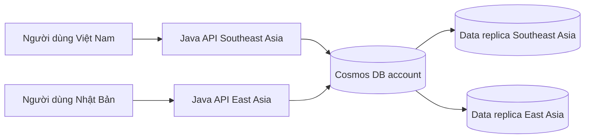
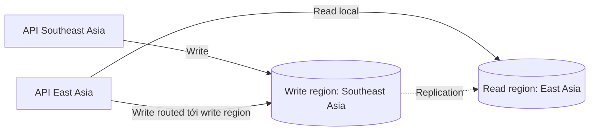
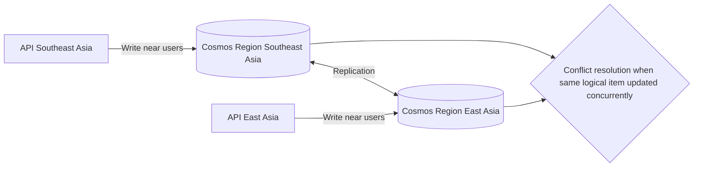
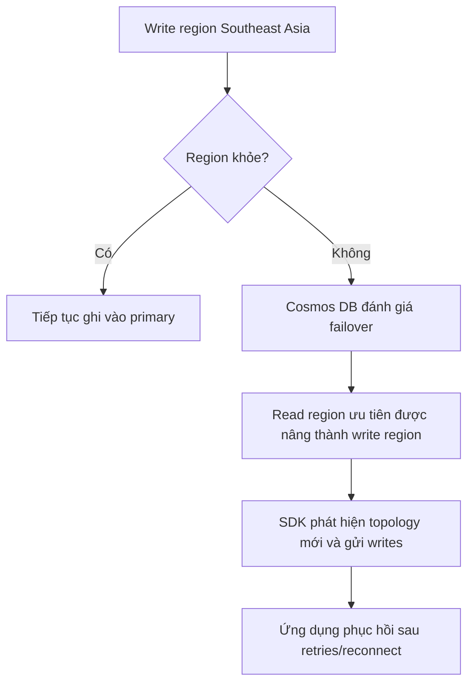
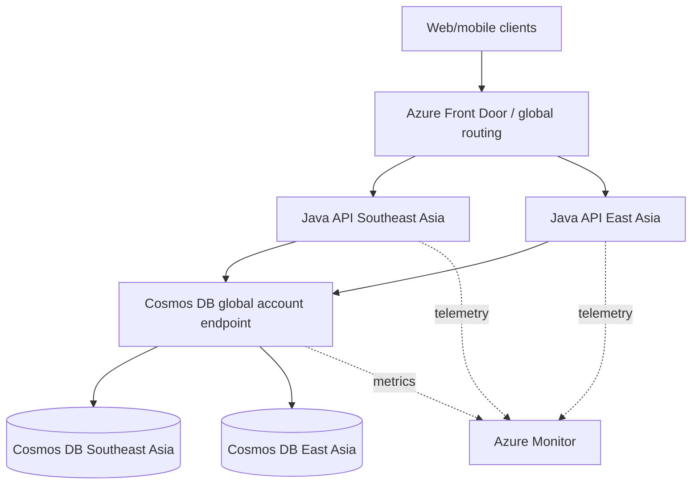

# Phân phối nhiều region và cơ chế failover

Một hệ thống thương mại điện tử phục vụ người dùng ở Việt Nam và Nhật Bản có yêu cầu: khách hàng ở mỗi nơi đọc đơn hàng với độ trễ thấp, việc đặt hàng không bị dừng hoàn toàn nếu một Azure region gặp sự cố, đồng thời dữ liệu vẫn có tính nhất quán đủ chặt để không xác nhận trùng giao dịch. Hệ thống có API Java Spring Boot chạy trên Azure App Service hoặc Azure Kubernetes Service (AKS), sử dụng **Azure Cosmos DB for NoSQL** để lưu thông tin đơn hàng dạng JSON.

**Phân phối nhiều region (multi-region distribution)** cho phép một tài khoản Azure Cosmos DB triển khai bản sao dữ liệu ở nhiều vùng địa lý. **Failover** là cơ chế thay đổi vùng phục vụ truy cập—đặc biệt là vùng ghi chính trong mô hình single-write—khi vùng hiện tại không sẵn sàng hoặc khi doanh nghiệp chủ động chuyển vùng. Tuy nhiên, chỉ bật hai region **không bảo đảm ứng dụng luôn sẵn sàng, mọi bản ghi đều đồng bộ ngay lập tức hoặc không bao giờ mất dữ liệu**. Kết quả phụ thuộc cấu hình đọc/ghi, mức nhất quán, SDK, đường mạng, nguồn lực và thiết kế nghiệp vụ.

Bài học thuộc chương **Dữ liệu NoSQL với Cosmos DB** của module **CLOUD_PROVIDERS_AZURE**: khám phá Microsoft Azure từ subscription, resource group và Entra ID tới mạng ảo, compute, lưu trữ, dữ liệu, giám sát, bảo mật và chi phí. Trong bài, “Cosmos DB” chủ yếu chỉ **Azure Cosmos DB for NoSQL**. Các API khác như MongoDB, Cassandra, Gremlin hoặc Table có khả năng và SDK riêng; không áp dụng nguyên xi ví dụ Java/KQL/CLI cho mọi API.

> **Lưu ý:** Khả năng multi-region write, conflict resolution, consistency, Private Link, availability zones, pricing và lệnh Azure CLI có thể khác theo API, SKU, region hoặc phiên bản SDK. Các thao tác thêm region và failover là thay đổi hạ tầng ảnh hưởng production; chỉ thực hiện trên môi trường thử nghiệm hoặc trong change window được phê duyệt. Không có tài khoản Azure nào được tạo, chỉnh sửa hoặc kiểm thử thật trong lúc biên soạn bài.

## Mục tiêu học tập

Sau bài học, bạn có thể:

1. Phân biệt **read region**, **write region**, **preferred region** và **failover priority** trong một tài khoản Azure Cosmos DB.
2. Giải thích replication qua region và sự khác biệt giữa high availability trong một region với disaster recovery giữa các region.
3. So sánh **single-region write** và **multi-region write**, lựa chọn theo độ trễ, tranh chấp dữ liệu và RPO/RTO.
4. Mô tả **automatic failover**, **manual failover**, failback và vai trò của SDK.
5. Đánh giá năm consistency levels và ảnh hưởng của Session consistency khi client chuyển vùng.
6. Phân tích xung đột ghi nhiều vùng, Last Writer Wins, versioning và mô hình dữ liệu tránh xung đột.
7. Cấu hình Java SDK với danh sách preferred regions, Microsoft Entra managed identity và xử lý lỗi tạm thời.
8. Thiết kế kết nối VNet/Private Endpoint/DNS và ứng dụng đa vùng hoạt động end-to-end.
9. Theo dõi availability, replication, request units, throttling, errors, region health và chi phí.
10. Lập kế hoạch kiểm thử failover, khôi phục dữ liệu, đối soát nghiệp vụ và vận hành production.

## 1. Từ một region tới hệ thống nhiều region

Một ứng dụng chỉ có database ở một Azure region có thể đáp ứng tốt người dùng ở gần region đó. Nhưng nếu toàn bộ region ngừng phục vụ, database có thể không truy cập được; người dùng ở xa cũng chịu latency mạng cao.



Trong một tài khoản Cosmos DB multi-region:

- **Tài khoản** là đối tượng quản lý cấu hình regions, API, consistency và capacity.
- **Databases và containers** là tập dữ liệu logic thuộc tài khoản.
- **Replication** phân phối các thay đổi sang các regions được cấu hình.
- **Clients/SDKs** chọn endpoint thích hợp để thực hiện reads/writes theo topology.
- **Region configuration** quyết định vùng nào được đọc, vùng nào có thể nhận ghi.
- **Failover policy** quyết định vùng được nâng lên làm write region khi mô hình yêu cầu một primary write.

### Những gì multi-region không tự cung cấp

Multi-region database **không tự tạo** API Java ở region thứ hai, không tự chuyển Azure Front Door sang API khỏe, không sửa DNS/Private Endpoint của ứng dụng và không thể bảo đảm mọi transaction bên ngoài SQL/payment gateway nhất quán với Cosmos DB. Cần thiết kế **cả application plane lẫn data plane**.

## 2. Phân biệt location, region, availability zone và replica

Những từ sau dễ bị dùng thay thế nhau nhưng không đồng nghĩa:

| Khái niệm | Ý nghĩa |
|---|---|
| **Azure region** | Một khu vực triển khai dịch vụ Azure, chẳng hạn Southeast Asia hoặc East Asia |
| **Availability zone (AZ)** | Vùng cách ly hạ tầng bên trong một region có hỗ trợ zones |
| **Cosmos DB region** | Một vị trí triển khai bản sao dữ liệu trong geographic distribution của tài khoản |
| **Replica** | Bản sao dữ liệu do dịch vụ quản lý ở cấp lưu trữ/partition theo kiến trúc Cosmos DB |
| **Write region** | Region được phép tiếp nhận ghi theo chế độ cấu hình |
| **Read region** | Region có thể phục vụ truy vấn đọc theo topology và consistency |
| **Preferred region** | Thứ tự ưu tiên vùng do ứng dụng/SDK đưa ra khi chọn nơi gửi yêu cầu |
| **Failover priority** | Thứ tự ưu tiên regions để trở thành write region trong chế độ single-write và failover tương ứng |

### Zone redundancy không thay multi-region

**Zone redundancy** giúp một số cấu hình Cosmos DB chịu lỗi availability zone **bên trong một region**. **Multi-region replication** bổ sung khả năng chịu sự cố ở cấp **toàn region** và giảm độ trễ đọc trên địa lý rộng. Hai cơ chế có thể kết hợp theo support matrix nhưng có **chi phí và điều kiện** riêng.

Một ứng dụng chỉ chạy ở một region dù database có ba regions vẫn có thể ngừng phục vụ nếu App Service/AKS region đó mất. Vì vậy mục tiêu RTO phải tính cả API, routing, identity, network và third-party dependencies.

## 3. Single-write account: một vùng ghi, nhiều vùng đọc

Ở mô hình **single-region write**, một tài khoản có **một write region tại một thời điểm**; dữ liệu có thể được replicate sang nhiều vùng đọc.



### Ưu điểm

- Hạn chế **xung đột ghi giữa các vùng** đối với cùng dữ liệu vì có một vùng ghi chính.
- Quy tắc ownership và audit đơn giản hơn.
- Dễ áp dụng cho đơn hàng/thanh toán cần xử lý theo thứ tự.
- Có thể tận dụng **local reads** tại nhiều region khi consistency cho phép.
- Có khả năng **automatic/manual write region failover** theo cấu hình và tình trạng dịch vụ.

### Trade-off

- Người dùng xa write region có thể gặp latency ghi cao hơn do khoảng cách mạng.
- Khi write region không sẵn sàng, có thể có khoảng thời gian ghi bị gián đoạn trong lúc failover.
- Replication sang read region và reads tại đó vẫn chịu **consistency semantics**.
- Read region không thể tự nhận ghi theo ý ứng dụng nếu chưa được nâng lên vai trò ghi.

### Ví dụ phù hợp

Một hệ thống đặt hàng có primary region ở Southeast Asia, backup/read region ở East Asia. API Đông Á có thể đọc từ vùng gần mình, nhưng lệnh ghi đơn hàng được định tuyến theo **single-write policy** đến write region đang active. Nếu vùng ghi chính lỗi, hệ thống cần failover sang vùng thứ hai để tiếp tục nhận ghi.

## 4. Multi-write account: ghi tại nhiều region

**Multi-region writes** cho phép những vùng đã cấu hình có thể phục vụ yêu cầu ghi gần người dùng hơn. Điều này hữu ích cho workload địa lý phân tán, có thể chấp nhận hoặc chủ động xử lý **concurrent updates**.



### Ưu điểm

- Độ trễ ghi có thể thấp hơn vì ứng dụng ghi gần nơi xử lý.
- Khi một vùng không sẵn sàng, vùng ghi khác vẫn có thể tiếp nhận requests theo cấu hình và SDK.
- Giúp tăng tính sẵn sàng của các workload phân tán theo địa lý.

### Rủi ro và giới hạn

- **Hai vùng có thể cập nhật cùng logical item trước khi biết thay đổi của nhau**.
- Phải quyết định conflict resolution phù hợp với **nghiệp vụ**, không chỉ chọn một quy tắc mặc định.
- Không nên giả định mọi consistency level đều hỗ trợ multi-write như single-write; **Strong consistency không dùng cho multi-region write configuration**.
- Chi phí, throughput, operations và monitoring có thể tăng đáng kể.
- Transaction được hỗ trợ trong phạm vi partition/region theo API không đồng nghĩa **distributed ACID transaction đồng bộ giữa mọi regions**.

### Khi nào đáng cân nhắc?

- Dữ liệu user profile được phân theo tenant/region, ít có cập nhật chéo vùng.
- Sự kiện append-only với ID duy nhất và tránh ghi đè cùng item.
- Các trường hợp nghiệp vụ có merge semantics rõ ràng.
- Workload yêu cầu local write latency và có cơ chế xử lý conflict chặt chẽ.

**Không chọn multi-write cho tài chính chỉ vì muốn tốc độ cao.** Cần hiểu chính xác một giao dịch bị cập nhật đồng thời sẽ được giải quyết ra sao, và có được phép mất một cập nhật hợp lệ hay không.

## 5. So sánh single-write và multi-write

| Tiêu chí | Single-write | Multi-write |
|---|---|---|
| Write region | Một region active | Nhiều regions được phép nhận ghi |
| Read regions | Có thể nhiều | Có thể nhiều |
| Write latency cho users xa | Có thể cao do đi tới primary | Thường thấp hơn nếu ghi ở region gần |
| Conflict khi nhiều vùng ghi cùng item | Giảm mạnh nhờ một đường ghi | Phải quản lý |
| Thay write region khi lỗi | Automatic/manual failover theo khả năng | Client có thể chuyển tới write region khác; không cùng cơ chế bầu một primary |
| Consistency | Các mức được hỗ trợ tùy topology | Có ràng buộc, không dùng Strong multi-region write |
| Thiết kế nghiệp vụ | Dễ kiểm soát serialization hơn | Cần conflict avoidance/resolution |
| Vận hành | Quản lý failover priority và failback | Theo dõi write distribution, conflicts và app routing |
| Chi phí | Nhân theo regions/capacity | Có thể tăng thêm theo cấu hình multiple-write regions |
| Trường hợp khởi đầu | OLTP đơn hàng, hệ thống nhạy dữ liệu | Phân tán địa lý, updates độc lập |

**Mẹo chọn:** bắt đầu từ **single-write + multiple read regions + automatic failover**, nếu mục tiêu chính là DR và local reads. Chỉ chuyển sang **multi-write** khi có yêu cầu local writes thực sự và đã kiểm chứng conflict semantics bằng thử nghiệm.

## 6. Quá trình replication dữ liệu qua các region

Cosmos DB quản lý bản sao dữ liệu giữa các regions theo cơ chế của dịch vụ. Về mặt thiết kế application, cần hiểu:

1. Ứng dụng gửi write request tới region thích hợp.
2. Region nhận ghi thực thi operation theo consistency/transaction semantics được hỗ trợ.
3. Dữ liệu thay đổi được propagate tới những regions khác.
4. Read request có thể được phục vụ từ local/preferred region khi phù hợp.
5. Khi dữ liệu chưa được propagate đầy đủ, kết quả đọc phụ thuộc **consistency level** và session context.

### Replication không đồng nghĩa “mọi nơi nhận tức thì”

Trong những chế độ có replication bất đồng bộ, có thể có **replication lag** giữa regions. Nếu region ghi gặp sự cố ngay sau khi acknowledge một thay đổi, mức dữ liệu được giữ sau failover phụ thuộc consistency và trạng thái replication. Vì vậy, RPO cần được **thiết kế/đo và kiểm chứng theo cấu hình**, không chỉ suy từ số lượng regions.

### Không chỉnh trực tiếp replication

Bạn không phải tự dựng SQL replication jobs hoặc quản lý replica VM. Tuy nhiên cần quản lý:

- Regions được chọn và thứ tự ưu tiên.
- Mức consistency.
- Chế độ single-/multi-write.
- Throughput/partitioning.
- SDK routing, availability và retries.
- Kiểm thử DR/khôi phục với dữ liệu nghiệp vụ.

## 7. Năm consistency levels trong Cosmos DB for NoSQL

Azure Cosmos DB for NoSQL thường trình bày năm consistency levels. Chúng trả lời câu hỏi: **“Sau khi một write thành công, readers ở các regions khác có thể quan sát thay đổi đó với bảo đảm nào?”**

| Consistency | Ý nghĩa khái quát | Trade-off |
|---|---|---|
| **Strong** | Reads nhìn thấy dữ liệu gần ngữ nghĩa latest committed theo mô hình nhất quán mạnh của dịch vụ | Có giới hạn topology/latency/availability; không hỗ trợ multi-region writes |
| **Bounded staleness** | Giới hạn độ “cũ” theo khoảng thời gian hoặc số phiên bản operations trong cấu hình hỗ trợ | Cần cân nhắc replication lag, latency và giới hạn vùng |
| **Session** | Bảo đảm nhất quán trong session của client, điển hình read-your-writes | Thuận tiện cho nhiều ứng dụng web; ngoài session có thể thấy dữ liệu khác thời điểm |
| **Consistent prefix** | Đọc theo thứ tự tiền tố của write history, không quan sát một thứ tự đảo ngược không hợp lệ theo mô hình | Dữ liệu có thể chưa mới nhất |
| **Eventual** | Nếu không có writes mới, replicas tiến tới đồng bộ; không hứa ngay khi nào | Thường linh hoạt về latency/availability, ứng dụng chấp nhận dữ liệu chậm |

### Session consistency thường là điểm khởi đầu

Khi user vừa cập nhật hồ sơ, cùng session cần thấy thay đổi của mình. Session tokens/SDK giúp duy trì read-your-writes theo cơ chế hỗ trợ, nhưng **không tự bảo đảm mọi user khác ở region khác nhìn thấy ngay lập tức**.

### Những hiểu lầm phổ biến

- **Strong** không có nghĩa một ứng dụng multi-write sẽ nhận Strong ở mọi vùng; cấu hình có ràng buộc.
- **Session** không tương đương Strong trên toàn thế giới.
- **Eventual** không có nghĩa dữ liệu “vĩnh viễn khác nhau”; nhưng không có giới hạn staleness như Bounded staleness.
- Mức consistency không biến **giao dịch qua nhiều logical partitions hoặc hệ thống ngoài Cosmos DB** thành một transaction ACID toàn cục.
- Chọn mức mạnh hơn có thể tác động latency, throughput/availability và chi phí; cần benchmark.

## 8. Tác động consistency lên trải nghiệm nghiệp vụ

### Trường hợp A: hồ sơ người dùng

Một người cập nhật display name, ngay sau đó xem lại profile. **Session** có thể phù hợp khi application giữ session context/SDK đúng. Người dùng ở phiên khác có thể nhận bản cũ trong khoảng replication lag; UI có thể cần hiển thị trạng thái “đang đồng bộ” hoặc đọc từ nguồn cập nhật.

### Trường hợp B: tồn kho và giữ hàng

Hai vùng cùng ghi số lượng tồn kho có thể tạo conflict nếu mỗi vùng tính toán từ trạng thái cũ. Dù read consistency mạnh hơn, business invariants như “không bán vượt tồn” vẫn cần thiết kế **single owner per stock item, transaction trong logical partition hoặc hệ thống điều phối** phù hợp.

### Trường hợp C: trang danh sách sản phẩm

Giá/miêu tả sản phẩm được cập nhật ít, có thể chấp nhận nhìn thấy bản mới chậm vài giây trong một số trường hợp. Eventual hoặc Session có thể đủ, tùy SLA.

### Trường hợp D: thanh toán

Không dùng đơn thuần Last Writer Wins cho trạng thái thanh toán rồi nghĩ mọi giao dịch sẽ tự nhất quán. Cần **nguồn giao dịch có tính đúng đắn**, idempotency, event log và đối soát.

### Câu hỏi trước khi chọn consistency

1. Những user nào phải **thấy bản ghi vừa viết ngay**?
2. Có chấp nhận dữ liệu chậm vài giây không?
3. Có business invariants xuyên regions/partitions?
4. Điều gì xảy ra nếu region ghi mất trước replication?
5. Có cần điều phối writes vào một region/partition owner?
6. Độ trễ và request units có đáp ứng SLO không?

## 9. Failover là gì, có những tình huống nào?

**Failover** là việc chuyển traffic hoặc vai trò write/read từ vùng không sử dụng được sang vùng khả dụng. Phải phân biệt:

- **Database region failover:** thay đổi vùng phục vụ dữ liệu hoặc vùng ghi chính của Cosmos DB.
- **SDK endpoint failover:** client tự chọn region endpoint khỏe khác dựa trên account topology, preferred regions và retries.
- **Application failover:** Azure Front Door/Traffic Manager chuyển client sang Java API khác region.
- **Dependency failover:** Key Vault, Storage, Queue, Azure SQL, DNS hoặc identity infrastructure có kế hoạch riêng.

### Những lý do failover

- Một Azure region mất khả năng phục vụ.
- Bảo trì/di chuyển có kế hoạch và muốn chuyển write ownership.
- DR test trong staging.
- Chuyển primary sang region thuận tiện hơn cho hoạt động kinh doanh.
- Thay đổi topology để tối ưu latency/cost theo change plan.

### Failover không phải phân phối lại traffic thông thường

**Load balancing** giữa hai Java APIs có thể liên tục. **Failover write region** của Cosmos DB là một thay đổi quan trọng trong data plane, có thể tác động write availability, SDK routing và session consistency. Cần theo dõi từng tầng riêng.

## 10. Automatic failover trong tài khoản single-write

Khi tài khoản có **nhiều regions**, cấu hình **automatic failover** cho phép dịch vụ xử lý việc chuyển **write region** theo chính sách nếu vùng ghi hiện tại không sẵn sàng và điều kiện dịch vụ thỏa mãn.



### Cấu hình cần có

- Tài khoản có từ **hai Azure regions trở lên** phù hợp.
- Chế độ **single-region write**.
- Automatic failover được bật/được hỗ trợ theo account configuration.
- **Failover priorities** đã sắp theo thứ tự mong muốn.
- Application/SDK có cách cập nhật topology, retry và theo dõi trạng thái.
- Năng lực throughput và network ở secondary đáp ứng tải khi chuyển vùng.

### Điều không được hứa

- Không có guarantee ứng dụng **không bao giờ có lỗi trong quá trình failover**.
- Không phải mọi lỗi 429/403/500 đều là tín hiệu region outage.
- Không bảo đảm zero data loss cho mọi consistency level/cấu hình.
- Không tự chuyển Java API sang region khác hoặc xử lý session/token của gateway ngoài Cosmos DB.
- Không nên giả định original primary được tự động chuyển lại làm write region ngay khi phục hồi.

### Failback

Sau khi region ban đầu phục hồi, nó có thể quay lại topology như một vùng đọc trong tài khoản single-write. Việc **đưa quyền ghi trở lại region cũ** cần tuân theo khả năng của dịch vụ và quy trình failback/chuyển ưu tiên đã phê duyệt; không tự đổi giữa giờ cao điểm chỉ vì muốn “trả về mặc định”.

## 11. Manual failover và thay đổi write region có kế hoạch

**Manual failover** là thao tác quản trị viên chủ động chọn/chuyển write region (trong các cấu hình hỗ trợ), ví dụ khi muốn thực hành DR hoặc có kế hoạch bảo trì.

### Quy trình an toàn

1. Xác định region hiện tại và secondary đã được thêm/synchronized.
2. Kiểm tra account consistency, write mode và region priorities.
3. Đánh giá application traffic, công việc đang chạy và transactions chưa hoàn tất.
4. Có maintenance window, thông báo các nhóm liên quan và rollback plan.
5. Thực hiện failover qua Azure Portal/management API được hỗ trợ.
6. Quan sát account write region mới, Cosmos DB availability metrics, SDK retries.
7. Đối soát bản ghi/transactions thuộc khoảng chuyển vùng.
8. Kiểm tra ứng dụng từ **cả hai application regions**, không chỉ một môi trường quản trị.
9. Ghi RTO/RPO quan sát được, lỗi client và hành động khắc phục.
10. Nếu cần failback, lập một thay đổi riêng với kiểm tra topology và dữ liệu.

### Không nhầm manual failover với “xóa primary region”

Xóa một region khỏi Cosmos DB account là **thay đổi cấu hình geo-distribution**. Điều đó không tương đương với thao tác diễn tập chuyển write role và có thể gây mất khả năng truy cập tại khu vực đó hoặc ảnh hưởng billing/capacity. Không xóa region để giả lập outage production.

## 12. Thứ tự ưu tiên failover (failover priorities)

Đối với account single-write, các regions có thể được sắp theo **thứ tự ưu tiên failover**. Thứ tự này quyết định vùng nào được chọn làm write region tiếp theo theo điều kiện và khả năng dịch vụ.

Ví dụ thiết kế:

| Region | Vai trò ban đầu | Thứ tự mong muốn |
|---|---|---|
| Southeast Asia | Write region | Primary |
| East Asia | Read region | Secondary |
| Australia East | Read region | Dự phòng tiếp theo |

Nếu Southeast Asia không sẵn sàng, hệ thống kỳ vọng chuyển write role sang vùng ưu tiên còn khả dụng. Nhưng ứng dụng vẫn phải thử kết nối, xác minh routes và xử lý exceptions transient.

### Ưu tiên không bằng độ gần của tất cả client

Dù Australia East có latency thấp hơn với một nhóm users, failover priority có thể đặt East Asia trước do yêu cầu dữ liệu, compliance, hạ tầng API hoặc năng lực capacity. SDK **preferredRegions** là danh sách vùng ưu tiên **client**, còn **failover priority** là cấu hình **tài khoản** cho write region trong chế độ single-write. Không dùng chúng như tên khác của cùng một cài đặt.

## 13. Multi-write khi một region mất kết nối

Trong **multi-write account**, những regions được phép ghi có thể tiếp nhận local writes. Khi một region mất khả năng phục vụ, client ở vùng đó cần chuyển đến region còn khả dụng theo SDK và kết nối được thiết kế.

### Khác với single-write

- Không cần bầu một primary write duy nhất theo cùng mô hình single-write.
- Không có nghĩa mọi request đang chạy trên region hỏng đều hoàn tất thành công.
- Có thể có **writes chưa propagate**, conflicts hoặc những yêu cầu client không biết đã commit hay chưa.
- App và SDK vẫn cần retries, idempotency và reconciliation.

### Ví dụ

User ở Southeast Asia cập nhật profile khi region đó gặp sự cố. Nếu API còn hoạt động và SDK chuyển tới East Asia, thao tác có thể thành công ở region thay thế. Tuy nhiên, nếu cùng lúc user khác sửa cùng profile ở vùng còn lại, phải xử lý xung đột đồng thời.

### Đối với thao tác tài chính

Nếu hai vùng nhận ghi cùng một số dư, phương pháp “region khỏe thì ghi” chưa đủ. Cần một ownership model hoặc cơ chế giao dịch bên ngoài đảm bảo invariant, tránh **double spending** và mất cập nhật hợp lệ.

## 14. Conflict resolution khi nhiều region cùng ghi một item

Giả sử cùng item:

```json
{
  "id": "ORD-1001",
  "tenantId": "tenant-a",
  "status": "PENDING",
  "version": 3
}
```

Hai regions cùng đọc version 3 rồi ghi:

```text
Southeast Asia: status = PAID, version = 4
East Asia:      status = CANCELLED, version = 4
```

Hai requests có thể được chấp nhận cục bộ trước khi replication phát hiện concurrent updates. **Cosmos DB cần xác định winner hoặc cách hợp nhất state** theo conflict resolution policy và khả năng API.

### Last Writer Wins (LWW)

Một lựa chọn phổ biến là **Last Writer Wins** dựa trên thuộc tính/tie-breaking được dịch vụ hỗ trợ (chẳng hạn system timestamp hoặc một numeric field được cấu hình trong một số trường hợp). **LWW chỉ chọn phiên bản thắng**, không hiểu nghiệp vụ “PAID không được biến thành CANCELLED khi tiền đã trừ”.

### Application-defined conflict resolution

Một số mô hình **custom conflict resolution** hoặc procedure theo API/khả năng dịch vụ có thể được dùng khi phù hợp. Tính khả dụng, quy tắc và hạn chế phải được xác minh cho **Cosmos DB for NoSQL và account setting** hiện hành; không áp dụng tùy ý handler SQL Server hoặc Java function như một server-side conflict resolver mà không có cơ chế được hỗ trợ.

### Cách tránh conflict tốt hơn

- **Partition ownership:** một tenant/order được gán vùng ghi chủ sở hữu.
- **Append-only events:** thay vì overwrite trạng thái, ghi các sự kiện riêng có ID bất biến rồi tổng hợp state với quy tắc rõ.
- **Optimistic concurrency:** dùng ETag/conditional writes để kiểm soát cập nhật **trong phạm vi được hệ thống hỗ trợ**, nhưng không giả định ETag cục bộ loại bỏ mọi cross-region conflict khi replication bất đồng bộ.
- **Business version/idempotency:** mỗi command có operation ID; backend kiểm tra trạng thái hợp lệ.
- **Single-write for invariants:** những dữ liệu cần bảo đảm chặt có thể được gửi về một region/owner hoặc một transaction authority.

**Đừng dùng timestamp máy client làm bằng chứng sự kiện “mới nhất”.** Clock skew, client retries và out-of-order events có thể khiến LWW theo thời gian sai ý nghĩa kinh doanh.

## 15. Partition key ảnh hưởng trực tiếp đến multi-region

Cosmos DB for NoSQL phân phối dữ liệu theo **partition key**. Một logical partition là đơn vị quan trọng cho truy vấn, transaction và mức cô lập.

Ví dụ container `orders` dùng:

```text
Partition key path: /tenantId
Item id:            ORD-1001
Partition key:      tenant-a
```

Item ID phải được xét cùng partition key để nhận diện đúng một document. Một tài khoản có thể có nhiều items trùng `id` ở các logical partitions khác nhau theo điều kiện API.

### Lựa chọn tốt

- Phân phối writes/reads đều theo tenant/user/customer khi pattern phù hợp.
- Truy vấn phổ biến biết partition key để giảm cross-partition fan-out.
- Operation idempotency được thực hiện trong phạm vi khóa đủ duy nhất.
- Tránh mọi traffic ghi vào một logical partition quá nóng.
- Xem xét growth, per-partition limits và workload peak trước khi chốt schema.

### Partition key không phải phép chữa mọi conflict

Một partition key ổn định giúp định danh/điều phối dữ liệu nhưng **không ngăn hai regions cập nhật cùng item** khi multi-write. Để tránh conflict, cần ownership/routing hoặc mô hình append-only/transaction đúng.

### Transaction boundaries

Transactions/batch operations được hỗ trợ thường có phạm vi **cùng logical partition**, không phải một transaction toàn cầu xuyên mọi partitions/regions. Chuyển từ SQL Server sang Cosmos DB mà giữ nguyên giả định ACID cross-table/cross-region là sai mô hình.

## 16. SDK là phần quan trọng của failover

Azure Cosmos DB SDK theo dõi thông tin tài khoản và có khả năng chọn regional endpoints. Ứng dụng nên sử dụng **SDK được hỗ trợ** thay vì hardcode một regional IP hoặc tự viết retry vô hạn.

### Client lựa chọn region dựa trên

- Account topology: region nào có thể đọc/ghi.
- `preferredRegions` do application cấu hình.
- Chế độ single-write hay multi-write.
- Consistency level/session token.
- Network connectivity và phản hồi lỗi tạm thời.
- Connection mode (Gateway/Direct) và SDK version.

### Best practices

1. Tạo **một CosmosClient dài hạn** cho cấu hình tương ứng, tái sử dụng trong ứng dụng.
2. Đặt preferred regions theo vị trí deployment; không dùng danh sách ưu tiên Việt Nam cho app đặt ở Nhật Bản mà không có chủ ý.
3. Để SDK quản lý discovery/failover thay vì pin cứng một region/IP.
4. Bật retry/backoff theo SDK nhưng có timeout và retry budget ở cấp nghiệp vụ.
5. Xác định operation nào **idempotent** khi client không chắc server đã commit.
6. Theo dõi SDK diagnostics, status/substatus, RU charge và độ trễ.
7. Kiểm tra phiên bản SDK hỗ trợ authentication, region routing và conflict behavior được chọn.

### Global endpoint

Một account for NoSQL thường có endpoint kiểu:

```text
https://<COSMOS_ACCOUNT>.documents.azure.com:443/
```

Đây là endpoint account-level. SDK có thể khám phá và định tuyến tới những regional endpoints được dịch vụ công bố. **Không thay endpoint bằng private IP trần** vì DNS, TLS, region routing và failover cần hostname hợp lệ.

## 17. Java SDK v4: preferred regions và Microsoft Entra ID

Ví dụ Java dưới đây minh họa một client đọc tài liệu. Nó dựa trên **Azure Cosmos DB Java SDK v4** và Azure Identity library phiên bản tương thích.

### Các dependency Maven cần có

```xml
<dependencies>
  <dependency>
    <groupId>com.azure</groupId>
    <artifactId>azure-cosmos</artifactId>
    <version><!-- Chọn và pin phiên bản SDK v4 tương thích --></version>
  </dependency>
  <dependency>
    <groupId>com.azure</groupId>
    <artifactId>azure-identity</artifactId>
    <version><!-- Chọn phiên bản tương thích --></version>
  </dependency>
</dependencies>
```

Đây là trích đoạn minh họa, không phải toàn bộ `pom.xml` tự build. Phiên bản cần được chọn theo dự án/JDK và dependency management thực tế.

### Ví dụ Java

```java
package vn.example.cosmos;

import com.azure.cosmos.CosmosClient;
import com.azure.cosmos.CosmosClientBuilder;
import com.azure.cosmos.CosmosContainer;
import com.azure.cosmos.models.CosmosItemResponse;
import com.azure.cosmos.models.PartitionKey;
import com.azure.cosmos.ConsistencyLevel;
import com.azure.identity.DefaultAzureCredentialBuilder;

import java.util.List;
import java.util.Map;

public class RegionalCosmosReader {

    public static void main(String[] args) {
        String endpoint = System.getenv("COSMOS_ENDPOINT");

        if (endpoint == null || endpoint.isBlank()) {
            throw new IllegalArgumentException(
                "Missing COSMOS_ENDPOINT");
        }

        CosmosClient client = new CosmosClientBuilder()
            .endpoint(endpoint)
            .credential(new DefaultAzureCredentialBuilder().build())
            .preferredRegions(List.of("Southeast Asia", "East Asia"))
            .consistencyLevel(ConsistencyLevel.SESSION)
            .gatewayMode()
            .buildClient();

        try {
            CosmosContainer container = client
                .getDatabase("shop")
                .getContainer("orders");

            CosmosItemResponse<Map> response =
                container.readItem(
                    "ORD-1001",
                    new PartitionKey("tenant-a"),
                    Map.class
                );

            System.out.println(
                "Request RU charge: " + response.getRequestCharge());
            System.out.println(
                "Status: " + response.getItem().get("status"));
        } finally {
            client.close();
        }
    }
}
```

### Điều kiện trước khi chạy

- Tài khoản Cosmos DB for NoSQL, database `shop` và container `orders` đã tồn tại; partition key path là `/tenantId`.
- Item có `id=ORD-1001`, `tenantId=tenant-a`.
- Runtime Azure có managed identity hoặc local developer có identity được `DefaultAzureCredential` hỗ trợ.
- Identity có **Cosmos DB for NoSQL data-plane role** để đọc item, được phân quyền ở đúng scope.
- Mạng và DNS tới Cosmos account có thể truy cập được; nếu dùng Private Endpoint phải có đường private phù hợp.
- JDK, Azure Cosmos SDK v4 và Azure Identity dependencies tương thích.
- `gatewayMode()` dùng HTTPS và có thể đơn giản hơn trong lab; **Direct mode** có trade-off về latency, connection management và network rules khác, cần đo theo production plan.

**`preferredRegions` là ưu tiên của client**, không làm thay đổi failover priority của account. Một JVM triển khai ở East Asia có thể đảo danh sách thành `East Asia, Southeast Asia` để ưu tiên đọc gần hơn.

## 18. Làm gì khi Java SDK gặp lỗi trong failover?

SDK có thể tự retry/chọn endpoint khác theo response và topology, nhưng **ứng dụng vẫn phải có error budget và biết xử lý các write operations chưa rõ outcome**.

### Phân biệt nhóm lỗi

| Hiện tượng | Ý nghĩa thường gặp | Cách xử lý |
|---|---|---|
| HTTP **429** | Throughput/RU limit hoặc throttling | Tôn trọng Retry-After, kiểm tra RU/hot partition; không vội đổi write region |
| HTTP **401/403** | Token/permission/network policy hoặc request bị từ chối | Kiểm tra managed identity, data role, firewall và thông điệp lỗi |
| HTTP **404** | Item/container không tồn tại, partition key sai, hoặc tình trạng nhất quán/đọc cần điều tra | Xác minh ID, partition key, session, region và response details |
| HTTP **409** | Conflict do ID/unique key hoặc operation | Kiểm tra idempotency/unique constraints, không retry create mù quáng |
| HTTP **412** | ETag/conditional write không khớp | Đọc lại version, áp logic concurrency |
| HTTP **5xx / timeout** | Transient service/network hoặc vấn đề backend | SDK retry/backoff, kiểm tra availability và diagnostics |
| DNS/connection failure | Network, Private Link, resolver, gateway/direct mode | Kiểm tra đúng hostname, DNS và endpoint reachable |
| Session-related read issue | Context/session token hoặc vùng đọc chưa đáp ứng | Để SDK xử lý, tránh bỏ session token tùy tiện |

**Không lấy status code đơn lẻ làm root cause.** Cần kết hợp exception message, substatus, request diagnostics, region, session và sự kiện hạ tầng.

### Với write timeout, kết quả có thể chưa biết

Ví dụ API Java gọi create order và timeout. Database có thể đã ghi item nhưng response chưa tới client. Nếu ứng dụng retry bằng một `id` khác, có thể tạo hai đơn hàng.

Giải pháp:

- Dùng **deterministic item ID / idempotency key** ở backend.
- Dựa vào unique constraint phù hợp trong logical partition.
- Khi gặp 409, đọc item và xác minh có đúng cùng business operation không.
- Dùng optimistic concurrency/ETag khi update.
- Không retry một transaction có tác dụng tài chính nếu chưa hiểu nó đã commit chưa.
- Thiết kế đối soát theo business event/transaction record.

## 19. Ứng dụng multi-region phải có failover riêng

Cosmos DB multi-region chỉ bảo vệ **data plane** của account, không bảo đảm toàn bộ ứng dụng hoạt động từ region dự phòng.

### Kiến trúc đề xuất



### Các điều kiện

1. API được triển khai ở **ít nhất hai regions** nếu mục tiêu là chịu lỗi toàn region.
2. Global routing có health probes đúng và có thể chuyển client.
3. AuthN/AuthZ, Entra ID, Key Vault, Storage và message brokers có mô hình DR nhất quán.
4. Cấu hình Java SDK/identity/region preferences tại mỗi deployment.
5. DNS/VNet/Private Endpoint hoạt động với regions còn sống.
6. Cơ chế retry/idempotency không tạo giao dịch trùng trong lúc chuyển vùng.
7. Monitoring đo **business transaction success**, không chỉ Cosmos DB availability.

### Lưu ý

Một hệ thống có Java API active-passive nhưng Cosmos DB multi-write không nhất thiết nhận lợi ích ghi địa phương. Ngược lại, API active-active với Cosmos DB single-write vẫn có khả năng chịu lỗi frontend, nhưng writes đi tới write region hiện hành.

## 20. Private Endpoint và DNS khi Cosmos DB có nhiều region

Nếu doanh nghiệp tắt public network access và dùng **Azure Private Link/Private Endpoint** cho Cosmos DB for NoSQL, phải thiết kế network routing và DNS **cho các application regions**.

### Các hostname liên quan

Global account endpoint thường là:

```text
<COSMOS_ACCOUNT>.documents.azure.com
```

Private DNS zone thường liên quan đến Cosmos DB for NoSQL Private Link:

```text
privatelink.documents.azure.com
```

Private Endpoint tạo IP riêng để client trong VNet hoặc mạng kết nối hợp lệ truy cập Cosmos DB. Thực tế có thể có những bản ghi/endpoint dành cho regional routing, cần dùng DNS zone group/record đúng theo hướng dẫn của dịch vụ.

### Những sai lầm thường gặp

- Có Private Endpoint ở VNet Southeast Asia nhưng **Java API East Asia không có đường mạng/DNS** phù hợp khi failover.
- Peering có route nhưng private DNS zone link/forwarder thiếu.
- Tắt public network trước khi xác minh ứng dụng qua private endpoint.
- Dùng public hostname bị resolve sang public IP trong mạng chỉ cho private.
- Chọn `Direct mode` nhưng firewall chỉ cho luồng phù hợp với Gateway mode.
- Hardcode IP Private Endpoint thay vì account FQDN.
- Sai endpoint API: Cosmos DB for NoSQL khác đường kết nối dành cho API khác.
- Chỉ kiểm thử từ laptop/Cloud Shell, không từ **runtime Java ở mỗi region**.

### Connectivity checklist

| Tầng | Kiểm tra |
|---|---|
| Identity | Workload có credential/managed identity hợp lệ? |
| DNS | Global/regional endpoint names resolve đúng địa chỉ từ app subnet? |
| Route | App subnet có route tới Private Endpoint theo topology? |
| Firewall/NSG | Luồng SDK Gateway/Direct được cho phép theo cấu hình? |
| TLS | Hostname và certificate hợp lệ, không tắt validation? |
| Region failover | Khi một region mất, endpoint còn sống vẫn reachable? |
| Cost | Private Endpoint, DNS Resolver, firewall/peering/traffic costs đã tính? |

**Không tự giả định một Private Endpoint duy nhất xử lý mọi kịch bản geo-failover**. Hãy kiểm tra khả năng regional endpoints/private link hiện hành và làm một bài failover drill trên network thực tế.

## 21. Bảo mật: control plane, data plane và identity

Một tài khoản Cosmos DB có ít nhất ba ranh giới:

1. **Azure Resource Manager control plane:** tạo/sửa account, thêm regions, đổi write mode, bật failover.
2. **Cosmos DB data plane:** đọc/ghi databases, containers và items.
3. **Network plane:** client có tới được endpoint hay không.

### Azure RBAC không thay data-plane authorization

Một account có quyền Contributor trên resource group **không tự động đồng nghĩa** có quyền đọc mọi item qua SDK data plane. Với Cosmos DB for NoSQL, sử dụng **data-plane RBAC roles** phù hợp như built-in Data Reader/Data Contributor trong phạm vi được phê duyệt.

### Managed identity cho Java

- Bật managed identity cho App Service/AKS/VM theo workflow hỗ trợ.
- Gán đúng Cosmos DB data-plane role ở account/database/container scope.
- Dùng `DefaultAzureCredential`/TokenCredential trong SDK.
- Không commit primary key/connection string vào Git.
- Kiểm soát app identities tại cả hai regions.
- Hạn chế người có quyền thay account failover/multi-write configuration.

### Network và keys

Tắt/hạn chế public access khi Private Endpoint đã được xác minh. Nếu cần key-based auth, bảo vệ keys bằng Key Vault/secret rotation và đánh giá loại bỏ shared-key auth theo chính sách/tính năng hỗ trợ.

**Managed identity đúng role cũng không đi xuyên firewall được.** Ngược lại, có route tới Private Endpoint cũng không cho phép đọc/ghi nếu thiếu data-plane authorization.

## 22. Provisioning nhiều region: thứ tự triển khai

Trước khi thêm region, cần thiết kế cả application và dữ liệu.

### Kiểm tra tiền điều kiện

- Account API = **Azure Cosmos DB for NoSQL**.
- Có đủ quota, region support và region capacity theo subscription.
- Xác định **single-write** hay **multi-write**.
- Định nghĩa consistency, conflict policy và SLO.
- Kiểm tra throughput: manual/autoscale, container-level hoặc database shared.
- Rà soát region residency/compliance và backup policy.
- Chuẩn bị mạng/Private Endpoint/DNS tại mỗi app region.
- Dự toán chi phí replicated storage, provisioned RU/s và network.
- Có người chịu trách nhiệm change window/rollback.

### Quy trình trên Azure Portal (khái niệm)

1. Mở **Cosmos DB account** đúng subscription/resource group.
2. Vào phần **Replicate data globally/Global Distribution** hoặc trải nghiệm region management tương đương trong Portal phiên bản hiện hành.
3. Xem regions đang có, write/read locations và chế độ multi-region writes.
4. Chọn region mới theo kiến trúc và xác nhận chi phí/giới hạn.
5. Lưu cấu hình và theo dõi tiến trình thêm region.
6. Đợi hoàn tất provisioning/replication theo trạng thái dịch vụ trước khi xem là ready.
7. Kiểm tra SDK reads từ region mới và latency.
8. Thiết lập failover priorities hoặc multi-write strategy theo quyết định thiết kế.
9. Kiểm tra monitoring, identity/network và ứng dụng ở cả hai regions.

**Thêm region không đồng nghĩa thêm một Cosmos DB account thứ hai.** Bài này nói về **một account replicate qua nhiều regions**; active-active giữa **hai tài khoản độc lập** là một bài toán khác về replication/application synchronization.

## 23. Azure CLI: kiểm tra account, regions và failover config

Các lệnh sau **chỉ đọc** cấu hình tài khoản trong phạm vi được phép.

### Xác minh subscription

```bash
az account show --output table

az account set --subscription "<SUBSCRIPTION_ID>"

RG="<COSMOS_RESOURCE_GROUP>"
ACCOUNT="<COSMOS_ACCOUNT_NAME>"
```

### Đọc thông tin account

```bash
az cosmosdb show \
  --resource-group "$RG" \
  --name "$ACCOUNT" \
  --output json
```

Xem có chọn lọc:

```bash
az cosmosdb show \
  --resource-group "$RG" \
  --name "$ACCOUNT" \
  --query "{name:name,locations:locations,readLocations:readLocations,writeLocations:writeLocations,automaticFailover:enableAutomaticFailover,multipleWriteLocations:enableMultipleWriteLocations,consistencyPolicy:consistencyPolicy}" \
  --output json
```

Tùy **Azure CLI/API version**, tên properties có thể thay đổi hoặc null. Khi cần xác nhận, đọc JSON gốc và dùng tài liệu schema hiện hành, không tự suy account bị lỗi vì một field query thiếu.

### Đọc resource ID

```bash
COSMOS_ID=$(az cosmosdb show \
  --resource-group "$RG" \
  --name "$ACCOUNT" \
  --query id --output tsv)

echo "$COSMOS_ID"
```

### Liệt kê cơ sở dữ liệu NoSQL

```bash
az cosmosdb sql database list \
  --resource-group "$RG" \
  --account-name "$ACCOUNT" \
  --output table
```

Với container cụ thể:

```bash
az cosmosdb sql container show \
  --resource-group "$RG" \
  --account-name "$ACCOUNT" \
  --database-name "shop" \
  --name "orders" \
  --output json
```

Các lệnh này chỉ đọc metadata, không tự bảo đảm data-plane access. Không in master keys hoặc connection strings vào log/chat trong quá trình điều tra.

## 24. Thiết kế throughput RU/s trong nhiều region

Azure Cosmos DB tính chi phí xử lý bằng **Request Units (RUs)**. Một request có RU charge tùy kích thước item, query complexity, indexing, consistency và điều kiện khác. **RU/s** là khả năng xử lý cấp phát hoặc autoscale ở phạm vi database/container.

### Ví dụ

Một container có **10.000 RU/s** ở một region và được replicate sang region thứ hai. Không được giả định “đã có hai vùng thì tổng giá vẫn là 10.000 RU/s một vùng”. Với nhiều mô hình provisioning, throughput/capacity được tính theo **mỗi region** hoặc có multipliers theo multi-region writes và tính năng sử dụng.

### Các yếu tố chi phí/hiệu năng

| Yếu tố | Tác động |
|---|---|
| Số regions | Replicated storage, throughput capacity và operations trên nhiều vùng |
| Single vs multi-write | Khả năng ghi và pricing/capacity model tương ứng |
| Manual vs autoscale throughput | Compute cost theo provisioned/maximum/autoscale rules |
| Partition key | Hot partition có thể gây 429 dù tổng RU/s chưa hết |
| Query cross-partition | Tăng RU và latency |
| Indexing policy | Thêm index có thể làm writes tốn hơn |
| Consistency | Có thể ảnh hưởng RU/latency/availability theo semantics |
| Item size | Tài liệu lớn làm nhiều RUs và network traffic hơn |
| Backup/restore | Chi phí storage/feature theo model |
| Private Endpoint, monitoring | Chi phí network/Log Analytics/Azure Monitor bổ sung |

### Không phải 429 là failover

**HTTP 429 Too Many Requests** thường báo throughput bị giới hạn. Giải pháp có thể là:

- Phân tích RU consumption/hot logical partitions.
- Tôn trọng retry-after và bounded retries.
- Tối ưu partition key, queries và indexing.
- Kiểm soát concurrency của Spring Boot/API.
- Tăng throughput/autoscale trong ngân sách nếu cần.

Tự chuyển region liên tục mỗi khi có 429 có thể **tăng latencies, tạo thêm retries** và che nguyên nhân chính.

## 25. Multi-region reads và độ trễ người dùng

Một ứng dụng có hai deployments:

| Application region | Preferred read regions | Kỳ vọng |
|---|---|---|
| Southeast Asia | Southeast Asia → East Asia | Local reads nhanh hơn khi có region khỏe |
| East Asia | East Asia → Southeast Asia | Local reads nhanh hơn cho khách hàng Nhật Bản |

### Đo latency đúng cách

- Đo từ **Java API host thật**, không phải chỉ laptop.
- Ghi p50/p95/p99 read latency và end-to-end HTTP latency.
- Đo RU charge, document size và partition key.
- Ghi tên/địa chỉ endpoint/region phục vụ theo SDK diagnostics nếu hỗ trợ.
- Kiểm tra network/VNet/Private Endpoint của cả hai vùng.
- Tách latency database khỏi Java serialization, service mesh và HTTP proxy.
- So sánh trước/sau khi bật region, không suy từ khoảng cách trên bản đồ.

### Đọc dữ liệu chưa đồng bộ hoàn toàn

Nếu consistency cho phép, người dùng ở vùng khác có thể thấy phiên bản cũ. Giải pháp UX/nghiệp vụ có thể là:

- Đọc qua cùng session context khi cần read-your-writes.
- Hiển thị trạng thái cập nhật đang xử lý.
- Chuyển các đọc nhạy cảm tới chính nguồn ghi hoặc dùng consistency phù hợp.
- Thiết kế object version để phát hiện dữ liệu lạc hậu.
- Không cho phép thay đổi tài chính dựa trên snapshot eventual mà không kiểm chứng.

## 26. Failover RTO, RPO và các trạng thái bất định

**RTO (Recovery Time Objective):** thời gian tối đa hệ thống được phép gián đoạn.

**RPO (Recovery Point Objective):** mức dữ liệu tối đa doanh nghiệp chấp nhận mất khi sự cố xảy ra.

### Ví dụ yêu cầu

```text
RTO mục tiêu: 15 phút
RPO mục tiêu: 5 phút
Scope: API đặt hàng + Cosmos DB + công việc xác nhận đơn
```

Các con số trên là **ví dụ giả định của doanh nghiệp**, không phải SLA cam kết chung cho Cosmos DB.

### Đo cả chuỗi

Nếu Cosmos DB đã chuyển write region trong vài phút nhưng:

- Front Door chưa chuyển API,
- API mới không có quyền Key Vault,
- DNS Private Endpoint chưa resolve,
- queue xử lý xác nhận đơn ở vùng hỏng,
- hoặc Java SDK vẫn dùng endpoint cũ do configuration,

thì **RTO của dịch vụ nghiệp vụ** vẫn không đạt.

### RPO cần đối soát dữ liệu

Trong một kịch bản failover với replication bất đồng bộ, có thể tồn tại writes chưa được replicate tới secondary. RPO quan sát phải dựa trên **accepted writes, replicated state và business records**. Không chỉ nhìn write region mới hiện trong Portal rồi tuyên bố RPO = 0.

## 27. Failover không thay thế backup và point-in-time restore

Đây là nguyên tắc bắt buộc: **replication nhân bản cả thay đổi sai**, bao gồm delete nhầm, application bug ghi hỏng data hoặc ransomware dùng credential hợp lệ. Khi có nhiều regions, một thao tác xóa nhầm item có thể tiếp tục replicate sang các vùng.

Cần kết hợp:

- **Periodic backup** hoặc **continuous backup** theo khả năng, cấu hình tài khoản và chính sách.
- **Point-in-time restore (PITR)** khi dùng backup mode hỗ trợ.
- Quy trình khôi phục về account/resource target phù hợp theo API của dịch vụ.
- Bảo vệ backup access/roles và encryption.
- Kiểm thử restore thực tế với dữ liệu/schemas đã lựa chọn.
- Business audit/event log cho những operation không được mất.
- Reconciliation sau failover và sau restore.

### Phân biệt ba công cụ

| Cơ chế | Giải quyết |
|---|---|
| Multi-region replication | Bản sao dữ liệu/khả năng truy cập qua regions và DR |
| Automatic/manual failover | Chuyển nơi tiếp nhận truy cập/ghi theo topology |
| Backup/restore | Phục hồi phiên bản dữ liệu trước lỗi logic, delete hoặc sự cố cần restore |

Một hệ thống có ba regions nhưng không backup có thể mất dữ liệu do delete nhầm ở **cả ba regions** sau replication.

## 28. Availability zones và database failover trong region

Không phải mọi sự cố đều là “cả region mất”. Có thể là một availability zone, network segment hoặc thành phần hạ tầng gặp trục trặc.

**Zone redundancy** khi được dịch vụ/region/tier hỗ trợ là biện pháp tăng khả năng chịu lỗi **trong một region**. Cosmos DB cũng có replication nội bộ do platform quản lý; application không trực tiếp chọn replica máy chủ cho mỗi read.

### Cần quyết định

1. Region mục tiêu có hỗ trợ AZ?
2. Tài khoản và throughput mode có khả năng zone redundancy tương ứng?
3. Có sự khác biệt chi phí hoặc yêu cầu triển khai?
4. Application App Service/AKS cũng có zone resilience chưa?
5. Có cần multi-region ngoài khả năng zone-level HA?
6. Đã kiểm tra SLA/DR assumptions theo cấu hình cuối cùng chưa?

### Không trộn hai cấp độ failover

- **Zone failure:** platform có thể bảo vệ tài nguyên trong region mà không cần đổi write region.
- **Region outage:** multi-region distribution/failover có thể cần để phục hồi.
- **Application deployment failure:** có thể cần rollback app hoặc chuyển API region dù Cosmos DB bình thường.

Runbook cần gắn cảnh báo tới cấp độ lỗi đúng để tránh chuyển vùng không cần thiết.

## 29. Metrics và diagnostics cho geo-distributed Cosmos DB

Một account nhiều regions phải được giám sát cả **service health**, **request success**, **replication** và **business outcome**.

### Những tín hiệu nên quan sát

- Request volume, status codes, substatus, failed requests.
- **Server-side latency** và end-to-end SDK latency.
- **RU consumption**, normalized RU consumption, provisioned throughput và 429 throttling.
- Storage usage, index size và tốc độ tăng dung lượng.
- Region availability/region status, read/write locations.
- Replication-related telemetry khi service/API cung cấp.
- Read requests theo region hoặc application deployment.
- Conflict-related signal khi dùng multi-region writes.
- Backup/restore/failover management events.
- Client exception rate, retry counts, timeout và session failures.
- **Business metrics:** orders created, orders confirmed, duplicate rate, processing lag.

### Kiểm tra metric definitions bằng Azure CLI

```bash
az monitor metrics list-definitions \
  --resource "$COSMOS_ID" \
  --output table
```

Sau khi có danh sách tên/dimensions thực tế của tài khoản, mới thiết kế query/alert. Không hardcode một metric name không tồn tại ở API/region/SKU đang sử dụng.

### Azure Monitor/Application Insights

- **Azure Monitor Metrics** phát hiện spike lỗi/latency và capacity.
- **Diagnostic settings** có thể đẩy logs theo categories hỗ trợ tới Log Analytics/Storage/Event Hubs.
- **Application Insights** ở Java App Service/AKS hiển thị API latency, dependencies, exceptions khi instrumentation được bật.
- **Azure Activity Log** phản ánh control-plane changes như sửa region config/failover settings.
- **Service Health** hỗ trợ đánh giá Azure incident, nhưng không thay thế telemetry từ workload.

Không hiểu “Cosmos DB 200 OK” là khách hàng đã thanh toán hoặc đơn hàng đã hoàn tất.

## 30. KQL và logging có correlation

Nếu Azure Cosmos DB diagnostic logs đã được gửi tới Log Analytics workspace, bảng và schema cụ thể tùy mode/cấu hình. Một mẫu **khảo sát nguồn logs** thay vì đoán tên trường:

```kusto
AzureDiagnostics
| where TimeGenerated > ago(1h)
| summarize Records = count() by ResourceProvider
| order by Records desc
```

Với resource-specific tables, bảng không nhất thiết là `AzureDiagnostics`. Dùng Log Analytics schema explorer để chọn tên thật; không suy rằng thiếu bảng `AzureDiagnostics` nghĩa là Cosmos DB không phát metrics.

### Truy vấn Java app telemetry (nếu instrument)

Trong workspace-based Application Insights:

```kusto
AppExceptions
| where TimeGenerated > ago(1h)
| summarize Failures = count() by Type
| top 20 by Failures desc
```

```kusto
AppDependencies
| where TimeGenerated > ago(1h)
| summarize Requests = count(),
            Failed = countif(Success == false)
  by bin(TimeGenerated, 5m), Target
| order by TimeGenerated asc
```

Không phải mọi operation Cosmos Java SDK đều tự xuất hiện dưới dạng `AppDependencies` ở mọi runtime/instrumentation mode. Khi thiếu dữ liệu, kiểm tra SDK diagnostics/tracing, OpenTelemetry/Azure Monitor instrumentation và sampling.

### Log format khuyến nghị

```text
event=cosmos_read
account=<account>
appRegion=Southeast Asia
preferredRegion=Southeast Asia
container=orders
operationId=op-1001
partitionKeyHash=<hash>
requestCharge=3.1
status=200
durationMs=24
```

Đây là dữ liệu minh họa. Không ghi access keys, session tokens, toàn bộ payload hoặc dữ liệu cá nhân vào logs. Hash của partition key cũng cần được đánh giá khả năng tái nhận diện theo chính sách dữ liệu.

## 31. Chi phí của multi-region Cosmos DB

Multi-region mang lại lợi ích về latency và resilience, nhưng chi phí có thể tăng theo số regions và tính năng.

| Khoản chi phí | Câu hỏi cần hỏi |
|---|---|
| Throughput provisioned/autoscale | RU/s được tính thế nào trên từng region và write mode? |
| Replicated storage | Mỗi region có dữ liệu/index và storage billing ra sao? |
| Multi-region writes | Có pricing/capacity multiplier nào áp dụng không? |
| Zone redundancy | Có ảnh hưởng giá ở region/tier đã chọn không? |
| Backup/restore | Backup model, retention và PITR cần chi phí gì? |
| Network | Private Endpoints, DNS Resolver, peering, Firewall, data transfer |
| Applications | Có phải chạy hai Java app deployments thường trực không? |
| Monitoring | Application Insights và Log Analytics ingestion/retention |
| DR testing | Chi phí test load, môi trường staging và vận hành |

### Ví dụ không nên suy luận sai

Giả sử một container được cấp throughput baseline ở region A. Khi thêm region B, **không mặc nhiên** nghĩa là database được nhân đôi capacity mà chi phí không đổi. Số regions và cách tính RU/s theo pricing model ảnh hưởng hóa đơn.

### Giảm chi phí mà vẫn giữ resilience

1. Đo request charge thực tế và tối ưu indexes/queries.
2. Chọn partition key tránh hot partitions.
3. Dùng autoscale/manual throughput theo pattern tải và SLA.
4. Chỉ thêm regions mang giá trị latency/DR thực sự.
5. Không bật multi-write nếu không có yêu cầu và khả năng xử lý conflicts.
6. Quản lý backup/storage retention phù hợp.
7. Theo dõi App Service/AKS và Private Endpoint/traffic costs.
8. Đặt **Azure Cost Management budgets/alerts** và gắn owner/costCenter tags theo chính sách.
9. Chạy thử performance với account staging và tổng hợp RU/s theo vùng.
10. Xem **bảng giá Azure Cosmos DB hiện hành** cho region/API/tier trước khi phê duyệt.

Budget alert giúp cảnh báo, **không tự chặn mọi chi phí** hoặc ngăn sự cố sản xuất.

## 32. Các lỗi thường gặp khi có nhiều region

| Triệu chứng | Khả năng nguyên nhân | Hướng kiểm tra |
|---|---|---|
| Client ở region B đọc chậm | Preferred regions sai, network vòng qua A, query tốn RU | SDK diagnostics, latency, query, endpoint |
| App đọc dữ liệu cũ | Consistency/session context, replication lag, cache | Consistency level, session token, version |
| API nhận **429** | RU/s hoặc hot partition, không phải region down | RU metrics, retry-after, partition key |
| API nhận 403 | Data-plane RBAC, token, firewall, sai write location | Exception/substatus, identity và account topology |
| Write timeout giữa failover | Endpoint lỗi, region đổi, service/network transition | SDK retries, write outcome reconciliation |
| Duplicate orders sau retry | Không có idempotency key/unique constraint | Business log, item ID, operations |
| Conflict multi-write | Concurrent update cùng item ở hai regions | Conflict policy, version, source region |
| Một app region không kết nối Private Link | DNS/VNet link/route/firewall thiếu | Test từ app host, Private Endpoint records |
| Client vẫn gọi region cũ | SDK cũ, hardcoded regional endpoint, config sai | SDK version, preferred regions, diagnostics |
| Automatic failover không xảy ra như kỳ vọng | Single-write/priority/setting/điều kiện dịch vụ | Account config, Azure Service Health |
| App UI vẫn lỗi sau DB failover | Chỉ data plane phục hồi, API/queue/Key Vault chưa phục hồi | Global routing và dependencies |
| Sau failover thiếu một số transactions | Replication/consistency/RPO assumption | Accepted write log, business reconciliation |
| Restore không tìm thấy thời điểm | Backup policy/retention/restore support khác | Backup config và PITR window |
| Chi phí tăng mạnh | Thêm regions/RU/s, multi-write, logs | Cost analysis + Cosmos metrics |
| Toàn hệ thống chậm khi scale | App connection storms, retries hoặc cross-region network | App metrics, SDK client reuse |

### Khi debug, đừng sửa quá nhiều lớp cùng lúc

Phân biệt **authentication, network, SDK routing, throughput, consistency và business logic**. Nếu cùng lúc tăng RU/s, đổi regions và tắt firewall, bạn sẽ khó biết điều gì thực sự giải quyết vấn đề và có thể gây rủi ro bảo mật.

## 33. Runbook 1: write region mất khả năng phục vụ

**Bối cảnh:** account single-write ở Southeast Asia, read region ở East Asia, automatic failover đã bật. Java API đặt hàng báo tăng timeout/5xx.

### Bước 1 — Xác định phạm vi

- Account, subscription/resource group, API for NoSQL.
- App deployments/regions đang lỗi.
- Write/read locations theo quản trị Azure.
- Thời điểm UTC, operation IDs, accepted writes cuối cùng.
- Azure Service Health/incident nếu có.
- Business SLO/RTO/RPO.

### Bước 2 — Phân biệt region outage với throttling

Kiểm tra 429 RU limits, identity errors, DNS failures và app deployment health. Nếu chỉ 429 do một logical partition, **đó không phải căn cứ tự động chuyển write region**.

### Bước 3 — Quan sát account failover

Xem write region hiện tại, các regions còn khỏe, automatic failover settings và priorities. Không thay đồng thời nhiều cài đặt khi platform đang xử lý sự cố.

### Bước 4 — Kiểm tra SDK tại từng app region

- SDK có dùng account endpoint và preferred regions hợp lệ?
- Có pin IP/region endpoint ngoài ý muốn?
- Retry/backoff có hoạt động và không tạo storms?
- Managed identities và private networking ở vùng còn sống hợp lệ?
- Có log diagnostics và request charge/status code?

### Bước 5 — Bảo vệ dữ liệu nghiệp vụ

- Dừng những retry không idempotent.
- Thu thập accepted write IDs và request outcomes chưa rõ.
- Dùng keys/transaction state để tránh tạo trùng.
- Xác minh writes ở vùng mới sau khi failover.
- Đối soát record/event của khoảng outage.

### Bước 6 — Khôi phục end-to-end

Xác nhận API có thể đọc/ghi từ vùng còn sống, workflow xác nhận đơn hoàn tất, error rate giảm và dữ liệu báo cáo nhất quán theo SLA.

### Bước 7 — Failback có kế hoạch

Khi region cũ phục hồi, chỉ chuyển primary về nếu có lý do kỹ thuật/nghiệp vụ, đã kiểm tra replication state, network và change window. Ghi lại RTO/RPO quan sát được và điều chỉnh runbook.

## 34. Runbook 2: multi-write gây xung đột trạng thái đơn hàng

**Bối cảnh:** hai APIs ở Southeast Asia và East Asia đều có thể cập nhật `status` của đơn `ORD-1001`.

### Các bước

1. Lấy item ID + partition key, không chỉ nhìn order ID.
2. Ghi lại region, operation ID, thời gian, version/ETag trước mỗi write.
3. Kiểm tra multi-write configuration và conflict resolution policy.
4. Xác định dữ liệu cuối đang thấy ở cả hai regions và session context.
5. Đối chiếu database state với payment gateway, inventory reservation và business event log.
6. Không sửa trực tiếp một status bằng tay khi chưa xác định transaction đã xảy ra.
7. Đưa ra quy tắc authoritative owner/merge theo nghiệp vụ.
8. Thiết kế idempotency, append-only events hoặc single-writer per entity.
9. Chạy concurrency tests trên staging, gồm hai vùng cập nhật cùng item trong khoảng ngắn.
10. Bổ sung cảnh báo conflict/đối soát và báo cáo RCA.

### Ví dụ nguyên tắc nghiệp vụ

```text
Allowed status flow:
PENDING -> PAID -> FULFILLED
PENDING -> CANCELLED

If payment has been captured:
  Do not silently replace PAID with CANCELLED.
  Use refund/compensation workflow if cancellation is requested.
```

Đây là **state machine nghiệp vụ**, không phải cấu hình conflict policy tự có của Cosmos DB. Eventual consistency hay Last Writer Wins không thể tự hiểu nghĩa “đã thu tiền”.

## 35. Bài thực hành: đánh giá hai regions trên một account lab

Bài lab ưu tiên quan sát và kiểm thử an toàn. **Không cần tạo tài khoản Cosmos DB mới đắt tiền** nếu tổ chức đã có account staging được phép. Việc thêm region, chuyển write mode hoặc failover **có thể phát sinh phí và gây gián đoạn**.

### Điều kiện

- Một Azure Cosmos DB for NoSQL account thuộc resource group lab.
- Đã có hai regions, hoặc người quản trị đã phê duyệt thêm region.
- Có database `shop`, container `orders` với partition key `/tenantId`.
- Có app Java test ở một hoặc hai regions, identity được cấp data-plane role.
- Có quyền xem Azure Monitor metrics và account configuration.
- Có runbook rollback/cutover nếu diễn tập failover.
- Không dùng đơn hàng/thanh toán production thật.

### Bước 1: chụp cấu hình gốc

```bash
az account show --output table

az cosmosdb show \
  --resource-group "<COSMOS_RG>" \
  --name "<COSMOS_ACCOUNT>" \
  --query "{locations:locations,automaticFailover:enableAutomaticFailover,multipleWriteLocations:enableMultipleWriteLocations,consistencyPolicy:consistencyPolicy}" \
  --output json
```

Lưu snapshot cấu hình **không chứa secrets** vào báo cáo lab. Nếu thấy chỉ một region, bài lab có thể dừng ở read-only assessment hoặc nhờ người quản trị chuẩn bị hai regions trước khi diễn tập.

### Bước 2: kiểm tra SDK với vùng ưu tiên

Chạy Java reader từ phần 17 trong app ở Southeast Asia, ghi:

- Thời gian và deployment region.
- Cosmos client preferred regions.
- Request latency, RU charge và success/error.
- Đường network là public/private endpoint.
- Kết quả đọc item và partition key đúng.

Nếu có deployment thứ hai ở East Asia, đảo preferredRegions, đo lại và so sánh. Không khẳng định mọi request sẽ luôn đi đúng region đầu tiên khi region không sẵn sàng.

### Bước 3: thiết kế dữ liệu thí nghiệm

Trong container `orders`, người quản trị hoặc test application tạo:

```json
{
  "id": "ORD-1001",
  "tenantId": "tenant-a",
  "status": "PENDING",
  "version": 1,
  "operationId": "lab-init-001"
}
```

Dùng ID riêng biệt và deterministic để có thể nhận diện duplicate. Không thay item của người dùng khác.

### Bước 4: kiểm tra đọc từ hai app regions

Đọc item từ hai vùng liên tiếp. Ghi cùng timestamp/operation ID để đối chiếu consistency. Khi cập nhật item hợp lệ ở vùng ghi, đo thời điểm mỗi reader quan sát version mới. **Đây là phép đo quan sát, không phải bằng chứng bảo đảm trễ cố định cho tất cả workloads**.

### Bước 5: diễn tập single-write failover (chỉ khi được duyệt)

- Xác định original primary/read locations.
- Thông báo tất cả nhóm sở hữu app/database.
- Tạm ngừng những workload lab không idempotent.
- Người quản trị sử dụng Azure Portal/management API được hỗ trợ để thực hiện planned/manual failover.
- Quan sát SDK requests từ hai deployments.
- Thu thập lỗi/retries, thời gian tới first successful write ở vùng mới.
- Đối soát items đã write trước/trong/sau thời điểm chuyển vùng.
- Không tự chuyển lại ngay nếu không có change plan.

**Không dùng lệnh phá mạng/xóa region/sửa chính sách trên account dùng chung** để tạo sự cố.

### Bước 6: mô phỏng conflict multi-write (tùy chọn riêng)

Chỉ nếu có **account multi-write staging** và quyền thực hiện: hai test clients cùng cập nhật item `ORD-1001` với operation IDs khác nhau theo kế hoạch. Theo dõi conflict behavior của policy, versioning và dữ liệu cuối. Không dùng tenant/order production thật.

Nếu account đang single-write, **không bật multi-write chỉ để xem thử** khi chưa có approval, vì thay đổi này ảnh hưởng consistency, pricing và cách xử lý conflict.

### Bước 7: thu bằng chứng và đối soát

| Hạng mục | Cần ghi |
|---|---|
| Account | Resource ID, API for NoSQL, consistency |
| Regions | Read/write locations trước và sau |
| Write mode | Single-write hoặc multi-write |
| Failover | Automatic setting, priority, thời gian chuyển |
| Java | SDK version, preferred regions, connection mode |
| Identity | Data-plane roles, endpoint networking |
| Operations | Operation IDs, latency, RU charge, errors/retries |
| Consistency | Item versions quan sát được theo client/session |
| Dữ liệu | Accepted writes, duplicates, missing/late writes |
| Business | Kết quả workflow và đối soát |
| Cost | Số regions, throughput, storage, monitoring |
| DR | RTO/RPO quan sát được và limitations |

### Bước 8: hoàn nguyên

Khôi phục cấu hình chỉ theo **runbook đã phê duyệt**. Xóa **items lab** nếu được phép và không ảnh hưởng người dùng khác. Không xóa account, database hoặc region dùng chung. Kiểm tra app route/Private Endpoint/permissions vẫn ổn và lưu kết quả cho QA chuyên môn tiếp theo.

## 36. Checklist production cho Cosmos DB multi-region

- [ ] Đã chọn **Cosmos DB API for NoSQL** và xác minh khả năng geo-distribution của account.
- [ ] Đã định nghĩa business SLO, RTO, RPO và phạm vi end-to-end.
- [ ] Phân biệt lỗi availability zone, region, API/app, network và backend dependencies.
- [ ] Chọn regions theo latency, availability, residency/compliance và chi phí.
- [ ] Đã chọn single-write hay multi-write từ yêu cầu nghiệp vụ, không chỉ từ latency.
- [ ] Với single-write, có failover priority và automatic failover được cấu hình khi phù hợp.
- [ ] Với multi-write, đã thiết kế conflict prevention/resolution và kiểm thử concurrency.
- [ ] Chọn consistency level có chủ đích; hiểu Session read-your-writes và giới hạn Strong.
- [ ] Partition key cân bằng RU/s, hỗ trợ truy vấn và tránh hot logical partition.
- [ ] Có idempotency key, optimistic concurrency và compensation khi cần.
- [ ] Java SDK được hỗ trợ, dùng client dài hạn, preferred regions và retries hợp lý.
- [ ] Không pin IP hoặc region endpoint ngoài ý muốn; có telemetry cho SDK routing.
- [ ] Có managed identity và Cosmos DB data-plane RBAC đúng phạm vi.
- [ ] Private Endpoint/DNS/route/firewall được kiểm thử từ **mỗi application region**.
- [ ] Ứng dụng/API cũng có regional redundancy nếu yêu cầu chịu lỗi region.
- [ ] Global routing có health checks và xử lý traffic cutover.
- [ ] Azure Monitor metrics theo region, RU, latency, errors, 429, availability và cost.
- [ ] Có cảnh báo cho app errors, stalled workflows và business output thiếu.
- [ ] Có backup/PITR/restore drill, không dùng replication thay backup.
- [ ] Có runbook automatic/manual failover, failback và data reconciliation.
- [ ] Có kế hoạch xử lý writes không rõ outcome và duplicate sau retries.
- [ ] Đã đo latency từ Java host và tính chi phí mỗi region.
- [ ] Có change control cho region add/remove, write mode, consistency và credentials.
- [ ] Không đặt secrets/session tokens/raw PII trong logs/diagnostics.
- [ ] Có test DR định kỳ và báo cáo RTO/RPO quan sát được.

## 37. Câu hỏi tự kiểm tra

1. Multi-region Cosmos DB giải quyết vấn đề gì, và có tự tạo Java API ở region dự phòng không?
2. Region khác availability zone ở cấp bảo vệ sự cố thế nào?
3. Single-write khác multi-write ở chỗ nào về latency và conflict?
4. Khi nào chọn single-write với nhiều read regions?
5. Multi-write có bảo đảm mọi update cùng item không bị ghi đè không?
6. Replication giữa regions có luôn đồng bộ tức thời không?
7. Năm consistency levels khác nhau ở bảo đảm đọc gì?
8. Vì sao Session consistency không có nghĩa tất cả người dùng thấy cùng phiên bản ngay?
9. Strong consistency có phù hợp với multi-region write mode không?
10. Automatic failover có cần ít nhất hai regions không?
11. Failover priority của account khác preferredRegions của SDK như thế nào?
12. Manual failover khác xóa một region khỏi account thế nào?
13. Vì sao failover không luôn đồng nghĩa zero downtime hoặc RPO bằng 0?
14. Trong multi-write, làm sao một item cùng ID/partition key có thể xung đột?
15. Last Writer Wins có hiểu trạng thái thanh toán đã thực sự thu tiền không?
16. Vì sao ETag cục bộ không loại bỏ mọi cross-region conflict?
17. Partition key có vai trò gì với truy vấn, throughput và transaction boundary?
18. CosmosClient Java có nên tạo mới cho mỗi HTTP request không?
19. Preferred regions giúp client tối ưu điều gì và có thay account write region không?
20. Khi nhận HTTP 429, có nên lập tức failover không? Vì sao?
21. Nếu một write timeout, làm sao tránh tạo hai đơn hàng khi retry?
22. Private Endpoint/DNS của vùng B cần kiểm thử gì khi vùng A bị lỗi?
23. Managed identity có tự cấp Cosmos data-plane role không?
24. Vì sao replication không thay thế backup/PITR?
25. Điều gì khiến RTO ứng dụng lớn hơn RTO database?
26. Có thể dùng Application Insights và Azure Monitor để phát hiện lỗi gì?
27. Vì sao có hai account Cosmos độc lập không giống một account multi-region?
28. Những khoản chi phí nào tăng khi thêm regions?
29. Kiểm thử failover production cần điều kiện/chấp thuận gì?
30. Khi phục hồi sau outage, tại sao phải đối soát business records chứ không chỉ nhận HTTP 200?

## Kết luận

**Azure Cosmos DB multi-region distribution** giúp mở rộng phạm vi đọc/ghi theo địa lý, cải thiện khả năng chịu lỗi và giảm latency cho người dùng ở nhiều khu vực. Trong **single-write mode**, tài khoản có một write region với các read regions, kết hợp **automatic/manual failover** và priorities để chuyển write role khi cần. Trong **multi-write mode**, nhiều regions có thể nhận ghi, đổi lại ứng dụng phải xử lý **concurrent updates, conflict resolution và tính đúng đắn nghiệp vụ**.

Thiết kế production đòi hỏi nhiều hơn việc bật hai regions trong Portal: phải chọn **consistency và partition key**, dùng **Java SDK preferred regions và idempotent retries**, bảo vệ **managed identity/Private Endpoint/DNS**, triển khai **application failover**, giám sát **RU/s, latency, availability và business outcomes**, đồng thời duy trì **backup/restore và diễn tập DR**. Một hệ thống chỉ thật sự sẵn sàng sau failover khi **người dùng tiếp tục hoàn thành giao dịch, dữ liệu được đối soát đúng và mục tiêu RTO/RPO của toàn bộ ứng dụng được chứng minh**, không chỉ khi tài khoản Cosmos DB báo trạng thái Available.
