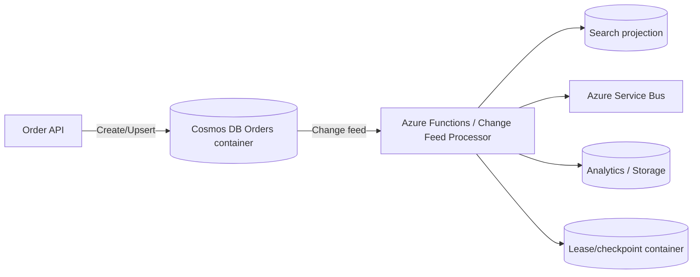
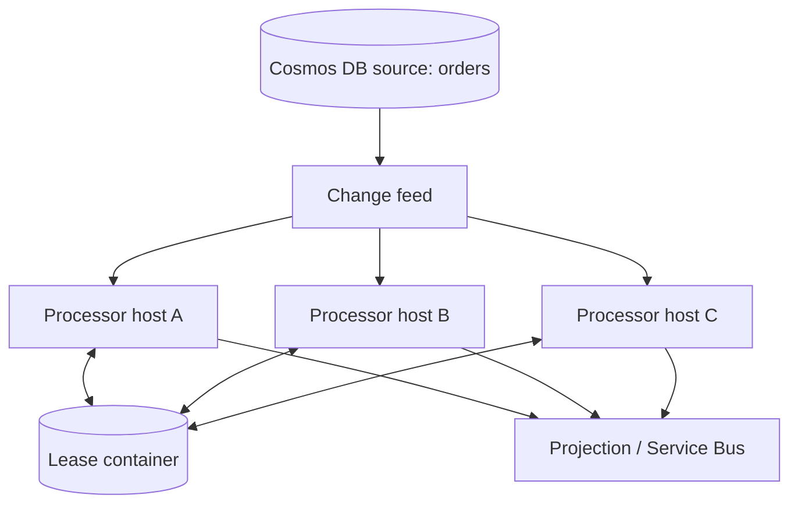
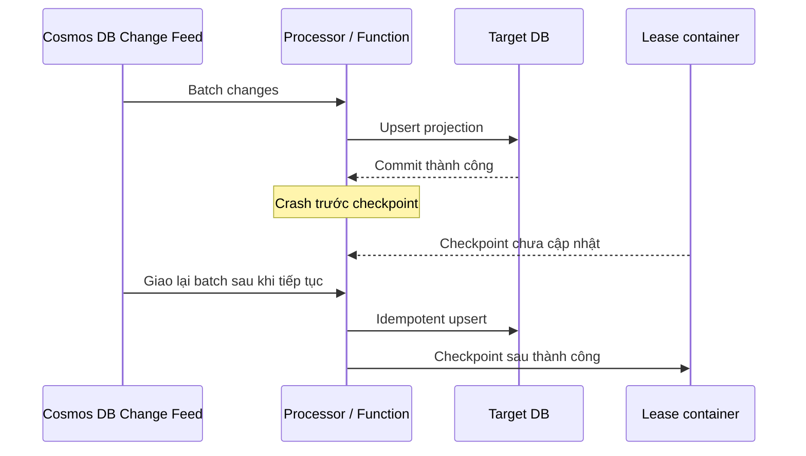
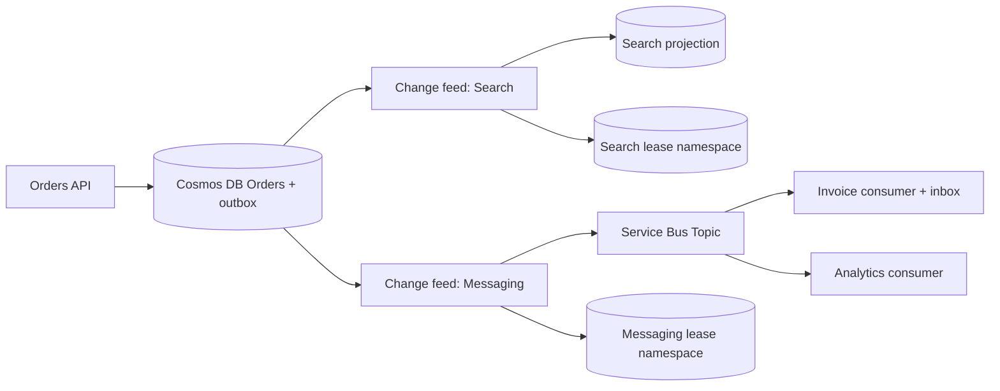
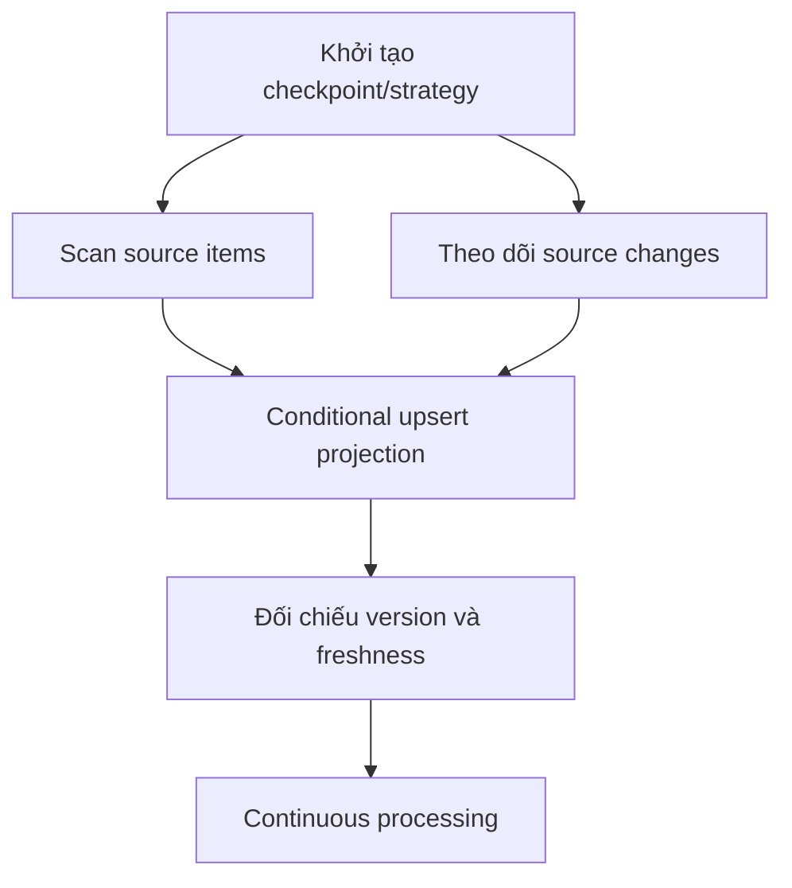
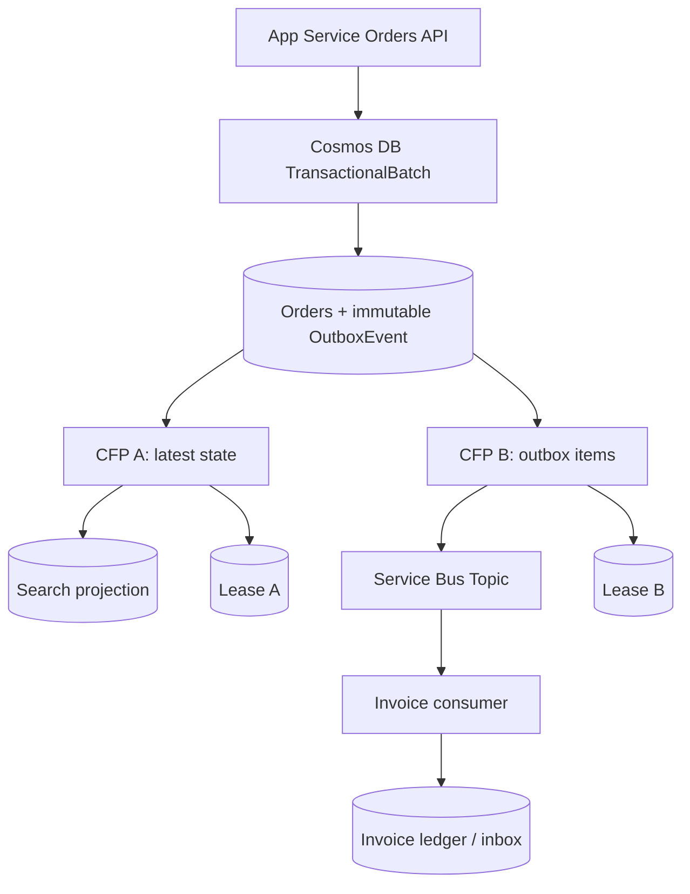

# Change feed và luồng xử lý thay đổi dữ liệu

Trong kiến trúc **NoSQL với Azure Cosmos DB**, nhiều hệ thống cần phản ứng ngay sau khi dữ liệu thay đổi: đơn hàng chuyển sang `PAID` thì cập nhật bảng tìm kiếm, thiết bị IoT ghi bản đo mới thì làm mới dashboard, hồ sơ khách hàng đổi trạng thái thì gửi thông điệp sang hệ thống đối tác. Một cách đơn giản nhưng kém hiệu quả là cho ứng dụng liên tục truy vấn `WHERE updatedAt > lastTime`. Cách này tạo thêm truy vấn tốn **Request Units (RU)**, phụ thuộc vào đồng hồ ứng dụng, khó chịu được nhiều workers và dễ bỏ sót thay đổi khi có lỗi hoặc cập nhật nhanh.

**Change feed** của **Azure Cosmos DB for NoSQL** cung cấp một luồng thay đổi được đọc theo thứ tự thích hợp trong phạm vi partition. Ứng dụng có thể sử dụng **Azure Functions Cosmos DB trigger**, **Change Feed Processor (CFP)** của SDK hoặc một mô hình đọc change feed phù hợp để xử lý dữ liệu bất đồng bộ. Tuy nhiên, change feed **không phải một broker giao thông điệp exactly-once**, **không mặc định cung cấp toàn bộ lịch sử xóa**, và **không thay thế backup hoặc hệ thống kiểm toán dài hạn**. Một hệ thống đáng tin cậy cần kết hợp partition key, checkpoint/lease, idempotency, retry, monitoring và kiểm soát chi phí.

Bài học này thuộc chương **Dữ liệu NoSQL với Cosmos DB** trong mô-đun `CLOUD_PROVIDERS_AZURE`: tìm hiểu hệ sinh thái Azure từ subscription, resource group và Microsoft Entra ID đến mạng, compute, dữ liệu, giám sát, bảo vệ và chi phí. Ví dụ chủ yếu sử dụng **Azure Cosmos DB for NoSQL**, **Azure Functions**, **Service Bus**, **Azure Storage** và Java. Các API hoặc mô hình thay đổi của Azure Cosmos DB for MongoDB, Cassandra, Gremlin hay Table **không được giả định giống API for NoSQL**.

## Mục tiêu học tập

Sau bài học, bạn có thể:

1. Giải thích cách Cosmos DB change feed hoạt động và phân biệt với polling, SQL CDC, Event Hubs, Service Bus và backup.
2. So sánh **latest-version mode** với **all-versions-and-deletes mode** cùng những điều kiện và giới hạn của mỗi chế độ.
3. Hiểu **logical partition key**, thứ tự sự kiện, continuation/checkpoint, lease container và scale-out của Change Feed Processor.
4. Thiết kế consumer theo mô hình **at-least-once**, xử lý trùng lặp, retry, poison data và idempotent writes.
5. Xây một Azure Function Java đọc change feed, định danh sự kiện và cập nhật projection hoặc phát thông điệp.
6. Thiết kế khởi chạy lần đầu, replay/backfill, xử lý xóa/TTL và tránh vòng lặp khi đọc và ghi cùng container.
7. Ước lượng RU/s, nhận biết partition hotspots, theo dõi processing lag và xử lý lỗi `429`.
8. Cấu hình Microsoft Entra ID, managed identity, Azure RBAC, lease permissions, network và bảo vệ dữ liệu.
9. Thử nghiệm các tình huống crash, split/scale, cập nhật nhanh và phục hồi bằng runbook có kiểm chứng.

## 1. Bài toán: biến thay đổi dữ liệu thành hành động

Giả sử một API đơn hàng ghi document sau:

```json
{
  "id": "ORD-1057",
  "tenantId": "tenant-a",
  "orderId": "ORD-1057",
  "status": "PENDING",
  "totalVnd": 450000,
  "version": 1,
  "updatedAtUtc": "2026-11-20T09:00:00Z"
}
```

Sau khi khách hàng thanh toán, API thay đổi `status` thành `PAID`, tăng `version` lên `2` và ghi lại cùng document. Một quy trình nền cần:

- Cập nhật bảng `orders-search` để khách hàng tìm kiếm nhanh.
- Đưa `OrderPaid` vào Service Bus để hệ thống hóa đơn xử lý.
- Ghi dữ liệu phân tích vào một kho phù hợp với báo cáo.
- Theo dõi nếu consumer thất bại và tiếp tục sau khi worker được khởi động lại.

Không nên buộc HTTP API thực hiện đồng bộ tất cả công việc: nếu hệ thống tìm kiếm lỗi 20 giây, người dùng không nhất thiết phải đợi thanh toán hoàn tất. Một thiết kế có thể dùng **change feed** như tín hiệu **document đã được ghi**.



Luồng này **không đồng nghĩa một document write và các tác vụ downstream commit trong cùng transaction**. Một document có thể đã ghi thành công ở Cosmos DB trong khi consumer chưa kịp cập nhật projection. Đó là **eventual consistency ở các hệ thống dẫn xuất**, cần đo thời gian trễ và có chiến lược xử lý lỗi.

### 1.1. Change feed là gì?

Trong API for NoSQL, change feed cung cấp các thay đổi đối với **items** của một container theo các chế độ được hỗ trợ. Một consumer đọc batch thay đổi theo nguồn và vị trí tiếp tục phù hợp. Dịch vụ quản lý thứ tự trong phạm vi thích hợp, trong khi processor có thể theo dõi vị trí đã xử lý qua **leases/checkpoints**.

Change feed rất phù hợp với **event-driven processing**, đồng bộ sang projection và tạo downstream workflows. Nó không có nghĩa mỗi lần sửa một field đều trở thành một event bất biến đầy đủ cho mọi chế độ, và cũng không bảo đảm business event semantics như `PaymentChargedExactlyOnce` khi một document bị cập nhật nhiều lần.

### 1.2. Change feed khác truy vấn theo updatedAt như thế nào?

| Khía cạnh | Polling qua truy vấn | Cosmos DB change feed |
|---|---|---|
| Phát hiện thay đổi | Chạy query định kỳ dựa trên timestamp/field hoặc trạng thái. | Đọc feed được dịch vụ quản lý từ lịch sử thay đổi của container. |
| Rủi ro bỏ sót | Đồng hồ/điều kiện lọc, pagination hoặc update liên tiếp. | Phụ thuộc change feed mode, điểm bắt đầu, checkpoint, retention và lỗi xử lý. |
| Chi phí | Query RU lặp lại ngay cả lúc ít thay đổi. | RU cho các lần đọc feed và chi phí processor/lease, không phải miễn phí. |
| Xử lý song song | Tự thiết kế partitioning/locking/offset. | CFP có cơ chế lease và phân phối partitions giữa instances. |
| Xử lý xóa | Query bình thường không thấy item đã xóa. | Latest-version không cung cấp delete như lịch sử đầy đủ; chế độ khác có điều kiện hỗ trợ. |
| Độ trễ | Bằng polling interval + xử lý. | Near-real-time theo polling/processor/throughput, không phải realtime tuyệt đối. |

**Không phải mọi yêu cầu đều cần change feed.** Nếu chỉ cần báo cáo thống kê theo giờ, query có index thích hợp hoặc dữ liệu đã tổng hợp có thể đủ. Nếu cần một lệnh nghiệp vụ có hợp đồng kiểm soát rõ, trực tiếp publish thông điệp bằng **transactional outbox** có thể rõ ràng hơn so với suy diễn event từ trạng thái document cuối.

## 2. Khác biệt giữa change feed và các công nghệ liên quan

| Thành phần | Vai trò | Thứ nó không tự đảm bảo |
|---|---|---|
| **Cosmos DB change feed** | Đọc thay đổi của items trong container. | Không tự là event bus độc lập, không mặc định exactly-once business effect. |
| **Service Bus** | Queue/topic, routing, delivery/settlement/DLQ cho thông điệp nghiệp vụ. | Không có transaction tự động với mọi Cosmos DB write. |
| **Event Hubs** | Ingest luồng lớn với partitions, offsets và consumer groups. | Không phải bản sao tự động của mọi Cosmos DB change nếu chưa có connector/pipeline. |
| **Event Grid** | Route các sự kiện tài nguyên/ứng dụng theo subscription. | Không thay thế change feed của documents hoặc historical state. |
| **Azure Functions Cosmos DB trigger** | Chạy function khi có batch thay đổi từ change feed. | Không bảo đảm chỉ có một invocation cho một document/business operation. |
| **Backup/PITR Cosmos DB** | Bảo vệ/khôi phục dữ liệu theo chế độ backup. | Không phải pipeline realtime sang hệ thống khác. |
| **SQL CDC** | Ghi nhận thay đổi từ database quan hệ theo cơ chế sản phẩm. | Không dùng chung offset/API với Cosmos DB change feed. |

Các hệ thống có thể kết hợp: Cosmos DB change feed → Functions → Service Bus hoặc Event Hubs, trong khi backup hỗ trợ phục hồi khi người dùng xóa nhầm dữ liệu. Cần tránh thiết kế thay thế backup bằng một consumer change feed: consumer vẫn có thể bị lỗi, checkpoint mất hoặc ghi thiếu dữ liệu ngoài.

## 3. Hai chế độ đọc chính của Cosmos DB for NoSQL

Điểm quan trọng nhất khi dùng change feed là **mode**. Không thể giả định output luôn chứa mọi phiên bản và thao tác xóa.

### 3.1. Latest-version mode (chế độ thông dụng/mặc định)

Ở **latest-version mode**, feed phản ánh **những lần tạo và cập nhật item** dưới dạng phiên bản tài liệu hiện có theo cơ chế của feed. Nó thích hợp để làm mới một projection dựa trên **trạng thái gần nhất** của item.

Ví dụ chuỗi cập nhật nhanh:

```text
T1: Order.status = PENDING, version=1
T2: Order.status = PAID,    version=2
T3: Order.status = SHIPPED, version=3
```

Một consumer ở latest-version mode **không nên coi** việc đọc các documents là bằng chứng chắc chắn đã nhận **cả ba bản thay đổi trung gian** nếu item bị cập nhật nhiều lần trong một khoảng ngắn. Chế độ này có thể thể hiện phiên bản mới nhất phù hợp cơ chế đọc, nên **không phù hợp để xây ledger kiểm toán mỗi trạng thái** chỉ bằng cách đọc và so sánh snapshot.

Đặc điểm thường gặp:

- Thấy item **được tạo hoặc cập nhật** dưới dạng phiên bản đầy đủ, không phải chỉ diff của field.
- **Không ghi nhận thao tác xóa vật lý như một delete event đầy đủ** theo mặc định.
- Có thể đọc change feed theo thứ tự trong phạm vi logical partition key.
- Có thể xử lý lại item sau crash/checkpoint loss; downstream cần idempotency.
- Có thể đọc từ đầu lịch sử còn được feed hỗ trợ hoặc từ mốc phù hợp tùy API/continuation, nhưng không phải mọi yêu cầu replay đều được thỏa mãn nếu chọn chế độ/điểm bắt đầu sai.

### 3.2. All versions and deletes mode

**All versions and deletes mode** được thiết kế để đọc **các phiên bản thay đổi và thao tác xóa**, thích hợp khi cần biết nhiều hơn trạng thái mới nhất. Đối với **Azure Cosmos DB for NoSQL**, chế độ này có **điều kiện về continuous backup** và các ràng buộc SDK/API, retention và tài khoản. Không mặc định có nó trên một account sử dụng periodic backup hoặc trên mọi API/Cosmos DB emulator.

Khác biệt chính:

- Có thể tiếp cận các phiên bản/operation types đã thay đổi, bao gồm delete theo API/mode được hỗ trợ.
- **Phạm vi lịch sử bị giới hạn bởi khoảng continuous backup retention được hỗ trợ**; không phải event archive vô thời hạn.
- Những trường metadata chỉ loại thao tác/phiên bản phụ thuộc **SDK, response schema và mode**; cần xem payload thật thay vì tự suy `operationType` luôn nằm trong body document.
- Các abstraction như **Azure Functions Cosmos DB trigger/Change Feed Processor thông thường** không nhất thiết hỗ trợ tất cả capability của mode này; cần chọn **SDK pull model hoặc cơ chế hỗ trợ cụ thể** và kiểm tra phiên bản.
- Có thể phát sinh chi phí, RU và yêu cầu lưu trữ/backup khác latest-version; thiết kế phải xem budget và compliance.

### 3.3. Bảng so sánh

| Tiêu chí | Latest-version | All versions and deletes |
|---|---|---|
| Mục đích | Đồng bộ trạng thái mới nhất/projection. | Lịch sử phiên bản và xóa trong cửa sổ khả dụng. |
| Create/update | Có. | Có các thay đổi được mode hỗ trợ. |
| Delete vật lý | Không nên mong có delete event. | Có theo chế độ và các giới hạn hỗ trợ. |
| Intermediate updates | Không đảm bảo từng phiên bản trung gian. | Thiết kế để thấy nhiều phiên bản theo retention và hợp đồng feed. |
| Backup prerequisite | Không đồng nghĩa phải bật continuous backup. | Có điều kiện continuous backup theo tính năng hiện hành. |
| Khả năng replay | Dựa trên API, checkpoint và phạm vi lịch sử phù hợp. | Bị ràng buộc chặt bởi continuous backup retention window. |
| Hỗ trợ Functions/SDK | Cosmos DB trigger/CFP phổ biến thường phục vụ latest-version. | Kiểm tra SDK pull API hỗ trợ; không tự suy trigger dùng được. |
| Phù hợp | Cache, search projection, denormalized views. | Audit/change history hoặc các yêu cầu delete-aware trong cửa sổ hỗ trợ. |

**Quy tắc chọn mode:** nếu chỉ cần chỉ số cuối cùng của thiết bị và bản hiện hành của đơn hàng, latest-version có thể đủ. Nếu phải lập một ledger bất biến của **từng giao dịch thanh toán**, vẫn nên phát sinh **business events độc lập** hoặc ghi immutable records theo transaction rõ ràng; không giao toàn bộ trách nhiệm cho một feed thay đổi trạng thái cuối.

## 4. Xử lý xóa và TTL: điểm dễ gây sai dữ liệu

Giả sử một item có:

```json
{
  "id": "P-1009",
  "tenantId": "tenant-a",
  "type": "CustomerProfile",
  "status": "ACTIVE",
  "ttl": 86400
}
```

Sau khi hết TTL, Cosmos DB có thể **xóa item** theo chính sách TTL đã cấu hình. Nếu consumer chỉ đọc **latest-version mode**, nó có thể **không nhận sự kiện xóa** để xóa projection tương ứng ở search index. Kết quả là hệ thống tìm kiếm vẫn hiển thị bản ghi đã hết hạn, dù source container không còn item.

### 4.1. Ba chiến lược cho bài toán deletion

1. **Soft delete/tombstone:** cập nhật `isDeleted=true` hoặc `status=DELETED` (giữ document cho đến khi consumer đọc được), để latest-version mode thấy thay đổi. Sau thời gian an toàn, có thể dùng TTL/xóa vật lý theo policy.
2. **All versions and deletes:** dùng khi tài khoản, backup mode và SDK hỗ trợ, retention đủ cho yêu cầu và có thiết kế replay/tombstone.
3. **Explicit delete business event:** ghi một event độc lập như `CustomerProfileDeleted` vào container/outbox/message bus để consumer nhận theo hợp đồng nghiệp vụ.

Mỗi cách có đánh đổi. **Soft delete** cần chính sách để ngăn xóa vật lý quá sớm; **AVD mode** có giới hạn retention và khả năng hỗ trợ; **explicit event** cần bảo đảm atomicity với thao tác xóa thật hoặc có reconciliation để tránh lệch.

### 4.2. Đừng tạo vòng lặp trên chính container nguồn

Nếu Function theo dõi container `orders` và mỗi lần thấy cập nhật lại **ghi sửa đúng item đó trong cùng container**, thao tác của Function sẽ tạo **thay đổi mới**, khiến trigger có thể chạy liên tục:

```text
Order updated
  → Function ghi processed=true trên Order
  → Change feed lại có Order updated
  → Function ghi processedAt mới
  → ...
```

Giải pháp có thể là: ghi output sang **container khác**, kiểm tra version/field và **chỉ ghi khi thực sự có thay đổi**, hoặc tổ chức pattern/partition giao dịch phù hợp. Nếu ghi marker lên chính item, cần điều kiện chống vòng lặp và kiểm tra tính đúng đắn trước khi triển khai.

## 5. Partition key, ordering và giới hạn tính nhất quán

Cosmos DB sử dụng **partition key** để phân phối items và throughput. Trong API for NoSQL, một item có định danh thực tế dựa trên **`id` kết hợp logical partition key value**. Một item `id="ORD-1"` trong tenant A có thể khác item cùng `id` ở tenant B. Key thiết kế cho change feed và downstream cần phản ánh điều đó.

### 5.1. Thứ tự theo logical partition key

Trong cách hiểu phổ biến của change feed, **thứ tự thay đổi được đảm bảo trong phạm vi một logical partition key value** theo hợp đồng của mode/API, không có một thứ tự toàn cục giữa các logical partitions. Ví dụ:

```text
tenant-a / order-1: Created(v1) → Paid(v2) → Shipped(v3)
tenant-b / order-9: Created(v1) → Paid(v2)

Không có thứ tự toàn cục bắt buộc giữa tenant-a và tenant-b.
```

Nếu cùng một workflow quan trọng yêu cầu các thao tác tuần tự, cần partition strategy phù hợp, **business version** và optimistic concurrency. Đừng giả định một batch change feed từ nhiều partitions đến theo đúng trật tự wall-clock của tất cả source writes.

### 5.2. Physical partitions, logical partitions và split

**Logical partition** là tập items cùng partition key value. **Physical partition** là đơn vị backend dùng để lưu/phân phối throughput và có thể được chia tách khi data/throughput tăng. **Change Feed Processor** có nhiệm vụ quản lý công việc đọc feed ranges/partition leases khi backend chia/sắp xếp partitions theo cơ chế hỗ trợ.

Đừng viết code hard-code `partition 0, 1, 2` như danh sách vĩnh viễn. Khi physical partitions thay đổi, lease distribution và continuation handling phải dựa trên SDK/processor thay vì tự ghép offset một cách tùy tiện.

### 5.3. Partition skew làm ảnh hưởng cả ghi và đọc feed

Nếu mọi documents dùng `tenantId="global"` trong một account multi-tenant, nguồn có thể thành một **hot logical partition**. Các bất lợi có thể gồm: giới hạn throughput trong phạm vi partition, tăng latency, hotspot và hiệu năng processing không cân bằng.

Một partition key tốt cần cân nhắc:

- Đa dạng giá trị và phân phối tải.
- Các truy vấn/tác vụ cần transaction cùng logical partition.
- Ordering mà nghiệp vụ thật sự yêu cầu.
- Khối lượng tăng theo thời gian.
- Quyền/tenant isolation, mô hình multi-tenant và partition strategy của container.

**Đổi partition key cho container đã tồn tại** không phải thao tác sửa một property đơn giản trong mọi trường hợp; thường cần migration/new container và kiểm soát đồng bộ dữ liệu.

## 6. Change Feed Processor: đọc nhiều partitions mà không tự viết scheduler

**Change Feed Processor (CFP)** là thành phần SDK hỗ trợ xây một ứng dụng xử lý thay đổi theo batch, tự điều phối tiến trình giữa nhiều host instances thông qua **lease container**. Azure Functions Cosmos DB trigger xây trên cùng tư duy tự theo dõi feed/leases bằng extension.

Một deployment ví dụ:



Processor sử dụng **lease ownership**, checkpoint/continuation và cơ chế cân bằng để phân chia việc đọc. Khi một instance mất kết nối hoặc scale-in, một host khác có thể tiếp quản leases. Vì vậy **cùng batch/item có thể được đọc lại**, không được cho rằng ownership giúp đạt exactly-once.

### 6.1. Lease container là gì?

Đây là **container Cosmos DB khác**, lưu metadata phục vụ CFP/trigger: leases, trạng thái phân chia work và continuation checkpoints. Lease container **không phải bản sao mọi documents nguồn** hay kho event history.

Nên:

- Tạo lease container đúng database/account/location theo khả năng SDK và quyền.
- Chọn partition-key configuration **được phiên bản extension/SDK hỗ trợ**; đừng tự suy `/tenantId` là phù hợp cho lease.
- Cấp quyền **đọc/ghi** lease documents cho runtime identity theo RBAC data plane phù hợp.
- Cấp đủ RU/s cho lease operations và theo dõi `429`/latency.
- Bảo vệ lease data khỏi xóa/chỉnh sửa thủ công.
- Có chiến lược phân biệt **các nhóm consumer độc lập**.

### 6.2. Một nhóm workers chia sẻ lease, hai pipelines độc lập thì không

Nếu ba instances đều xử lý cùng mục tiêu `orders-search`, chúng nên tham gia **cùng một lease set** để phân phối công việc. Nhưng nếu một pipeline cập nhật search và pipeline khác gửi sự kiện cho kế toán, chúng cần **checkpoints độc lập**; nếu chia sẻ cùng lease/checkpoint một cách sai, một pipeline có thể khiến pipeline còn lại bỏ qua thay đổi.

Có thể dùng **lease containers khác nhau** hoặc cơ chế **lease prefix/processor identity tách biệt** nếu extension hỗ trợ và đã thiết kế rõ. Đừng đổi lease prefix tùy tiện trong production: nó có thể khiến một consumer đọc lại từ điểm bắt đầu khác.

### 6.3. Khi nào checkpoint được ghi?

Trong mô hình CFP/trigger thông dụng, processor cập nhật checkpoint khi **batch được xử lý thành công theo hợp đồng callback**. Nếu callback đã ghi projection rồi host crash **trước khi checkpoint được lưu**, batch có thể được giao lại. Nếu callback **nuốt exception và báo success** dù output chưa commit, processor có thể checkpoint làm mất cơ hội retry.



Đây là mô hình để hiểu **failure window**, không có nghĩa ứng dụng kiểm soát trực tiếp từng thông điệp của backend. Các trigger và SDK có thể có quy tắc checkpoint/batch retry cụ thể khác nhau.

### 6.4. CFP không thay thế dead-letter queue

Một batch chứa một document sai schema có thể gây lỗi mỗi lần chạy và chặn tiến trình của range liên quan. CFP **không tự tạo Service Bus DLQ** cho mọi document. Ứng dụng phải quyết định: retry transient lỗi, **quarantine lỗi vĩnh viễn** (có audit và trạng thái bền vững) rồi tiến tiếp, hoặc dừng pipeline để bảo toàn correctness. Không chỉ `catch(Exception)` rồi bỏ qua âm thầm.
## 7. Azure Functions Cosmos DB trigger: xử lý theo batch

**Azure Functions Cosmos DB trigger** cho phép chạy serverless consumer khi nguồn Cosmos DB for NoSQL có thay đổi. Extension dùng change feed processor và **lease container** để phân phối công việc. Phần này minh họa **latest-version processing**, không mặc định hỗ trợ all-versions-and-deletes mode.

### 7.1. Các tài nguyên trong ví dụ

```text
Azure resource group
├── Cosmos DB account (API for NoSQL)
│   └── database: commerce
│       ├── container: orders             partition key /tenantId
│       ├── container: leases             cấu hình partition key theo extension
│       └── container: orders-projection  partition key theo truy vấn đích
└── Function App: fn-orders-projection
    ├── Managed identity
    ├── Cosmos DB trigger (extension tương thích)
    ├── Application Insights
    └── Connection settings + network
```

**Source** cần quyền đọc feed; **lease** cần quyền tạo/đọc/ghi metadata lease; **projection** cần quyền ghi. Những quyền data plane này khác quyền quản lý resource của Azure RBAC. Hãy kiểm tra phiên bản Cosmos DB extension và identity-based connection được hỗ trợ trước khi thiết lập.

### 7.2. Java Function minh họa

Ví dụ annotation cho Azure Functions Java và Cosmos DB extension phù hợp. Tên một số thuộc tính annotation/binding có thể khác giữa các phiên bản; cần đối chiếu với dependencies triển khai. Mã xử lý một JSON array được binding cung cấp:

```java
import com.fasterxml.jackson.databind.JsonNode;
import com.fasterxml.jackson.databind.ObjectMapper;
import com.microsoft.azure.functions.ExecutionContext;
import com.microsoft.azure.functions.annotation.CosmosDBTrigger;
import com.microsoft.azure.functions.annotation.FunctionName;

public class OrderChangeFunction {
    private static final ObjectMapper JSON = new ObjectMapper();

    @FunctionName("OnOrderChanged")
    public void run(
        @CosmosDBTrigger(
            name = "changes",
            databaseName = "commerce",
            containerName = "orders",
            leaseContainerName = "leases",
            createLeaseContainerIfNotExists = false,
            connection = "CosmosConnection")
        String changesJson,
        final ExecutionContext context) {

        try {
            JsonNode documents = JSON.readTree(changesJson);
            if (!documents.isArray()) {
                throw new IllegalArgumentException("Expected a document batch");
            }

            for (JsonNode doc : documents) {
                String id = required(doc, "id");
                String tenant = required(doc, "tenantId");
                long version = doc.path("version").asLong(-1);
                if (version < 0) {
                    throw new IllegalArgumentException("Missing business version");
                }

                // Business service: tự triển khai conditional upsert bền vững.
                OrderProjectionService.upsertIfNewer(tenant, id, version, doc);
            }
        } catch (Exception error) {
            context.getLogger().warning(
                "Change-feed batch failed: " + error.getClass().getSimpleName());
            // Cho runtime biết xử lý batch chưa thành công.
            throw new IllegalStateException("Change-feed processing failed", error);
        }
    }

    private static String required(JsonNode obj, String key) {
        JsonNode value = obj.path(key);
        if (!value.isTextual() || value.asText().isBlank()) {
            throw new IllegalArgumentException("Missing " + key);
        }
        return value.asText();
    }
}
```

**Lưu ý:** `OrderProjectionService.upsertIfNewer` **không phải SDK API sẵn có**; đó là service ứng dụng phải viết bằng Cosmos SDK/SQL/Storage và kiểm thử concurrency. Chương trình cần dependencies Java Functions, Jackson và runtime/extensions tương thích. Không log toàn bộ `changesJson` vì có thể chứa PII.

### 7.3. Connection và managed identity

`connection = "CosmosConnection"` là **tên nhóm cấu hình binding**, không phải URI/password ghi trực tiếp trong Java. Ở local development, cất thông số trong cấu hình local được bảo vệ; **không commit `local.settings.json` chứa secrets**. Trên Azure, ưu tiên **managed identity và identity-based connection** khi version extension hỗ trợ. Kiểm tra account endpoint property names, data-plane role assignments và mạng (Private Endpoint, VNet Integration, DNS, firewall). Quyền Azure quản trị resource group **không tự cho phép đọc change feed**.

### 7.4. Vì sao batch quan trọng?

Giả sử Function nhận 50 documents, cập nhật projection thành công cho 49 documents rồi document thứ 50 bị schema error. Nếu callback throw, batch/range có thể được xử lý lại: **49 operations trước đó phải an toàn khi chạy lần nữa**.

```java
// Phản ví dụ: nuốt lỗi khiến callback trả success.
try {
    publishToServiceBus(item);
} catch (Exception ex) {
    logger.info("Ignored");
}
// Checkpoint có thể tiến dù message chưa được publish.
```

Với lỗi transient, nên throw để processor retry theo cơ chế hợp lệ. Với lỗi dữ liệu vĩnh viễn, cần **quarantine bền vững có nguồn/identity**, thông báo đội vận hành, rồi quyết định có thể tiến checkpoint hay không. Đừng tự động bỏ qua record quan trọng chỉ để tăng throughput.

### 7.5. Batch size và timeout

Batch lớn giúp giảm overhead nhưng kéo dài callback và tăng số operations có thể bị retry khi lỗi cuối batch. Các tùy chọn như `maxItemsPerInvocation`, `feedPollDelay` và polling/scale settings phụ thuộc extension version và hosting plan. Không sao chép `host.json` của một extension cũ rồi suy nó hoạt động y hệt phiên bản mới. Đo change feed lag, RU consumption, downstream 429 và thời gian xử lý trước khi thay đổi.

## 8. CFP SDK so với Azure Functions trigger

Có thể chạy **Change Feed Processor (CFP)** trong Java worker trên Azure Container Apps, AKS, App Service hoặc VM khi cần kiểm soát host lifecycle, scale hoặc tích hợp khác. Functions trigger thuận tiện cho các tác vụ serverless nhưng không làm mất trách nhiệm xử lý concurrency/idempotency ở nghiệp vụ.

| Tiêu chí | Azure Functions trigger | Change Feed Processor SDK |
|---|---|---|
| Quản lý host | Functions runtime/hosting plan. | Tổ chức tự triển khai service và scaling. |
| Lease/checkpoint | Extension quản lý theo cấu hình. | SDK CFP quản lý theo source/lease configuration. |
| Callback | Function nhận batch theo binding. | SDK callback nhận changes theo API. |
| Tùy biến | Phù hợp workflows serverless phổ biến. | Linh hoạt hơn với app hosting đặc thù. |
| Runtime behavior | Phụ thuộc phiên bản trigger/extension. | Phụ thuộc SDK version, cấu hình và host lifecycle. |
| Chế độ feed | Cần kiểm tra mode được trigger hỗ trợ. | Cần phân biệt CFP và SDK pull API của mode cần thiết. |

### 8.1. Vòng đời CFP (pseudocode)

```text
processor = buildProcessor(
    sourceContainer = commerce.orders,
    leaseContainer = commerce.leases,
    hostName = uniqueStableHostId,
    onChanges = handleBatch
)
start(processor)
waitForShutdown()
stopGracefully(processor)

function handleBatch(docs):
    for doc in docs:
        upsertProjectionIfNewer(doc)
    return SUCCESS_ONLY_AFTER_DURABLE_EFFECTS
```

Đây là **pseudocode**, không phải tên hàm đầy đủ của một SDK version bất kỳ. Chọn `hostName` khác nhau giữa các instances để quan sát ownership; giữ chung lease/checkpoint identity cho các instances của **cùng pipeline**, nhưng tách lease namespace cho **hai pipelines độc lập**.

### 8.2. Thay lease không phải thao tác vô hại

Đổi lease container hoặc lease prefix có thể khiến consumer đọc lại dữ liệu từ vị trí khác hoặc bắt đầu từ hiện tại theo default. Nếu muốn replay, làm có kế hoạch bằng state/lease riêng và idempotency. **Không xóa lease container production** để sửa lag mà chưa hiểu tác động tới số records được xử lý lại.

## 9. At-least-once và idempotent processing

Change feed callback có thể được gọi lại cho cùng logical change/batch sau worker crash, timeout, lease redistribution hoặc checkpoint chưa lưu. Không coi một Function invocation tương đương một business operation đúng một lần.

### 9.1. Crash sau khi ghi đích, trước checkpoint

```text
T1. Nhận Order.version=8
T2. Ghi OrdersSearch(version=8) thành công
T3. Host crash trước khi cập nhật lease checkpoint
T4. Processor khác đọc lại version=8
T5. Consumer thử ghi OrdersSearch lần hai
```

Nếu consumer viết `inventoryCount -= 1` mỗi lần, có thể trừ tồn kho hai lần. Nếu ghi **projection theo version** với điều kiện chỉ nhận bản mới hơn, lần xử lý lại không làm thay đổi kết quả.

### 9.2. Conditional update theo business version

```text
function upsertIfNewer(tenantId, id, newVersion, payload):
    existing = readProjection(tenantId, id)
    if existing != null and existing.sourceVersion >= newVersion:
        return ALREADY_APPLIED

    candidate = project(payload)
    candidate.sourceVersion = newVersion

    conditionalWrite(
        candidate,
        expectedETag = existing.ETag if existing else CREATE_ONLY
    )
    if PRECONDITION_FAILED:
        rereadAndRetryWithBoundedBackoff()
    else:
        return APPLIED
```

**Không** dùng `read → compare → blind upsert` trên hai workers song song. Cần optimistic concurrency qua `_etag`/`If-Match` hoặc transaction/unique constraint tại đích. Không so sánh hai `_etag` theo “giá trị lớn hơn”: token này **opaque**. Business version do ứng dụng quản lý phải tăng atomically khi sửa source; `_ts` không đủ làm khóa duy nhất của từng transaction.

### 9.3. Inbox/ledger cho side effects

Với nghiệp vụ gửi email, phát hóa đơn hay thu tiền, một projection idempotent chưa bảo vệ side effects bên ngoài. Durable inbox có thể gồm `(consumerName,tenantId,businessEventId,payloadFingerprint)` với **unique key** và trạng thái `PROCESSING/SUCCEEDED/FAILED`. Claim phải atomic; nếu xử lý dài cần lease timeout/fencing.

Đánh dấu `SUCCEEDED` **trước khi gửi email** gây rủi ro mất email khi host crash. Gửi email **trước khi ghi marker** cũng có nguy cơ gửi lại khi response mất. Dùng transactional outbox, provider idempotency key hoặc reconciliation phù hợp với hệ thống đích; không tuyên bố một transaction Cosmos DB có thể atomically commit cùng external HTTP call.

## 10. Transactional outbox trong Cosmos DB

Một document `Order.status=PENDING→PAID` có thể thay đổi nhanh nhiều lần; latest-version feed **không phải ledger bất biến của từng bước**. Với business events quan trọng, lưu **outbox event item** bằng thao tác atomic với thay đổi source theo giới hạn Cosmos DB.

### 10.1. TransactionalBatch chỉ trong cùng logical partition

**Cosmos DB for NoSQL TransactionalBatch** hỗ trợ nhiều operations nguyên tử trên **items thuộc cùng container và cùng logical partition key value**, theo giới hạn dịch vụ. Nó **không** tạo transaction chung giữa hai containers, hai tenants/partitions, Service Bus hoặc payment API.

Ví dụ trong một container `commerce` có partition key `/tenantId`, tạo cả Order và OutboxEvent của tenant A:

```json
{
  "id": "ORD-1057",
  "tenantId": "tenant-a",
  "type": "Order",
  "status": "PAID",
  "version": 2
}
```

```json
{
  "id": "evt-ORD-1057-PAID-v2",
  "tenantId": "tenant-a",
  "type": "OutboxEvent",
  "eventType": "OrderPaid",
  "eventId": "evt-ORD-1057-PAID-v2",
  "orderId": "ORD-1057",
  "schemaVersion": 1
}
```

Trong cùng partition `tenant-a`:

```text
TransactionalBatch(PartitionKey="tenant-a"):
  1. Conditional Patch/Replace Order ORD-1057 sang PAID, version=2
  2. Create OutboxEvent evt-ORD-1057-PAID-v2 (stable unique id)
  3. Commit cả hai hoặc rollback cả hai
```

Nếu lưu Order trong `orders` và event trong container `outbox` riêng, không thể áp một TransactionalBatch atomic **xuyên hai containers**. Cần đổi data model hoặc cơ chế event/reconciliation khác.

### 10.2. Feed chỉ dispatch OutboxEvent

```text
if item.type != "OutboxEvent": skipDispatch()
else:
    ServiceBus.Send(MessageId=item.eventId, Body=eventPayload)
    trackDurablePublishOutcome(item.eventId)
```

Mỗi event là **một item bất biến riêng**: latest-version mode thấy creation mà không phải suy diễn những bước trạng thái trung gian của order. Nhưng dispatcher vẫn có thể gửi lại sau crash trước checkpoint. **Service Bus duplicate detection** (khi bật/tier hỗ trợ) lọc một số sends trùng trong window; subscriber vẫn cần idempotency để chống redelivery hoặc replay ngoài window.

### 10.3. Đừng tạo vòng lặp marker

Nếu dispatcher sau khi gửi thành công lại cập nhật `publishedAt` của chính OutboxEvent nằm trong source container, change feed sẽ thấy cập nhật đó. Consumer cần **lọc event đã published đúng cách**, tránh cập nhật timestamp mãi hoặc gửi lại vô hạn.

Cũng có **failure window**: lưu published trước broker ACK có thể bỏ mất event; lưu published sau broker ACK vẫn có thể tạo duplicate nếu ACK bị mất. Outbox cung cấp **at-least-once publish**, không phải exactly-once trên mọi dịch vụ.
## 11. Pipeline đến nhiều downstream consumers

Một nguồn Cosmos DB có thể phục vụ nhiều luồng xử lý độc lập. Chúng **không nên dùng chung checkpoints** nếu mỗi luồng có tiến độ và SLA riêng.



**Search** có thể dùng conditional upsert theo `sourceVersion`. **Messaging** có thể chỉ gửi items có `type=OutboxEvent`, với `eventId` ổn định. Sau đó invoice consumer có unique business key, còn analytics consumer dùng watermark/dedup của mình. Một inbox **không có phạm vi consumer** có thể khiến Search xử lý event trước rồi vô tình chặn Invoice xử lý cùng event hợp lệ.

### 11.1. Eventual consistency và mục tiêu thời gian

Sau khi nguồn đã `PAID`, projection vẫn có thể `PENDING` trong một khoảng vì Function chưa đọc batch hoặc đích bị throttle. Phải công bố **freshness SLO** và biết luồng nào cần đọc nguồn trực tiếp để có dữ liệu ngay sau khi ghi. Change feed không tự đảm bảo read-your-writes xuyên mọi destination.

### 11.2. Sự kiện nghiệp vụ phải có danh tính riêng

Với sự kiện tạo hóa đơn, dùng `eventId/invoiceId/paymentId` ổn định. Nếu producer phát lại cùng logical event với ID khác, Service Bus duplicate detection có thể không nhận ra; các consumers vẫn cần dedup theo **business key**. Đồng thời, đừng gộp hai giao dịch thanh toán hợp lệ của một đơn bằng cách chỉ dùng `orderId` làm key.

## 12. Initial load, start position và replay/backfill

Một pipeline mới thường cần cả **dữ liệu đã có** và **những thay đổi đang phát sinh**. Nếu chỉ bắt đầu đọc feed từ hiện tại, một container projection rỗng sẽ không tự chứa những hàng triệu items được tạo trước đó.

### 12.1. Checkpoint đã có khác lease mới

Tùy SDK/Functions extension, consumer có thể bắt đầu từ `now`, `beginning` hoặc một continuation/time phù hợp. Thuộc tính như `startFromBeginning` ở một số trigger chỉ tác động khi **lease chưa có checkpoint**. Đổi config sang true nhưng giữ leases cũ **không đảm bảo replay toàn bộ lịch sử**.

Không xóa lease container production để “reset mọi thứ”. Nếu cần chạy lại, tạo **lease namespace/prefix riêng** được kiểm soát, chọn điểm bắt đầu theo mode và đảm bảo idempotency của downstream.

### 12.2. Backfill không bỏ sót writes đang xảy ra

Ví dụ đã có 10 triệu documents, trong lúc scan để tạo projection người dùng vẫn cập nhật order. Một phương án:

1. Chọn nguồn, phạm vi, schema và mode, xác định một chiến lược **continuation/checkpoint** để bảo vệ changes phát sinh trong lúc backfill.
2. Chạy **snapshot/scan** phân trang, partition-aware và ghi target bằng conditional upsert.
3. Áp dụng changes đã ghi nhận qua feed sau/đồng thời với scan.
4. So sánh `incomingVersion` với `target.sourceVersion` để ngăn snapshot ghi đè version mới.
5. Kiểm tra sample IDs, counts, version distribution và lag trước khi bật traffic tới projection.
6. Chuyển sang continuous processing; giữ evidence để phục hồi nếu projection sai.



**Race:** snapshot nhìn version 8 nhưng feed đã áp version 9; nếu snapshot blind-write version 8, projection bị tụt. Kiểm tra version cùng ETag/conditional writes phải dùng trong **cả backfill lẫn streaming**. Không có transaction snapshot toàn container trong mọi cách scan thông thường.

### 12.3. Replay có giới hạn theo mode

- **Latest-version:** không đảm bảo mọi intermediate versions/deletes như audit log.
- **All versions and deletes:** giới hạn bởi continuous backup retention và mode/SDK hỗ trợ.
- **Yêu cầu lịch sử nhiều năm:** dùng immutable business events hoặc archive riêng với retention, không xem lease checkpoint như backup.

Khi dữ liệu nguồn đã ngoài phạm vi feed có thể đọc, reset lease **không tạo lại lịch sử đã mất**.

### 12.4. Backfill ảnh hưởng tới sản xuất

Scan hàng triệu items có thể tiêu tốn RU và làm nguồn bị `429`, tăng latency API. Giới hạn concurrency, tối ưu partition-aware reads, tránh giờ cao điểm và theo dõi normalized RU consumption. Đừng tăng throughput không giới hạn chỉ để backfill nhanh; kiểm tra quota và ngân sách.

## 13. RU/s, performance và chi phí

Cosmos DB sử dụng **Request Units (RU)** để tính chi phí của các hoạt động dữ liệu. Change feed reads, ghi lease metadata, cập nhật projection và scan backfill có mức RU khác nhau; chi phí còn phụ thuộc document size/indexing/consistency, throughput mode, Functions/Container compute, networking và downstream services.

### 13.1. Những nơi tiêu thụ RU

```text
Source container:
  - Writes của API
  - Change feed reads
  - Backfill queries/scans

Lease container:
  - Ownership/lease reads và writes
  - Checkpoints/metadata updates

Target container:
  - Conditional reads/updates
  - Projection indexes và validation
```

Không có công thức `mỗi document = 1 RU`. Đo request charge, CPU/batch duration và metrics của **source, lease, target** riêng.

### 13.2. Xử lý 429 đúng cách

`429 Too Many Requests` thể hiện throttling theo capacity và workload. SDK thường có retry policy và hướng dẫn retry-after. Khi xuất hiện:

1. Xác định **resource nào** bị 429 (source, lease hay projection).
2. Kiểm tra hot partition, RU/s, batch size và downstream bottleneck.
3. Áp bounded retries và backoff/jitter theo SDK, không retry storm.
4. Giảm concurrent scans hoặc batch workload khi nguồn bận.
5. Cân nhắc autoscale RU/s/tier/partition strategy sau khi đo tải.
6. Theo dõi change feed lag khi phục hồi.

Không catch 429 rồi trả success nếu chưa commit output: processor có thể cập nhật checkpoint **bỏ qua công việc chưa hoàn tất**.

### 13.3. Nhiều instances không luôn nhanh hơn

CFP chia việc theo feed ranges và leases, nhưng một logical partition quá nóng vẫn có giới hạn. Khi số host instances vượt các đơn vị công việc có thể phân phối, scale có thể không tăng throughput tương ứng. Tối ưu partition key và workload/data model trước khi chỉ tăng số Functions instances.

### 13.4. Cost model

```text
Total cost gần đúng
  = Source RU/Storage + Lease RU/Storage + Target RU/Storage
  + Functions/Container compute
  + Service Bus/Storage/Search nếu có
  + Network + Azure Monitor/Log Analytics
```

Một thiết kế có ba independent pipelines có thể tăng reads/lease work; một dispatcher → Service Bus Topic có thể giảm số nguồn consumers nhưng thêm broker operations, DLQ và vận hành. **Không khẳng định lựa chọn nào luôn rẻ hơn**; đo trên volume và SLA thực, dùng Azure Pricing Calculator/Cost Management.
## 14. Entra ID, managed identity, RBAC và mạng riêng

Change feed có thể mang **toàn bộ dữ liệu của documents được thay đổi**, bao gồm PII. Vì vậy Function không nên có khả năng đọc/ghi rộng hơn nhu cầu xử lý, và downstream phải được kiểm soát như một bản sao của nguồn.

### 14.1. Management plane và data plane

Azure Cosmos DB for NoSQL hỗ trợ **native data-plane RBAC** theo account/API và những khả năng SDK được hỗ trợ. Có ba nhóm quyền cần phân biệt:

| Chủ thể | Hành động | Ranh giới quyền |
|---|---|---|
| **Resource operator** | Tạo Cosmos account/container, đổi throughput/network và gán role. | Azure management-plane RBAC theo subscription/resource group. |
| **Change feed processor** | Đọc thay đổi source, ghi lease/checkpoint. | Native Cosmos DB data-plane permissions theo source và lease container. |
| **Projection writer** | Upsert/index vào target Cosmos DB/Search/SQL. | Quyền ghi data-plane của hệ thống đích, không mặc định cùng scope nguồn. |

Role `Contributor` ở resource group **không tự cấp quyền đọc Cosmos DB items** bằng SDK Entra auth. Ngược lại, dùng account key có quyền rộng có thể làm tăng blast radius. Ưu tiên **managed identity và data-plane role assignments tối thiểu** khi bản SDK/Functions extension hỗ trợ.

### 14.2. Managed identity cho Azure Functions

Quy trình logic:

1. Bật system-assigned hoặc user-assigned managed identity trên Function App.
2. Xác định **principal ID** đúng; đừng nhầm với client ID/resource ID.
3. Cấp data-plane quyền đọc feed ở **source container** và đọc/ghi leases ở **lease container** theo requirements của SDK/extension.
4. Nếu ghi projection hoặc gửi Service Bus, cấp quyền đích riêng.
5. Trong Function binding, dùng tên **connection configuration group** và các thuộc tính Entra identity đúng với extension version.
6. Kiểm tra kết nối, role propagation và trigger logs trong staging trước khi áp production.

Không commit `local.settings.json` có secrets, không in access token vào logs. Với workload chạy trên Azure Container Apps/AKS, nguyên tắc identity tương tự, nhưng cơ chế gắn danh tính vào workload khác Functions.

### 14.3. Private Endpoint, VNet và DNS

Nếu Cosmos DB account chặn truy cập công khai, Function/processor phải có đường đi qua **VNet Integration, Private Endpoint, DNS zone và network rules** được hosting plan hỗ trợ. Có RBAC đúng vẫn có thể timeout khi DNS trả endpoint sai hoặc outbound không đến được mạng đích.

Không chữa 403/timeouts bằng việc mở Cosmos DB public endpoint cho mọi nguồn. Kiểm tra riêng: identity token, native RBAC scopes, account endpoint, Private DNS resolution, outbound route và firewall. Lease container ở account khác khi cấu hình được hỗ trợ có thể cần routing và quyền riêng.

### 14.4. PII, encryption và audit

Nguồn `CustomerProfile` có thể chứa địa chỉ, số điện thoại, thuộc tính nhạy cảm. Khi đưa sang projection/search/analytics, cần áp **data minimization**, masks/tokenization theo chính sách và retention riêng. Azure Cosmos DB encryption at rest theo khả năng dịch vụ không tự bảo vệ dữ liệu bị log hoặc xuất ra hệ thống khác.

Thực hành:

- Log business event ID/document ID đã được giảm nhạy cảm, status/latency, không log raw change feed payload.
- Không lưu access token, account key, connection string hoặc SAS trong tài liệu/telemetry.
- Có owner cho source, leases, projection và dead-letter/quarantine.
- Tách quyền đọc raw source và quyền xem dashboards.
- Sử dụng audit để phát hiện thay đổi role/network hoặc xóa nhầm container/lease.

### 14.5. Backup không đồng nghĩa change feed

Change feed phục vụ **xử lý thay đổi**, còn Cosmos DB periodic/continuous backups phục vụ **khôi phục dữ liệu** theo giới hạn. Continuous backup có thể là điều kiện của all-versions-and-deletes mode, nhưng không làm mode đó thành công cụ lưu toàn bộ lịch sử vĩnh viễn. Nếu source bị xóa và lease đã checkpoint, chỉ restore backup hoặc archive đã duy trì theo chính sách mới có thể đáp ứng khôi phục lâu dài.

## 15. Thực hành: quan sát một thay đổi từ Cosmos DB đến projection

Đây là **hướng dẫn cho người học ở môi trường lab**, không phải thao tác triển khai được thực hiện trong quá trình biên soạn. Chỉ dùng resource được phép và dữ liệu giả.

### 15.1. Tạo/kiểm tra cấu trúc nguồn

Chuẩn bị tài nguyên:

```text
Account:      cosmos-orders-lab
Database:     commerce
Container:    orders        partition key /tenantId
Lease:        leases        cấu hình đúng extension/SDK
Projection:   orders-view   partition key /tenantId
Function App: fn-orders-view-lab
```

Khi có quyền và quota, tạo containers bằng Portal/Infrastructure-as-Code theo mô hình partition key. **Không thay đổi partition key của production container** để thử bài này. Giữ lease và projection riêng nếu processor cần ghi target mà không tạo vòng lặp nguồn.

### 15.2. Kiểm tra account bằng Azure CLI

Các lệnh sau chỉ **đọc metadata** về resource, không tạo/sửa dữ liệu:

```bash
az login
az account set --subscription "<subscription-id>"

RG="rg-cosmos-lab"
ACCOUNT="cosmos-orders-lab"
DB="commerce"
SOURCE="orders"

az cosmosdb show \
  --resource-group "$RG" \
  --name "$ACCOUNT" \
  --query "{name:name,location:location,kind:kind,consistency:consistencyPolicy,backup:backupPolicy}" \
  --output json

az cosmosdb sql container show \
  --resource-group "$RG" \
  --account-name "$ACCOUNT" \
  --database-name "$DB" \
  --name "$SOURCE" \
  --query "{id:id,partitionKey:partitionKey,indexingPolicy:indexingPolicy}" \
  --output json
```

Đọc `partitionKey.paths`, consistency policy và backupPolicy thực tế. Những lệnh này cần quyền quản lý read resource; chúng **không chứng minh** runtime identity có quyền data-plane đọc feed. Nếu command output khác vì CLI version, kiểm tra `az cosmosdb ... --help`.

### 15.3. Tạo thay đổi thử nghiệm

Trong **Data Explorer** của Cosmos DB ở môi trường lab, tạo item:

```json
{
  "id": "ORD-DEMO-1",
  "tenantId": "tenant-demo",
  "type": "Order",
  "version": 1,
  "status": "PENDING"
}
```

Sau đó cập nhật `status` thành `PAID` và `version=2`, lưu bằng cơ chế đúng partition key và concurrency policy. Chú ý đây là **thay đổi source đã commit**. Không dùng tiền thật, token hoặc PII trong item.

### 15.4. Quan sát Function/processor

Trong Function monitoring/Application Insights hoặc logs được cấu hình:

- Xác nhận binding nối đúng account, database, container và lease container.
- Xem số batches/documents nhận, thời gian callback, exception/429.
- Kiểm tra target projection chứa `ORD-DEMO-1` với `sourceVersion` hợp lệ.
- Nếu callback fail, xác định processor có retry và projection có **chống ghi lặp**.
- Nếu source item thay đổi nhanh, không tự giả định đã nhận mỗi phiên bản trung gian ở latest-version mode.

### 15.5. Kiểm thử replay có kiểm soát

Trong staging riêng, dùng lease namespace mới hoặc cơ chế replay được SDK hỗ trợ, **không xóa lease production**, rồi đọc lại phạm vi changes phù hợp. Xác nhận target version không giảm và không có duplicate business effects. Nếu muốn thử all-versions-and-deletes, kiểm tra trước **continuous backup retention, SDK pull mode và giới hạn tính năng**, không đơn giản bật một flag trên Cosmos DB trigger.

### 15.6. Kết quả cần lưu trong biên bản lab

```text
Source item id / partition key:    ORD-DEMO-1 / tenant-demo
Source version sau update:         2
Processor identity / lease scope:  <observed value>
Batch received at UTC:            <observed timestamp>
Projection version:               <observed version>
Change feed lag:                  <measured estimate>
Duplicate after controlled replay: <yes/no + evidence>
Error/429 count:                  <observed value>
```

Các trường `<...>` là **giá trị phải đo thật**, không phải kết quả giả được công bố. Để dọn lab, xác nhận resource có owner và không chứa data dùng chung; không xóa cả resource group hoặc account production.

## 16. Monitoring, cảnh báo và quan sát dữ liệu

Một pipeline không ném exception vẫn có thể **ngừng tiến checkpoint hoặc chậm hàng giờ**. Giám sát cần có cả **nguồn, lease, target và business effect**, không chỉ số lần Function invocation.

### 16.1. Những tín hiệu quan trọng

| Tín hiệu | Quan sát ở đâu | Ý nghĩa |
|---|---|---|
| Change feed processing lag / estimated remaining work | CFP estimator/telemetry SDK khi hỗ trợ. | Backlog tăng hay giảm? |
| Functions failures, duration, restarts | Azure Monitor/Application Insights. | Callback lỗi/timeout, có restart nhiều? |
| Source RU consumption/429 | Cosmos DB metrics. | API writes/reads và feed reads cạnh tranh capacity? |
| Lease RU/429, lease churn | Lease container metrics/processor logs. | Ownership/checkpoint chậm hoặc bất ổn? |
| Target write failures, 409/412 | Projection database logs/metrics. | Unique/version conflict hợp lệ hay lỗi? |
| Duplicate skip rate | Application logs/inbox store. | Replay/at-least-once đã được xử lý an toàn? |
| Quarantine/poison count | App-managed quarantine/DLQ. | Có record lỗi vĩnh viễn bị kẹt? |
| Source-to-target freshness | Business timestamps/version checkpoints. | Người dùng thấy dữ liệu trễ bao lâu? |
| Tổng chi phí | Azure Cost Management/RU metrics. | Autoscale/telemetry/đích tăng bất thường? |

Tên metrics và estimator chính xác phụ thuộc **SDK/runtime và các metric resource đang hỗ trợ**. Không tự tạo tên metric không có ở Azure Monitor rồi suy nó sẽ hoạt động. Với freshness, nên tự đo chênh lệch `sourceUpdatedAt` và `targetAppliedAt` một cách có cơ sở.

### 16.2. Log có correlation và idempotency key

Một structured log mẫu:

```json
{
  "component": "order-change-processor",
  "tenantScope": "tenant-demo",
  "documentId": "ORD-DEMO-1",
  "sourceVersion": 2,
  "result": "already_applied",
  "processingDurationMs": 74
}
```

Không log toàn bộ payload nếu có PII. `FunctionInvocationId` dùng để debug một execution, còn `businessEventId` hoặc `(tenantId,id,version)` hỗ trợ liên kết retries. Không chọn invocation ID làm dedup key. Với logs có sampling, dùng inbox/outbox/ledger bền vững để kiểm toán, không chỉ dựa vào telemetry đã được lấy mẫu.

### 16.3. Báo động phải phân biệt nguồn không thay đổi

Nếu source không có writes trong 30 phút, việc Function không có invocation có thể hoàn toàn bình thường. Alert “no trigger call” nên được kết hợp với **source activity** và lag/freshness SLO. Trong peak traffic, tăng lag dù không có error có thể là dấu hiệu target bị bottleneck; theo dõi cả tốc độ xử lý và throughput.

## 17. Troubleshooting theo triệu chứng

| Triệu chứng | Nguyên nhân có thể | Cách xác minh/xử lý |
|---|---|---|
| Trigger không chạy dù có writes. | Sai account/container, lease settings, identity, start position hoặc network. | Đọc binding/lease logs, Cosmos data-plane RBAC, DNS và endpoint. |
| Có invocation nhưng projection thiếu record. | Callback nuốt exception, filter sai hoặc target write failure. | So business outcomes, checkpoint và sourceVersion/targetVersion. |
| Không thấy delete events. | Dùng latest-version mode. | Soft delete/tombstone, explicit event hoặc AVD khi hỗ trợ. |
| Thiếu intermediate updates. | Latest-version semantics không phải audit trail đầy đủ. | Immutable event records/AVD theo yêu cầu. |
| Một event bị xử lý hai lần. | Crash trước checkpoint, lease handoff, batch retry. | Idempotent conditional write và inbox. |
| Checkpoint không tiến. | Poison document, lease 429 hoặc callback lỗi. | Xem exceptions, source/lease RU, quarantine. |
| 429 tăng nhanh. | RU thiếu, burst, hot partition. | Phân loại source/lease/target, backoff và tuning. |
| Version cũ đè version mới. | Blind upsert, snapshot/backfill race. | ETag/conditional writes và business version. |
| Hai pipelines ảnh hưởng nhau. | Chia sẻ lease/checkpoint sai. | Tách consumer group/lease namespace. |
| Chỉ thấy items mới. | Không có initial backfill hoặc start position hiện tại. | Thiết kế snapshot + feed replay an toàn. |
| Function lặp vô hạn. | Sửa source item từ chính trigger. | Tách output container hoặc filter + write condition. |
| 403/Unauthorized. | Native data-plane role thiếu hoặc sai identity. | Kiểm tra principal, scope và permissions. |
| Timeout với Private Endpoint. | VNet/DNS/firewall/outbound route sai. | Test connectivity từ Function hosting environment. |
| Scale nhiều workers nhưng lag không giảm. | Hot logical partition hoặc target bottleneck. | Đánh giá partition model, leases và RU. |
| AVD không cho đọc lịch sử cũ. | Continuous backup mode/window/SDK constraints. | Kiểm tra giới hạn và nguồn archive khác. |

### 17.1. Luồng chẩn đoán có thứ tự

```text
Search/Projection không cập nhật
  |
  +-- Source write đã commit?
  |      +-- Không: API producer / RU / conflict
  |
  +-- Feed mode có chứa thay đổi này?
  |      +-- Delete/intermediate version: xem mode
  |
  +-- Processor có nhận lease và đọc feed?
  |      +-- Không: connection, RBAC, network, lease RUs
  |
  +-- Callback có commit target thành công?
  |      +-- Không: schema, 429, retry, downstream outage
  |
  +-- Target có bảo vệ version/idempotency?
         +-- Không: conditional write, inbox, race/replay
```

Không reset lease, cấp quyền quá rộng hoặc tăng RU không giới hạn chỉ để che lỗi. Xác định **failure domain** trước, đồng thời bảo toàn khả năng replay và bằng chứng dữ liệu.
## 18. Kiểm thử độ tin cậy: fault injection và replay

Một bài test chỉ viết một document rồi thấy Function chạy **chưa đủ** để chứng minh change feed pipeline đáng tin cậy. Cần kiểm tra cả **safety** (không áp hiệu ứng sai/lặp) và **liveness** (có thể tiếp tục sau lỗi).

### 18.1. Ma trận kiểm thử

| Test | Cách tạo điều kiện trong lab | Kết quả mong muốn |
|---|---|---|
| **Create item** | Tạo document mới đúng partition key. | Projection nhận được bản tương ứng. |
| **Update item** | Tăng `version`, đổi một field. | Projection cập nhật lên version mới, không ghi phiên bản cũ. |
| **Nhiều updates liên tiếp** | Ghi version 2, 3, 4 nhanh. | Hiểu latest-version có thể không cung cấp mọi trung gian; projection cuối đúng. |
| **Soft delete** | Đặt `isDeleted=true`. | Consumer thực hiện chính sách tombstone/projection delete đúng. |
| **Physical delete/TTL** | Xóa item hoặc để TTL hết hạn. | Latest-version **không được giả định** phát delete event; dùng mode/pattern được thiết kế. |
| **Crash trước target commit** | Fault injection trước ghi target. | Callback fail, checkpoint chưa xác nhận thành công; retry có thể áp dụng. |
| **Crash sau target commit** | Throw/restart sau upsert nhưng trước callback hoàn tất. | Replay không tạo duplicate side effects; target version không giảm. |
| **Hai workers cùng xử lý** | Scale-out và phát lại/batch overlapping. | Conditional write/unique key xử lý race, không blind overwrite. |
| **Source 429** | Tạo tải cao trong lab có quota được kiểm soát. | Retry/backoff và recovery, không báo success giả. |
| **Lease 429** | Giới hạn lease throughput trong lab có kiểm soát. | Cảnh báo checkpoint lag, khôi phục khi đủ RU, không bỏ dữ liệu. |
| **Một document sai schema** | Thiếu `tenantId` hoặc `version`. | Quarantine có audit hoặc dừng theo policy, không âm thầm skip. |
| **Backfill trùng streaming** | Snapshot version 8, feed version 9 gần nhau. | Target giữ version 9. |
| **Đổi lease namespace** | Dùng lease prefix mới trên môi trường riêng. | Hiểu start position/replay và xác minh dedup. |
| **Partition split/redistribution** | Dùng môi trường hỗ trợ scale/partition operations. | CFP tiếp tục phân phối work mà không hard-code partition IDs. |
| **Downstream outage** | Tạm ngừng Service Bus/target giả. | Lỗi được quan sát, retry có giới hạn, không mất event đã commit. |

Không tạo tải gây nghẽn account production hoặc xóa dữ liệu thật. Với mỗi test phải lưu **source event ID/version, expected target state, actual state, invocation/lease trace và business invariants**.

### 18.2. Tiêu chí PASS

Bộ kiểm thử đạt khi:

1. **Safety:** cùng event/batch được retry vẫn không tạo hai invoice/payment/ledger entries và projection không giảm version.
2. **Liveness:** lỗi transient hồi phục, processor tiếp tục tiến checkpoint; lỗi vĩnh viễn có owner/quarantine và cơ chế xử lý.
3. **Observability:** có thể tìm nguyên nhân qua logs/metrics không chứa PII và xác định gap/lag.
4. **Security:** identity chỉ truy cập source/lease/target đúng scope, network được bảo vệ.
5. **Recovery:** có thể làm lại/backfill trong giới hạn mode/retention được tài liệu hóa.

**Không dùng số Function invocations bằng số documents đã tạo** làm bằng chứng exactly-once. Batch size, retries, coalescing và scale-out làm hai con số khác nhau là bình thường.

## 19. Tình huống thiết kế: đồng bộ đơn hàng và phát hóa đơn

Một doanh nghiệp vận hành nền tảng thương mại có Azure App Service, Azure Cosmos DB for NoSQL và Azure Functions. API lưu trạng thái đơn hàng theo `tenantId`. Hệ thống cần:

- Cho khách hàng xem danh sách đơn hàng cập nhật gần realtime.
- Khi thanh toán thành công, tạo **một hóa đơn duy nhất** cho mỗi payment.
- Gửi sự kiện cho hệ thống kế toán qua Service Bus.
- Không bỏ sót khi Functions host restart hoặc lease được chuyển.
- Đáp ứng tải cao mà không làm API chính bị 429.
- Xử lý việc khách hàng hủy đơn/xóa dữ liệu theo chính sách.
- Có khả năng backfill khi tạo search projection mới.

### 19.1. Phân chia hai luồng xử lý

**Luồng A — Search projection:** đọc latest-version change feed của các `Order` documents; chỉ upsert khi `incomingVersion > target.sourceVersion`. Với delete, dùng `isDeleted` tombstone hoặc xử lý delete-aware riêng vì latest-version không tự phát physical delete event. Pipeline A có lease riêng.

**Luồng B — Invoice events:** API dùng **Cosmos DB TransactionalBatch** trên cùng container/partition key để cập nhật Order và tạo **`OutboxEvent(OrderPaid,paymentId)` bất biến**. Processor B chỉ lấy OutboxEvent và gửi tới Service Bus với `MessageId=eventId`. Consumer hóa đơn có durable unique key `(tenantId,paymentId)`; bản gửi lại cùng payment không tạo invoice thứ hai. Pipeline B có lease riêng.



### 19.2. Xử lý từng điểm thất bại

| Thời điểm lỗi | Điều gì còn lại? | Cơ chế bảo vệ |
|---|---|---|
| API crash **trước TransactionalBatch commit**. | Cả Order update và OutboxEvent chưa commit. | Retry API có idempotency key/optimistic concurrency. |
| API crash **sau commit nhưng trước trả HTTP response**. | Order và OutboxEvent đã có. | Retry API kiểm tra business payment ID, không tạo event mới sai. |
| CFP B publish Service Bus thành công rồi crash trước checkpoint. | Event có thể đã ở broker, feed chưa checkpoint. | Publish lại cùng MessageId; consumer invoice idempotent. |
| Invoice consumer commit ledger rồi Service Bus lock mất. | Ledger đã commit, message có thể redeliver. | Unique payment/invoice key; complete an toàn khi thấy duplicate. |
| CFP A đọc version 7 trong khi backfill áp version 8. | Có thể có hai updates cạnh tranh. | Conditional target version giữ bản mới nhất. |
| User xóa Order vật lý. | Latest-version không đủ thông tin xóa. | Soft delete/explicit delete event hoặc AVD mode khi hỗ trợ. |
| Processor bị poison document. | Checkpoint có thể ngừng tiến trên một range. | Quarantine bền vững, alert, xử lý schema và replay. |

### 19.3. Câu hỏi tự kiểm tra

1. Vì sao Cosmos DB change feed không được coi là một Service Bus queue mặc định?
2. Latest-version mode có bắt buộc cho thấy mọi phiên bản trung gian khi một item được cập nhật nhanh không?
3. Vì sao một item bị TTL xóa có thể vẫn tồn tại trong projection nếu chỉ dùng latest-version?
4. Điều kiện nào liên quan continuous backup khi muốn dùng all-versions-and-deletes?
5. Tại sao ordering theo logical partition key không có nghĩa mọi tenant được xử lý theo một thứ tự toàn cục?
6. Lease container lưu những gì và tại sao hai pipelines độc lập không nên dùng cùng checkpoints?
7. Khi Function đã ghi target nhưng crash trước checkpoint, điều gì có thể xảy ra?
8. Vì sao TransactionalBatch không thể atomically cập nhật Order ở container A và Outbox ở container B?
9. Nếu Service Bus send đã thành công nhưng CFP crash, tránh phát hóa đơn trùng bằng gì?
10. Vì sao một backfill scan có thể ghi đè kết quả mới nếu không kiểm tra version?
11. Một account Cosmos DB có RBAC quản trị `Contributor` có nghĩa Function tự được đọc feed không?
12. Nếu source không có writes trong một giờ, absence của Function invocations có phải luôn là lỗi không?

**Gợi ý:** change feed là feed thay đổi nguồn, không thay broker semantics; latest-version không đảm bảo mọi intermediate updates; physical delete/TTL không tự có delete event; AVD phụ thuộc continuous backup/retention và API; thứ tự không toàn cục; leases chứa ownership/checkpoint; callback at-least-once nên có replay; TransactionalBatch giới hạn một container và một logical PK; inbox/idempotency key ở invoice; version guard chống old overwrite; native data-plane RBAC khác management plane; absence of calls có thể hợp lệ khi nguồn yên tĩnh.

## 20. Checklist production

- [ ] Đã xác nhận **API for NoSQL**, source database/container, partition key và data contract.
- [ ] Đã chọn **latest-version** hoặc **all-versions-and-deletes** có hiểu giới hạn và tính năng hỗ trợ.
- [ ] Với AVD đã kiểm tra continuous backup retention và SDK/API hỗ trợ, không suy trigger mặc định có delete events.
- [ ] Đã xác định chính sách physical delete, TTL, soft delete/tombstone và thời gian giữ marker.
- [ ] Không dùng latest-version feed làm ledger duy nhất cho mọi trạng thái trung gian.
- [ ] CFP/Functions trigger có lease container hợp lệ, đủ quyền data plane và RU/s.
- [ ] Các instances **cùng pipeline** chia sẻ lease phù hợp; pipelines **khác mục tiêu** có checkpoint tách biệt.
- [ ] Start position và initial backfill được thiết kế để tránh bỏ dữ liệu cũ hoặc replay vô ý.
- [ ] Target writes dùng **business version + ETag/conditional write hoặc transaction**, không blind upsert.
- [ ] Mỗi side effect quan trọng có **business idempotency key** và cơ chế dedup bền vững.
- [ ] Nếu dùng outbox, các items cùng container/logical partition key khi cần TransactionalBatch atomic.
- [ ] Change feed callbacks trả lỗi đúng khi chưa commit; poison documents có quarantine/runbook.
- [ ] Processor không ghi ngược source tạo vòng lặp không kiểm soát.
- [ ] Đã kiểm tra partition hotspots, source RU, lease RU, target RU và `429` handling.
- [ ] Managed identity, native Cosmos DB RBAC, outbound VNet/Private Endpoint và DNS được kiểm thử.
- [ ] Logs không chứa secrets/PII; có correlation ID, sourceVersion và audit.
- [ ] Có metrics/alerts cho lag, retries, lease churn, schema failures, source/target freshness và cost.
- [ ] Đã chạy fault injection: crash trước/sau commit, concurrent updates, lease handoff, replay, 429 và bad schema.
- [ ] Có kế hoạch backup/restore, không dựa vào feed continuation để thay thế lưu trữ dài hạn.
- [ ] Có owner, change review, ngân sách RU/compute, rollback và dọn môi trường thử nghiệm an toàn.

## Kết luận

**Azure Cosmos DB change feed** giúp tạo các luồng xử lý bất đồng bộ từ thay đổi dữ liệu NoSQL để làm mới projection, phát sự kiện và xây pipeline phân tích. Nhưng **latest-version mode** tập trung vào trạng thái mới nhất và không tự đáp ứng lịch sử delete/intermediate updates; **all-versions-and-deletes mode** có điều kiện continuous backup, giới hạn retention và SDK/API hỗ trợ. Khi sử dụng **Azure Functions trigger hoặc Change Feed Processor**, phải thiết kế **lease/checkpoint, partition ordering, at-least-once retries, idempotency, backfill và giám sát RU/lag**. Với nghiệp vụ quan trọng, **TransactionalBatch và immutable outbox events** trong cùng logical partition giúp gắn nguồn dữ liệu với ý định phát sự kiện, còn downstream vẫn cần chống xử lý trùng lặp. Kết hợp **Microsoft Entra ID, native RBAC, mạng riêng, observability, backup và kiểm soát chi phí** sẽ tạo một kiến trúc xử lý thay đổi dữ liệu có khả năng khôi phục, mở rộng và bảo toàn tính đúng đắn của nghiệp vụ trên Azure.


