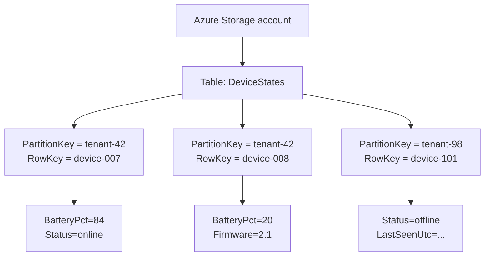
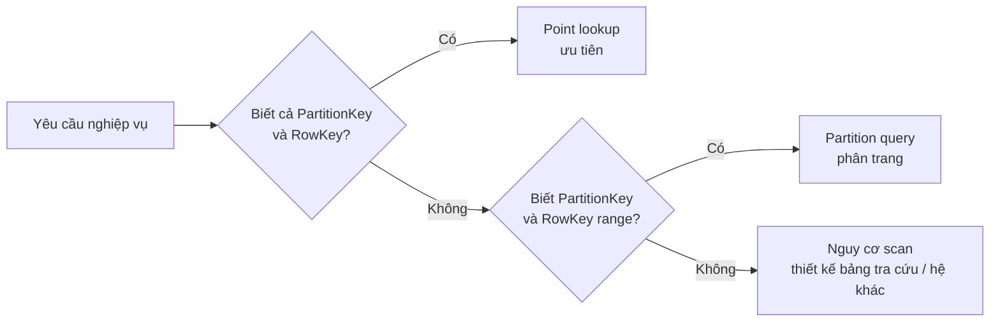
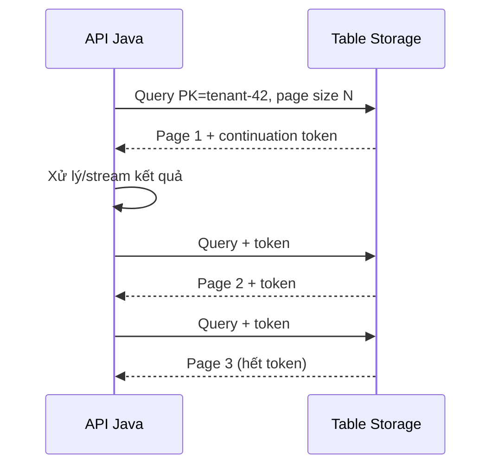
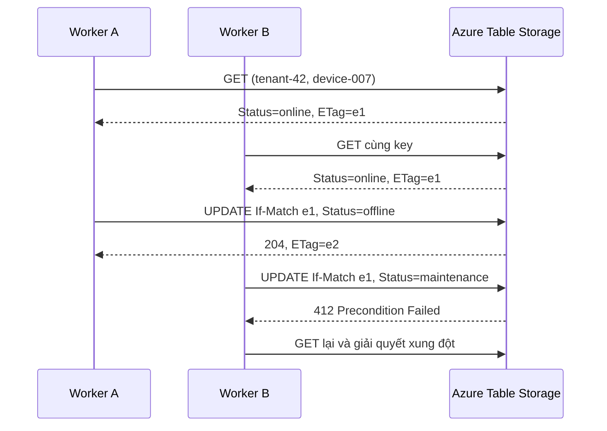
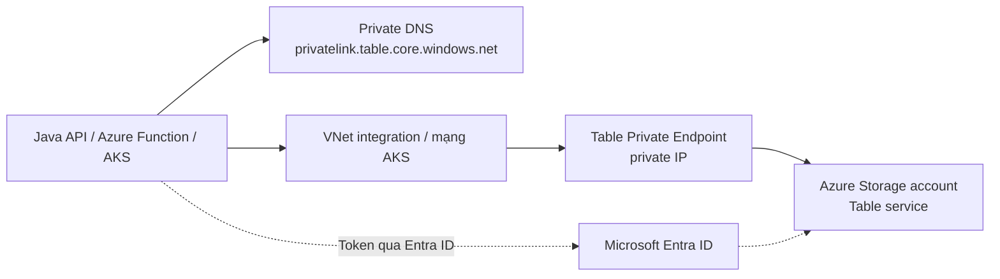
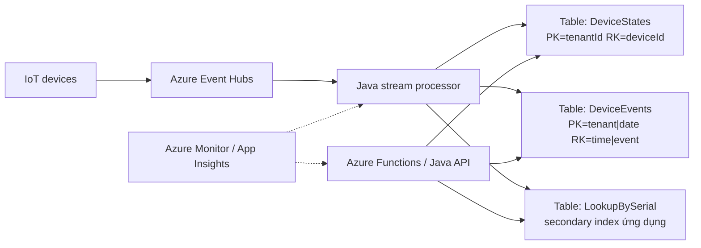

# Azure Table Storage và mô hình dữ liệu key-value

Một ứng dụng quản lý thiết bị IoT cần lưu trạng thái mới nhất của hàng triệu thiết bị: thiết bị thuộc khách hàng nào, lần cập nhật gần nhất, nhiệt độ, mức pin và trạng thái cảnh báo. Truy vấn phổ biến là “lấy thiết bị `device-007` của khách hàng `tenant-42`” hoặc “liệt kê thiết bị của khách hàng `tenant-42`”. Nếu tạo một hệ cơ sở dữ liệu quan hệ với nhiều bảng và join cho một bài toán tra cứu theo khóa đơn giản, kiến trúc có thể phức tạp hơn nhu cầu.

**Azure Table Storage** là dịch vụ lưu trữ NoSQL dạng **key-value/thuộc tính (schemaless entities)** thuộc Azure Storage. Mỗi entity được xác định duy nhất bởi cặp **`PartitionKey` + `RowKey`**, có các thuộc tính tùy biến và có thể được truy vấn qua Table service API. Thiết kế khóa ảnh hưởng trực tiếp đến **mẫu truy cập, phân bố tải, độ trễ, khả năng mở rộng và chi phí giao dịch**.

Trong module **CLOUD_PROVIDERS_AZURE**, bạn tìm hiểu Microsoft Azure từ subscription, resource group và Microsoft Entra ID tới mạng ảo, compute, storage, dữ liệu, triển khai, giám sát, bảo vệ và tối ưu chi phí kiến trúc ứng dụng. Bài thuộc chương **Dữ liệu NoSQL với Cosmos DB**, nhưng tập trung vào **Azure Table Storage**, đồng thời giải thích khác biệt với **Azure Cosmos DB for Table** để chọn dịch vụ đúng với nhu cầu.

## 1. Mục tiêu học tập

Sau bài này, bạn có thể:

- Giải thích bảng, entity, thuộc tính, `PartitionKey`, `RowKey`, `Timestamp` và `ETag`.
- Nhận diện đặc điểm NoSQL/schemaless, khác biệt với relational database và giới hạn của Table service.
- Thiết kế khóa theo **access pattern** thay vì chỉ sao chép khóa chính trong SQL.
- Phân biệt **point query**, **partition query** và **table scan**, cũng như phân trang/continuation tokens.
- Thực hiện CRUD từ Java qua **Azure Data Tables SDK** và Microsoft Entra ID.
- Giải thích **Merge/Replace/Upsert**, optimistic concurrency với `ETag` và transactional batch trong **một partition**.
- Lựa chọn Azure RBAC, managed identity, Private Endpoint và cấu hình mạng phù hợp.
- Phân tích hot partition, denormalization, indexing, giao dịch và chi phí trước khi chọn Table Storage hay Cosmos DB for Table.
- Thiết lập quy trình giám sát, kiểm thử, xử lý lỗi và phục hồi dữ liệu cho ứng dụng production.

## 2. Bản chất key-value của Azure Table Storage

Table Storage lưu **entities** trong **tables**. Mỗi entity giống một tập thuộc tính có kiểu; các entity cùng table **không bắt buộc cùng tập thuộc tính**.



Ví dụ biểu diễn dữ liệu theo kiểu JSON cho dễ đọc:

```json
{
  "PartitionKey": "tenant-42",
  "RowKey": "device-007",
  "Timestamp": "2026-11-20T09:30:00Z",
  "BatteryPct": 84,
  "Status": "online",
  "LastSeenUtc": "2026-11-20T09:29:40Z",
  "Firmware": "2.1"
}
```

**Lưu ý:** Đây là hình biểu diễn logic, không phải toàn bộ định dạng JSON trả về từ SDK/REST. `Timestamp` do dịch vụ quản lý; `ETag` là metadata của entity, thường được SDK phản ánh riêng và không phải một cột nghiệp vụ tùy ý.

| Thành phần | Ý nghĩa | Ai quản lý? |
|---|---|---|
| **Table** | Tập hợp các entity trong Storage account | Ứng dụng/admin tạo và xóa |
| **PartitionKey** | Khóa phân vùng của entity | Ứng dụng chọn lúc ghi |
| **RowKey** | Định danh entity trong một partition | Ứng dụng chọn lúc ghi |
| **PartitionKey + RowKey** | Cặp khóa duy nhất trong một table | Dịch vụ đảm bảo tính duy nhất |
| **Timestamp** | Thời gian sửa đổi do dịch vụ cập nhật | Dịch vụ quản lý |
| **ETag** | Phiên bản/điều kiện để cập nhật có kiểm tra đồng thời | Dịch vụ cấp, client sử dụng |
| **Custom properties** | Dữ liệu nghiệp vụ: Status, BatteryPct, LastSeen... | Ứng dụng định nghĩa/ghi |

Khái niệm **key-value** ở đây không phải mỗi record chỉ chứa đúng một value kiểu chuỗi. Mỗi entity được tra cứu bằng **cặp khóa**, phần “value” là **một tập thuộc tính linh hoạt**. Vì vậy Table Storage thường được gọi là **wide-column hoặc key/attribute store** trong ngữ cảnh học NoSQL, nhưng không cung cấp SQL join hoặc secondary index như một hệ relational database.

## 3. Khóa chính, thứ tự lưu và tính duy nhất

### 3.1. PartitionKey

`PartitionKey` xác định nhóm các entity thuộc cùng logical partition. Nếu ứng dụng thường truy xuất tất cả thiết bị của một khách hàng, `PartitionKey = tenantId` là lựa chọn có thể hợp lý:

```text
Table DeviceStates
  (tenant-42, device-001)
  (tenant-42, device-002)
  (tenant-42, device-007)
  (tenant-98, device-101)
```

Những entity có cùng PartitionKey có thể được **query bằng điều kiện PartitionKey** và tham gia **transactional batch** nếu thỏa các giới hạn của dịch vụ. Tuy nhiên, một PartitionKey được chọn quá rộng có thể khiến **hot partition** khi hầu hết traffic dồn vào một giá trị.

### 3.2. RowKey

`RowKey` phân biệt entity **trong cùng partition**. Vì một table có thể chứa hai entity cùng RowKey nhưng khác PartitionKey, cặp khóa mới là định danh đầy đủ.

| PartitionKey | RowKey | Hợp lệ theo uniqueness? |
|---|---|---|
| `tenant-42` | `device-001` | Có |
| `tenant-42` | `device-002` | Có |
| `tenant-98` | `device-001` | Có: partition khác |
| `tenant-42` | `device-001` | Không nếu là lần `Insert` thứ hai cho entity đã tồn tại |

Nếu dùng `Upsert`, thao tác với khóa đã tồn tại sẽ cập nhật entity theo semantics Merge/Replace, không phải chèn thêm một record có cùng khóa.

### 3.3. Khóa có thứ tự từ điển

Table Storage duy trì chỉ mục theo **PartitionKey và RowKey**; truy vấn lọc chính xác PartitionKey và một khoảng RowKey có thể tận dụng thứ tự khóa. Vì vậy, đối với timestamp cần **sắp xếp theo chuỗi**, hãy dùng dạng ổn định, UTC, độ rộng cố định:

```text
PartitionKey = tenant-42|202611
RowKey       = 20261120T091520Z|evt-000001
```

Nếu `RowKey` là `1`, `2`, `10`, thứ tự từ điển không giống thứ tự số: `1` → `10` → `2`. Với khóa số, hãy dùng **zero-padding** (`000001`, `000002`, `000010`) hoặc mã hóa có quy tắc để đảm bảo range scan đúng.

Không đặt dấu phân cách tùy ý mà không kiểm tra **các ký tự bị cấm và giới hạn kích thước khóa** trong Table service. Một số ký tự như `/`, `\`, `#`, `?` và ký tự điều khiển không hợp lệ trong PartitionKey/RowKey. Nếu mã nghiệp vụ chứa các ký tự đó, hãy encode/normalize bằng quy tắc nhất quán, không dựa vào URL encoding tự phát ở từng client.

## 4. Mô hình schemaless và kiểu thuộc tính

Ví dụ hai entity cùng table nhưng không có cùng trường:

```json
[
  {
    "PartitionKey": "tenant-42",
    "RowKey": "device-007",
    "Status": "online",
    "BatteryPct": 84
  },
  {
    "PartitionKey": "tenant-42",
    "RowKey": "device-008",
    "Status": "maintenance",
    "Firmware": "v2.1",
    "LastErrorCode": 503
  }
]
```

Table Storage không đòi hỏi migration schema ở mức table cho từng property mới. Nhưng **schemaless không đồng nghĩa không cần data contract**. Ứng dụng vẫn phải định nghĩa:

1. **Tên trường** nhất quán, phân biệt viết hoa/viết thường theo xử lý của SDK/hợp đồng.
2. **Kiểu dữ liệu** tương thích: string, Boolean, Int32/Int64, Double, DateTime, Guid, Binary theo kiểu EDM được hỗ trợ.
3. **Các field bắt buộc** và fallback khi property không tồn tại.
4. **SchemaVersion** để phục vụ nâng cấp từng loại entity.
5. **UTC timestamp** và quy tắc làm tròn/độ chính xác; không dùng chuỗi thời gian địa phương không có timezone.
6. **Kích thước và bảo mật payload**, đặc biệt khi có PII.

Các giới hạn kỹ thuật như **kích thước entity tối đa khoảng 1 MiB**, giới hạn số properties và độ dài/kiểu của từng property phải được kiểm tra theo API/version. Không dùng một entity để chứa file ảnh, log dài hàng chục MiB hoặc một mảng JSON tăng vô hạn; với dữ liệu lớn, lưu ở **Azure Blob Storage** rồi để entity giữ đường dẫn và metadata.

### Thuộc tính null và thiếu thuộc tính

Đừng dựa vào việc một field `null` được lưu như một giá trị độc lập giống SQL `NULL`. Một số SDK/REST semantics của Table Storage biểu diễn thuộc tính null như **không có property**. Vì vậy code nên kiểm tra **missing property** thay vì giả định mọi entity đều có `BatteryPct` với null.

## 5. Bắt đầu thiết kế từ access patterns

NoSQL thường đạt hiệu năng tốt khi mô hình dữ liệu đi theo **truy vấn cần hỗ trợ**. Thay vì đưa entity vào table rồi tìm cách join, hãy lập danh sách truy vấn trước:

| Mẫu truy cập | Truy vấn nghiệp vụ | Mô hình khóa gợi ý |
|---|---|---|
| **Point lookup** | Lấy trạng thái một thiết bị của tenant | `PK=tenantId`, `RK=deviceId` |
| **Partition range** | Lấy các sự kiện của tenant trong một tháng | `PK=tenantId|yyyyMM`, `RK=UTCtimestamp|eventId` |
| **Danh sách của chủ sở hữu** | Liệt kê thiết bị theo tenant | `PK=tenantId`, RowKey theo ID |
| **Đọc theo mã đơn** | Tìm order theo orderId khi biết tenant | `PK=tenantId`, `RK=orderId` |
| **Tra theo email** | Tìm thiết bị/khách bằng email | Cần bảng tra cứu phụ hoặc dữ liệu khác; không có global secondary index mặc định |
| **Báo cáo tổng doanh số nhiều tenants** | SUM theo tháng / join OrderDetails | Pipeline phân tích hoặc database phù hợp, không scan cả Table Storage theo từng request |

### Point query — truy vấn thường hiệu quả nhất

Khi biết **cả `PartitionKey` và `RowKey`**, client có thể yêu cầu một entity bằng khóa đầy đủ. Đây là access pattern chủ đạo của Table Storage.

### Partition query — tốt khi giới hạn được phạm vi

Khi biết `PartitionKey` và có điều kiện `RowKey`, ứng dụng có thể quét một khoảng **nhỏ, có ý nghĩa** trong một partition. Phải phân trang vì một partition có thể chứa hàng triệu entity.

### Table scan — cần cân nhắc kỹ

Nếu chỉ tìm `Status = 'online'` mà không giới hạn PartitionKey/RowKey, dịch vụ có thể phải duyệt nhiều entity. **Lọc ở server không có nghĩa truy vấn được tối ưu bằng secondary index.** Truy vấn scan trên bảng lớn có thể chậm, tốn giao dịch và tăng áp lực phân vùng.



## 6. Thiết kế key cho dữ liệu nhiều khách hàng

Giả sử ứng dụng theo dõi các event vận hành của thiết bị theo tenant:

```text
Table: DeviceEvents

PartitionKey: tenant-42|202611
RowKey:       20261120T091520Z|device-007|evt-001
EventType:    temperature_high
TempC:        82.5

PartitionKey: tenant-42|202611
RowKey:       20261120T091612Z|device-008|evt-002
EventType:    battery_low
BatteryPct:   9
```

**Ưu điểm:** truy vấn event của tenant trong tháng cụ thể có thể lọc PartitionKey và khoảng RowKey theo thời gian, giảm lượng dữ liệu phải quét. Khi tháng thay đổi, dữ liệu được chia sang partition logic mới.

**Đánh đổi:** một tenant phát sinh hàng chục nghìn event/giây vẫn có thể tạo **hot partition** trong cả tháng. Với tenant đó, cân nhắc shard theo device, hash bucket hoặc thời gian hẹp hơn (`yyyyMMdd`/giờ) và chấp nhận query phải fan-out qua một số partitions.

### Hai phương án và hệ quả

| Khóa | Ưu điểm | Điểm yếu |
|---|---|---|
| `PK=tenantId, RK=deviceId` | Point lookup thiết bị nhanh; liệt kê theo tenant | Tenant cực lớn/hot có thể dồn tải |
| `PK=tenantId|yyyyMM, RK=timestamp|eventId` | Range scan thời gian theo tenant | Truy vấn xuyên nhiều tháng phải gọi nhiều partitions |
| `PK=tenantId|bucket, RK=deviceId` | Phân bố tải tenant lớn | Phải tính bucket từ ID; liệt kê toàn tenant fan-out |
| `PK=deviceId, RK=timestamp` | Truy vấn lịch sử một thiết bị | Truy vấn tổng hợp theo tenant khó |

**Không có một PartitionKey tối ưu cho tất cả query.** Nếu cần nhiều access patterns quan trọng, thường phải **denormalize** có kiểm soát (nhiều bảng/vật hóa chỉ mục) hoặc chọn database hỗ trợ các kiểu truy vấn phong phú hơn.

## 7. Bảng tra cứu phụ và denormalization

Ví dụ bảng chính `DevicesByTenant` lưu entity với `PK=tenantId, RK=deviceId`. API đôi khi cần tìm thiết bị từ **serialNumber** mà chưa biết tenant. Nếu quét bảng chính mỗi lần tìm sẽ đắt.

Có thể tạo thêm bảng `DeviceLookupBySerial`:

```text
DevicesByTenant:
    PK = tenant-42, RK = device-007
    SerialNumber = SN-ABC-007
    Status = online

DeviceLookupBySerial:
    PK = serial-prefix-ABC, RK = SN-ABC-007
    TenantId = tenant-42
    DeviceId = device-007
```

Luồng tra cứu:

1. Tính `serial-prefix-ABC` từ serial theo quy ước.
2. Point lookup trong `DeviceLookupBySerial` để lấy `TenantId`/`DeviceId`.
3. Point lookup trong `DevicesByTenant` để lấy trạng thái hiện hành.

Đây là **chỉ mục ứng dụng tự quản lý**, không phải secondary index do Azure Table Storage tự xây. Khi thêm/xóa/chuyển tenant, ứng dụng phải cập nhật cả hai bảng. **Table Storage không có giao dịch nguyên tử xuyên các tables hoặc partitions**, nên có thể cần outbox/queue, retry, reconcile và idempotency để giữ tính nhất quán cuối cùng.

**Không lưu dữ liệu nhạy cảm trực tiếp trong RowKey** (email, số điện thoại, token) chỉ để được point lookup: key có thể xuất hiện ở logs/telemetry và làm lộ thông tin. Khi cần lookup theo giá trị nhạy cảm, đánh giá hash có secret/normalization phù hợp, rủi ro enumeration và phương án database khác.

## 8. Truy vấn và giới hạn khả năng lọc

Azure Table Storage sử dụng các truy vấn filter kiểu **OData** qua Table API. Trong Java SDK, `ListEntitiesOptions` có thể gửi điều kiện lọc và danh sách properties cần lấy.

### Point lookup

```text
Table = DeviceStates
PartitionKey = tenant-42
RowKey = device-007
```

Đây là thao tác lấy đúng entity theo hai khóa, không phải lọc ngẫu nhiên trên toàn bảng. Khi thiết kế API `GET /tenants/42/devices/007`, ứng dụng đã biết hai khóa hoặc có thể tính trực tiếp từ URL.

### Truy vấn một partition

```text
PartitionKey eq 'tenant-42'
```

Khi cần thiết bị của tenant và phân trang, truy vấn này hợp lý nếu partition không bị quá tải hoặc chứa dữ liệu cực lớn. **Không nên lấy toàn bộ entities lên RAM rồi mới phân trang phía API**.

### Lọc theo khoảng RowKey

```text
PartitionKey eq 'tenant-42|202611'
and RowKey ge '20261120T000000Z'
and RowKey lt '20261121T000000Z'
```

Nếu RowKey bắt đầu bằng timestamp UTC có độ rộng cố định, giới hạn đầu/cuối giúp đọc một phạm vi thời gian.

### Lọc theo thuộc tính thường

```text
Status eq 'online'
```

Truy vấn này có thể được dịch vụ xử lý, nhưng **không có secondary index mặc định** trên `Status` như index B-tree trong relational DB. Nếu bảng lớn, việc lọc trên thuộc tính không khóa có thể tốn scan. Kể cả khi thêm `PartitionKey` vào filter, chỉ điều kiện trên key có thể được tận dụng để giảm không gian tìm kiếm.

### Không có join và ORDER BY linh hoạt như SQL

Azure Table Storage không hỗ trợ native SQL joins, group-by aggregates, full-text search hay arbitrary secondary indexes cho mọi custom property. Thứ tự dữ liệu dựa trên cặp khóa, nên muốn “lấy 20 event mới nhất” phải **thiết kế RowKey/partition key** và chiến lược pagination phù hợp. Đừng nhầm query filter `RowKey ge ...` với một hệ SQL có thể tự tối ưu mọi ORDER BY/LIMIT.

## 9. Phân trang, continuation token và kết quả lớn

Một truy vấn table có thể trả nhiều **segments/pages** thay vì toàn bộ dữ liệu trong một response. SDK hỗ trợ phân trang và continuation tokens để tiếp tục từ nơi dịch vụ dừng. Query Service API có giới hạn kích thước/số entity mỗi segment và thời gian xử lý theo phiên bản; đừng dựa vào việc một request sẽ trả hết partition.



### Quy tắc vận hành

1. Thiết kế **page size** và giới hạn tổng số entity/API response.
2. Không thực hiện một truy vấn liệt kê vô hạn rồi giữ tất cả entities trong heap.
3. Gắn continuation token với **cùng table, filter, select/projection và ngữ cảnh truy vấn**; không dùng token của truy vấn khác.
4. Token có thể là cấu trúc nội bộ opaque; **không tự giải mã/chỉnh sửa**.
5. Nếu trả token ra client public, cân nhắc mã hóa/ký và kiểm tra quyền để tránh rò rỉ thông tin truy vấn hoặc bị lạm dụng.
6. Khi dữ liệu thay đổi giữa các pages, không giả định toàn bộ kết quả là snapshot cố định có isolation kiểu SQL.

Trong Java, có thể dùng `PagedIterable`/`PagedResponse` của Azure SDK để xử lý từng page. Khi ứng dụng cần một API page 100 entities, hãy giữ nguyên ngữ nghĩa continuation token của SDK thay vì tự tăng số trang và scan bỏ dữ liệu.

## 10. Insert, Update, Merge, Replace, Upsert và Delete

Các thao tác dữ liệu cần được phân biệt rõ, vì chúng ảnh hưởng đến **mất dữ liệu khi có hai writer**.

| Thao tác | Ngữ nghĩa thực hành | Rủi ro/điểm kiểm tra |
|---|---|---|
| **Insert/Create** | Chỉ tạo entity mới với cặp khóa chưa tồn tại | Nếu đã có entity, trả lỗi conflict; hữu ích chống insert trùng |
| **Merge update** | Chỉ cập nhật/ghi thêm những properties có trong payload | Các properties không chỉ định thường được giữ lại |
| **Replace update** | Thay thế tập thuộc tính tùy chỉnh bằng payload mới | Properties cũ không có trong payload có thể bị xóa |
| **Upsert merge** | Nếu chưa tồn tại thì tạo, nếu có thì merge | Dễ ghi đè thay đổi mới nếu không áp điều kiện phù hợp |
| **Upsert replace** | Nếu chưa tồn tại thì tạo, nếu có thì replace | Có thể làm mất properties được writer khác bổ sung |
| **Delete** | Xóa entity theo key/điều kiện | Cần xác định đã kiểm tra ETag hay bỏ qua concurrency |

### Ví dụ vì sao Merge khác Replace

Entity gốc:

```json
{
  "PartitionKey": "tenant-42",
  "RowKey": "device-007",
  "Status": "online",
  "BatteryPct": 84,
  "Firmware": "2.1"
}
```

Writer A gửi payload chỉ có `Status="offline"`:

- Với **Merge**, kết quả có thể giữ `BatteryPct=84` và `Firmware="2.1"`.
- Với **Replace**, hai thuộc tính không gửi lại có thể biến mất.

**Không mặc định Merge là concurrency-safe.** Nếu Writer A và Writer B đều cập nhật `Status` dựa trên state cũ, lần ghi sau có thể ghi đè lần trước. Với nghiệp vụ không chấp nhận lost update, dùng **ETag và điều kiện If-Match**.

## 11. Optimistic concurrency với ETag

Khi client đọc entity, dịch vụ trả `ETag` đại diện cho phiên bản được nhận. Client có thể dùng ETag trong request cập nhật/xóa với **If-Match** để đảm bảo entity vẫn ở phiên bản mà nó đã đọc. Nếu entity đã bị writer khác sửa, dịch vụ thường từ chối với lỗi **`412 Precondition Failed`**.



### Chiến lược khi gặp 412

1. Đọc lại entity hiện tại.
2. So sánh state mới với ý định nghiệp vụ.
3. Nếu thay đổi vẫn hợp lệ, tính toán payload mới và thử ghi lại **có giới hạn số lần**, không loop vô hạn.
4. Nếu xung đột không tự giải được, trả `409`/conflict cấp ứng dụng hoặc chuyển workflow đối soát.
5. Ghi metrics collision rate để phát hiện hot key hoặc nhiều writers tranh chấp.

**Không bỏ điều kiện ETag chỉ để “cho update thành công”.** Đó là cách chuyển lỗi đồng thời rõ ràng thành lỗi mất dữ liệu âm thầm. Bên cạnh ETag, vẫn cần **idempotency key** để tránh xử lý cùng một lệnh nghiệp vụ hai lần.

### Timestamp khác ETag

`Timestamp` hữu ích cho biết lần sửa gần nhất do dịch vụ ghi nhận, nhưng không phải thay thế tuyệt đối cho ETag trong kiểm soát phiên bản. Dùng **ETag** để thực hiện optimistic concurrency; dùng **LastUpdatedAt** riêng nếu ứng dụng cần thời gian nghiệp vụ do producer xác nhận.

## 12. Transactional batch: tính nguyên tử trong một partition

Azure Table Storage hỗ trợ **entity group transactions (transactional batch)** với những thao tác thỏa điều kiện, nổi bật:

- Những entity cùng **một table** và **một PartitionKey**.
- Tối đa **100 thao tác trong một batch** và giới hạn **4 MiB** cho một transaction theo API Table Storage thông dụng.
- Batch được xử lý **atomic**: thành công tất cả hoặc thất bại theo transaction semantics.
- Có quy tắc riêng với thao tác trùng entity/key và concurrency; cần kiểm tra SDK/API tương ứng.

**Không có transaction nguyên tử giữa hai PartitionKeys hoặc hai tables** chỉ vì chúng nằm trong cùng Storage account.

### Ví dụ batch cùng partition

```text
Table OrderState
  PK = tenant-42|order-1001, RK = header
  PK = tenant-42|order-1001, RK = line-001
  PK = tenant-42|order-1001, RK = line-002
```

Nếu cả ba entity cùng PartitionKey, có thể tạo chúng trong một entity group transaction theo giới hạn. Nhưng nếu một đơn có hàng trăm nghìn lines, thiết kế gộp tất cả vào một batch sẽ không phù hợp. Cần chia transactions, thiết kế trạng thái hoàn tất có checkpoint hoặc dùng relational database nếu nghiệp vụ yêu cầu transaction lớn.

### Một lưu ý quan trọng về “phân vùng nghiệp vụ”

Tổ chức tất cả entity của một đơn hàng vào `PK=tenant|order` giúp atomic batch trong phạm vi đơn đó, nhưng lại khiến truy vấn “toàn bộ đơn của tenant” phải fan-out hoặc dùng **bảng chỉ mục phụ**. Đây là trade-off cơ bản giữa:

- Giao dịch nhóm theo đơn;
- Truy vấn theo tenant;
- Phân bố tải và số lượng partitions;
- Chi phí duy trì dữ liệu vật hóa trùng.

**Thiết kế PartitionKey nên bắt đầu từ truy vấn và ranh giới giao dịch cùng lúc**, không chỉ từ mong muốn một trong hai.

## 13. Tính nhất quán, replication và giới hạn phục hồi

Azure Storage cung cấp tính nhất quán mạnh cho thao tác trên primary endpoint theo semantics dịch vụ: sau một ghi thành công, lần đọc sau đó tại primary cho phép quan sát thay đổi tương ứng. Tuy nhiên:

- **Geo-replication** ở các account có RA-GRS/RA-GZRS là **bất đồng bộ** tới secondary; việc đọc secondary có thể thấy dữ liệu cũ và failover có thể liên quan RPO.
- Đọc qua nhiều pages **không bảo đảm snapshot isolation toàn bảng** khi dữ liệu đang liên tục thay đổi.
- Một workflow ghi **hai tables/partitions** không có transaction chung: có thể quan sát trạng thái trung gian.
- ETag giúp phát hiện lost update khi được sử dụng đúng, nhưng không tự giải quyết nghiệp vụ side effects ngoài Table Storage.

### Đừng nhầm redundancy với backup

LRS/ZRS/GRS bảo vệ trước một số lỗi hạ tầng theo mức redundancy được chọn; **không tự bảo đảm khôi phục entity đã bị ứng dụng xóa nhầm**. Với nhu cầu RPO/RTO thực tế, thiết kế export/snapshot cấp ứng dụng hoặc pipeline backup được phê duyệt, versioned records, retention và diễn tập khôi phục theo khả năng dịch vụ.

Ví dụ ứng dụng vô tình replace entity và làm mất trường `Firmware`; bản sao geo cũng có thể phản ánh thay đổi sai. Cần có lịch sử/audit hoặc nguồn dữ liệu có thể tái tạo để phục hồi giá trị cũ.

## 14. Chuẩn bị Azure Storage Table cho thực hành

Ví dụ lab dùng tên minh họa; **không áp dụng lệnh sửa đổi trực tiếp cho production**:

| Thành phần | Giá trị mẫu | Mục đích |
|---|---|---|
| Subscription | `<subscription-id>` | Subscription được cấp quyền |
| Resource group | `rg-tables-lab` | Quản lý tài nguyên |
| Storage account | `sttablelab001` | Chứa Table service |
| Table | `DeviceStates` | Lưu trạng thái thiết bị |
| Java application | `device-api` | Thực hiện CRUD |
| Principal ứng dụng | Managed identity hoặc developer identity được cấp quyền | Truy cập qua Entra ID |

### 14.1. Kiểm tra Storage account hiện có

```bash
az login
az account set --subscription "<subscription-id>"

az storage account show \
  --resource-group "rg-tables-lab" \
  --name "sttablelab001" \
  --query "{name:name,location:location,kind:kind,sku:sku.name,publicAccess:publicNetworkAccess}" \
  --output json
```

Đây là lệnh **read-only**. Hãy chọn Storage account có **Table service** được hỗ trợ và chính sách mạng phù hợp. Không suy rằng mọi loại Storage account/SKU đều có cùng danh mục dịch vụ hoặc tính năng.

### 14.2. Tạo table bằng Azure portal

1. Mở [Azure portal](https://portal.azure.com/) và xác nhận đúng tenant/subscription.
2. Chọn Storage account dùng cho lab.
3. Tìm mục **Tables** trong phần Data storage/Table service nếu account hỗ trợ.
4. Tạo table tên `DeviceStates`, đúng yêu cầu đặt tên của Azure Storage Table.
5. Kiểm tra endpoint Table service của account, thường có dạng:

   `https://sttablelab001.table.core.windows.net`

6. Kiểm tra **Networking**, quyền data plane và khả năng truy cập từ môi trường chạy Java.

Bạn cũng có thể tạo table qua **Azure SDK** hoặc IaC, tùy chính sách quản lý hạ tầng. Với production, nên đưa tên table, RBAC/network và quy trình provision vào Terraform/Bicep/ARM hoặc hệ thống triển khai đã được phê duyệt, không để một web request bất kỳ tự tạo table khi khởi động.

### 14.3. Local development bằng Azurite?

**Azurite** là Storage emulator hữu ích cho một số dịch vụ và mô hình Table service được hỗ trợ theo phiên bản. Khi sử dụng, kiểm tra Table endpoint, connection string local và mức độ tương thích API của bản Azurite đang chạy. Emulator không thay thế kiểm thử **Microsoft Entra ID, Azure RBAC, private endpoint, quota và latency** trên Azure thật.

Không sử dụng production connection string làm cấu hình mặc định của máy phát triển.

## 15. Xác thực và phân quyền: Entra ID, RBAC, SAS

Azure Table Storage hỗ trợ những mô hình xác thực phù hợp với Storage service như **Microsoft Entra ID và Azure RBAC**, account keys hoặc SAS trong các trường hợp được hỗ trợ. Với ứng dụng Azure mới, **ưu tiên managed identity/Workload Identity** để giảm rủi ro lưu shared secret dài hạn.

### Role ở tầng dữ liệu

| Principal | Nhu cầu | Role nên đánh giá |
|---|---|---|
| API đọc trạng thái thiết bị | Chỉ đọc entities | **Storage Table Data Reader** |
| Worker cập nhật trạng thái | Tạo, sửa, xóa entities cần thiết | **Storage Table Data Contributor** |
| Người vận hành chỉ xem Storage account | Quản lý/đọc resource properties | Azure RBAC management Reader tương ứng |
| Pipeline cấu hình Storage account/network | Thay đổi tài nguyên quản lý | Management role ở scope nhỏ nhất |

**Azure RBAC Reader/Contributor của Storage account không mặc định tương đương quyền đọc/ghi data plane bằng Microsoft Entra token.** Hãy cấp role `Storage Table Data Reader` hoặc `Storage Table Data Contributor` ở scope dịch vụ/table/account được hỗ trợ theo mục đích thực.

### Role assignment từ CLI

Ví dụ gán quyền cho một managed identity đã tồn tại; chỉ chạy khi người thực hiện có quyền gán role ở scope tương ứng:

```bash
STORAGE_ID=$(az storage account show \
  --resource-group "rg-tables-lab" \
  --name "sttablelab001" \
  --query id --output tsv)

# Giá trị thật lấy từ principalId của managed identity ứng dụng.
APP_PRINCIPAL_ID="<managed-identity-principal-object-id>"

az role assignment create \
  --assignee-object-id "$APP_PRINCIPAL_ID" \
  --assignee-principal-type ServicePrincipal \
  --role "Storage Table Data Contributor" \
  --scope "$STORAGE_ID"

# Đọc lại assignment sau khi cấp.
az role assignment list \
  --scope "$STORAGE_ID" \
  --include-inherited \
  --output table
```

**Phân biệt ID:** `principalId/objectId` dùng cho role assignment; `clientId` thường được dùng để chọn user-assigned managed identity trong SDK. Nếu ứng dụng chạy AKS, workload identity phải được gắn đúng ServiceAccount/federated credential; gán role cho identity của AKS control plane không tự cấp quyền cho Java pod.

### SAS và account keys

- **Account key** có phạm vi rất rộng đối với dữ liệu Storage account; hạn chế dùng trong ứng dụng runtime.
- **SAS** có thể cấp quyền giới hạn thời gian/tài nguyên/thao tác theo loại SAS áp dụng; phải bảo vệ token và có chính sách rotation.
- Với môi trường production, xem xét cấu hình **disallow Shared Key authorization** khi được hỗ trợ và sau khi đã kiểm kê client/feature còn cần Shared Key; xác minh tác động tới Table service và tích hợp hiện hữu trước thay đổi.
- Không commit connection string, account key hoặc SAS token vào Git, container image, log, ticket hay ví dụ đào tạo.

Role assignment có thể cần một khoảng thời gian để có hiệu lực. Khi mới cấp quyền mà ứng dụng nhận lỗi `403`, hãy kiểm tra **principal thực tế, scope, token cache, network** trước khi cấp quyền rộng hơn.

## 16. Bảo vệ mạng: Public Endpoint, firewall và Private Endpoint

Storage account có thể áp dụng network rules và **Azure Private Link** theo loại account/dịch vụ được hỗ trợ. Truy cập data plane Table cần phân biệt với truy cập Blob hoặc Queue: **một private endpoint cho Blob không tự tạo private endpoint cho Table**.

### Các phương án thường gặp

| Cách kết nối | Đặc điểm | Khi dùng |
|---|---|---|
| Public endpoint với TLS + identity | Client dùng `https://<account>.table.core.windows.net` | Lab/ứng dụng được phép truy cập công khai, có kiểm soát |
| Firewall/IP allowlist hoặc network rules | Hạn chế nguồn truy cập public theo tính năng | Khi có IP egress rõ ràng, chính sách cho phép |
| VNet service endpoint / rules | Kiểm soát truy cập qua mạng Azure theo khả năng Storage | Mạng Azure được phép, không phải private IP của Private Link |
| **Private Endpoint cho Table** | Table service được truy cập qua private IP trong VNet | Dữ liệu cần đường mạng riêng, phù hợp với chính sách |

### Endpoint và DNS cho Table

Endpoint ứng dụng tiếp tục sử dụng:

```text
sttablelab001.table.core.windows.net
```

Private DNS zone điển hình:

```text
privatelink.table.core.windows.net
```

Khi tạo Private Endpoint cho **subresource/group ID `table`**, một private IP được gán trong VNet. Với private DNS zone/link và routing hợp lệ, hostname Table service chuẩn sẽ phân giải đến đường private tương ứng từ những mạng được phép.



**Private Endpoint không cấp quyền đọc/ghi entity**: client vẫn cần TokenCredential/RBAC hoặc một cơ chế xác thực hợp lệ. Ngược lại, identity có role hợp lệ vẫn sẽ không truy cập được nếu DNS/route/firewall chặn đường mạng.

### Trình tự kiểm tra mạng

1. Xác định đúng Storage account và **Table endpoint**.
2. Kiểm tra private endpoint **Approved** và subresource `table`.
3. Kiểm tra Private DNS zone và VNet links/forwarding, đặc biệt nếu dùng custom DNS hoặc hub-and-spoke.
4. Từ chính VM/pod/Function worker, chạy `nslookup sttablelab001.table.core.windows.net`.
5. Xác minh hostname cuối cùng phân giải tới **private IP mong muốn**.
6. Kiểm tra HTTPS **TCP 443**, NSG/route/firewall và TLS.
7. Sau cùng mới kiểm tra token, RBAC và entity/table name.

Ví dụ chẩn đoán:

```bash
nslookup sttablelab001.table.core.windows.net

# Khi môi trường có netcat:
nc -vz sttablelab001.table.core.windows.net 443
```

**TCP 443 thành công chưa chứng minh role đúng**. Nếu Storage account bị giới hạn public access, một máy local không có VPN/route phù hợp có thể bị từ chối dù `az login` và RBAC đều đúng. Không mở public access toàn Internet như cách “sửa” mặc định.

### Tạo Private Endpoint trong lab

Trong Azure portal, chọn Storage account → **Networking → Private endpoint connections** (tên mục tùy giao diện), tạo private endpoint, chọn **Table service** thay vì Blob, VNet/subnet được phép và tích hợp Private DNS zone. Kiểm tra approval, private IP và resolution trước khi giới hạn public access. Nếu hệ thống đã dùng private endpoints cho Blob/Queue, **không tái sử dụng suy đoán rằng chúng bao phủ Table**.

## 17. Java SDK: dependency, client và cấu hình an toàn

Azure SDK for Java có thư viện **`com.azure:azure-data-tables`** với `TableClient` và `TableServiceClient`. Với Azure Table Storage, ví dụ dùng **Microsoft Entra token** thông qua `com.azure:azure-identity` và `DefaultAzureCredential`.

### 17.1. Dependency

Trong Maven, khai báo dependencies theo **phiên bản đã được tổ chức kiểm tra** hoặc dùng Azure SDK BOM; ví dụ khung Maven (thay placeholder bằng bản được phê duyệt):

```xml
<dependencies>
    <dependency>
        <groupId>com.azure</groupId>
        <artifactId>azure-data-tables</artifactId>
        <version>REPLACE_WITH_APPROVED_VERSION</version>
    </dependency>
    <dependency>
        <groupId>com.azure</groupId>
        <artifactId>azure-identity</artifactId>
        <version>REPLACE_WITH_APPROVED_VERSION</version>
    </dependency>
</dependencies>
```

```text
AZURE_STORAGE_TABLE_ENDPOINT=https://sttablelab001.table.core.windows.net
AZURE_STORAGE_TABLE_NAME=DeviceStates
```

Hai biến trên chứa tên/endpoint, **không phải secret**. Local developer có thể dùng `az login` với tài khoản được gán Storage Table Data Contributor trong lab; môi trường Azure dùng managed identity/Workload Identity. Với user-assigned managed identity, cấu hình `AZURE_CLIENT_ID` hoặc credential cụ thể theo phiên bản SDK và mô hình triển khai.

### 17.2. Tạo TableClient

```java
import com.azure.data.tables.TableClient;
import com.azure.data.tables.TableClientBuilder;
import com.azure.identity.DefaultAzureCredentialBuilder;

public final class TableClients {
    static String requiredEnv(String name) {
        String value = System.getenv(name);
        if (value == null || value.isBlank()) {
            throw new IllegalArgumentException("Missing env var: " + name);
        }
        return value;
    }

    static TableClient deviceStatesClient() {
        return new TableClientBuilder()
                .endpoint(requiredEnv("AZURE_STORAGE_TABLE_ENDPOINT"))
                .tableName(requiredEnv("AZURE_STORAGE_TABLE_NAME"))
                .credential(new DefaultAzureCredentialBuilder().build())
                .buildClient();
    }
}
```

**Thay endpoint bằng account thực** và kiểm tra Data Contributor/Reader phù hợp. Đối với production, client nên được tái sử dụng theo lifecycle của ứng dụng thay vì tạo mới cho từng HTTP request. Không đưa exception chứa secret hoặc payload nhạy cảm vào log.

### 17.3. Tạo table khi cần (provisioning)

Việc tạo table là **thao tác provision**, nên thuộc pipeline/hạ tầng có quyền phù hợp thay vì mỗi request chạy `createTableIfNotExists`. Một cách biểu đạt bằng SDK:

```java
import com.azure.data.tables.TableServiceClient;
import com.azure.data.tables.TableServiceClientBuilder;
import com.azure.identity.DefaultAzureCredentialBuilder;

// Đặt trong method provisioning của ứng dụng có quyền phù hợp.
TableServiceClient serviceClient = new TableServiceClientBuilder()
        .endpoint(System.getenv("AZURE_STORAGE_TABLE_ENDPOINT"))
        .credential(new DefaultAzureCredentialBuilder().build())
        .buildClient();

serviceClient.createTableIfNotExists("DeviceStates");
```

Đây là đoạn mã **đặt trong method hoặc khối khởi tạo thích hợp** và chỉ dùng khi principal có quyền tạo table theo Storage Table service. Tài nguyên production nên được tạo bởi IaC/pipeline được kiểm soát. Khi chuyển sang **Azure Cosmos DB for Table**, endpoint, cách xác thực/quyền và việc cấp capacity khác, không mặc định copy-paste toàn bộ cấu hình Storage RBAC.

## 18. Java CRUD: tạo, đọc, merge, upsert và xóa entity

Ví dụ Java sau giả định class `TableClients` ở mục trước, table `DeviceStates` đã tồn tại và identity có quyền ghi. Lưu ý `TableEntity` chứa PartitionKey/RowKey và map properties; không nên ép mọi property về chuỗi nếu bạn cần filter/logic theo kiểu số/ngày.

### 18.1. Insert và point lookup

```java
import com.azure.data.tables.TableClient;
import com.azure.data.tables.models.TableEntity;
import java.time.OffsetDateTime;
import java.time.ZoneOffset;

public final class DeviceTableCrud {
    public static void main(String[] args) {
        TableClient table = TableClients.deviceStatesClient();

        String partitionKey = "tenant-42";
        String rowKey = "device-007";

        TableEntity newDevice = new TableEntity(partitionKey, rowKey)
                .addProperty("Status", "online")
                .addProperty("BatteryPct", 84)
                .addProperty("Firmware", "2.1")
                .addProperty("SchemaVersion", 1)
                .addProperty("LastSeenUtc",
                        OffsetDateTime.now(ZoneOffset.UTC));

        // CREATE chỉ thành công nếu cặp khóa chưa tồn tại.
        table.createEntity(newDevice);

        TableEntity stored = table.getEntity(partitionKey, rowKey);
        System.out.println("PK=" + stored.getPartitionKey());
        System.out.println("RK=" + stored.getRowKey());
        System.out.println("Status=" + stored.getProperty("Status"));
        System.out.println("ETag=" + stored.getETag());
    }
}
```

Nếu chạy lại cùng code với cùng khóa, `createEntity` có thể trả **`409 Conflict`** vì entity đã tồn tại; đó là hành vi có ích để phát hiện bản ghi trùng. Với thao tác **upsert**, bạn chủ động chọn ý nghĩa tạo hoặc cập nhật, không dùng upsert khi nghiệp vụ bắt buộc “chỉ chèn một lần”.

### 18.2. Merge và upsert

```java
import com.azure.data.tables.TableClient;
import com.azure.data.tables.models.TableEntity;
import com.azure.data.tables.models.TableEntityUpdateMode;

TableClient table = TableClients.deviceStatesClient();

TableEntity statusPatch = new TableEntity("tenant-42", "device-007")
        .addProperty("Status", "offline");

// UPSERT_MERGE: tạo nếu chưa tồn tại, hoặc merge nếu đã tồn tại.
table.upsertEntity(statusPatch, TableEntityUpdateMode.MERGE);

// Với cập nhật có kiểm soát phiên bản, xem mục ETag tiếp theo.
```

Đoạn trên là **snippet trong method Java**, không phải class độc lập. `upsertEntity` không có cùng semantics với update có `If-Match`, do đó nên dùng cho những thuộc tính có chính sách last-write-wins được chấp nhận hoặc những giá trị đủ idempotent.

### 18.3. Delete

```java
TableClient table = TableClients.deviceStatesClient();

// Chỉ xóa trên lab và sau khi đã xác nhận khóa.
table.deleteEntity("tenant-42", "device-007");
```

Đoạn này minh họa delete **theo khóa**. Với nghiệp vụ cần tránh xóa một phiên bản mới bị worker khác cập nhật, dùng API hỗ trợ **ETag/If-Match** phù hợp thay vì xóa vô điều kiện.

### 18.4. Làm gì khi entity không tồn tại?

SDK thường ném `TableServiceException` với HTTP `404` cho point lookup không tìm thấy, `409` cho insert trùng, `412` cho lỗi điều kiện ETag. Ở tầng API nghiệp vụ:

- Chuyển **404 thật** thành thông báo không tìm thấy (hoặc giá trị mặc định có chủ đích).
- Không nuốt mọi exception rồi trả `null`; lỗi `403` hoặc network không phải “entity không tồn tại”.
- Gắn correlation ID/tracing, tránh log toàn bộ entity nếu có dữ liệu cá nhân.

## 19. Java: truy vấn một partition và xử lý nhiều trang

Khi client biết tenant, hãy filter theo PartitionKey. Ví dụ dùng SDK `ListEntitiesOptions`:

```java
import com.azure.data.tables.TableClient;
import com.azure.data.tables.models.ListEntitiesOptions;
import com.azure.data.tables.models.TableEntity;
import java.util.List;

TableClient table = TableClients.deviceStatesClient();

ListEntitiesOptions options = new ListEntitiesOptions()
        .setFilter("PartitionKey eq 'tenant-42'")
        .setSelect(List.of(
                "PartitionKey", "RowKey", "Status", "BatteryPct"));

int maxItemsForThisRequest = 100;
int count = 0;
for (TableEntity entity : table.listEntities(options, null, null)) {
    System.out.printf("%s / %s: %s%n",
            entity.getPartitionKey(),
            entity.getRowKey(),
            entity.getProperty("Status"));
    if (++count >= maxItemsForThisRequest) {
        break;
    }
}
```

**Đây là ví dụ giới hạn số entity xử lý ở client**, không phải triển khai phân trang HTTP API hoàn chỉnh. Khi API cần tiếp tục lấy trang tiếp theo:

- Dùng `PagedIterable.iterableByPage(...)` hoặc API paging tương đương của SDK để lấy page và continuation token.
- Đặt giới hạn page size và **tổng tài nguyên** được phép tiêu thụ cho mỗi API request.
- Trả token opaque an toàn cho client, không tự tạo page number bằng cách đọc/bỏ hàng nghìn entities.
- Với filter dựa vào dữ liệu từ người dùng, **escape giá trị OData** (đặc biệt dấu nháy đơn) hoặc dùng phương thức xây query an toàn; không nối chuỗi không kiểm soát.

Ví dụ truy vấn theo khoảng thời gian trong cùng partition:

```java
String partition = "tenant-42|202611";
String filter = "PartitionKey eq '" + partition
        + "' and RowKey ge '20261120T000000Z'"
        + " and RowKey lt '20261121T000000Z'";

ListEntitiesOptions dayQuery =
        new ListEntitiesOptions().setFilter(filter);
for (TableEntity event : table.listEntities(dayQuery, null, null)) {
    // Chỉ xử lý và ghi nhận dữ liệu cần thiết.
    System.out.println(event.getRowKey());
}
```

Đây là giá trị partition hard-coded trong lab để minh họa query shape. Trong production, cần validation/escape theo hợp đồng key và pagination. Nếu một ngày có hàng triệu events, không duyệt toàn bộ mỗi khi người dùng mở một màn hình.

## 20. Java ETag: tránh lost update khi hai writers ghi đồng thời

Giả sử hai workers cùng nhận event cập nhật thiết bị. Một worker đọc `BatteryPct=84`, worker kia đã sửa thành 81, sau đó worker đầu ghi đè một entity cũ. Với optimistic concurrency, đọc entity hiện tại và cập nhật có điều kiện theo ETag.

```java
import com.azure.core.util.Context;
import com.azure.data.tables.TableClient;
import com.azure.data.tables.models.TableEntity;
import com.azure.data.tables.models.TableEntityUpdateMode;
import com.azure.data.tables.models.TableServiceException;

public final class DeviceConditionalUpdate {
    public static void main(String[] args) {
        TableClient table = TableClients.deviceStatesClient();
        TableEntity current =
                table.getEntity("tenant-42", "device-007");
        current.addProperty("BatteryPct", 81);

        try {
            // ifUnchanged=true: yêu cầu chỉ update nếu ETag còn khớp.
            table.updateEntityWithResponse(
                    current,
                    TableEntityUpdateMode.MERGE,
                    true,
                    null,
                    Context.NONE);
            System.out.println("Updated with ETag check");
        } catch (TableServiceException e) {
            if (e.getResponse() != null
                    && e.getResponse().getStatusCode() == 412) {
                System.err.println("Concurrent update; reload and reconcile");
                return;
            }
            throw e;
        }
    }
}
```

Với phiên bản Azure Data Tables SDK khác nhau, kiểm tra overload của `updateEntityWithResponse` và tham số `ifUnchanged` trong API đang dùng. **Không bỏ qua lỗi 412 để retry cùng entity cũ**: đọc lại entity, tính state mới theo quy tắc nghiệp vụ, rồi thực hiện lại có giới hạn.

### Không dùng ETag thay business deduplication

Nếu cùng một event tăng `ViewCount` được giao lại hai lần, hai lần ghi có ETag mới vẫn có thể tăng view count hai lần. Hãy dùng **event ID/idempotency record** trong thiết kế xử lý message; ETag chỉ giải quyết vấn đề **cập nhật đồng thời một phiên bản**, không bảo vệ “chỉ xử lý một sự kiện một lần”.

## 21. Java transactional batch trong cùng partition

Giả sử một đơn hàng có header và hai line items. Nếu cần **cùng thành công hoặc cùng thất bại** khi tạo các entities trong một partition, sử dụng transactional batch. Azure SDK cung cấp `TableTransactionAction` và `TableTransactionActionType`.

```java
import com.azure.data.tables.TableClient;
import com.azure.data.tables.models.TableEntity;
import com.azure.data.tables.models.TableTransactionAction;
import com.azure.data.tables.models.TableTransactionActionType;
import java.util.List;

public final class OrderBatchExample {
    public static void main(String[] args) {
        TableClient table = TableClients.deviceStatesClient();
        // Lab thật: dùng table OrderState thay vì DeviceStates.
        // Ví dụ chỉ minh họa yêu cầu một PartitionKey chung.
        String pk = "tenant-42|order-1001";

        TableEntity header = new TableEntity(pk, "header")
                .addProperty("Status", "created")
                .addProperty("OrderId", "order-1001");
        TableEntity line1 = new TableEntity(pk, "line-001")
                .addProperty("Sku", "SKU-A")
                .addProperty("Quantity", 2);
        TableEntity line2 = new TableEntity(pk, "line-002")
                .addProperty("Sku", "SKU-B")
                .addProperty("Quantity", 1);

        List<TableTransactionAction> actions = List.of(
                new TableTransactionAction(
                        TableTransactionActionType.CREATE, header),
                new TableTransactionAction(
                        TableTransactionActionType.CREATE, line1),
                new TableTransactionAction(
                        TableTransactionActionType.CREATE, line2));

        table.submitTransaction(actions);
        System.out.println("Committed order entities atomically");
    }
}
```

**Chú ý khi thực hành:** đoạn minh họa đang gọi `TableClients.deviceStatesClient()` chỉ để tái sử dụng cách tạo client; trong hệ thống thật phải dùng một `TableClient` trỏ tới **table `OrderState`** được tạo sẵn. Không gửi entities của đơn hàng vào `DeviceStates` rồi coi đó là thiết kế production.

Nếu một trong ba entities đã tồn tại và `CREATE` thất bại, cả transactional batch không được ghi thành công một phần theo semantics dịch vụ. Các thao tác phải tuân thủ **cùng table, cùng PartitionKey**, hạn mức số operations/payload và các điều kiện ETag nếu có.

### Vì sao batch không thể thay Saga?

Nếu một đơn hàng cần:

1. Tạo entity order trong Table Storage;
2. Giữ tồn kho ở database khác;
3. Gửi message vào Azure Service Bus;

thì Table transaction **chỉ bao phủ các thao tác cùng partition của một table**. Không có distributed transaction tự động xuyên cả Table Storage, database và Service Bus. Dùng **outbox, idempotent consumers, retry và Saga/compensation** khi nghiệp vụ cần nhất quán qua các hệ thống.

## 22. Tối ưu hiệu năng: hotspot, phân vùng và retry

Table Storage được thiết kế cho quy mô lớn, nhưng **phân vùng không đồng đều** có thể trở thành điểm nghẽn. Ví dụ mọi worker cùng cập nhật một entity `PK=all, RK=counter` để đếm request sẽ gây tranh chấp ETag và tạo một hot key.

### Dấu hiệu hot partition

- `503 Server Busy` hoặc throttling tăng ở một số khóa dù tổng Storage account chưa có vẻ bão hòa.
- Latency tăng theo từng nhóm PartitionKey cụ thể.
- Nhiều update gặp `412 Precondition Failed` do cạnh tranh cùng entity.
- Truy vấn liệt kê một tenant lớn bị chậm hoặc trả quá nhiều pages.
- Workload tăng theo sự kiện nhưng chỉ một partition gánh phần lớn writes.

### Các chiến lược phân tán

| Chiến lược | Ví dụ | Đánh đổi |
|---|---|---|
| **Sharding theo hash bucket** | `PK=tenant-42|b03` | Query toàn tenant fan-out tới nhiều bucket |
| **Phân vùng theo thời gian** | `PK=tenant-42|20261120` | Query xuyên nhiều ngày cần hợp nhất |
| **Khóa theo thực thể nhỏ hơn** | `PK=device-007` | Query theo tenant phải có bảng tra cứu |
| **Gom/batch trong một partition** | Atomic updates các entity liên quan | Không giảm hot partition nếu mọi request cùng key |
| **Giảm writes trùng** | Chỉ ghi khi trạng thái thay đổi | Cần so sánh/idempotency và có thể phát sinh đọc |
| **Asynchronous aggregation** | Nhiều counters shard rồi tổng hợp định kỳ | Tổng số gần thời gian thực có thể không tức thì |

Không thêm shard ngẫu nhiên trước khi biết client sẽ **tính được bucket** từ request. Nếu muốn point lookup, bucket nên được xác định một cách deterministic từ ID hoặc lưu trong bảng tra cứu phụ. Nếu `bucket=RANDOM()` mỗi lần ghi, client sẽ phải scan tất cả buckets để tìm entity.

### Retry khi throttling

Với lỗi tạm như `503`/throttling, SDK có thể hỗ trợ retry mặc định. Khi tùy chỉnh:

- Dùng **bounded exponential backoff + jitter**.
- Đặt request timeout và deadline toàn thao tác.
- Không retry vô hạn khi thiếu role (`403`), entity không tồn tại (`404`) hoặc payload sai (`400`).
- Với `409` và `412`, xử lý theo **business semantics** (trùng insert/ETag conflict), không chỉ ngủ rồi gửi lại request cũ.
- Giới hạn concurrency/bulkhead trong mỗi worker, quan sát account và partition pressure.
- Không tăng số client threads vô hạn để “vượt throttle”; điều đó thường làm vấn đề nặng hơn.

### Tránh chi phí scan và egress không cần thiết

API chỉ cần `Status` nhưng truy vấn trả tất cả custom properties, blobs dưới dạng Binary hoặc nhiều pages sẽ dùng nhiều băng thông/RAM hơn cần thiết. Dùng **projection/select** để chỉ lấy các properties thiết yếu; lưu payload lớn ở Blob Storage và trả một tham chiếu có phân quyền.

## 23. Chi phí: giá theo dung lượng và transactions, không phải RU/s

**Azure Table Storage** thuộc Azure Storage, có mô hình tính chi phí theo khả năng lưu trữ và các hoạt động dịch vụ (transactions/operations), cộng phí redundancy, network/egress và monitoring theo cấu hình/region. **Nó không dùng mô hình RU/s của Azure Cosmos DB for Table**.

### Khung dự toán sơ bộ

| Thành phần | Ví dụ phát sinh chi phí | Cách tối ưu |
|---|---|---|
| **Dung lượng dữ liệu** | Số entity × kích thước trung bình, replication | Giữ thuộc tính cần thiết, TTL/xóa theo lịch ứng dụng |
| **Read operations** | Point get, query nhiều pages, lọc thiếu PartitionKey | Thiết kế access pattern, bảng chỉ mục phụ hợp lý |
| **Write operations** | Insert, Merge, Replace, Upsert, Delete và retries | Batch hợp lệ, giảm cập nhật thừa, idempotency |
| **Network egress** | Client khác region/ra Internet, kết quả query lớn | Đặt compute gần storage, projection, phân trang |
| **Private Link/DNS/firewall** | Private endpoints, networking và DNS services | Thiết kế tối thiểu đủ tuân thủ, không trùng dịch vụ |
| **Monitoring** | Metrics, log ingestion, retention | Theo dõi lỗi/latency đủ dùng, không log payload |
| **Backup/export** | Bản sao lưu ứng dụng/Archive và xử lý phục hồi | Chọn RPO/RTO, retention đúng nhu cầu |

Ví dụ một API point lookup 100.000 lần/ngày có mô hình chi phí rất khác với API thực hiện **một table scan toàn bộ hàng triệu entity** 100.000 lần/ngày. Tối ưu query shape thường mang lại hiệu quả lớn hơn việc tiết kiệm vài bytes của một property.

**Không lấy bảng giá cũ làm đơn giá cố định**. Dùng Azure Pricing Calculator và Cost Management cho Storage account, region, redundancy và loại operation thực tế; xem phí giao dịch, storage và network. Với nhu cầu throughput ổn định lớn, hãy đo latency/throttling và so sánh tổng chi phí với Cosmos DB for Table sau khi tính RU/s thực tế.

### Dữ liệu “lâu ngày” có tự hết hạn không?

Azure Table Storage không cung cấp một **TTL entity mặc định với semantics giống mọi database NoSQL**. Nếu muốn xóa trạng thái/history quá hạn, thiết kế:

1. Field `ExpiresAtUtc` hoặc phân vùng theo ngày/tháng.
2. Worker cleanup có lịch và quyền tối thiểu.
3. Truy vấn/xóa từng nhóm có kiểm soát request limits/throttling.
4. Audit và phục hồi nếu job xóa nhầm.

Đừng giả định đặt property `TTL=30` làm entity tự bị xóa. Tính năng TTL giữa Azure Table Storage và Azure Cosmos DB for Table có thể khác nhau theo sản phẩm/cấu hình.

## 24. Giám sát Table service và điều tra latency

Azure Monitor có thể cung cấp metrics về transactions, availability, latency, ingress/egress và response types theo loại Storage service/tài khoản. Hãy **kiểm tra metric definitions của đúng resource** thay vì dùng tên metric của Blob hoặc Queue rồi áp cho Table.

| Góc nhìn | Metrics/log nên có | Câu hỏi |
|---|---|---|
| Table service | Successful/failed operations, availability, end-to-end latency | Table endpoint có đang gặp lỗi không? |
| Storage account | Total transactions, capacity, network/egress | Account có workload bất thường? |
| Ứng dụng Java | Point get/query/update latency, retry count, exception status | Query nào chậm và có retry storm không? |
| Partition | Operation count theo PartitionKey **do ứng dụng tự đo** | Tenant/key nào là hot? |
| Concurrency | Số `409`, `412` và attempts, lost update alerts | Có nhiều writers tranh một entity? |
| Network/auth | DNS, TCP 443, `401/403`, role changes | Lỗi kết nối, identity hay data plane? |
| Data lifecycle | Count entities đã hết hạn, cleanup failures, size trend | Dữ liệu tăng ngoài kế hoạch? |
| Chi phí | Transactions/storage/egress/monitoring | Cost per successful operation |

### Azure CLI đọc metric definitions

```bash
ACCOUNT_ID=$(az storage account show \
  --resource-group "rg-tables-lab" \
  --name "sttablelab001" \
  --query id --output tsv)

az monitor metrics list-definitions \
  --resource "$ACCOUNT_ID" \
  --output table

# Table service có resource con theo mô hình Storage resource.
TABLE_SERVICE_ID="$ACCOUNT_ID/tableServices/default"
az monitor metrics list-definitions \
  --resource "$TABLE_SERVICE_ID" \
  --output table
```

Nếu công cụ/permission/tier không cho xem một metric cụ thể, kiểm tra **resource type, metric namespace và scope** tại Azure Monitor/portal. Lệnh trên chỉ đọc định nghĩa; nó không đo trực tiếp số operations theo PartitionKey, vì thông tin hot key thường phải được **instrument** trong client/server logs của ứng dụng.

### Correlation và bảo vệ dữ liệu

Ghi trace ID, table name, operation type, độ trễ, status code và **hashed/normalized partition ID** khi cần theo dõi hot partitions. Tránh log trực tiếp RowKey có số điện thoại/email hoặc toàn bộ payload; giới hạn retention và người được xem logs.

## 25. Khi nào chọn Azure Table Storage, khi nào chọn Cosmos DB for Table?

Hai dịch vụ có **giao diện Table API** tương đồng ở nhiều thao tác nhưng không giống nhau về kiến trúc, SLA, indexing, throughput, billing và cách vận hành.

| Tiêu chí | **Azure Table Storage** | **Azure Cosmos DB for Table** |
|---|---|---|
| Mô hình lưu | NoSQL key + thuộc tính trên Azure Storage | Table API trên nền Cosmos DB |
| Truy cập tối ưu | `PartitionKey` + `RowKey` | Table API với khả năng indexing/query theo đặc tính Cosmos |
| Secondary indexing | Không có secondary indexes tùy ý mặc định | Cosmos DB for Table cung cấp khả năng indexing trên thuộc tính tùy theo chính sách/tính năng |
| Throughput và tính phí | Storage operations/transactions + capacity | Provisioned/autoscale RU/s hoặc mô hình throughput được hỗ trợ, storage và phụ trợ |
| Global distribution | Geo-redundancy của Storage với tính chất replication riêng | Các khả năng multi-region/global distribution theo cấu hình Cosmos |
| Latency/SLA | Tùy dịch vụ Storage và workload | Tính năng SLA và latency targets theo mô hình Cosmos/tier |
| Query richness | OData filter, chủ yếu tối ưu cho hai khóa | Query/index behavior khác, cần đo RU theo query thực |
| Auth/network | Storage Table data RBAC, Shared Key/SAS, Storage Private Endpoint | Cosmos DB auth/RBAC/network theo Table API và offering; **không dùng nguyên role Storage Table** |
| Phù hợp | Key-value đơn giản, truy vấn chính theo khóa, dự toán operations/storage | Cần query/index/geo-scale/latency cụ thể và chấp nhận cơ chế RU/capacity |

**Không có quy tắc “Cosmos DB luôn nhanh hơn/đắt hơn” cho mọi workload.** Nếu chỉ có hai access patterns điểm theo khóa với lưu lượng thấp, Table Storage có thể là lựa chọn ít phức tạp và hiệu quả. Nếu dữ liệu có nhiều thuộc tính cần filter hiệu quả, yêu cầu phân phối toàn cầu hoặc thông lượng/SLA đặc thù, Cosmos DB for Table đáng đánh giá bằng **benchmark và dự toán thực tế**.

### Trước khi migration

1. Xác nhận ứng dụng dùng Table API/SDK nào và các tính năng tương thích.
2. Kiểm tra sự khác nhau về **endpoint, credential, RBAC**, encryption và network.
3. Đánh giá index, partition distribution, query semantics và loại property.
4. Ước lượng RU/s/throughput nếu chuyển sang Cosmos; không chỉ so storage GB.
5. Thử dữ liệu mẫu, phân trang, batch/ETag, lỗi 429/503, concurrency và DR.
6. Xây phương án cutover/dual-write/reconcile, không giả định copy dữ liệu là đủ.

Azure Cosmos DB for NoSQL (SQL API) là một mô hình API khác với **Azure Cosmos DB for Table**; đừng nhầm truy vấn SQL-like của Cosmos NoSQL với Azure Table Storage OData.

## 26. Case study: hệ thống trạng thái thiết bị IoT theo tenant

Một công ty vận hành 500.000 thiết bị thuộc 2.000 khách hàng doanh nghiệp. Backend nhận bản tin trạng thái qua Azure Event Hubs, một worker cập nhật trạng thái thiết bị mới nhất; API cho người quản trị tra trạng thái thiết bị theo tenant/device ID và xem danh sách thiết bị thuộc một tenant.

### Yêu cầu và lựa chọn mô hình

| Yêu cầu | Mô hình đề xuất | Lý do |
|---|---|---|
| Lấy trạng thái hiện tại một thiết bị | Table `DeviceStates`, `PK=tenantId`, `RK=deviceId` | Point lookup nhanh và rõ |
| Liệt kê trạng thái theo tenant | Query PartitionKey với pagination | Không scan toàn table |
| Lưu lịch sử event theo thời gian | `DeviceEvents`, `PK=tenantId|yyyyMMdd`, `RK=timestamp|eventId` | Range query theo tenant/ngày |
| Tenant rất lớn có nhiều writes | Shard theo device/bucket hoặc thời gian ngắn hơn | Giảm hot partition |
| Truy vấn ngẫu nhiên theo serial number | Bảng tra cứu `DeviceLookupBySerial` | Tránh filter toàn bảng theo property |
| Lưu ảnh/firmware/log lớn | Azure Blob Storage, entity giữ reference | Tránh vượt giới hạn entity |
| Phân tích toàn bộ devices theo khu vực | Đẩy stream sang hệ phân tích thích hợp | Tránh table scans/joins lớn |

### Kiến trúc



### Luồng cập nhật một thiết bị

1. Device phát event có `eventId`, `tenantId`, `deviceId`, `occurredAtUtc` và payload.
2. Java processor validate schema, kiểm tra quyền và định danh tenant.
3. Từ `tenantId`/`deviceId`, tính PartitionKey/RowKey của `DeviceStates`.
4. Đọc state/ETag và kiểm tra `occurredAtUtc`: **không ghi đè trạng thái mới bằng event cũ đến muộn**.
5. Upsert/conditional update theo quy tắc nghiệp vụ; xử lý `412` bằng đọc lại có giới hạn.
6. Ghi lịch sử vào `DeviceEvents` với RowKey có timestamp + eventId; chống insert trùng bằng khóa ổn định.
7. Chỉ sau khi các kết quả nghiệp vụ được ghi bền vững mới checkpoint consumer trong Event Hubs.
8. Nếu ghi hai tables thất bại một phần, dùng **outbox/repair job/reconciliation**; không giả định atomic transaction giữa `DeviceStates` và `DeviceEvents`.

### Event đến lệch thứ tự

Giả sử `Status=online` tại 10:10 được lưu trước, rồi event `Status=offline` từ 10:05 đến muộn do mạng yếu. Nếu last-write-wins theo thời điểm **đến worker**, trạng thái sẽ bị hạ về dữ liệu cũ. Giải pháp:

- Có field `EventOccurredAtUtc` và sequence/version đáng tin cậy từ producer khi có thể.
- Trong vòng optimistic concurrency, chỉ cập nhật state nếu event **mới hơn theo thứ tự nghiệp vụ**.
- Nếu hai event cùng timestamp, dùng sequence/eventId quy ước để quyết định, không dùng timezone local.
- Lưu lịch sử riêng và định kỳ reconcile nếu có duplicate/reorder.

### Khi nào thay Table Storage bằng dịch vụ khác?

Nếu yêu cầu chuyển sang truy vấn real-time “tìm tất cả device có `BatteryPct < 10` ở mọi tenant và sắp theo mức pin” với dữ liệu lớn, Table Storage không có secondary index mặc định trên `BatteryPct`. Khi đó:

1. Duy trì một bảng vật hóa riêng `LowBatteryDevices` nếu truy vấn ít chiều và cần đơn giản;
2. Đưa event vào Azure Data Explorer/analytics system cho phân tích;
3. Đánh giá Cosmos DB for Table hoặc database khác nếu nhu cầu query/index đa chiều là cốt lõi.

**Không ép mọi access pattern mới vào một partition key cũ.** Mô hình NoSQL phải được đánh giá lại khi hình thái truy vấn thay đổi.

## 27. Bảng lỗi thường gặp và cách xử lý

| Triệu chứng | Nguyên nhân có thể | Hướng kiểm tra |
|---|---|---|
| `404` khi point get | Table không tồn tại hoặc cặp khóa sai | Kiểm tra account/table, PK/RK, phân biệt môi trường |
| `409 Conflict` khi insert | Cặp PartitionKey + RowKey đã tồn tại | Dùng idempotency hoặc xử lý duplicate có chủ đích |
| `412 Precondition Failed` khi update | ETag không khớp do writer khác sửa | Đọc lại, so sánh business state, retry giới hạn |
| `403 AuthorizationFailure` | Principal thiếu Table Data role, scope sai, Shared Key policy | Kiểm tra credential thực tế, data RBAC, role propagation |
| DNS trả public IP trong VNet | Private DNS zone/link hoặc resolver sai | Kiểm tra `privatelink.table.core.windows.net` và forwarding |
| DNS private đúng nhưng HTTP timeout | NSG, route, Private Endpoint chưa Approved, outbound firewall | Kiểm tra TCP 443, network path |
| Blob API hoạt động, Table API lỗi | Chỉ có Blob private endpoint hoặc Blob Data role | Tạo Table endpoint và cấp Table Data role riêng |
| Query theo `Status` cực chậm | Scan trên property không có secondary index | Thiết kế key/bảng phụ, thêm filter PK |
| Liệt kê tenant không bao giờ kết thúc | Quá nhiều entities, không phân trang | Continuation tokens, page limit, time budget |
| Table transaction fail | Entities khác PartitionKey, vượt 100 actions/4 MiB hoặc lỗi một action | Nhóm cùng partition, kiểm tra request và response |
| Properties “biến mất” sau update | Dùng Replace thay vì Merge | Chọn đúng semantics, ETag và data contract |
| Nhiều `503 Server Busy` | Hot partition/account throttling hoặc burst | Backoff/jitter, shard, giảm scans và concurrency |
| “Đã ghi” nhưng reader ở region khác chưa thấy | Đọc geo-secondary hoặc replication lag | Kiểm tra primary vs secondary, replication semantics |
| Java không lấy được token | Managed identity/tenant/Workload Identity cấu hình sai | Kiểm tra `DefaultAzureCredential`, principal, role, token endpoint |
| Table name bị từ chối | Không đúng quy tắc tên table/độ dài/ký tự | Normalize table name trước provisioning |
| Key bị từ chối | Dùng ký tự không hợp lệ trong PK/RK | Encode/normalize theo quy tắc thống nhất |
| Entity quá lớn | Nhét JSON/file lớn vào một property/entity | Chuyển payload lớn sang Blob, giữ metadata/reference |
| Chi phí read tăng bất thường | Table scan, N+1 queries, retry hoặc pagination quá lớn | Theo dõi operations per request, cache/bảng phụ |
| API mất dữ liệu khi hai writer cập nhật | Upsert/Replace vô điều kiện, thiếu ETag | Conditional update và idempotency |

### Trình tự chẩn đoán bảy bước

1. **Đúng account/table/region không?** Xác nhận endpoint/tên table và Storage account SKU.
2. **Đường mạng?** DNS, private endpoint group `table`, TCP 443 và firewall.
3. **Đúng identity/quyền?** Data Reader/Contributor, role scope và thời gian propagation.
4. **Đúng khóa không?** PartitionKey/RowKey, normalization, case/encoding và uniqueness.
5. **Loại thao tác?** Create vs Upsert, Merge vs Replace, If-Match hay không.
6. **Tải và truy vấn?** Point lookup vs scan, hot partition, pagination, retry count.
7. **Đúng nghiệp vụ không?** Duplicate event, event reorder, multi-table writes và thiết kế reconciliation.

**Không sửa lỗi bằng cách cấp Owner toàn subscription, mở public network toàn Internet, bỏ ETag hoặc đưa account key vào mã nguồn.** Các giải pháp đó làm yếu bảo mật/tính nhất quán mà chưa chắc khắc phục nguyên nhân.

## 28. Bài tập và câu hỏi tự kiểm tra

### Bài tập A. Xác định cặp khóa

Hai entity có cùng `RowKey=device-001` nhưng `PartitionKey` lần lượt là `tenant-42` và `tenant-98`. Chúng có vi phạm uniqueness không?

**Gợi ý:** Không. Unique key là **cặp** PartitionKey + RowKey trong một table.

### Bài tập B. Chọn truy vấn tối ưu

Một API đã biết `tenantId=tenant-42` và `deviceId=device-007`. Nên gọi point get theo hai khóa, query theo `Status='online'` hay scan toàn table?

**Gợi ý:** Point get theo cặp khóa. Query theo custom property không có secondary index mặc định.

### Bài tập C. Chọn PartitionKey cho lịch sử

Ứng dụng cần xem mọi event của một tenant **theo ngày**, trong khi một tenant lớn tạo hàng trăm nghìn sự kiện/giây. `PK=tenantId` có hợp lý không?

**Gợi ý:** Một tenant lớn có thể là hot partition. Cân nhắc tenant + ngày/giờ + hash bucket, đổi lại phải fan-out khi xem cả ngày.

### Bài tập D. Merge hay Replace?

Entity có `Status`, `BatteryPct` và `Firmware`. Worker chỉ gửi `Status="offline"` và muốn giữ hai trường còn lại. Nên dùng Merge hay Replace?

**Gợi ý:** Merge. Nếu dùng Replace, những thuộc tính không gửi lại có thể bị loại.

### Bài tập E. ETag đồng thời

Hai workers đọc cùng ETag `e1`. Worker A update thành công và đổi ETag thành `e2`, Worker B gửi update với If-Match `e1`. Điều gì xảy ra và nên xử lý thế nào?

**Gợi ý:** B bị từ chối `412`, đọc lại state, quyết định theo nghiệp vụ và thử lại có giới hạn.

### Bài tập F. Transactional batch

Một batch gồm 70 entity cùng PartitionKey và một entity khác PartitionKey, tổng 2 MiB. Dù chưa vượt 100 actions hay 4 MiB, batch có hợp lệ không?

**Gợi ý:** Không: transactional batch yêu cầu **cùng PartitionKey** (và cùng table) cho các entities.

### Bài tập G. Security và Private Link

Java app có Storage Blob Data Contributor và DNS private cho Blob, nhưng gọi Table Storage báo `403`/timeout. Bạn sẽ kiểm tra những gì?

**Gợi ý:** Storage Table Data role, Private Endpoint **Table**, `privatelink.table.core.windows.net`, outbound routing, identity và status code thực tế.

### Bài tập H. So sánh Cosmos DB for Table

Một hệ thống truy vấn liên tục theo nhiều properties như `Status`, `City`, `BatteryPct` trên hàng triệu records và cần độ trễ dự đoán được ở nhiều regions. Table Storage có thể gặp vấn đề gì?

**Gợi ý:** Filter properties không được secondary index mặc định; scans/chi phí cao. Đánh giá Cosmos DB for Table/indexing/global distribution và chi phí RU/capacity bằng phép thử thực tế.

### Bài tập I. Lab end-to-end trên Azure

Chỉ thực hiện trên tài nguyên được phép, dùng dữ liệu giả:

1. Tạo/kiểm tra Storage account có Table service và table `DeviceStates`.
2. Gán `Storage Table Data Contributor` cho principal dùng trong lab.
3. Cấu hình `AZURE_STORAGE_TABLE_ENDPOINT` và tên table, đăng nhập bằng identity phù hợp.
4. Chạy Java `createEntity` rồi `getEntity` để xác nhận PK/RK, properties và ETag.
5. Chạy `upsertEntity(MERGE)`, quan sát `Firmware`/`BatteryPct` được giữ lại; thử Replace trên entity khác ở lab.
6. Thử update có ETag cũ để nhận `412` và triển khai xử lý conflict an toàn.
7. Gửi các entities cùng PartitionKey qua transactional batch; thử một batch khác PK để quan sát lỗi.
8. Thử partition query với filter và paging, đếm operations và thời gian.
9. Nếu có môi trường VNet riêng, thử Private Endpoint Table/DNS và xác nhận đường dữ liệu.
10. Ghi báo cáo: latencies, operations, 409/412/503, giới hạn và chi phí dự kiến.
11. Thu dọn **chỉ tài nguyên lab do mình tạo**, không xóa tables/identities hoặc network resources dùng chung.

## 29. Checklist trước khi đưa Azure Table Storage vào production

### Mô hình dữ liệu và truy vấn

- [ ] Các access patterns chủ đạo được liệt kê và ưu tiên theo tần suất/SLO.
- [ ] PartitionKey/RowKey cho phép point get/range query có ý nghĩa.
- [ ] Các khóa được normalize, tránh ký tự cấm và dữ liệu nhạy cảm.
- [ ] Đã đo hot partitions, skew theo tenant và kế hoạch shard nếu cần.
- [ ] Query có filter PartitionKey/RowKey khi có thể; API dùng paging/continuation token.
- [ ] Không giả định có joins, arbitrary ORDER BY hoặc secondary index mặc định.
- [ ] Các bảng tra cứu phụ có quy trình đồng bộ/repair rõ ràng.

### Tính nhất quán và xử lý lỗi

- [ ] Đã chọn đúng Create/Merge/Replace/Upsert/Delete semantics.
- [ ] Mọi update cần concurrency control dùng ETag/If-Match.
- [ ] Workflow có idempotency khi message/event có thể giao lại.
- [ ] Batch transactions chỉ trong cùng table/partition và dưới giới hạn kích thước.
- [ ] Có cơ chế reconcile nếu cập nhật nhiều partitions/tables thất bại một phần.
- [ ] Có chính sách xóa dữ liệu cũ, backup/export, DR, RPO/RTO và thử phục hồi.

### Bảo mật và vận hành

- [ ] Java SDK và runtime dùng phiên bản được hỗ trợ, client được tái sử dụng.
- [ ] Entra managed identity hoặc workload identity có Storage Table Data Reader/Contributor đúng scope.
- [ ] Không có account key/SAS trong source, logs, CI artifacts hoặc container image.
- [ ] Private Endpoint **Table**, DNS `privatelink.table.core.windows.net` và routing được kiểm chứng khi yêu cầu.
- [ ] Azure Monitor/telemetry có alerts về 4xx/5xx, latency, throttling, 412 conflicts và operations.
- [ ] Đã kiểm tra pricing, redundancy, egress, Private Link và retention theo region.
- [ ] Đã benchmark Table Storage so với Cosmos DB for Table khi cần query/index/geo-scale đặc thù.
- [ ] Có runbook nhận diện lỗi theo network → auth → key → operation → workload.

## Kết luận

**Azure Table Storage** là lựa chọn NoSQL phù hợp khi ứng dụng chủ yếu thực hiện **tra cứu key-value bằng `PartitionKey` và `RowKey`**, cần lưu các entities linh hoạt và không phụ thuộc join/secondary index phức tạp. Thiết kế tốt bắt đầu từ **access patterns và ranh giới giao dịch**: point lookup được ưu tiên, partition range query phải phân trang, còn scan theo property cần được xem xét lại hoặc vật hóa bảng tra cứu phụ. **ETag** giúp tránh lost update, **transactional batch** chỉ có tính nguyên tử trong một partition, và **RBAC/Private Endpoint** bảo vệ dữ liệu nhưng không thay thế idempotency, reconciliation hay backup. Khi workload cần truy vấn đa chiều, phân phối toàn cầu hoặc mô hình RU/SLA cụ thể, hãy đánh giá **Azure Cosmos DB for Table** bằng benchmark thực tế. Mục tiêu là hệ thống **đọc/ghi đúng, scale ổn định, có thể phục hồi và kiểm soát chi phí**.
