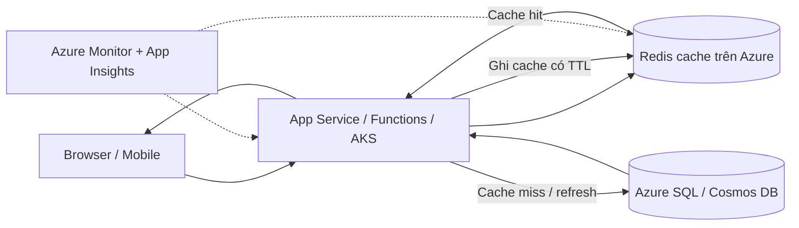
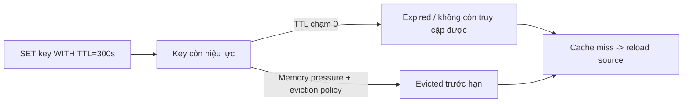
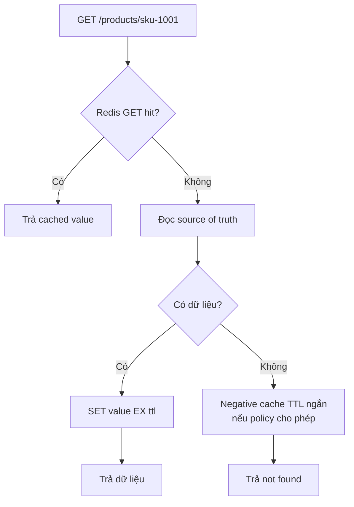
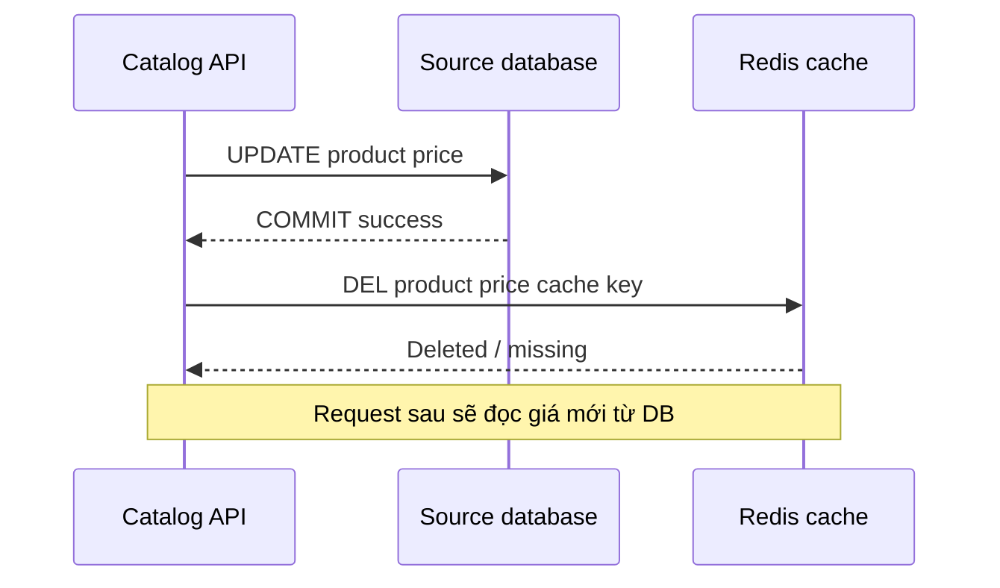
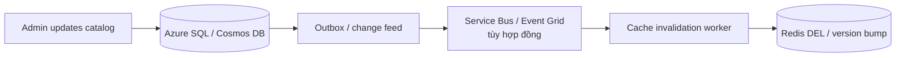
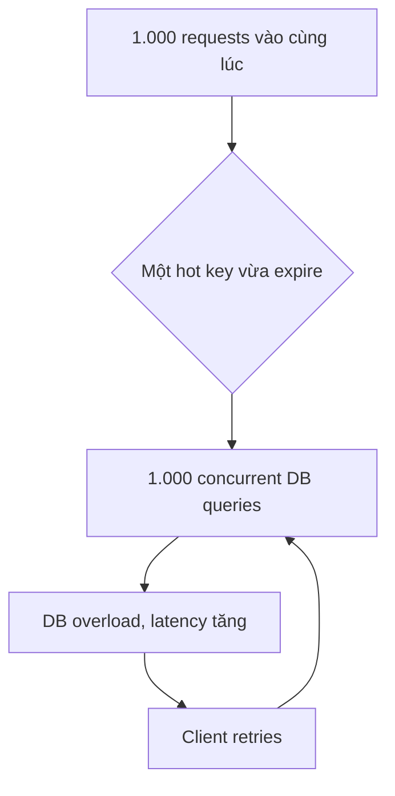
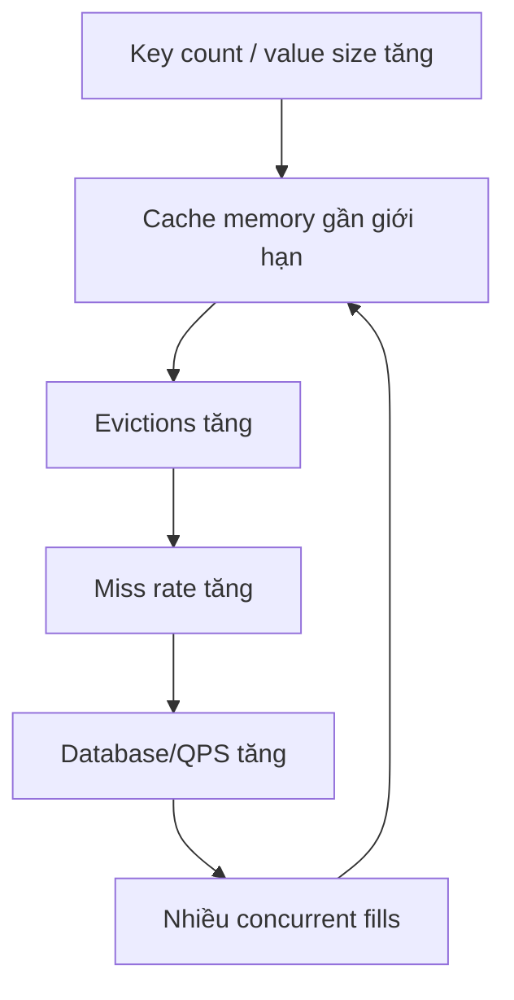
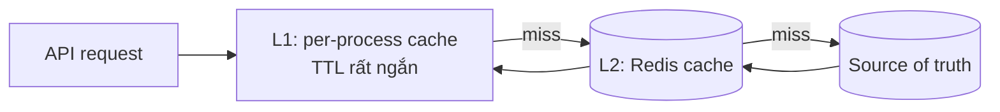

# Thiết kế key, TTL và chính sách eviction

Một website thương mại điện tử trên Azure phục vụ 20.000 lượt xem sản phẩm mỗi phút. Thông tin tên, hình ảnh và mô tả thay đổi vài lần mỗi ngày, trong khi **giá bán, tồn kho và ưu đãi** có thể đổi trong vài giây. Nếu mọi request đều truy vấn database, hệ thống tốn chi phí và tăng độ trễ; nếu cache mọi thứ trong 24 giờ mà không có cơ chế cập nhật, người dùng có thể thấy giá cũ hoặc mua một sản phẩm đã hết hàng. Nếu cache đầy và chính sách **eviction** loại bỏ những key quan trọng, tỷ lệ cache miss và tải lên database đột ngột tăng mạnh.

Để dùng Redis làm cache hiệu quả, cần thiết kế **ba quyết định liên quan nhưng không giống nhau**:

1. **Key design** — khóa định danh chính xác dữ liệu nào, phạm vi tenant/user, phiên bản schema và điều kiện truy vấn nào.
2. **TTL (Time To Live)** — dữ liệu được phép ở cache trong bao lâu trước khi bị coi là hết hạn.
3. **Eviction policy** — khi bộ nhớ bị áp lực, engine ưu tiên loại bỏ những key nào để giải phóng dung lượng.

Bài học thuộc chương **Cache và giao tiếp thời gian thực** của module **CLOUD_PROVIDERS_AZURE**. Lộ trình module khám phá Azure từ subscription, resource group, Microsoft Entra ID đến mạng, compute, storage và dữ liệu, đồng thời dạy triển khai, giám sát, bảo vệ và kiểm soát chi phí. Ví dụ sử dụng **Redis-compatible cache trên Azure**, bao gồm các tình huống với **Azure Managed Redis** và hệ thống **Azure Cache for Redis** còn hiện diện trong kiến trúc. Tên sản phẩm, SKU, vòng đời dịch vụ, cấu hình eviction và tùy chọn identity/network có thể thay đổi theo dịch vụ hoặc tier; phải kiểm tra tính năng được hỗ trợ trước khi áp dụng lệnh vận hành.

**Sau bài học, bạn có thể:**

- Định nghĩa cache key nhất quán, có version, namespace, tenant isolation và tránh lộ PII.
- Chọn TTL theo **mức chấp nhận dữ liệu cũ** và mức độ biến động của từng loại dữ liệu.
- Phân biệt **absolute TTL**, **sliding expiration**, **negative caching**, invalidation và stale-while-revalidate.
- Giải thích Redis `EXPIRE`, `TTL`, `PTTL`, `SET EX`, `GETEX` và các bẫy khiến TTL mất hiệu lực.
- So sánh `allkeys-lru`, `allkeys-lfu`, `volatile-lru`, `volatile-ttl` và `noeviction` theo đúng semantics.
- Giảm cache stampede, hot key, eviction storm và duplicate loads bằng jitter, single-flight/locking, backpressure.
- Ước tính nhu cầu RAM và theo dõi **hit rate, evictions, expirations, memory usage và database load**.
- Triển khai cache-aside an toàn với Python, kết nối TLS/identity và lập runbook khi cache suy giảm.

## 1. Cache nằm ở đâu trong kiến trúc Azure?

Cache giúp tránh thực hiện lại một thao tác đắt khi kết quả có thể dùng lại trong khoảng thời gian hợp lý.



**Nguồn dữ liệu gốc (*source of truth*)** thường là SQL, Cosmos DB hoặc hệ thống nghiệp vụ. Redis cache giữ **bản sao có thể tái tạo**, không phải nơi duy nhất chứa số dư, thanh toán, đơn hàng chưa được ghi bền vững hoặc quyền truy cập quan trọng.

### 1.1. Phân biệt cache với các hệ thống lân cận

| Thành phần | Vai trò chính | Có nên coi là thay thế cache? |
|---|---|---|
| **Redis cache** | Giữ kết quả truy cập nhanh trong RAM, có TTL/eviction | Phù hợp dữ liệu tái tạo được |
| **Azure SQL / Cosmos DB** | Dữ liệu nghiệp vụ có yêu cầu bền vững/giao dịch | Là source of truth, không thay bằng cache tùy tiện |
| **Azure Service Bus** | Giao nhận message, retries, DLQ, tách producer-consumer | Không dùng làm cache lookup |
| **Azure Event Grid** | Định tuyến sự kiện thay đổi, có delivery retry theo mode | Hữu ích cho invalidation, nhưng không tự lưu trạng thái cache |
| **Azure SignalR Service** | Phân phối thông tin realtime tới kết nối client | Không phải database hay key-value cache |
| **In-process memory cache** | Truy cập cực nhanh trên một process | Có vấn đề consistency khi scale nhiều replicas |

**Ví dụ đúng:** cache mô tả sản phẩm hoặc trang tổng hợp; mỗi khi catalog thay đổi, cập nhật database trước rồi gửi invalidation. **Ví dụ nguy hiểm:** chỉ lưu việc đã thanh toán trong Redis và cho phép eviction xóa dấu đã thanh toán.

### 1.2. Khả năng giảm tải phụ thuộc hit rate

Giả sử một API nhận 10.000 lượt đọc/giây và cache hit rate thực tế là 90%:

```text
Reads từ cache:       9.000 request/s
Reads rơi xuống DB:  1.000 request/s
```

Nếu đột ngột hit rate giảm xuống 50% thì database phải phục vụ **5.000 request/s**, tăng năm lần so với trước. Đây là lý do cần coi key design, TTL và eviction là **một phần của capacity planning cho database**, không chỉ tối ưu cache riêng lẻ.

## 2. Thiết kế cache key: mỗi key phải đại diện một kết quả xác định

Một key tốt cho phép hai requests có **cùng ý nghĩa** chia sẻ kết quả và hai requests có **quyền hoặc dữ liệu khác nhau** không nhận nhầm kết quả.

Mẫu tham khảo:

```text
<environment>:<service>:<tenant>:<entity>:<entity-id>:<variant>:v<schema-version>
```

Ví dụ:

```text
prod:catalog:public:product:sku-1001:detail:vi:v3
prod:catalog:public:product:sku-1001:detail:en:v3
prod:orders:tenant-42:order:order-9001:summary:v2
staging:catalog:public:product:sku-1001:detail:vi:v3
```

Với mẫu này:

- `prod` / `staging`: **environment**, tránh trộn dữ liệu các môi trường.
- `catalog` / `orders`: **service/ownership namespace**.
- `public` / `tenant-42`: **data visibility/tenant scope**.
- `product` / `order`: **entity type**.
- `sku-1001`: **business identity**.
- `detail:vi`: **projection và locale**.
- `v3`: **version của cache payload/contract**.

Đây là convention ứng dụng, không phải định dạng bắt buộc của Redis. Dấu phân cách cần được **escape hoặc chuẩn hóa** nếu identifier có thể chứa dấu `:`, để hai tổ hợp fields không va nhau.

### 2.1. Tránh key quá chung

**Sai:**

```text
product:sku-1001
search:shoes
profile:123
```

Nếu dữ liệu phụ thuộc tenant, ngôn ngữ, giá theo quốc gia, permission hoặc feature flag, những key này có thể trả **giá/trạng thái/dữ liệu của người khác**.

**Tốt hơn:**

```text
prod:catalog:tenant-42:product:sku-1001:price:VND:v4
prod:search:public:query:qhash-7c3a:page-1:vi:v2
prod:profile:tenant-42:user:sub-8f9e:public-view:v1
```

Không dùng raw email, số điện thoại, token, JWT, số thẻ hoặc địa chỉ khách hàng làm key: Redis commands, metrics, traces hoặc các công cụ quản trị có thể làm lộ tên key. Dùng ID không nhạy cảm hoặc tokenization/HMAC phù hợp khi cần.

### 2.2. Key phải đủ ngắn nhưng không mất tính duy nhất

Key là bytes được lưu trong bộ nhớ. Một triệu keys dài 200 bytes có thể tiêu thụ đáng kể RAM chỉ để **lưu tên**, chưa tính values, metadata và allocator overhead.

Tuy nhiên, nén key tới mức `p1`, `p2` làm con người khó điều tra và dễ va chạm. Chọn tên **ngắn, có namespace và ổn định**; đo memory footprint trên dữ liệu thật.

### 2.3. Chọn identifier không thay đổi theo metadata

Đừng ghép giá bán, tên sản phẩm, trạng thái giao hàng hay timestamp biến động vào key chính nếu không có lý do:

```text
Sản phẩm đổi tên:
  Key cũ: catalog:shoes-blue-2026
  Key mới: catalog:shoes-navy-2026
```

Nếu không xóa key cũ, dữ liệu lỗi thời vẫn chiếm RAM. Dùng stable product ID; những thuộc tính dễ đổi nên nằm trong **value** hoặc thuộc tính phiên bản có chiến lược invalidation rõ ràng.

## 3. Canonical key cho query, filter và pagination

Không phải mọi thứ đều được lấy theo một entity ID. Cache search results phải bao gồm **mọi đầu vào ảnh hưởng tới kết quả**.

Ví dụ endpoint:

```text
GET /products?category=shoes&color=blue&sort=price_asc&page=2&lang=vi
```

Cache key phải tính đến:

- category, color và các filters thực sự tham gia truy vấn;
- sort order;
- page index/page size hoặc cursor;
- locale, currency và market;
- visibility/tenant/authorization scope;
- phiên bản thuật toán tìm kiếm hoặc schema dữ liệu.

### 3.1. Canonicalize trước khi hash

Hai query strings sau có thể cùng ngữ nghĩa:

```text
?color=blue&category=shoes&page=2
?page=2&category=shoes&color=blue
```

Nếu dùng raw query string làm key, cùng một kết quả bị cache hai lần. Cần:

1. Parse theo schema được cho phép.
2. Áp giá trị mặc định một cách nhất quán.
3. Normalize kiểu dữ liệu, chữ hoa/thường theo ngữ nghĩa.
4. Sort các tên parameters khi thứ tự không quan trọng.
5. Phân biệt danh sách có thứ tự với danh sách không thứ tự.
6. Serialize deterministically, sau đó hash nếu chuỗi quá dài.

```python
import hashlib
import json


def search_cache_key(tenant_id: str, filters: dict, version: int = 2) -> str:
    # Caller phải validate/authorize tenant_id và filters từ trước.
    canonical = json.dumps(
        filters,
        sort_keys=True,
        separators=(",", ":"),
        ensure_ascii=False,
    )
    digest = hashlib.sha256(canonical.encode("utf-8")).hexdigest()[:24]
    return f"prod:search:{tenant_id}:query:{digest}:v{version}"


print(search_cache_key(
    "tenant-42",
    {"category": "shoes", "color": "blue", "page": 2, "sort": "price_asc"},
))
```

Đoạn code **minh họa canonical serialization**. Trước khi production, cần định nghĩa cách normalize giá trị và thứ tự list; dùng digest dài hơn nếu số key rất lớn hoặc rủi ro collision không chấp nhận được. Nếu mục đích là che danh tính nhạy cảm khỏi người có thể đoán input, **hash thuần không đủ**; cân nhắc HMAC với khóa quản lý an toàn và không dùng digest như cơ chế phân quyền.

### 3.2. Cache theo quyền truy cập

Kết quả tìm kiếm có thể phụ thuộc role hoặc danh sách sản phẩm được phép xem. Nếu người dùng A và B có visibility khác nhau, **không dùng chung key `search:shoes`**.

Tùy ứng dụng, có thể cache:

- dữ liệu public theo locale/market;
- dữ liệu tenant-wide theo tenant ID;
- dữ liệu user-specific theo user identifier và permission version;
- projection riêng cho role/view;
- hoặc **không cache** dữ liệu chứa quyền thay đổi quá thường xuyên.

Partition key/tenant trong key **không thay thế authorization ở API**: server vẫn phải xác minh người gọi có quyền truy cập đúng tenant.

## 4. Cache values và schema versioning

Redis hỗ trợ các cấu trúc như **string, hash, list, set, sorted set** và những kiểu dữ liệu/tính năng khác tùy phiên bản/dịch vụ. Đối với cache-aside, string chứa JSON hoặc dữ liệu nhị phân serialize là lựa chọn phổ biến.

```json
{
  "schemaVersion": 3,
  "productId": "sku-1001",
  "name": "Áo khoác thể thao",
  "language": "vi",
  "currency": "VND",
  "displayPrice": 499000
}
```

### 4.1. Tại sao cần version?

Sau deploy, service v4 có thể đọc key do service v3 tạo với schema thiếu field. Nếu code không phân biệt version, lỗi parsing hoặc hiển thị dữ liệu sai xuất hiện ngẫu nhiên.

Hai cách:

- **Version trong key** như `:v3` giúp hai application versions cùng tồn tại khi rollout.
- **Version trong payload** giúp consumer validate trước khi deserialize.

Có thể sử dụng cả hai. **Đổi namespace version không tự xóa keys cũ**; chúng vẫn có thể chiếm bộ nhớ đến lúc TTL/eviction/invalidation, do đó cần kế hoạch cleanup.

### 4.2. Redis hash và TTL của key

Redis hash nhóm nhiều fields trong **một Redis key**:

```text
HSET product:sku-1001 name "Jacket" stock "15"
EXPIRE product:sku-1001 300
```

Với semantics Redis truyền thống, **TTL áp dụng cho Redis key**, không tự áp riêng cho từng field trong hash. Một số phiên bản mới/tính năng hỗ trợ **field-level expiration** với API cụ thể; không giả định tính năng đó tồn tại ở mọi Azure tier/engine. Nếu price và stock cần TTL rất khác nhau, **tách thành các keys** hoặc có logic kiểm soát tuổi dữ liệu phù hợp.

## 5. TTL: dữ liệu được phép cũ bao lâu?

**TTL (Time To Live)** là khoảng thời gian còn lại trước khi key **hết hạn (*expire*)**. TTL trả lời “key này còn hợp lệ trong cache cho tới khi nào?” chứ không trả lời “key này có chắc tồn tại tới thời điểm đó không?” — vì **eviction** có thể loại bỏ key sớm hơn.



### 5.1. Absolute expiration

Key hết hạn sau khoảng cố định tính từ lúc tạo hoặc cập nhật TTL:

```text
10:00:00 SET catalog:sku-1001 EX 300
10:04:59 Key vẫn có thể hợp lệ
10:05:00 TTL hết hạn theo thời gian
```

Những lần `GET` thông thường **không tự kéo dài TTL**. Đây là lựa chọn đơn giản, dễ kiểm soát độ cũ tối đa từ lúc làm mới cache.

### 5.2. Sliding expiration

Sliding expiration kéo dài tuổi key mỗi khi **được sử dụng hợp lệ**, ví dụ reset TTL 30 phút sau mỗi lần đọc.

Ưu điểm: giữ dữ liệu nóng lâu, giảm misses. Nhược điểm: key rất nóng có thể **không bao giờ tự hết hạn**, dẫn đến dữ liệu cũ nếu không có invalidation hoặc absolute expiry bổ sung.

**Thiết kế an toàn:** nếu cần sliding TTL, đặt thêm **absolute maximum age** trong payload hoặc lưu key version để không phục vụ dữ liệu cũ vô hạn.

### 5.3. TTL và consistency là hai quyết định riêng

Một TTL 60 giây nghĩa cache có thể phục vụ dữ liệu từ lần fill gần nhất trong tối đa khoảng đó nếu không có invalidation/refresh. Nó **không phải cam kết dữ liệu luôn mới hơn 60 giây so với database** trong mọi sự cố: bản dữ liệu đọc từ nguồn có thể đã trễ, đồng bộ replication có độ trễ, và client có thể có cache tầng khác.

Nếu giá/permission cần nhất quán mạnh, nên dùng **source of truth hoặc cơ chế version/conditional validation** ở điểm ra quyết định, không chỉ hy vọng TTL ngắn là đủ.

## 6. Redis TTL commands: ý nghĩa và bẫy thường gặp

Các ví dụ sau là **Redis command syntax** để học semantics. Không chạy trên production nếu chưa xác nhận key/namespace.

### 6.1. Tạo key và TTL trong một thao tác

```redis
SET prod:catalog:sku-1001:detail:v3 "{\"name\":\"Jacket\"}" EX 300
TTL prod:catalog:sku-1001:detail:v3
PTTL prod:catalog:sku-1001:detail:v3
```

`SET ... EX 300` đặt value kèm hạn 300 giây trong **cùng command**, giảm cửa sổ lỗi so với `SET` rồi `EXPIRE` tách rời.

| Lệnh | Ý nghĩa |
|---|---|
| `EXPIRE key seconds` | Gán/đổi TTL theo giây |
| `PEXPIRE key milliseconds` | Gán TTL theo mili giây |
| `EXPIREAT key unixTime` | Hết hạn tại thời điểm Unix theo giây |
| `TTL key` | Số giây còn lại |
| `PTTL key` | Số mili giây còn lại |
| `PERSIST key` | Bỏ expiration, biến thành key không TTL |
| `GETEX key EX seconds` | Đọc giá trị string đồng thời cập nhật expiration nếu hỗ trợ |
| `SET key value KEEPTTL` | Ghi lại value nhưng giữ TTL hiện hữu nếu tính năng được hỗ trợ |

Trong Redis thông thường, `TTL`/`PTTL` có thể trả:

- **-2:** key không tồn tại hoặc đã hết hạn.
- **-1:** key tồn tại nhưng **không có expiration**.
- **Số không âm:** thời gian còn lại theo đơn vị lệnh.

Đừng nhầm `-1` với “còn một giây”: đó là **không có TTL**, có thể dẫn tới memory growth nếu ứng dụng dự tính mọi cache key đều tự biến mất.

### 6.2. Ghi đè key có thể xóa TTL

Ví dụ:

```redis
SET demo:product "old" EX 300
TTL demo:product
SET demo:product "new"
TTL demo:product
```

Theo semantics Redis phổ biến, lệnh `SET key value` không có tuỳ chọn giữ expiration sẽ **xóa TTL cũ**. Sau dòng cuối, `TTL` có thể trả `-1`. Đây là lỗi phổ biến khi refactor code từ `setex` sang `set`.

Khắc phục: dùng `SET ... EX ...` rõ ràng mỗi lần fill, hoặc `KEEPTTL` nếu mục tiêu thật sự là giữ expiration hiện có và phiên bản engine hỗ trợ.

### 6.3. `GETEX` làm TTL trượt

```redis
SET demo:session "payload" EX 1800
GETEX demo:session EX 1800
```

Lệnh `GETEX` (khi hỗ trợ) cho phép đọc và đặt lại hạn trong một thao tác, phục vụ sliding expiration. Nhưng một session **không nên được sống mãi** chỉ vì mỗi phút có request: có thể cần absolute expiry hoặc server-side session revocation độc lập.

### 6.4. Thay đổi field trong hash

`HSET` trên **một key hash đã có TTL** thường không xóa TTL ở cấp key vì nó sửa nội dung hash chứ không thay key bằng `SET`. Nhưng nếu code tạo một hash key mới rồi không gắn `EXPIRE`, key mới có thể tồn tại vô thời hạn.

Khi thiết kế cache service, đừng dựa vào “mọi lệnh ghi đều giữ TTL” hoặc “mọi lệnh ghi đều xóa TTL”: **mỗi Redis command có semantics riêng**.

## 7. Chọn TTL theo loại dữ liệu và SLO

TTL không nên là một hằng số dùng cho tất cả key.

| Dữ liệu | TTL thử nghiệm | Cách cập nhật/đánh đổi |
|---|---:|---|
| Danh mục sản phẩm ít đổi | 15–60 phút | Có event invalidation khi chỉnh catalog |
| Mô tả sản phẩm public | 30–120 phút | Cho phép stale ngắn, version key khi deploy |
| Giá hiển thị theo thị trường | 30–120 giây | Invalidate khi đổi giá; checkout xác thực lại giá |
| Tồn kho để hiển thị | 5–30 giây | Thông tin chỉ tham khảo; khi đặt hàng kiểm tra source |
| Kết quả tìm kiếm | 30–180 giây | Key chứa filters, locale, page và version |
| Negative cache: không tìm thấy SKU | 5–30 giây | Tránh DB miss storm, không giữ lâu khi SKU mới xuất hiện |
| Permission snapshot | Cực ngắn hoặc không cache | Revocation/authorization phải có cơ chế độc lập |
| Session/presence ephemeral | Theo heartbeat và session contract | Sliding + absolute cap, failover semantics |
| Tỷ giá đã công bố theo ngày | Theo kỳ phát hành/nguồn dữ liệu | Event refresh hoặc absolute deadline |

**Các số trên là ví dụ khởi đầu cho load test, không phải giá trị mặc định Azure hoặc Redis.** Giá, tồn kho và session có yêu cầu nghiệp vụ riêng; ở điểm thực hiện thanh toán/cấp quyền, luôn cần kiểm tra authoritative state.

### 7.1. Cách tính TTL từ độ cũ cho phép

Một sản phẩm được phép hiển thị giá cũ tối đa **60 giây**. Nếu cache đã đọc nguồn từ 20 giây trước khi ghi Redis, TTL 60 giây tính từ lúc ghi sẽ làm tổng độ cũ có thể lên tới khoảng 80 giây. Thiết kế nên quản lý **data timestamp/version**, không chỉ `EX 60`.

Nếu freshness SLO là `F` và độ trễ dữ liệu nguồn thường ở mức `L`, TTL an toàn về mặt lập luận phải nhỏ hơn ngân sách còn lại, hoặc phải dùng event invalidation/version check:

\[
TTL_{\mathrm{max}} \lesssim F-L
\]

Đây là một **heuristic**, không phải bảo đảm consistency. Độ trễ nguồn có thể biến thiên, nên cần theo dõi actual data age và có fallback.

### 7.2. Không cache những thứ không được phép sai

Ví dụ không dùng cache đọc rời rạc làm quyết định cuối:

- Kiểm tra số dư trước khi trừ tiền.
- Kiểm tra quyền xem hồ sơ bệnh án/PII sau khi quyền có thể bị thu hồi ngay.
- Xác nhận tồn kho lúc tạo đơn.
- Chống thanh toán trùng, idempotency ledger hoặc record đã hoàn tất.

Cache có thể giúp **hiển thị hoặc đề xuất**, nhưng business transaction phải kiểm tra nguồn có quyền quyết định.

## 8. TTL jitter: ngăn nhiều keys hết hạn cùng lúc

Giả sử 50.000 sản phẩm được warm cache lúc 09:00 với TTL chính xác 300 giây. Đến 09:05, nhiều keys hết hạn cùng thời điểm; request tăng đột biến rơi xuống database.

```text
09:00:00 warm 50.000 product keys, TTL = 300 giây
09:05:00 nhiều keys hết hạn cùng lúc
09:05:01 5.000 requests miss và cùng gọi database
=> Cache stampede / thundering herd
```

**TTL jitter** phân tán thời điểm hết hạn:

\[
TTL_{\mathrm{key}} = TTL_{\mathrm{base}} + U(0,J)
\]

Ví dụ TTL gốc 300 giây và jitter 0–60 giây: các key có TTL 300–360 giây. Nếu bài toán đặt **hard maximum freshness là 300 giây**, công thức trên **không phù hợp** vì nó cho phép key tồn tại lâu hơn 300 giây. Thay vào đó:

\[
TTL_{\mathrm{key}} = TTL_{\mathrm{max}} - U(0,J)
\]

Với `TTL_max = 300s`, `J = 60s` thì TTL nằm trong 240–300 giây.

### 8.1. Cách triển khai có giới hạn

```python
import secrets


def ttl_with_jitter(max_ttl_seconds: int, jitter_seconds: int) -> int:
    if max_ttl_seconds <= 0:
        raise ValueError("max_ttl_seconds must be positive")
    if jitter_seconds < 0 or jitter_seconds >= max_ttl_seconds:
        raise ValueError("invalid jitter_seconds")
    # Không vượt hard maximum freshness TTL.
    return max_ttl_seconds - secrets.randbelow(jitter_seconds + 1)


print(ttl_with_jitter(max_ttl_seconds=300, jitter_seconds=60))
```

Jitter cần được chọn theo tập key và tải nguồn. Jitter quá rộng khiến hit rate giảm; jitter quá hẹp chưa đủ phân tán việc refresh. **TTL jitter không thay thế request coalescing, rate limit và database capacity** khi một key cực nóng hết hạn.

## 9. Cache-aside: mẫu truy cập phổ biến

**Cache-aside (lazy loading)** để ứng dụng tự đọc cache trước; nếu miss, lấy nguồn rồi điền cache.



**Ưu điểm:** chỉ cache dữ liệu được truy cập, giảm writes dư thừa. **Nhược điểm:** miss đầu tiên phải trả latency của database, dễ stampede và cần invalidation khi nguồn thay đổi.

### 9.1. Ví dụ Python với Redis client

Đoạn code minh họa Redis-py cache-aside; **repository** là lớp dữ liệu do ứng dụng cung cấp. Redis connection phải được cấu hình qua secret store hoặc phương thức identity hỗ trợ, không hardcode mật khẩu:

```python
import json
import logging
import os

from redis import Redis, RedisError

# REDIS_URL là secret/config được cấp an toàn tại runtime.
# Với Azure-managed Redis, dùng TLS và kiểm tra phương thức auth được hỗ trợ.
cache = Redis.from_url(
    os.environ["REDIS_URL"],
    decode_responses=True,
    socket_connect_timeout=1.0,
    socket_timeout=1.0,
)


def product_key(product_id: str, lang: str) -> str:
    # Caller phải validate product_id/lang theo contract cho phép.
    return f"prod:catalog:public:product:{product_id}:detail:{lang}:v3"


def get_product(product_id: str, lang: str, repository):
    key = product_key(product_id, lang)

    try:
        cached = cache.get(key)
        if cached is not None:
            envelope = json.loads(cached)
            if envelope["kind"] == "not-found":
                return None
            if envelope["kind"] == "value":
                return envelope["data"]
    except (RedisError, ValueError, KeyError, TypeError) as exc:
        # Cache lỗi hoặc payload hỏng không được làm mất read availability.
        logging.warning("Cache read unavailable or invalid: %s", type(exc).__name__)

    # Source of truth phải thực hiện authorization ở lớp phù hợp.
    result = repository.get_product(product_id, lang)

    if result is None:
        payload = {"kind": "not-found"}
        ttl = 20  # Negative caching ngắn, chỉ khi nghiệp vụ cho phép.
    else:
        payload = {"kind": "value", "data": result}
        ttl = ttl_with_jitter(max_ttl_seconds=300, jitter_seconds=60)

    try:
        cache.set(key, json.dumps(payload, ensure_ascii=False), ex=ttl)
    except (RedisError, TypeError, ValueError) as exc:
        # Database là nguồn; không coi cache write failure là DB write failure.
        logging.warning("Cache fill skipped: %s", type(exc).__name__)

    return result
```

Trong ứng dụng production:

- `ttl_with_jitter` là hàm đã định nghĩa ở mục 8.
- `repository.get_product` là API giả định của lớp truy cập database, **không phải hàm Azure SDK có sẵn**.
- Cache client nên được **reuse theo process**, tránh tạo một TCP connection mới cho mỗi request.
- Mẫu `kind` tách **negative cache** khỏi một giá trị JSON `null` có thể hợp lệ trong domain khác.
- `lang` và quyền xem dữ liệu phải được kiểm soát để không dùng nhầm key.
- Nếu database lỗi, **không** giả vờ trả thành công từ dữ liệu không tồn tại; cần định nghĩa fallback/SLO.
- Nếu cache payload lớn/không JSON-serializable, dùng serializer có contract, schema validation và size limits.

### 9.2. Tại sao bỏ qua lỗi cache có thể hợp lý?

Với cache-aside dùng **dữ liệu tái tạo được**, cache là dependency để cải thiện hiệu năng; khi Redis timeout, API có thể fallback về database nếu database chịu được tải. Nhưng fallback không được **unbounded**: nếu toàn bộ Redis outage đẩy 100% tải xuống SQL, SQL cũng có thể sập. Cần rate limiting, circuit breaker và degraded mode phù hợp.

## 10. Negative caching: không tìm thấy cũng có thể được cache

Nếu bot hoặc user liên tục yêu cầu một SKU không tồn tại, mỗi request đều đến database khi cache không lưu “not found”.

```text
GET product-404 -> DB NotFound
GET product-404 -> DB NotFound
GET product-404 -> DB NotFound
```

**Negative cache** lưu sentinel `not-found` với TTL ngắn, ví dụ 10–30 giây. Điều này giảm truy vấn lặp cho khóa không tồn tại.

**Nhưng:** nếu sản phẩm mới vừa được tạo với ID đó, negative cache có thể khiến ứng dụng tiếp tục trả 404 cho đến khi TTL hết hoặc có invalidation. Vì thế:

- TTL negative thường **ngắn hơn** TTL positive.
- Tránh cache các lỗi **403 permission denied** như thể tài nguyên không tồn tại toàn cục.
- Không cache lỗi 500, timeout hoặc phản hồi từ database không đáng tin thành “not-found”.
- Khi entity được tạo, xóa negative key hoặc tăng namespace/version theo policy.
- Có giới hạn cardinality; một attacker có thể tạo **hàng triệu ID không tồn tại** khiến Redis chứa nhiều negative entries.

### 10.1. Negative cache và security

Một user không có quyền xem sản phẩm X khác với sản phẩm X **không tồn tại**. Nếu ghi `not-found` vào key public chỉ vì một request bị chặn quyền, user được phép xem về sau cũng có thể nhận sai. Phải thực hiện **authorization trước cache** hoặc đưa authorization scope vào key một cách đúng đắn.

## 11. Cache invalidation: TTL không giải quyết mọi cập nhật

**Invalidation** là xóa/đánh dấu không còn hợp lệ key khi nguồn dữ liệu thay đổi, thay vì chờ TTL tự hết.

Ví dụ:



**Thứ tự quan trọng:** với cache-aside đơn giản, thường update database trước, **sau commit** mới invalidate cache. Xóa cache trước khi transaction commit có thể cho request khác fill lại giá cũ ngay lập tức.

### 11.1. Race condition giữa cache fill và invalidation

Ngay cả “update DB rồi DEL” vẫn có race:

```text
T1: Reader thấy cache MISS.
T2: Reader bắt đầu đọc DB, nhận price = 100.
T3: Writer commit DB price = 120.
T4: Writer DEL cache key.
T5: Reader ghi price = 100 vào cache (sau DEL).
T6: Những request khác nhận giá cũ cho tới TTL/invalidation mới.
```

Phương án tùy độ nghiêm ngặt:

- Dùng **ngắn TTL** làm safety bound cho cache-aside đọc đơn giản.
- Mang **source version/ETag/updatedAt** vào payload và chỉ chấp nhận version phù hợp.
- Dùng **versioned key** gắn với version nghiệp vụ được lấy từ nguồn đáng tin.
- Tách price/stock critical ra khỏi dữ liệu mô tả.
- Dùng event invalidation có retry/outbox và các thao tác kiểm tra version.
- Với quyết định thanh toán/tồn kho, kiểm tra lại **database/transaction source**.

**Không khẳng định “DELETE sau commit bảo đảm tuyệt đối không stale”.** Nó giảm rủi ro nhưng chưa khóa được mọi trường hợp concurrent cache fills.

### 11.2. Event-driven invalidation



Worker cần:

1. Có event ID và business entity version.
2. Xử lý duplicate event/idempotency.
3. Chịu được event đến muộn/out-of-order.
4. Retry khi Redis tạm lỗi và có monitoring.
5. Không tuyên bố invalidation đã áp dụng nếu event còn đang trong queue.

Khi event-based invalidation thất bại, **TTL là lớp bảo vệ cuối** chống tồn tại key vô hạn, trừ khi dữ liệu yêu cầu consistency chặt phải có cơ chế khác.

## 12. Cache stampede, single-flight và distributed lock

**Cache stampede** xảy ra khi nhiều requests cùng miss một key rồi đồng thời đọc một dependency đắt.



Các lớp giảm thiểu theo độ phức tạp tăng dần:

1. **TTL jitter** cho nhiều keys khác nhau.
2. **Per-process single-flight**: các requests trong cùng instance chờ chung một cache fill.
3. **Distributed lock/lease** cho một key nóng ở nhiều instances.
4. **Stale-while-revalidate** trong giới hạn freshness cho phép.
5. **Bounded fallback** vào database, circuit breaker và warm-up có giới hạn.

### 12.1. Redis lock bằng `SET NX EX` — chỉ là lease

```redis
SET lock:prod:catalog:sku-1001 "unique-token" NX EX 10
```

- `NX` chỉ tạo lock key nếu chưa tồn tại.
- `EX 10` đặt TTL lease 10 giây, tránh khóa nằm mãi khi holder crash.
- `unique-token` giúp phân biệt holder để khi unlock không xóa nhầm khóa của process khác.

**Quan trọng:** lock có TTL là **lease**, không phải bảo đảm mutex vĩnh viễn. Nếu DB query mất 20 giây, lease 10 giây đã hết; worker khác có thể nhận lease và cùng cập nhật cache. Phải dùng version/fencing nếu side effect ngoài cache có yêu cầu nhất quán.

### 12.2. Unlock an toàn bằng so sánh token

Không được làm:

```redis
DEL lock:prod:catalog:sku-1001
```

nếu holder cũ có thể xóa khóa mới của holder khác. Có thể dùng thao tác atomic theo phiên bản Redis hỗ trợ; ví dụ **Lua compare-and-delete**:

```lua
-- KEYS[1] = lock key; ARGV[1] = token của caller.
if redis.call("GET", KEYS[1]) == ARGV[1] then
    return redis.call("DEL", KEYS[1])
end
return 0
```

Đây là mô hình **best-effort coordination cho cache fill**, không phải cơ chế distributed transaction. Đánh giá Redis failover, lock expiry, stale cache fill và network partition. Không dùng cache lock kiểu này làm nguồn duy nhất để bảo đảm “một lần thanh toán” hoặc ghi giao dịch tài chính.

### 12.3. Người không có lock phải làm gì?

Không để 999 requests khác **spin mỗi 1 ms**:

- Chờ ngắn có jitter, kiểm tra cache lại.
- Dùng stale value nếu nghiệp vụ cho phép.
- Cho một lượng nhỏ requests fallback DB theo semaphore.
- Trả degraded response/503 có kiểm soát nếu dependency quá tải.
- Theo dõi thời gian chờ lock và lock contention.

## 13. Stale-while-revalidate và hai mốc hết hạn

Với dữ liệu cho phép stale ngắn, có thể dùng **soft TTL** và **hard TTL**:

- **Soft expiry:** sau thời điểm này, dữ liệu nên được refresh, nhưng vẫn có thể phục vụ stale theo chính sách.
- **Hard expiry:** sau thời điểm này, dữ liệu **không được dùng nữa**; phải fetch source hoặc trả lỗi.

Ví dụ envelope:

```json
{
  "schemaVersion": 3,
  "value": {
    "productId": "sku-1001",
    "name": "Áo khoác thể thao"
  },
  "softExpiresAtUtc": "2026-11-20T10:02:00Z",
  "hardExpiresAtUtc": "2026-11-20T10:07:00Z",
  "sourceVersion": "product-v145"
}
```

Redis key TTL có thể được đặt tới **hard expiry**, còn application quyết định hành vi ở soft expiry. Một request sau soft expiry có thể nhận stale value ngay trong khi **một worker** refresh nền.

### 13.1. Không dùng stale cho thao tác nhạy cảm

Ví dụ danh mục sản phẩm public có thể cho stale vài phút. Quyền truy cập, thông tin giá tại checkout, thanh toán, quota bảo mật hoặc điều khiển an toàn vật lý có thể **không chấp nhận stale**. Policy nên được định nghĩa bởi chủ sở hữu dữ liệu, không chỉ bởi cache team.

### 13.2. Clock và absolute timestamps

Soft/hard expiry là timestamps cần tính theo **UTC** với đồng hồ máy được đồng bộ; clock skew có thể làm dữ liệu quá hạn. Với policy nghiêm ngặt, dùng version hoặc validation với source để tránh dựa hoàn toàn vào clock của web worker.

## 14. Eviction khác expiration và invalidation

Ba cách mất key khác nhau:

| Cơ chế | Nguyên nhân | Ai quyết định? | Ảnh hưởng |
|---|---|---|---|
| **Expiration** | TTL chạm 0 | TTL của key + Redis runtime | Key không còn phục vụ, request sau miss |
| **Eviction** | Redis cần giải phóng RAM theo policy | Engine và memory policy | Key có thể bị loại trước TTL |
| **Invalidation** | Dữ liệu nguồn thay đổi hoặc chủ động xóa | Ứng dụng/worker/operator | Request tiếp theo phải refresh |
| **Manual delete** | Lệnh `DEL`/`UNLINK` | Người hoặc phần mềm có quyền | Có thể vô tình gây cold cache |
| **Instance loss/flush** | Outage, reset, migration, cấu hình persistence | Hạ tầng/vận hành | Có thể mất nhiều keys tùy service tier |

**Eviction không phải cam kết freshness.** Một key cũ nhưng thường xuyên được truy cập có thể tồn tại tới TTL; một key mới nhưng ít dùng có thể bị evict sớm vì memory pressure.

### 14.1. Redis expired key deletion có thể không xảy ra ngay ở mức quét bộ nhớ

Redis có cơ chế **lazy expiration** khi truy cập key và **active expiration** quét keys hết hạn. Key đã hết TTL không được coi là giá trị hợp lệ khi truy cập, nhưng việc thu hồi toàn bộ RAM có thể không diễn ra đúng tại mili giây hết hạn. Khi xem memory metrics, cần phân biệt key validity với thời điểm physical cleanup.

### 14.2. Không dùng Redis keyspace notifications như event log bền vững

Redis có keyspace notifications ở những phiên bản/cấu hình hỗ trợ, nhưng thông báo expire/evict thường không phải **durable event delivery contract**. Subscriber disconnect có thể lỡ thông báo; thời điểm phát phụ thuộc cơ chế hết hạn. Nếu cần ghi nhận nghiệp vụ “đơn hàng hết hiệu lực”, dùng database/job/queue với transaction và retry phù hợp, không chỉ chờ một Redis expiration event.

## 15. Các eviction policies thường gặp của Redis

Tùy engine/service tier, Redis có các policy tiêu biểu:

| Policy | Tập key được xem xét | Chiến lược | Khi nào cân nhắc |
|---|---|---|---|
| `noeviction` | Không chủ động evict để nhận thêm writes | Khi chạm giới hạn bộ nhớ, thao tác cần thêm RAM có thể bị từ chối | Không muốn mất keys trước hạn; phải có capacity planning |
| `allkeys-lru` | Mọi keys | Ưu tiên loại các key **ít được sử dụng gần đây** | Cache đọc lại theo working set có locality |
| `allkeys-lfu` | Mọi keys | Ưu tiên loại các key có **tần suất sử dụng thấp** | Giữ dữ liệu phổ biến lâu, workload có heavy hitters |
| `allkeys-random` | Mọi keys | Chọn ngẫu nhiên | Ít quan tâm locality/tần suất |
| `volatile-lru` | Chỉ keys **có TTL** | LRU trong tập có expiration | Trộn keys có/không TTL, chấp nhận non-TTL tồn tại lâu |
| `volatile-lfu` | Chỉ keys có TTL | LFU trong tập có expiration | Chỉ muốn evict ephemeral keys theo tần suất |
| `volatile-random` | Chỉ keys có TTL | Ngẫu nhiên trong tập có expiration | Workload đặc thù |
| `volatile-ttl` | Chỉ keys có TTL | Ưu tiên keys **gần đến hạn** hơn | Khi muốn ưu tiên loại dữ liệu sắp hết giá trị |

**Quan trọng:** tên và semantics trên mô tả các policy Redis quen thuộc; **Azure Managed Redis, Redis Enterprise engine và các tier của Azure Cache for Redis có thể khác nhau về danh sách policy hoặc cách cấu hình**. Không áp một lệnh `CONFIG SET maxmemory-policy` lên production mà chưa xác minh Azure Portal/API/SKU và chính sách change management.

### 15.1. LRU và LFU là heuristic, không phải danh sách sắp xếp tuyệt đối

Trong Redis, các thuật toán LRU/LFU có thể dùng sampling/approximation và cấu hình riêng, không phải lúc nào cũng lựa chọn **chính xác tuyệt đối** key “ít truy cập nhất” theo toàn bộ lịch sử.

- **LRU (Least Recently Used):** ưu tiên loại key lâu chưa được truy cập.
- **LFU (Least Frequently Used):** ưu tiên loại key ít được truy cập thường xuyên theo bộ đếm/decay.

Ví dụ một key `homepage` được truy cập 100.000 lần/ngày, còn một key báo cáo vừa được đọc một lần; LFU có thể giữ homepage tốt hơn. Nhưng nếu xu hướng sản phẩm thay đổi nhanh theo giờ, tham số decay và TTL vẫn cần điều chỉnh để cache không giữ những key từng hot nhưng nay không còn hot.

### 15.2. `allkeys-*` và `volatile-*` khác nhau ở đâu?

Giả sử cache có:

```text
key A: product:1001     TTL 300s
key B: product:1002     TTL 300s
key C: feature-config   no TTL
key D: admin-report     no TTL
```

Với `allkeys-lru`, cả A/B/C/D đều có thể là ứng viên eviction. Với `volatile-lru`, chỉ A/B có TTL mới là ứng viên. Nếu không còn key có TTL hoặc RAM không thể giải phóng đủ, các thao tác ghi cần thêm bộ nhớ có thể **bị từ chối** dù `volatile-lru` đã được chọn.

**Không nghĩ rằng volatile policies bảo vệ non-TTL keys theo nghĩa an toàn dữ liệu.** Chúng chỉ làm những keys đó không thuộc tập eviction của chính sách, có thể khiến ứng dụng đối mặt với OOM/rejected writes.

### 15.3. `volatile-ttl` không tương đương “TTL dài hơn sẽ bị đuổi trước”

`volatile-ttl` ưu tiên keys **có thời gian tới expiration ngắn hơn**. Điều đó khác LRU/LFU: một key rất hot nhưng sắp hết hạn vẫn có thể bị chọn trước key ít dùng hơn có TTL dài.

### 15.4. `noeviction` không phải giải pháp miễn phí

Khi bộ nhớ tới giới hạn, Redis có thể từ chối những writes đòi hỏi thêm memory. Với ứng dụng có cache-aside, điều này biến **cache fill failure** thành tình huống bình thường cần xử lý; nếu code không fallback, API có thể lỗi hàng loạt.

`noeviction` thường hợp với những dữ liệu có nguyên tắc không tự xóa theo pressure, nhưng nếu dữ liệu thực sự **không được mất**, Redis cache với noeviction vẫn **không thay thế durable database/transaction log**.

## 16. Chọn eviction policy theo workload

| Tình huống | Policy đáng đánh giá | Lý do/điều kiện |
|---|---|---|
| Product/catalog cache, toàn bộ dữ liệu tái tạo được | `allkeys-lru` hoặc `allkeys-lfu` | Không bị giới hạn chỉ keys có TTL; locality/frequency rõ |
| Nhiều keys có TTL, muốn bảo vệ một số metadata không TTL | `volatile-lru` / `volatile-lfu` | Cần đủ memory và không giả định các key protected là durable |
| Cache phiên ngắn, key sắp hết hạn ít giá trị | `volatile-ttl` | Cân nhắc hit rate và ngữ nghĩa session |
| Cache có yêu cầu không mất dữ liệu dưới memory pressure | Đánh giá `noeviction` và **đổi kiến trúc lưu trữ** | Reject writes còn nguy hiểm; dữ liệu quan trọng phải bền vững ở hệ khác |
| Workload thay đổi từ hot key lâu dài sang hot key theo trend | LRU hoặc LFU có tuning phù hợp | Quan sát hit rate, churn và thời gian hot key |

Trong production, đừng quyết định policy chỉ theo tên. Dùng **trace workload**, dữ liệu có TTL/không TTL, hit/miss, key sizes và memory budget để thử nghiệm các policy hỗ trợ ở staging.

### 16.1. Một Redis database dùng cho nhiều mục đích có thể khó tối ưu

Trộn:

- Product cache cần eviction linh hoạt;
- Session state cần TTL rõ và logout/revocation;
- Rate-limiter counters cần tính nguyên tử, không muốn bị xóa sớm;
- Lock keys cần lease semantics;

trong một vùng bộ nhớ với **một eviction policy** có thể gây tương tác khó lường. Cân nhắc **tách cache/instance/service** theo lớp dữ liệu và SLA nếu isolation/chi phí cho phép.

**Không dùng Redis key prefix như `session:` để bảo đảm một eviction policy riêng cho các key đó** nếu engine đang áp policy ở mức database/instance. Namespace không tạo ranh giới capacity.

## 17. Memory sizing: payload không phải toàn bộ bộ nhớ

Ước tính RAM cache cần gồm:

\[
M_{\mathrm{total}} \approx
N \times (S_{\mathrm{value}}+S_{\mathrm{key}}+S_{\mathrm{metadata}})
+ M_{\mathrm{fragmentation}}+M_{\mathrm{overhead}}
\]

Trong đó:

- `N`: số keys/objects đồng thời.
- `S_value`: kích thước serialize trung bình của value.
- `S_key`: kích thước key.
- `S_metadata`: overhead cấu trúc Redis/object/allocator (không cố định).
- `M_fragmentation`: dư thừa do allocator và phân mảnh.
- `M_overhead`: runtime, connection buffers, replication/persistence hoặc system reserve tùy tier.

### 17.1. Ví dụ tính memory

Giả định:

```text
Số entries:                      1.000.000
Payload value trung bình:         1.000 bytes
Key + metadata ước lượng:           200 bytes
Tổng theo mô hình đơn giản:  1.200.000.000 bytes (~1,12 GiB)
```

Giả sử thêm 35% headroom theo mẫu thử:

\[
1.12 \times 1.35 \approx 1.51\ \mathrm{GiB}
\]

Đây chỉ là **ước lượng minh họa**, không phải yêu cầu bộ nhớ tối thiểu do Azure quy định. Overhead thực tế thay đổi theo Redis data type, encoding, cluster topology, replicas, connection buffers, TLS, persistence, reserve và memory fragmentation. Phải đo bằng dữ liệu thật ở tier sẽ dùng.

### 17.2. Memory limit của service không luôn bằng RAM quảng cáo

Ở managed Redis, một phần memory có thể dành cho engine, hệ điều hành, replication, persistence và những chức năng nền tảng. **Available cache data memory** có thể khác dung lượng RAM của node/plan. Chế độ memory policies và bảo vệ headroom có thể được dịch vụ quản lý; không tự coi một tham số `maxmemory` giống nhau ở mọi Azure Redis tier.

### 17.3. Item size distribution

Average value size có thể đánh lừa:

- 95% keys là 1 KB, 5% keys là 500 KB;
- vài keys lớn tiêu thụ phần lớn RAM;
- một API vô tình cache toàn bộ bảng trong một JSON string;
- serialization giữ field thừa hoặc nhiều bản copy của cùng dữ liệu.

Đo p50/p95/p99 value size, key count, memory per namespace/tenant và mức tăng theo thời gian. Có thể giảm size bằng projection riêng, loại field không dùng hoặc compression có kiểm soát CPU/latency.

## 18. Capacity planning: cache budget và eviction storm

### 18.1. Khi cache đầy, eviction có thể tự khuếch đại tải



Một **eviction storm** xảy ra khi áp lực memory loại bỏ những key vẫn còn được dùng, khiến ứng dụng tái tạo chúng liên tục và đẩy tải xuống source.

### 18.2. Tính công suất source khi cache suy giảm

Giả sử:

```text
API reads:                   8.000 request/s
Cache hit rate bình thường:      95%
DB load từ cache misses:         400 request/s

Cache hit rate khi lỗi:          60%
DB load khi lỗi:               3.200 request/s
```

Nguồn dữ liệu cần phục vụ **gấp tám lần** số reads so với trạng thái bình thường. Nếu SQL chỉ chịu bền vững 1.000 reads/s, fallback “bỏ qua cache lỗi” vẫn không đủ. Cần:

- Bounded concurrent DB fallback.
- Request coalescing.
- Graceful degradation/stale-if-error nếu policy cho phép.
- Rate limiting ở API.
- Read replicas/materialized views khi phù hợp.
- Khôi phục cache và warm-up có giới hạn.

### 18.3. Cold cache là sự kiện cần thiết kế

Restart, failover, maintenance, scale-out hoặc cache replacement có thể làm giảm hit rate, tùy cấu hình persistence/replication. Phải có **cold start runbook**: ưu tiên top hot keys, warm dần, không tạo đồng loạt 10 triệu key với TTL giống nhau.

## 19. Hot key, hot tenant và hash tags

**Hot key** là key được đọc/ghi nhiều vượt trội so với phần còn lại. Redis hoạt động trong RAM nhưng một key quá nóng vẫn có thể gây bottleneck ở network, shard, CPU hoặc client.

### 19.1. Hot key khác cache stampede

- **Hot key:** lượng truy cập tập trung liên tục vào một key.
- **Stampede:** key vừa miss/expire, nhiều clients cùng phải tải source.

Một key có thể vừa hot vừa thường xuyên stampede. Giải pháp gồm single-flight, local near-cache nếu chấp nhận consistency, refresh trước khi hết hạn hoặc chia workload theo đúng nhu cầu.

### 19.2. Redis Cluster và hash slots

Trong Redis Cluster và những dịch vụ Azure dùng mô hình sharding phù hợp, key được ánh xạ vào hash slot/shard. Một số multi-key operations chỉ được hỗ trợ khi keys thuộc **cùng hash slot**.

**Hash tags** có dạng `{...}` để nhóm keys vào cùng slot, ví dụ:

```text
cart:{cart-42}:summary
cart:{cart-42}:line:001
cart:{cart-42}:line:002
```

Cách này có thể hữu ích khi cần một số thao tác atomic/multi-key trong cùng slot, **nhưng**:

- Dồn mọi keys của `{tenant-42}` vào cùng slot có thể tạo **hot shard**.
- Hash tags không tạo transaction giữa nhiều services/database.
- Không nhầm **Redis hash slot** với **Cosmos DB partition key**; thuật toán và giới hạn khác nhau.
- Phải xem topology/cluster API của tier Azure Managed Redis/Redis-compatible service được dùng.

### 19.3. Tách workloads gây tranh chấp

Nếu catalog cache có burst 50.000 reads/s còn session store yêu cầu latency ổn định, cân nhắc tách Redis service hoặc capacity tier, thay vì chỉ thêm prefix `catalog:` và `session:`.

## 20. Multi-layer caching: local cache, Redis và database

Một kiến trúc có thể dùng nhiều tầng:



**Ưu điểm:** giảm network roundtrips tới Redis cho hot keys. **Đổi lại:** các replicas có các bản cache L1 khác nhau, invalidation khó hơn và có thể phục vụ stale lâu hơn tổng TTL dự kiến.

Nếu L2 có TTL 60 giây và L1 được điền từ L2 rồi có TTL 60 giây mới, một value đã tồn tại 59 giây trong L2 có thể được giữ thêm 60 giây ở L1. **Không cộng TTL tùy tiện** khi freshness budget chỉ 60 giây từ nguồn. Nên truyền **source fetchedAt/hardExpiresAt** và giới hạn TTL của L1 theo **thời gian còn lại**, không reset tuổi dữ liệu từ đầu.

### 20.1. CDN/HTTP cache và Redis

Nếu response còn qua CDN, browser, proxy hoặc HTTP caching, cần thêm `Cache-Control`, `ETag`, `Vary` và invalidation của từng tầng. TTL trong Redis **không điều khiển TTL của CDN**. Với dữ liệu user-specific, phải đặt headers và cache key đúng để không lộ dữ liệu qua shared HTTP cache.

## 21. Session, presence và tính năng thời gian thực

Chương này có bối cảnh **cache và giao tiếp thời gian thực**. Redis có thể lưu trạng thái tạm thời như session metadata, presence, subscription counters hoặc recent events, nhưng mỗi loại có độ tin cậy khác nhau.

### 21.1. Presence heartbeat

Ví dụ:

```text
presence:tenant-42:user-19:device-7
  value: {"lastSeenAt":"2026-11-20T10:00:00Z"}
  TTL: 90 giây
```

Client gửi heartbeat mỗi 30 giây; server cập nhật presence TTL. Nếu mất kết nối, key hết hạn và user được coi là offline sau khoảng chờ. Hệ thống cần chấp nhận rằng **presence có tính xấp xỉ**: mạng mất tạm thời, mobile sleep, retry hoặc failover có thể làm trạng thái chậm vài chục giây.

### 21.2. Presence không phải bằng chứng đăng xuất bảo mật

Nếu presence key biến mất do eviction, user có thể bị hiển thị offline dù vẫn online. Ngược lại, key còn tồn tại có thể do heartbeat đến muộn. Không dùng presence cache làm bằng chứng duy nhất để cấp quyền hoặc thực thi quy định thanh toán.

### 21.3. Session TTL và revocation

Session cache có thể yêu cầu sliding idle timeout cùng absolute lifetime và revocation. Khi logout:

- Xóa/invalidate session key hoặc tăng session version theo thiết kế.
- Đồng bộ với token/identity provider và chính sách refresh token.
- Có fallback khi cache không thể truy cập.
- Không dựa vào `volatile-lru` để bảo đảm session key luôn tồn tại tới hạn; nếu session bị evict sớm phải có UX/recovery rõ.

Với session/authorization có ràng buộc quan trọng, đánh giá **durable session store hoặc identity service** và failure model thay vì dùng cache thuần làm nguồn sự thật.

## 22. Redis caching với Azure security và networking

### 22.1. TLS và authentication

Ứng dụng kết nối Redis-compatible service qua **TLS** và cơ chế authentication được tier hỗ trợ. Các lựa chọn có thể gồm Redis AUTH/access keys hoặc **Microsoft Entra authentication** trên dịch vụ/tier tương ứng.

**Không phải mọi Redis product/tier hỗ trợ cùng cơ chế Entra, ACL hoặc client credential format.** Hãy xác minh trước khi áp dụng. Tránh nhúng key/password trong source code, Docker image, connection string commit vào Git hoặc logs.

Ví dụ nguyên tắc:

```text
App Service / AKS / Azure Functions
    -> identity hoặc secret injection an toàn
    -> TLS Redis client
    -> Azure Managed Redis / Redis-compatible endpoint
```

Nếu dùng managed identity và token-based authentication, client phải có cơ chế **refresh token/kết nối** phù hợp, không lưu access token cố định nhiều ngày. Redis-py `from_url` trong ví dụ cache-aside là một cách kết nối **sau khi đã cung cấp credential đúng**, không tự bảo đảm có Entra authentication.

### 22.2. Private Endpoint, DNS và outbound

Khi Redis service yêu cầu truy cập private:

1. Xác định service/SKU hỗ trợ Private Endpoint hay VNet injection và mô hình DNS tương ứng.
2. Tạo network path từ App Service/AKS/VM/Functions tới endpoint theo hỗ trợ.
3. Đảm bảo FQDN Redis phân giải tới private IP thích hợp từ môi trường ứng dụng.
4. Mở đúng port/transport TLS của service; không đoán rằng mọi Redis endpoint đều dùng chung port.
5. Kiểm tra NSG/UDR/firewall, DNS forwarding trong hub-spoke và các dependency auth.
6. Xác minh public network access riêng, không coi Private Endpoint Approved là đã chặn đường public.

**Network route không tự cấp quyền đăng nhập Redis**, và access key/identity hợp lệ không mở đường qua firewall. Chẩn đoán từng lớp thay vì cấp quyền Administrator để chữa timeout.

### 22.3. Tenant separation và dữ liệu nhạy cảm

Cache key chứa `tenant-42` chỉ phục vụ namespacing. API vẫn phải xác thực user và authorize tenant trước khi đọc/ghi Redis. Nếu cùng Redis endpoint phục vụ nhiều tenants:

- Không cho browser/mobile kết nối Redis trực tiếp.
- Giới hạn Redis credentials tới backend tin cậy.
- Không dùng quyền đọc tất cả keys cho một service không đáng tin.
- Cân nhắc tách cache instances khi cần isolation/capacity mạnh.
- Không coi Redis key names là bí mật hay security controls.

## 23. Redis CLI: quan sát TTL và memory an toàn

Các lệnh sau phục vụ học tập. Trước khi chạy, cần được kết nối tới đúng cache bằng TLS/auth được quản trị. **Không dán thông tin authentication vào command line/log** ở môi trường chia sẻ.

### 23.1. Lệnh chỉ đọc

```redis
PING
TTL prod:catalog:public:product:sku-1001:detail:vi:v3
PTTL prod:catalog:public:product:sku-1001:detail:vi:v3
MEMORY USAGE prod:catalog:public:product:sku-1001:detail:vi:v3
INFO memory
INFO stats
INFO keyspace
```

`INFO` có thể chứa thống kê hữu ích như memory, keyspace hits/misses, evicted/expired keys tùy engine. Một số Redis managed services **hạn chế lệnh quản trị hoặc không cung cấp toàn bộ fields**; khi bị từ chối, dùng metrics/diagnostics của Azure thay vì cố cấp quyền rộng để chạy lệnh không hỗ trợ.

### 23.2. Quan sát một phần namespace bằng SCAN

```redis
SCAN 0 MATCH prod:catalog:* COUNT 100
```

`SCAN` là **iterative cursor-based scan**, có thể trả một phần kết quả, lặp key và cần tiếp tục với cursor cho đến khi về 0. `COUNT 100` chỉ là hint, không cam kết trả đúng 100 keys.

**Tránh chạy `KEYS *` trên production lớn** để thống kê vì nó có thể gây block/latency spikes. Ngay cả `SCAN` trên dataset rất lớn cũng có chi phí và không nên chạy dồn dập trong giờ cao điểm.

### 23.3. Lệnh thay đổi dữ liệu — chỉ dùng trong lab

```redis
SET lab:product:sku-1 "{\"name\":\"Demo\"}" EX 120
TTL lab:product:sku-1
EXPIRE lab:product:sku-1 60
TTL lab:product:sku-1
DEL lab:product:sku-1
```

Đây là lệnh ghi/xóa key, **không** chạy trên production. Không dùng `FLUSHALL` hoặc `FLUSHDB` làm thao tác dọn cache trong thời gian vận hành mà không có phê duyệt, phương án khôi phục và đánh giá blast radius.

### 23.4. Xem eviction policy

Ở Redis OSS tự quản có thể xem cấu hình `maxmemory-policy` qua lệnh quản trị nếu được phép. Nhưng nhiều Azure managed Redis configurations được quản lý qua **Portal/management API** và có thể chặn `CONFIG GET`/`CONFIG SET`. Dùng giao diện hỗ trợ của **dịch vụ/tier thực tế**; không đưa lệnh đổi policy lên production trong quy trình chẩn đoán chỉ đọc.

## 24. Monitoring: đo hit rate, eviction và downstream load

**Cache hit rate** ở mức đơn giản:

\[
\mathrm{HitRate}=\frac{\mathrm{hits}}{\mathrm{hits}+\mathrm{misses}}\times 100\%
\]

Ví dụ 90.000 hits và 10.000 misses trong một khoảng quan sát:

\[
\mathrm{HitRate}=\frac{90000}{90000+10000}\times100\%=90\%
\]

Nhưng **hit rate tổng** có thể gây hiểu lầm. Nếu endpoint checkout quan trọng chỉ hit 40% trong khi product description hit 99%, trung bình chung 95% vẫn không chứng minh checkout đáp ứng SLO.

| Chỉ số | Dùng để đánh giá | Cần phân tích thêm khi |
|---|---|---|
| **Cache hit/miss ratio** | Khả năng tái sử dụng dữ liệu | Hit giảm sau deploy, TTL quá ngắn, key quá riêng biệt |
| **Evicted keys/s** | Memory pressure theo policy | Eviction tăng liên tục khi working set ổn |
| **Expired keys/s** | Mức dữ liệu tự hết hạn | Burst expiration cùng thời điểm, TTL đồng bộ |
| **Used memory / memory utilization** | Dung lượng đang được sử dụng | Gần ngưỡng và tăng đều |
| **Memory fragmentation / RSS** | Overhead và phân mảnh theo engine | RSS cao nhưng used memory không tương xứng |
| **Client connections** | Số connections và pool health | Connection churn hoặc vượt giới hạn tier |
| **Redis CPU / latency p95-p99** | Bottleneck server/client/network | Tail latency tăng trước khi 429/rejected writes |
| **Cache GET/SET failure rate** | Availability và authentication/network | Timeout, TLS/credential errors, OOM |
| **DB read QPS/latency** | Hiệu quả giảm tải thật | Cache miss storm khiến DB vượt capacity |
| **Key count + average size** | Cardinality và memory growth | Key leak, query variants không giới hạn |
| **Hot-key traffic** | Điểm tập trung tải | Một key/shard quá nóng |
| **Stale reads và invalidation lag** | Data correctness | Cache vẫn phục vụ phiên bản cũ sau update |

Tên metrics/dimensions cụ thể tùy Redis service/tier và Azure Monitor. Không phải mọi mục là một metric dựng sẵn với đúng tên trong bảng; có thể cần **Application Insights custom metrics**, Redis INFO/SDK telemetry và database metrics.

### 24.1. Khi eviction count bằng không chưa chắc tốt

Với `noeviction`, số evictions có thể bằng 0 trong khi writes bị từ chối vì RAM đầy. Cần quan sát **OOM/rejected operations, failed cache fills và application errors**; không dùng riêng evicted keys/s để kết luận capacity ổn.

### 24.2. Staleness SLO

Nếu một giá hiển thị cũ quá 2 phút là sự cố, hãy đo:

```text
sourceUpdatedAtUtc
cacheFilledAtUtc
responseServedAtUtc
sourceVersion
```

Từ đó có thể tính tuổi thực tế của dữ liệu khi response phục vụ. **Hit rate 99% không có giá trị** nếu những hits đó trả dữ liệu sai.

### 24.3. Logging có cấu trúc

```json
{
  "component": "product-cache",
  "operation": "GET",
  "keyClass": "catalog-product-detail",
  "tenantClass": "public",
  "cacheOutcome": "miss",
  "latencyMs": 9,
  "sourceFallback": true,
  "servedStale": false
}
```

Đây là log minh họa, không phải schema do Redis phát. Không log access keys, raw PII, toàn bộ payload hoặc cache key chứa danh tính nhạy cảm.

## 25. Case study A: catalog, giá và tồn kho thương mại điện tử

**Yêu cầu:**

- Mô tả sản phẩm đọc nhiều, thay đổi ít.
- Giá thay đổi theo currency/market và chương trình khuyến mãi.
- Tồn kho biến động liên tục.
- Checkout không được xác nhận giá/tồn kho sai.

### 25.1. Đề xuất key và TTL

```text
prod:catalog:public:product:sku-1001:detail:vi:v3
  TTL ~ 30 phút + invalidation khi sửa mô tả

prod:catalog:market-vn:product:sku-1001:price:VND:v5
  TTL ~ 30–60 giây + invalidation theo price version

prod:inventory:warehouse-hcm:sku:sku-1001:display:v2
  TTL ~ 5–15 giây, chỉ dùng hiển thị
```

Các con số là **giả định test ban đầu**, không phải SLA được Redis đảm bảo.

**Quy trình khi đổi giá:**

1. Pricing service commit giá mới trong source of truth.
2. Phát change event/outbox có product ID, market, currency và version.
3. Cache invalidation worker xóa/version-bump đúng price key.
4. Request mới fill giá từ source với TTL ngắn và version.
5. Checkout thực hiện xác thực giá/tồn kho authoritative trong transaction phù hợp.

### 25.2. Eviction policy

Catalog descriptions là dữ liệu tái tạo được; `allkeys-lru` hoặc `allkeys-lfu` đáng đánh giá nếu tier hỗ trợ. Nhưng tồn kho hiển thị bị evict sớm sẽ tạo cache misses nhiều hơn; **không** vì thế mà coi dữ liệu tồn kho trong Redis là nguồn đúng.

**Thử nghiệm:** đo p95 page load, hit rate theo key class, stale price observations, evictions và SQL read QPS trong giờ flash sale.

## 26. Case study B: multi-tenant SaaS với key explosion

**Bối cảnh:** mỗi tenant có dashboard và bộ lọc tuỳ chỉnh. Ban đầu hệ dùng:

```text
dashboard:<tenantId>:<rawQueryString>
```

Một tenant có thể gửi hàng nghìn query variants với thứ tự parameters khác nhau, khiến Redis chứa nhiều keys gần như đồng nghĩa.

### 26.1. Rủi ro

- **High cardinality:** nhiều biến thể cache keys hơn số request thực cần.
- **Low reuse:** mỗi key chỉ được đọc một lần.
- **RAM tăng:** evictions làm mất những keys quan trọng của tenants khác.
- **PII leak:** raw query string có thể chứa user ID/email.
- **Cross-tenant leak:** một cache key có lỗi canonicalization bỏ tenant scope.

### 26.2. Phương án

1. Validate và canonicalize filter schema.
2. Hash deterministic query payload đã chuẩn hóa.
3. Giới hạn page size và những filter combinations được phép.
4. Gắn tenant/role/locale/permission version vào key.
5. TTL ngắn hơn cho search tùy biến có reuse thấp; không cache các query gần như không tái sử dụng.
6. Áp per-tenant rate/capacity budgets ở API; cân nhắc cache isolation.
7. Đo key count, hit rate, memory và eviction theo tenant class.

Không phải key nào cũng đáng cache: nếu chi phí lưu và invalidation cao hơn lợi ích tránh truy vấn, **bỏ cache** là quyết định hợp lý.

## 27. Case study C: session/presence và eviction ngoài dự kiến

**Bối cảnh:** một ứng dụng chat sử dụng Redis để ghi presence và một ít session metadata. Cả catalog cache và presence dùng chung Redis instance.

**Sự cố:** sau chiến dịch quảng cáo, số catalog keys tăng nhanh; eviction policy `allkeys-lru` loại nhiều presence keys dù TTL của chúng chưa hết. Trên giao diện, người dùng đang kết nối bị hiển thị offline.

### 27.1. Chẩn đoán

1. Xem evicted keys/s và memory utilization.
2. Phân loại key namespace, kích thước và TTL.
3. Xác định presence thực sự cần độ tin cậy đến mức nào.
4. Kiểm tra heartbeat interval, reconnects và key TTL.
5. Xem catalog key explosion hoặc batch warm-up có gây biến động.

### 27.2. Cải thiện

- Tách cache catalog và presence/session có SLA khác nhau, nếu hợp lý về vận hành/TCO.
- Định nghĩa presence là **ephemeral approximate state**, có heartbeat đủ và UI chịu được chập chờn.
- Với session security, dùng cơ chế bền vững/revocation phù hợp, không để eviction ảnh hưởng quyền.
- Chọn eviction policies và memory headroom theo **workload riêng**.
- Thử failover/cold start để hệ thống realtime không bị “toàn bộ user offline” mà không có chế độ phục hồi.

**Điểm cần nhớ:** một prefix `presence:` không làm Redis tự dành RAM riêng cho nhóm keys đó.

## 28. Runbook: cache hit giảm, eviction tăng hoặc dữ liệu cũ

### Giai đoạn 1 — Phân loại triệu chứng

1. **Cache đang lỗi kết nối hay đang miss nhiều?** Phân biệt TLS/auth/network timeout với key không tồn tại.
2. **TTL có được đặt đúng?** Kiểm tra key mẫu bằng `TTL`/`PTTL`, chú ý `-1`/`-2`.
3. **Eviction policy là gì?** Kiểm tra qua Portal/management plane thực tế, không chỉ giả định default.
4. **Memory pressure có thật không?** Xem used memory, reserve, fragmentation, OOM/rejected writes.
5. **Miss rate phân bố ở key nào?** Top endpoints, tenants, versions, locale, query variants.
6. **Database có chịu được fallback không?** QPS, 429/throttling, p95/p99 latency.
7. **Có stale data không?** So sánh source version, cached version và invalidation lag.

### Giai đoạn 2 — Ổn định

1. Nếu Redis unavailable: bật circuit breaker/fallback có giới hạn để không làm database sập.
2. Nếu nhiều keys cùng expire: dùng single-flight, TTL jitter hoặc refresh nền.
3. Nếu key explosion: chặn unbounded query variants, giảm caching cho dữ liệu không có reuse.
4. Nếu memory đầy: phân tích key sizes và capacity; tăng headroom/scale theo plan thay vì xóa ngẫu nhiên.
5. Nếu hot shard/key: giảm concurrency, dùng L1 cache hoặc tách workload theo consistency requirement.
6. Nếu stale giá/quyền: **bypass cache** ở đường critical và kiểm tra authoritative source; sửa invalidation trước khi mở lại.

### Giai đoạn 3 — Phục hồi

1. Khôi phục connectivity/auth/Redis health và xác nhận các GET/SET thử ở lab/staging.
2. Warm hot keys **từ từ** theo mức source QPS chịu được.
3. Quan sát hit rate, evictions, expired keys, OOM errors và downstream DB load.
4. Đối soát cache versions và dữ liệu nguồn ở một tập mẫu.
5. Kiểm tra cold-start/migration giữa namespaces nếu vừa triển khai version mới.
6. Cập nhật root cause, memory budgets, alerts, TTL và load tests.

### 28.1. Những hành động nguy hiểm khi đang incident

- **`FLUSHALL`/`FLUSHDB`:** làm toàn bộ working set miss, dễ gây database outage thứ cấp.
- **`KEYS *` trên cache lớn:** có thể gây block/latency và không phải công cụ thống kê production.
- **Tăng TTL của mọi key vô hạn:** có thể che stale data, tăng memory leak.
- **Đổi sang `noeviction` ngay khi RAM gần đầy:** có thể gây hàng loạt write failures.
- **Cấp quyền Redis admin công khai:** không chữa DNS/Private Link và làm tăng rủi ro bảo mật.
- **Scale cache không giới hạn mà không đo query/data model:** có thể lãng phí chi phí và bỏ qua key explosion.

## 29. Kiểm thử key, TTL và eviction trước production

Một load test chỉ đo latency của `GET` khi cache đầy dữ liệu mẫu sẽ bỏ qua nhiều lỗi quan trọng.

### 29.1. Dữ liệu test

- Dataset có **Zipf-like popularity**: ít keys rất hot, nhiều keys ít đọc.
- Các product values có kích thước khác nhau.
- Nhiều tenants và query variants, gồm các nhóm user/permission.
- Những keys thường xuyên được ghi đè và có TTL.
- Keys không có TTL để phát hiện leak.
- Batches được warm cùng lúc để mô phỏng expiration burst.
- Cache outage, failover và source DB throttling.

### 29.2. Kịch bản test

1. **Key collision:** hai tenants/currencies/locales khác nhau không nhận nhầm giá trị.
2. **Schema version:** v3/v4 đồng tồn tại và ứng dụng không deserialize nhầm.
3. **Absolute TTL:** key không được phục vụ sau hard expiry theo contract.
4. **Sliding TTL:** hot key vẫn có absolute cap nếu nghiệp vụ yêu cầu.
5. **SET overwrite:** không vô tình xóa TTL.
6. **Negative cache:** không cache lỗi 403/500 thành not-found toàn cục.
7. **Stampede:** 1.000 concurrent misses không sinh 1.000 database calls.
8. **Eviction pressure:** cache hit ratio/DB load ở 60%, 80%, 95% memory.
9. **Noeviction mode:** ứng dụng xử lý failed writes thay vì crash.
10. **Invalidation race:** write DB xảy ra giữa cache miss và fill không để giá sai tồn tại lâu.
11. **Key explosion:** nhiều query params không tạo unbounded keys.
12. **Security:** access control và tenant scope được enforce trước cache.
13. **Cold start:** nguồn dữ liệu chịu được cache warm-up có giới hạn.
14. **Cost:** đo memory footprint, RU/SQL load, traffic network và chi phí managed cache.

### 29.3. Tiêu chí chấp nhận tham khảo

```text
Correctness:
  - Không có cross-tenant cache leak
  - Giá/tồn kho quyết định tại checkout lấy từ source
  - Cached schema version khớp application contract

Performance:
  - Hit rate theo key class đạt baseline đã định
  - p95/p99 cache latency trong SLO
  - DB fallback QPS không vượt ngân sách ở cache outage

Resilience:
  - Không có TTL-less key leak ngoài danh sách allowlist
  - Eviction không tạo outage thứ cấp
  - Có alert cho OOM, auth errors, stale reads, invalidation lag
```

Đây là bộ tiêu chí ví dụ, không phải SLA được Azure đảm bảo. Tổ chức cần đặt ngưỡng bằng số liệu từ workload và hosting tier thật.

## 30. Checklist thiết kế production

- [ ] Đã xác định Redis cache là **bản sao tái tạo được** hay một state store có yêu cầu khác.
- [ ] Có quy ước key gồm environment, service, tenant/visibility, entity, variant và schema version.
- [ ] Key tránh chứa secrets/PII, được canonicalize và có giới hạn kích thước.
- [ ] Query cache key tính đủ locale, currency, permission scope, filters và pagination.
- [ ] Có contract serializer/schema version; đã test version change và rolling deployment.
- [ ] Mỗi key class có TTL dựa trên freshness SLO, không dùng một TTL chung vô điều kiện.
- [ ] `SET`/`EXPIRE` semantics được kiểm tra, không có TTL bị xóa ngoài ý muốn.
- [ ] Có TTL jitter và kiểm soát đồng thời cho hot-key misses.
- [ ] Negative caching chỉ áp dụng NotFound thật, TTL ngắn và không trộn quyền truy cập.
- [ ] Invalidation chạy sau source commit và có cơ chế chống race/version nếu cần.
- [ ] Stale-while-revalidate chỉ dùng với dữ liệu được phép stale, có hard expiry.
- [ ] Cache stampede được giảm bằng single-flight/lease, bounded fallback và monitoring.
- [ ] Eviction policy được chọn theo **dịch vụ/tier hỗ trợ** và workload thực tế.
- [ ] Hiểu rõ `allkeys-*` khác `volatile-*` và rủi ro `noeviction`.
- [ ] Không trộn catalog/cache ephemeral với state cực quan trọng nếu eviction policy xung đột.
- [ ] RAM sizing tính key/value/metadata, fragmentation, reserve và growth.
- [ ] Có metrics hit/miss, evictions, expirations, OOM, p95, DB fallback và key cardinality.
- [ ] Redis được bảo vệ qua TLS, credential/managed identity phù hợp, network và Azure RBAC.
- [ ] Tenant authorization được thực thi **độc lập** với cache key.
- [ ] Đã test cache outage, cold start, failover, stampede và invalidation race.
- [ ] Có runbook phục hồi không sử dụng `FLUSHALL`/`KEYS *` tùy tiện.
- [ ] Có ngân sách chi phí và người chịu trách nhiệm review khi workload tăng trưởng.

## 31. Câu hỏi tự kiểm tra

1. Vì sao cache hit rate cao chưa đủ chứng minh dữ liệu cache đúng?
2. Vì sao key `product:sku-1001` có thể làm lộ dữ liệu nếu giá phụ thuộc tenant/currency?
3. Hãy thiết kế key cho sản phẩm theo tenant, ngôn ngữ, thị trường và version.
4. Khi cache kết quả search, cần đưa những thành phần nào vào key?
5. Vì sao query string phải được canonicalize trước khi hash?
6. Key schema version giúp gì khi triển khai rolling deployment?
7. Absolute TTL khác sliding expiration như thế nào?
8. Redis `TTL key` trả `-1` hoặc `-2` mang ý nghĩa gì?
9. Vì sao `SET key value` có thể làm mất expiration đã đặt?
10. `GETEX` hỗ trợ sliding TTL như thế nào và cần absolute cap khi nào?
11. Vì sao TTL jitter có hai công thức khác nhau khi có hard maximum freshness?
12. Negative cache giúp giảm tải gì? Vì sao không cache 403/500 như NotFound?
13. Giải thích race giữa cache fill và `DEL` sau database commit.
14. Vì sao một distributed lock `SET NX EX` không bảo đảm business transaction exactly-once?
15. So sánh `allkeys-lru` và `allkeys-lfu` theo cách chọn keys.
16. `volatile-lru` khác `allkeys-lru` thế nào? Điều gì xảy ra khi không còn key có TTL?
17. `volatile-ttl` ưu tiên key nào?
18. Tại sao `noeviction` vẫn có thể khiến ứng dụng lỗi khi RAM đầy?
19. Phân biệt cache expiration, eviction và invalidation; mỗi cơ chế có thể xảy ra lúc nào?
20. Vì sao key `cart:{tenant-42}:id-1` có thể gây hot slot nếu tất cả cart keys dùng cùng hash tag của tenant?
21. Redis L1 cache có thể kéo dài độ cũ của dữ liệu ra sao nếu reset TTL từ đầu?
22. Tại sao presence không nên được coi là bằng chứng đăng xuất/chứng thực?
23. Kể các metric dùng chẩn đoán giảm hit rate do **key explosion**, **memory pressure** hoặc **network outage**.
24. Với 8.000 reads/s, hit rate từ 95% giảm còn 60% thì DB load tăng bao nhiêu lần?
25. Vì sao cache key chứa `tenantId` không tự bảo đảm tenant isolation về bảo mật?
26. Khi nào nên tách hai managed Redis instances dù một cache chung rẻ hơn lúc đầu?
27. Nếu Redis bị outage toàn bộ, làm sao khôi phục mà không gây stampede lên SQL?
28. Tại sao `SCAN` thích hợp hơn `KEYS *` để thăm dò keyspace lớn, và vì sao vẫn phải thận trọng?

## Kết luận

Thiết kế cache tốt bắt đầu từ **hợp đồng dữ liệu và workload**, không bắt đầu từ việc chọn một Redis command. **Key** phải định danh đúng kết quả theo environment, service, tenant, locale, variant và version; **TTL** giới hạn độ cũ cho phép và cần kết hợp invalidation, jitter, negative caching hoặc stale-while-revalidate theo tính chất dữ liệu; **eviction policy** quyết định key nào bị loại khi RAM áp lực và không thay thế expiration hoặc nguồn dữ liệu bền vững. Các lựa chọn như `allkeys-lru`, `allkeys-lfu`, `volatile-ttl` hay `noeviction` cần được đánh giá theo engine/tier và trace tải thực. Với Azure, hãy kết hợp **managed Redis phù hợp, TLS/Entra hoặc credential an toàn, Private Endpoint/DNS, Azure Monitor, cache-aside có fallback, idempotent invalidation và database capacity planning**. Khi key/TTL/eviction được thiết kế và kiểm thử cùng nhau, cache mới thực sự cải thiện độ trễ, tính sẵn sàng và chi phí mà không đánh đổi tính đúng đắn của dữ liệu nghiệp vụ.
