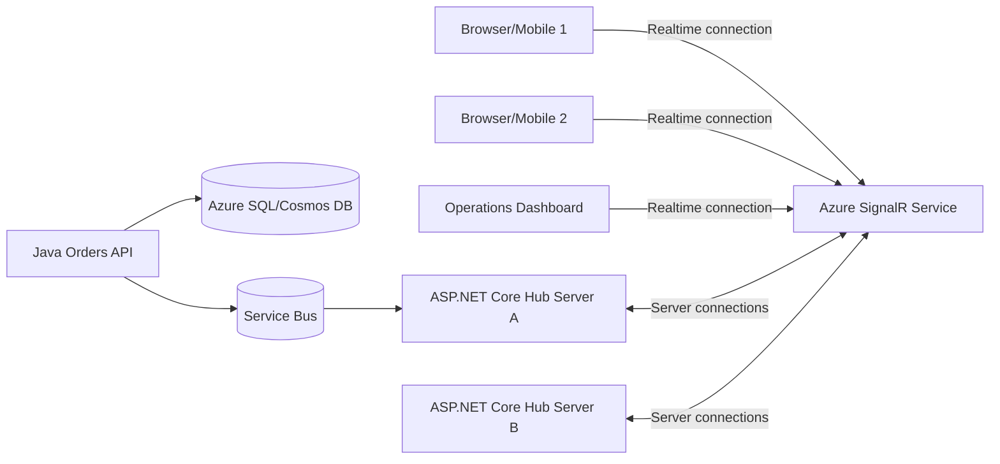
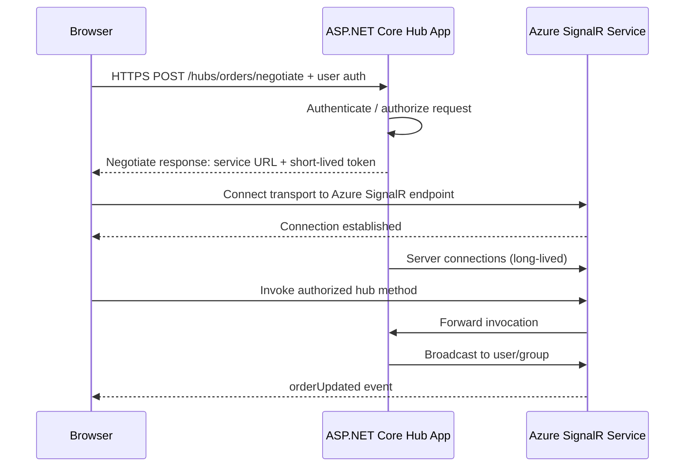
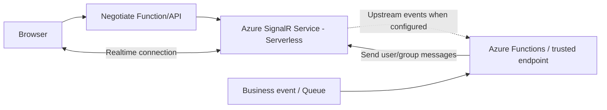
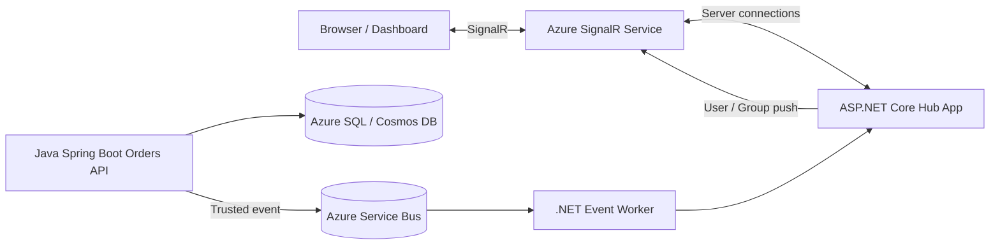
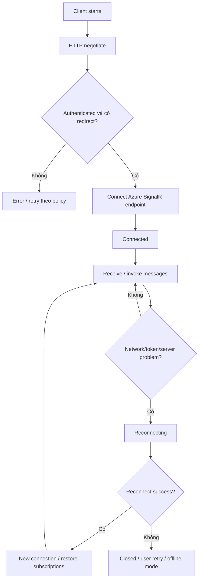
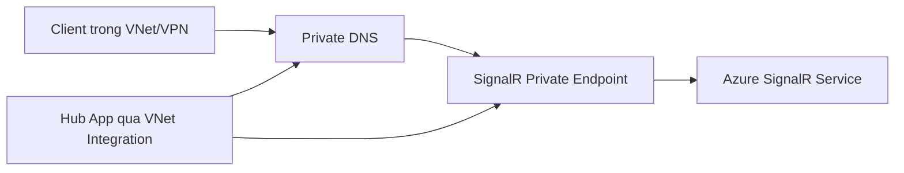
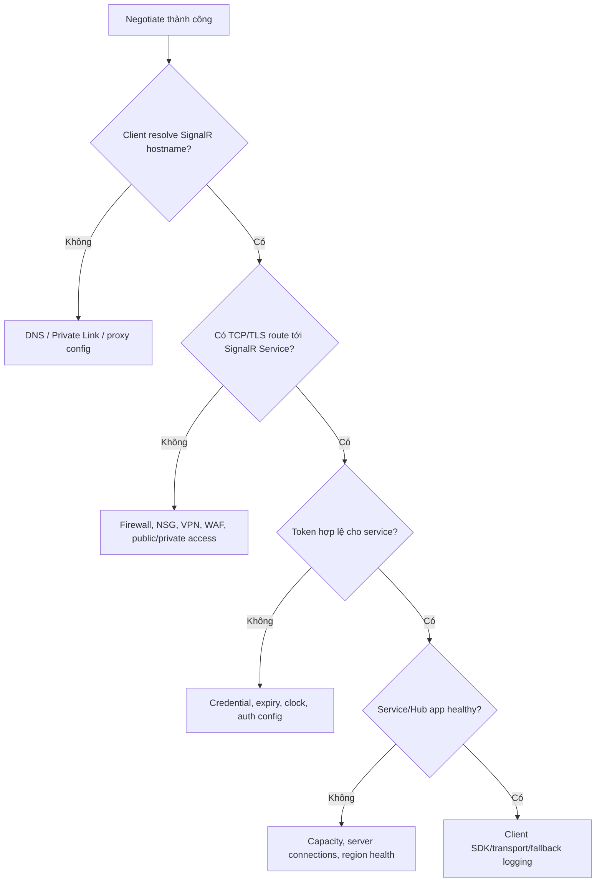

# Azure SignalR Service và quản lý kết nối thời gian thực

Một hệ thống thương mại điện tử gửi thông báo “Đơn hàng đã được đóng gói” ngay khi kho xử lý xong. Người dùng đang mở ứng dụng web cần thấy trạng thái mới mà **không phải tải lại trang hoặc liên tục gọi API mỗi vài giây**. Một ứng dụng khác có bảng điều khiển vận hành cho hàng nghìn nhân viên, yêu cầu nhận cập nhật số đơn đang chờ gần thời gian thực. Nếu tự quản lý hàng chục nghìn WebSocket connections ở nhiều máy chủ ứng dụng, nhóm kỹ thuật phải giải quyết scale-out, kết nối bị ngắt, phân phối thông báo giữa instances và giám sát độ trễ.

**Azure SignalR Service** là một dịch vụ Azure được quản lý để hỗ trợ kết nối thời gian thực dựa trên **ASP.NET Core SignalR** và các khả năng client/server theo chế độ của dịch vụ. Dịch vụ giúp chuyển phần lớn gánh nặng duy trì kết nối của clients sang hạ tầng do Azure vận hành. Ứng dụng vẫn phải chịu trách nhiệm **xác thực người dùng, phân quyền, dữ liệu nghiệp vụ, thiết kế thông báo, xử lý reconnect và đảm bảo kết quả nghiệp vụ**.

Bài học thuộc chương **Cache và giao tiếp thời gian thực** của module **CLOUD_PROVIDERS_AZURE**. Nội dung liên kết Azure subscription, resource group, Microsoft Entra ID, VNet/Private Endpoint, App Service, Azure Functions, Service Bus, dữ liệu, giám sát và kiểm soát chi phí. Dù thuộc cùng chương với cache, **SignalR Service không phải cơ sở dữ liệu hoặc cache bền vững**: thông báo real-time thường phải đi cùng một nguồn trạng thái chính thức như Azure SQL, Cosmos DB hoặc Storage.

> **Phạm vi:** Bài tập trung **Azure SignalR Service**, không đồng nhất với **Azure Web PubSub**. Ví dụ dùng ASP.NET Core SignalR làm hub server và minh họa cách ứng dụng **Java/Spring Boot** phát sự kiện qua Service Bus để một cầu nối .NET gửi thông báo. Khả năng, SDK, service mode, tier, giới hạn kết nối và networking có thể thay đổi theo phiên bản/region; phải xác minh cấu hình đang dùng trước khi triển khai production. Không có tài nguyên Azure nào được tạo hoặc chạy thử trong quá trình biên soạn.

## Mục tiêu học tập

Sau bài học, bạn có thể:

1. Phân biệt polling, Server-Sent Events, WebSocket và SignalR trong một ứng dụng thời gian thực.
2. Mô tả đường đi **negotiate → kết nối client tới dịch vụ → hub server → gửi thông báo**.
3. Phân biệt **Default**, **Serverless** và **Classic** service modes cùng giới hạn của từng mô hình.
4. Phân biệt **connection**, **user**, **group**, **hub**, **server connection** và cách quản lý lifecycle.
5. Cấu hình một ASP.NET Core hub dùng Azure SignalR Service và client JavaScript có reconnect.
6. Xây dựng mô hình **Java business service → Service Bus → .NET notification bridge → SignalR clients**.
7. Hiểu xác thực JWT, Microsoft Entra ID, authorization khi vào group, identity và bảo vệ token.
8. Thiết kế presence, state synchronization, duplicate/out-of-order handling và nhận biết giới hạn reliability.
9. Đánh giá Private Endpoint, DNS, network path của client và app server.
10. Theo dõi concurrent connections, message delivery, server connections, latency, lỗi và chi phí.
11. Viết runbook điều tra negotiate 401, kết nối thất bại, client không nhận event và reconnect storm.
12. Thiết kế một dashboard đặt hàng có cập nhật thời gian thực nhưng vẫn đúng nghiệp vụ.

## 1. Vì sao cần realtime thay vì polling?

Giả sử 10.000 trình duyệt cùng mở trang trạng thái đơn hàng. Nếu mỗi client gọi REST API mỗi 2 giây thì hệ thống nhận khoảng **5.000 HTTP requests/giây**, ngay cả khi chỉ có một số rất nhỏ đơn hàng thay đổi.

| Cơ chế | Cách hoạt động | Phù hợp | Trade-off |
|---|---|---|---|
| **Short polling** | Client hỏi API định kỳ | Ứng dụng nhỏ, tần suất thay đổi thấp | Nhiều request dư thừa hoặc độ trễ cập nhật |
| **Long polling** | Server giữ request tới khi có dữ liệu/timeout rồi client gọi tiếp | Fallback khi transport khác không hoạt động | Nhiều vòng HTTP, proxy timeout |
| **Server-Sent Events (SSE)** | Kênh server → client qua HTTP | Notification một chiều | Không thay thế giao tiếp hai chiều đầy đủ |
| **WebSocket** | Kết nối hai chiều tồn tại lâu | Chat, dashboard, collaboration | Cần connection lifecycle, scale, auth, reconnect |
| **ASP.NET Core SignalR** | Abstraction realtime với hubs và transport negotiation | Ứng dụng cần groups/users/hub methods | Phụ thuộc SignalR ecosystem và hub semantics |
| **Azure SignalR Service** | Dịch vụ managed hỗ trợ SignalR connectivity/scale-out | Số lượng kết nối lớn, nhiều app servers | Thêm một service, network/auth/cost và operational boundaries |

SignalR có thể sử dụng WebSocket và transport fallback tùy khả năng client/server/proxy. **Không nên giả định tất cả clients luôn dùng WebSocket**. Azure SignalR Service giúp quản lý kết nối ở quy mô lớn nhưng không thay thế bài toán bảo mật và dữ liệu.

## 2. Azure SignalR Service là gì và không phải gì?

**Azure SignalR Service** cung cấp thành phần hạ tầng giữa client và ứng dụng SignalR. Trong **Default mode**, dịch vụ duy trì các client connections và chuyển thông điệp/hub invocation giữa clients với **hub servers**. Các app servers thiết lập **server connections** tới dịch vụ.



**Dịch vụ làm tốt:** kết nối realtime, phân phối message, giảm gánh nặng kết nối ở app servers, hỗ trợ user/group routing theo mô hình SignalR, scale service units theo khả năng tier.

**Dịch vụ không tự làm:**

- Lưu vĩnh viễn mọi notification như message broker.
- Đảm bảo user offline sẽ nhận lại tất cả message sau khi kết nối.
- Chạy Java business logic, SQL transactions hoặc kiểm tra quyền đọc đơn hàng.
- Tự lưu bảng presence chính xác theo nghiệp vụ.
- Tạo một API REST cho lịch sử đơn hàng hoặc cache dữ liệu.
- Bảo vệ ứng dụng nếu server cấp token/group access cho người dùng sai.
- Đảm bảo end-to-end exactly-once delivery từ database qua browser.

### Phân biệt cache và realtime

Một **cache** lưu dữ liệu để truy vấn nhanh trong một thời gian; một **SignalR connection** là kênh đưa thông báo tới client đang kết nối. Với một bảng dashboard, thiết kế tốt thường là:

1. Client gọi REST API để lấy trạng thái mới nhất từ database/cache.
2. Client nhận SignalR event như một lời nhắc có thay đổi.
3. Khi event đến hoặc client reconnect, client fetch/cập nhật state theo version.
4. Dữ liệu bền vững vẫn nằm ở hệ thống được xác định là nguồn sự thật.

## 3. Các khái niệm: hub, connection, user và group

| Khái niệm | Ý nghĩa | Lưu ý |
|---|---|---|
| **Hub** | Endpoint logic mà SignalR server/client dùng để gọi phương thức và nhận thông điệp | Có thể có nhiều hubs trong ứng dụng |
| **Client connection** | Một phiên kết nối transport giữa client và Azure SignalR Service | Có connection ID, thay đổi khi reconnect |
| **Server connection** | Kết nối từ ASP.NET Core hub server tới Azure SignalR Service trong Default mode | Khác client connection; phục vụ chuyển tiếp và điều phối |
| **User identifier** | Khóa logic đại diện user trong SignalR | Phải lấy từ identity được xác thực; tránh trùng giữa tenants |
| **Group** | Nhóm logic các connections để broadcast tới nhiều thành viên | Membership phải được quản lý theo quyền và reconnect |
| **Hub method** | Phương thức server cho phép client gọi trong hub model | Phải authorize, validate input và giới hạn side effects |
| **Negotiation endpoint** | HTTP endpoint dùng trong thiết lập kết nối | Tạo redirect/credential theo mô hình Azure SignalR |
| **Connection token** | Credential ngắn hạn để client kết nối đến service endpoint | Không phải account access key; không đưa vào log |
| **Management plane/API** | Quản lý groups/users/connections hoặc gửi message theo SDK/REST phù hợp | Cần auth và phân quyền riêng |

Một user có thể đăng nhập đồng thời trên **web, điện thoại và nhiều tab**. Khi gửi tới user, ứng dụng có thể cần gửi tới nhiều connections thuộc cùng user đó. Ngược lại, một connection có thể gia nhập nhiều groups.

### Nhóm không phải danh sách quyền truy cập

Không được suy rằng biết tên group như `order:ORD-1001` thì user tự có quyền vào. Server phải xác minh quyền của user với đơn hàng trước khi thêm connection vào group. Không tạo hub method `JoinAnyGroup(string groupName)` mà không kiểm tra authorization.

## 4. Quy trình negotiate và thiết lập kết nối

Trong **Default mode** với ASP.NET Core SignalR và Azure SignalR Service, client thường bắt đầu bằng HTTP negotiate tới **ứng dụng hub server**. Sau đó client được chuyển tới endpoint Azure SignalR Service cùng credential do phía server/service tạo theo cơ chế tương ứng.



Sơ đồ khái niệm, không cam kết tất cả byte-level messages hoặc thứ tự handshake ở mọi SDK.

### Vì sao client không nên kết nối chỉ bằng service key?

Account key/connection string có quyền rộng để quản lý hoặc phát access tokens. **Không đưa service connection string vào browser/mobile app**. Browser chỉ cần token ngắn hạn được tạo qua endpoint trusted theo service mode.

### Cần bảo vệ cả hai phía

- **Client → hub negotiate:** app auth (Microsoft Entra ID/JWT/cookie), TLS, CORS/origin policy và rate limit.
- **Client → Azure SignalR endpoint:** token hợp lệ, network/TLS tới service.
- **Hub servers → Azure SignalR Service:** connection credential/managed identity theo capability.
- **Hub/app → database, queue:** workload identity và RBAC data plane.

Negotiate thành công không chứng minh client sẽ kết nối được: client vẫn phải DNS resolve/route tới **Azure SignalR Service endpoint**, không chỉ tới App Service hostname.

## 5. Default mode: server có Hub và application logic

**Default mode** là lựa chọn tiêu biểu cho ứng dụng **ASP.NET Core SignalR** có hub servers thường trực.

- Hub servers chạy trên App Service, container hoặc AKS/VM theo mô hình được hỗ trợ.
- Azure SignalR Service giữ client connections và truyền dữ liệu tới hub servers.
- Hub method, authentication logic, group permissions và event handling thuộc app servers.
- App servers có thể scale-out, dịch vụ giúp phân phối tới đúng connections/groups.
- Cần theo dõi **server connections** và khả năng hub servers hoạt động; nếu tất cả hub servers down, nhiều hub interactions không thể thực hiện bình thường.

### Khi nào dùng Default mode?

- Đã có ASP.NET Core SignalR hubs.
- Muốn hub method và lifecycle logic ở app.
- Cần ASP.NET Core authentication/authorization và DI.
- Muốn broadcast từ `IHubContext`, background worker hoặc ứng dụng .NET.
- Có thể vận hành hub app servers theo SLO.

### Những điều cần tránh

- Không giữ business-critical connection state chỉ trong **static dictionary** của một hub server: scale-out/failover làm dữ liệu lệch.
- Không dùng hub instance như singleton; hub instances có lifecycle riêng.
- Không cho mọi client tự gửi notification đại diện user khác.
- Không phụ thuộc message trong RAM để thay thế event queue/database.
- Không mặc định server connections ổn định nếu hub app crash hoặc mất network.

## 6. Serverless mode: không có hub server thường trực

Ở **Serverless mode**, ứng dụng thường **không triển khai ASP.NET Core hub server giữ server connections** như Default mode. Một dịch vụ trusted (ví dụ Azure Functions dùng bindings/SDK được hỗ trợ) có thể cung cấp negotiate flow và gửi thông điệp qua management/bindings.



### Thích hợp khi nào?

- Ứng dụng chủ yếu **push notifications** tới clients.
- Đang dùng Azure Functions hoặc event-driven backend.
- Không muốn duy trì một ứng dụng ASP.NET Core hub server chỉ để giữ connections.
- Có nhu cầu serverless negotiate và xử lý upstream events theo tính năng hỗ trợ.

### Hạn chế cần hiểu

- Không tự có một hub server C# để chạy Hub method như Default mode.
- Các bindings/SDK và khả năng nhận **client invocation/upstream events** phụ thuộc runtime, ngôn ngữ và phiên bản extension.
- Vẫn cần một nơi trusted để cấp connection info/token và authorize.
- Logic groups/users, delivery và authentication không tự biến mất.
- Nếu dùng Java Azure Functions, **phải kiểm tra language support của SignalR bindings cho chính Functions runtime**; không sao chép annotation .NET/JavaScript rồi giả định Java có tương đương.

**Pseudocode (không phải mã Functions để chạy trực tiếp):**

```text
POST /realtime/negotiate
  -> authenticate user
  -> generate SignalR connection info for authorized user

Business event arrives at Azure Function
  -> validate source, schema and recipient
  -> send SignalR message to authorized user/group

Browser connects to service URL with token
  -> receive message
  -> refetch authoritative state when necessary
```

## 7. Classic mode và lựa chọn mode cho ứng dụng mới

Một số tài nguyên/triển khai cũ có **Classic mode**, được cung cấp cho các mô hình tương thích legacy. Nó có hành vi phụ thuộc cách kết nối app servers/serverless và không phải lựa chọn mặc định nên áp dụng khi thiết kế mới.

| Service mode | Hub server | Điểm mạnh | Lưu ý |
|---|---|---|---|
| **Default** | Có ASP.NET Core hub servers | Hubs, methods, groups và scale-out | Cần server connections/hub app luôn sẵn sàng |
| **Serverless** | Không theo hub-server model thường trực | Push với Functions/REST/management APIs | Negotiate/upstream flow và SDK khác Default |
| **Classic** | Chế độ legacy tương thích | Phục vụ nhu cầu ứng dụng cũ cụ thể | Không chọn chỉ vì muốn “tự động tốt nhất”; kiểm tra tài liệu/capabilities |

### Không chuyển mode tùy tiện trong production

Đổi service mode có thể làm thay đổi cách negotiate, upstream events và khả năng hub server hoạt động, gây gián đoạn client. Cần thử trên service staging, xác minh compatibility và lên kế hoạch migration/rollback.

## 8. Azure SignalR Service khác Azure Web PubSub thế nào?

**Azure Web PubSub** là một dịch vụ Azure khác để xây dựng ứng dụng realtime dựa trên **WebSocket/pub-sub** với giao thức/API riêng.

| Góc nhìn | Azure SignalR Service | Azure Web PubSub |
|---|---|---|
| Mô hình chính | SignalR clients/hubs và Azure SignalR protocol/integration | WebSocket/pub-sub với protocol/service API riêng |
| ASP.NET Core SignalR | Tích hợp trực tiếp với hub server SDK | Không tự thay thế một Hub SignalR bằng cách đổi URL |
| Hệ thống Java | Thường tích hợp gián tiếp qua trusted bridge/REST theo support matrix | Có thể phù hợp nếu ứng dụng Java cần mô hình WebSocket/pub-sub trực tiếp |
| Nhóm người dùng/connection | User/group semantics theo SignalR | Group/pub-sub semantics theo dịch vụ |
| Client SDK | SignalR clients theo ngôn ngữ/platform được hỗ trợ | Web PubSub clients/SDK được hỗ trợ |
| Migration | Cần xem service mode, negotiate, hub contract | Có thể phải đổi protocol, auth và client library |

**Không nhầm rằng cả hai dịch vụ có thể dùng thay nhau mà không sửa code.** Nếu tổ chức chọn Azure SignalR Service, client/hub contract phải dựa trên SignalR. Nếu hệ thống Java thuần muốn phát/nhận WebSocket theo protocol riêng, cần đánh giá Azure Web PubSub riêng trước khi quyết định.

## 9. Kiến trúc thực tế: Java nghiệp vụ + SignalR hub .NET

Một Spring Boot API xử lý đơn hàng, ghi database và phát **business event** vào Service Bus. Một ứng dụng **ASP.NET Core notification bridge** đọc event và dùng `IHubContext` gửi tới SignalR Service.



Trong triển khai thật, **.NET Event Worker có thể chạy cùng process với Hub App** và dùng `IHubContext` để phát thông báo; mũi tên giữa Worker/Hub chỉ là quan hệ logic chứ không bắt buộc là một HTTP call khác.

### Vì sao có Service Bus?

- Java business logic không cần phụ thuộc trực tiếp vào đời sống kết nối WebSocket.
- Event được lưu bền vững ở broker tới khi worker xử lý theo settlement/TTL/DLQ được cấu hình.
- Nếu hub server gặp sự cố, worker có thể retry và xử lý backlog theo giới hạn.
- Java và .NET deployment có thể scale độc lập.
- Mỗi event có `eventId`, `orderId`, `tenantId` để correlation.

### Giới hạn reliability

Khi worker đã gửi thông báo tới SignalR và **complete message** trên Service Bus, điều đó **không chứng minh browser đã đọc và lưu thông báo**. Khách hàng offline có thể không nhận. Vì vậy backend phải lưu trạng thái đơn hàng; browser fetch snapshot sau reconnect. Nếu cần lịch sử notification và read receipts, xây một **notification inbox** bền vững có trạng thái đã đọc.

## 10. Chuẩn bị ASP.NET Core Hub App

Ví dụ minh họa dùng **ASP.NET Core** có package cho SignalR Service (thường là `Microsoft.Azure.SignalR`), ASP.NET Core JWT Bearer Authentication và configuration tương thích phiên bản .NET đang dùng.

### Cấu hình phải tồn tại

- Azure SignalR Service instance ở **Default mode**.
- Trusted hub app có đường outbound tới SignalR Service.
- Hub route, ví dụ `/hubs/orders`.
- Cấu hình authentication cho client (Microsoft Entra ID/JWT, hoặc một cơ chế phù hợp).
- Credential để hub server kết nối SignalR Service, ví dụ cấu hình `Azure:SignalR:ConnectionString` trong môi trường lab; ưu tiên identity/secret store được hỗ trợ ở production.
- Application endpoint TLS và DNS.
- Số hub servers và service units phù hợp SLO.

### Cấu hình bằng appsettings (không có secret)

```json
{
  "Azure": {
    "SignalR": {
      "ConnectionString": ""
    }
  },
  "Entra": {
    "TenantId": "<TENANT_ID>",
    "Audience": "<API_APPLICATION_ID_URI_OR_AUDIENCE>"
  }
}
```

**Không điền connection string thật vào file source.** Trong App Service, biến môi trường dạng `Azure__SignalR__ConnectionString` có thể map vào configuration `Azure:SignalR:ConnectionString` theo quy ước .NET; dùng Key Vault reference/secret store được phê duyệt hoặc identity-based SDK configuration nếu phiên bản service/SDK hỗ trợ.

### Mục tiêu authorization

Mỗi connection cần một identity đáng tin cậy. Không dùng một nickname do client tự gửi làm định danh user nếu hệ thống có tài khoản/tenant thực. Với Microsoft Entra ID, các claims như `tid` (tenant) và `oid` (object ID) có thể giúp tạo **khóa user duy nhất theo tenant** sau khi JWT đã được validate.

## 11. ASP.NET Core Program.cs: authenticate và kết nối SignalR

Đoạn code dưới minh họa cấu trúc ứng dụng .NET hiện đại. Nó yêu cầu các packages/version .NET tương thích, một identity provider đã cấu hình và Azure SignalR Service Default mode.

```csharp
using Microsoft.AspNetCore.Authentication.JwtBearer;
using Microsoft.AspNetCore.SignalR;
using Microsoft.IdentityModel.Tokens;

var builder = WebApplication.CreateBuilder(args);

var tenant = builder.Configuration["Entra:TenantId"]
    ?? throw new InvalidOperationException("Missing Entra:TenantId");
var audience = builder.Configuration["Entra:Audience"]
    ?? throw new InvalidOperationException("Missing Entra:Audience");

builder.Services
    .AddAuthentication(JwtBearerDefaults.AuthenticationScheme)
    .AddJwtBearer(options =>
    {
        options.Authority =
            "https://login.microsoftonline.com/" + tenant + "/v2.0";
        options.Audience = audience;

        // Browser SignalR transports may pass the bearer token in a
        // query value for WebSockets/SSE. Restrict parsing to hub path.
        options.Events = new JwtBearerEvents
        {
            OnMessageReceived = context =>
            {
                var token =
                    context.Request.Query["access_token"].ToString();

                if (!string.IsNullOrWhiteSpace(token)
                    && context.HttpContext.Request.Path
                        .StartsWithSegments("/hubs/orders"))
                {
                    context.Token = token;
                }

                return Task.CompletedTask;
            }
        };
    });

builder.Services.AddAuthorization();

// Microsoft.Azure.SignalR integration for Default mode.
builder.Services.AddSignalR().AddAzureSignalR();

var app = builder.Build();

app.UseAuthentication();
app.UseAuthorization();
app.MapHub<OrdersHub>("/hubs/orders")
    .RequireAuthorization();

app.Run();
```

### Giải thích

- `AddSignalR().AddAzureSignalR()` tích hợp managed SignalR Service với ASP.NET Core hub.
- `AddJwtBearer` minh họa kiểm tra JWT qua Microsoft Entra ID.
- `RequireAuthorization()` yêu cầu client phải được xác thực trước khi dùng hub.
- `access_token` trên query string chỉ được đọc ở **hub path** trong tình huống browser transport cần; phải hạn chế query-string logging để không lộ token.
- `Authority` và `Audience` phải đúng Entra app registration; không lấy ID token của frontend dùng thay access token cho API.
- Trong hệ thống đa tenant, phải kiểm tra **issuer/tenant allowlist và policy** chứ không chỉ nhận một claim `tid` chưa được xác minh.

**Đây là phần khung học tập**: còn cần `OrdersHub`, authorization nghiệp vụ, dependency versions và cấu hình triển khai. Không khẳng định đoạn code đã được biên dịch hoặc chạy trên Azure.

## 12. Hub: thêm connection vào group dựa trên identity thật

Đoạn code dưới tránh để client tự chọn tùy ý tên group. Sau khi JWT được validate, mỗi connection được đưa vào group dành riêng cho **user object ID trong tenant**.

```csharp
using Microsoft.AspNetCore.Authorization;
using Microsoft.AspNetCore.SignalR;

[Authorize]
public sealed class OrdersHub : Hub
{
    public static string UserGroup(string tenantId, string userObjectId)
        => "user:" + tenantId + ":" + userObjectId;

    public override async Task OnConnectedAsync()
    {
        var tenantId = Context.User?.FindFirst("tid")?.Value;
        var userObjectId = Context.User?.FindFirst("oid")?.Value;

        if (string.IsNullOrWhiteSpace(tenantId)
            || string.IsNullOrWhiteSpace(userObjectId))
        {
            Context.Abort();
            return;
        }

        await Groups.AddToGroupAsync(
            Context.ConnectionId,
            UserGroup(tenantId, userObjectId));

        await base.OnConnectedAsync();
    }
}
```

### Vì sao group do server quyết định?

Nếu client gửi `JoinOrder("ORD-1001")`, một user có thể thử ID đơn hàng của người khác. Bản ví dụ trên dùng `tid` và `oid` từ **verified JWT** do backend xác thực. Khi gửi thông báo, service backend phải biết **đúng owner của đơn hàng** từ database hoặc một event được tin cậy.

### Khi cần group cho một đơn hàng

Có thể triển khai hub method:

```text
SubscribeOrder(orderId)
  1. Xác thực caller
  2. Kiểm tra user/tenant có quyền xem orderId từ database
  3. Nếu không có quyền: từ chối
  4. Nếu được phép: add Context.ConnectionId vào group order:<tenant>:<order>
```

Đây là **pseudocode**, không phải method thiếu authorization được dùng trực tiếp. Nếu quyền user bị thu hồi trong lúc connection còn sống, cần cơ chế **remove group membership/revalidate authorization**, không coi membership đã cấp là quyền vĩnh viễn.

### Lifecycle

- `OnConnectedAsync` được gọi khi hub connection được thiết lập theo mô hình runtime.
- `OnDisconnectedAsync` có thể được gọi khi ngắt kết nối; đừng coi nó là một transaction guaranteed trong mọi crash/network partition.
- Khi reconnect thành kết nối mới, group membership cần được **thiết lập lại** theo ứng dụng.
- `Context.ConnectionId` là thông tin của một phiên kết nối; không dùng làm user ID bất biến.

## 13. Gửi thông báo từ backend .NET bằng IHubContext

Hub không phải singleton chứa mutable state. Khi code ngoài hub cần gửi message, nên dùng `IHubContext<OrdersHub>` do dependency injection cung cấp.

```csharp
using Microsoft.AspNetCore.SignalR;

public sealed record OrderUpdate(
    string EventId,
    string OrderId,
    string Status,
    long Version);

public sealed class OrderRealtimeNotifier
{
    private readonly IHubContext<OrdersHub> _hub;

    public OrderRealtimeNotifier(IHubContext<OrdersHub> hub)
    {
        _hub = hub;
    }

    public Task NotifyOwnerAsync(
        string tenantId,
        string userObjectId,
        OrderUpdate update,
        CancellationToken cancellationToken)
    {
        string group = OrdersHub.UserGroup(
            tenantId, userObjectId);

        return _hub.Clients.Group(group)
            .SendAsync("orderUpdated", update, cancellationToken);
    }
}
```

### Phân biệt gửi thông báo với transaction

`SendAsync` giúp thực hiện **send operation** tới hạ tầng SignalR theo cơ chế thư viện. Nó không phải bằng chứng tất cả client devices đã render được message hoặc ghi “read receipt”. Nếu cần xác nhận đã đọc, client phải gửi **acknowledgment nghiệp vụ** và backend lưu trạng thái qua API/DB có authorization.

### Payload nhỏ và ổn định

Nên gửi:

```json
{
  "eventId": "evt-ORD-1001-v4",
  "orderId": "ORD-1001",
  "status": "PACKED",
  "version": 4
}
```

Không gửi access token, SQL connection string, toàn bộ thông tin thanh toán hoặc file lớn trong notification. Nếu UI cần dữ liệu chi tiết, gọi REST API đã phân quyền để lấy theo phiên bản.

## 14. Browser JavaScript: kết nối, nhận event và tự reconnect

Với package JavaScript `@microsoft/signalr` (phiên bản tương thích với backend), client kết nối vào **hub route của ứng dụng**, không tự cấp key để gọi SignalR Service endpoint.

```javascript
import * as signalR from "@microsoft/signalr";

async function getAccessTokenForApi() {
  // Implement with MSAL or another approved auth flow.
  // Return an access token whose audience is the hub API.
  throw new Error("Configure a real token provider");
}

const connection = new signalR.HubConnectionBuilder()
  .withUrl("/hubs/orders", {
    accessTokenFactory: getAccessTokenForApi
  })
  .withAutomaticReconnect([0, 2000, 10000, 30000])
  .configureLogging(signalR.LogLevel.Warning)
  .build();

let lastVersionByOrder = new Map();

connection.on("orderUpdated", async update => {
  const current = lastVersionByOrder.get(update.orderId) ?? -1;
  if (update.version <= current) {
    return; // Duplicate or stale event; not authoritative state.
  }

  lastVersionByOrder.set(update.orderId, update.version);

  // Fetch authoritative state if security/accuracy require it.
  // const order = await fetchAuthorizedOrder(update.orderId);
  console.log("Order changed", update.orderId, update.status);
});

connection.onreconnecting(error => {
  console.warn("SignalR disconnected", error?.message);
  // UI should display reconnecting/offline status.
});

connection.onreconnected(async newConnectionId => {
  console.info("SignalR reconnected", newConnectionId);

  // Reconcile real order data from a secured REST endpoint.
  // await refreshCurrentOrders();
});

connection.onclose(error => {
  console.error("SignalR connection closed", error?.message);
  // Consider bounded initial/new connection retry or user action.
});

async function start() {
  try {
    await connection.start();
    console.info("Realtime connection established");
  } catch (error) {
    console.error("Initial connection failed", error);
    // withAutomaticReconnect does NOT retry initial start().
    // Implement bounded retry/backoff or show reconnect button.
  }
}

start();
```

### Lưu ý cho production

- Hàm `getAccessTokenForApi` trong mẫu cố ý chưa cài để **không dùng token giả**.
- Dùng một token acquisition mechanism an toàn với refresh khi token hết hạn.
- `withAutomaticReconnect` xử lý việc reconnect **sau khi kết nối từng hoạt động**, không tự retry initial `start()`; cần chính sách riêng.
- Mọi UI update nên kiểm soát duplicate/out-of-order events.
- Khi reconnect, fetch snapshot và thiết lập lại những subscription/group membership do ứng dụng quản lý nếu cần.
- Không log token/negotiation redirect URL chứa credential.
- Nếu client chạy sau reverse proxy, đảm bảo route, CORS và HTTPS của negotiate đúng.

## 15. Java backend không phải ASP.NET Core SignalR hub server

Một ứng dụng **Java/Spring Boot** có thể là nguồn tạo business events và tích hợp với hệ thống realtime, nhưng không nên suy rằng một `@RestController` Java sẽ trở thành **ASP.NET Core SignalR Hub** chỉ nhờ trỏ kết nối tới Azure SignalR Service.

Các lựa chọn kiến trúc gồm:

1. **Java API → Service Bus → .NET Hub/Worker bridge**: tách nghiệp vụ với kênh realtime, phù hợp khi có thể chạy một dịch vụ .NET nhỏ.
2. **Java API → trusted backend → management SDK/REST của SignalR Service** nếu API/language support, authentication và service mode được xác minh.
3. **Java API → Azure Functions/Logic Apps → Serverless mode** khi bindings/runtime và upstream semantics phù hợp.
4. Nếu yêu cầu Java giao tiếp WebSocket/pub-sub trực tiếp mà không dùng SignalR hub contract, đánh giá **Azure Web PubSub** như một sản phẩm khác.

### Java client có hỗ trợ không?

ASP.NET Core SignalR có những client SDK cho một số nền tảng ngoài .NET, trong đó có Java/Android trong hệ sinh thái được hỗ trợ. Tuy nhiên, **client Java không đồng nghĩa Java server hub**; API/hành vi SDK phải kiểm tra theo phiên bản và môi trường (JVM server, Android, WebSocket transports).

### Không phát thông báo trực tiếp từ transaction chưa commit

Nếu Java tạo order rồi gửi event realtime **trước khi transaction database commit**, browser có thể thấy trạng thái mới nhưng database vẫn chưa có. Nên dùng **transactional outbox** hoặc luồng ghi state → publish event có đảm bảo phù hợp, tránh mất event khi process crash giữa hai bước.

## 16. Java gửi sự kiện nghiệp vụ vào Azure Service Bus

Đoạn Java sau minh họa event producer tin cậy: từ Spring Boot/Java backend gửi message sau khi dữ liệu nghiệp vụ đã được ghi bền vững theo outbox/integration pattern. Nó sử dụng Microsoft Entra identity thay vì đưa connection string vào code.

### Maven dependencies (trích đoạn)

```xml
<dependencies>
  <dependency>
    <groupId>com.azure</groupId>
    <artifactId>azure-messaging-servicebus</artifactId>
    <version><!-- Pin a compatible version --></version>
  </dependency>
  <dependency>
    <groupId>com.azure</groupId>
    <artifactId>azure-identity</artifactId>
    <version><!-- Pin a compatible version --></version>
  </dependency>
</dependencies>
```

Các `version` là placeholder cần thay trong project thực; thêm JSON serialization library nếu dùng POJO/Jackson thay vì chuỗi thủ công.

### Mã minh họa

```java
package vn.example.orders;

import com.azure.identity.DefaultAzureCredentialBuilder;
import com.azure.messaging.servicebus.ServiceBusClientBuilder;
import com.azure.messaging.servicebus.ServiceBusMessage;
import com.azure.messaging.servicebus.ServiceBusSenderClient;

public final class OrderEventPublisher {

    private OrderEventPublisher() { }

    public static void publish(
            String eventId,
            String tenantId,
            String recipientObjectId,
            String orderId,
            String status) {

        String namespace = System.getenv("SERVICE_BUS_NAMESPACE");
        if (namespace == null || namespace.isBlank()) {
            throw new IllegalStateException(
                "SERVICE_BUS_NAMESPACE is required");
        }

        // Example input is trusted business data. Production:
        // serialize JSON with a real library and validate each field.
        String payload = String.format(
            "{\"eventId\":\"%s\",\"tenantId\":\"%s\","
            + "\"recipientObjectId\":\"%s\","
            + "\"orderId\":\"%s\",\"status\":\"%s\"}",
            eventId, tenantId, recipientObjectId, orderId, status);

        try (ServiceBusSenderClient sender =
                new ServiceBusClientBuilder()
                    .credential(
                        namespace,
                        new DefaultAzureCredentialBuilder().build())
                    .sender()
                    .queueName("order-notifications")
                    .buildClient()) {

            sender.sendMessage(
                new ServiceBusMessage(payload)
                    .setMessageId(eventId));
        }
    }
}
```

**Hạn chế có chủ ý:** `String.format` trong ví dụ chỉ dùng cho các giá trị lab tin cậy, không phải JSON serializer an toàn với dữ liệu tùy ý. Production cần dùng Jackson hoặc thư viện tương đương, xác thực schema, tránh injection/string escaping errors và không nhận `tenantId`/`recipientObjectId` trực tiếp từ client không đáng tin.

### Điều kiện

- `SERVICE_BUS_NAMESPACE` có dạng tên đầy đủ, ví dụ `orders-bus.servicebus.windows.net`.
- Workload identity có role **Azure Service Bus Data Sender** hoặc quyền data-plane tương đương tại queue/namespace phù hợp.
- Queue `order-notifications` tồn tại; không dùng namespace/queue production khi lab.
- Network tới Service Bus hợp lệ.
- Event được gửi **sau transaction commit**, tốt hơn qua outbox/relay để không mất sự kiện khi ứng dụng crash.
- Trong production, tái sử dụng sender/client theo lifecycle được SDK khuyến nghị thay vì tạo và đóng client cho từng event.

## 17. .NET bridge nhận Service Bus event rồi gửi SignalR

Một `BackgroundService` trong cùng app với `OrdersHub` có thể đọc các event đã commit từ queue và dùng `IHubContext<OrdersHub>` để gửi thông báo cho đúng user.

### Luồng xử lý khuyến nghị

```text
Receive Service Bus message
  -> parse và validate event schema
  -> xác minh business source / recipient tenant-user
  -> tra DB hoặc accepted business data nếu cần
  -> gọi IHubContext.Clients.Group(...)
  -> ghi nhận kết quả enqueue-to-SignalR
  -> complete message
```

### Đoạn code C# minh họa bridge

```csharp
using System.Text.Json;
using Azure.Messaging.ServiceBus;
using Microsoft.AspNetCore.SignalR;

public sealed record OrderEvent(
    string EventId,
    string TenantId,
    string RecipientObjectId,
    string OrderId,
    string Status,
    long Version);

public sealed class OrderNotificationWorker : BackgroundService
{
    private readonly ServiceBusClient _bus;
    private readonly IHubContext<OrdersHub> _hub;
    private readonly ILogger<OrderNotificationWorker> _log;

    public OrderNotificationWorker(
        ServiceBusClient bus,
        IHubContext<OrdersHub> hub,
        ILogger<OrderNotificationWorker> log)
    {
        _bus = bus;
        _hub = hub;
        _log = log;
    }

    protected override async Task ExecuteAsync(
        CancellationToken stoppingToken)
    {
        await using var processor = _bus.CreateProcessor(
            "order-notifications",
            new ServiceBusProcessorOptions
            {
                AutoCompleteMessages = false,
                MaxConcurrentCalls = 4
            });

        processor.ProcessMessageAsync += async args =>
        {
            OrderEvent? e = JsonSerializer.Deserialize<OrderEvent>(
                args.Message.Body.ToString());

            if (e == null || string.IsNullOrWhiteSpace(e.EventId))
            {
                await args.DeadLetterMessageAsync(
                    args.Message,
                    "InvalidEvent",
                    "Missing required fields",
                    args.CancellationToken);
                return;
            }

            // Production: validate source, tenant/user ownership,
            // schema and event version against trusted business state.
            await _hub.Clients.Group(OrdersHub.UserGroup(
                    e.TenantId, e.RecipientObjectId))
                .SendAsync(
                    "orderUpdated",
                    new OrderUpdate(
                        e.EventId, e.OrderId, e.Status, e.Version),
                    args.CancellationToken);

            await args.CompleteMessageAsync(
                args.Message, args.CancellationToken);
        };

        processor.ProcessErrorAsync += args =>
        {
            _log.LogError(args.Exception,
                "Service Bus notification processing error");
            return Task.CompletedTask;
        };

        await processor.StartProcessingAsync(stoppingToken);
        try
        {
            await Task.Delay(
                Timeout.InfiniteTimeSpan, stoppingToken);
        }
        catch (OperationCanceledException)
            when (stoppingToken.IsCancellationRequested)
        {
        }
        finally
        {
            await processor.StopProcessingAsync(
                CancellationToken.None);
        }
    }
}
```

Để dùng, ứng dụng phải đăng ký `ServiceBusClient` bằng namespace và `TokenCredential`, đăng ký `OrderNotificationWorker` qua `AddHostedService`, thêm packages `Azure.Messaging.ServiceBus` và `Azure.Identity` cùng cấu hình role **Azure Service Bus Data Receiver**. Mẫu chưa bao gồm toàn bộ DI/configuration project, business schema validation hoặc outbox handling.

### Một điểm reliability cực kỳ quan trọng

Một lần `SendAsync` thành công **không đồng nghĩa client đã nhận và hiển thị event**, vì user có thể offline hoặc disconnected giữa các bước. Nếu cần giao “đến tay người dùng”, phải xây inbox/persistent events và replay từ REST API sau reconnect.

### Nếu worker thất bại

- Không complete Service Bus message trước khi xử lý phần việc broker/hub bridge theo contract.
- Có retry giới hạn, DLQ và alert.
- Event ID phải cho phép backend/client dedupe.
- Nếu backend đã gửi nhưng mất xác nhận rồi worker retry, browser có thể nhận **duplicate event**.
- Nếu event quan trọng, không lấy việc broadcast thành công làm thay thế cho database update.

## 18. Gửi tới tất cả, user cụ thể và group

Các đích phổ biến của SignalR:

| Đích | Ví dụ | Ứng dụng |
|---|---|---|
| **All clients** | Thông báo hệ thống công khai | Dashboard public, maintenance notification không nhạy cảm |
| **Specific connection** | Một connection ID | Phản hồi kênh tạm thời; connection có thể biến mất |
| **User** | Một authenticated user ID | Thông báo cho tất cả thiết bị của một user theo mapping |
| **Group** | `tenant:<id>` hoặc `order:<id>` | Broadcast tới những connections được authorize |
| **All except some** | Trừ connection đã phát sự kiện | Tránh phản hồi trùng tới một số clients khi API hỗ trợ |

Trong Default mode, `IHubContext`/Hub Clients cung cấp các lựa chọn tương ứng theo API của SignalR. Trong Serverless mode, management API/output binding có khả năng riêng; xác minh đúng mode và SDK.

### Không broadcast toàn bộ tenant khi event chỉ dành cho một user

Ví dụ hóa đơn và thanh toán có thể chứa dữ liệu nhạy cảm. Khi gửi tới `tenant:acme`, mọi connection trong tenant group đều có thể nhận metadata. Nên chọn `user:<tenant>:<oid>` hoặc `order:<tenant>:<id>` có authorization phù hợp với chính sách.

### Group names có phải bí mật không?

Không. Tên group không phải credential. Bảo mật dựa trên **server-side authorization** và cách server quản lý membership. Không dựa vào việc đặt group name khó đoán làm cơ chế bảo vệ dữ liệu.

## 19. Lifecycle của một kết nối SignalR

Một connection có thể đi qua những trạng thái logic:



### Thực tế kết nối không luôn có thứ tự đẹp

- Browser tab bị sleep hoặc thiết bị mất mạng không nhất thiết báo disconnected ngay.
- Server và client có thể phát hiện gián đoạn ở thời điểm khác nhau.
- Client có thể thiết lập **connection ID mới** sau reconnect.
- Một user có nhiều connections; một tab đóng không có nghĩa user offline.
- Hub server restart không nhất thiết giống dịch vụ SignalR outage.
- Khi mất mạng, client có thể bỏ lỡ message đã phát.

**Presence** và business state cần thiết kế để chịu **eventual observations**, không dùng một sự kiện disconnect đơn lẻ làm chứng cứ tuyệt đối user đã rời hệ thống.

## 20. Presence: ai đang online?

Bài toán “User hiện đang online?” khó hơn việc đếm connection IDs.

### Mô hình đơn giản

```text
Presence key: tenantId + userObjectId
Observed connections: conn-A, conn-B, conn-C
LastHeartbeatUtc: 2026-11-20T09:15:00Z
Status: probably-online
```

Đây là dữ liệu ví dụ, không phải API built-in bắt buộc của SignalR.

### Những sai lệch có thể xảy ra

- Một user mở nhiều tab/thiết bị.
- Client mất mạng nhưng server chưa phát hiện.
- Hub server crash trước khi chạy disconnected handler.
- Connection reconnect đổi ID; key cũ chưa được xóa.
- Clocks không đồng bộ.
- App scale-out làm process-local dictionary không có cái nhìn toàn cục.

### Thiết kế production

- Sử dụng service/SDK presence APIs nếu phù hợp với nhu cầu và tính năng được hỗ trợ.
- Nếu cần presence nghiệp vụ, dùng distributed state store như Redis-compatible cache hoặc database với TTL/leases.
- Gắn heartbeat/last-seen và xử lý expiry thay vì tin tuyệt đối disconnect event.
- Định nghĩa “online” là một **ước lượng quan sát theo cửa sổ thời gian**, không phải chứng cứ người dùng đang nhìn màn hình.
- Không ghi dữ liệu cá nhân/chính xác vị trí hoặc hoạt động nhạy cảm vào presence store nếu không cần.
- Tách presence hiển thị trên UI khỏi security authorization.

### Không dùng presence để điều khiển thanh toán

User offline không có nghĩa phải rollback transaction đã commit. Quy trình thanh toán/đơn hàng tiếp tục thông qua database, queue và workflow riêng.

## 21. Reconnect, resubscribe và đồng bộ lại trạng thái

**Automatic reconnect** giảm gián đoạn giao diện, nhưng **không phát lại tất cả message** mà user đã bỏ lỡ. Cần quy trình phục hồi:

1. Client phát hiện mất kết nối và hiển thị trạng thái “đang kết nối lại”.
2. Client thực hiện reconnect với token còn hợp lệ hoặc refresh token.
3. Hub/Service thiết lập connection mới theo flow.
4. Backend kiểm tra lại identity và gán groups được phép.
5. Client gọi **GET snapshot** hoặc API `/orders?sinceVersion=...` nếu được hỗ trợ để bù dữ liệu.
6. Client cập nhật UI theo version, loại duplicate/out-of-order events.
7. Hệ thống ghi reconnect/error metrics.

### EventId và version

Hai thông tin có mục đích khác nhau:

- `eventId`: định danh một notification/event, dùng dedupe và correlation.
- `version`: thứ tự cập nhật của một order/item, dùng tránh cập nhật ngược về trạng thái cũ.

```text
Order ORD-1001:
  Event v5: PACKED
  Event v4: PAID arrives later
  UI rule: do not replace v5 by v4
```

Lưu ý: version cần được **backend tạo theo quy tắc nhất quán**, không dùng số tự tăng tại mỗi browser. Nếu version không thể suy tuyến tính do multi-region concurrent writes, cần state machine/merge policy theo dữ liệu thật.

### Tài liệu bền vững

Nếu thông báo là yêu cầu pháp lý hoặc phải được xác nhận đã đọc, lưu một **notification inbox** với ID, người nhận, timestamps, trạng thái unread/read, TTL/retention, rồi dùng SignalR làm kênh **thông báo “có tin mới”**.

## 22. Tin nhắn có bảo đảm thứ tự và giao đúng một lần không?

**Không nên thiết kế nghiệp vụ trên giả định SignalR luôn bảo đảm end-to-end exactly-once, durable delivery và global ordering.**

Trong một connection khỏe mạnh, thư viện/transport có một số hành vi giữ thứ tự; nhưng khi có:

- Nhiều producers/worker instances,
- Retry từ Service Bus/HTTP,
- Client reconnect,
- Route qua nhiều groups/connections,
- Các vùng Azure hoặc hệ thống data replication,

thì **thứ tự nghiệp vụ toàn cục** không thể suy chỉ từ thứ tự nhận SignalR callback.

### Kỹ thuật nên sử dụng

- **Idempotent event handler:** xử lý cùng event ID nhiều lần không gây trạng thái sai.
- **Monotonic business version:** cập nhật state theo version.
- **Snapshot synchronization:** fetch lại DB state sau reconnect.
- **Transactional outbox:** phát event sau khi state commit.
- **Poison/DLQ:** queue dữ liệu hỏng sau retry budget.
- **Backpressure:** coalescing/debounce các cập nhật cùng entity khi throughput cao.
- **Client acknowledgments** nếu cần read/delivery receipts ở tầng ứng dụng.

### Ví dụ event bị mất

1. Worker gửi “Đơn đã giao hàng”.
2. Browser đang offline.
3. SignalR không giữ tin nhắn vô thời hạn cho browser.
4. Khi user mở lại app, REST API trả trạng thái đã giao hàng.

Đây là hành vi **đúng** khi nguồn sự thật nằm ở database; hệ thống không cần cố phát mọi notification cũ qua WebSocket để tính toán lại state.

## 23. Xác thực và ủy quyền người dùng

Kênh realtime không làm giảm nhu cầu authN/authZ.

### Cấu hình phía client

Client đăng nhập qua Microsoft Entra ID hoặc hệ thống identity được phê duyệt, lấy **access token** dành cho hub app/backend. Token được gửi trong negotiate request. Server validate signature, issuer, audience, expiry và policy.

### Cấu hình phía hub

- Hub route yêu cầu authentication.
- Groups/user mapping dựa trên **claims đã được validate**.
- Client chỉ được gọi những hub methods được server cho phép.
- Mọi tham số như `orderId` phải kiểm tra quyền truy cập.
- Permission changes trong session được xử lý (remove group/disconnect/reauthorize).
- Không tin `tenantId` do client tự cung cấp nếu tenant claim đã có trong JWT.

### Token tới SignalR Service

Token do trusted service cấp cho client kết nối tới Azure SignalR Service là **bearer credential** trong thời gian hiệu lực. Bảo vệ khỏi logging, analytics, URL sharing và browser extensions không đáng tin. Nếu ứng dụng yêu cầu thời gian kết nối dài, cần hiểu **token lifetime/connection authentication behavior** khi token hết hạn, reconnect và policy revoke.

### CORS/origin không phải authorization

CORS giới hạn một số request từ browser origins; các native clients hoặc scripts có thể không chịu cùng giới hạn. Vì vậy **không dùng CORS như cơ chế xác thực người dùng**.

## 24. Xác thực server-to-service và quản lý bí mật

App servers hoặc serverless trusted endpoints cần có cách xác thực để dùng Azure SignalR Service.

### Những lựa chọn

- **Connection string/access key**: dễ cho lab, nhưng key phải được bảo vệ và có rotation.
- **Microsoft Entra ID/managed identity**: khi SDK/service mode/tier hỗ trợ, ưu tiên identity và Azure RBAC phù hợp.
- **Key Vault references/named secret store**: giữ secrets ra khỏi source code/CI logs.

### Shared responsibility

| Tầng | Trách nhiệm |
|---|---|
| Azure control plane | Ai được tạo/xóa service, scale và đổi network settings |
| SignalR data plane | Ai được tạo server connections, negotiate/send/manage connections |
| Hub application | Identity, authorization, groups và thông điệp |
| Java event producer | Quyền gửi Service Bus và xác thực nguồn sự kiện |
| Notification bridge | Quyền nhận Service Bus và truy cập Azure SignalR |
| Client | Không được nhận service key; giữ access tokens an toàn |

**Owner của resource group không tự có nghĩa là một user từ trình duyệt được đọc mọi message.** Control-plane RBAC và application-level auth là hai ranh giới khác nhau.

### Secrets trong cấu hình

- Không commit `Azure:SignalR:ConnectionString` hoặc Service Bus connection string.
- Không chèn credential vào JavaScript.
- Không log Authorization header hoặc full negotiate response.
- Không dùng same key không rotation cho mọi môi trường.
- Dùng Azure RBAC/managed identity theo quyền tối thiểu khi supported.
- Khi rotate key, đánh giá tác động tới server connections và clients đang dùng token cũ.

## 25. Private Endpoint và mạng riêng cho Azure SignalR Service

Với yêu cầu security cao, Azure SignalR Service có khả năng **Private Endpoint/Private Link** theo SKU/tính năng được hỗ trợ. Điều này ảnh hưởng **đường mạng của cả clients lẫn hub servers**, không chỉ backend.



### Luồng cần kiểm tra

1. Browser/mobile client có thể gọi **negotiate endpoint** của app server.
2. Browser/mobile client có thể kết nối **service endpoint** sau redirect.
3. Hub servers có thể outbound tới Azure SignalR Service để giữ server connections.
4. DNS từ **mỗi loại client** và mỗi app deployment resolve endpoint đúng.
5. Firewall/NSG/route/VPN có đường tới Private Endpoint khi cấu hình yêu cầu.
6. Backend vẫn có quyền Microsoft Entra/credential phù hợp.

### Một lỗi thiết kế dễ mắc

Ứng dụng web có public HTTPS endpoint ở App Service. Browser ngoài Internet gọi negotiate thành công, nhưng Azure SignalR Service đã được cấu hình **private-only**. Sau redirect, browser không có route tới private endpoint và **kết nối realtime thất bại**.

**Private Endpoint không phải một reverse proxy công khai** cho client ở mọi nơi. Nếu đối tác Internet cần truy cập, phải thiết kế phù hợp với khả năng public/private endpoint và threat model; không nên tắt private restrictions để chạy demo rồi quên khôi phục.

### DNS

Private DNS zone thường liên quan Azure SignalR Service Private Link là:

```text
privatelink.service.signalr.net
```

Service hostname và records phải được xác minh từ **Private Endpoint DNS zone group/Portal của tài nguyên thật**. Không hardcode private IP hoặc tự dựng endpoint URL từ tên service. Với custom DNS, cấu hình forwarding/zone links để cả app và client ở networks khác resolve đúng.

## 26. App Service, AKS, network egress và WebSocket

### Default-mode hub servers trên App Service

- App Service outbound cần kết nối Azure SignalR Service theo endpoint/port và service networking hỗ trợ.
- Nếu dùng SignalR Private Endpoint, App Service cần **VNet Integration** và route/DNS phù hợp.
- App Service **inbound Private Endpoint** (nếu dùng) là khái niệm khác với outbound tới SignalR Service.
- Scale-out app servers không thay việc phải có server connections và đúng configuration.
- Khi deploy/restart hub server, client lifecycle/recovery cần được quan sát.

### Hub servers trên AKS

- Pods có outbound tới SignalR Service qua NAT/Private Endpoint/network policy phù hợp.
- Kiểm tra DNS trong pod, CoreDNS, NSG, Azure Firewall, SNAT/egress capacity.
- Ingress của hub app phải xử lý negotiate route và user authentication.
- Số pod replicas và CPU/memory có ảnh hưởng server-side event processing.
- Đừng nhầm `Service type=LoadBalancer` của Kubernetes với Azure SignalR Service resource.

### Browser/proxy

WebSockets có thể bị chặn bởi proxy doanh nghiệp, WAF hoặc mạng khách hàng. Khi có fallback transports, cần kiểm tra đường HTTP tương ứng, timeouts và CORS. Nếu frontend đưa negotiate qua APIM, Front Door hoặc Application Gateway, phải bảo đảm headers, routes, auth và không làm hỏng protocol negotiation.

**Client liên hệ tới hai hostname có thể khác nhau**: ứng dụng negotiate và Azure SignalR Service. Network policy chỉ allowlist ứng dụng sẽ không đủ nếu service endpoint bị chặn.

## 27. Service units, concurrent connections và scale

Capacity của SignalR Service phụ thuộc **tier/SKU, units, quotas và service limits** tại thời điểm triển khai. Khi lập kế hoạch:

- Số **client connections đồng thời** ở giờ cao điểm.
- Số **server connections** từ hub apps/instances tới service.
- Số messages/second, kích thước payload và fan-out factor.
- Tần suất reconnect/negotiate, thời gian session, burst traffic.
- Số groups/users và pattern broadcasts.
- Application CPU/IO, database dependencies và queue throughput.
- Network egress/WebSocket compatibility.
- SLA/availability và giới hạn tài nguyên Azure.

### Ví dụ tính tải

Giả sử có 20.000 clients online và mỗi 10 giây có 2.000 clients nhận một message 1 KiB. Đây là **kích thước workload giả định**, chưa tính protocol overhead, reconnects hoặc việc một message fan-out tới nhiều users.

Một service có thể bị giới hạn bởi **connections**, một service khác bị giới hạn bởi **message fan-out** hoặc app servers. Không chọn số units chỉ từ concurrent users.

### Scale không sửa được mọi lỗi

- Thêm service units giúp capacity ở lớp managed SignalR theo tính năng/tier.
- Thêm App Service instances giúp xử lý hub code, auth và event processing.
- Tăng Service Bus consumers tăng throughput event bridge.
- Database/Redis/backend vẫn có thể là bottleneck.
- Broadcast tới `Clients.All` quá nhiều có thể làm client/browser quá tải dù service khỏe.

### Khi nào coalesce notification?

Dashboard có 100 updates/giây của một counter không nhất thiết cần gửi đủ 100 events cho mỗi client. Có thể:

1. Cập nhật state bền vững liên tục.
2. Aggregate/snapshot mỗi vài trăm mili giây theo SLO.
3. Gửi một notification “counter changed” tới group liên quan.
4. Browser fetch phiên bản mới hoặc cập nhật từ payload cuối hợp lệ.

## 28. Thời gian sống kết nối, heartbeat và token

Kết nối realtime sống lâu hơn một HTTP request. Vì vậy cần theo dõi:

- **Connection keepalive/heartbeat** theo client/server/service configuration.
- Idle network timeouts và proxy behavior.
- Access token lifetime, refresh và reconnect.
- Server connection status ở Default mode.
- Client/browser pause/background throttling.
- Device sleep, network handoff Wi-Fi ↔ 4G.
- Deployment/restart/failover effects.

### Không dùng một timeout duy nhất cho mọi lớp

HTTP request timeout ở API Management/Front Door, WebSocket idle timeout của proxy, SignalR keepalive interval và client serverTimeout có ý nghĩa khác nhau. Cấu hình tùy tiện có thể tạo **reconnect storm** hoặc ngắt kết nối khỏe.

### Khi token hết hạn

Tùy cấu hình SignalR/transport/server, một connection hiện hữu có thể có hành vi khác với request negotiate mới. Production phải xác định token lifetime, chính sách revoke, refresh trước reconnect và xử lý 401 đúng cách. Không hướng client tự cất account key để “không bị hết token”.

## 29. Multi-region và disaster recovery của realtime

Một ứng dụng có API ở hai regions và Cosmos DB/SQL data redundancy vẫn phải nghĩ tới **realtime connectivity**.

### Kịch bản

- Region A chạy hub app chính, Region B chạy hub app dự phòng.
- Azure SignalR Service resource/capacity đặt tại region theo tài nguyên được cấu hình.
- Nếu region/service gặp sự cố, client cần **re-negotiate và kết nối theo endpoint còn hoạt động**, không chỉ tự retry mãi tới cùng endpoint không sẵn sàng.
- Azure Front Door/Traffic Manager có thể giúp chuyển **hub app route** theo health probes, nhưng **không tự di chuyển mọi SignalR connection đang hoạt động**.
- Các tài nguyên SignalR ở nhiều regions (nếu dùng) cần có thiết kế provisioning, routing, auth, group membership và quota riêng theo capability.

### Không nhầm app DR và SignalR DR

| Thành phần | Điều cần chuẩn bị |
|---|---|
| Java Order API | Deploy nhiều regions, global routing và identity |
| Azure SQL/Cosmos DB | Replication/failover hoặc DR theo dịch vụ |
| Azure Service Bus | DR/geo features hoặc recovery strategy phù hợp |
| Hub app servers | Deploy/failover, server connections và auth |
| Azure SignalR Service | Endpoint/service continuity, resource strategy, connection rebuild |
| Client | Reconnect, fresh negotiate, snapshot sync và token refresh |
| Observability | Correlation across regions, end-to-end RTO/RPO |

**Đừng giả định client WebSocket đang nối tới SignalR ở region A sẽ tự tồn tại nguyên vẹn khi A bị mất**. Connection là trạng thái runtime; client cần thiết lập lại phiên và khôi phục state.

### RTO/RPO

RTO của trang trạng thái đơn hàng gồm **routing tới app + negotiate + realtime reconnect + snapshot retrieval**. RPO của dữ liệu đơn hàng do database/queue quyết định; SignalR message delivery không phải cơ chế backup của dữ liệu.

## 30. Monitoring: đo kết nối và kết quả nghiệp vụ

Một dashboard vận hành nên có hai lớp chỉ số:

**Service/network metrics:** lượng connections, connection failures, message throughput, server connection health, errors, quota/capacity.

**Business metrics:** sự kiện đơn hàng từ database, tốc độ nhận notification, tỷ lệ client reconnect thành công, thời gian UI hiển thị phiên bản mới và tỷ lệ users cần refresh snapshot.

| Tín hiệu | Câu hỏi |
|---|---|
| Connected client count | Có bao nhiêu connections đang mở? |
| Server connection count | Hub servers còn kết nối Service không? |
| Negotiation success/failure | Client có lấy được redirect/token không? |
| Connection errors/reconnect rate | Có network/auth/service issues hoặc burst reconnect? |
| Messages sent/received (theo metric hỗ trợ) | Có message traffic bất thường/đột biến? |
| Queue backlog/DLQ | Java business events có bị kẹt trước bridge không? |
| Hub invocation latency/errors | Hub code hoặc dependency có chậm không? |
| Client observed update latency | Người dùng thấy thay đổi nhanh và đúng version không? |
| App/database availability | Business source of truth có khỏe không? |
| Cost per active connection | Capacity có phù hợp workload không? |

Tên Azure Monitor metrics thực tế phụ thuộc **SignalR Service resource, SKU và API version**. Khi tạo alerts, hãy chọn từ metrics list/definitions của chính resource, không tự hardcode tên phỏng đoán.

### Đừng suy từ connection count ra số user

Một user có nhiều tabs/devices và có thể reconnect nhiều lần trong một khoảng. Concurrent connections không phải số distinct authenticated users. Muốn số user online cần cơ chế tính distinct và presence TTL phù hợp.

## 31. Azure CLI: kiểm tra service trước khi điều tra

Trong Bash/Cloud Shell đã đăng nhập bằng identity có quyền read:

```bash
az account show --output table
az account set --subscription "<SUBSCRIPTION_ID>"

RG="<RESOURCE_GROUP>"
SIGNALR="<SIGNALR_SERVICE_NAME>"

az signalr show \
  --resource-group "$RG" \
  --name "$SIGNALR" \
  --output json
```

Chỉ xem thông tin cần thiết:

```bash
az signalr show \
  --resource-group "$RG" \
  --name "$SIGNALR" \
  --query "{name:name,location:location,sku:sku,hostName:hostName,features:features,provisioningState:provisioningState}" \
  --output json
```

Tên properties có thể khác giữa Azure CLI/API versions; nếu một field trả null, kiểm tra JSON gốc và resource settings thay vì kết luận service đang lỗi.

### Xem metric definitions

```bash
SIGNALR_ID=$(az signalr show \
  --resource-group "$RG" \
  --name "$SIGNALR" \
  --query id --output tsv)

az monitor metrics list-definitions \
  --resource "$SIGNALR_ID" \
  --output table
```

Lệnh trên chỉ đọc. **Không dùng lệnh show/list keys và chia sẻ nguyên output** vào incident ticket, vì keys có thể là bí mật cấp service.

### Service mode và tier

Từ Portal/resource configuration, ghi nhận Default/Serverless mode, tier/units, public/private network access và liên kết Private Endpoint. Không đổi mode/scale trên production để thử nguyên nhân trước khi có backup config, change approval và rollback.

## 32. Application Insights và structured logging

Trong Default mode, observability thường có nhiều nguồn:

1. **Azure SignalR Service metrics/diagnostic logs**.
2. **ASP.NET Core hub app logs/Application Insights**.
3. **Java Orders API logs/traces**.
4. **Service Bus queue/DLQ metrics**.
5. **Browser client telemetry** được gửi về nơi phù hợp sau khi không chứa secrets.

### Correlation IDs

Ví dụ:

```text
eventId=evt-ORD-1001-v4
orderId=ORD-1001
notificationType=OrderUpdated
source=JavaOrdersApi
queueMessageId=evt-ORD-1001-v4
hubDispatchId=notify-1831
clientSession=web-4821
status=PACKED
version=4
```

Dữ liệu giả lập. Không phải tất cả các ID trên đều do SignalR tự tạo; ứng dụng phải chủ động đưa IDs qua các tầng.

### KQL ở Application Insights workspace

Nếu ASP.NET Core/.NET worker đã được instrument và workspace có `AppExceptions`:

```kusto
AppExceptions
| where TimeGenerated > ago(1h)
| summarize Failures = count() by Type
| top 20 by Failures desc
```

Và nếu structured application traces đi vào `AppTraces`:

```kusto
AppTraces
| where TimeGenerated > ago(1h)
| where Message contains "orderUpdated"
| project TimeGenerated, OperationId, SeverityLevel, Message
| order by TimeGenerated desc
```

Các bảng/cột phụ thuộc instrumentation; classic Application Insights có schema khác. Nếu không thấy data, kiểm tra connection string, sampling, logging levels, đúng resource/region/time window trước khi kết luận application không gửi.

### Diagnostic settings

Có thể cấu hình Azure Monitor diagnostic destination cho SignalR Service theo categories hỗ trợ như Log Analytics, Storage hoặc Event Hubs. Danh sách categories thay đổi theo tài nguyên/tier, hãy xem trong Portal/CLI trước khi thiết kế một KQL truy vấn cố định.

## 33. Runbook: client negotiate 401/403 hoặc 404

Khi browser không mở được realtime:

### Bước 1 — Xác định request thất bại

Browser DevTools → Network (cẩn trọng không chia sẻ token), phân biệt:

- Request `/hubs/orders/negotiate` tới app server.
- Request kết nối WebSocket/fallback tới Azure SignalR Service.
- REST API khác mà trang đang gọi.

### Bước 2 — Nếu negotiate trả 401

- Access token có được gửi đúng chưa?
- Token còn hạn, đúng issuer/tenant/audience?
- App auth middleware có chạy trước `MapHub`?
- Browser có bị chặn cookie hoặc CORS?
- Có API gateway/WAF thay đổi Authorization header?

### Bước 3 — Nếu negotiate trả 403

- Authorization policy/user role/group access có từ chối không?
- CORS/IP/network restrictions/conditional access có can thiệp?
- App backend có kiểm tra tenant/entitlement sai?
- Là 403 từ **hub app**, gateway phía trước hay SignalR Service?

### Bước 4 — Nếu 404

- Hub route đúng `/hubs/orders`?
- Đã publish app version có `MapHub` chưa?
- Reverse proxy/API Management có rewrite route sai?
- Client dùng sai base URL/hostname hoặc deployment slot?

### Bước 5 — Bảo vệ bí mật

Không đăng raw Authorization header, negotiate response chứa token hoặc connection string vào issue. Chỉ lưu status code, request ID, thời gian UTC, issuer/audience đã mask và correlation ID.

## 34. Runbook: negotiate thành công nhưng WebSocket không kết nối

Triệu chứng: browser nhận redirect/URL nhưng kết nối realtime lỗi, có thể hiện WebSocket close code, timeout hoặc fallback failure.



### Những nguyên nhân chính

- Service chỉ cho Private Endpoint nhưng client ngoài VNet.
- Private DNS zone link/forwarding sai.
- Corporate proxy/WebSocket bị chặn.
- TLS certificate/hostname mismatch.
- Token đã hết hạn hoặc không hợp lệ.
- Service unit/connection quota chạm ngưỡng.
- Hub app server connections down ở Default mode.
- Không tương thích SignalR client/server/service SDK.
- Browser nhiều tabs tạo bùng nổ negotiate/connect requests.

### Không dùng mẹo không an toàn

Không đặt service key trong browser để “đi thẳng tới service”, không tắt TLS validation, không mở public access cho mọi IP trong production chỉ để kiểm tra nhanh.

## 35. Runbook: client connected nhưng không thấy orderUpdated

Đây là lỗi **phân phối thông điệp/nghiệp vụ**, khác lỗi kết nối.

1. Kiểm tra Java Orders API **đã commit** thay đổi đơn hàng chưa.
2. Kiểm tra outbox/business event có `eventId` và recipient chính xác.
3. Kiểm tra Service Bus queue, DLQ, message ID/delivery count.
4. Kiểm tra notification bridge process đang chạy, có quyền Data Receiver, không lỗi parse.
5. Kiểm tra `IHubContext` đã gửi tới **đúng user/group**.
6. Kiểm tra group membership được gán từ **authenticated user claims** sau reconnect.
7. Kiểm tra SignalR Service message/server connection metrics.
8. Kiểm tra browser `connection.on("orderUpdated", ...)` được đăng ký **trước hoặc đúng thời điểm cần nhận**.
9. Kiểm tra schema/method name case và version field.
10. Gọi REST API để xác nhận dữ liệu order thật.
11. Kiểm tra event đến muộn/duplicate có bị client bỏ qua theo version không.
12. Ghi root cause và bổ sung telemetry tương ứng.

### Hai lỗi phổ biến

**Gửi nhầm group:** Worker lấy `recipientObjectId` từ một payload không trusted hoặc thiếu `tenantId`, kết quả group key không khớp connection. Cần đối chiếu backend identity và authorized recipient từ database.

**Nuốt lỗi:** Worker catch exception rồi complete Service Bus message, khiến event bị mất mà không vào DLQ. Đừng hoàn tất broker message nếu công việc cần bền vững chưa hoàn thành đúng contract.

## 36. Runbook: reconnect storm và chi phí tăng

Sau một sự cố mạng ngắn, hàng nghìn clients cùng reconnect có thể khiến negotiate endpoints, identity provider, hub servers và service units chịu tải đột biến.

### Dấu hiệu

- Spike concurrent connection attempts.
- Nhiều client 401 vì token hết hạn sau sự cố.
- App CPU và memory tăng.
- Service Bus workers bị chậm do cùng lúc broadcast backlog.
- 429/quota ở network/auth/backend.
- Log Analytics ingestion tăng bất thường.

### Hướng xử lý

- Dùng **exponential backoff có jitter** cho retry initial connection và reconnect ở client khi cần.
- Thiết lập timeout hợp lý cho negotiate/transport.
- Refresh token đúng cách trước reconnect.
- Scale gateway/hub app/service units có kiểm soát theo quota và SLO.
- Coalesce burst notification và tránh gửi snapshots rất lớn tới mọi connection.
- Để REST state endpoint chịu được burst sau reconnect (cache/rate limit phù hợp).
- Giới hạn telemetry debug và tránh log token/payload.
- Đánh giá root cause: service outage, deploy, DNS, proxy hoặc certificate expiration.

**Không tắt authentication hoặc tắt toàn bộ rate limiting như biện pháp khắc phục thường trực.**

## 37. Bảo mật dữ liệu, abuse prevention và multi-tenant isolation

Realtime có thể làm lộ dữ liệu nhanh hơn REST nếu gửi nhầm group. Hãy thiết kế từ threat model:

| Nguy cơ | Kiểm soát |
|---|---|
| User tự join group của người khác | Server authorization trước khi add group |
| Lộ connection string | Managed identity/Key Vault và RBAC |
| Lộ negotiate/access token | TLS, redaction logs, short lifetime |
| User giả tenant ID | Claims từ JWT đã validate + issuer/tenant policy |
| Client gửi method quá nhiều | Authentication, input validation, rate limit/backpressure |
| Group message chứa PII | Chỉ gửi metadata tối thiểu; REST fetch phân quyền |
| Broadcast nhầm mọi clients | Code review và integration tests cho recipient routing |
| Cross-tenant duplicate user IDs | Group key gồm tenant + principal ID |
| Revoke quyền nhưng connection còn nhóm | Reauthorize/remove membership/disconnect phù hợp |
| Abuse connection creation | Quotas, monitoring, auth checks và WAF/proxy policy phù hợp |
| XSS trên browser | Encode UI, CSP, không render thẳng dữ liệu không tin cậy |
| Token trong query logs | Mask query string/headers và bảo vệ diagnostics |

### Xác thực user ≠ quyền xem order

Một JWT hợp lệ chỉ chứng minh caller là ai theo identity provider. Nếu account `user-a` gọi `SubscribeOrder("ORD-B")`, hub vẫn phải hỏi business authorization service hoặc database trước khi thêm group, không tin rằng có JWT là được xem mọi đơn.

### Tách notification khỏi dữ liệu nhạy cảm

Một message “Có hóa đơn mới” có thể an toàn hơn gửi toàn bộ hóa đơn gồm địa chỉ, số điện thoại và thông tin thanh toán tới group. Client gọi API có authorization để lấy đúng dữ liệu.

## 38. Tính giá và tối ưu chi phí

Azure SignalR Service có các tiers và mô hình tính phí theo **units/capacity, connections, messages và các đặc tính sử dụng** tùy SKU/pricing hiện hành. Những yếu tố cần dự toán:

- Tier (Free/Standard/Premium hoặc các lựa chọn hiện hành theo region).
- Số service units được cấp.
- Concurrent client connection capacity và mức tải thực tế.
- Số lượng message operations/fan-out.
- Server connections và app server compute.
- App Service/AKS/Functions để negotiate/hub/bridge.
- Azure Service Bus queue, DLQ và transactions.
- Private Endpoint, VNet, Firewall, NAT, DNS Resolver nếu dùng.
- Application Insights/Log Analytics ingestion và retention.
- Azure SQL/Cosmos DB cho trạng thái/các notification inbox.
- Multi-region DR/test infrastructure và network transfer.

### Không suy từ số users tới hóa đơn chính xác

Ví dụ một user mở 5 tabs có thể dùng 5 connections; một group broadcast phát tới 10.000 connections có đặc tính tải khác gửi 10.000 messages đơn lẻ. Chọn units dựa trên **số connections, message fan-out, bandwidth, protocol overhead và SLO** theo giới hạn thực của tier.

### Mẹo tối ưu

1. Giữ payload thông báo nhỏ; không gửi nguyên object lớn thường xuyên.
2. Chỉ gửi tới groups/users quan tâm, không broadcast `Clients.All` cho mọi thay đổi.
3. Debounce/coalesce những cập nhật có thể gộp.
4. Dọn ứng dụng tạo kết nối lặp và phát hiện reconnect loop.
5. Đo connection duration, peak concurrency và messages/second.
6. Chọn mode đúng: Default khi cần hubs; Serverless khi event-driven và runtime phù hợp.
7. Đặt budget/alerts và kiểm tra prices/SKU trong Azure Cost Management.
8. Scale có kiểm soát; đừng tăng units nếu bottleneck ở Java database query hoặc Service Bus.
9. Dùng retention/telemetry sampling hợp lý, không mất dữ liệu sự cố quan trọng.
10. Kiểm tra chi phí Private Link/DR trước khi mở rộng nhiều regions.

Không đặt bảng giá cố định trong bài học: giá thay đổi theo region, tier và thời điểm.

## 39. Bài thực hành tổng hợp: realtime đơn hàng

### Mục tiêu lab

Tạo hoặc sử dụng một **SignalR Service instance Default mode** trong resource group lab đã được cấp quyền, một ứng dụng ASP.NET Core hub nhận JWT và một browser client. Nếu có Java Orders API, phát sự kiện `ORD-1001` qua Service Bus tới notification bridge.

**Không tự tạo service SKU tốn phí lớn** hoặc thay đổi service mode của tài nguyên dùng chung. Dùng resource group lab/tài nguyên đã được phê duyệt; không dùng dữ liệu đơn hàng production.

### Bước 1: ghi nhận điều kiện

- Subscription/resource group và SignalR resource name.
- Service mode = Default.
- Tier/units/quota khả dụng theo service.
- Public/private endpoint, DNS và allowed network paths.
- Entra tenant/audience cho hub API.
- App Service/.NET hosting và Java API/Service Bus nếu sử dụng.
- Azure Monitor/App Insights access.

### Bước 2: kiểm tra tài nguyên read-only

```bash
az account show --output table
az signalr show \
  --resource-group "<RESOURCE_GROUP>" \
  --name "<SIGNALR_NAME>" \
  --query "{name:name,sku:sku,location:location,hostName:hostName,features:features}" \
  --output json
```

### Bước 3: chuẩn bị .NET hub app

- Tạo ASP.NET Core app phù hợp .NET SDK phiên bản được hỗ trợ.
- Cài Azure SignalR Service integration package.
- Cấu hình `Azure:SignalR:ConnectionString` qua user-secrets/Key Vault reference hoặc identity-based option theo SDK.
- Thêm `Program.cs` và `OrdersHub` từ phần 11–12.
- Xác nhận JWT Authority/Audience đúng.
- Deploy tới App Service/AKS test hoặc chạy local với service lab được phép.

### Bước 4: mở browser client

- Dùng SignalR JavaScript client.
- Implement MSAL/token provider thực sự thay placeholder.
- Gọi `/hubs/orders`, kiểm tra negotiate và WebSocket/fallback connection.
- Quan sát connected/reconnecting/reconnected callbacks.
- Không chia sẻ access token khi lưu DevTools screenshot.

### Bước 5: phát thông báo thử nghiệm

Nếu có backend Java, ghi event test `ORD-1001` rồi publish Service Bus sau khi transaction lab được xác nhận. .NET bridge đọc queue và gửi message `orderUpdated` tới group theo `tenantId:oid`.

Nếu không có Service Bus bridge, một endpoint nội bộ được **bảo vệ** hoặc một background job trong .NET test có thể dùng `OrderRealtimeNotifier.NotifyOwnerAsync` để phát message mẫu. Không tạo một endpoint HTTP public “broadcast to arbitrary group” thiếu auth chỉ để tiện demo.

### Bước 6: kiểm tra nhiều connections

- Cùng user mở 2 tabs: cả hai connections có thể nhận thông báo cho user đó.
- User khác: không nhận event dành riêng cho user thứ nhất.
- Tắt Wi-Fi một tab rồi bật lại: theo dõi reconnect, connection ID và snapshot.
- Gửi event trùng ID/version: UI không đảo ngược hoặc nhân đôi trạng thái.
- Đóng một tab: user vẫn có thể online ở tab khác.

### Bước 7: kiểm tra service mode khác (chỉ mô phỏng)

Vẽ một Serverless architecture tương đương dùng Azure Functions/management API; **không chuyển mode tài nguyên Default đang phục vụ clients** khi chưa có change approval. Ghi rõ negotiate/upstream bindings cần được triển khai bằng runtime thực sự hỗ trợ.

### Bước 8: test network

- Client có thể gọi negotiate URL?
- Client có thể DNS/HTTPS tới SignalR Service endpoint?
- Hub App server connections có khỏe?
- Nếu Private Link, client có ở VNet/VPN đúng và DNS `privatelink.service.signalr.net` được giải quyết theo cấu hình thật?
- Nếu có App Service VNet Integration, outbound tới service có route?
- Có WebSocket/proxy restrictions không?

### Bước 9: ghi metrics và chi phí

| Kiểm tra | Bằng chứng |
|---|---|
| Client connection | Có callback connected, timestamp và mã session test |
| Auth | Token đúng audience, user khác bị chặn không nhận thông báo |
| Group membership | Trusted claims ánh xạ đúng recipient |
| Publish event | Java/Service Bus eventId và DB state đã commit |
| Bridge | Message được xử lý đúng, DLQ không tăng bất thường |
| SignalR dispatch | Hub log, message metrics theo resource |
| UI | orderUpdated và version hiển thị hợp lệ |
| Reconnect | Client phục hồi, tải lại state qua REST |
| Network | DNS/route/TLS từ đúng host |
| Cost | Tier/units, peak connections, message volume |
| Limitations | Các phần chưa kiểm thử hoặc thiếu quyền |

### Bước 10: dọn dẹp

- Không xóa SignalR Service resource dùng chung.
- Dọn test messages/items theo policy và không ảnh hưởng users khác.
- Thu hồi test credentials nếu đã tạo.
- Không giữ log chứa access tokens hoặc raw private data.
- Lưu báo cáo lab và những trường hợp thất bại cho bước QA/production readiness tiếp theo.

## 40. Checklist production

- [ ] Đã chọn Azure SignalR Service thay vì nhầm với Redis cache hoặc Azure Web PubSub.
- [ ] Đã xác định Default/Serverless mode phù hợp và kiểm tra SDK/runtime support.
- [ ] Có sơ đồ negotiate, client connections và server connections/upstream.
- [ ] Hub server/API/Functions nằm trong hosting plan đáp ứng tải và uptime.
- [ ] Không nhúng SignalR access key/connection string vào browser hoặc Git.
- [ ] Client auth qua Microsoft Entra ID/OIDC hoặc identity provider hợp lệ.
- [ ] Server kiểm tra tenant/user claims và authorization khi thêm group.
- [ ] Group/User mappings tránh xung đột cross-tenant.
- [ ] Không cho arbitrary group join hoặc broadcast qua endpoint public thiếu quyền.
- [ ] Có token refresh, reconnect strategy và refresh snapshot.
- [ ] ConnectionId không dùng làm primary key user; có định nghĩa presence/last-seen.
- [ ] Có xử lý nhiều tabs/devices và expiration/cleanup của stale connections.
- [ ] Java producer gửi trusted event sau DB commit/outbox; dùng Service Bus khi phù hợp.
- [ ] Notification bridge có retry budget, DLQ và không complete sai dữ liệu.
- [ ] Client render events idempotent, có event ID/version và xử lý out-of-order.
- [ ] Có persistent state/inbox khi cần hỗ trợ offline/historical notifications.
- [ ] Private Endpoint/DNS/routes được kiểm thử từ **client lẫn hub/Function host**.
- [ ] Không bật private-only SignalR nếu public clients không có đường kết nối.
- [ ] TLS, CORS/origin và proxy/Front Door/APIM configuration đúng.
- [ ] Đã đo peak connections, fan-out, app CPU và Service Bus backlog.
- [ ] Có dashboard service connections/messages/errors/reconnect rate và UI latency.
- [ ] Có log correlation giữa Java → queue → bridge → SignalR → client.
- [ ] Đã dự toán service units, connections/messages, compute, queue, network và logs.
- [ ] Có kế hoạch regional outage/failover và client re-negotiate.
- [ ] Có runbook xử lý 401/403, 404, disconnected, không nhận event và reconnect storm.
- [ ] Đã kiểm thử data leak giữa tenants và token expiry/revocation.
- [ ] Có chính sách tránh log secrets/PII và giới hạn quyền quản trị service.
- [ ] Có staging/canary, IaC và rollback cho service mode, tier, auth và network.

## 41. Câu hỏi tự kiểm tra

1. Vì sao polling 2 giây một lần có thể gây nhiều requests dư thừa?
2. SignalR Service khác một server WebSocket tự triển khai ở điểm nào?
3. Hub, client connection và server connection khác nhau ra sao?
4. Vì sao một user có thể có nhiều connection IDs?
5. Khi client negotiate, backend phải kiểm tra những gì?
6. Redirect token tới Azure SignalR khác account access key như thế nào?
7. Vì sao client có thể negotiate thành công nhưng không tạo được WebSocket connection?
8. Default mode và Serverless mode khác nhau về hub server thế nào?
9. Vì sao Classic mode không phải lựa chọn mặc định cho hệ thống mới?
10. Azure SignalR Service và Azure Web PubSub có thay thế nhau chỉ bằng đổi URL không?
11. Một ứng dụng Spring Boot có trực tiếp trở thành ASP.NET Core SignalR Hub không?
12. Vì sao chọn mô hình Java → Service Bus → .NET bridge cho business events?
13. Khi nào nên dùng `IHubContext<OrdersHub>`?
14. Vì sao client không được tự vào group bất kỳ dù biết tên group?
15. Vì sao nên dùng `tid` và `oid` đã validate trong user group key?
16. Khi user reconnect, membership và business state cần xử lý thế nào?
17. `withAutomaticReconnect` có tự retry initial `connection.start()` không?
18. Connection count có bằng distinct users đang online không?
19. Vì sao OnDisconnected không thể là nguồn sự thật chính xác tuyệt đối?
20. Làm sao tránh UI hiển thị trạng thái cũ sau một event đến trễ?
21. SignalR có đảm bảo offline user nhận lại mọi message không?
22. Vì sao một broadcast thành công không chứng minh người dùng đã đọc message?
23. Khi Java transaction đã commit nhưng publish queue thất bại, outbox giải quyết gì?
24. Nếu worker retry và gửi trùng event, hệ thống cần làm gì?
25. Kênh client → Azure SignalR Service qua Private Endpoint cần DNS/network gì?
26. Nếu SignalR Service private-only, browser public Internet gặp vấn đề gì?
27. App Service inbound Private Endpoint có giúp outbound tới SignalR private endpoint không?
28. Khi negotiate trả 401, phân biệt issuer/audience/token expiration thế nào?
29. Khi connected nhưng không nhận event, cần điều tra theo thứ tự nào?
30. Vì sao reconnect storm có thể làm tăng chi phí và tải authentication?
31. Những metrics nào giúp nhận diện service-capacity issue?
32. Khi gặp Azure regional outage, client connections đang mở có tự tồn tại không?
33. Vì sao database state vẫn phải bền vững dù realtime service khỏe?
34. Những lớp chi phí nào ngoài Azure SignalR Service units cần tính?

## Kết luận

**Azure SignalR Service** giúp một ứng dụng cung cấp cập nhật **thời gian thực** cho nhiều clients mà không phải tự vận hành toàn bộ hệ thống WebSocket scale-out. Trong **Default mode**, ASP.NET Core hub servers phối hợp với managed SignalR Service; trong **Serverless mode**, trusted Functions/API có thể thực hiện negotiate và phát thông điệp theo bindings/management APIs được hỗ trợ. Dù ở mode nào, ứng dụng vẫn chịu trách nhiệm **xác thực, phân quyền, group membership, reconnect, presence và dữ liệu nghiệp vụ**.

Khi kiến trúc có Java, một đường tích hợp rõ ràng là **Spring Boot ghi dữ liệu bền vững → outbox/Service Bus event → .NET notification bridge → Azure SignalR Service → browser**. Client phải xử lý duplicate/out-of-order events và tải lại trạng thái sau reconnect, bởi SignalR **không phải message queue bền vững hoặc nguồn sự thật**. Một thiết kế production tốt kết hợp **identity và authorization chặt chẽ, Private Endpoint/DNS khi phù hợp, monitoring cho connections/messages, capacity planning, DR tests và ngân sách** để realtime nhanh nhưng vẫn đúng, an toàn và có thể vận hành.
