# Azure Web PubSub cho ứng dụng WebSocket

Hãy hình dung một hệ thống quản lý giao hàng: nhân viên điều phối nhìn bản đồ đơn hàng, tài xế cập nhật trạng thái, khách hàng nhận thông báo vị trí và phòng hỗ trợ cần trao đổi tức thời. Nếu trình duyệt phải gọi HTTP mỗi giây để hỏi “có gì mới không?”, lượng request và độ trễ có thể tăng nhanh. Nếu xây một cụm WebSocket server tự vận hành, đội phát triển phải giải quyết **hàng nghìn kết nối sống lâu, cân bằng tải, nhóm người nhận, xác thực, mất kết nối, mở rộng ngang và phục hồi**.

**Azure Web PubSub** là dịch vụ giao tiếp thời gian thực được quản lý trên Microsoft Azure, cung cấp khả năng duy trì **kết nối WebSocket** giữa clients và dịch vụ, phát message tới **tất cả clients, một connection, một user hoặc các nhóm (groups)**. Ứng dụng backend chịu trách nhiệm cấp quyền kết nối, điều phối nghiệp vụ và xử lý các sự kiện khi cần. Nhờ đó, server ứng dụng có thể tập trung vào xác thực và dữ liệu thay vì tự giữ từng TCP/WebSocket connection.

Bài thuộc chương **Cache và giao tiếp thời gian thực** trong module `CLOUD_PROVIDERS_AZURE`. Trong hành trình khám phá Azure từ subscription, resource group, Microsoft Entra ID đến mạng ảo, dịch vụ tính toán, lưu trữ và dữ liệu, nội dung này hướng dẫn cách **thiết kế, triển khai, giám sát, bảo vệ và kiểm soát chi phí một ứng dụng WebSocket** bằng Azure Web PubSub.

> **Phạm vi:** Bài tập trung vào **Azure Web PubSub với WebSocket clients** và Web PubSub client protocol. Tính năng, SDK, SKU, giới hạn, networking và cách tính giá thay đổi theo region/tier/phiên bản; hãy kiểm tra tài liệu của tài nguyên đang dùng trước production. Các thông tin định danh, endpoint, room, user và dữ liệu gửi bên dưới là giả lập. Chỉ tạo Azure resources trong subscription sandbox được phép.

## Mục tiêu học tập

Sau bài học, bạn có thể:

1. Giải thích **WebSocket** và sự khác biệt với HTTP polling, Server-Sent Events (SSE) và message broker.
2. Mô tả kiến trúc **client → Web PubSub service ↔ application server/event handler**, vai trò của **hub, connection, user và group**.
3. Thiết kế **negotiate endpoint** để cấp URL WebSocket cùng access token có thời hạn ngắn, không đưa service key cho browser.
4. Phân biệt **server-to-client**, **client-to-group** và **client-to-server/upstream events**, cùng các quyền tương ứng.
5. Sử dụng Web PubSub **JSON subprotocol** để kết nối, tham gia group, gửi và nhận tin, theo dõi ACK.
6. Nhận biết và xử lý **connect, connected, disconnected và user events** qua event handlers được cấu hình.
7. Quản lý **authentication, authorization, userId, claims, group membership, token expiry và reconnect**.
8. Hiểu giới hạn **ordering, acknowledgment, delivery, presence và độ bền dữ liệu** của kênh realtime.
9. Tích hợp với App Service/Azure Functions/Service Bus/SQL hoặc Cosmos DB theo trách nhiệm phù hợp.
10. Giám sát số connections, send failures, reconnect, latency, capacity, bảo mật và chi phí.

## 1. Vì sao ứng dụng thời gian thực cần WebSocket?

HTTP request/response rất phù hợp với thao tác lấy danh sách, tạo đơn, đổi trạng thái; nhưng khi server cần chủ động đẩy sự kiện mới đến client, gọi HTTP liên tục có thể gây chi phí và độ trễ.

| Công nghệ | Mô hình trao đổi | Ưu điểm | Giới hạn |
|---|---|---|---|
| **Short polling** | Client hỏi server theo chu kỳ | Đơn giản, dễ tích hợp HTTP | Request thừa khi không có dữ liệu; độ trễ theo polling interval |
| **Long polling** | HTTP request chờ tới khi có event/timeout | Giảm request không cần thiết | Vẫn cần quản lý kết nối, reconnect và timeout |
| **SSE** | Server đẩy event qua một luồng HTTP | Hữu ích cho server → browser text events | Mặc định một chiều, không thay thế mọi use case 2 chiều |
| **WebSocket** | Kết nối lâu dài, gửi nhận hai chiều | Độ trễ thấp, server push, tương tác realtime | Cần quản lý connection, auth, backpressure, reconnect |
| **Message broker** | Các services trao đổi queue/topic/events | Buffer, retry, delivery patterns | Không tự cung cấp WebSocket sessions cho browser |

Azure Web PubSub giải quyết phần kết nối WebSocket ở quy mô lớn. **Nó không thay thế Azure Service Bus, Event Hubs hoặc database** trong các trường hợp cần message durability, business transaction hay lưu lịch sử.

### Ví dụ lựa chọn

Một đội vận hành muốn cập nhật trạng thái đơn hàng sau khi ERP xử lý:

```text
Client tạo đơn → HTTP API → Service Bus → Worker cập nhật database
                                          |
                                          v
                                  Azure Web PubSub
                                          |
                                          v
                                 Browser nhận thông báo
```

Trong chuỗi này:

- HTTP API xác thực và chấp nhận công việc.
- Service Bus giữ công việc bền vững theo cơ chế message broker.
- Worker cập nhật trạng thái chuẩn trong database.
- Web PubSub **thông báo gần thời gian thực** rằng trạng thái đã thay đổi.
- Client có thể gọi API đọc lại trạng thái chuẩn khi cần.

**Đừng coi message WebSocket “OrderPaid” là bằng chứng thanh toán đã commit** nếu nó chưa được phát sau transaction có thẩm quyền. Trình duyệt cũng có thể tạm ngắt kết nối và bỏ lỡ thông báo.

## 2. Kiến trúc tổng quan Azure Web PubSub

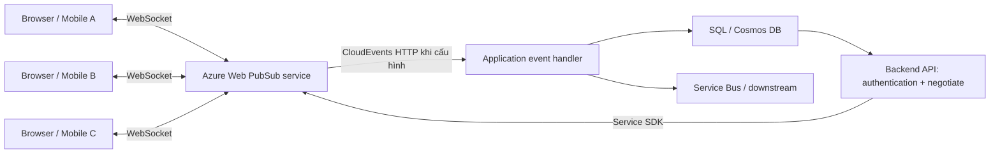

### Các thành phần

| Thành phần | Trách nhiệm |
|---|---|
| **Web PubSub resource** | Tài nguyên Azure nhận WebSocket clients, định tuyến messages và quản lý kết nối theo khả năng service |
| **Hub** | Namespace logic cho một ứng dụng/chức năng realtime, ví dụ `orders`, `chat` |
| **Connection** | Một kết nối WebSocket cụ thể, có **connectionId** riêng |
| **User** | Định danh logic do backend đáng tin cậy gán, có thể có nhiều connections |
| **Group** | Tập connections cần nhận chung messages, ví dụ `order-501` hoặc `room-7` |
| **Negotiate endpoint** | HTTP endpoint của ứng dụng cấp client access URL/token phù hợp user/room |
| **Application server** | Backend thực hiện auth, validate nghiệp vụ, phát message và lưu trạng thái |
| **Event handler / upstream** | HTTP endpoint/Function xử lý sự kiện dịch vụ chuyển lên ứng dụng |
| **Server SDK/REST API** | Công cụ server gửi messages, tạo client access token, quản lý group/users theo quyền |

### Một tài nguyên có thể có nhiều hubs

Ví dụ:

```text
Azure Web PubSub resource: wp-realtime-prod
  Hub: orders
    Group: order-501
    Group: order-502
  Hub: chat
    Group: support-room-17
    Group: support-room-18
  Hub: notifications
    Group: tenant-a
    Group: tenant-b
```

**Hub là namespace/đường định tuyến**, không phải database table. **Group là tập connections được quản lý khi đang kết nối**, không phải kho lưu danh sách thành viên tồn tại vĩnh viễn.

### Hub, user và group không thay thế authorization

Nếu một token có quyền tham gia group `order-501`, người dùng có thể nghe thông báo dành cho đơn đó. Việc backend tự tạo chuỗi tên group **không chứng minh** người đó sở hữu đơn hàng. Trước khi phát token/assign group, backend phải tra quyền của user đối với resource nghiệp vụ.

## 3. Một WebSocket connection hoạt động như thế nào?

WebSocket bắt đầu bằng một yêu cầu HTTP Upgrade qua kết nối phù hợp, sau đó chuyển sang kênh hai chiều. URL kết nối Azure Web PubSub dùng giao thức **`wss://`** trong production.

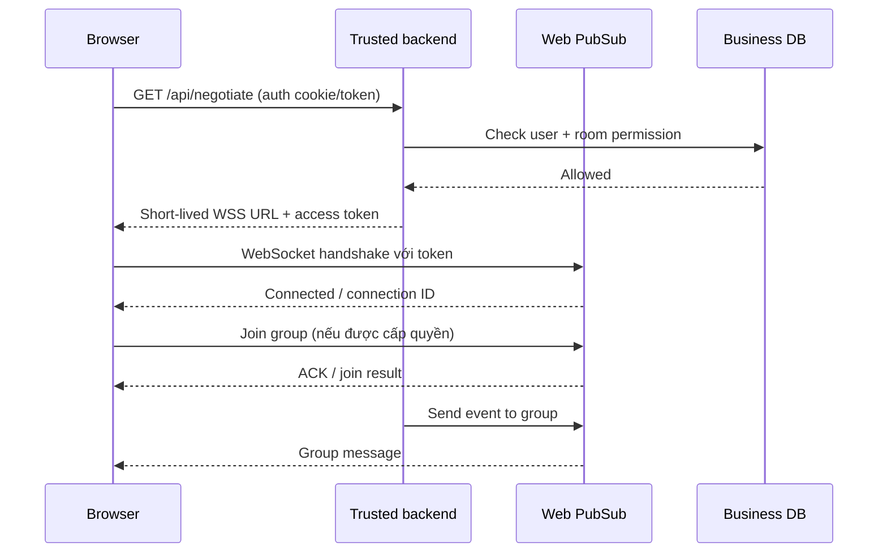

### Vì sao client không được dùng service connection string?

**Service key/connection string** là bí mật quyền cao dùng phía server để quản lý tài nguyên, phát access token hoặc gửi messages. Nếu copy vào HTML/JavaScript:

- Bất kỳ ai mở DevTools cũng có thể lấy key.
- Client có thể tự mint token/role cho group của người khác.
- Mất quyền kiểm soát ai được phát message.
- Việc rotate key có thể làm gián đoạn toàn bộ clients.

**Browser chỉ nhận client access URL/token với quyền và thời gian sống tối thiểu**. Token URL cũng là thông tin nhạy cảm, không được log hoặc gắn vào analytics/referrer một cách vô ý.

## 4. Negotiate endpoint: cầu nối giữa identity và WebSocket

Một cách triển khai phổ biến:

1. Người dùng đăng nhập vào web app qua Microsoft Entra ID/OIDC hoặc cơ chế được phê duyệt.
2. Browser gọi endpoint `/api/negotiate` trong ứng dụng.
3. Backend xác minh session/JWT, kiểm tra quyền truy cập room/order ở database.
4. Backend tạo **client access token** dùng hub tương ứng, `userId` và roles tối thiểu.
5. Backend trả `wss://...` URL cho browser qua HTTPS.
6. Browser mở WebSocket trực tiếp tới dịch vụ.

**Không nhận `userId` do client tự đưa vào query** như một bằng chứng identity. Ví dụ:

```text
GET /api/negotiate?userId=ceo&group=payroll
```

Nếu backend tin nguyên query này, client có thể tự cấp quyền vào phòng nhạy cảm. Đúng hơn là backend lấy user từ **claims đã được xác minh**, rồi tự xác định group mà user được phép tham gia.

### Những thuộc tính access token

| Thuộc tính | Ý nghĩa | Nguyên tắc |
|---|---|---|
| **Hub** | Nơi client kết nối | Chỉ hub cần thiết |
| **userId** | Danh tính logic gắn với connection | Do trusted backend xác định |
| **Roles** | Những thao tác client được thực hiện | Least privilege, có thể giới hạn theo group |
| **Expiration** | Hết hạn token để tạo kết nối | Ngắn, có quy trình lấy lại khi cần |
| **Groups/initial groups** | Nhóm kết nối được phép tham gia hoặc được thêm theo cơ chế hỗ trợ | Kiểm tra quyền nghiệp vụ trước khi gán |

### Token expiration và kết nối đã mở

Token hết hạn **không nên được hiểu đơn giản là WebSocket đang kết nối sẽ tự đóng ngay đúng giây đó**. Hạn dùng token và vòng đời kết nối/reconnect có semantics riêng theo service/protocol. Thiết kế phải có:

- hạn dùng ngắn cho URL/token;
- refresh/re-negotiate cho reconnect;
- cách thu hồi/đóng connections khi quyền người dùng bị hủy;
- kiểm tra quyền trong mọi backend action có tác động nghiệp vụ.

**Đừng chỉ dựa vào token expiration để lập tức cắt quyền người dùng đang có connection sống.**

## 5. Client WebSocket protocol: raw và JSON subprotocol

Azure Web PubSub hỗ trợ các cách giao tiếp WebSocket theo service model:

- **Plain/raw WebSocket client:** gửi/nhận dữ liệu theo protocol mặc định; hành vi upstream và xử lý message phụ thuộc cấu hình hub/event handlers.
- **Web PubSub client protocol** như `json.webpubsub.azure.v1`: client gửi những command đã định nghĩa để **join/leave group, sendToGroup** và nhận các events/ACK/system messages.

Việc chọn subprotocol phải khớp SDK/client thực tế. **Không đặt một subprotocol tùy ý rồi kỳ vọng Web PubSub hiểu JSON command**; cũng không coi raw payload luôn được phát tới mọi group mà không cấu hình.

### WebSocket JSON subprotocol

Client có thể mở:

```javascript
const ws = new WebSocket(accessUrl, "json.webpubsub.azure.v1");
```

Khi kết nối thành công, service có thể gửi message hệ thống liên quan trạng thái kết nối, ví dụ:

```json
{
  "type": "system",
  "event": "connected",
  "connectionId": "example-connection-id",
  "userId": "demo-user-1"
}
```

Payload trên là ví dụ hình thức; những trường có mặt có thể khác theo protocol version và hoàn cảnh. Browser nên xử lý theo **`type` và `event`**, không hardcode thứ tự hay giả định mọi trường luôn có.

### Nhóm commands phổ biến

| Command | Mục đích | Điều kiện |
|---|---|---|
| **`joinGroup`** | Thêm connection hiện tại vào group | Có role phù hợp hoặc server điều khiển membership |
| **`leaveGroup`** | Rời group | Có quyền/điều kiện theo protocol |
| **`sendToGroup`** | Gửi message tới group | Có quyền gửi tới group |
| **ACK response** | Thông báo command được service xử lý/thất bại | Client gắn `ackId` và theo dõi kết quả |
| **Group message** | Nhận dữ liệu từ group đã tham gia | Connection đang mở, thuộc group khi phát |

### Vai trò client trong Web PubSub

Các role có ý nghĩa như:

```text
webpubsub.joinLeaveGroup.demo-room
webpubsub.sendToGroup.demo-room
```

Ý tưởng là token chỉ cho phép client vào/ra và gửi tới **`demo-room`**. Trong các bản SDK/protocol tương thích, có thể có quyền ở phạm vi rộng hơn; **tránh phát role toàn hub** nếu chỉ cần một group.

Role cho client **không trao cho họ quyền đọc database hoặc gọi API tạo đơn**. Đó là hai hệ thống authorization riêng cần được kiểm tra.

## 6. Group messaging: broadcast, user và connection

### Bốn kiểu người nhận

| Đích gửi | Câu hỏi | Tình huống |
|---|---|---|
| **All clients in hub** | Ai đang online trong hub? | Thông báo bảo trì công khai |
| **One connection** | Một tab/device cụ thể? | Kết quả tạm thời liên quan connection |
| **One user** | Tất cả connections gắn cùng userId? | Thông báo cá nhân trên nhiều tab |
| **One group** | Tất cả connections đã tham gia room? | Chat room, order tracking, tenant notifications |

**Một user có thể mở nhiều tab**. Nếu gửi “to user”, cùng user có thể nhận trên nhiều connections. Một connection cũng có thể tham gia nhiều groups. Không dùng connectionId như userId bền vững, bởi mỗi reconnect có thể tạo connectionId mới.

### Group theo thực thể nghiệp vụ

Ví dụ group `order-501`:

```text
Client buyer-A  ─┐
Client courier-7 ├─> group order-501
Support agent-3 ─┘
```

Trước khi join:

- Buyer phải sở hữu hoặc có quyền xem đơn.
- Courier phải được phân công đơn tại thời điểm hiện tại.
- Support agent phải có quyền/phiên hỗ trợ hợp lệ.

**Tên group không bí mật**; bảo mật dựa trên quyền cấp token và chính sách membership, không phải cố đặt group name khó đoán.

### Group membership không có độ bền như database

Nếu client mất kết nối rồi kết nối lại:

- ConnectionId có thể thay.
- Membership của connection cũ không tự trở thành membership của connection mới theo mọi client path.
- Client/server cần tái tham gia những groups hợp lệ.
- Các messages gửi trong lúc offline có thể bị bỏ lỡ.

Nên giữ danh sách **subscriptions/room memberships** thật trong business database hoặc một nguồn có thẩm quyền; group Web PubSub chỉ thể hiện trạng thái phân phối realtime hiện hành.

## 7. Trình tự gửi một thông báo đáng tin cậy

Một notification nên được phát sau khi business state đã được commit:

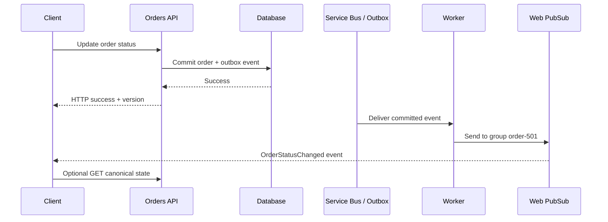

**Nếu notification send thất bại sau DB commit**, hệ thống có thể retry từ outbox/queue mà không đổi lại đơn hàng. Nếu notification send thành công nhưng browser mất mạng, client sẽ cần **reconcile** khi reconnect.

### Payload sự kiện nên nhỏ, có version

```json
{
  "eventId": "evt-501-12",
  "eventType": "OrderStatusChanged",
  "orderId": "order-501",
  "version": 12,
  "status": "Shipped",
  "occurredAt": "2026-11-20T09:30:00Z"
}
```

Không gửi toàn bộ hồ sơ khách hàng hay token/payment details qua broadcast group nếu chỉ cần cập nhật trạng thái. Với dữ liệu nhạy cảm, client nhận ID/version rồi gọi API đã xác thực để đọc nội dung theo quyền.

### Version guard phía client

Ví dụ client hiện biết order version 13 nhưng một message cũ version 12 đến sau reconnect/retry. UI không nên lùi trạng thái về version 12:

```javascript
function applyOrderUpdate(incoming, localState) {
  if (incoming.version <= localState.version) {
    return localState; // old/duplicate event
  }
  if (incoming.version > localState.version + 1) {
    // Có gap: gọi API để đồng bộ lại thay vì đoán trạng thái.
    return { ...localState, requiresRefresh: true };
  }
  return {
    ...localState,
    version: incoming.version,
    status: incoming.status
  };
}
```

**WebSocket delivery không thay thế business ordering**. Khi nhiều workers phát các thông báo liên quan cùng thực thể, hãy có `eventId` và `version` từ nguồn dữ liệu; không dùng arrival order trên browser làm chân lý cuối cùng.

## 8. Python Server SDK: tạo token và gửi message

Azure cung cấp **service-side SDK** cho những ngôn ngữ được hỗ trợ. Trong Python, một thư viện phục vụ Azure Web PubSub service API là `azure-messaging-webpubsubservice`. Mã phía server có thể:

- tạo client access token cho một hub;
- gửi đến toàn hub, group, user hoặc connection theo các phương thức hỗ trợ;
- quản lý group membership/connection state ở mức dịch vụ;
- sử dụng credential phù hợp từ server environment.

### Ví dụ tạo client access token

```python
import os

from azure.messaging.webpubsubservice import WebPubSubServiceClient


connection_string = os.environ["WEB_PUBSUB_CONNECTION_STRING"]
hub_name = os.environ.get("WEB_PUBSUB_HUB", "chat")

service = WebPubSubServiceClient.from_connection_string(
    connection_string=connection_string,
    hub=hub_name
)

# Identity trong production phải lấy từ phiên đăng nhập đã xác minh.
access = service.get_client_access_token(
    user_id="lab-user-01",
    roles=[
        "webpubsub.joinLeaveGroup.demo-room",
        "webpubsub.sendToGroup.demo-room"
    ],
    minutes_to_expire=10
)

# access["url"] dùng riêng trong trusted negotiate response.
print("Token URL được tạo:", bool(access.get("url")))
```

Mẫu trên dùng **service connection string ở phía backend** cho bài lab, không đưa key vào client. Các tham số và tên gói phải được kiểm tra với phiên bản SDK bạn cài trước khi dùng production.

### Gửi message đến group từ backend

```python
# Giả định biến service đã được tạo bởi WebPubSubServiceClient.
service.send_to_group(
    group="demo-room",
    message="Thông báo từ backend",
    content_type="text/plain"
)
```

Khi gửi với `content_type="application/json"`, payload nên tuân thủ cách SDK serialize dữ liệu; đừng gửi một chuỗi Python `str(dict)` có dấu nháy đơn rồi gọi đó là JSON hợp lệ. Ví dụ:

```python
import json

payload = {
    "eventId": "evt-100",
    "eventType": "ShipmentUpdated",
    "orderId": "order-501",
    "version": 12
}
service.send_to_group(
    group="order-501",
    message=json.dumps(payload),
    content_type="application/json"
)
```

Lệnh send thành công có ý nghĩa **dịch vụ đã chấp nhận/thi hành thao tác theo contract**; không chứng minh mọi thiết bị đang offline đã đọc message, rằng frontend đã cập nhật giao diện, hoặc rằng khách hàng đã xác nhận thông báo.

### Dùng Microsoft Entra ID trong production

Trong một backend chạy trên App Service, Azure Functions, VM hoặc AKS, lựa chọn được khuyến nghị khi SDK/service hỗ trợ là **Microsoft Entra ID với managed identity hoặc workload identity**:

```python
# Mẫu khái niệm; kiểm tra constructor/credential của SDK version.
from azure.identity import DefaultAzureCredential
from azure.messaging.webpubsubservice import WebPubSubServiceClient

credential = DefaultAzureCredential()
service = WebPubSubServiceClient(
    endpoint="https://<resource-name>.webpubsub.azure.com",
    hub="chat",
    credential=credential
)
```

Đi kèm:

1. Bật identity cho compute.
2. Gán **Web PubSub data-plane role** có quyền thao tác tương ứng cho identity.
3. Xác minh endpoint/tenant/identity được SDK chọn.
4. Kiểm tra networking từ backend tới Web PubSub service endpoint.
5. Chỉ bỏ connection string cũ sau khi xác nhận end-to-end hoạt động.

**Azure RBAC `Reader` ở resource group không tự đảm bảo quyền phát token hay gửi message tới Web PubSub data plane**. Ngược lại, một service connection string có quyền cao cần được hạn chế, lưu trong secret store và rotate.

## 9. Lab tối thiểu: FastAPI negotiate + WebSocket browser

Lab gồm **một Python backend** phát token và **một HTML page** tạo kết nối. Mọi người dùng thử đều vào chung group `demo-room`; đây là **giả lập công khai trong môi trường localhost**, không có đăng nhập/tenant isolation thực.

### Kiến trúc lab

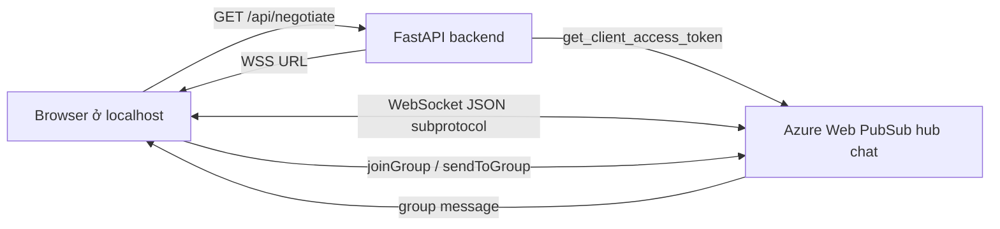

**Không dùng mã lab này để triển khai internet-facing production**. Backend hiện chưa xác thực người dùng, chưa kiểm tra room ownership, chưa rate-limit, chưa có audit/revocation và không xử lý toàn bộ abuse scenarios.

### Bước 1 — Chuẩn bị tài nguyên Azure

Trong Azure Portal:

1. Chọn subscription sandbox và một resource group chỉ phục vụ lab, ví dụ `rg-webpubsub-lab`.
2. Tạo **Azure Web PubSub** resource trong region/SKU được phép.
3. Chọn endpoint resource, ví dụ `https://<resource>.webpubsub.azure.com`.
4. Chuẩn bị hub logical name `chat` (hub có thể được tham chiếu trong endpoint/SDK; việc cấu hình upstream handlers theo hub là bước riêng).
5. Xác nhận mức giá, quotas/concurrent connections và budget.
6. Chuẩn bị connection string cho **backend local only**, quản lý ngoài source code.

Với demo chỉ dùng client-side group commands và token đã cấp, bạn có thể kiểm tra luồng group cơ bản mà chưa cần xử lý user events bằng upstream handler. Nếu thiết lập service/hub mode yêu cầu event handler cho connect/user events, cần cấu hình đúng các sự kiện ấy trước khi mở client theo kiểu ứng dụng bạn chọn.

### Bước 2 — Cài dependencies

Trong **một project lab riêng**:

```bash
python -m pip install fastapi uvicorn azure-messaging-webpubsubservice
```

Đặt environment variables an toàn:

```text
WEB_PUBSUB_CONNECTION_STRING=<server-side secret, không commit>
WEB_PUBSUB_HUB=chat
```

Không paste giá trị connection string thật vào Git, tài liệu công khai, screenshot hoặc terminal history được chia sẻ. Local secret manager hoặc profile environment được tổ chức phê duyệt phù hợp hơn việc ghi thẳng key vào file trong repository.

### Bước 3 — Tạo `server.py`

```python
import os
import uuid

from fastapi import FastAPI, Response
from fastapi.responses import FileResponse
from azure.messaging.webpubsubservice import WebPubSubServiceClient


app = FastAPI()
hub = os.environ.get("WEB_PUBSUB_HUB", "chat")

service = WebPubSubServiceClient.from_connection_string(
    connection_string=os.environ["WEB_PUBSUB_CONNECTION_STRING"],
    hub=hub
)


@app.get("/")
def index():
    return FileResponse("index.html")


@app.get("/api/negotiate")
def negotiate(response: Response):
    # CHỈ LAB: mỗi request tạo user giả, không có authentication.
    # PRODUCTION: user_id phải lấy từ identity đã xác thực.
    user_id = "lab-" + uuid.uuid4().hex[:12]
    room = "demo-room"

    access = service.get_client_access_token(
        user_id=user_id,
        roles=[
            "webpubsub.joinLeaveGroup.demo-room",
            "webpubsub.sendToGroup.demo-room"
        ],
        minutes_to_expire=10
    )
    response.headers["Cache-Control"] = "no-store"

    return {
        "url": access["url"],
        "userId": user_id,
        "group": room
    }
```

Điểm cần nhớ:

- Backend giữ secret, browser chỉ nhận URL có token ngắn hạn.
- Mỗi lần negotiate sẽ sinh userId mới; nếu reconnect muốn giữ identity trong production, phải gắn userId vào phiên đăng nhập ổn định.
- Group trong lab là public demo; production cần backend kiểm tra authorization trước khi cấp role.
- Không log `access["url"]` hoặc toàn bộ response negotiate.

### Bước 4 — Tạo `index.html`

```html
<!doctype html>
<html lang="vi">
<head>
  <meta charset="utf-8">
  <title>Web PubSub WebSocket Demo</title>
</head>
<body>
  <h1>Web PubSub Demo: demo-room</h1>
  <p id="status">Chưa kết nối</p>
  <input id="message" placeholder="Nhập nội dung" maxlength="500">
  <button id="send" disabled>Gửi</button>
  <ul id="feed"></ul>
  <script>
    const statusEl = document.getElementById("status");
    const inputEl = document.getElementById("message");
    const feed = document.getElementById("feed");
    const sendButton = document.getElementById("send");
    let socket = null;
    let room = null;
    let nextAckId = 1;

    function show(text) {
      const li = document.createElement("li");
      li.textContent = text; // Không inject HTML từ người dùng.
      feed.appendChild(li);
    }

    async function connect() {
      const response = await fetch("/api/negotiate", {
        credentials: "same-origin",
        cache: "no-store"
      });
      if (!response.ok) {
        throw new Error("Negotiate failed: " + response.status);
      }

      const access = await response.json();
      room = access.group;
      socket = new WebSocket(access.url, "json.webpubsub.azure.v1");

      socket.onopen = () => {
        statusEl.textContent = "Đã mở WebSocket; đang vào nhóm";
        socket.send(JSON.stringify({
          type: "joinGroup",
          group: room,
          ackId: nextAckId++
        }));
      };

      socket.onmessage = (event) => {
        let message;
        try {
          message = JSON.parse(event.data);
        } catch {
          show("Không parse được message");
          return;
        }

        if (message.type === "ack") {
          show("ACK: " + JSON.stringify(message));
          if (message.success) {
            sendButton.disabled = false;
            statusEl.textContent = "Đã tham gia nhóm";
          }
        } else if (message.type === "message") {
          show("Nhận: " + JSON.stringify(message.data));
        } else if (message.type === "system") {
          show("System: " + message.event);
        }
      };

      socket.onerror = () => {
        statusEl.textContent = "WebSocket lỗi";
      };

      socket.onclose = () => {
        statusEl.textContent = "WebSocket đóng";
        sendButton.disabled = true;
      };
    }

    sendButton.onclick = () => {
      if (!socket || socket.readyState !== WebSocket.OPEN) return;
      const text = inputEl.value.trim();
      if (!text) return;

      socket.send(JSON.stringify({
        type: "sendToGroup",
        group: room,
        dataType: "text",
        data: text,
        ackId: nextAckId++
      }));
      inputEl.value = "";
    };

    connect().catch((error) => {
      statusEl.textContent = error.message;
    });
  </script>
</body>
</html>
```

**Quan trọng:** Lab minh họa một WebSocket JSON subprotocol cụ thể. Nếu SDK/protocol version mà service hỗ trợ trả ACK khác hoặc message có cấu trúc khác, phải xử lý theo specification thực tế. `ACK.success` biểu thị kết quả command theo protocol, **không phải read receipt của mọi người nhận**.

### Bước 5 — Chạy local server

```bash
uvicorn server:app --host 127.0.0.1 --port 8000
```

Mở `http://127.0.0.1:8000/` ở **hai tab** cùng máy. Vì cả hai kết nối được cấp quyền vào `demo-room`, một tab gửi message và tab kia có thể nhận khi cả hai đang online và đã join thành công.

### Bước 6 — Kiểm tra kết quả

| Thao tác | Kết quả mong đợi |
|---|---|
| Mở tab A | Negotiate thành công, WebSocket mở, joinGroup ACK |
| Mở tab B | User/connection riêng, joinGroup thành công |
| Tab A gửi “Xin chào” | Có ACK command và message group ở tab đang kết nối |
| Đóng tab B | Tab B không còn nhận tin khi offline |
| Mở lại tab B | Phải negotiate/đăng ký lại; message cũ không tự hiện |
| Tắt backend sau khi tab đã kết nối | Những kết nối hiện có có thể còn hoạt động tùy mô hình/token, nhưng không có negotiate mới |
| Xóa/thu hồi credentials hoặc đổi quyền | Phải có quy trình revoke/reconnect và không suy rằng quyền cũ biến mất tức thời |

Nếu kết nối bị từ chối ngay, kiểm tra **protocol, access token, hub, service SKU/endpoint, connection quotas và browser console**. Không đưa URL chứa access token vào ticket công khai để điều tra.

### Bước 7 — Kết thúc lab

Dừng server local. Kiểm kê và chỉ xóa Web PubSub resource nếu nó thuộc riêng lab, không dùng chung. Kiểm tra các resources liên quan (App Service, Functions, Key Vault, Private Endpoint, logs) và bảng giá nếu vẫn còn provisioned/active.

## 10. Event handlers: đưa sự kiện WebSocket lên backend

Để backend thực thi nghiệp vụ khi client kết nối hoặc gửi custom events, Azure Web PubSub hỗ trợ **event handlers** được cấu hình tại mức hub/service, chuyển events lên ứng dụng theo cơ chế **CloudEvents over HTTP** hoặc tích hợp được hỗ trợ.

### Các loại sự kiện cần biết

| Sự kiện | Thời điểm | Trách nhiệm điển hình |
|---|---|---|
| **Connect** | Khi client yêu cầu kết nối và service xử lý event connect theo cấu hình | Kiểm tra/điều chỉnh quyền, trả response theo contract |
| **Connected** | Khi connection được thiết lập | Ghi presence/metrics, gửi thông báo chào mừng nếu phù hợp |
| **Disconnected** | Khi connection kết thúc | Dọn trạng thái tạm, cập nhật last-seen |
| **User-defined event** | Client gửi event tùy chỉnh theo protocol/mode | Validate payload, authorize, thực thi nghiệp vụ |

**Không cấu hình một event handler rồi mặc định mọi loại event đều được route đến đó**. Hãy khai báo subscriptions/filters/mappings được Web PubSub hỗ trợ, kiểm thử từng loại và kiểm tra event name/case.

### Connect handler khác message handler

Connect event có vai trò trong quá trình thiết lập connection và có thể cần response **trong timeout** theo protocol. Một xử lý dài (gọi ERP 30 giây) tại connect có thể làm handshake timeout. Handler user events phù hợp nhận message, kiểm tra và chuyển sang queue; hành vi response/ACK phụ thuộc loại event và Web PubSub protocol.

### Dữ liệu event và CloudEvents metadata

Các thông tin thường cần:

```text
hub
event type / event name
connectionId
userId (nếu có)
request trace / correlation identifier
event payload / data type
```

CloudEvents có thể biểu diễn metadata trong **HTTP headers** và payload trong body theo binding của dịch vụ. **Không mặc định tất cả fields trên sẽ nằm trong một JSON object giống nhau** ở mọi event handler. Đọc các headers/fields mà Web PubSub thực sự gửi và phiên bản của event binding được hỗ trợ.

### Endpoint validation và tin cậy nguồn gọi

Khi cấu hình handler HTTP, dịch vụ có thể thực hiện **validation handshake/abuse protection**; endpoint phải đáp ứng đúng yêu cầu giao thức. Đây mới chỉ là một phần bảo mật. Production còn cần:

- cấu hình endpoint URL hợp lệ, HTTPS và quyền truy cập;
- xác minh yêu cầu thực sự đến từ service theo cơ chế hỗ trợ;
- bảo vệ event handler tránh client giả mạo HTTP request từ Internet;
- timeout ngắn và retry/idempotency;
- không tin `userId` trong payload nếu không xác thực nguồn event;
- tránh log toàn bộ dữ liệu nhạy cảm.

**Không chỉ kiểm tra một header tự khai báo rồi coi mọi request đều đáng tin**. Với Functions và SDK tích hợp, tận dụng middleware/validation do service cung cấp khi phù hợp.

## 11. Client-to-server events khác client-to-group messaging

Đây là phân biệt quan trọng trong thiết kế chat:

### Client gửi trực tiếp tới group

```text
Browser A → Web PubSub sendToGroup → Browser B/C
```

Ưu điểm: nhanh và giảm lượt gọi backend cho mỗi message. Nhưng nếu bạn cấp quyền client gửi tới group, một tin có thể được phân phối **trước khi backend kịp ghi moderation/audit/business state**. Hệ thống có yêu cầu kiểm duyệt, lưu lịch sử hoặc phân quyền theo từng message cần thiết kế kỹ.

### Client gửi custom event tới backend

```text
Browser A → Web PubSub user event → Backend event handler
         → Validate/moderate/save database
         → Server SDK sendToGroup
         → Browser B/C
```

Đây thường là mô hình phù hợp khi mỗi message phải được:

- xác thực identity và room membership;
- kiểm tra kích thước, nội dung, chính sách kiểm duyệt;
- ghi bền vững hoặc đặt vào durable queue;
- gắn eventId/sequence sau commit;
- phát tới đúng nhóm người nhận.

**Đừng để client chỉ cần có role gửi tới group là tự được phép thay đổi business state.** Quyền group messaging là một phần của dịch vụ realtime; quyền ứng dụng phải do backend quyết định.

### Khi nào bỏ qua upstream?

Một phòng demo công khai không cần lưu lịch sử có thể cho clients gửi trực tiếp theo quyền hẹp. Một phòng hỗ trợ khách hàng có thông tin nhạy cảm, moderation và audit thường nên dùng upstream/back-end mediated delivery.

## 12. Azure Functions và Web PubSub

Azure Functions phù hợp làm backend event-driven mà không cần chạy một web server dài hạn chỉ để xử lý mỗi thông báo:

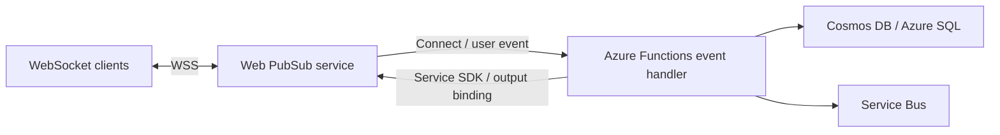

### Các trường hợp sử dụng

1. **Negotiate Function:** HTTP trigger được xác thực, gọi Web PubSub server SDK để cấp client access token.
2. **Event Function:** Web PubSub event trigger/binding hoặc HTTP endpoint tích hợp với CloudEvents khi runtime/extension hỗ trợ.
3. **Queue-to-WebSocket Function:** Service Bus trigger xử lý message sau DB commit, sau đó gửi group notification.
4. **Timer cleanup:** Kiểm tra trạng thái heartbeat/presence projection, không dùng timer ping chỉ để giữ clients giả luôn online.

### Lưu ý khi dùng extensions

Functions Web PubSub binding/trigger API phụ thuộc **Functions runtime, programming language và extension version**. Đừng trộn code của Azure Web PubSub SDK, Azure SignalR binding và Azure Functions Event Grid trigger rồi mặc định chúng tương thích.

Nếu chọn HTTP event handler thay vì extension chuyên dụng:

- Cần implement đúng CloudEvents headers/validation/response.
- Hạn chế runtime và startup latency.
- Thiết lập retry/idempotency vì event có thể được gửi lại.
- Không giả định Function scale-out sẽ tạo thêm WebSocket connection capacity cho dịch vụ realtime; capacity đó là của Web PubSub.

### Backend có phải luôn online?

Với **client-to-group messaging được cấp quyền**, dữ liệu có thể đi qua dịch vụ mà backend không xử lý mỗi message. Nhưng với **custom events cần event handler** hoặc một negotiate endpoint, backend phải sẵn sàng theo SLA; cold start/timeout có thể ảnh hưởng handshake hoặc business flow. Đừng nhầm “serverless” với “không có server-side responsibility”.

## 13. Delivery, ordering và ACK: những gì Web PubSub không hứa

Web PubSub sử dụng WebSocket để chuyển data tới những connections đang hoạt động. Tuy nhiên, một kênh realtime **không phải message queue bền vững cho thiết bị offline**.

| Tính chất | Điều có thể dựa vào | Điều không được suy ra |
|---|---|---|
| **WebSocket transport order** | Frames trên cùng một WebSocket connection sử dụng thứ tự của transport còn hiệu lực | Thứ tự business events qua nhiều workers/connections/reconnect |
| **Client command ACK** | Service đã xử lý hoặc báo lỗi command tương ứng theo protocol | Mọi người nhận đã thấy/đọc tin |
| **Server send result** | API của service đã chấp nhận/thi hành thao tác theo contract | Tin đã được lưu bền vững hoặc sẽ được phát lại khi user online |
| **Group delivery** | Gửi tới những connections thuộc group vào thời điểm phát theo cơ chế | Group có offline inbox tự động |
| **Connection ID** | Xác định một connection trong vòng đời của nó | ID không đổi sau reconnect |
| **User ID** | Nhóm các connections logic theo identity backend gán | Chính là credential xác thực hay không thể bị giả nếu backend gán sai |
| **Presence** | Có thể quan sát connection/online events trong khả năng service | Bằng chứng tuyệt đối người dùng đang nhìn giao diện |

### ACK không phải read receipt

Ví dụ client A gọi:

```json
{
  "type": "sendToGroup",
  "group": "demo-room",
  "dataType": "text",
  "data": "Hello",
  "ackId": 20
}
```

Một ACK thành công chứng minh command được service xử lý theo giao thức, nhưng **không** cho biết client B đã hiện message trên màn hình. Nếu ứng dụng cần “đã đọc”:

1. Backend lưu message với `messageId` bền vững.
2. Client B hiển thị nội dung hợp lệ.
3. B gửi **application-level read acknowledgment** có identity đã xác thực.
4. Backend ghi read receipt vào database.
5. Backend phát một notification read-receipt tới các bên liên quan.

Không tin một client tự khai `readBy="user-CEO"` mà không xác thực và kiểm tra quyền ở backend.

### Ordering trong một phòng chat

Hai users A và B có thể phát messages cùng lúc; service/router/clients không tự cấp **global monotonically increasing room sequence** cho mọi nguồn. Nếu phòng chat cần timeline thống nhất:

- cấp `sequence` hoặc timestamp/ID chuẩn **tại nguồn có thẩm quyền** sau khi lưu message;
- không lấy client clock làm thứ tự tuyệt đối;
- dùng database transaction/conditional counter hoặc event log design phù hợp;
- gửi notification gồm `roomId`, `messageId`, `sequence`;
- client sắp xếp/đối chiếu từ database sau reconnect.

Với ứng dụng game có latency thấp hơn yêu cầu lưu lịch sử, có thể chấp nhận best-effort realtime cho vị trí hoặc trạng thái tạm. Mức bảo đảm phải do nghiệp vụ quyết định, không phải chỉ do lựa chọn WebSocket.

## 14. Reconnect và đồng bộ những sự kiện bị bỏ lỡ

Mobile client đổi Wi-Fi sang 4G, laptop sleep, browser refresh hoặc token hết hạn cho lần kết nối mới đều có thể khiến WebSocket bị đóng.

### State machine phía client

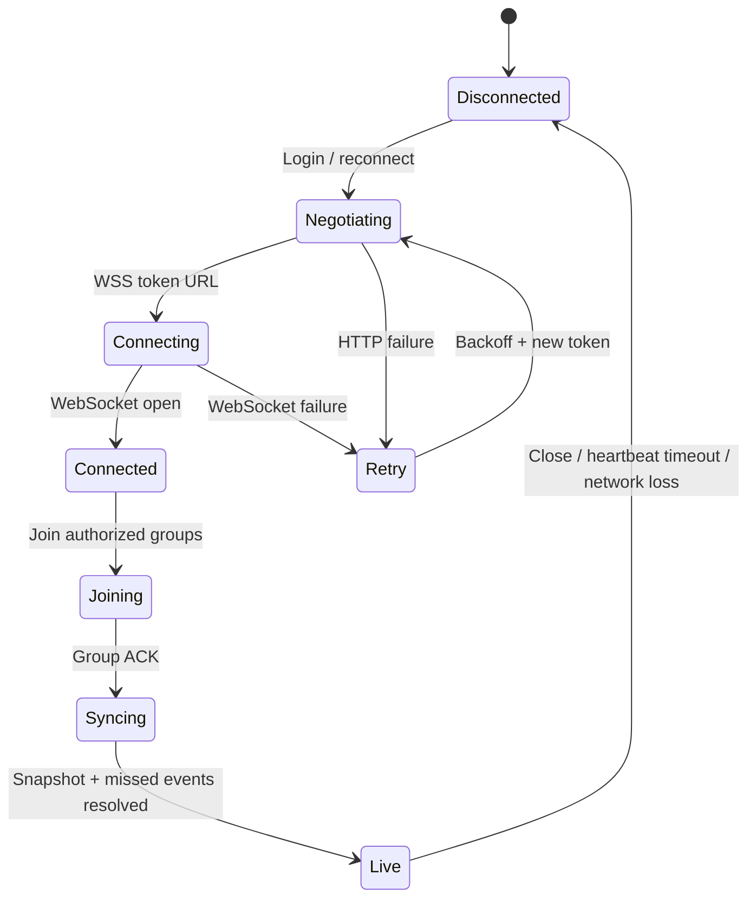

### Thuật toán reconnect an toàn

1. Nhận biết `onclose`, network error hoặc session revoked.
2. Đưa UI sang trạng thái `Reconnecting`, vô hiệu hóa actions không thể gửi an toàn.
3. Chờ **exponential backoff có jitter**, giới hạn số lần/interval.
4. Gọi lại **negotiate endpoint** để lấy token mới sau khi xác thực session.
5. Mở WebSocket mới; không tái sử dụng URL/token đã hết hạn.
6. Join lại **những groups mà user hiện còn quyền**.
7. Đồng bộ **snapshot hoặc event history kể từ version cuối** từ API/DB.
8. Xử lý duplicate/out-of-order bằng `eventId` và `version`.
9. Khi có khoảng trống không thể replay, **refresh snapshot** thay vì đoán trạng thái.

### Vì sao phải đồng bộ snapshot?

```text
09:00:00  Client đã nhận order version 7
09:00:05  Mất kết nối
09:00:08  Order cập nhật version 8
09:00:09  Service gửi event v8, client đang offline
09:00:20  Client kết nối lại
09:00:21  Client chỉ biết v7 nếu không gọi API
```

Azure Web PubSub **không tự replay v8** khi reconnect. Backend nên cung cấp:

```text
GET /api/orders/order-501
→ { "orderId": "order-501", "version": 8, "status": "Shipped" }
```

### Tránh race giữa snapshot và join

Nếu client **GET snapshot trước**, sau đó mới join group, có một khoảng thời gian mà event mới có thể xảy ra và bị bỏ lỡ. Một phương án:

1. Kết nối và **join group thành công**.
2. Bắt đầu buffer incoming events trong bộ nhớ theo `version`.
3. Gọi API lấy snapshot tại version V.
4. Áp dụng những events có version lớn hơn V, kiểm tra sequence liên tục.
5. Nếu gap phát hiện, đọc lại snapshot hoặc gọi history endpoint.

Điều này giảm race nhưng **không tự tạo exactly-once** trong mọi hệ thống. Để có độ tin cậy cao, source-of-truth API cần hỗ trợ version/continuation/history phù hợp.

### Backoff có jitter

Không để 100.000 clients reconnect cùng một giây sau sự cố. Dùng:

```text
delay = min(maxDelay, baseDelay * 2^attempt) + randomJitter
```

Giới hạn attempts theo UX, xử lý offline mode và hiển thị thông báo khi lỗi kéo dài. Với mobile, lưu last-known state hợp lý nhưng tránh cache dữ liệu nhạy cảm không mã hóa hoặc không có retention policy.

## 15. Chống mất dữ liệu và trùng lặp bằng durable state

Web PubSub phù hợp **data plane phân phối realtime**, trong khi application database/broker chịu trách nhiệm **durable state**.

### Ví dụ messaging có lưu lịch sử

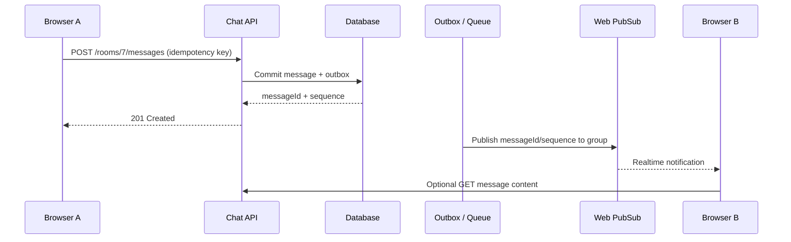

### Failure windows

| Sự cố | Nguy cơ | Cơ chế phục hồi |
|---|---|---|
| API crash trước DB commit | Message không được tạo | Client retry cùng idempotency key |
| DB commit rồi worker chưa publish | Message có trong DB nhưng client khác chưa biết | Transactional outbox/queue retry |
| Service send thành công, worker không ghi nhận | Notification có thể gửi lại | EventId/version de-dup phía client |
| Browser B offline | B bỏ lỡ realtime event | History endpoint khi reconnect |
| Hai messages gửi đồng thời | UI có thể nhận theo thứ tự khác | Business sequence từ DB |
| User bị thu hồi quyền trong lúc online | Connection có thể còn token/role cũ | Backend revoke, close/leave group và authorization lại |

### Idempotency key

Với message gửi từ browser:

```json
{
  "clientMessageId": "client-msg-7f31",
  "roomId": "support-room-17",
  "text": "Tôi cần hỗ trợ đơn hàng #501"
}
```

Backend phải gắn `clientMessageId` với authenticated user/room và kiểm tra unique constraint để tránh tạo hai bản ghi khi browser retry. Một message có thể được phát lại qua Web PubSub, nhưng database chỉ ghi **một business message**.

## 16. Connection presence và last-seen

Presence có nhiều ý nghĩa:

- **Connected:** service đang nhận thấy một WebSocket connection tồn tại.
- **Online user:** có ít nhất một connection gắn userId đang hoạt động theo chính sách.
- **Active user:** người dùng có tương tác gần đây.
- **Read/seen:** người dùng đã xem một nội dung cụ thể.
- **Available agent:** nhân viên sẵn sàng nhận một cuộc chat mới.

Các khái niệm không đồng nhất. Ví dụ trình duyệt đang mở tab ở background có thể vẫn giữ WebSocket nhưng người dùng đã rời máy.

### Presence store

Một hệ thống có thể dùng:

```text
userId
connectionId
hub
connectedAt
lastHeartbeatAt
lastBusinessActivityAt
status
```

Lưu ý:

- Một user có nhiều connections; không đánh dấu user offline ngay khi **một** tab đóng nếu vẫn còn tab khác.
- `disconnected` event có thể đến trễ hoặc không được xử lý hoàn hảo khi backend sự cố.
- Dùng TTL/heartbeat/reconciliation, không dựa vào một event duy nhất để kết luận trạng thái cuối.
- Không lạm dụng presence logs để theo dõi nhân viên ngoài mục đích được thông báo và phê duyệt.

### Server-side presence APIs

Web PubSub service/SDK có các operations giúp kiểm tra user/connection/group state trong những phạm vi được hỗ trợ. Tuy nhiên, **query được connection hiện tại không phải lịch sử online của user**. Nếu cần báo cáo online time/agent availability, phải có kho trạng thái, định nghĩa phiên và xử lý late events riêng.

## 17. Bảo mật đa lớp cho Web PubSub

### 17.1 Identity

Browser xác thực với ứng dụng bằng Entra ID, OIDC/cookie hoặc phương thức đã phê duyệt. Backend xác minh:

- chữ ký/issuer/audience/expiration của token người dùng khi dùng JWT;
- session/cookie policy và CSRF protection nếu dùng cookie;
- user còn active và có quyền truy cập room/tenant hay không;
- request đến negotiate không bị abuse/rate limit.

**Không coi `userId` trong URL hoặc JSON body là bằng chứng identity**.

### 17.2 Authorization

Phân quyền nên nằm ở ít nhất hai tầng:

1. **Application authorization:** user có được vào group `order-501`, gửi tin hoặc xem thông tin riêng không?
2. **Web PubSub roles/groups:** token chỉ cho phép lệnh WebSocket tương ứng với quyết định của ứng dụng.

Khi quyền thay đổi, app phải cập nhật membership/connection state. Một access token đã cấp có thể tiếp tục tồn tại trong một khoảng thời gian; cần chính sách revoke phù hợp.

### 17.3 Token/secret

- Chỉ cấp WSS URL ngắn hạn qua HTTPS.
- Không nhúng service key vào frontend.
- Không log URL chứa `access_token`.
- Không gửi token qua analytics, email, chat hoặc query param của endpoint khác.
- Dùng Key Vault cho secret có thể cần thiết và managed identity cho server SDK khi hỗ trợ.
- Giới hạn CORS/Origin của **negotiate API** theo ứng dụng; kiểm tra chính sách Origin ở WebSocket handshake riêng theo dịch vụ.
- Token không phải bộ lọc business payload; backend vẫn phải validate mọi thao tác có tác động.

**CORS không thay thế authorization**. CORS chủ yếu áp dụng browser HTTP access; một WebSocket connection có thể liên quan Origin và token nhưng không có cùng mô hình preflight như fetch/CORS.

### 17.4 Payload security

- Không chèn HTML bằng `innerHTML` từ chat messages; dùng `textContent` hoặc sanitize.
- Hạn chế độ dài/nội dung message để chống spam/DoS.
- Kiểm soát file attachments qua Storage upload API/SAS hạn ngắn thay vì gửi binary file lớn trong WebSocket.
- Không broadcast toàn bộ object người dùng có email/địa chỉ/thẻ nếu chỉ cần `orderId + version`.
- Bảo vệ input handler trước injection, JSON bombing và oversized payload.
- Có moderation/audit khi nghiệp vụ chat yêu cầu.

### 17.5 Tenant isolation

Một Web PubSub resource/hub có thể phục vụ nhiều tenants theo thiết kế, nhưng:

```text
tenant-a / room-1
tenant-b / room-1
```

Nếu tên group chỉ là `room-1`, hai tenants có thể bị lẫn thông báo khi backend cấp role sai. Có thể dùng namespace group có định danh tenant ổn định:

```text
tenant-a:room-1
tenant-b:room-1
```

Tuy nhiên **group naming không phải security boundary**. Backend phải kiểm tra user thuộc đúng tenant và room từ nguồn thẩm quyền, tránh cho browser tự chọn tên group khác để nhận dữ liệu.

### 17.6 Network security

Theo SKU/tính năng được hỗ trợ, Web PubSub có thể có **network access controls, firewall và Private Link/private endpoint**. Những mô hình:

| Mô hình | Client ở đâu | Điều cần kiểm tra |
|---|---|---|
| Public endpoint có auth token | Browser ngoài Internet | WSS/TLS, token, origin/security policy, quotas |
| Private endpoint | Client/backend trong mạng riêng có route | VNet, DNS, VPN/ExpressRoute, firewall |
| Backend private; browser public | API và browser dùng đường mạng khác nhau | Đường negotiate và WebSocket đều có endpoint truy cập phù hợp |

Nếu resource chỉ cho phép private network, **một browser công khai trên Internet không tự kết nối được** chỉ vì backend có managed identity. Private endpoint thay đổi đường truyền, không cấp quyền cho user hoặc tự tạo VPN.

### 17.7 Upstream handler security

Backend event handler có thể nhận HTTP requests mang CloudEvents. Cần:

- validation handshake và xác minh nguồn gọi theo contract Web PubSub;
- allowlist/identity/signature validation nếu được tính năng hỗ trợ;
- kiểm tra `hub`, event type, userId và resource scope;
- giới hạn payload, timeout, retries và chống replay;
- không chấp nhận từ header `X-User-Id` do client tùy ý gắn vào public endpoint.

**Private networking và xác thực nguồn upstream là hai việc khác nhau**. Một handler private vẫn cần auth/validation nếu có đường truy cập từ các services khác.

## 18. Quản trị session, revocation và quyền thay đổi

Giả sử tài xế Courier-7 được gán đơn `order-501`, sau đó điều phối viên chuyển đơn cho Courier-8.

Nếu backend chỉ gỡ quyền trong database nhưng connection Courier-7 **vẫn ở group `order-501`**, người cũ có thể tiếp tục nghe notifications.

Quy trình:

```text
1. Application commits assignment change.
2. Authorization state/version tăng.
3. Server-side group membership được cập nhật:
   - remove Courier-7 connections khỏi order-501 group;
   - grant Courier-8 theo policy.
4. Backend không phát nội dung nhạy cảm trong khoảng trạng thái chưa đồng bộ.
5. Khi cần quyền thu hồi ngay, close/revoke connections tương ứng
   theo API/service policy hỗ trợ.
6. Clients reconnect phải negotiate và join lại theo quyền mới.
```

### Hệ thống cần xác định RTO của revoke

“Thu hồi quyền ngay lập tức” khó hơn việc giảm thời gian sống token. Cần đo:

- thời gian DB commit tới update group membership;
- liệu notification có thể lọt giữa hai hành động;
- khả năng connection disconnect/rejoin;
- cách xử lý nhiều tabs/devices;
- cơ chế audit và alert khi cập nhật membership thất bại.

Với dữ liệu đặc biệt nhạy cảm, có thể chỉ gửi **event metadata**, còn nội dung chi tiết luôn yêu cầu HTTPS GET với authorization hiện tại. Cách này giảm hậu quả khi một group membership tạm thời chưa được cập nhật.

## 19. Backpressure, message size và chống quá tải

WebSocket duy trì kết nối lâu dài; tốc độ gửi của backend có thể lớn hơn tốc độ nhận/hiển thị của một số clients.

### Ba nút thắt

1. **Ingress:** tốc độ client hoặc backend gửi messages vào dịch vụ.
2. **Fan-out:** một message gửi tới group có hàng trăm nghìn connections.
3. **Egress:** khả năng network/browser/client xử lý incoming messages.

Ví dụ:

```text
1.000 sự kiện/giây × 1.000 client nhận/sự kiện
= 1.000.000 deliveries/giây (ước lượng số lần phân phối)
```

Điều này **không đồng nghĩa 1.000.000 Web PubSub billable messages** theo một công thức cố định: pricing/billing và giới hạn phải theo tier/cách đếm thực tế. Nhưng nó cho thấy fan-out có thể tạo áp lực mạng và client rất lớn.

### Tối ưu

- Gộp các cập nhật UI thành batch hoặc coalescing khi dữ liệu thay đổi liên tục.
- Throttle thông báo vị trí (ví dụ gửi trạng thái quan trọng ngay, vị trí cập nhật theo cadence hợp lý).
- Chỉ gửi delta/IDs/versions thay vì JSON đầy đủ nhiều KB.
- Không broadcast thay đổi chỉ liên quan một tenant cho toàn hub.
- Chia groups theo nhu cầu người nhận và scope dữ liệu.
- Dùng retry/backoff ở backend, nhưng không replay bừa mọi realtime event cũ.
- Hạn chế tốc độ client phát `sendToGroup` để tránh spam.

### Browser backpressure

`WebSocket.bufferedAmount` biểu thị số bytes data đã được queue để gửi từ browser và chưa đi hết qua network. Nếu nó tăng liên tục, client đang gửi nhanh hơn đường truyền. UI có thể tạm dừng nút gửi hoặc gộp/thả bớt **telemetry không quan trọng**; không thả mất event nghiệp vụ đã cam kết.

```javascript
function safeSend(ws, payload) {
  if (!ws || ws.readyState !== WebSocket.OPEN) {
    return false;
  }
  const MAX_BUFFERED_BYTES = 256 * 1024;
  if (ws.bufferedAmount > MAX_BUFFERED_BYTES) {
    return false; // caller phải quyết định retry/throttle
  }
  ws.send(JSON.stringify(payload));
  return true;
}
```

Ngưỡng 256 KiB là **ví dụ local policy**, không phải quota Web PubSub. Kiểm tra giới hạn message size, connection count, throughput và nhóm của SKU đang dùng trước khi xác định số liệu production.

## 20. Network connectivity, heartbeat và idle connections

Một WebSocket dùng `wss://` phải đi qua:

```text
Client DNS
→ TLS / proxy / corporate firewall / NAT
→ Azure Web PubSub endpoint
→ WebSocket handshake
→ giữ kết nối và gửi nhận frame
```

Các nguồn gây mất kết nối:

- Mobile chuyển mạng hoặc vào chế độ tiết kiệm pin.
- Reverse proxy/firewall đóng idle connections.
- Token/connection lifecycle theo cơ chế service.
- Client sleep, browser tab suspend.
- Quota/capacity, lỗi vùng mạng, DNS hoặc TLS.
- Backend event handler từ chối connect theo chính sách.

### Heartbeat

WebSocket protocol có ping/pong ở tầng thấp, nhưng **browser WebSocket API không cho JavaScript tự tạo control ping frame trực tiếp**. Khi cần application heartbeat, có thể thiết kế một message ứng dụng nhẹ với cadence hợp lý và server validation — nhưng không dùng message heartbeat để kết luận người dùng đã đọc nội dung.

### Đừng ping quá dày

Heartbeat mỗi 100 ms cho 100.000 clients tạo rất nhiều messages/network operations, có thể làm tăng chi phí và tải. Chọn interval dựa trên SLA presence, idle timeout và network constraints; theo dõi chênh lệch giữa “connected” và “active”.

### Connection quotas

Mỗi SKU/tier của Azure Web PubSub có giới hạn và cơ chế scaling khác nhau đối với:

- concurrent connections;
- message size/throughput;
- số units/replicas và khả năng tăng capacity;
- event handler response time/availability;
- data transfer và API call quotas.

Trước launch cần xác định số **concurrent connections ở peak**, không chỉ số registered users. Ví dụ 200.000 accounts nhưng chỉ 5.000 users online cùng lúc khác hoàn toàn 200.000 concurrent WebSockets.

## 21. Chọn Azure Web PubSub hay Azure SignalR Service?

Đây là hai dịch vụ Azure liên quan realtime nhưng được xây cho những hệ sinh thái khác nhau.

| Nhu cầu | Azure Web PubSub | Azure SignalR Service |
|---|---|---|
| Browser/native clients dùng **raw WebSocket** | Phù hợp | Cần dùng protocol/SDK SignalR theo thiết kế |
| Chủ động điều khiển JSON subprotocol/groups | Phù hợp với Web PubSub client protocol | Theo mô hình SignalR Hub/clients |
| Ứng dụng đã viết **ASP.NET Core SignalR** | Cần đánh giá migration/compatibility | Thường là lựa chọn tự nhiên |
| Hub methods và strongly typed SignalR clients | Không tự tương thích chỉ vì cũng dùng WebSocket | Phù hợp hơn |
| Backend REST/Functions phát tới groups/users qua SDK | Có hỗ trợ | Có qua bộ SDK/bindings tương ứng |
| Socket.IO clients hiện có | Không giả định plain Web PubSub tương thích | Không giả định SignalR tương thích |
| Web PubSub for Socket.IO | Là một sản phẩm/chế độ hỗ trợ Socket.IO cần xem riêng | Không phải Azure SignalR |

**WebSocket là giao thức transport**, còn **SignalR và Socket.IO là các framework/protocol cấp ứng dụng khác nhau**. Bạn không thể đổi một URL `ws://` sang Web PubSub rồi kỳ vọng mọi SignalR/Socket.IO message framing và API vẫn hoạt động không cần sửa.

### Chọn theo team và ứng dụng

- Team .NET đã có SignalR Hub/clients: nên đánh giá **Azure SignalR Service** trước.
- Ứng dụng đa nền tảng cần WebSocket trực tiếp, muốn điều khiển group/user delivery qua service: **Azure Web PubSub** là ứng viên.
- Ứng dụng Socket.IO: kiểm tra rõ **Web PubSub for Socket.IO** hoặc giải pháp Socket.IO phù hợp với version/features đang dùng.
- Ứng dụng chỉ cần notifications không thường xuyên tới mobile offline: có thể cần **push notification service**, email/SMS hoặc message storage hơn là WebSocket giữ kết nối liên tục.

## 22. Phân biệt Web PubSub, Service Bus và Event Hubs

| Dịch vụ | Tối ưu cho | Không nên giả định |
|---|---|---|
| **Azure Web PubSub** | WebSocket clients online, groups/users, realtime fan-out | Durable queue, offline inbox, business transaction |
| **Azure Service Bus** | Durable enterprise messaging, queues/topics, sessions, DLQ | Tự cung cấp WebSocket connection cho browser |
| **Azure Event Hubs** | Ingest telemetry/event streams throughput cao | Chat room membership hoặc read receipt |
| **Azure Event Grid** | Event routing và integration giữa producers/subscribers | WebSocket session management |
| **Azure SignalR Service** | Ứng dụng sử dụng SignalR framework | Tương thích raw WebSocket commands của Web PubSub |
| **Azure Cache / Redis-compatible cache** | Cache, ephemeral state, một số Pub/Sub patterns | Durable audit log hoặc Web PubSub service độc lập |

### Kiến trúc kết hợp

Một chuỗi robust phổ biến:

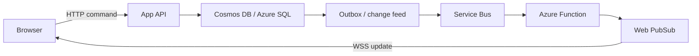

**Không bắt mọi loại sự kiện qua Web PubSub**. API vẫn xử lý yêu cầu nghiệp vụ, database giữ sự thật, broker giữ công việc bền vững, Web PubSub chỉ là kênh realtime phù hợp với những clients đang kết nối.

## 23. Capacity planning: đo concurrent connections và fan-out

### Phác thảo workload

Giả sử ứng dụng vận chuyển có:

```text
Người dùng đăng ký:                  500.000
Người dùng online giờ cao điểm:      20.000
Số tabs/thiết bị online mỗi user:     1,4
Concurrent WebSocket connections:    28.000
Số nhóm mỗi connection:              3
Server notification events/giây:     200
Người nhận trung bình/event:         100
```

Ước lượng số kết nối:

\[
20\,000 \times 1.4 = 28\,000\ \text{connections}.
\]

Số lần phân phối message trung bình cho các thông báo:

\[
200 \times 100 = 20\,000\ \text{recipient-deliveries/giây}.
\]

Đây là **mô hình tính tải để học**, không phải cam kết số lượng connections hỗ trợ hay công thức tính phí của SKU cụ thể. Cần tính thêm message từ clients, traffic peak, payload size, reconnect bursts, event handler calls, server SDK operations, network bytes và chi phí khác.

### Những câu hỏi trước khi chọn SKU/capacity

- **Peak concurrent connections** trong ngày/chiến dịch là bao nhiêu?
- Một user mở bao nhiêu tabs/devices?
- Một message sẽ được fan-out tới trung bình và p99 bao nhiêu clients?
- Có **hot groups** chứa phần lớn clients không?
- Payload trung bình/p99 là bao nhiêu bytes?
- Cần target latency từ DB commit tới browser là bao lâu?
- Số kết nối/giây mới khi outage và reconnect storm có lớn không?
- Số upstream event requests/giây tới Function/App Service là bao nhiêu?
- Mức độ ưu tiên của notification và độ mất dữ liệu cho phép thế nào?
- Có yêu cầu networking/private endpoint, availability, disaster recovery theo tier không?

### Group hot và fan-out

Một group `all-users` với 50.000 connections dùng để phát vị trí của một đơn hàng là một thiết kế tồi. Phát tới group `order-501` với 3 người liên quan giảm traffic và tránh rò rỉ. Với thông báo toàn hệ thống thật, dùng broadcast có kiểm soát, rate limit, caching và kênh riêng phù hợp.

### Autoscale/capacity không giống autoscale backend

Tăng instances của Azure Functions không tự tăng giới hạn concurrent connections tại Web PubSub resource. Ngược lại, tăng Web PubSub capacity không sửa được một event handler có CPU-bound processing hoặc database bị throttle. **Mỗi lớp có bottleneck riêng**; phải đo và scale đúng lớp.

## 24. Availability, region strategy và disaster recovery

WebSocket connections gắn với một endpoint và vòng đời kết nối cụ thể. Nếu region hoặc resource gặp sự cố, client cần nhận biết disconnect và kết nối lại theo phương án được triển khai.

### Không nhầm geo-availability với session durability

Ngay cả khi ứng dụng có nhiều regions:

- một connection WebSocket hiện tại không tự trở thành connection sống tại region khác;
- client có thể phải negotiate lại tới endpoint/resource mới;
- group memberships phải được dựng lại;
- messages realtime gửi khi clients offline có thể bị bỏ lỡ;
- nguồn dữ liệu chuẩn và history endpoint phải phục hồi độc lập.

### Một chiến lược nhiều vùng

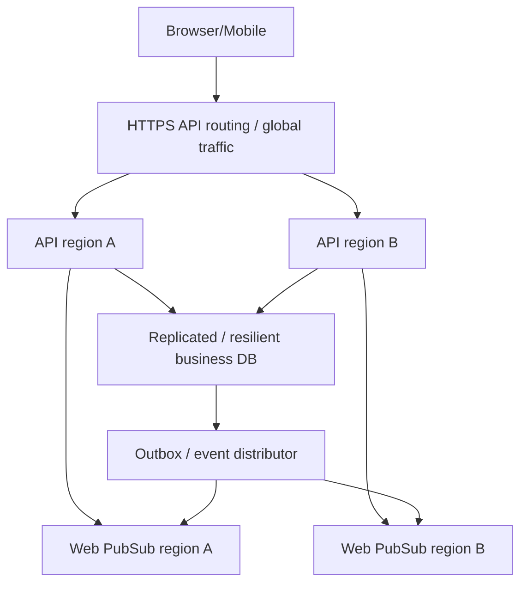

Sơ đồ là **một pattern kiến trúc**, không khẳng định tất cả resources đều có replication tự động. Nếu dùng hai Web PubSub resources ở hai vùng, ứng dụng phải điều phối sự kiện tới đúng resources, không ngầm coi groups giữa hai resources là một đối tượng duy nhất.

### Phân biệt hai loại dự phòng

1. **Availability của backend:** negotiate endpoint, auth, event handlers, queue, database còn hoạt động.
2. **Availability của realtime delivery:** Web PubSub endpoint, network path và clients có thể reconnect.

Nếu backend đang lỗi nhưng Web PubSub còn hoạt động, một số client-to-group traffic đã được cấp quyền có thể tiếp tục; không có nghĩa workflow nghiệp vụ vẫn đúng. Nếu Web PubSub lỗi nhưng API/DB hoạt động, app có thể tiếp tục cập nhật dữ liệu và **reconcile** qua HTTP.

### Runbook DR

- Phát hiện region/resource connection errors sớm.
- Chuyển HTTP negotiate routing sang vùng khả dụng theo phương án.
- Client reconnect với backoff và token mới.
- Re-join groups sau khi tái xác thực quyền.
- GET snapshot/history từ DB.
- Đảm bảo backend xử lý event/outbox không phát trùng business effects.
- Giám sát lag/online population sau khôi phục.
- Diễn tập khi có kiểm soát, không gây outage production ngoài kế hoạch.

### RTO/RPO

**RTO realtime**: mất bao lâu clients kết nối lại và UI đồng bộ? **RPO nghiệp vụ**: dữ liệu nào có thể mất trong database/queue khi sự cố? Đây là hai vấn đề khác nhau. Với ứng dụng chỉ phát WebSocket notification sau DB commit, người dùng có thể mất notification nhưng **không mất trạng thái đơn hàng**, miễn kiến trúc lưu trữ bền vững hoạt động đúng.

## 25. Azure Monitor: quan sát connections, messages và ứng dụng

Một Web PubSub resource có metrics/diagnostics giúp theo dõi trạng thái connections/messages/requests theo capability của service/SKU. Kết hợp với Azure Monitor, Application Insights/Log Analytics và telemetry nghiệp vụ.

| Lớp | Tín hiệu cần đo | Hành động khi bất thường |
|---|---|---|
| Web PubSub resource | Connected clients/concurrent connections | Xem capacity, connection quota, reconnect storm |
| Web PubSub traffic | Send/receive operations, ingress/egress bytes | Xem fan-out, payload size, hot groups |
| WebSocket handshake | Success/failure/close reasons nếu có logs | Kiểm tra token, hub, origin/network |
| Client command | Join/send ACK success/failure | Vai trò token, group, command schema |
| Event handler | Handler response time, HTTP status, retries | 5xx/timeouts, validation, auth |
| Negotiate API | HTTP 2xx/401/403/429/5xx, latency | Login/authorization abuse, credential issues |
| Business events | DB-commit-to-delivery latency, event version gaps | Queue delay, lost notifications, stale client state |
| Presence | User online counts, disconnect/reconnect ratio | Network issues, stale presence records |
| Security | Role/group denial, suspicious token issuance | Lỗi authorization/abuse |
| Costs | Connection usage, units/capacity, message usage, logs, egress | Tối ưu traffic và budget |

**Tên metrics cụ thể** có thể khác theo tier và Azure Monitor resource. Dùng **Metrics → Metric definitions/selector** của Web PubSub resource đang triển khai thay vì giả định một tên metric luôn tồn tại.

### Correlation IDs

Một event có thể có:

```json
{
  "correlationId": "trace-order-501",
  "eventId": "evt-501-12",
  "eventType": "OrderStatusChanged",
  "businessVersion": 12,
  "targetHub": "orders",
  "targetGroup": "order-501",
  "sendOutcome": "acceptedByService",
  "sentAtUtc": "2026-11-20T09:30:01Z"
}
```

Đây là **log do ứng dụng tự định nghĩa**. Không log token, connection string, nội dung chat nhạy cảm hoặc public/private keys. `acceptedByService` là trạng thái kỹ thuật, không phải `readByCustomer`.

### Đo latency end-to-end

Mỗi sự kiện có thể có:

```text
T0: Business DB commit
T1: Outbox event được publish
T2: Worker gọi Web PubSub send
T3: Web PubSub API trả kết quả
T4: Browser nhận và render
```

Tổng độ trễ người dùng cảm nhận:

\[
L_{\text{end-to-end}} = T_4 - T_0.
\]

Backend thường biết T0–T3; muốn biết T4 cần client telemetry có correlation, đồng hồ được đồng bộ tương đối hoặc đo client-relative time hợp lý. **Không dùng chỉ server-side send latency để khẳng định notification đã hiện ở người dùng trong dưới 100 ms**.

### Alerts nên có

1. Concurrent connections tiến gần quota/capacity.
2. Join/send command errors tăng bất thường.
3. Event handler 5xx/timeouts vượt SLO.
4. Negotiate 401/403 hoặc 429 tăng đột biến.
5. Reconnect rate tăng/online clients giảm mạnh.
6. DB commit → notification delivery latency vượt mục tiêu.
7. Client event gaps hoặc stale-state refresh tăng bất thường.
8. Chi phí fan-out/messages/traffic vượt budget.
9. Private endpoint/DNS issues sau release hạ tầng.

## 26. Chi phí của Web PubSub và toàn bộ kiến trúc

Không nên nói “WebSocket là kết nối một lần, sau đó gửi tin miễn phí”. Chi phí phụ thuộc model của Web PubSub service/SKU và những tài nguyên đi kèm.

| Thành phần | Yếu tố cần dự toán |
|---|---|
| **Azure Web PubSub** | SKU/units/capacity, concurrent connections, messages/operations và traffic theo mô hình tính giá |
| **App Service / Azure Functions** | HTTP negotiate requests, event handler executions, compute/memory và capacity |
| **Service Bus** | Durable message operations, queue/topic capacity và retention |
| **Cosmos DB / Azure SQL** | Reads/writes, RU/s/database compute, storage, indexes |
| **Azure Monitor** | Logs/traces, ingestion và retention |
| **Network** | Data transfer, private endpoints, NAT/gateway theo kiến trúc |
| **Authentication** | Identity service, Key Vault operations và security controls khi có phí |
| **Global routing/DR** | Resources ở nhiều regions, traffic management và năng lực dự phòng |

### Bài toán ví dụ

Giả sử:

```text
5.000 concurrent connections ở peak
100 notification events/giây
50 recipients trung bình/event
Payload trung bình 600 bytes
```

Thông lượng phân phối payload thuần, chưa tính framing/protocol overhead:

\[
100\times50\times600 = 3\,000\,000\ \text{bytes/giây}.
\]

Khoảng **3 MB/giây** chỉ là phép tính payload thô, chưa tính client sends, messages headers, TLS/TCP, reconnect, authentication, retries hay billing. Không suy số tiền từ công thức này; cần **Azure Pricing Calculator/bảng giá của resource/SKU cụ thể**, xem quotas và đo usage trong sandbox.

### Sáu biện pháp tối ưu

1. **Send đúng group**, không gửi toàn hub nếu không cần.
2. **Coalesce cập nhật thường xuyên**, ví dụ chỉ phát vị trí mới nhất theo cadence thay vì mọi GPS sample.
3. Giảm kích thước payload, chỉ truyền eventId/version rồi fetch khi cần.
4. Tránh reconnect storm do token/idle policy không hợp lý.
5. Chỉ giữ kết nối khi user thực sự dùng realtime; disconnect hợp lệ khi app ở chế độ không hoạt động tùy UX.
6. Chọn tier/units dựa trên concurrent connections/fan-out đo được, kết hợp budgets và alert.

**Đừng dùng Redis cache hoặc một queue chỉ để “tiết kiệm” bằng cách đẩy mọi message qua thêm hai services** nếu chúng không giải quyết nhu cầu thật; mỗi thành phần tăng độ trễ, độ phức tạp và chi phí vận hành.

## 27. Troubleshooting theo từng lớp

| Triệu chứng | Nguyên nhân có thể | Cách điều tra |
|---|---|---|
| Negotiate trả 401 | User chưa xác thực, session/JWT không hợp lệ | API auth logs, identity, cookie/OIDC |
| Negotiate trả 403 | User không được vào room/tenant | Authorization policy, resource ownership |
| Negotiate trả 500 | Backend thiếu SDK credential, role, endpoint sai | Server logs, Key Vault, managed identity |
| WSS handshake thất bại 401/403 | Token hết hạn/sai hub/role/endpoint | Mint time, hub URL, browser console, service diagnostics |
| Browser không kết nối được | TLS, DNS, firewall, proxy hoặc private-only endpoint | Network path từ client, corporate proxy, Private DNS |
| Mở socket thành công nhưng joinGroup thất bại | Không có role, group name sai, protocol command sai | ACK details, token roles, subprotocol |
| Không có ACK | Không dùng JSON subprotocol, ackId sai, error path hoặc mạng | ws.protocol, raw frames, connection close |
| A gửi nhưng B không nhận | B chưa join group, B offline, room khác hoặc group membership bị thu hồi | Join ACK, group name, presence, handler logs |
| Chỉ một tab nhận | Tab còn lại chưa join, dùng connection khác hoặc mất mạng | Per-connection events/ACK |
| User nhận message của tenant khác | Cấp roles/group sai hoặc tên group đụng nhau | Negotiate authorization và membership |
| Event handler không nhận | Hub event handler chưa cấu hình, event filter/type sai | Hub settings, CloudEvents endpoint, logs |
| Event handler trả lỗi 401/403 | Validation/auth không khớp | Upstream origin/identity config |
| Connect chậm rồi timeout | Handler startup/DB call chậm | Handler latency, cold start, timeout |
| Tin bị mất khi browser sleep | WebSocket đã ngắt, không có durable inbox | Reconnect + history API |
| UI bị lùi về trạng thái cũ | Events out-of-order/duplicate | eventId, business version guard |
| Client nhận hai lần sau retry | Publish retry hoặc backend/outbox duplicate | Idempotency, event IDs, logs |
| Thấy ACK nhưng người nhận nói không thấy | ACK không phải read receipt | Delivery/visibility/client telemetry |
| CPU backend thấp nhưng connections chạm quota | Web PubSub capacity tách backend compute | Concurrent connection metrics và SKU |
| Traffic tăng mạnh khi một đơn đổi trạng thái | Gửi tới toàn hub hoặc group quá rộng | Fan-out recipients, group design |
| Không thể thu hồi quyền ngay | Token/connection cũ còn active | Server leave/close operations, revoke plan |
| SDK send thất bại do quyền | Identity thiếu data-plane access | Role assignments, credential chain, endpoint |
| Private endpoint hoạt động từ VM nhưng browser public lỗi | Browser không có private network route | DNS/route của client, kiến trúc endpoint |
| Chi phí tăng | Fan-out, reconnect, logging/compute/network | Usage/Cost Management, traffic profile |

### Lưu đồ tìm root cause

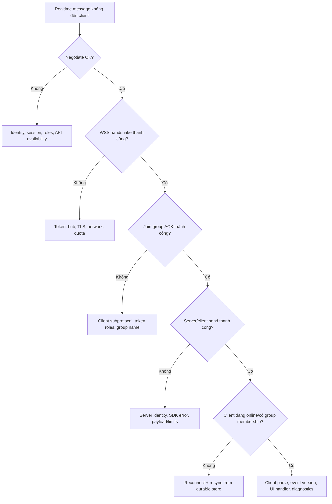

### Các điều tuyệt đối không làm để “sửa nhanh”

- Không phát service connection string cho browser.
- Không cấp quyền `joinLeaveGroup`/`sendToGroup` toàn hub nếu ứng dụng chỉ cần một room.
- Không tắt mọi authorization vì WSS handshake đang fail.
- Không biến Web PubSub thành kho duy nhất chứa nội dung quan trọng.
- Không bật public network access trái chính sách khi resource private-only.
- Không log toàn bộ token URL để nhóm khác “copy thử”.
- Không tăng capacity vô giới hạn khi vấn đề thực sự là group routing hoặc backend errors.

## 28. Kiến trúc mẫu: live order tracking có quyền truy cập

### Yêu cầu

Khách hàng, tài xế và tổng đài cần xem trạng thái đơn hàng `order-501`. Hệ thống phải:

- không cho khách hàng khác nhận dữ liệu;
- cập nhật trong thời gian gần thực;
- không mất trạng thái nghiệp vụ khi WebSocket ngắt;
- hiển thị đúng version sau reconnect;
- thu hồi quyền tài xế cũ khi đơn được phân công lại;
- giám sát lag và số lần mất kết nối.

### Các lớp thành phần

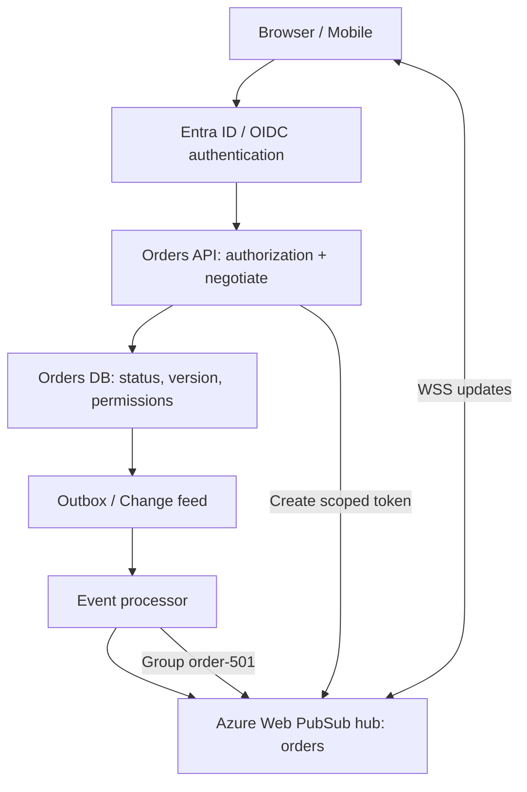

### Group policy

```text
hub: orders
group: order-501

Allowed:
  - Customer who owns order-501
  - Courier currently assigned to order-501
  - Authorized support agent with active case

Client roles:
  - join/leave authorized group if required by client flow
  - no client-to-group send for read-only order tracking
```

Vì client chỉ cần **nhận thông báo**, có thể không cấp `webpubsub.sendToGroup.order-501`. Backend sau khi kiểm tra quyền có thể thêm connection vào group theo server SDK hoặc cấp đúng quyền join theo mô hình app; đây là quyết định security quan trọng.

### Protocol event mẫu

```json
{
  "eventId": "evt-order-501-v12",
  "eventType": "OrderStatusChanged",
  "orderId": "order-501",
  "version": 12,
  "newStatus": "OutForDelivery",
  "occurredAtUtc": "2026-11-20T10:10:00Z"
}
```

Client nhận event rồi:

1. Xác minh event thuộc order hiện đang xem.
2. So sánh `version` với state.
3. Nếu version tiếp theo hợp lệ, cập nhật UI tạm thời.
4. Nếu version gap, gọi GET order status.
5. Khi quyền truy cập bị thu hồi, xóa dữ liệu hiển thị nhạy cảm theo policy và ngắt subscription.

### Câu hỏi bảo mật

**Nếu URL của group bị lộ thì sao?** Tên group không được coi là secret. Backend vẫn phải kiểm tra quyền vào group và không cho user tự mint token.

**Nếu Courier-7 vẫn mở app sau khi bị gỡ khỏi đơn?** Cần server-side leave/close, quyền token mới và khả năng bảo vệ payload bằng API có authorization hiện hành.

**Nếu client offline 20 phút?** Đọc snapshot/history API, không yêu cầu Web PubSub replay mọi thông báo.

## 29. Kiến trúc mẫu: chat hỗ trợ có lưu lịch sử

Một phòng hỗ trợ cần nhiều tính năng hơn kênh chat demo:

| Khả năng | Thiết kế |
|---|---|
| Tạo phòng | API có auth và authorization |
| Gửi tin | API hoặc upstream event → validate/moderate → database |
| Tin mới | Publish `messageId + roomId + sequence` qua Web PubSub |
| Lịch sử | Query database với pagination/auth |
| Đã đọc | Application-level read receipt, không dựa ACK Web PubSub |
| Đang nhập | Ephemeral `typing` events có TTL; có thể thả khi quá tải |
| File đính kèm | Upload tới Storage bằng cơ chế quyền phù hợp; WebSocket chỉ gửi metadata |
| Offline | Notification service/history API hoặc mobile push |
| Chặn người dùng | Thu hồi membership, app-level ban, token revalidation |
| Kiểm duyệt | Backend moderation, không chỉ client-to-group direct |
| Thống kê agent | Business state và last-seen; presence events chỉ là tín hiệu |

### Phân biệt ba loại sự kiện

**Business-critical:** `SupportTicketClosed`, `RefundApproved` — phải có database transaction và durable history.

**User-visible nhưng có thể khôi phục:** `NewChatMessage` — có database messageId và page/history API.

**Ephemeral:** `TypingStarted`, `CursorMoved` — có thể bỏ qua khi mạng kém hoặc client offline.

Không áp một delivery policy giống nhau cho cả ba. Đặc biệt đừng đưa typing indicator vào Service Bus durable queue rồi replay sau 15 phút; đó là thông tin hết giá trị.

## 30. Kiểm tra hạ tầng bằng Azure CLI

Với một Azure Web PubSub resource đã có trong sandbox, CLI có thể giúp đối chiếu subscription, endpoint, SKU và trạng thái resource.

### Lệnh đọc an toàn

```bash
az login --tenant "<tenant-id>"
az account set --subscription "<subscription-id>"

az account show \
  --query "{subscription:id,tenant:tenantId,name:name}" \
  --output json

az resource show \
  --resource-group "rg-webpubsub-lab" \
  --resource-type "Microsoft.SignalRService/webPubSub" \
  --name "<webpubsub-resource-name>" \
  --query "{name:name,location:location,sku:sku,properties:properties}" \
  --output json
```

Resource provider type/casing và output property structure có thể khác theo Azure CLI/API version; nếu projection null, xem phản hồi đầy đủ và tài liệu command trong môi trường, không suy resource mất thuộc tính. Lệnh đọc ARM **không kiểm chứng** browser WebSocket đã join group hoặc access token được mint đúng.

### Cấp quyền data plane

Với managed identity ở backend:

1. Xác nhận identity principal/tenant của App Service/Function App.
2. Gán Azure role có quyền **gửi message/tạo client token** theo khả năng Azure Web PubSub data-plane role và scope resource.
3. Chờ role assignment có hiệu lực.
4. Gọi server SDK từ chính runtime backend.
5. Đối chiếu kết quả với browser negotiate và WebSocket connection.

Không dùng role ARM `Owner` trên toàn subscription nếu ứng dụng chỉ cần send-to-group.

### Không tự chạy thay đổi production

Các lệnh như tạo Web PubSub resource, sửa network ACL, rotate keys, set hubs/event handlers hoặc tăng units có thể gây phí/gián đoạn. Nên đưa cấu hình vào Bicep/ARM/Terraform hoặc pipeline được phê duyệt, với review/rollback và budget.

## 31. Triển khai production từng giai đoạn

### Giai đoạn 1 — Thiết kế hợp đồng sự kiện

Xác định:

- eventId, eventType, business entity ID, version, occurredAt;
- public vs private payload;
- group naming conventions và tenant isolation;
- quyền read/write/join của từng loại người dùng;
- business persistence và history API;
- handling duplicate, gap, reconnect, offline.

### Giai đoạn 2 — Hạ tầng và bảo mật

- Tạo Azure Web PubSub resource đúng SKU/region.
- Cấu hình hub/event handlers cần thiết.
- Thiết lập managed identity/role/Key Vault.
- Quyết định public/private networking cho clients và backend.
- Bật diagnostic settings/monitoring theo chính sách.
- Giới hạn negotiate endpoint bằng auth, authorization, rate limit.

### Giai đoạn 3 — Backend

- Tạo negotiate endpoint phát token ngắn hạn.
- Implement group authorization và revocation.
- Sử dụng SDK gửi message sau business commit.
- Tạo outbox/queue cho notification quan trọng.
- Tạo event handler chỉ khi workload cần xử lý client events.
- Trả HTTP status rõ ràng khi token không được cấp.

### Giai đoạn 4 — Client

- WebSocket connect với đúng subprotocol.
- Theo dõi system messages/ACK/errors.
- Join groups được cấp quyền.
- Reconnect có backoff và lấy token mới.
- Snapshot/history sync để chống missed events.
- Cập nhật UI theo business version và chống XSS.

### Giai đoạn 5 — Release và vận hành

- Load test concurrent connections và hot group fan-out.
- Test network failures, revoke, token expiry, event handler outage.
- Đặt alerts cho connection/latency/errors/cost.
- Diễn tập failover/reconnect và quan sát DB state.
- Có rollout/canary/rollback và incident owner.

### Deployment không đồng nghĩa hết việc

Một triển khai được báo “Succeeded” chỉ chứng minh Azure đã chấp nhận cấu hình/code theo deployment operation. Nghiệm thu yêu cầu **browser kết nối thật, group authorization đúng, messages tới đúng người, state phục hồi sau ngắt và costs nằm trong budget**.

## 32. Bộ kiểm thử lỗi (failure injection) có kiểm soát

Chỉ chạy trong sandbox hoặc staging có kế hoạch. Không tự tạo tải hoặc cố tình ngắt production service.

| Case | Thao tác thử | Tiêu chí chấp nhận |
|---|---|---|
| Token hết hạn trước handshake | Dùng URL/token cũ trong lab | Bị từ chối; client re-negotiate đúng |
| User không có quyền room | Gọi negotiate room của người khác | HTTP 403/không cấp roles; không lộ token |
| Client join group khác | Gửi `joinGroup` ngoài scope token | ACK lỗi hoặc bị từ chối theo protocol |
| Client gửi tin liên tục | Tạo burst nhỏ dưới giới hạn lab | Rate limit/backpressure hoạt động |
| Client ngắt khi worker publish | Đóng tab rồi phát notification | Không giả định đã nhận; snapshot sync khi mở lại |
| Hai tabs một user | Mở hai connections | Presence đúng, không suy một connection = một user |
| Lỗi sau DB commit | Mô phỏng worker send thất bại | Outbox retry, không tạo lại business transaction |
| Publish duplicate | Gửi lại cùng eventId | Client không tạo hai effects/trạng thái sai |
| Events sai thứ tự | Gửi version 13 trước version 12 | Client phát hiện gap/refresh |
| Event handler trả 500 | Lỗi có chủ đích trong staging | Retry/monitoring theo contract, business action idempotent |
| User bị thu hồi room | Remove membership khi đang kết nối | Không tiếp tục nhận dữ liệu trái quyền theo mục tiêu revocation |
| Private endpoint routing lỗi | Thử từ mạng không được phép | Kết nối bị từ chối, không bật public trái chính sách |
| Reconnect storm nhỏ | Khởi tạo/reconnect nhóm clients được phép | Backoff, quota alerts và server không quá tải |
| Failover app backend | Chuyển negotiate sang backend dự phòng | Client re-negotiate và resync |

### Các phép thử cần ghi lại

```text
Resource/SKU/region: <giá trị>
Hub name: <giá trị>
Auth mode: <Entra / backend demo>
Token TTL: <giá trị>
User/room authorization: PASS/FAIL
Connections peak: <giá trị>
Join/send ACK result: <giá trị>
Fan-out group size: <giá trị>
Client reconnect latency: <giá trị>
DB commit-to-client latency p95: <giá trị>
Duplicate/version gap handling: PASS/FAIL
Event handler status/errors: <giá trị>
Network route + private DNS: <giá trị>
Diagnostic collection: <giá trị>
Estimated cost: <giá trị>
Cleanup owner: <người phụ trách>
```

## 33. Checklist trước go-live

### Phạm vi và contract

- [ ] WebSocket thật sự cần thiết; HTTP/SSE/push message có đáp ứng được không?
- [ ] Đã chọn đúng Web PubSub / SignalR / Socket.IO product.
- [ ] Hub names, user IDs và group names có quy tắc rõ ràng.
- [ ] Events có `eventId`, `eventType`, business version và payload tối thiểu.
- [ ] Đã phân loại dữ liệu ephemeral và durable.
- [ ] Đã dự kiến reconnect, offline reconciliation và duplicate detection.

### Bảo mật

- [ ] Backend xác thực user từ session/JWT đáng tin.
- [ ] Authorization theo tenant/room/business resource trước khi cấp role.
- [ ] WSS token ngắn hạn, không log URL và không cấp service key cho browser.
- [ ] Managed identity/role hoặc secrets trong Key Vault đã được kiểm soát.
- [ ] Upstream event handler xác minh nguồn và CloudEvents validation đúng.
- [ ] Revocation/group leave/close hoạt động với nhiều tabs.
- [ ] XSS/payload size/rate limit và dữ liệu nhạy cảm được kiểm soát.
- [ ] Public/private network path, TLS và DNS đúng cho client lẫn backend.

### Vận hành và chi phí

- [ ] Load test peak concurrent connections/fan-out/hot groups.
- [ ] SDK errors, ACK, reconnect, stale state và latency có metrics.
- [ ] Event handler/DB/queue failure có runbook và idempotency.
- [ ] Quota/capacity/budget alerts được cài theo SKU.
- [ ] Một resource Web PubSub hỏng có phương án reconnect/DR.
- [ ] CI/CD và infrastructure configuration có review/rollback.
- [ ] Account/role/secret rotation, incident owner và cleanup policy rõ ràng.

## 34. Những hiểu nhầm phổ biến

**“Web PubSub là một queue giữ mọi message khi user offline.”** Không. Nó là dịch vụ realtime; cần database/broker/history API để khôi phục dữ liệu.

**“WebSocket thì luôn nhanh hơn HTTP trong mọi trường hợp.”** Không. WebSocket phù hợp kênh liên tục, còn request/response ngắn có thể đơn giản và tối ưu hơn với HTTP.

**“Chỉ cần URL `wss://...` là bất kỳ ai cũng có thể connect.”** Không. Kết nối cần token/authorization/network phù hợp; URL chứa token là credential nhạy cảm.

**“Service connection string có thể đặt trong JavaScript vì client đã dùng HTTPS.”** Sai. Browser và script đều có thể đọc secret.

**“userId trong query parameter là một danh tính đã được xác thực.”** Không. Backend phải xác minh claims/session.

**“Token hết hạn thì mọi existing WebSocket connections bị đóng ngay.”** Không nên giả định; cần thiết kế revocation riêng.

**“Một user luôn có đúng một connectionId.”** Sai. Nhiều tabs/devices, reconnect tạo nhiều connections/IDs.

**“Group membership có lịch sử và tự được khôi phục sau reconnect.”** Không mặc định. Rejoin từ nguồn quyền đáng tin.

**“Tên group ngẫu nhiên đủ bảo mật phòng riêng.”** Sai. Phải kiểm tra authorization khi cấp token/role.

**“ACK sendToGroup thành công nghĩa mọi người đã đọc tin.”** Sai. ACK của service không phải read receipt ứng dụng.

**“Backend có thể tin mọi user event gửi lên.”** Sai. Handler cần xác minh nguồn sự kiện, user và quyền nghiệp vụ.

**“Client-to-group direct send luôn phù hợp cho chat có audit.”** Không. Moderation, persistence và authorization theo message thường cần backend mediation.

**“Azure Functions có Web PubSub extension nên mọi WebSocket client cần nói chuyện trực tiếp với Function.”** Không. Client vẫn kết nối Web PubSub service; Functions xử lý negotiate/event/notification theo thiết kế.

**“Web PubSub tự sắp events theo version của database.”** Không. Cần business ordering/versions từ app.

**“Browser sẽ nhận lại mọi notification sau khi kết nối lại.”** Không. Cần GET snapshot/history từ database.

**“Tăng Azure Functions instances sẽ tăng số concurrent WebSockets.”** Không trực tiếp; WebSocket connections được Web PubSub resource phục vụ.

**“Dùng Web PubSub thay thế Service Bus trong quy trình thanh toán.”** Không. Realtime delivery không phải durable business messaging.

**“Client gửi dữ liệu ở `dataType=json` là JSON chắc chắn an toàn để render.”** Không. Phải validate schema, giới hạn nội dung và chống XSS.

**“WebSocket ping trong browser JS được gửi bằng hàm protocol ping chuẩn.”** Không. Browser WebSocket API không expose control ping frame.

**“Chỉ tính số registered users là đủ chọn capacity.”** Không. Cần peak concurrent connections, tabs/user, fan-out và payload/traffic.

**“Dùng private endpoint khiến người dùng ngoài Internet tự truy cập được.”** Không. Client cần network route phù hợp tới endpoint.

**“Một Web PubSub resource ở region A lỗi thì connections tự di chuyển liền mạch sang resource B.”** Không mặc định. Cần routing, reconnect, token và rejoin/sync.

**“Gửi thành công qua server SDK nghĩa browser đã render UI.”** Không. Cần client telemetry/read receipt nếu muốn kiểm chứng.

**“Log nguyên access token URL giúp support xử lý lỗi dễ hơn.”** Không nên. Đây là thông tin bí mật có thể bị dùng lại trong thời hạn hiệu lực.

**“Web PubSub luôn rẻ vì một kết nối có thể gửi vô hạn tin miễn phí.”** Không có cơ sở. Phải tính resource SKU/units, connection/message usage, network và các services phụ trợ theo bảng giá hiện hành.

## 35. Câu hỏi tự kiểm tra

**Câu 1.** Azure Web PubSub giải quyết phần nào của kiến trúc ứng dụng thời gian thực?

**Đáp án:** Quản lý kết nối WebSocket, group/user/connection messaging và định tuyến sự kiện realtime. Application vẫn quản lý xác thực, business state, lịch sử và quyền nghiệp vụ.

**Câu 2.** Vì sao polling HTTP mỗi giây không phải giải pháp tối ưu cho mọi dashboard realtime?

**Đáp án:** Nó tạo nhiều request ngay cả khi không có dữ liệu mới và có độ trễ tùy khoảng polling; WebSocket cho phép server push khi có sự kiện.

**Câu 3.** Hub, group, userId và connectionId khác nhau thế nào?

**Đáp án:** Hub là namespace realtime, group là tập connections nhận chung messages, userId là identity logic do backend gán, connectionId định danh một kết nối cụ thể.

**Câu 4.** Một user mở ba tab có thể có bao nhiêu connections?

**Đáp án:** Thường có thể có ba WebSocket connections với connectionIds riêng, tất cả gắn cùng userId nếu backend dùng cùng danh tính.

**Câu 5.** Vì sao phải có negotiate endpoint?

**Đáp án:** Backend xác thực và kiểm tra quyền trước khi cấp WSS URL/token với userId, roles và thời hạn phù hợp; tránh lộ service key cho browser.

**Câu 6.** Có được tin `userId` do browser truyền qua query trong `/api/negotiate` không?

**Đáp án:** Không. Backend phải dùng identity/session/JWT đã xác minh rồi tự xác định group mà người dùng có quyền truy cập.

**Câu 7.** Role `webpubsub.joinLeaveGroup.demo-room` và `webpubsub.sendToGroup.demo-room` khác gì?

**Đáp án:** Role đầu cấp quyền vào/ra group theo mô hình hỗ trợ; role sau cấp quyền gửi message tới group đó, không tự cấp quyền truy cập business resource.

**Câu 8.** Browser phải chọn subprotocol nào khi muốn dùng các lệnh JSON `joinGroup`, `sendToGroup` theo Web PubSub client protocol?

**Đáp án:** `json.webpubsub.azure.v1` cho phiên bản protocol tương thích.

**Câu 9.** ACK sau `sendToGroup` có chứng minh client B đã đọc message không?

**Đáp án:** Không. Nó xác nhận kết quả thao tác với dịch vụ theo protocol; read receipt cần ứng dụng lưu/nhận xác nhận riêng.

**Câu 10.** Nếu một người dùng mất mạng trong lúc server phát `OrderShipped`, Web PubSub có tự giữ để phát lại khi họ kết nối không?

**Đáp án:** Không nên giả định. Client phải đồng bộ lại từ history/snapshot API hoặc broker/database phù hợp.

**Câu 11.** Vì sao connectionId không thích hợp làm khóa primary key lâu dài cho người dùng?

**Đáp án:** ConnectionId gắn với vòng đời một WebSocket; mỗi tab hoặc lần reconnect có thể có ID khác.

**Câu 12.** Sau reconnect, client cần thực hiện những bước nào?

**Đáp án:** Re-auth/re-negotiate, mở WSS mới, join groups còn được phép, đọc snapshot/history, xử lý duplicate/version gaps.

**Câu 13.** Nếu client nhận order version 15 rồi nhận version 14, nên làm gì?

**Đáp án:** Không lùi state về 14; bỏ qua event cũ/duplicate, dùng version guard từ business source-of-truth.

**Câu 14.** Nếu đang ở version 12 mà nhận version 15 thì sao?

**Đáp án:** Có gap; gọi API lấy snapshot hoặc events thiếu theo khả năng backend, không suy đoán 13 và 14.

**Câu 15.** Client-to-group direct message và client-to-server event khác nhau thế nào?

**Đáp án:** Direct message được service phát nhóm theo quyền token, còn client-to-server event được backend xử lý nghiệp vụ/kiểm duyệt/lưu state rồi mới phát tiếp khi cần.

**Câu 16.** Khi nào nên gửi message từ backend sau database commit?

**Đáp án:** Khi event phản ánh business state cần chính xác và bền vững, ví dụ đơn hàng giao thành công hoặc thanh toán, để notification không báo trạng thái chưa commit.

**Câu 17.** Web PubSub có thay thế Azure Service Bus trong quy trình đặt đơn hàng có retries và DLQ không?

**Đáp án:** Không. Service Bus phù hợp durable commands/events, retries và dead-letter; Web PubSub phù hợp phân phối realtime tới clients đang online.

**Câu 18.** Tại sao các group theo tên ngẫu nhiên không đủ bảo vệ dữ liệu riêng tư?

**Đáp án:** Group name không phải credential; backend phải xác thực/authorize user trước khi cấp quyền hoặc thêm connection vào group.

**Câu 19.** Nếu courier bị hủy phân công đơn nhưng vẫn trong group, rủi ro gì?

**Đáp án:** Courier tiếp tục nhận notifications trái quyền. Backend cần cập nhật membership/close/revoke connections và bảo vệ nội dung bằng authorization hiện hành.

**Câu 20.** `WebSocket.bufferedAmount` cho biết gì?

**Đáp án:** Số bytes dữ liệu đang đợi gửi từ browser; tăng liên tục là tín hiệu backpressure và cần throttle/coalesce.

**Câu 21.** Để tính capacity cần xem registered users hay peak concurrent connections?

**Đáp án:** Peak concurrent connections, tabs/user, fan-out, payload/traffic và reconnect bursts quan trọng hơn tổng số users đăng ký.

**Câu 22.** Một notification tới 200 người dùng có nhất thiết chỉ tốn tương đương một người nhận không?

**Đáp án:** Không thể suy như vậy; fan-out tạo nhiều deliveries/traffic, còn billing thực tế phải dựa trên mô hình giá/SKU Web PubSub hiện hành.

**Câu 23.** Web PubSub có tương thích tự động SignalR và Socket.IO clients chỉ vì cùng dùng WebSocket không?

**Đáp án:** Không. SignalR/Socket.IO có protocol, handshake và framework semantics riêng; phải chọn dịch vụ/chế độ tương thích.

**Câu 24.** Managed identity trên backend có giúp browser ngoài Internet truy cập một Web PubSub resource private-only không?

**Đáp án:** Không. Browser phải có network route/DNS thích hợp; identity không thay thế networking.

**Câu 25.** Vì sao cần giám sát cả app event handlers và Web PubSub service?

**Đáp án:** Service có thể phục vụ connections tốt trong khi backend auth/negotiate/handler thất bại; hoặc backend khỏe nhưng resource WebSocket chạm quota. Hai lớp có metric và bottleneck khác nhau.

**Câu 26.** Browser WebSocket API có thể tự phát ping control frame như server WebSocket library không?

**Đáp án:** Không. Browser API không expose method gửi protocol ping; dùng cơ chế heartbeat phù hợp runtime/service hoặc application-level heartbeat khi cần.

**Câu 27.** Khi Web PubSub region A ngừng hoạt động, client có tự tiếp tục cùng connection ở region B không?

**Đáp án:** Không mặc định. Cần routing/re-negotiate/reconnect tới resource phù hợp, rejoin groups và đồng bộ state từ durable backend.

**Câu 28.** Khi nào nên dùng một kho lưu lịch sử thay vì chỉ dựa vào WebSocket?

**Đáp án:** Khi có dữ liệu cần khôi phục sau offline, audit, read receipts, business transactions hoặc yêu cầu lịch sử dài hạn.

**Câu 29.** Những thao tác nào phải thực hiện để bảo vệ negotiate endpoint production?

**Đáp án:** Xác thực identity, kiểm tra quyền theo room/tenant, cấp token ngắn hạn và roles tối thiểu, rate limit, HTTPS, no-store/no secret logs và kế hoạch revoke.

**Câu 30.** Muốn nghiệm thu một ứng dụng Web PubSub thành công, ngoài “send API trả success” cần gì?

**Đáp án:** Kiểm tra browser thực nhận đúng messages, không lộ dữ liệu, version/reconnect đúng, business state bền vững, monitoring/errors/capacity và cost nằm trong mục tiêu.

## 36. Bài tập tự thiết kế

**Đề bài:** Một trường đại học có hệ thống phòng học trực tuyến với 10.000 người học đang đăng nhập, 2.000 người tham gia livestream cùng lúc. Giảng viên muốn gửi thông báo lớp học, học viên có chat, và một moderator có quyền tắt chat của học viên bị vi phạm. Video livestream sử dụng một nền tảng video riêng; Web PubSub chỉ phục vụ thông báo và chat.

**Hãy thiết kế:**

1. Hub/group convention để lớp A không nhận dữ liệu lớp B.
2. Negotiate endpoint lấy identity và xác minh user thuộc lớp.
3. Phân quyền giảng viên/moderator/học viên: ai được gửi và ai được nhận?
4. Nếu chat phải được kiểm duyệt trước khi hiện, chọn direct client send hay server-mediated flow?
5. Làm sao một user bị ban không tiếp tục gửi/nhận?
6. Khi người học mất mạng 5 phút, lấy lại tin nhắn từ đâu?
7. Hệ thống lưu lịch sử chat và read receipts theo mô hình nào?
8. Load test cần đo peak concurrent connections, fan-out và event handler latency ra sao?
9. Những traffic ephemeral nào có thể coalesce/drop để giảm chi phí?
10. Những runbooks cần có cho service outage, secret leak và reconnect storm?

### Một phương án tham khảo

| Thành phần | Thiết kế gợi ý |
|---|---|
| Hub | `classrooms` |
| Group | `course:<courseId>:session:<sessionId>`, tránh đụng giữa lớp/tenant |
| Identity | OIDC/Entra ID; userId từ claims đã xác minh |
| Negotiate | Kiểm tra enrollment, session status và ban list |
| Permissions | Học viên có thể tham gia; quyền gửi phải qua moderated API |
| Moderator | Backend action thay đổi ban list và cập nhật connection/group state |
| Chat persistence | Database + idempotency + room sequence |
| Delivery | Backend publish tin đã qua moderation tới Web PubSub group |
| Reconnect | Re-negotiate, rejoin, GET history từ last sequence |
| Notifications | Message metadata/ID, không gửi toàn bộ hồ sơ người học |
| Monitoring | Active connections, ban/revocation delay, dropped/retried events, p95 latency |

**Không gửi video livestream qua mỗi WebSocket connection** khi hệ thống có streaming/media delivery service riêng; Web PubSub phù hợp metadata, tương tác, trạng thái và thông báo, không phải mặc định là mạng phân phối video.

## Tổng kết

**Azure Web PubSub** giúp ứng dụng WebSocket cung cấp giao tiếp hai chiều và **server push** theo hub, user, connection và group mà không phải tự vận hành toàn bộ hạ tầng WebSocket. Luồng cốt lõi gồm **trusted backend xác thực và cấp token qua negotiate endpoint**, browser kết nối **`wss://`** với protocol phù hợp, join groups được cấp quyền, gửi/nhận events, và application server xử lý nghiệp vụ hoặc gửi thông báo qua SDK.

Để xây dựng realtime đúng nghĩa và an toàn, cần phân biệt **ACK của dịch vụ với read receipt**, **group membership với quyền nghiệp vụ**, **connection state với dữ liệu bền vững**. Hãy thiết kế **reconnect + snapshot/history synchronization**, event IDs/business versions, idempotency/outbox, thu hồi quyền nhóm, token TTL, private networking và server-side validation ngay từ đầu; không dựa vào WebSocket để lưu tin offline hoặc thực hiện transaction nghiệp vụ.

Trong vận hành, đo **peak concurrent connections, fan-out, payload size, event handler latency, reconnect errors, client delivery lag và chi phí**. Kết hợp Web PubSub với Azure Functions/App Service, Service Bus, Azure SQL/Cosmos DB và Azure Monitor theo đúng trách nhiệm từng lớp, ứng dụng có thể giao tiếp gần thời gian thực mà vẫn kiểm soát **độ tin cậy, bảo mật, tính đúng đắn và ngân sách**.
