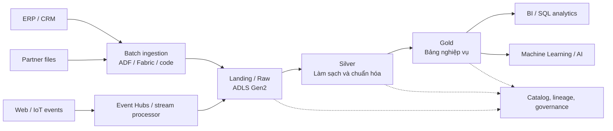
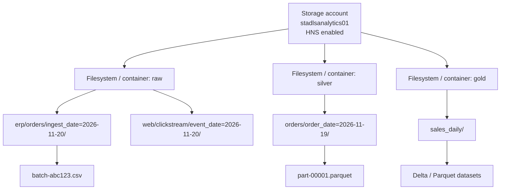
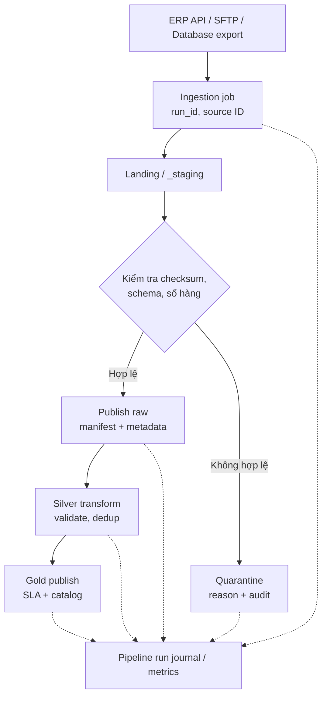
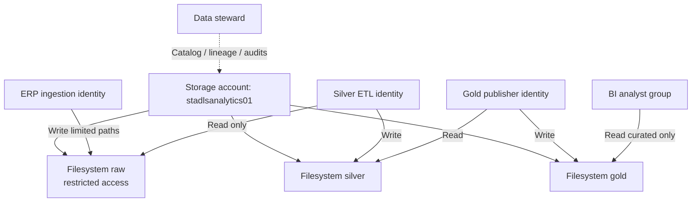
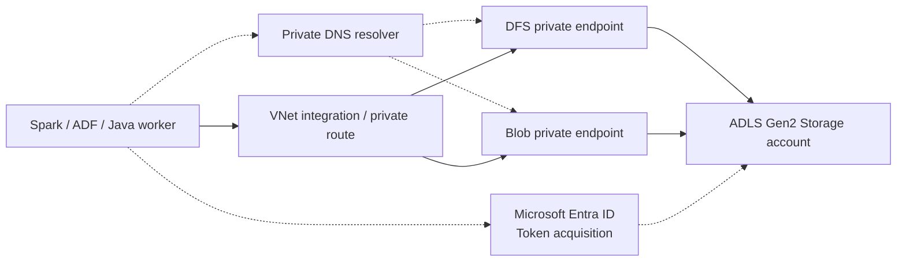
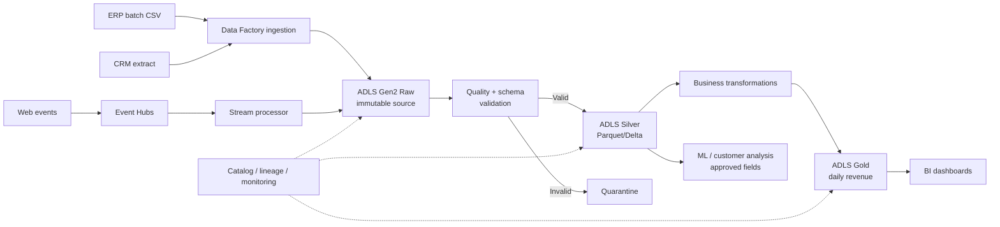

# Thiết kế data lake với Azure Data Lake Storage Gen2

Một doanh nghiệp bán lẻ nhận dữ liệu từ hệ thống bán hàng (ERP), website, ứng dụng di động, thiết bị IoT và các đối tác. Dữ liệu có nhiều định dạng, tần suất đến khác nhau, đôi khi thiếu trường hoặc bị gửi lại. Đội dữ liệu cần lưu bản gốc để điều tra, làm sạch và hợp nhất thành các bảng đáng tin cậy, sau đó cung cấp cho báo cáo, khoa học dữ liệu và các ứng dụng AI. Nếu tất cả các nhóm tự ghi đè một thư mục chung, chẳng bao lâu sẽ không ai biết file nào là nguồn gốc, ai được đọc dữ liệu cá nhân, hay phải chạy lại pipeline từ đâu khi thất bại.

**Data lake** là kiến trúc lưu dữ liệu đa dạng ở quy mô lớn, giữ được dữ liệu nguồn và cho phép nhiều công cụ xử lý/khai thác theo nhu cầu. **Azure Data Lake Storage Gen2 (ADLS Gen2)** cung cấp khả năng data lake trên **Azure Blob Storage** thông qua **hierarchical namespace (HNS)**, giúp tổ chức file và directory theo cây thư mục, thực hiện các thao tác phù hợp với workload phân tích, đồng thời tích hợp Azure identity, phân quyền và hệ sinh thái xử lý dữ liệu.

Trong module **CLOUD_PROVIDERS_AZURE**, bạn khám phá Microsoft Azure từ subscription, resource group và Microsoft Entra ID đến mạng ảo, compute, storage, dữ liệu, triển khai, giám sát, bảo vệ và kiểm soát chi phí. Bài thuộc chương **Nền tảng dữ liệu và phân tích**. Trọng tâm là **thiết kế data lake với ADLS Gen2**: chọn cấu trúc, bảo vệ dữ liệu, xây pipeline, kiểm soát chất lượng, vận hành, phục hồi và dự toán chi phí — không chỉ tạo một Storage account rồi upload file.

> **Phạm vi:** Các tên resource, địa chỉ và câu lệnh dưới đây là ví dụ cho **lab được cấp quyền**. Cấu hình HNS, networking, ACL, xóa dữ liệu, lifecycle và role assignments có thể ảnh hưởng production; luôn thử môi trường riêng và kiểm tra hỗ trợ theo loại Storage account, region, phiên bản SDK và chính sách tổ chức.

## 1. Mục tiêu học tập

Sau bài này, bạn có thể:

- Giải thích data lake, data warehouse và lakehouse giải quyết những nhu cầu khác nhau như thế nào.
- Mô tả quan hệ **Storage account → filesystem/container → directory → file** và đặc điểm HNS của ADLS Gen2.
- Phân biệt hai endpoint **`dfs.core.windows.net`** và **`blob.core.windows.net`**; đọc đường dẫn `abfss://`.
- Thiết kế vùng **landing, raw/bronze, standardized/silver, curated/gold, quarantine** và ranh giới dữ liệu phù hợp.
- Đặt tên file/directory và phân vùng theo nguồn, thời gian, tenant và loại dữ liệu mà không tạo quá nhiều file nhỏ.
- Thiết lập **Microsoft Entra ID, Azure RBAC, POSIX-like ACL** và default ACL theo nguyên tắc quyền tối thiểu.
- Hiểu sự khác nhau giữa **Private Endpoint**, Storage firewall, VNet integration và private DNS cho Blob/DFS.
- Upload, liệt kê và tổ chức file với Azure CLI/Java SDK; biết khi nào dùng Spark/ADF để biến đổi dữ liệu.
- Thiết kế pipeline có checkpoint, chất lượng dữ liệu, schema evolution, idempotency, audit và khả năng replay.
- Xác định trade-off về hiệu năng, bảo mật, lifecycle, monitoring, redundancy, phục hồi và chi phí.

## 2. Data lake giải quyết bài toán gì?

Các hệ thống dữ liệu thường được phân biệt theo **mục đích chính**, không chỉ theo dịch vụ lưu trữ:

| Kiến trúc | Tư tưởng cốt lõi | Phù hợp nhất khi |
|---|---|---|
| **Operational database (OLTP)** | Cập nhật bản ghi và giao dịch ứng dụng theo từng yêu cầu | Order processing, inventory, tài khoản |
| **Data warehouse** | Dữ liệu được mô hình hóa cho phân tích SQL và BI có quản trị | KPI, báo cáo doanh thu, dashboard nhất quán |
| **Data lake** | Lưu dữ liệu nhiều kiểu, gồm dữ liệu thô và đã xử lý, dùng schema-on-read hoặc schema-on-write theo lớp | Dữ liệu nguồn, telemetry, logs, ML, ETL |
| **Lakehouse** | Kết hợp data lake với lớp bảng/metadata và khả năng giao dịch, phân tích | Dùng một nền file cho ETL, BI, data science với table format |

**ADLS Gen2 là nền tảng lưu trữ**, không tự động cung cấp SQL warehouse, schema registry, data catalog hoặc ACID transaction cho tập nhiều file. Để có lakehouse, các hệ thống tính toán có thể dùng **Delta Lake, Apache Iceberg hoặc các định dạng bảng tương thích**, cùng catalog và engine được hỗ trợ.

### Một luồng dữ liệu điển hình



Ví dụ một nguồn ERP gửi file CSV vào `landing/erp/orders/`; pipeline xác minh checksum, ghi bản gốc sang `raw/erp/orders/`, đọc và kiểm tra schema, loại bản ghi lỗi vào `quarantine/`, rồi xuất dữ liệu chuẩn hóa dạng Parquet vào `silver/orders/`. Một job tiếp theo hợp nhất đơn hàng với thông tin sản phẩm để tạo dataset `gold/daily_sales/` cho báo cáo.

**Điểm quan trọng:** mọi vùng đều có **owner, chất lượng, retention và quyền truy cập** khác nhau. Data lake không được thiết kế tốt nếu “ai cũng ghi/đọc mọi chỗ” và không có dữ liệu đầu vào/trạng thái có thể truy vết.

## 3. ADLS Gen2 được xây trên Blob Storage như thế nào?

Azure Storage account là ranh giới cấu hình tài nguyên: region, redundancy, networking, identity, encryption và các dịch vụ lưu trữ được hỗ trợ. Với **hierarchical namespace bật**, Blob Storage cung cấp một namespace có **directory/file** rõ ràng cho workload data lake.



### Những khái niệm cần phân biệt

| Khái niệm | Ý nghĩa |
|---|---|
| **Storage account** | Tài nguyên Azure chứa các dịch vụ lưu trữ và cấu hình hạ tầng |
| **Hierarchical namespace (HNS)** | Tính năng tổ chức file/directory theo cấu trúc phân cấp và hỗ trợ thao tác kiểu filesystem |
| **Filesystem** | Trong ADLS Gen2 tương ứng một **Blob container**, có namespace gốc riêng |
| **Directory** | Thư mục trong filesystem HNS, có metadata và ACL phù hợp |
| **File** | Dữ liệu nhị phân và metadata được lưu theo đường dẫn trong filesystem |
| **Blob service endpoint** | Endpoint kiểu `https://<account>.blob.core.windows.net` |
| **Data Lake/DFS endpoint** | Endpoint kiểu `https://<account>.dfs.core.windows.net` |
| **ABFS/ABFSS** | URI filesystem driver thường dùng từ Spark/Hadoop |

**HNS không chỉ là cách đặt tên blob bằng dấu `/`.** Khi HNS được bật, directory là đối tượng filesystem có thể quản trị; các thao tác như rename/move trong namespace được hỗ trợ theo semantics riêng, hữu ích cho việc xuất dữ liệu từ thư mục tạm sang thư mục đã hoàn tất.

### Chọn HNS từ đầu

Khi tạo Storage account mới cho ADLS Gen2, thông thường chọn **General-purpose v2 (StorageV2)** và **Enable hierarchical namespace** theo cấu hình được hỗ trợ. Một số Storage accounts tương thích có thể được **nâng cấp bật HNS** qua quy trình Azure hỗ trợ; nhưng **không được giả định có thể bật/tắt qua lại** như một flag đơn giản. HNS ảnh hưởng API, khả năng tương thích tính năng và chi phí một số operations. Cần kiểm tra điều kiện trước khi nâng cấp account hiện hữu.

### Rename/move khác copy/xóa file

Trong nhiều workflow file-based, Spark/job tạo file tạm rồi **rename** directory/file vào vị trí publish cuối cùng. HNS hỗ trợ rename/move hiệu quả trong phạm vi filesystem được hỗ trợ, thường tránh phải copy lại mọi byte dữ liệu như cách giả lập thư mục bằng prefix. Tuy nhiên:

- Không coi rename giữa **hai storage accounts** hoặc hai filesystems khác nhau là một metadata operation nguyên tử.
- Không xem việc rename một directory là **ACID transaction nhiều bảng**.
- Phải kiểm tra quyền ACL, lease/lock, conflict ở tên đích và semantics SDK trước khi xây protocol commit.

## 4. Đường dẫn ADLS Gen2 và hai endpoint

Một Storage account minh họa tên `stadlsanalytics01` có filesystem `raw`, directory `erp/orders/ingest_date=2026-11-20` và file `batch-001.csv`.

| Cách biểu diễn | Ví dụ |
|---|---|
| **DFS HTTPS** | `https://stadlsanalytics01.dfs.core.windows.net/raw/erp/orders/ingest_date=2026-11-20/batch-001.csv` |
| **Blob HTTPS** | `https://stadlsanalytics01.blob.core.windows.net/raw/erp/orders/ingest_date=2026-11-20/batch-001.csv` |
| **ABFSS (Spark/Hadoop)** | `abfss://raw@stadlsanalytics01.dfs.core.windows.net/erp/orders/ingest_date=2026-11-20/batch-001.csv` |

`abfss` thường dùng để truy cập dữ liệu ADLS Gen2 bằng driver Hadoop ABFS qua kết nối an toàn. Trong Spark, các engines có hỗ trợ có thể dùng URI này để đọc Parquet, Delta hoặc định dạng khác.

### DFS và Blob: không phải hai bản sao

Hai endpoint trỏ vào **cùng dữ liệu trong cùng account** nhưng cung cấp những API/semantics khác nhau. Dịch vụ Blob và Data Lake Storage tích hợp, song một số thao tác/feature cần đúng endpoint. Ví dụ Java `DataLakeFileSystemClient` sử dụng **DFS endpoint**, còn một số công cụ Blob SDK/portal có thể sử dụng **Blob endpoint**.

Đặc biệt với **Private Link**, Storage account có thể cần **hai private endpoints riêng** cho subresources `dfs` và `blob`: có workflow dùng DFS API nhưng thực hiện thao tác/redirect liên quan Blob API. Tạo riêng private endpoint cho DFS **không bảo đảm** mọi yêu cầu liên quan Blob endpoint đều kết nối được qua private network. Phải xác minh đường mạng và private DNS thực tế của từng ứng dụng.

### Quy tắc đặt tên

- Storage account: tên toàn cục duy nhất theo quy tắc Azure; không dùng tên chứa thông tin bí mật.
- Filesystem/container: tên theo quy tắc Blob container, tránh nhầm hoa/thường.
- Directory/path: thống nhất chữ thường, ký tự cho phép và encoding; tránh whitespace, dấu địa phương hoặc ký tự cần escape nếu công cụ xử lý khác nhau.
- File name: ổn định, duy nhất khi cần, chứa `batch_id` hoặc `event_id` thay vì chỉ `data.csv` luôn bị overwrite.
- Không lưu token, password, email/số điện thoại hoặc định danh nhạy cảm trong path nếu log/catalog có thể ghi lại đường dẫn.

## 5. Kiến trúc vùng dữ liệu: landing → raw → silver → gold

Cách tổ chức vùng thường gọi **medallion architecture**. Đây là **quy ước kiến trúc**, không phải tính năng bắt buộc hoặc cấu hình tự sinh bởi ADLS Gen2.

| Vùng | Dữ liệu lưu | Quyền ghi/đọc điển hình | Chính sách vận hành |
|---|---|---|---|
| **Landing** | File mới đến, chưa kiểm tra virus/schema/checksum | Ingestion service ghi; validation pipeline đọc | TTL ngắn, chuyển sang raw/quarantine sau validation |
| **Raw/Bronze** | Bản gốc gần nguồn, thêm metadata ingestion | Ingestion được ghi; ETL đọc; hạn chế sửa/xóa | Immutable theo logic, replay, retention theo hợp đồng |
| **Standardized/Silver** | Dữ liệu đã làm sạch, chuẩn kiểu, deduplicate, schema version | Transformation jobs ghi; data engineers/consumers đọc theo phạm vi | Chất lượng, định dạng phân tích, có thể xây lại từ raw |
| **Curated/Gold** | Data products, aggregates, business definitions | Pipeline/owner được ghi; BI/analytics đọc | SLA, schema contract, lineage và freshness rõ |
| **Quarantine** | File/hàng lỗi schema, checksum hoặc vi phạm rule | Validation job ghi; nhóm chuyên trách đọc | Lưu reason/trace và retention ngắn có kiểm soát |
| **Sandbox** | Thử nghiệm data science có phê duyệt | Một nhóm/identity giới hạn | Quota, không truy cập PII vô tội vạ, cleanup |

### Một hay nhiều filesystems?

Có hai chiến lược:

**Một filesystem `lake` với các directories** `/raw`, `/silver`, `/gold`: dễ bắt đầu, cùng namespace và có thể đặt ACL theo folder, nhưng quản trị retention, ownership, chia sẻ và ranh giới team cần cẩn trọng.

**Nhiều filesystems** `raw`, `silver`, `gold`: tách bề mặt cấp quyền, lifecycle và điều phối dễ hơn trong nhiều tổ chức, nhưng vẫn nằm dưới cùng ranh giới Storage account cho networking/capacity. Một số chính sách cấp filesystem cần xét khả năng cấu hình thực tế.

Nếu có yêu cầu **tách vùng bảo mật mạnh** (ví dụ PII theo tenant, địa lý, quy tắc encryption, network hoặc lifecycle khác biệt), một **Storage account riêng** có thể phù hợp hơn chỉ tách folder. Không xem một folder tên `restricted` là tường bảo mật nếu một identity đã có quyền data-plane toàn account.

## 6. Đề xuất cấu trúc thư mục theo domain, nguồn và thời gian

Ví dụ tổ chức nhiều filesystems trong account `stadlsanalytics01`:

```text
stadlsanalytics01
├── landing/
│   ├── erp/orders/arrival_date=2026-11-20/run_id=r001/orders.csv
│   └── partners/pricing/arrival_date=2026-11-20/batch-93.json
├── raw/
│   ├── erp/orders/ingest_date=2026-11-20/run_id=r001/orders.csv
│   └── web/clickstream/ingest_date=2026-11-20/hour=09/events.jsonl
├── silver/
│   ├── sales/orders/order_date=2026-11-19/part-0001.parquet
│   └── customer/profile_snapshot/as_of_date=2026-11-20/part-0001.parquet
├── gold/
│   ├── finance/daily_revenue/business_date=2026-11-19/...
│   └── operations/fulfillment_kpis/business_date=2026-11-19/...
└── quarantine/
    └── erp/orders/ingest_date=2026-11-20/run_id=r001/...
```

Các dấu `/` trên cùng sơ đồ biểu diễn logical paths; `landing`, `raw`, `silver`, `gold` là **filesystems/containers** nếu bạn chọn tách theo mô hình trên. Đừng đồng thời giả định chúng vừa là containers vừa là folders trong container `lake` mà không ghi rõ thiết kế.

### Đặt tên theo trục truy cập

1. **Data domain:** `sales`, `finance`, `operations` — có owner và data contract.
2. **Source:** `erp`, `web`, `iot` — phục vụ lineage và replay.
3. **Dataset:** `orders`, `customers` — định nghĩa schema và SLA.
4. **Partition column:** `business_date=YYYY-MM-DD`, `hour=HH` — phù hợp truy vấn thực.
5. **Run/batch ID:** giúp đối soát, replay và tránh overwrite bất ngờ.
6. **File part:** `part-0001.parquet` khi job ghi song song, có manifest/checksum nếu cần.

**Phân vùng theo folder chỉ có ích khi query engine biết partitioning scheme và có partition pruning.** Đặt hàng nghìn directories không tự làm query nhanh; thiết kế sai có thể tăng chi phí list operations và metadata.

## 7. Thiết kế partitioning theo cách đọc dữ liệu

**Partitioning** trong data lake thường là quy ước chia dữ liệu thành các directories theo giá trị cột, khác với khái niệm partition vật lý của cơ sở dữ liệu. Một dataset đơn hàng thường được lọc theo ngày:

```text
silver/sales/orders/
  order_date=2026-11-18/part-0001.parquet
  order_date=2026-11-18/part-0002.parquet
  order_date=2026-11-19/part-0001.parquet
  order_date=2026-11-20/part-0001.parquet
```

Khi một truy vấn chỉ cần ngày `2026-11-20`, Spark/Synapse/Fabric engine có thể bỏ qua những partitions khác **nếu format, catalog và query predicate hỗ trợ partition pruning**. Điều này giảm bytes cần đọc và thời gian xử lý.

### Chọn partition columns

| Chiến lược | Phù hợp khi | Rủi ro |
|---|---|---|
| `event_date=YYYY-MM-DD` | Dữ liệu phân tích theo ngày, volume ổn định | Mỗi ngày quá nhỏ hoặc quá lớn tùy nguồn |
| `event_date=.../hour=HH` | Luồng lớn, cần lọc theo giờ | Nhiều directories và small files khi volume thấp |
| `region=.../date=...` | Thường lọc theo region và date | Skew nếu một region chứa phần lớn dữ liệu |
| `tenant_id=...` | Workload thường query theo tenant | Cardinality cao, lộ tenant ID trong path, metadata bùng nổ |
| `source=.../ingest_date=...` | Raw phục vụ replay theo nguồn/batch | Không luôn phù hợp với query theo business date |

**Ngày ingest khác ngày nghiệp vụ.** File nhận ngày 20/11 có thể chứa các giao dịch thực hiện ngày 19/11. Raw thường phân vùng theo **`ingest_date`** để đối soát batch, còn silver/gold có thể phân vùng theo **`business_date`** để tối ưu truy vấn. Đừng tự ghi đè partition ngày 19 khi dữ liệu đến muộn mà không có chiến lược upsert.

### Cardinality và folder explosion

Partition bằng `order_id` hoặc `user_id` khi có hàng triệu giá trị có thể tạo hàng triệu directories rất nhỏ, làm tăng metadata, list operations và chi phí query planning. Nếu truy vấn điểm theo ID là nhu cầu chính, hãy cân nhắc **index/catalog/database** thay vì chỉ dựa vào data lake folders.

### Quy ước timezone

- Timestamps truyền giữa các hệ thống nên có **timezone rõ ràng**, ưu tiên UTC cho ingestion/event time.
- Business date cần tuân thủ múi giờ nghiệp vụ được công bố.
- Job chạy 00:00 UTC không mặc định có cùng business date với cửa hàng ở Việt Nam hoặc thị trường khác.
- Ghi `ingested_at_utc`, `event_occurred_at_utc` và `business_date` riêng nếu cần.

## 8. Chọn định dạng file và định dạng bảng

ADLS Gen2 lưu **bytes**. Công cụ ingest/query quyết định cách diễn giải bytes thành bản ghi. Việc chọn format ảnh hưởng trực tiếp đến hiệu năng, schema evolution, khả năng kiểm tra và chi phí.

| Định dạng | Đặc điểm | Khuyến nghị |
|---|---|---|
| **CSV** | Dễ trao đổi, ít metadata kiểu dữ liệu | Thích hợp landing/raw khi nguồn là CSV; quy định encoding, delimiter, quote, timezone |
| **JSON / JSON Lines** | Linh hoạt cho event/nested data | Raw events; tránh một JSON array khổng lồ khó stream |
| **Parquet** | Columnar, compression và statistics hỗ trợ scan theo cột | Ưu tiên cho nhiều dataset silver/gold dạng analytics |
| **Avro** | Row-oriented, hỗ trợ schema trong hệ sinh thái phù hợp | Event serialization và data exchange |
| **ORC** | Columnar format cho những công cụ hỗ trợ | Một số ecosystem analytics |
| **Delta Lake** | Table format dựa trên Parquet và transaction log | Upsert/merge, schema enforcement/evolution, ACID theo engine hỗ trợ |
| **Apache Iceberg** | Table format có metadata/snapshots và tính năng quản lý bảng | Kiến trúc lakehouse đa engine khi tương thích |

**Đừng nhầm file format với table format.** Parquet là định dạng lưu cột; Parquet files tự thân **không cung cấp transaction commit nhiều file, time travel hay xử lý xung đột concurrent writers**. Delta/Iceberg thêm metadata và protocol do engine hỗ trợ thực hiện. Chỉ đặt folder tên `delta` không biến tập file CSV thành Delta table.

### Ví dụ vì sao Parquet giúp query

Giả sử dataset chứa 100 cột nhưng báo cáo chỉ đọc `business_date`, `region` và `revenue`. Với file columnar và query engine hỗ trợ projection pushdown, hệ thống có thể đọc ít dữ liệu hơn so với parsing toàn bộ các cột CSV. Nếu phân vùng theo `business_date` đúng, còn giảm số file phải mở.

Tuy nhiên, với một file CSV nhỏ 10 KiB, chuyển sang Delta/Iceberg có thể làm tăng độ phức tạp không cần thiết. Chọn theo **khối lượng, tần suất cập nhật, kiểu truy vấn, công cụ và SLA**.

### Nén dữ liệu

Parquet thường kết hợp các codec như Snappy hoặc Zstandard theo engine hỗ trợ. Nén tiết kiệm lưu trữ và giảm I/O nhưng tiêu tốn CPU encode/decode. Hãy so **total read latency, CPU, file size và compatibility**, không chỉ chọn tỉ lệ nén cao nhất.

## 9. Bài toán small files: vì sao ghi nhiều file bé là nguy hiểm?

Một stream processor tạo **một file 1 KiB cho mỗi event** sẽ sinh số file khổng lồ; khi Spark đọc dataset, overhead mở file, list metadata và lập kế hoạch xử lý có thể lớn hơn nhiều việc đọc dữ liệu.

Một nguyên lý:

```text
Tổng thời gian truy vấn
  ≈ thời gian liệt kê file + mở file + lập kế hoạch
    + đọc dữ liệu + giải nén + xử lý
```

### Các biện pháp

1. **Buffer/micro-batch:** gộp nhiều events vào mỗi file khi SLA cho phép.
2. **Compaction:** gom các file nhỏ thành ít file lớn hơn theo job bảo trì có kiểm soát.
3. **Partition sizing:** tránh partition theo giờ nếu một giờ chỉ có vài hàng.
4. **Columnar format:** chuyển dữ liệu analytics sang Parquet/Delta khi phù hợp.
5. **Không đưa toàn bộ dữ liệu vào một file:** quá lớn làm mất tính song song khi đọc, khó retry và khó quản lý thay đổi.

Không có kích thước file tốt nhất cho mọi engine. Ví dụ có thể thử các file từ vài chục đến vài trăm MiB trong môi trường phân tích, rồi **benchmark query engine, concurrency và object count** thay vì mặc định một con số cố định. Với table format, ưu tiên sử dụng **compaction/optimize protocol** đúng cách; không tùy tiện xóa file dữ liệu khi metadata transaction vẫn tham chiếu tới chúng.

## 10. Thiết kế pipeline ingestion có khả năng phục hồi

Một pipeline tốt không dừng ở thao tác “copy file thành công”. Nó cần trả lời **nguồn nào đã nạp, đã kiểm tra gì, có lỗi không và làm sao replay chính xác**.

### Quy trình batch ingestion



### Các bước cần thực hiện

1. **Xác định source contract:** schema version, owner, lịch cập nhật, timezone, expected row count, phạm vi dữ liệu cá nhân.
2. **Tạo run ID bền vững:** ví dụ `erp-orders-20261120-001` cho lần ingest; gắn với source snapshot/version.
3. **Ghi vào staging path:** không để downstream nhầm file đang upload dở là batch hoàn chỉnh.
4. **Kiểm tra file:** kích thước, checksum/hash, file count, mã hóa, định dạng và virus scanning nếu yêu cầu.
5. **Ghi manifest/journal:** danh sách file, checksum, source watermark, thời điểm ingest, trạng thái.
6. **Publish:** chuyển/move hoặc hoàn tất commit theo khả năng HNS/table format, chỉ công bố khi tất cả file hợp lệ.
7. **Xử lý lỗi:** phân loại transient/retryable, schema violation, duplicate và partial upload.
8. **Chuyển đổi silver/gold:** đọc đúng raw batch, kiểm tra dữ liệu, ghi output theo protocol tương ứng.
9. **Đánh dấu complete:** publish marker/metadata/catalog/checkpoint **sau khi dữ liệu hoàn chỉnh**, không sớm hơn.

### Không dùng tên file là dấu hiệu duy nhất “đã nạp”

Một source có thể gửi lại file cùng tên nhưng dữ liệu đã sửa, hoặc retry tạo tên mới cho cùng batch. Nên ghi **source ID + snapshot/watermark + checksum + run ID** trong journal. Khi ingest lại:

- Nếu checksum/schema giống batch đã hoàn tất, quyết định **skip hoặc xác nhận idempotently**.
- Nếu cùng logical batch nhưng checksum khác, chuyển **version mới hoặc review**, không âm thầm overwrite raw.
- Nếu upload bị gián đoạn, dọn staging theo retention và ghi trạng thái failed/retry.

### Hệ thống nào điều phối?

| Công cụ | Vai trò phù hợp |
|---|---|
| **Azure Data Factory / Synapse pipelines** | Copy Activity, schedule, parameterized pipelines và activity monitoring |
| **Azure Databricks / Spark** | Batch/stream transformations, Parquet/Delta operations, large-scale compute |
| **Azure Functions / Container Apps** | Xử lý sự kiện hoặc orchestration nhỏ, validation/lightweight work |
| **Event Hubs** | Thu nhận stream và chuyển tiếp tới processor/data lake phù hợp |
| **Microsoft Fabric / các engine analytics khác** | BI, lakehouse và data engineering theo tích hợp được hỗ trợ |
| **Microsoft Purview** | Catalog, lineage, phân loại dữ liệu và governance theo khả năng đã cấu hình |

ADLS Gen2 **không tự thực hiện ETL**. Nó cung cấp nơi lưu; khả năng schedule, schema validation, compute và query nằm ở công cụ kết nối. Trước khi chọn engine, xác nhận mô hình identity/network, quota và chi phí của engine.

## 11. Streaming ingestion và dữ liệu đến muộn

Ví dụ web clickstream đến qua **Azure Event Hubs**. Stream processor ghi micro-batch vào vùng raw theo **ingest timestamp**; silver xử lý theo **event timestamp**, watermark và deduplication.

```text
raw/web/clickstream/
  ingest_date=2026-11-20/hour=10/run_id=stream-20261120T10/part-0001.jsonl

silver/web/clickstream/
  event_date=2026-11-19/part-0001.parquet
```

Một event phát lúc `2026-11-19T23:59Z` có thể chỉ đến pipeline vào ngày `2026-11-20` do mạng hoặc reconnect. Nếu dùng ingest date làm business date, báo cáo theo ngày sẽ sai.

### Watermark, replay và checkpoint

- **Source offset/sequence:** thông tin cho biết đã đọc đến vị trí nào trong Event Hubs/Kafka/CDC.
- **Checkpoint:** trạng thái tiến độ của stream processor; không thay thế dữ liệu nghiệp vụ bền vững.
- **Watermark:** ngưỡng cho phép xử lý dữ liệu đến muộn; cần đặt theo SLA/source behavior.
- **Idempotency:** có event ID hoặc khóa nghiệp vụ để tránh ghi trùng khi processor restart/retry.
- **Late arrival policy:** append dữ liệu muộn và cập nhật partition silver/gold với table transaction/merge phù hợp, thay vì silently drop.

Nếu processor ghi data lake thành công nhưng crash trước checkpoint, lần chạy sau có thể ghi lại cùng event. Phải thiết kế output commit và deduplication. **Exactly-once processing** cần được đánh giá theo **toàn chuỗi nguồn → compute → sink**, không thể kết luận chỉ vì service cung cấp checkpoint.

## 12. Dữ liệu đến từ nhiều nguồn: schema evolution và data quality

Raw cho phép lưu bản gốc dù một field mới xuất hiện; silver/gold phải có **data contract** và quy tắc xử lý schema rõ ràng.

### Các tình huống schema thay đổi

| Thay đổi | Rủi ro | Hướng xử lý |
|---|---|---|
| Thêm trường tùy chọn | Consumer cũ không biết field | Cho phép backward compatible khi hợp đồng cho phép |
| Đổi tên `customer_id` thành `client_id` | Mapping cũ bị null hoặc mất dữ liệu | Tăng schema version, chuyển đổi có kiểm thử |
| Thay `amount` số thành string có ký hiệu tiền | Parse sai hoặc làm tròn | Validate, dùng decimal và currency riêng |
| Thiếu một field bắt buộc | Sai báo cáo hoặc join | Quarantine theo rule, ghi reason |
| Đổi timezone | Business date lệch | Chuẩn hóa UTC và lưu timezone nguồn |
| Gửi trùng cùng event ID | Tổng doanh số bị nhân đôi | Deduplication theo eventId/source/version |

### Những kiểm tra tối thiểu

1. **Schema:** loại dữ liệu và field bắt buộc.
2. **Completeness:** tỷ lệ null/thất lạc bản ghi và ngưỡng chấp nhận.
3. **Uniqueness:** trùng khóa hoặc event ID.
4. **Validity:** giá trị nằm trong miền hợp lệ (ví dụ doanh số không âm khi không phải refund).
5. **Timeliness:** dữ liệu đến đúng SLA/freshness.
6. **Reconciliation:** số hàng/tổng tiền/checksum theo source và sink.
7. **Privacy:** các trường PII được phân loại, che/mã hóa hoặc loại bỏ trước khi cung cấp cho đối tượng không có quyền.

### Quarantine không phải “thùng rác”

Mỗi record/file lỗi cần có **reason code, source ID, schema version, run ID và thời gian lỗi**. Chỉ nhóm được ủy quyền mới xem raw payload nhạy cảm. Quarantine có retention và workflow xử lý lại; một file bị lỗi không nên khiến toàn bộ batch thất bại nếu business contract cho phép tách lỗi, nhưng cũng không được đánh dấu “100% chất lượng” khi đã bỏ hàng.

## 13. Bảo mật ADLS Gen2: Microsoft Entra ID, Azure RBAC và ACL

Một data lake thường chứa cả dữ liệu phổ thông lẫn **PII, thông tin tài chính và bí mật thương mại**. Lớp bảo mật không thể chỉ dựa vào việc đường dẫn `raw/restricted/` khó đoán. ADLS Gen2 tích hợp:

1. **Microsoft Entra ID**: danh tính người dùng, service principal hoặc managed/workload identity.
2. **Azure RBAC data-plane roles**: quyền truy cập dữ liệu ở scope Azure Resource Manager được hỗ trợ.
3. **POSIX-like access control lists (ACLs)**: quyền truy cập cụ thể tới directories/files khi sử dụng cơ chế xác thực và thao tác phù hợp.
4. **Storage network rules/Private Link**: ràng buộc đường mạng tới Storage endpoints.
5. **Encryption, audit/monitoring, policies và lifecycle**: bảo vệ dữ liệu, phát hiện thay đổi và kiểm soát vòng đời.

### Management plane khác data plane

| Nhu cầu | Quyền/cơ chế phù hợp |
|---|---|
| Xem cấu hình Storage account | Azure RBAC **Reader** ở management plane |
| Tạo/sửa Storage account, network rules, redundancy | Management role có quyền tài nguyên tương ứng |
| Đọc Blob/file bằng Entra token | **Storage Blob Data Reader** hoặc ACL được phép |
| Ghi/đổi/xóa file bằng Entra token | **Storage Blob Data Contributor** hoặc ACL cho phép thao tác |
| Quản lý ownership/ACL và quyền dữ liệu rộng hơn | **Storage Blob Data Owner** hoặc quyền owner/superuser phù hợp |
| Tạo role assignments | Role có quyền quản lý RBAC ở scope phù hợp, ví dụ RBAC Administrator/Owner |

**Azure RBAC Reader trên Storage account không tự cấp quyền đọc nội dung file.** Mặt khác, cấp **Storage Blob Data Contributor** tại scope toàn account cho một worker có thể khiến ACL folder không còn là ranh giới giới hạn hiệu lực như bạn nghĩ.

### RBAC và ACL cùng tồn tại thế nào?

Trong mô hình Entra authorization, Azure Storage đánh giá quyền theo Azure RBAC data actions và cơ chế ACL. Nếu role data-plane đã **cho phép thao tác**, ACL không được dùng như một lớp **deny** để thu hồi thao tác mà role cho phép. Khi role không cấp quyền cho thao tác, ACL có thể được xét theo danh tính và đường dẫn.

**Hệ quả:** Nếu một identity phải chỉ đọc `gold/finance/`, đừng cấp `Storage Blob Data Reader` trên **toàn account** rồi đặt ACL “deny” tại `raw/pii/`. ACL không phải bộ lọc phủ định đối với role cho phép rộng. Cần giảm scope RBAC hoặc thiết kế folder/filesystem/account boundaries và ACL hợp lý.

### Quyền theo vai trò nghiệp vụ

| Chủ thể | Mục tiêu truy cập | Đề xuất phạm vi |
|---|---|---|
| ERP ingestion worker | Ghi landing/raw đúng source | Data Contributor hoặc ACL ghi trên đúng filesystem/path |
| Validation/transform job | Đọc raw, ghi silver, ghi quarantine khi lỗi | Tách read/write theo vùng, hạn chế ghi raw |
| Gold publishing job | Đọc silver, ghi gold | Data plane rights đúng output |
| BI analyst | Chỉ đọc curated datasets | Data Reader ở scope phù hợp/ACL, không có raw write |
| Data steward | Quản lý catalog và kiểm tra chất lượng | Quyền governance/audit tương ứng, không mặc định toàn bộ PII |
| SRE | Quan sát storage/metrics và ứng cứu có kiểm soát | Read/monitoring + quyền tạm thời khi thực sự cần |

Không dùng account key trong tất cả pipeline chỉ vì dễ cấu hình: **account key/SAS** có mô hình quyền khác với ACL/RBAC và có thể vượt qua ranh giới mà bạn dự định áp bằng Entra. Khi bắt buộc dùng SAS, giới hạn resource, permission và thời gian theo loại SAS hỗ trợ, lưu giữ an toàn và có kế hoạch thu hồi/rotation.

## 14. ACL trên directory: quyền `r`, `w`, `x` và default ACL

ADLS Gen2 hỗ trợ ACL theo phong cách POSIX cho file và directory khi HNS bật:

- **`r` (read):** đọc file hoặc liệt kê directory theo semantics.
- **`w` (write):** ghi dữ liệu/file hoặc thay đổi nội dung directory khi đi kèm quyền phù hợp.
- **`x` (execute/traverse):** đi xuyên qua directory để tới path con.
- **Access ACL:** quyền trên object hiện hữu.
- **Default ACL:** mẫu quyền áp cho **children mới tạo** dưới directory, theo quy tắc kế thừa.

### Quyền traverse rất dễ bị bỏ quên

Giả sử một analyst có quyền đọc file:

```text
raw/finance/2026/11/orders.parquet
```

Để truy cập bằng đường dẫn, identity cần quyền **traverse (x)** thích hợp trên những directories cha `raw/`, `raw/finance/`, `raw/finance/2026/` và `raw/finance/2026/11/`, không chỉ quyền `r` trên file đích. Trong data lake nhiều folder, lỗi `403` có thể do thiếu `x` ở một directory trung gian.

### Ví dụ ACL mang tính khái niệm

```text
Directory: /sales/silver

owner::rwx
user:etl-service-principal-id:rwx
group:data-engineers-group-id:r-x
mask::rwx
other::---

Default ACL cho children mới:
default:user::rwx
default:user:etl-service-principal-id:rwx
default:group:data-engineers-group-id:r-x
default:mask::rwx
default:other::---
```

Đây là **mô hình ACL minh họa**, không phải lệnh chạy ngay. Cú pháp thực và cách ánh xạ object ID/UPN, owner/group, mask và default entries cần kiểm tra theo API/CLI và môi trường. Quyền thực tế của named user/group entries có thể bị **ACL mask** giới hạn; không chỉ nhìn vào `rwx` ghi bên cạnh một entry rồi kết luận có đầy đủ quyền.

### Default ACL không tự sửa dữ liệu cũ

Nếu hôm nay bạn thêm default ACL vào `/silver/sales`, các file đã tồn tại từ tháng trước **không tự động có ACL mới** chỉ vì thay default entries. Với dữ liệu hiện hữu, cần quy trình cập nhật ACL/đệ quy theo khả năng dịch vụ, có kế hoạch rollback và đo tác động trên lượng file lớn.

### Kiểm tra quyền từ góc nhìn runtime

1. Xác định **principal ID** mà Spark/ADF/Functions thực sự dùng, không chỉ identity của user phát triển.
2. Kiểm tra Azure RBAC data permissions và inherited role assignments.
3. Xác định đường dẫn đầy đủ, quyền **x** trên directories cha.
4. Kiểm tra access ACL và mask của directory/file.
5. Kiểm tra default ACL đối với các file **mới tạo**, không áp vào file cũ.
6. Phân biệt lỗi ACL với firewall/Private DNS và lỗi token.

**Không xử lý `403` bằng cách cấp Storage Blob Data Owner toàn subscription.** Đây là quyền rộng và có thể che giấu sai thiết kế RBAC/ACL mà còn tăng rủi ro lộ dữ liệu.

## 15. Mô hình phân quyền theo vùng và data domain

Một chiến lược bảo mật thực dụng là **sở hữu dữ liệu theo domain**, không chỉ theo engine/pipeline.



### Chọn ranh giới

- **Filesystem boundary:** hữu ích khi mỗi vùng có principal/retention và cách vận hành riêng.
- **Directory/ACL boundary:** hữu ích khi nhiều domain chia sẻ một filesystem và không muốn tạo quá nhiều containers.
- **Storage account boundary:** mạnh hơn cho khác biệt về network rules, encryption key, region, redundancy hoặc chính sách tổ chức.
- **Subscription/resource group boundary:** phục vụ management plane, chi phí và tách nhóm hạ tầng; **không tự tạo row-level access** bên trong file.

Với data có PII, tạo một vùng restricted riêng và chỉ cấp quyền cho service principals được phép. Dataset gold có thể được **aggregate hoặc de-identify** để phục vụ nhóm phân tích rộng hơn, nhưng phải kiểm chứng việc khử định danh thực sự đạt yêu cầu.

### Quyền đọc dữ liệu không phải quyền “chỉ đọc một cột”

ACL và RBAC áp chủ yếu theo file/directory/object. Nếu một Parquet file chứa cả `email` và `revenue`, người có quyền đọc file có khả năng đọc cả hai trường dù report chỉ chọn `revenue`. **Column-level security** thường thuộc query/catalog/governance engine, không phải hệ quả tự động của folder ACL.

Vì vậy, nếu cần hạn chế PII, có thể tạo **separate restricted dataset** hoặc xuất bản gold dataset đã loại/mã hóa fields nhạy cảm. Không cho người dùng tải trực tiếp raw file rồi kỳ vọng SQL view policy bảo vệ nội dung file.

## 16. Kết nối mạng riêng: Storage firewall, Private Link và DNS

Một data lake thường được truy cập bởi ADF, Spark clusters, Azure Functions, AKS, BI engines và máy on-premises. **Có RBAC đúng nhưng không có đường mạng** vẫn không thể đọc dữ liệu. Ngược lại, một private endpoint hoạt động không tự cấp quyền cho client.

### Public endpoint và private endpoint

| Cơ chế | Tác dụng | Điều không nên giả định |
|---|---|---|
| TLS tới public endpoint | Mã hóa traffic và sử dụng endpoint của Azure Storage | Không đồng nghĩa endpoint chỉ có thể truy cập từ VNet |
| Storage firewall/network rules | Giới hạn nguồn IP/VNet theo khả năng cấu hình | Không tự cấp private IP |
| VNet service endpoint | Nhận diện/giới hạn subnet được phép đến service endpoint theo policy | Không phải Private Link |
| **Private Endpoint** | Network interface/private IP cho một Storage subresource | Không tự cấp Azure RBAC/ACL |
| Private DNS | Resolve hostname chuẩn đến private IP trong mạng thích hợp | Không tự tạo route/peering |

### Hai private DNS zones cần cân nhắc

```text
DFS API:
  stadlsanalytics01.dfs.core.windows.net
  privatelink.dfs.core.windows.net

Blob API:
  stadlsanalytics01.blob.core.windows.net
  privatelink.blob.core.windows.net
```

Với Storage account HNS và private networking, thường xem xét **private endpoints cho cả `dfs` và `blob`** cùng private DNS zones/link phù hợp. Một số thao tác Data Lake/Blob hoặc redirect có thể liên quan endpoint còn lại. Nếu chỉ cấu hình DFS, có thể gặp lỗi khó hiểu ở thao tác Blob API.



### Kiểm tra mạng từ workload thật

```bash
# Chạy trong đúng VM/container hoặc môi trường tích hợp VNet của workload.
nslookup stadlsanalytics01.dfs.core.windows.net
nslookup stadlsanalytics01.blob.core.windows.net

# Khi có netcat, kiểm tra kết nối HTTPS.
nc -vz stadlsanalytics01.dfs.core.windows.net 443
nc -vz stadlsanalytics01.blob.core.windows.net 443
```

Nếu hostname trả public IP trong VNet lẽ ra private, xem zone links, DNS forwarding, hub/spoke DNS và cache. Nếu private IP đúng nhưng TCP timeout, xem route, NSG/firewall, private endpoint approval và subnet. **DNS/TCP thành công không chứng minh ACL/RBAC chính xác**; thử thao tác đọc/ghi thực sau khi xác nhận mạng.

### Cẩn trọng khi khóa public network access

Trước khi tắt public access hoặc siết firewall:

1. Kiểm kê **tất cả clients**: Spark, ADF managed integration runtime, automation, monitoring/export, partner và máy vận hành.
2. Kiểm tra mỗi client có **đường private được hỗ trợ** từ môi trường thật không.
3. Kiểm tra **DFS và Blob endpoints** cùng DNS.
4. Kiểm tra Microsoft Entra token acquisition và quyền data plane.
5. Có kế hoạch rollback/change window được duyệt.

Không tắt public access ngay sau khi tạo private endpoint cho một VM lab rồi giả định toàn bộ production clients hoạt động. Đặc biệt, managed runtimes/linked services có thể có cơ chế managed private endpoint hoặc network integration riêng theo sản phẩm.

## 17. Thực hành Azure CLI: tạo filesystem, directory và upload

### 17.1. Chuẩn bị

Ví dụ giả định một Storage account `stadlsanalytics01` **đã tồn tại và bật HNS**, người thao tác có quyền phù hợp tại Storage account và network cho phép kết nối tới DFS endpoint.

| Tài nguyên | Giá trị lab | Yêu cầu |
|---|---|---|
| Subscription | `<subscription-id>` | Được phê duyệt |
| Resource group | `rg-data-lab` | Nhóm tài nguyên cho thực hành |
| Storage account | `stadlsanalytics01` | HNS enabled, đúng location/SKU |
| Filesystem | `raw` | Nơi chứa dữ liệu thô |
| Directory | `erp/orders/ingest_date=2026-11-20` | Partition theo ngày nạp |
| Input file | `orders-sample.csv` | Dữ liệu giả, không chứa PII thật |

Xác minh cấu hình account từ Azure CLI:

```bash
az login
az account set --subscription "<subscription-id>"

az storage account show \
  --resource-group "rg-data-lab" \
  --name "stadlsanalytics01" \
  --query "{name:name,location:location,kind:kind,sku:sku.name,isHnsEnabled:isHnsEnabled}" \
  --output json
```

**Không dùng lệnh tạo Storage account khi chưa xem yêu cầu HNS/region/network của lab.** Nếu `isHnsEnabled` không đúng, cần account khác hoặc quy trình chuyển đổi được duyệt; không coi việc đổi endpoint URL là đã bật ADLS Gen2.

### 17.2. Tạo filesystem và directory (ghi dữ liệu)

```bash
ACCOUNT="stadlsanalytics01"

# Cần quyền tạo filesystem theo chính sách môi trường.
az storage fs create \
  --account-name "$ACCOUNT" \
  --name "raw" \
  --auth-mode login

# Tạo thư mục cho một batch mới.
az storage fs directory create \
  --account-name "$ACCOUNT" \
  --file-system "raw" \
  --name "erp/orders/ingest_date=2026-11-20" \
  --auth-mode login
```

Đây là những thao tác **làm thay đổi dữ liệu**, chỉ chạy khi filesystem/directory tương ứng chưa có hoặc đã có quy trình idempotent. Quyền tạo container/filesystem không nên được cấp cho mọi worker ingest; trong production, pipeline hạ tầng có thể tạo filesystem trước, còn worker chỉ được phép tạo directory/file trong nhánh của mình.

### 17.3. Upload file và xác minh (ghi + đọc)

Tạo file CSV mẫu **trên máy lab của bạn** bằng công cụ được phép:

```csv
order_id,amount,currency,order_date
ORD-001,150000,VND,2026-11-19
ORD-002,230000,VND,2026-11-19
```

Lưu tên `orders-sample.csv`. Tiếp đó:

```bash
az storage fs file upload \
  --account-name "stadlsanalytics01" \
  --file-system "raw" \
  --path "erp/orders/ingest_date=2026-11-20/orders-sample.csv" \
  --source "./orders-sample.csv" \
  --auth-mode login

# Kiểm tra đối tượng đã xuất hiện trong directory dự kiến.
az storage fs file list \
  --account-name "stadlsanalytics01" \
  --file-system "raw" \
  --path "erp/orders/ingest_date=2026-11-20" \
  --auth-mode login \
  --output table
```

Tham số chính xác của `az storage fs` có thể thay đổi giữa CLI versions; trước khi chạy hãy kiểm tra `az storage fs file upload --help` và `az storage fs file list --help`. Đừng tự thêm `--overwrite` nếu chưa hiểu phiên bản CLI và tác động của việc ghi đè.

### 17.4. Xem ACL cho directory

```bash
az storage fs access show \
  --account-name "stadlsanalytics01" \
  --file-system "raw" \
  --path "erp/orders" \
  --auth-mode login \
  --output json
```

Lệnh này đọc thông tin ACL/owner/group theo khả năng của API và principal. Khi cần set ACL, sử dụng portal/CLI/IaC với **quy trình phê duyệt**; không copy nguyên câu ACL minh họa trong tài liệu vào thư mục production và vô tình thay mất quyền của pipeline đang chạy.

### 17.5. Xác nhận dữ liệu bằng nhiều lớp

Sau upload:

1. Kiểm tra **đường dẫn đầy đủ** và object type là file.
2. Kiểm tra kích thước, checksum/hash nếu yêu cầu và last modified.
3. Dùng identity của **consumer thực tế** thử đọc file; người upload thành công không chứng minh BI group có quyền đọc.
4. Kiểm tra manifest hoặc pipeline journal đã ghi batch ID, row count và trạng thái kiểm tra.
5. Không đánh dấu batch `READY` nếu mới thấy file tồn tại mà còn thiếu các phần của batch.

## 18. Java SDK: thao tác Data Lake file bằng Managed Identity

Azure Storage SDK cho Java có thư viện **`com.azure:azure-storage-file-datalake`** và **`com.azure:azure-identity`**. Dưới đây là ví dụ ngắn sử dụng **`DefaultAzureCredential`**; runtime Azure nên dùng managed identity hoặc workload identity phù hợp, không lưu account key trong source.

### 18.1. Khung Maven

```xml
<dependencies>
    <dependency>
        <groupId>com.azure</groupId>
        <artifactId>azure-storage-file-datalake</artifactId>
        <version>REPLACE_WITH_APPROVED_VERSION</version>
    </dependency>
    <dependency>
        <groupId>com.azure</groupId>
        <artifactId>azure-identity</artifactId>
        <version>REPLACE_WITH_APPROVED_VERSION</version>
    </dependency>
</dependencies>
```

Chọn version qua **Azure SDK BOM** hoặc bộ dependency đã được tổ chức phê duyệt. Placeholder trên **không phải version Maven hợp lệ**: cần thay trước khi build. Không tự tải/triển khai dependency vào dự án thật nếu chưa có quyền.

### 18.2. Ghi một file CSV mẫu

```java
import com.azure.identity.DefaultAzureCredentialBuilder;
import com.azure.storage.file.datalake.DataLakeDirectoryClient;
import com.azure.storage.file.datalake.DataLakeFileClient;
import com.azure.storage.file.datalake.DataLakeFileSystemClient;
import com.azure.storage.file.datalake.DataLakeServiceClient;
import com.azure.storage.file.datalake.DataLakeServiceClientBuilder;

import java.io.ByteArrayInputStream;
import java.nio.charset.StandardCharsets;

public final class DataLakeUploadDemo {
    public static void main(String[] args) {
        String account = "stadlsanalytics01";
        String filesystem = "raw";
        String directory = "erp/orders/ingest_date=2026-11-20";

        DataLakeServiceClient service = new DataLakeServiceClientBuilder()
                .endpoint("https://" + account + ".dfs.core.windows.net")
                .credential(new DefaultAzureCredentialBuilder().build())
                .buildClient();

        DataLakeFileSystemClient fs =
                service.getFileSystemClient(filesystem);
        DataLakeDirectoryClient dir = fs.getDirectoryClient(directory);

        // Demo: directory và filesystem đã được provision trước.
        String csv = "order_id,amount,currency\n"
                + "ORD-001,150000,VND\n"
                + "ORD-002,230000,VND\n";
        byte[] bytes = csv.getBytes(StandardCharsets.UTF_8);

        // Dùng tên batch duy nhất; tạo file có thể ghi đè theo SDK/option.
        DataLakeFileClient file = dir.createFile("batch-demo-001.csv");
        file.append(new ByteArrayInputStream(bytes), 0, bytes.length);
        file.flush(bytes.length);

        System.out.println("Uploaded bytes=" + bytes.length);
        System.out.println("File path=" + file.getFilePath());
    }
}
```

**Giải thích:**

- `DataLakeServiceClientBuilder` cần **DFS endpoint** của Storage account.
- `getFileSystemClient` và `getDirectoryClient` xác định đúng filesystem/directory.
- `createFile` tạo file theo semantics SDK; phải hiểu rõ việc **file đích đã tồn tại** trước khi tái chạy, tránh ghi đè raw bất ngờ.
- `append` ghi một đoạn bytes ở offset; `flush` hoàn tất/đưa các bytes đến vị trí logic mong muốn. Trong thực tế phải xử lý retry, partial writes, offset và lỗi flush.
- `DefaultAzureCredential` sử dụng danh tính của ứng dụng; chỉ cần quyền data plane và ACL thích hợp, không cần hard-code key.

Đoạn mã trên phù hợp **file nhỏ trong lab**. Với file hàng GiB hoặc nhiều người ghi song song, dùng **SDK high-level upload APIs**, transfer options và một staging/commit protocol phù hợp. Không tải toàn bộ data lake file vào RAM rồi gọi `append` một lần.

### 18.3. Đọc properties để kiểm tra file

```java
import com.azure.storage.file.datalake.DataLakeFileClient;
import com.azure.storage.file.datalake.models.PathProperties;

// file là DataLakeFileClient đã được tạo/tra cứu trước đó.
PathProperties properties = file.getProperties();
System.out.println("Length=" + properties.getFileSize());
System.out.println("ETag=" + properties.getETag());
System.out.println("LastModified=" + properties.getLastModified());
```

Đây là **snippet bên trong method** có biến `file`, không phải class Java độc lập. ETag và LastModified hữu ích cho kiểm tra thay đổi/optimistic conditions nhưng **không thay thế checksum nội dung do pipeline cần xác minh**.

### 18.4. Tái sử dụng client và quan sát lỗi

Production Java application nên tái sử dụng service/filesystem clients và đặt timeout, retry, memory limits, logging phù hợp. Khi gặp `403` hoặc `404`, cần xác định:

- `403`: principal/role/ACL, path traversal hoặc firewall/network restrictions.
- `404`: account/filesystem/directory/file có đúng path/region và đã được publish chưa?
- `409`/`412`: conflict ở tên đích hoặc ETag/conditions theo API.
- `429`/`503`: throttling/tài nguyên; retry backoff có giới hạn và giảm concurrency.

Không log OAuth token hoặc raw file nhạy cảm. Với lỗi retry trong upload, kiểm tra **byte ranges và committed length** trước khi tiếp tục để tránh ghi trùng/thiếu bytes.

## 19. Spark đọc/ghi Parquet trên ADLS Gen2

Trong các Spark environments đã được cấu hình kết nối ADLS Gen2 đúng (Azure Databricks, Synapse Spark hoặc môi trường hỗ trợ ABFS), đường dẫn `abfss` biểu diễn filesystem + storage account + path.

### Ví dụ Spark SQL/PySpark định hướng

```python
# Ví dụ CHỈ để minh họa API Spark; yêu cầu Spark session,
# quyền Entra/ACL và cấu hình connector ABFS đã có sẵn.
raw_path = (
    "abfss://raw@stadlsanalytics01.dfs.core.windows.net/"
    "erp/orders/ingest_date=2026-11-20/"
)
silver_path = (
    "abfss://silver@stadlsanalytics01.dfs.core.windows.net/"
    "sales/orders/"
)

orders = (
    spark.read.option("header", "true")
    .schema("order_id string, amount decimal(18,2), currency string")
    .csv(raw_path)
)

from pyspark.sql.functions import lit, to_date

normalized = (
    orders
    .filter("order_id IS NOT NULL AND amount >= 0")
    .withColumn("ingest_date", to_date(lit("2026-11-20")))
)

normalized.write.mode("append").partitionBy(
    "ingest_date"
).parquet(silver_path)
```

Đây là đoạn code để học **cách một Spark engine tiêu thụ ADLS Gen2**, không phải pipeline production hoàn chỉnh: thực tế cần schema validation/quarantine, checkpoint, deduplication, business date, xử lý file trùng và atomic publish. Lệnh `append` có thể tạo file lặp nếu job được chạy lại; với tính đúng đắn cao cần thiết kế idempotent sink hoặc table format có transaction protocol thích hợp.

### Quyền cho Spark

Một Spark runtime có thể dùng managed identity, workload identity, service principal hoặc cơ chế federation được dịch vụ hỗ trợ. Cấu hình credential/ACL cần tương thích với **execution identity thật** của cluster/job. Việc người dùng có thể xem file trong portal **không chứng minh** Spark executor đã có quyền traverse/đọc file.

### Tại sao không để secret trong notebook?

Không hard-code account key/service principal secret trong notebook, repo hoặc Spark config in ra logs. Ưu tiên **managed identity/federated identity** hoặc secret management được phê duyệt, phân quyền riêng cho các jobs. Khi cần chia sẻ notebook cho cộng đồng, loại bỏ hostname nhạy cảm và dữ liệu nội bộ.

## 20. Quản trị metadata: catalog, lineage và data contracts

Data lake dùng chung cho nhiều nhóm sẽ nhanh chóng thành **data swamp** nếu thiếu metadata, ownership và khả năng tìm dữ liệu.

### Metadata tối thiểu của một dataset

| Thuộc tính | Ví dụ | Công dụng |
|---|---|---|
| Dataset name | `sales.orders` | Định danh ổn định |
| Data owner / steward | Sales Data Team | Người chịu trách nhiệm |
| Description | Đơn hàng được chuẩn hóa sau kiểm tra | Tránh dùng sai nghĩa |
| Schema version | `v3` | Đánh giá tương thích pipeline |
| Source & lineage | ERP Orders → raw → silver | Truy vết nguồn |
| Freshness/SLA | Cập nhật trước 07:00 giờ nghiệp vụ | Cam kết chất lượng |
| Primary business key | `order_id` | Deduplication/upsert |
| Partition strategy | `business_date` | Tối ưu query/retention |
| Sensitivity | Internal / Confidential / PII | Kiểm soát truy cập |
| Retention / legal hold | Theo chính sách đã duyệt | Quản trị vòng đời |
| Storage format | Parquet/Delta | Engine compatibility |
| Quality rules | Non-null order_id, amount hợp lệ | Phát hiện dữ liệu lỗi |

### Microsoft Purview và catalog

**Microsoft Purview** hoặc công cụ catalog/governance phù hợp có thể hỗ trợ khám phá dataset, phân loại, ghi nhận lineage và quản lý metadata theo khả năng kết nối. Nhưng:

- Catalog **không tự sửa ACL** nếu không có cơ chế governance/enforcement tương ứng.
- Lineage không tự xuất hiện cho mọi pipeline nếu công cụ không tích hợp hoặc chưa cấu hình.
- Dataset có mô tả “PII restricted” nhưng nằm trong filesystem được đọc bởi identity có quyền toàn account vẫn có nguy cơ lộ dữ liệu.

Catalog, identity, ACL, network và query-engine permissions cần phối hợp thành **một mô hình quản trị**, không dựa vào một nhãn phân loại duy nhất.

## 21. Lifecycle, retention và bảo vệ dữ liệu

Data lake lưu lịch sử lâu dài nhưng **không phải mọi file đều phải ở tier nóng vĩnh viễn**. Dữ liệu raw có thể cần retention nhiều tháng để replay, landing có thể chỉ cần vài ngày, gold có thể được cập nhật liên tục, và những dataset nhạy cảm có thời hạn xóa theo yêu cầu pháp lý.

### Thiết kế retention theo vùng

| Vùng | Lý do giữ | Ví dụ chính sách cần xác định |
|---|---|---|
| Landing | Upload tạm, đối chiếu lỗi | Dọn các file đã publish sau khoảng an toàn |
| Raw/Bronze | Replay, audit nguồn, khôi phục pipeline | Retention theo hợp đồng dữ liệu và nghĩa vụ pháp lý |
| Silver | Dữ liệu chuẩn hóa có thể tái tạo từ raw | Chính sách xây lại, versioning/table retention |
| Gold | Data products được công bố cho người dùng | Lưu snapshots cần cho báo cáo, tránh xóa nhầm active datasets |
| Quarantine | Điều tra file/bản ghi lỗi | TTL ngắn có kiểm soát, xóa PII khi hết nhu cầu |
| Sandbox | Thử nghiệm có quota và owner | Hạn dọn dẹp, không lưu bản sao dữ liệu nhạy cảm vô hạn |

### Lifecycle management của Azure Storage

Azure Blob Storage có **lifecycle management policies** theo khả năng của account, blob type, HNS và access tiers. Có thể cân nhắc chuyển dữ liệu ít truy cập sang tier kinh tế hơn hoặc xóa dữ liệu theo tuổi, nhưng:

- **Không giả định mọi access tier (đặc biệt Archive) khả dụng/hoạt động như nhau với account HNS**. Kiểm tra khả năng service/tier/region và điều kiện API trước khi áp dụng.
- Tránh đặt một quy tắc theo prefix quá rộng vô tình di chuyển hoặc xóa file metadata/transaction log của Delta/Iceberg đang hoạt động.
- Xóa file vật lý trong một lakehouse table có thể làm hỏng snapshot/time travel/transaction log nếu không dùng cơ chế vacuum/expiration chính thức của table format.
- Dataset có legal hold, compliance hoặc retention bắt buộc cần chính sách riêng.
- Retention theo `lastModified` có thể khác business date/ingest date, phải xác minh policy đang dùng.

**Data lifecycle và data governance phải khớp nhau.** Không để một job “cleanup 30 ngày” xóa dữ liệu gốc bắt buộc giữ theo hợp đồng trong 5 năm.

### Soft delete, versioning và immutability

Một số tính năng bảo vệ dữ liệu của Blob Storage có các giới hạn/khả năng tương thích khác nhau khi HNS được bật. Khi thiết kế:

1. Kiểm tra có hỗ trợ **soft delete** cho files/directories theo SKU và feature hiện hành không.
2. Xem **versioning**, **point-in-time restore**, **immutability policies** và các hạn chế của account có HNS; **không mặc định tất cả được hỗ trợ như account Blob không HNS**.
3. Xác định RPO/RTO và phương án export/snapshot/backups thực tế khi tính năng mong muốn không khả dụng.
4. Thử phục hồi một dataset trong lab trước khi cam kết khả năng khôi phục.

Không nhầm **LRS/ZRS/GRS redundancy** với cơ chế backup phục hồi xóa nhầm hoặc sửa dữ liệu sai: dữ liệu lỗi có thể được sao chép sang replica.

## 22. Giám sát data lake và pipeline end-to-end

Một data lake cần nhìn thấy **hệ thống lưu trữ** và **tính đúng đắn của dữ liệu sau xử lý**. Các metrics Storage account chỉ cho biết requests/latency/bytes, không tự biết file `orders.parquet` bị thiếu 10% đơn hàng.

### Hai lớp quan sát

| Lớp | Những chỉ số nên có | Vì sao quan trọng |
|---|---|---|
| **Storage** | Transactions, availability, errors, ingress/egress, request latency | Kiểm tra Storage endpoint và network |
| **Pipeline** | Run status, input/output file count, row count, schema errors, checksum mismatches | Biết batch nào thiếu/sai |
| **Freshness** | Last successful ingestion, event lag, end-to-end SLA | Dữ liệu có đến kịp báo cáo? |
| **Data quality** | Missing IDs, duplicate keys, invalid amounts, null ratio | Ngăn dữ liệu sai vào gold |
| **Cost/efficiency** | Bytes stored/read/written, operations, compaction jobs, compute cost | Tránh lưu và quét thừa |
| **Security** | ACL/role changes, failed access, public network changes, key use | Phát hiện thay đổi ranh giới dữ liệu |
| **Governance** | Dataset owner, lineage freshness, retention compliance | Hỗ trợ audit và data stewardship |

### Ví dụ chỉ số nghiệp vụ

Với dataset `silver.sales.orders` nạp hằng ngày:

```text
dataset: sales.orders
business_date: 2026-11-19
pipeline_run_id: erp-orders-20261120-r001
source_records: 100000
accepted_records: 99880
quarantined_records: 120
duplicate_records: 0
source_checksum_verified: true
pipeline_state: COMPLETED_WITH_WARNINGS
published_at_utc: 2026-11-20T03:20:00Z
```

**Đây là minh họa**, không phải dữ liệu thật. Việc 120 records bị đưa vào quarantine phải được so với **ngưỡng chất lượng** và công bố minh bạch; không chỉ trả về trạng thái “success” khi downstream kỳ vọng đủ 100.000 records.

### Azure Monitor từ Azure CLI

```bash
ACCOUNT_ID=$(az storage account show \
  --resource-group "rg-data-lab" \
  --name "stadlsanalytics01" \
  --query id --output tsv)

az monitor metrics list-definitions \
  --resource "$ACCOUNT_ID" \
  --output table

# Với loại Storage account có resource con Blob service tương ứng:
BLOB_SERVICE_ID="$ACCOUNT_ID/blobServices/default"
az monitor metrics list-definitions \
  --resource "$BLOB_SERVICE_ID" \
  --output table
```

Lệnh chỉ liệt kê **metric definitions**, không tạo metrics mới. Các metrics/diagnostic categories cụ thể phụ thuộc resource type, service API và region. Để tạo alert, phải xác minh metric name/aggregation/dimensions trên resource thực, tránh áp số ngưỡng lấy từ một account khác.

### Structured logging

Mỗi pipeline cần ghi **run ID, source ID, dataset version, input/output paths, schema version, số hàng, bytes, duration, lỗi và trace IDs**. Không log SAS URL, OAuth bearer token, account key hoặc payload PII.

Ghi **Storage request ID** và correlation ID giúp đối chiếu với service-side diagnostics. Với lỗi data lake, phân biệt:

- HTTP `401/403`: credential/ACL/RBAC/firewall;
- `404`: file/directory chưa có hoặc path/version sai;
- `409/412`: conflict/conditions/ETag;
- `429/503`: throttling, transient errors, capacity/partition pressure;
- Request thành công nhưng **row count sai**: lỗi logic ETL/data quality, không phải Storage availability.

## 23. Tối ưu hiệu năng: file sizes, metadata operations, compute locality

Hiệu năng của một data lake thường bị chi phối bởi **số lượng file, cách phân vùng, định dạng, cách query engine quét dữ liệu và vị trí compute**, không chỉ băng thông tối đa của Storage account.

### Một phép so sánh

Giả sử có dataset 100 GiB được tạo theo hai cách:

- **Phương án A:** hàng triệu file rất nhỏ, mỗi file chứa ít events.
- **Phương án B:** ít file columnar với kích thước hợp lý, phân vùng theo business date.

Nếu query cần tổng doanh thu của một ngày, phương án B thường cho phép **partition pruning, column projection và ít metadata/list operations**, dù tổng dung lượng gốc tương tự. Nhưng nếu chỉ cần một event bằng ID, một relational/NoSQL index có thể phù hợp hơn việc scan Parquet.

### Các yếu tố cần đo

1. **Request/transaction count:** list/open/read/write/rename operations.
2. **Average file size và file count mỗi partition:** dấu hiệu small-file problem.
3. **Compression ratio và CPU decode:** cân bằng storage với compute.
4. **Partition pruning:** phần trăm partitions được bỏ qua theo query predicate.
5. **Read bytes vs scanned bytes:** kiểm tra projection/pushdown.
6. **Parallelism:** số file/partitions đủ để worker khai thác đồng thời.
7. **Cross-region traffic:** compute và storage khác region có thể tăng latency/egress.
8. **Hot paths:** nhiều jobs ghi vào một directory/manifest/transaction log gây tranh chấp.
9. **Backfill impact:** chạy lại lịch sử có làm nghẽn SLA dữ liệu mới không?

### Compaction và table maintenance

Compaction giúp giảm small files nhưng cũng dùng compute và phát sinh read/write operations. Với Delta/Iceberg, sử dụng **engine/table maintenance APIs** thích hợp và phối hợp retention snapshots, tránh tự copy/gộp file khiến transaction log/catalog mất đồng bộ.

Với raw immutable files, thường giữ file nguồn gốc và tạo derived silver/gold compacted dataset riêng thay vì ghi đè raw. Điều này hỗ trợ replay và audit.

### Tránh “load tất cả rồi mới filter”

Với Spark/Synapse/Databricks, đặt filter theo partition sớm, chỉ select columns cần thiết, tránh `collect()` dữ liệu lớn về driver và tránh full scan mỗi khi API người dùng yêu cầu một trang kết quả. Data lake phù hợp xử lý batch/analytics; phục vụ **low-latency point lookup** có thể cần một serving database/caching layer.

## 24. Chi phí data lake: không chỉ dung lượng GB

Chi phí tổng thể gồm **Storage + operations + data processing + networking + governance/monitoring + bảo vệ dữ liệu**.

| Thành phần | Điểm phát sinh | Kiểm soát như thế nào? |
|---|---|---|
| Dung lượng lưu trữ | Raw, silver, gold, snapshots, replicas | Retention, compression, tránh copy thừa |
| Storage operations | Create/list/read/write/rename, metadata, lifecycle | Giảm small files, giảm redundant scans |
| Access tiers | Dữ liệu hot/cool và khả năng tier tương thích | Chọn theo tần suất truy cập và phí đọc/chuyển |
| Replication | LRS/ZRS/GRS hoặc mô hình redundancy khác | Chọn theo RPO/RTO và quy định vùng dữ liệu |
| Compute | Spark clusters, ADF, Databricks, Functions/Fabric workloads | Autoscaling, job scheduling, partition pruning |
| Network | Egress giữa regions, private endpoints, peering, Firewall | Compute locality và kiến trúc mạng đơn giản |
| Monitoring/governance | Log Analytics, data catalog, quality jobs | Retention hợp lý, audit tập trung |
| Security/DR | CMK/Key Vault, backup/export, kiểm thử phục hồi | Tính vào ngân sách thay vì bỏ qua |

### Minh họa một phép dự toán

Giả sử mỗi ngày nạp `50 GiB` file gốc, silver giữ dữ liệu đã nén và gold sinh aggregates. Dự toán không thể chỉ lấy `50 GiB × 30 ngày` rồi coi đó là toàn bộ dữ liệu: còn file staging, late arrivals, duplicate versions, silver/gold, index/transaction log, temporary files và replication.

Một công thức khái quát:

\[
\text{Monthly total cost}
= \text{Storage GB-month} + \text{Transactions}
+ \text{Compute} + \text{Network}
+ \text{Monitoring/other services}
\]

Đây là **mô hình các thành phần chi phí**, không phải phép tính tiền với một đơn giá duy nhất. Dùng Azure Pricing Calculator và Cost Management với **region, redundancy, tier, operations và engine compute thực tế**. Các giá/tính năng có thể thay đổi theo thời gian.

### Thực hành kiểm soát chi phí

- Gắn **tags/cost allocation** ở resource scope để biết đội/domain nào tạo tài nguyên.
- Xem số Storage accounts, tier, redundancy và quy mô dữ liệu từng vùng.
- Đo chi phí **mỗi successful pipeline run, mỗi dataset được publish và mỗi TB query thực tế**.
- Tạo budget/alert theo ngưỡng, kết hợp cảnh báo small-file explosion hoặc scanning bất thường.
- Không tự dọn data lake production khi vượt ngân sách: có thể vi phạm retention, phá table snapshots hoặc mất dữ liệu cho downstream.

## 25. Độ bền, backup, disaster recovery và RPO/RTO

**RPO** là lượng dữ liệu tối đa có thể mất (theo thời gian) mà tổ chức chấp nhận; **RTO** là thời gian tối đa để phục hồi dịch vụ/dữ liệu. Mô hình redundancy của Storage account quyết định một phần khả năng chịu lỗi hạ tầng, nhưng không bao phủ toàn bộ kịch bản vận hành.

### Những tình huống cần phân biệt

| Tình huống | Có thể bị ảnh hưởng | Cách chuẩn bị |
|---|---|---|
| Một disk/storage node lỗi | Hạ tầng vật lý | Redundancy theo mức được cấu hình |
| Zone mất khả dụng | Region có availability zones | Đánh giá ZRS/GZRS theo hỗ trợ |
| Region gián đoạn | Nhiều workload/network/services | Đánh giá GRS/GZRS, failover procedure và DR region |
| Pipeline xóa nhầm raw files | Data correctness | Soft delete/backup/export/snapshots nếu được hỗ trợ, audit và restore drill |
| Job ghi sai data gold | Báo cáo sai dù storage khỏe | Data versions, table history, publish rollback và quality gates |
| Credential/ACL bị thay sai | Data lake không truy cập được | IaC, audit RBAC/ACL, emergency access process |
| Malware/ransomware xóa hoặc mã hóa file | Dữ liệu và truy cập | Least privilege, immutable/backup controls theo khả năng, tách ranh giới |
| Schema breaking change | ETL/BI bị lỗi | Data contracts, versioned schemas và replay |

### Geo-redundancy có độ trễ sao chép

Với geo-redundant replication, secondary có thể không chứa **những write mới nhất** vì quá trình sao chép giữa regions có thể bất đồng bộ. Không cam kết RPO=0 khi chưa có cơ chế bảo đảm phù hợp. Khi thực hiện failover, các pipeline, connection endpoints, RBAC/ACL, DNS và table metadata/catal​og phải được kiểm tra trong quy trình DR.

### Runbook khôi phục một dataset

1. Xác nhận **dataset, filesystem/path, thời điểm và nguyên nhân sự cố**.
2. Đóng băng hoặc cách ly job tiếp tục ghi sai vào vùng bị ảnh hưởng.
3. Xác định bản raw/source có thể replay, bản backup hoặc snapshot/table version hợp lệ.
4. Khôi phục vào **staging/quarantine recovery path**, không ghi đè ngay đường publish.
5. Kiểm tra checksum, row counts, schema, sample queries và phân quyền.
6. Publish lại theo commit protocol, thông báo downstream và cập nhật catalog/lineage.
7. Ghi audit ai thực hiện, RPO/RTO thực tế và bài học cải tiến.

**Phục hồi dữ liệu và phục hồi quyền truy cập là hai việc khác nhau.** Một file được khôi phục nhưng không có access ACL/default ACL đúng vẫn khiến Spark/BI thất bại; ngược lại identity truy cập được nhưng file bị ghi sai vẫn tạo báo cáo sai.

## 26. Case study: data lake cho hệ thống bán lẻ đa kênh

Một doanh nghiệp có:

- **ERP:** xuất CSV đơn hàng và tồn kho mỗi đêm.
- **E-commerce website:** sinh event `page_view`, `add_to_cart` và `checkout_completed` qua Event Hubs.
- **CRM:** cung cấp thông tin khách hàng và phân loại membership.
- **Đội tài chính:** cần báo cáo doanh thu theo ngày đúng trước 07:00 giờ kinh doanh.
- **Đội dữ liệu:** cần replay dữ liệu trong 90 ngày, quản lý PII và truy xuất nguồn gốc.

### 26.1. Thiết kế tổng thể



### 26.2. Tổ chức filesystems và quyền

| Filesystem/vùng | Data owner | Writer | Reader | Đặc biệt |
|---|---|---|---|---|
| `landing` | Platform ingestion team | ADF ingestion identity | Validation pipeline | File tạm, cleanup |
| `raw/erp` | ERP data owner | Ingestion identity | Silver ETL | Replay, audit |
| `raw/crm-restricted` | CRM owner | CRM ingestion identity | PII-approved ETL | ACL/identity hạn chế |
| `silver/sales` | Sales data engineering | Silver transform identity | Gold/analytics identities | Schema hợp lệ, PII được xử lý |
| `gold/finance` | Finance data owner | Gold publishing identity | Finance BI group | SLO và KPI definitions |
| `quarantine` | Data quality team | Validation pipeline | Chuyên trách data quality | Lưu lỗi/PII có kiểm soát |

Nếu phần `crm-restricted` có yêu cầu region, encryption key hoặc ranh giới network khác, nên xem xét **Storage account riêng** thay vì chỉ một directory.

### 26.3. Chọn partitioning theo nhu cầu

**ERP raw:**

```text
raw/erp/orders/ingest_date=2026-11-20/run_id=erp-orders-001/
  orders.csv
  manifest.json
```

**Web raw:**

```text
raw/web/clickstream/ingest_date=2026-11-20/hour=09/run_id=stream-09/
  part-0001.jsonl
  part-0002.jsonl
```

**Silver orders:**

```text
silver/sales/orders/business_date=2026-11-19/
  part-0001.parquet
  part-0002.parquet
```

**Gold daily revenue:**

```text
gold/finance/daily_revenue/business_date=2026-11-19/
  part-0001.parquet
```

Với lakehouse table format, đường dẫn có thể gồm thêm **transaction log/metadata directories**, nên ví dụ chỉ mô tả dữ liệu logic, không phải cấu trúc đầy đủ của Delta/Iceberg.

### 26.4. Quy trình có thể replay

1. ERP đưa file vào landing với `source_snapshot_id` và checksum.
2. ADF/validation job kiểm tra schema, row count và quyền, sau đó đưa bản gốc vào raw.
3. Silver job đọc raw batch theo journal, dùng `order_id` làm business key, xác định bản ghi trùng/cập nhật và chuẩn hóa timezone/currency.
4. Bản ghi lỗi sang quarantine có reason/lineage; pipeline không làm mất file gốc.
5. Gold job tính daily revenue, không lấy dữ liệu đến muộn thành đơn mới hai lần.
6. Manifest và catalog được cập nhật khi gold publish hoàn tất.
7. Nếu job thất bại ở bước 5, chỉ replay batch chưa complete; không nạp lại thành hai lần doanh số.
8. Theo dõi SLA dữ liệu sẵn sàng trước 07:00 và alert khi freshness/row-count deviation vượt ngưỡng.

### 26.5. Kịch bản sửa dữ liệu đến muộn

Một đơn hàng từ 19/11 được ERP bổ sung vào file ngày 20/11 sau khi Gold `daily_revenue` đã publish. Giải pháp:

- Raw vẫn giữ **file gốc** và ingestion metadata ngày 20/11.
- Silver cập nhật chính xác `business_date=2026-11-19` theo `order_id` và version/updatedAt.
- Gold recalculation chỉ cập nhật những business date bị ảnh hưởng, dùng commit protocol an toàn.
- Dashboard và consumer được thông báo “late correction” nếu SLA yêu cầu.

Không mặc định mọi file đến ngày 20/11 đều thuộc doanh thu ngày 20/11.

## 27. Bảng lỗi thường gặp và cách xử lý

| Triệu chứng | Nguyên nhân có thể | Kiểm tra/hướng xử lý |
|---|---|---|
| `403 AuthorizationPermissionMismatch` | Data RBAC thiếu hoặc path ACL `x`/read/write không đủ | Kiểm tra principal, inherited roles, ACL/mask và directories cha |
| Pipeline đọc được root nhưng không đọc được dataset | Directory ACL thiếu traverse hoặc default ACL không áp vào file cũ | Kiểm tra access ACL từng path, quyền executor |
| Người dùng đọc `raw/pii` dù ACL không cho | Có Storage Blob Data Reader/Contributor rộng ở scope cha | Rà soát RBAC, giảm scope; ACL không phải deny layer cho quyền RBAC đã có |
| DFS hostname trả public IP dù có Private Endpoint | Thiếu `privatelink.dfs.core.windows.net` zone link/forwarder | Kiểm tra DNS từ workload |
| DFS kết nối được nhưng một số thao tác Blob thất bại | Thiếu Blob private endpoint/DNS hoặc API dùng Blob endpoint | Kiểm tra `blob` private endpoint và `privatelink.blob.core.windows.net` |
| Private IP đúng nhưng timeout | Route/NSG/firewall/PE approval hoặc VNet integration | Kiểm tra TCP 443, network path và service connection |
| Spark `abfss://` không truy cập được | Sai filesystem/account path, credential config, identity hoặc network | Xem error code, ABFS config, service principal/managed identity |
| Spark driver đọc được nhưng executors lỗi | Worker nodes dùng network/identity khác hoặc DNS khác | Kiểm tra chính compute workers, không chỉ notebook/UI |
| Job rerun làm tăng doanh thu gấp đôi | Append không idempotent, duplicate source files | Dùng business key, replay journal và transactional table write |
| File còn đang upload đã bị downstream đọc | Thiếu staging/commit marker | Publish sau validation, atomic rename trong scope hỗ trợ |
| Query Spark chậm dù tổng data nhỏ | Hàng triệu file nhỏ hoặc quá nhiều partitions | Compaction, điều chỉnh partition, đo metadata overhead |
| Query theo một ngày vẫn scan mọi file | Partition column không được dùng trong filter/catalog | Kiểm tra schema/path/query, partition pruning |
| Gold schema thay đổi làm BI lỗi | Breaking change không có version/data contract | Quản lý schema version, compatibility tests, release plan |
| Xóa nhầm file của Delta table | Cleanup không tuân transaction log/snapshot | Dùng maintenance APIs của table format, kiểm tra restore |
| Có backup geo nhưng không khôi phục file xóa nhầm | Redundancy không phải backup logic | Dùng cơ chế recover/export/snapshot phù hợp và restore drill |
| Storage operations cost tăng | Liệt kê quá nhiều file, compaction liên tục, query scan lớn | Kiểm tra transactions, file sizes và orchestration |
| Dataset gold “thành công” nhưng thiếu records | Quality gate/manifest không đối chiếu source | Row counts, checksums, rejected records và freshness |
| Permission thay đổi làm ingestion dừng | Role/ACL/network bị sửa hoặc token chưa có hiệu lực | Activity logs, RBAC/ACL diff, token refresh, runbook |
| Data lineage không có | Connector/catalog không tích hợp pipeline | Cấu hình catalog/metadata emission đúng engine |

### Quy trình điều tra theo lớp

1. **Data correctness:** thiếu/sai records hay chỉ không đọc được file?
2. **Đúng path:** account, filesystem, directory, timestamp partition, dataset version.
3. **Đường mạng:** DNS DFS/Blob, private endpoints, TCP 443, routing.
4. **Danh tính và quyền:** principal ID, RBAC data role, ACL traverse + mask.
5. **Storage behavior:** request ID, HTTP status, file commit/rename/ETag và throttling.
6. **Pipeline:** source offset/checksum, run ID, journal, schema validation, data quality.
7. **Query/performance:** partition pruning, file counts, small files, compute/region.
8. **Recovery:** staging/quarantine/replay, không ghi đè source khi chưa có bằng chứng.

## 28. Bài tập và câu hỏi tự kiểm tra

### Bài tập A. HNS có vai trò gì?

Một người nói “ADLS Gen2 chỉ là Blob container được thêm dấu `/` trong tên file”. Nhận định này thiếu điều gì?

*Gợi ý:* HNS cung cấp directory/file semantics, ACL, rename/move operations được hỗ trợ, khác với chỉ prefix naming.

### Bài tập B. Chọn partition column

ERP nạp đơn hàng ngày 20/11 nhưng nhiều đơn có `business_date=19/11`. Raw và silver nên phân vùng theo ngày nào?

*Gợi ý:* Raw có thể theo `ingest_date=20/11` để replay; silver/gold theo `business_date` nếu đó là access pattern báo cáo chính.

### Bài tập C. Quyền truy cập không như dự kiến

User có `Storage Blob Data Reader` toàn account nhưng ACL `raw/pii` không cấp `r`. Vì sao họ có thể vẫn đọc được dữ liệu?

*Gợi ý:* Azure RBAC data role cho phép ở scope rộng; ACL không phải deny rule phủ định role đó. Cần giảm RBAC scope/thiết kế boundary.

### Bài tập D. Thiếu quyền traverse

Spark worker có quyền `r` trên `/finance/orders.parquet` nhưng không thể mở file; các parent directories thiếu `x`. Sửa ở đâu?

*Gợi ý:* Bổ sung quyền traverse trên đường dẫn cha theo nguyên tắc tối thiểu, không cấp toàn account Owner.

### Bài tập E. HNS và Private DNS

Một ứng dụng đọc DFS được, nhưng thao tác từ Blob SDK thất bại sau khi chặn public access. Bạn sẽ kiểm tra gì?

*Gợi ý:* Blob private endpoint `blob`, DNS `privatelink.blob.core.windows.net`, route và RBAC/token; DFS endpoint không tự bao phủ Blob.

### Bài tập F. Small files

Một hệ thống lưu một triệu file 1 KiB trong một ngày. Điều gì có thể khiến Spark query chậm dù dữ liệu không lớn?

*Gợi ý:* File open/list/metadata/task overhead; cân nhắc micro-batching, compaction và partitioning thích hợp.

### Bài tập G. Raw và gold khác nhau

Nếu dữ liệu gold đã được tổng hợp chính xác, có thể xóa toàn bộ raw để tiết kiệm chi phí ngay không?

*Gợi ý:* Còn nghĩa vụ replay, audit, hợp đồng retention, late corrections và khả năng khôi phục. Chỉ xóa theo lifecycle policy đã được phê duyệt.

### Bài tập H. Data lake có giao dịch ACID không?

Một job ghi 100 file Parquet rồi crash sau file thứ 67. ADLS Gen2 có tự rollback tất cả file không?

*Gợi ý:* Không. HNS không tự cung cấp ACID commit multi-file. Cần staging/commit marker hoặc table format/engine có transaction protocol đúng.

### Bài tập I. Chọn giữa data lake và database

Ứng dụng cần lookup một khách hàng theo email trong 20 ms. Có nên để API quét toàn bộ Parquet trong raw mỗi request?

*Gợi ý:* Không. Data lake thích hợp analytics/ETL; cân nhắc serving database, index hoặc cache phù hợp.

### Bài tập J. Lab thiết kế end-to-end

Chỉ thực hiện trên tài nguyên **được cấp quyền và dữ liệu giả**:

1. Tạo/kiểm tra Storage account bật HNS, xác nhận `isHnsEnabled` và region.
2. Tạo filesystems `landing`, `raw`, `silver` trong lab.
3. Định nghĩa naming convention cho một nguồn đơn hàng và một nguồn web events.
4. Gán identity upload raw và identity chỉ đọc silver; rà soát scope RBAC.
5. Cấu hình ACL trên directory phù hợp; thử read/write từ đúng principal.
6. Tạo raw CSV mẫu; upload và kiểm tra path/metadata/checksum.
7. Viết pipeline nhỏ biến đổi sang Parquet, phân vùng theo business date.
8. Thử chạy lại cùng batch; xác minh không nhân đôi số records.
9. Cố tình cho file sai schema, ghi quarantine + reason và báo cáo quality.
10. Nếu có VNet/Private Endpoint lab, xác minh DNS/TCP cho **cả DFS lẫn Blob**.
11. Đo thời gian đọc/query, số file và số operations; so khi gom file nhỏ.
12. Thử xóa nhầm file **trong lab** và thực hành khôi phục qua cơ chế đã cấu hình.
13. Ghi báo cáo đầy đủ và thu dọn **chỉ tài nguyên lab do bạn tạo**.

## 29. Checklist trước khi triển khai ADLS Gen2 production

### Kiến trúc lưu trữ

- [ ] Đã xác định dùng data lake, warehouse hay lakehouse theo workload.
- [ ] Storage account type, HNS, region và redundancy được lựa chọn có căn cứ.
- [ ] Filesystem/account boundaries thể hiện domain, zone và mức độ nhạy cảm.
- [ ] Đã phân biệt DFS endpoint, Blob endpoint và URI `abfss`.
- [ ] Đường dẫn nhất quán về domain, source, dataset, partition và batch ID.
- [ ] Không đưa secret/PII không cần thiết vào tên object/path.

### Data engineering

- [ ] Raw được giữ theo policy và có thể replay, không overwrite mất source.
- [ ] Landing/staging không bị downstream đọc khi upload chưa complete.
- [ ] Dữ liệu silver/gold có schema contract, quality rules và owner.
- [ ] Phân vùng theo query pattern thực, có hỗ trợ dữ liệu đến muộn.
- [ ] Có checkpoint, manifest, checksum, idempotency và cơ chế xử lý duplicate.
- [ ] Ghi nhiều file có commit protocol, không coi HNS là multi-file ACID.
- [ ] Có chiến lược compaction/small-file cleanup tuân đúng table format.

### Bảo mật và governance

- [ ] Managed identity/Entra credentials được ưu tiên; không hard-code account keys.
- [ ] Azure RBAC data roles có scope hợp lý; không dùng ACL để phủ định role rộng.
- [ ] Access ACL + default ACL + parent traverse rights đã được kiểm tra.
- [ ] Private endpoints và DNS `dfs`/`blob` được xác minh từ compute runtime.
- [ ] PII nằm trong dataset/boundary riêng và có policy truy cập/retention phù hợp.
- [ ] Có catalog, data owner/steward, classification, lineage và audit.
- [ ] Run history/logs không làm lộ payload nhạy cảm hoặc credentials.

### Vận hành, chi phí và phục hồi

- [ ] Có metrics về Storage errors/latency, pipeline runs, freshness và data quality.
- [ ] Có alerts cho ingestion delay, failed batch, ACL/network changes và chi phí tăng.
- [ ] Có budgets, cost attribution, đo operations/compute/egress và lifecycle.
- [ ] Có RPO/RTO rõ, backup/restore hoặc replay plan phù hợp khả năng HNS.
- [ ] DR đã được thử, gồm networking, identities, ACLs và catalog dependencies.
- [ ] Mọi thay đổi lifecycle/xóa data có approval và kiểm tra snapshot/table metadata.
- [ ] Đã benchmark data format, partition pruning, small-file count và compute locality.
- [ ] Có runbook rollback/reprocess khi publish gold sai hoặc raw bị hỏng.

## Kết luận

**Thiết kế data lake với Azure Data Lake Storage Gen2** bắt đầu từ **bài toán dữ liệu và mẫu truy cập**, không phải từ một Storage account trống. HNS cung cấp nền tảng filesystem và quản lý đường dẫn trên Blob Storage; các vùng **landing/raw/silver/gold/quarantine** giúp phân định nguồn gốc, chất lượng và mục đích sử dụng. Một kiến trúc tốt cần **partitioning và định dạng file phù hợp**, pipeline có thể replay, kiểm soát schema/idempotency, và ranh giới **Entra ID/RBAC/ACL** được kiểm chứng cùng **Private Endpoint/DNS**. ADLS Gen2 không tự thay thế engine tính toán, data catalog, transactional table format hay backup; những lớp này phải được thiết kế bổ sung có chủ đích. Khi giám sát freshness, chất lượng, hiệu năng, chi phí và khả năng phục hồi từ đầu, data lake trở thành một **nền dữ liệu có quản trị, an toàn và đáng tin cậy**, thay vì kho file khó tìm và khó vận hành.
