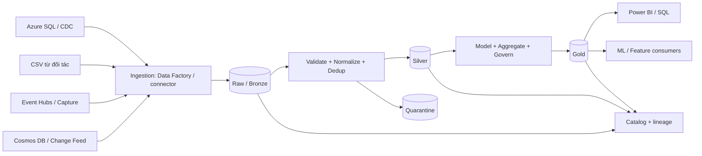
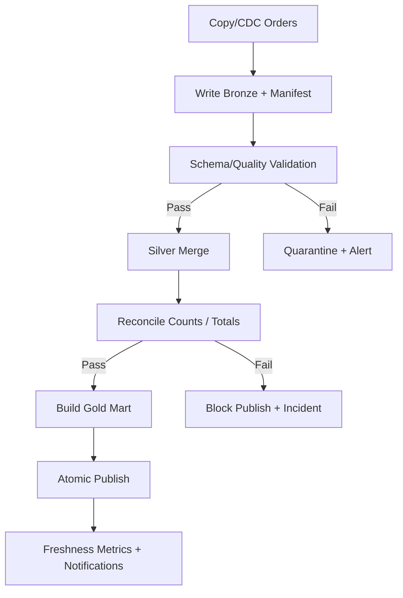

# Tổ chức vùng dữ liệu thô, chuẩn hóa và phục vụ phân tích

Một doanh nghiệp có nhiều nguồn dữ liệu: ứng dụng bán hàng ghi đơn hàng vào Azure SQL Database, hệ thống quản lý hàng hóa xuất CSV hằng ngày, website phát clickstream qua Azure Event Hubs, còn dữ liệu sản phẩm nằm trong Azure Cosmos DB. Bộ phận kế toán cần báo cáo doanh thu đã đối soát, marketing cần phân tích kênh chuyển đổi, trong khi kỹ sư dữ liệu phải điều tra được vì sao một con số trong báo cáo khác số liệu nguồn.

Nếu đưa tất cả dữ liệu vào một container tên `data`, rồi cho mọi công cụ cùng đọc và sửa trực tiếp những file đó, kiến trúc rất dễ gặp lỗi: schema đổi làm hỏng báo cáo, sự kiện trùng được tính hai lần, dữ liệu cá nhân bị lộ, một pipeline ghi dở khiến người dùng đọc bảng chưa hoàn chỉnh, và không thể tái tạo kết quả của kỳ trước.

Giải pháp phổ biến là **tổ chức dữ liệu thành các vùng với trách nhiệm và hợp đồng rõ ràng**:

- **Vùng thô — Raw/Bronze:** lưu dữ liệu nguồn gần nguyên bản, có metadata để truy vết và tái xử lý.
- **Vùng chuẩn hóa — Refined/Silver:** kiểm tra schema, làm sạch, chuẩn hóa, khử trùng lặp, tích hợp các nguồn và tạo bản ghi đáng tin cậy.
- **Vùng phục vụ phân tích — Curated/Gold:** cung cấp bảng nghiệp vụ, mô hình chiều, tổng hợp, KPI và data products để BI/SQL/ML sử dụng.

Tên **Bronze–Silver–Gold** thường được gọi là kiến trúc *medallion*, nhưng không phải một sản phẩm riêng mà Azure bắt buộc phải mua. Các vùng có thể được triển khai trên **Azure Data Lake Storage Gen2 (ADLS Gen2)** kết hợp **Azure Data Factory**, **Azure Databricks**, **Azure Synapse Analytics** hoặc những công cụ xử lý/điều phối tương đương theo yêu cầu. Trong một số giải pháp, Microsoft Fabric/OneLake có thể đảm nhiệm các lớp lakehouse và xử lý, nhưng cần phân biệt quyền, SKU, cách tổ chức và khả năng kết nối với môi trường Azure hiện hữu.

Bài học thuộc chương **Nền tảng dữ liệu và phân tích**, trong mô-đun `CLOUD_PROVIDERS_AZURE` về triển khai, bảo vệ, giám sát và kiểm soát chi phí kiến trúc ứng dụng Azure từ subscription/resource group và Microsoft Entra ID đến mạng, lưu trữ và dữ liệu. Bài tập trung vào cách **thiết kế ranh giới dữ liệu, quy tắc di chuyển giữa các vùng, bảo vệ tính đúng đắn và vận hành pipeline**, không chỉ việc đặt tên thư mục.

## Mục tiêu học tập

Sau bài này, bạn có thể:

1. Giải thích **Raw/Bronze, Refined/Silver và Curated/Gold** cùng ranh giới trách nhiệm của mỗi lớp.
2. Chọn mô hình **storage account, container/filesystem, folder path, partitioning, file format** phù hợp với dữ liệu batch và streaming.
3. Thiết kế **data contracts** gồm schema, business key, timestamp, nguồn gốc, SLA, data owner và version.
4. Xây luồng xử lý **landing → Bronze → Silver → Gold** với checkpoints, retries, idempotency và khả năng replay.
5. Dùng **Parquet và Delta Lake** đúng mục đích, phân biệt với JSON/CSV/Avro gốc và tính năng của ADLS Gen2.
6. Thực hiện validation, quarantine, deduplication, CDC, xử lý dữ liệu đến muộn và Slowly Changing Dimensions.
7. Tổ chức các **data products** phục vụ Power BI/SQL/ML, tránh dùng vùng Gold như bản sao dữ liệu tùy tiện.
8. Thiết kế **managed identity, Microsoft Entra ID, RBAC, ACL, Private Endpoint, Key Vault, lineage và governance**.
9. Đặt mục tiêu freshness/completeness, giám sát pipeline, chọn retention và kiểm soát chi phí.
10. Áp dụng quy trình kiểm thử end-to-end và runbook khi số liệu phân tích sai hoặc dữ liệu không đến.

## 1. Kiến trúc tổng thể: ba vùng, ba loại cam kết



Sơ đồ mô tả **trách nhiệm logic**. Một file CSV có thể được nạp trước vào vùng `landing` rồi chuyển vào Bronze; một stream có thể được đổ vào Bronze trực tiếp từ Event Hubs Capture; một luồng có thể đi qua nhiều bước chuẩn hóa trước Silver. Các dịch vụ sử dụng để xử lý và điều phối **không làm thay đổi ngữ nghĩa của ba vùng**.

### 1.1. So sánh hợp đồng của các vùng

| Tiêu chí | Raw/Bronze | Refined/Silver | Curated/Gold |
|---|---|---|---|
| Nguồn sự thật | Bản sao dữ liệu đã nhận từ nguồn, kèm metadata ingest. | Dữ liệu được diễn giải và chuẩn hóa theo hợp đồng. | Tập dữ liệu nghiệp vụ đã được định nghĩa rõ cho người dùng. |
| Định dạng thường gặp | CSV, JSON, Avro, Parquet, binary, CDC envelope. | Parquet/Delta hoặc định dạng bảng hỗ trợ update/upsert. | Delta/Parquet tables, serving SQL tables/views, semantic model. |
| Schema | Gần source; ghi nhận phiên bản và sai lệch. | Có schema đích ổn định, validation và chuẩn hóa kiểu. | Theo metric/model được phê duyệt, tương thích BI. |
| Xử lý trùng | Thường giữ dấu vết bản đã nhận; không xóa dấu vết nguồn vô điều kiện. | Dedup theo business/event ID và quy tắc. | Một định nghĩa metric duy nhất, tránh đếm trùng sau join. |
| Quyền truy cập | Rất hạn chế vì có thể chứa PII/raw secrets. | Theo data domain/nhóm xử lý. | Dataset/row-level/column-level theo người tiêu dùng. |
| Replay | Ưu tiên bảo toàn dữ liệu và tính tái tạo. | Có thể tạo lại từ Bronze và code versioned. | Có thể tạo lại từ Silver và metric definitions. |
| SLA | Đã nhận/lưu dữ liệu từ nguồn hay chưa. | Dữ liệu hợp lệ, đầy đủ, ít trùng, có độ trễ chấp nhận được. | Báo cáo chính xác, được công bố và sẵn sàng đúng kỳ. |
| Chủ sở hữu | Ingestion/platform và source owner. | Data engineering và data steward. | Business/domain owner, analytics engineering. |

**Phân vùng dữ liệu không tự sinh chất lượng dữ liệu.** Nếu Silver chỉ là copy mọi file Bronze với tên mới, hoặc Gold chỉ là một folder không có business definitions, hệ thống chưa đạt mục tiêu của kiến trúc này.

### 1.2. Hai loại ranh giới: logical và physical

Ba vùng có thể được phân chia bằng:

- **Một storage account, ba containers/filesystems**: `bronze`, `silver`, `gold`; đơn giản cho lab, có thể quản lý quyền/lifecycle theo container.
- **Nhiều storage accounts**: ví dụ raw nhạy cảm ở account có firewall/quyền/retention riêng, Silver và Gold ở account phục vụ analytics; tăng isolation nhưng tăng network, IAM và chi phí quản lý.
- **Một lakehouse/catalog với nhiều schemas/databases**: các bảng có namespace và policy khác nhau, dữ liệu vật lý được quản lý bởi engine hỗ trợ.
- **Kết hợp**: dữ liệu gốc trong ADLS Gen2, các bảng Silver/Gold dưới quản lý của Spark/SQL engine, báo cáo thông qua semantic model.

Không có quy định “mỗi tầng bắt buộc một subscription” hay “mỗi tầng bắt buộc một resource group”. Chọn ranh giới dựa trên **data sensitivity, quyền ghi/đọc, lifecycle, billing, tenancy, vận hành và sự phù hợp với dịch vụ**.

### 1.3. Landing và quarantine không nhất thiết là tầng thứ tư

Nhiều nền tảng thêm:

- **Landing/Ingestion**: nơi tập tin vừa nhận được, có thể cần antivirus, kiểm tra checksum, scan metadata trước khi ghi Bronze.
- **Quarantine/Rejected**: nơi lưu records/file lỗi schema hoặc business rule kèm lý do và thông tin replay.
- **Sandbox/Feature/Serving**: vùng dùng thử, feature data hoặc serving database riêng cho một mục đích.

Đó là những **trách nhiệm bổ sung**, không phải “Gold version 2” hay một thay đổi định nghĩa Bronze–Silver–Gold. Đặt tên khác nếu tổ chức có taxonomy riêng nhưng phải ghi rõ các ranh giới.

## 2. Bắt đầu từ data contract trước khi tạo folder

Một pipeline tốt cần biết **đang chờ dữ liệu gì, từ đâu và phục vụ ai**. Nếu không, cách đặt tên folder chỉ chuyển sự hỗn loạn từ database sang data lake.

### 2.1. Ví dụ hợp đồng cho nguồn Orders

| Thuộc tính | Ví dụ | Ý nghĩa |
|---|---|---|
| Domain / Dataset | `commerce.orders` | Phân định owner và nghiệp vụ. |
| Source | Azure SQL Database `orders-db` | Xác định nơi phát sinh dữ liệu. |
| Ingestion | CDC incremental + daily reconciliation | Cách thu thập và kiểm tra dữ liệu. |
| Grain | Một hàng cho một `orderId` hoặc một event theo `orderId,version` | Định nghĩa đơn vị dữ liệu, tránh đếm hai lần. |
| Primary business key | `(tenantId, orderId)` | Xác định cùng một đơn hàng. |
| Operation/event key | `sourceEventId` hoặc `(partition,LSN)` theo nguồn | Chống xử lý lại cùng thay đổi. |
| Event time | `orderCreatedAtUtc` | Khi nghiệp vụ phát sinh. |
| Source update time | `updatedAtUtc` | Khi trạng thái nguồn được cập nhật. |
| Ingest time | `ingestedAtUtc` | Khi hệ thống đã nhận về lake. |
| Schema version | `v1`, `v2` | Chuẩn hóa breaking changes. |
| PII | Email, địa chỉ, số điện thoại | Bảo vệ/mask theo chính sách. |
| Owner | Commerce Data Owner | Người chịu trách nhiệm ý nghĩa dữ liệu. |
| Freshness SLO | Ví dụ 15 phút cho Silver, 60 phút cho Gold | Mục tiêu nội bộ, không phải SLA Azure. |
| Retention | Theo chính sách nghiệp vụ và luật áp dụng | Không dùng ngày lưu mặc định cho mọi nguồn. |

**Grain là yếu tố quan trọng nhất của data model.** Một bảng `orders` có một dòng mỗi order và một bảng `payments` có nhiều dòng mỗi order. Nếu join rồi tính `SUM(orders.totalVnd)`, số tiền có thể bị nhân theo số payments. Thiết kế Silver/Gold phải nói rõ grain và đường join trước khi định nghĩa metric.

### 2.2. Data contract gồm cả thay đổi schema

Một contract nên định nghĩa:

- Các cột bắt buộc, kiểu và timezone.
- Cột có thể null và quy tắc default.
- Khóa nghiệp vụ/khóa kỹ thuật.
- Các enum hợp lệ và constraints logic.
- Cách truyền xóa (`DELETE`, tombstone hoặc soft delete).
- Version compatibility và thông báo khi thay đổi.
- Owner, SLA, test cases và quy trình phê duyệt breaking change.

Ví dụ đổi `amountVnd` từ integer sang string có chứa dấu phân cách có thể khiến tổng doanh thu sai mà pipeline vẫn “Succeeded” nếu cast im lặng. Silver cần **fail/quarantine và cảnh báo** thay vì tự đổi giá trị lỗi thành 0.

## 3. Tổ chức vật lý trên ADLS Gen2

**Azure Data Lake Storage Gen2** là các khả năng cho workload data lake trên Azure Storage với **hierarchical namespace (HNS)** được bật. Trong thực hành thường nói “folder”, “filesystem” và “container”; với Blob/ADLS cần hiểu chính xác account/container/path cùng cơ chế API được dùng.

### 3.1. Mẫu layout theo vùng và domain

```text
storage-account: stlakeprod

bronze/                                # container / filesystem
  commerce/
    orders/
      source=azure-sql/
        ingest_date=2026-11-20/
          batch_id=20261120T020000Z/
            part-00001.json
            _manifest.json
    payments/
      source=service-bus/
        ingest_date=2026-11-20/
          batch_id=.../
  telemetry/
    sensors/
      source=event-hubs/
        year=2026/month=11/day=20/hour=02/
          partition=0/
            ...avro

silver/
  commerce/
    orders_current/                   # table hoặc path quản lý bởi engine
    payments_validated/
    customers_masked/
  telemetry/
    sensor_readings_clean/

gold/
  commerce/
    daily_revenue/
    customer_lifetime_value/
  telemetry/
    hourly_device_health/

quarantine/
  commerce/
    orders/
      reason=schema_mismatch/
      reason=invalid_currency/
```

Đây là **ví dụ layout**, không phải yêu cầu của Azure. Cấu trúc thật còn phụ thuộc catalog/metastore, engine hỗ trợ table format, data ownership, HNS, region và quy định bảo mật.

### 3.2. Các nguyên tắc đặt tên

1. **Ổn định và có nghĩa**: `commerce/orders` rõ hơn `data_new_final_v7`.
2. **Tách domain/dataset**: tránh một folder chứa file của nhiều nguồn không có contract.
3. **Phân biệt ingest date và business event date**: `ingest_date` là ngày file vào lake, không phải ngày bán hàng.
4. **Có lineage metadata**: `source, pipeline_run_id, batch_id, file_checksum, schema_version`.
5. **Không đưa PII/secrets vào tên path**: folder name có thể xuất hiện trong log, storage listing hoặc telemetry.
6. **Không phụ thuộc vào file name là duy nhất về nghiệp vụ**: cần event ID/source key.
7. **Quy định case, dấu, timezone và escaping**: tránh ba cách viết cùng một dataset.
8. **Bảo vệ đường dẫn của managed tables**: không tự sửa/xóa những file hoặc transaction logs do engine Delta quản lý.

### 3.3. Partitioning theo thời gian và truy vấn

Nếu báo cáo thường lọc theo ngày bán hàng, bảng Silver/Gold có thể dùng `event_date` theo business semantics. Nếu Bronze phục vụ replay theo đợt ingest, `ingest_date` tiện cho tìm file nguồn đã nhận.

| Chiến lược | Ưu điểm | Cảnh báo |
|---|---|---|
| `ingest_date=YYYY-MM-DD` | Audit/replay theo thời gian nhận. | Event đến muộn nằm ở ngày ingest mới, không phải ngày nghiệp vụ. |
| `event_date=YYYY-MM-DD` | Truy vấn business time thường hiệu quả. | Late events cần cập nhật partition cũ; có thể skew. |
| `tenant_id=...` | Isolation/pruning khi số tenant phù hợp. | Cardinality lớn gây nhiều partition/files; PII/tenant IDs trong paths. |
| `country=VN` | Hữu ích nếu truy vấn theo khu vực. | Phân bố không đều; dimension có thể thay đổi. |
| `event_hour=...` | Phù hợp volume streaming rất lớn. | Volume thấp tạo nhiều tiny partitions/files. |

Partitioning của **folder/table** không đồng nghĩa partition key của **Cosmos DB** hoặc số partitions của **Event Hubs**. Đây là các khái niệm ở tầng khác nhau. Chỉ thêm nhiều folder partitions sau khi đo query filtering, file counts và data skew.

### 3.4. File count và vấn đề small files

Một nguồn Event Hubs Capture có thể tạo hàng nghìn Avro files/ngày. Một ingestion pipeline đặt mỗi record thành một file riêng còn tệ hơn: Spark/serverless SQL phải list/open nhiều objects, làm tăng latency và operations. Trong Silver/Gold, dùng **batch writes, compaction/OPTIMIZE theo engine**, kích thước file phù hợp volume/workload và hạn chế over-partitioning. Không sửa trực tiếp raw files nếu chúng là bản lưu để audit/replay.

## 4. Chọn file format đúng tầng

| Định dạng | Thường gặp ở đâu | Điểm mạnh | Giới hạn |
|---|---|---|---|
| **CSV** | Landing/Bronze từ hệ thống đối tác. | Dễ trao đổi, đọc bằng công cụ phổ thông. | Không tự bảo toàn kiểu, schema evolution và escaping dễ lỗi. |
| **JSON/JSONL** | API/events/Bronze. | Linh hoạt, lưu cấu trúc lồng nhau. | Dung lượng lớn, parse tốn chi phí, schema không ổn định. |
| **Avro** | Stream archive/Bronze. | Binary có schema, hữu ích khi lưu events. | Không phải file JSON có thể query field nghiệp vụ trực tiếp nếu body là bytes. |
| **Parquet** | Silver/Gold và export analytics. | Columnar, compression, column pruning. | Bản thân mỗi file không cung cấp ACID transaction nhiều file. |
| **Delta Lake** | Silver/Gold lakehouse. | Table format với transaction log và thao tác ACID/MERGE theo engine hỗ trợ. | Cần công cụ đọc/ghi Delta tương thích, quản trị transaction log/schema. |
| **ORC** | Một số hệ sinh thái data engineering. | Columnar, hiệu quả với workloads phù hợp. | Chọn theo hỗ trợ engine, không phải mặc định trên mọi Azure tool. |

**Delta Lake không phải một kiểu Blob Storage mới.** Delta table thường gồm **Parquet data files và một transaction log (ví dụ `_delta_log`)** do engine hỗ trợ quản lý. Copy/xóa file Parquet trực tiếp mà không thực hiện thao tác Delta tương ứng có thể gây mất nhất quán. Trên ADLS Gen2, các file vẫn là Azure Storage objects; **ACID semantics thuộc table format và transaction engine**.

### 4.1. Khi nào không cần Delta?

Nếu một tập dữ liệu chỉ là snapshots định kỳ, append-only và không có update/delete hoặc nhu cầu concurrent writers, Parquet files có thể đủ. Nếu cần **UPSERT CDC, schema enforcement, transactionally publish bảng** và nhiều lần đọc/ghi đồng thời, Delta là lựa chọn đáng cân nhắc khi công cụ hỗ trợ. Không tuyên bố Delta là bắt buộc cho mọi Bronze/Silver/Gold, hoặc rằng mọi dịch vụ truy vấn SQL của Azure đều hỗ trợ mọi tính năng Delta giống nhau.

## 5. Vùng thô/Bronze: có thể tin vào nguồn gốc, chưa tin vào dữ liệu

**Bronze** nên làm một việc rất tốt: **lưu dữ liệu đã nhận được và thông tin nguồn để có thể giải thích, tái xử lý hoặc kiểm chứng**. Tránh áp các biến đổi làm mất chi tiết mà chưa có hợp đồng. Một số tổ chức chọn lưu raw bytes không đổi; tổ chức khác lưu phiên bản chuẩn hóa tối thiểu để dễ ingest. Điều bắt buộc là phải ghi rõ **đã biến đổi gì và giữ được những gì**.

### 5.1. Một file Bronze cần metadata nào?

Ví dụ một ingestion manifest (không nhất thiết phải là một file riêng cho mỗi batch; có thể lưu trong log/control table):

```json
{
  "dataset": "commerce.orders",
  "sourceSystem": "azure-sql-orders",
  "schemaVersion": "v2",
  "ingestBatchId": "orders-20261120T020000Z",
  "sourceWatermark": "2026-11-20T01:59:59Z",
  "ingestedAtUtc": "2026-11-20T02:00:08Z",
  "fileCount": 12,
  "expectedRecordCount": 120450,
  "checksumAlgorithm": "SHA-256",
  "status": "COMMITTED"
}
```

Manifest minh họa **chứng cứ cần theo dõi**. Nếu copy 12 files nhưng task chết sau 9 files, không được ghi `status=COMMITTED`. Với ingestion thực, thiết kế **atomic publication** hoặc commit marker/control table sau khi kiểm tra đủ files và checksum. **Không coi tên file có `_SUCCESS` là bằng chứng đầy đủ nếu chưa xác định cơ chế tạo marker và tiêu chí commit.**

### 5.2. Append-only/immutable càng phù hợp cho audit

Nhiều hệ thống ưu tiên **không overwrite raw đã ingest**. Nếu đối tác gửi lại file `orders.csv` ngày cũ, lưu thành **batch/version mới với source ID/checksum** thay vì ghi đè bản gốc. Như vậy, kỹ sư có thể phân biệt:

- File nguồn lúc 09:00 khác file được gửi lại lúc 10:00 hay không.
- Tại sao Silver được tạo hôm qua khác Silver hôm nay.
- Nếu pipeline logic sai, nên reprocess từ bản raw nào.

Điều này **không đồng nghĩa lưu vô thời hạn**: dữ liệu thô chịu lifecycle/retention, quyền xóa hợp pháp và yêu cầu bảo vệ dữ liệu cá nhân. Nếu raw bị xóa theo policy, phải biết ảnh hưởng đến khả năng replay.

### 5.3. Schema-on-read có giới hạn

Bronze có thể lưu một file JSON với field mới, không bắt buộc reject ngay ở landing. Nhưng nếu pipeline downstream âm thầm parse sai, lỗi chỉ chuyển từ Bronze sang Silver. Vì thế nên có **schema registry/contract registry, validation report** và khả năng quarantine trước khi promote. Với file CSV, kiểm tra encoding, header, delimiter, số cột và quote escaping để tránh nhầm dữ liệu thành cột khác.

### 5.4. Batch ingestion và streaming ingestion

- **Batch:** Data Factory/Synapse pipeline/Databricks Job nhận file hoặc truy vấn nguồn theo đợt; ghi batch ID, watermark và manifest.
- **Streaming:** Event Hubs Capture lưu Avro theo partition và window; Structured Streaming/processor xử lý events theo checkpoints.
- **CDC:** connector đọc inserts/updates/deletes từ database nguồn, đưa operation metadata và offsets vào Bronze.
- **Change feed:** Cosmos DB for NoSQL cung cấp feed theo mode với ranh giới retention/delete behavior riêng.

**Tránh đồng nhất watermark của Data Factory, Event Hubs offset và Cosmos DB continuation token.** Chúng là những checkpoint thuộc nguồn khác nhau, có semantics, retention và khả năng replay khác nhau.

## 6. Vùng chuẩn hóa/Silver: từ data bytes thành bản ghi đáng tin

Một bảng Silver `commerce.orders_current` có thể cam kết **mỗi `(tenantId,orderId)` là một bản ghi trạng thái hợp lệ mới nhất**, tiền tệ tính theo một quy tắc, timestamp chuẩn UTC, mã quốc gia ISO và dữ liệu cá nhân được giới hạn theo quyền.

Các bước thường gồm:

1. **Parse & validate:** JSON/CSV/Avro theo schema version; record thiếu key bắt buộc bị quarantine.
2. **Normalize types:** decimal cho tiền, ISO date/time, chuẩn hóa enum, Unicode/encoding.
3. **Resolve keys:** xác định business ID, mapping source IDs, unique constraints/merge keys.
4. **Deduplicate:** bỏ các bản gửi lại, định nghĩa bản nào là “latest”.
5. **Handle CDC/deletes:** upsert hoặc tombstone theo change operation, không giữ stale rows.
6. **Conform dimensions:** map cùng customer/product/country code từ nhiều nguồn.
7. **Apply privacy policy:** tokenize/mask/remove các trường không cần thiết.
8. **Record lineage:** source ID, raw file, ingestion batch, transformation version, processedAt.
9. **Publish atomically:** downstream chỉ đọc bảng ở version/commit đã hoàn tất.
10. **Test & alert:** quality gates trước khi promote dữ liệu.

### 6.1. Ví dụ schema Silver

```text
commerce.orders_current
-----------------------
tenant_id              STRING     NOT NULL
order_id               STRING     NOT NULL
customer_id_token      STRING     NULL
order_status           STRING     NOT NULL
order_created_utc      TIMESTAMP  NOT NULL
source_updated_utc     TIMESTAMP  NOT NULL
currency_code          STRING     NOT NULL
total_amount           DECIMAL(18,2) NOT NULL
source_version         LONG       NOT NULL
ingested_at_utc        TIMESTAMP  NOT NULL
transformed_at_utc     TIMESTAMP  NOT NULL
raw_source_path        STRING     NOT NULL
batch_id               STRING     NOT NULL

grain: một bản ghi cho (tenant_id, order_id) tại version mới nhất.
```

Số tiền **không nên dùng `double/float`** nếu quy tắc cần chính xác đến đơn vị tiền; dùng decimal và xác định currency/rounding. Với Việt Nam đồng, có thể lưu `amount_vnd` dưới dạng số nguyên đồng khi phù hợp, nhưng phải có quyết định rõ và nhất quán giữa nguồn/báo cáo.

### 6.2. Chuẩn hóa không có nghĩa tự suy giá trị

Một record có `totalAmount="N/A"` không nên được âm thầm chuyển về 0 nếu số tiền là chỉ số tài chính. Cách xử lý tốt hơn:

- Ghi record vào quarantine với `reason=invalid_amount`.
- Ghi metrics số lượng/lệ lỗi.
- Cảnh báo khi tỷ lệ vượt quality threshold.
- Chỉ chấp nhận default khi contract đã cho phép và có owner phê duyệt.
### 6.3. Data quality dimensions và ví dụ ngưỡng

| Khía cạnh | Câu hỏi cần trả lời | Ví dụ kiểm thử |
|---|---|---|
| **Completeness** | Có đủ nguồn/batch/record yêu cầu không? | Số orders nhập đủ so với manifest và source count. |
| **Validity** | Giá trị có đúng kiểu/enum/range? | `order_status IN ('PENDING','PAID','CANCELLED','SHIPPED')`. |
| **Uniqueness** | Grain có bị nhân đôi không? | Không có hai `(tenantId,orderId)` active trong current table. |
| **Consistency** | Hai datasets có dùng cùng quy tắc không? | Tổng payments hợp lệ khớp số đã đối soát theo kỳ. |
| **Timeliness** | Dữ liệu có cập nhật đúng SLO? | Latest committed Silver version không trễ quá ngưỡng. |
| **Referential integrity** | Business keys liên kết có hợp lệ? | `productId` trong order lines có mapping sản phẩm. |
| **Accuracy** | Số liệu có đúng nguồn thực tế đã đối soát? | Tổng doanh thu từ orders/ledger theo định nghĩa thống nhất. |

Một ngưỡng `invalid_rows / input_rows ≤ 0,1%` chỉ hợp lý nếu được **business owner phê duyệt**. Với giao dịch tiền, một lỗi dữ liệu có thể đã là nghiêm trọng; với log telemetry, tỷ lệ lỗi nhỏ có thể được cách ly mà không chặn pipeline. Đừng đặt ngưỡng chất lượng tùy tiện rồi diễn giải pipeline `Succeeded` nghĩa là dữ liệu chính xác tuyệt đối.

### 6.4. Quarantine phải giải thích được lỗi và có thể sửa

Một record lỗi nên có:

```json
{
  "dataset": "commerce.orders",
  "batchId": "orders-20261120T020000Z",
  "sourceFile": "bronze/commerce/orders/.../part-00001.json",
  "sourceRecordId": "ORD-1057",
  "schemaVersion": "v2",
  "reasonCode": "INVALID_AMOUNT",
  "validationRule": "totalAmount must be a non-negative decimal",
  "firstSeenUtc": "2026-11-20T02:01:12Z",
  "reviewStatus": "PENDING"
}
```

Không đưa **toàn bộ raw PII** vào file lý do lỗi hoặc Application Insights nếu không cần. Quarantine records và raw data có thể liên kết bằng source path/ID; quyền truy cập của data stewards có thể bị giới hạn. Một lỗi schema mới xuất hiện với tỷ lệ lớn nên **chặn publish Silver/Gold** cho đến khi owner đánh giá, thay vì công bố dataset bị thiếu một nửa hàng.

## 7. Idempotency, deduplication và CDC trong Silver

Một pipeline đáng tin cậy phải chịu được **retry cùng batch**, **consumer restart**, **file arrive twice** và **events out of order** mà không tạo hai doanh thu hoặc ghi lùi phiên bản.

### 7.1. Phân biệt ba dạng trùng

| Dạng trùng | Ví dụ | Cách xử lý |
|---|---|---|
| **Duplicate file/batch** | Data Factory Copy retry gửi lại `orders-20261120.csv`. | Manifest/checksum/ingestion key, idempotent commit. |
| **Duplicate physical event** | Event Hubs consumer checkpoint chưa cập nhật, đọc lại cùng offset. | Key `(eventHub,partition,offset/sequence)` trong phạm vi đúng. |
| **Duplicate business operation** | Hai messages có event IDs khác nhau nhưng cùng `paymentId`. | Unique business key và transaction/ledger semantics. |

Không thể chỉ dựa vào tên file để xác định cùng một **nghiệp vụ**. Một file chứa nhiều đơn hàng; một đơn hàng có thể xuất hiện trong nhiều files vì được cập nhật. `sourceEventId`, `businessKey` và `sourceVersion` phục vụ các mục đích khác nhau, cần bảo toàn từ Bronze tới Silver.

### 7.2. Dùng window để chọn bản mới nhất trước MERGE

Ví dụ nguồn Bronze chứa các bản theo `tenantId,orderId,version`. Trước khi merge vào bảng current-state, cần chọn bản mới nhất trên **mỗi business key** và có quy tắc tie-break deterministic.

```text
Bronze input:
tenant-a, ORD-1, version=1, PENDING
tenant-a, ORD-1, version=2, PAID
tenant-a, ORD-1, version=2, PAID     # duplicate delivery
tenant-a, ORD-2, version=1, PENDING

Silver current:
tenant-a, ORD-1, version=2, PAID
tenant-a, ORD-2, version=1, PENDING
```

Nếu hai records cùng `key + version` nhưng **payload khác nhau**, không nên chọn một bản ngẫu nhiên; đó có thể là conflict của nguồn, cần quarantine hoặc business rule chính thức. Sắp xếp theo ingest timestamp chỉ là tie-break được phê duyệt, không đảm bảo thứ tự nghiệp vụ khi clocks sai.

### 7.3. Cơ chế MERGE có điều kiện

Ví dụ SQL minh họa áp dụng vào engine hỗ trợ Delta MERGE tương ứng:

```sql
MERGE INTO silver.orders_current AS t
USING silver.orders_batch_dedup AS s
ON t.tenant_id = s.tenant_id AND t.order_id = s.order_id
WHEN MATCHED AND s.source_version > t.source_version THEN UPDATE SET
  t.order_status = s.order_status,
  t.total_amount = s.total_amount,
  t.source_version = s.source_version,
  t.source_updated_utc = s.source_updated_utc,
  t.transformed_at_utc = s.transformed_at_utc
WHEN NOT MATCHED THEN INSERT (
  tenant_id, order_id, order_status, total_amount,
  source_version, source_updated_utc, transformed_at_utc
) VALUES (
  s.tenant_id, s.order_id, s.order_status, s.total_amount,
  s.source_version, s.source_updated_utc, s.transformed_at_utc
);
```

**Đây là SQL thiết kế**, cần điều chỉnh đúng dialect/engine, schema bảng và dữ liệu `orders_batch_dedup`. Bảng source của MERGE phải không có nhiều hàng cùng match một target key, nếu không có thể lỗi hoặc kết quả không được đảm bảo. Khi target đã có version cao hơn, bản replay cũ **không được ghi đè**.

MERGE không tự biết số tiền nào là đúng nếu `sourceVersion` bị producer phát sinh sai. Định nghĩa version cần được bảo vệ **tại hệ thống nguồn**, có reconciliation khi version/value conflict.

### 7.4. Deletes và tombstones

CDC có thể cung cấp `operation=INSERT/UPDATE/DELETE`. Change feed của một số nguồn chỉ cung cấp phiên bản hiện hành, không tự báo physical delete. Vì vậy cách xử lý phải theo **source semantics**:

- **Hard delete:** nếu nguồn xuất operation delete có khóa và version, Silver nên xóa hoặc đánh dấu tombstone theo contract.
- **Soft delete:** `isDeleted=true` và timestamp được đưa vào Silver; Gold phải loại/giữ dữ liệu theo chính sách.
- **TTL expiration:** phải xác minh nguồn có phát delete event hay cần reconciliation; không mặc định tất cả change feeds đều giống nhau.
- **Retention/legal deletion:** có thể đòi xóa PII ở cả Bronze, Silver, Gold và backups theo luật/chính sách, không thể nói raw luôn bất biến tuyệt đối trong mọi trường hợp.

### 7.5. Late-arriving events và watermark

Giả sử một event `OrderPaid` xảy ra lúc 10:00 UTC nhưng producer offline và chỉ gửi vào Event Hubs lúc 11:30. Nếu Gold tính doanh thu theo `eventTime` thì đơn này có thể thuộc bucket 10:00, dù file nằm ở `ingest_hour=11`.

Có ba đồng hồ:

1. **Event time:** khi nghiệp vụ phát sinh.
2. **Processing/ingestion time:** khi pipeline nhận/xử lý.
3. **Publication time:** khi bảng Gold/báo cáo được cập nhật.

Với streaming, khái niệm **watermark** giúp quyết định dữ liệu đến trễ được giữ/loại/cập nhật trong một giới hạn; semantics phụ thuộc engine. Đừng tự suy watermark là ngày xóa dữ liệu ở storage. Với báo cáo tài chính, late events có thể cần **restate kỳ cũ** và ghi audit thay đổi, không âm thầm bỏ qua để đạt KPI freshness.

## 8. Slowly Changing Dimensions (SCD) và lịch sử phân tích

Bảng Silver `customers_current` dùng cho ứng dụng tra cứu nhanh có thể chỉ lưu thông tin khách hàng mới nhất. Nhưng phân tích doanh thu theo phân khúc khách hàng **tại thời điểm giao dịch** cần biết khách hàng đã thuộc phân khúc nào trong quá khứ.

### 8.1. SCD Type 1 và Type 2

| Loại | Ý nghĩa | Use case |
|---|---|---|
| **Type 1** | Ghi đè giá trị cũ bằng mới. | Sửa lỗi chính tả tên hiển thị, dữ liệu current-state. |
| **Type 2** | Tạo bản ghi mới với khoảng hiệu lực, giữ lịch sử thay đổi. | Khách chuyển từ `BASIC` sang `PREMIUM`, cần báo cáo theo phân khúc lịch sử. |

Ví dụ dimension Type 2:

```text
customer_sk | customer_id | segment  | valid_from_utc     | valid_to_utc       | is_current
1001        | C-7         | BASIC    | 2026-01-01 00:00   | 2026-10-01 00:00   | false
1432        | C-7         | PREMIUM  | 2026-10-01 00:00   | null               | true
```

Nên định nghĩa khoảng hiệu lực dạng **`[valid_from,valid_to)`** (bao gồm đầu, không bao gồm cuối) để tránh vừa hết kỳ cũ vừa bắt đầu kỳ mới bị match hai bản ghi. `customer_sk` là surrogate key dùng trong mô hình chiều; `customer_id` là business key. Nếu event nguồn đến sai thứ tự, Type 2 cần xử lý version/hiệu lực, không chỉ append một dòng mới.

### 8.2. Cẩn trọng khi tính metrics với SCD2

Nếu fact `orders` join dimension `customers_history` chỉ bằng `customer_id`, một đơn có thể match **nhiều bản lịch sử**, làm doanh thu bị nhân. Phải join theo surrogate key được xác định tại lúc xử lý, hoặc join business key cùng **event time nằm trong khoảng hiệu lực**. SCD2 không phải mục tiêu mặc định của mọi field; chỉ dùng cho thuộc tính cần lịch sử phân tích.

## 9. Ví dụ PySpark: từ Bronze JSON tới Silver Delta

Đây là **mã minh họa cho người học** trên một Spark runtime hỗ trợ Delta Lake (chẳng hạn môi trường Azure Databricks hoặc Spark được cấu hình tương thích). **Không thực thi Python/Gradle trong quá trình soạn bài STEP 4**. Ví dụ có chủ đích tách parse, quality gate, dedup và write để dễ kiểm thử.

### 9.1. Đọc và chuẩn hóa

```python
from pyspark.sql import functions as F
from pyspark.sql.window import Window

# Ví dụ giả định: storage identity/network đã được cấu hình riêng.
bronze_path = "abfss://bronze@stlakeprod.dfs.core.windows.net/commerce/orders/"
silver_path = "abfss://silver@stlakeprod.dfs.core.windows.net/commerce/orders_current/"

raw = spark.read.json(bronze_path)

normalized = (
    raw.select(
        F.col("tenantId").cast("string").alias("tenant_id"),
        F.col("orderId").cast("string").alias("order_id"),
        F.upper(F.trim(F.col("status"))).alias("order_status"),
        F.expr("try_cast(totalAmount as decimal(18,2))").alias("total_amount"),
        F.col("version").cast("long").alias("source_version"),
        F.to_timestamp("updatedAtUtc").alias("source_updated_utc"),
        F.current_timestamp().alias("transformed_at_utc")
    )
)

valid_condition = (
    F.col("tenant_id").isNotNull()
    & F.col("order_id").isNotNull()
    & F.col("source_version").isNotNull()
    & F.col("total_amount").isNotNull()
    & (F.col("total_amount") >= F.lit(0))
    & F.col("order_status").isin("PENDING", "PAID", "CANCELLED", "SHIPPED")
)

valid = normalized.where(valid_condition)
invalid = normalized.where(~valid_condition)

# Trong production cần lưu/quarantine invalid và đếm quality metrics bền vững.
invalid_count = invalid.count()
print("Quarantined rows in candidate batch:", invalid_count)
```

**Các điều kiện thực tế phải chặt hơn**: xử lý `NaN`/out-of-range, cột thiếu schema, empty strings, timezone, currency, negative adjustments và bản ghi lỗi không thể parse JSON ngay từ đầu. Hàm `try_cast` có thể phụ thuộc SQL runtime và phiên bản Spark; nếu engine không hỗ trợ, thay bằng phương pháp parse/type validation tương ứng.

### 9.2. Chọn bản mới nhất trong batch

```python
window = Window.partitionBy("tenant_id", "order_id").orderBy(
    F.col("source_version").desc(),
    F.col("source_updated_utc").desc()
)
latest_batch = (
    valid.withColumn("_rownum", F.row_number().over(window))
         .where(F.col("_rownum") == 1)
         .drop("_rownum")
)
```

**Quan trọng:** đoạn này là minh họa tính latest-state. Trước khi chạy production phải có bước **phát hiện `key + version` trùng nhưng payload khác** và đưa vào quarantine; `row_number` với tie-break không đủ mạnh có thể âm thầm chọn một bản conflict. Cần có `eventId` hoặc source change sequence khi contract yêu cầu tính xác định tuyệt đối.

### 9.3. MERGE khi đã có bảng Delta

```python
from delta.tables import DeltaTable

# Chỉ chạy nhánh này nếu silver_path đã có một Delta table tương thích.
target = DeltaTable.forPath(spark, silver_path)
(
    target.alias("t")
    .merge(
        latest_batch.alias("s"),
        "t.tenant_id = s.tenant_id AND t.order_id = s.order_id"
    )
    .whenMatchedUpdate(
        condition="s.source_version > t.source_version",
        set={
            "order_status": "s.order_status",
            "total_amount": "s.total_amount",
            "source_version": "s.source_version",
            "source_updated_utc": "s.source_updated_utc",
            "transformed_at_utc": "s.transformed_at_utc"
        }
    )
    .whenNotMatchedInsert(values={
        "tenant_id": "s.tenant_id",
        "order_id": "s.order_id",
        "order_status": "s.order_status",
        "total_amount": "s.total_amount",
        "source_version": "s.source_version",
        "source_updated_utc": "s.source_updated_utc",
        "transformed_at_utc": "s.transformed_at_utc"
    })
    .execute()
)
```

Ví dụ **giả định Delta table target đã được tạo** với schema phù hợp; nó không tự tạo bảng, grant quyền hay cấu hình Storage. Khi dùng production, cần thêm lineage fields, null handling, data quality results, concurrency handling và stable batch identifiers. Có thể dùng `DeltaTable.isDeltaTable`/quy trình bootstrap table rõ ràng thay vì try/except tùy tiện.

### 9.4. Kiểm chứng batch có thể chạy lại

Chạy cùng batch lần hai không được tăng số dòng `orders_current` hoặc giảm `source_version`. Nếu chạy cùng dữ liệu nhiều lần mà `transformed_at_utc` của tất cả hàng đều thay đổi do blind overwrite, audit sẽ khó phân biệt bản mới thật với replay. `whenMatchedUpdate` có condition theo version giúp tránh update không cần thiết.

## 10. Gold: tạo data products cho người dùng phân tích

Vùng Gold là nơi đặt **định nghĩa nghiệp vụ đã được thống nhất**, không phải chỉ chọn vài cột từ Silver. Một bảng Gold cần có **grain rõ ràng, owner, metric definitions, refresh policy, quyền, tests và SLA**.

### 10.1. Những kiểu data products thường gặp

- **Fact table:** `fact_order_payment`, `fact_sales_daily`, `fact_web_session`.
- **Dimension table:** `dim_product`, `dim_customer_segment`, `dim_calendar`.
- **Aggregated mart:** `daily_revenue_by_channel`, `weekly_active_customers`.
- **Semantic model:** định nghĩa measure/relationship/time intelligence/RLS cho Power BI.
- **Feature datasets:** khi cần phục vụ mô hình ML, phải quản lý feature time và tránh data leakage.

Một data product **không nhất thiết chỉ là một table**; có thể gồm schema, dataset, quality metrics, access policy, documentation, examples và API/SQL endpoint phù hợp.

### 10.2. Tư duy grain của doanh thu

Giả sử:

```text
Order ORD-1: total = 500.000 VND
Payment PAY-1: 300.000 VND
Payment PAY-2: 200.000 VND

Nếu join Order với Payments và sum Order.total, kết quả = 1.000.000 (SAI)
Nếu cần tính collected revenue, sum valid settled payment amounts = 500.000
```

Bảng Gold `fact_payments` nên có **grain một payment transaction hợp lệ**, khóa `paymentId`, trạng thái đối soát, currency, timestamp và refund rules. Nếu business muốn `booked revenue` theo order, phải định nghĩa riêng một fact grain hoặc aggregation từ orders, không trộn booked và collected revenues.

### 10.3. SQL Gold daily revenue minh họa

```sql
-- Ví dụ cho engine SQL hỗ trợ DATE() và mô hình silver đã chuẩn hóa.
SELECT
  CAST(settled_at_utc AS DATE) AS revenue_date_utc,
  currency_code,
  COUNT(DISTINCT payment_id) AS settled_payment_count,
  SUM(amount) AS settled_amount
FROM silver.payments_validated
WHERE payment_status = 'SETTLED'
  AND is_duplicate = false
GROUP BY CAST(settled_at_utc AS DATE), currency_code;
```

**Quy tắc nghiệp vụ cần bổ sung** tùy hệ thống: refunds, chargebacks, partial settlements, timezone của kỳ kế toán, exchange rates, charge vs authorization, reversals và late events. Không tự tính net revenue từ `SUM(amount)` nếu source có transaction đảo/hoàn tiền chưa được chuẩn hóa. Người phê duyệt metric phải là business/data owner.

### 10.4. Star schema và semantic layer

Một mô hình sao `fact_sales + dim_product + dim_date + dim_channel` giúp Power BI hoặc SQL dễ truy vấn và có cách đếm phù hợp. Nhưng phải xác định quan hệ many-to-one, surrogate keys, valid-time joins và row-level security. Semantic model chứa measures, format, hierarchies, descriptions và policy; **không thay thế data quality ở Silver**.

### 10.5. Không đưa PII vào Gold nếu không cần

Báo cáo theo kênh/ngày thường chỉ cần tổng hợp, không cần email và địa chỉ khách hàng. Đừng copy toàn bộ `customers_raw` sang Gold vì “sau này có thể cần”. Dùng aggregation, de-identification/tokenization và role-based access để chỉ giữ dữ liệu cần thiết cho quyết định.

## 11. Công bố bảng Gold có tính nhất quán

Một dashboard không nên thấy nửa bảng của ngày mới và nửa bảng của ngày cũ. Với Delta/engine có atomic table commits, nên ghi kết quả vào **một transaction version mới** hoặc dùng kỹ thuật **staging + publish/swap** được engine hỗ trợ. Với CSV/Parquet files rời, cần có manifest/commit marker và cơ chế reader chỉ đọc batches đã hoàn tất, chứ không upload từng file rồi cho dashboard tự phát hiện ngay lập tức.

### 11.1. Data publication contract

Một bản Gold công bố có thể ghi:

```json
{
  "dataset": "commerce.daily_revenue",
  "businessDate": "2026-11-19",
  "revision": 3,
  "generatedAtUtc": "2026-11-20T02:05:00Z",
  "sourceSilverVersion": "delta-commit-004281",
  "qualityStatus": "PASSED",
  "approvedBy": "commerce-data-owner",
  "isCurrent": true
}
```

Đây là metadata **minh họa**, không tự do Fabric/Databricks sinh đúng schema. Nếu late payments xuất hiện, revision 4 có thể **restate ngày trước**, nên dashboard cần biết đã đổi số liệu và metric owner phải phê duyệt.

### 11.2. Reprocessing và reproducibility

Cần có khả năng chạy lại:

```text
Bronze batch IDs + source data versions
       +
Transformation code version + configuration
       +
Schema/reference data versions
       =
Reproduced Silver / Gold outputs
```

Trong thực tế, equality cần thêm deterministic processing, late data policy và các dependency snapshots. Nếu mapping `channel-code → channel-name` thay đổi hôm nay, chạy lại báo cáo năm ngoái bằng mapping hiện tại có thể khác kết quả cũ. Lưu **version của reference data hoặc effective-dated mapping** khi yêu cầu tái lập chính xác.

## 12. Orchestration: Data Factory, Databricks Workflows và Synapse

Một data pipeline gồm **di chuyển dữ liệu**, **biến đổi**, **validation**, **publish**, **notification** và **rerun**. Azure cung cấp nhiều lựa chọn tổ chức:

| Lựa chọn | Phù hợp khi | Giới hạn cần nhớ |
|---|---|---|
| **Azure Data Factory** | Orchestrate copy, connectors, scheduling, dependencies, integration runtime. | Copy activity không tự tạo data contract, versioned dedup hoặc ACID cho mọi output. |
| **Azure Databricks** | Spark/Delta ETL, streaming, notebooks/jobs/workflows, quản trị data lakehouse. | Cần quản lý cluster/serverless compute, catalog, Delta tables và chi phí. |
| **Azure Synapse Analytics** | SQL/Spark analytics và orchestration trong hệ sinh thái Synapse. | Tính năng/SQL pool/Delta support khác nhau giữa serverless/dedicated/Spark. |
| **Microsoft Fabric** | OneLake/lakehouse, notebooks/data pipelines, warehouse/Power BI trong giải pháp phù hợp. | Capacity/licensing và quản trị khác Azure resources trực tiếp; xác minh connectivity/security. |
| **Azure Functions/Container Apps** | Custom small steps, event-driven validation/notifications. | Không phù hợp mặc định cho mọi Spark-scale join hoặc long-running backfill. |

Các lựa chọn **có thể kết hợp hoặc thay thế**, không phải bắt buộc phải chạy tất cả. Chọn theo data volume, latency, team skills, governance, regional availability, budget và data locality.

### 12.1. Ví dụ DAG phụ thuộc



DAG mô tả **dependency**. Trong implementation, từng bước nên ghi `pipelineRunId`, `inputBatchId`, trạng thái `STARTED/COMMITTED/FAILED` và thông tin output. Nếu bước Gold thất bại, không cần ingest lại raw từ đầu trong mọi trường hợp; có thể rerun từ Silver version đã được kiểm chứng.

### 12.2. Hệ thống lịch và retry

Thiết lập retries chỉ cho lỗi **transient** như temporary network/429/throttling. Schema mismatch thường là lỗi cần action; retry 100 lần vẫn sai. Mỗi step phải **idempotent**: copy cùng file không tạo hai batch “đã commit” nếu cùng source ID, Silver MERGE không duplicate grain, Gold publish không công bố bản dở.

### 12.3. Incremental loading và watermark

Lần đầu thường cần full load, sau đó chuyển incremental. Một watermark như `updatedAtUtc` có thể bỏ sót thay đổi nếu nguồn ghi timestamp không chuẩn hoặc có đồng hồ lệch. Khi nguồn hỗ trợ CDC/change tracking, nên dùng **nguồn offset/LSN/continuation được quản lý** phù hợp, và có reconciliation/bounded overlap để tránh gaps. Metadata watermark chỉ được commit sau khi output thực sự được lưu bền vững.
## 13. Bảo mật, Entra ID, RBAC và ACL trên data lake

Bronze có thể chứa email, địa chỉ, số điện thoại, dữ liệu log và những cột chưa được phân loại. Nếu tất cả BI users đều đọc được raw vì data lake dùng chung một storage account, việc tạo Gold đã tổng hợp không đủ bảo vệ dữ liệu.

### 13.1. Phân quyền theo chức năng

Với **ADLS Gen2 có hierarchical namespace**, quyền truy cập data plane thường liên quan **Azure RBAC** và **POSIX-like ACLs** của filesystem/directory/file theo semantics của dịch vụ. Role management-plane `Reader` trên resource group không tự đồng nghĩa có thể đọc tất cả blobs.

| Danh tính | Nhiệm vụ | Quyền cần giới hạn |
|---|---|---|
| Ingestion pipeline | Ghi Bronze, manifest và metadata ingest. | Không cần ghi/xóa Gold hoặc quyền Owner toàn subscription. |
| Silver transform | Đọc Bronze, ghi Silver và quarantine. | Không sửa raw source trừ khi có thủ tục khắc phục được duyệt. |
| Gold publisher | Đọc Silver, ghi Gold/revision metadata. | Không đọc dữ liệu ngoài domain cần thiết. |
| BI/analyst | Đọc Gold/semantic model. | Không mặc định đọc raw PII hay ghi Delta files. |
| Data steward | Xem validation, lineage, quarantine có phạm vi. | Không tự có quyền truy cập mọi dữ liệu nhạy cảm. |
| Platform operator | Quản trị hạ tầng, quota, monitoring, network. | Không mặc định có quyền truy vấn nội dung khách hàng. |

Các roles như **Storage Blob Data Reader/Contributor** có thể được gán ở scope phù hợp. Với ACLs cần kiểm tra **traverse/execute** trên các thư mục cha, quyền files và inheritance; default ACL cho đối tượng mới không tự sửa toàn bộ objects cũ. Quy trình phải được thử với **đúng identity thật**.

### 13.2. Managed identity và cách cấp quyền cho jobs

Azure Data Factory có thể dùng managed identity để truy cập ADLS Gen2 khi linked service/connector hỗ trợ. Azure Databricks có thể sử dụng access connector, storage credentials, external locations và các cơ chế catalog/identity tùy mô hình; không mặc định một Function managed identity được Databricks tự sử dụng.

Nguyên tắc:

- Không hard-code storage account key, SAS không giới hạn hoặc client secret vào notebooks/pipeline JSON.
- Cấp scope tối thiểu cho ingestion, transforms và BI, tách identity khi cần.
- Secrets còn phải lưu thì dùng **Azure Key Vault** và rotation policy phù hợp.
- Theo dõi role assignments, owner changes, denied access và truy cập dữ liệu nhạy cảm.
- Không cấp toàn bộ Storage Blob Data Contributor chỉ để sửa một lỗi thiếu quyền trên một folder Gold.

### 13.3. Private Endpoints, DNS và region

Khi Storage chặn public network, cần đường truy cập được thiết kế cho Data Factory Integration Runtime, Spark compute, SQL readers và analyst environments. ADLS Gen2 có thể liên quan **Blob và DFS endpoints** với các thao tác khác nhau; kiểm tra Private Endpoints, Private DNS, VNet routing, firewall và outbound policies của từng dịch vụ.

Một job có RBAC đúng vẫn có thể timeout nếu DNS hoặc đường mạng sai. Không nới public firewall cho toàn Internet khi không cần thiết. Với nhiều regions/subscriptions, đánh giá **data residency, network egress và disaster recovery** trước khi nhân bản datasets.

### 13.4. PII và row/column-level controls

Định nghĩa classification ở data contract: `public, internal, confidential, restricted` theo chính sách. Để BI theo tenant hoặc department, có thể dùng row-level security/masking trong **SQL/semantic/catalog layer hỗ trợ**. Nhưng một Power BI RLS rule **không chặn** người có quyền đọc trực tiếp underlying files; cần bảo vệ cả data plane của storage.

Raw “immutable” là mục tiêu audit, không có nghĩa giữ PII vĩnh viễn dù có yêu cầu xóa hợp pháp. Xây quy trình retention, deletion và key management có xét các lớp Bronze/Silver/Gold, backup và derived products theo nghĩa vụ thực tế.

## 14. Governance: catalog, lineage và trách nhiệm dữ liệu

Một số liệu có tên `revenue` không đủ để người dùng biết nó là doanh thu theo order date, payment settled date hay đã trừ refunds. **Gold là hợp đồng nghiệp vụ**, không chỉ một bảng tổng hợp.

### 14.1. Metadata của Gold product

```yaml
dataset: commerce.daily_revenue
grain: one_row_per_date_and_currency
business_timezone: Asia/Ho_Chi_Minh
owner: finance-data-steward
technical_owner: data-platform
source_datasets:
  - silver.payments_validated
measure: net_settled_revenue
description: settled payments adjusted for approved reversals
freshness_slo_minutes: 60
classification: internal
schema_version: v3
```

Đây là **mẫu metadata tự thiết kế**, không phải schema bắt buộc của Azure Purview hoặc một catalog cụ thể. Người phê duyệt công thức phải là business owner. Hệ sinh thái có thể dùng **Microsoft Purview** để catalog/classification/lineage theo các integrations được hỗ trợ, hoặc catalog/governance của Databricks/Fabric/engine; đừng giả định một công cụ tự phát hiện mọi transformation/custom SQL không cấu hình thêm.

### 14.2. End-to-end lineage

```text
Power BI measure "Net Settled Revenue"
  → Gold commerce.daily_revenue (revision 3)
      → Silver payments_validated (Delta commit 4281)
          → Bronze batch payments-20261120T010000Z
              → Source CDC LSN / Event ID / file checksum
```

Một runbook tốt có thể trả lời **nguồn nào, batch nào, code version nào và validation nào** tạo nên giá trị trên dashboard. Chỉ lưu tên bảng không đủ để tái tạo metric nếu lookup mappings, currency rates hoặc rules đã thay đổi. Có thể cần versioned reference data và effective-dated dimensions.

### 14.3. Schema evolution và change control

Nếu nguồn thêm field nullable, pipeline có thể tương thích; nếu đổi `totalAmount` từ decimal sang string có dấu phân cách hoặc đổi `currencyCode`, có thể phá các chỉ số. Quy trình:

1. Source owner thông báo version/breaking change trước khi triển khai.
2. Test parser, Silver transforms, Gold business metrics và semantic consumers.
3. Chọn staged rollout hoặc dual-schema reading khi cần.
4. Cập nhật data contract, catalog, classifications và validation rules.
5. Chỉ publish revision mới khi đạt quality gates.
6. Có rollback/backfill nếu kết quả không đúng.

Không bật schema auto-evolution không giới hạn chỉ để pipeline luôn “thành công”; dữ liệu hợp lệ về mặt parse nhưng sai nghiệp vụ vẫn là sự cố.

## 15. Monitoring: đo dữ liệu, không chỉ đo jobs

### 15.1. Chỉ số theo vùng

| Vùng | Điều cần theo dõi | Ví dụ cảnh báo |
|---|---|---|
| Bronze | Source availability, file count/checksum, ingest lag, watermark, job errors. | Nguồn có dữ liệu nhưng manifest chưa COMMITTED. |
| Silver | Valid/invalid ratio, duplicate/conflict count, source vs output reconciliation, backlog. | Tỷ lệ lỗi schema tăng hoặc current-state không tiến version. |
| Gold | Last published revision, freshness, business totals, consumer query errors. | Báo cáo quá hạn và metric reconciliation sai. |
| Nền tảng | Storage latency/errors, Spark/ADF run status, SQL capacity, network/RBAC. | Lỗi 403/timeout hoặc worker out-of-memory. |
| Chi phí | Storage growth, compute spend, BI capacity, egress, logs. | Chi phí tăng ngoài dự toán cho một dataset. |

### 15.2. Freshness end-to-end

```text
10:00:00 UTC   Payment source commit
10:01:20 UTC   Bronze batch được ghi và xác minh
10:03:45 UTC   Silver version mới commit
10:06:10 UTC   Gold revision được publish
10:08:00 UTC   Dashboard đã refresh dữ liệu

Bronze arrival lag    ≈ 1 phút 20 giây
Silver processing lag ≈ 2 phút 25 giây
Gold publish lag      ≈ 2 phút 25 giây
Display freshness     ≈ 8 phút tính từ source commit
```

Thời gian **chỉ là ví dụ**, không phải SLA Azure. Đo trên hệ thống thật và công bố các **SLO theo source/dataset**, phân biệt business event time, ingestion time và publication time.

### 15.3. Azure Monitor và custom quality metrics

Có thể dùng Azure Data Factory pipeline/activity monitoring, Databricks job telemetry, Azure Monitor/Log Analytics và Storage diagnostics theo các khả năng hiện có. **Không tự bịa một metric tên `GoldLagSeconds`** rồi nghĩ Azure Monitor xuất sẵn; nếu muốn alert end-to-end freshness, hãy phát metric/ghi control table phù hợp.

Application Insights/Logs có thể lấy mẫu, nên business audit/quality evidence cần **bảng trạng thái, manifest và dataset revision bền vững**. Không log raw PII, connection strings hay SAS tokens chỉ để chẩn đoán lỗi.

### 15.4. Alert phải hiểu lịch nguồn

Một đối tác chỉ gửi CSV mỗi tối không nhất thiết tạo file mới lúc trưa. Cảnh báo “không có file 10 phút” gây false positives nếu không xét lịch expected deliveries, ngày lễ, timezone và upstream activity. Với streaming, nguồn im lặng có thể bình thường; dùng lượng ingress, watermark và backlog để phân biệt.

## 16. Chi phí và vòng đời dữ liệu

Chi phí của một nền tảng medallion gồm **storage dung lượng + operations, compute transformations, SQL/BI workloads, network, governance và monitoring**. Bảng Bronze–Silver–Gold không có giá cố định; dung lượng phụ thuộc retention và compression.

### 16.1. Dự báo data volume

```text
Raw ingress: 100 GiB/ngày, giữ 30 ngày
Bronze rough volume ≈ 3.000 GiB, chưa tính metadata/replication

Silver: phụ thuộc lọc, compression, SCD2 history, Delta logs
Gold:   phụ thuộc aggregation/materialization và số data products
```

Không mặc định Silver/Gold đều bằng đúng 3.000 GiB; Parquet columnar có thể giảm size, nhưng nhiều bản SCD2 và lịch sử cập nhật có thể tăng storage. Định giá theo **Azure Pricing Calculator, Cost Management và region/SKU thật**, không dùng các con số ở ví dụ làm báo giá.

### 16.2. Những nút điều chỉnh chính

- **Lifecycle raw** theo retention đã phê duyệt; access tiers có phí truy xuất, minimum retention và thời gian khôi phục riêng.
- **Compaction Parquet/Delta** để giảm small files và thời gian metadata scan.
- **Incremental ETL** để không quét mọi dữ liệu lịch sử mỗi lần.
- **Compute scheduling/auto-termination** cho các jobs không cần chạy liên tục.
- **SQL/BI cache, partition pruning và aggregate tables** đúng workload.
- **Data movement locality** để giảm cross-region egress và latency.
- **Log retention có chủ đích**, không lưu toàn bộ raw payload trong telemetry.

**Cẩn trọng với Delta table `VACUUM` và Azure Storage lifecycle:** xóa files/`_delta_log` bằng tay có thể làm bảng hoặc khả năng time travel hỏng. Thực hiện maintenance theo engine và policy, đảm bảo không xóa dữ liệu còn cần cho streaming checkpoints/replay.

### 16.3. RTO và compliance trước khi tiết kiệm

Chuyển toàn bộ raw sang Archive tier để tiết kiệm chi phí có thể khiến việc backfill vài giờ bị kéo dài vì phải rehydrate. Nếu nguồn chỉ giữ events 7 ngày nhưng doanh nghiệp cần tái tạo Gold của năm trước, retention raw/backup cần thiết kế riêng. Không rút ngắn retention chỉ vì giảm chi phí mà chưa có data owner/compliance phê duyệt.

## 17. Rebuild, replay và DR theo lớp

### 17.1. Khi pipeline bị lỗi

- **Bronze ingest lỗi:** đọc source offsets/file manifest, retry cùng source/batch identity, không commit watermark khi thiếu dữ liệu.
- **Silver transform lỗi:** sửa code, chạy lại từ Bronze batch/versions phù hợp vào Silver candidate, không overwrite production bừa bãi.
- **Gold metric sai:** giữ Silver bản đã được kiểm chứng và publish **Gold revision mới** có audit.
- **Source/Storage gặp sự cố:** dùng backup/replication/DR của dịch vụ phù hợp; nhớ kiểm tra networking/identity/keys.
- **Dữ liệu cần xóa hợp pháp:** triển khai policy trên các copies/layers/bản backups có phạm vi pháp luật áp dụng.

### 17.2. Quy trình rebuild Silver

1. Xác định dataset, thời gian, batches và consumer bị ảnh hưởng.
2. Cô lập pipeline phiên bản lỗi, **bảo toàn evidence**.
3. Chọn Bronze files và manifests đủ, kiểm tra checksum/counts.
4. Chạy code/config/reference data version được phê duyệt vào **candidate path/table**.
5. Chạy quality gates, số liệu đối chiếu, key uniqueness, valid-time consistency.
6. Có data owner sign-off mới publish/cutover, giữ old version/rollback policy.
7. Rebuild các Gold products phụ thuộc bằng đúng Silver revision.
8. Xác minh semantic refresh và SLO end-to-end.

### 17.3. RPO/RTO không tự kế thừa

Storage replication không tự bảo đảm RPO của toàn pipeline bằng 0. Cần xét việc producer đã phát event chưa, Event Hubs/CDC retention còn không, Bronze ingest checkpoint có tiến không, Silver/Gold versions và quyền truy cập Key Vault. RTO phải tính cả rebuild dữ liệu, kiểm thử consistency, cập nhật permissions và dashboard refresh.
## 18. Thực hành có kiểm soát: xây pipeline từ file JSON đến báo cáo Gold

Phần này là **hướng dẫn lab dành cho người học**, không phải tài nguyên Azure đã được triển khai trong quá trình viết tài liệu. Có thể thực hành trên tài khoản được cấp phép, với dữ liệu giả và ngân sách/quotas đã được phê duyệt. Không tự dùng dữ liệu khách hàng hoặc production storage account.

### 18.1. Điều kiện tiên quyết

- Một Azure subscription/resource group dành cho lab.
- Một Storage account hỗ trợ **ADLS Gen2/HNS** với containers/filesystems `bronze`, `silver`, `gold` và `quarantine`, hoặc layout tương đương.
- Một runtime xử lý hỗ trợ đọc JSON và ghi Parquet/Delta (ví dụ Azure Databricks Spark hoặc lựa chọn được phép).
- Azure Data Factory hoặc cơ chế orchestration nếu muốn kiểm tra scheduling và dependency DAG.
- Một managed identity/service principal có **quyền đọc/ghi đúng phạm vi** và mạng/DNS được cấu hình.
- Một nơi lưu run metadata: `pipelineRunId`, `batchId`, `sourceChecksum`, `status`, quality metrics.
- Các record giả từ `Orders` và `Payments`, không chứa PII thực.

### 18.2. Azure CLI: đọc trạng thái Storage và containers

Đây là các lệnh **chỉ đọc metadata/tệp**, không tạo hạ tầng hay thay đổi dữ liệu:

```bash
az login
az account set --subscription "<subscription-id>"

RG="rg-datalake-lab"
ACCOUNT="stlakelab"

az storage account show \
  --resource-group "$RG" \
  --name "$ACCOUNT" \
  --query "{name:name,location:location,isHnsEnabled:isHnsEnabled,allowBlobPublicAccess:allowBlobPublicAccess}" \
  --output json

# Kiểm tra danh sách containers/filesystems theo data-plane permission.
az storage fs list \
  --account-name "$ACCOUNT" \
  --auth-mode login \
  --output table

# Kiểm tra Bronze files theo prefix được tạo trong lab.
az storage blob list \
  --account-name "$ACCOUNT" \
  --container-name bronze \
  --auth-mode login \
  --prefix "commerce/orders/" \
  --query "[].{path:name,size:properties.contentLength}" \
  --output table
```

**Lưu ý:** `--auth-mode login` dùng danh tính người chạy CLI, không tự chứng minh identity của Data Factory/Databricks có quyền. `Storage Blob Data Reader` hoặc quyền data-plane tương ứng cùng network/ACLs là cần thiết khi liệt kê files; role management plane `Reader` không đủ. Với HNS, chọn Blob/DFS API phù hợp theo connector và account. Nếu lệnh `az storage fs list` thay đổi schema theo phiên bản CLI, kiểm tra `--help`.

### 18.3. Tạo dữ liệu đầu vào giả

Hai files ở `bronze` được giả định đã ingest và có source metadata theo data contract; người học tự tạo ở môi trường lab:

```json
{"tenantId":"tenant-demo","orderId":"ORD-101","status":"PENDING","totalAmount":"250000","currencyCode":"VND","version":1,"updatedAtUtc":"2026-11-20T01:00:00Z"}
{"tenantId":"tenant-demo","orderId":"ORD-101","status":"PAID","totalAmount":"250000","currencyCode":"VND","version":2,"updatedAtUtc":"2026-11-20T01:05:00Z"}
{"tenantId":"tenant-demo","orderId":"ORD-102","status":"PAID","totalAmount":"100000","currencyCode":"VND","version":1,"updatedAtUtc":"2026-11-20T01:07:00Z"}
{"tenantId":"tenant-demo","orderId":"ORD-102","status":"PAID","totalAmount":"100000","currencyCode":"VND","version":1,"updatedAtUtc":"2026-11-20T01:07:00Z"}
```

Đây là **JSON Lines** (mỗi dòng là một JSON object), không phải một JSON array. Đặt đường dẫn lab thích hợp, ví dụ `bronze/commerce/orders/ingest_date=2026-11-20/batch_id=lab-001/data.jsonl`.

### 18.4. Quy trình Bronze → Silver

1. Đọc batch đã **COMMITTED** và kiểm tra source manifest nếu có.
2. Parse JSON bằng schema version tương ứng.
3. Chuyển `totalAmount` sang numeric decimal theo quy tắc hợp lệ, không tự cast invalid thành 0.
4. Loại những records thiếu `tenantId/orderId/version` sang quarantine.
5. Kiểm tra duplicate `key+version` với payload fingerprint trước khi chọn latest.
6. Chọn version mới nhất cho mỗi `(tenantId,orderId)`.
7. MERGE vào Silver current-state bằng version condition và transaction semantics được engine hỗ trợ.
8. Ghi `valid, invalid, duplicate, conflict counts` và `silverCommitVersion`.

**Kết quả kỳ vọng ở ví dụ** (khi không có conflict payload):

| Key | Silver status | Source version | Total amount VND |
|---|---|---:|---:|
| `tenant-demo/ORD-101` | PAID | 2 | 250.000 |
| `tenant-demo/ORD-102` | PAID | 1 | 100.000 |

Có **2 business keys**, không phải 4 orders. Hai bản trùng `ORD-102 v1` phải được nhận diện là cùng logical row theo contract. Nếu pipeline vẫn ra 4 dòng, dedup/current-state logic chưa đúng.

### 18.5. Bổ sung Payments để xây Gold đúng grain

Giả sử batch Payments hợp lệ có:

```json
{"tenantId":"tenant-demo","paymentId":"PAY-1","orderId":"ORD-101","status":"SETTLED","amountVnd":250000,"settledAtUtc":"2026-11-20T01:06:00Z"}
{"tenantId":"tenant-demo","paymentId":"PAY-2","orderId":"ORD-102","status":"SETTLED","amountVnd":100000,"settledAtUtc":"2026-11-20T01:08:00Z"}
```

Vùng Silver `payments_validated` kiểm tra unique `(tenantId,paymentId)` và trạng thái thanh toán. Gold `daily_collected_revenue` theo **ngày UTC** có tổng **350.000 VND** trên **2 payment transactions**. Nếu cần ngày kinh doanh Việt Nam, chuyển timezone theo contract trước khi nhóm ngày; không trộn UTC với `Asia/Ho_Chi_Minh` giữa các datasets.

**Không lấy `SUM(orders.totalAmount)` sau khi join một-nhiều với Payments** khi có nhiều payments cho một order; kết quả có thể bị nhân đôi. Nếu một payment bị refund hoặc chargeback, cần bổ sung business rule tương ứng để tính collected/net revenue.

### 18.6. Đọc kết quả và chứng minh lineage

Các bằng chứng nên lưu:

```text
Lab batch ID: lab-001
Bronze manifest status: COMMITTED
Bronze source files / checksum: <measured>
Silver valid rows: 4 raw order records parsed
Silver current rows: 2 order keys after dedup
Silver conflict rows: 0 in expected example
Gold date/currency: 2026-11-20 / VND
Gold collected payment count: 2
Gold amount: 350000
Source transformation code version: <version from environment>
Gold published revision: <observed>
```

Các trường `<...>` phải được điền **khi chạy lab thực tế**. Không công bố values giả là telemetry đã thu thập. Sau khi hoàn thành, đóng/quy hoạch compute và xử lý dữ liệu lab theo retention policy để tránh chi phí chạy tiếp.

## 19. Ma trận kiểm thử lỗi và chất lượng theo tầng

Một hệ thống chỉ được kiểm thử khi pipeline chạy thành công trong điều kiện bình thường thì chưa chứng minh khả năng chịu lỗi. Cần cả **replay, schema conflict, data quality và cutover**.

| Tình huống | Fault injection/đầu vào kiểm thử | Kết quả mong muốn |
|---|---|---|
| **Duplicate file** | Gửi lại cùng file/checksum/batch ID. | Bronze có audit hợp lệ; Silver/Gold không đếm trùng nghiệp vụ. |
| **File thiếu** | Chỉ 9/12 files tới landing. | Manifest không thành `COMMITTED`; không promote thiếu dữ liệu. |
| **Schema drift** | Đổi `totalAmount` thành chuỗi `N/A`. | Quarantine/alert, không cast thành 0. |
| **Duplicate business key khác payload** | Cùng `tenantId,orderId,version` nhưng số tiền khác. | Báo conflict; không chọn ngẫu nhiên. |
| **Update đảo thứ tự** | Version 3 được xử lý trước version 2. | Version 2 không ghi đè current-state v3. |
| **Late event** | EventTime ngày 19, ingest ngày 20. | Theo business time policy, restate Gold khi cần và ghi revision. |
| **CDC delete** | Xóa item và gửi operation metadata. | Silver tombstone/delete đúng rule; Gold xử lý thích hợp. |
| **Processor crash trước Silver commit** | Dừng job giữa batch. | Retry an toàn; chưa commit watermark thành công. |
| **Crash sau Silver commit, trước checkpoint** | Thử lại cùng batch. | Không tăng business key count hay giảm version. |
| **Gold build lỗi giữa chừng** | Làm pipeline lỗi khi ghi output. | Consumer vẫn thấy revision cũ hoặc trạng thái chưa publish, không có nửa bảng. |
| **Double-count do join** | Hai payments cho một order. | KPI grain đúng; không nhân `orders.total`. |
| **Access denied** | Identity không có role trên Gold. | Pipeline fail rõ ràng và audit; không nới quyền global. |
| **Private DNS sai** | Ngắt route lab được kiểm soát. | Alert network timeout, không đánh dấu output thành công giả. |
| **Small-file overload** | Nhiều input files rất nhỏ. | Throughput/chi phí được đo; có chiến lược compaction. |
| **Retention quá ngắn** | Raw đến hạn xóa trước khi phải replay. | Phát hiện policy/RTO conflict trước production. |
| **BI refresh chậm** | Gold publish đúng giờ nhưng semantic model chưa refresh. | End-to-end freshness alert vẫn phát hiện. |

### 19.1. Pass/fail criteria

Một bộ kiểm thử đạt **PASS** khi:

- **Safety:** bản ghi Silver/Gold không bị trùng/sai grain; reprocess không làm mất phiên bản mới.
- **Completeness:** đã đối chiếu source counts/offsets/manifests với phạm vi đã cam kết.
- **Quality:** invalid/conflict records được quarantine/cảnh báo, không biến thành dữ liệu hợp lệ giả.
- **Reproducibility:** có thể dùng Bronze/versioned code tạo lại Silver/Gold tương thích.
- **Availability:** data product được publish nguyên vẹn đúng SLO, xử lý lỗi có runbook.
- **Security:** identity/network/PII tuân theo scope và quyền truy cập được kiểm tra.
- **Cost:** throughput và lưu trữ nằm trong budget/nhận diện đúng drivers.

Một phép test `COPY activity = Succeeded` mà không so checksum, count và business totals **chưa đạt**.

## 20. Troubleshooting khi Gold báo số liệu sai

| Triệu chứng | Nguyên nhân khả dĩ | Hướng điều tra |
|---|---|---|
| Bronze không có dữ liệu mới. | Source không phát file, connector lỗi, network, auth hoặc watermark sai. | Đối chiếu source event/manifest, pipeline và ADF logs. |
| Bronze có thiếu files trong một batch. | Job crash giữa copy hoặc chưa commit marker. | So source manifest/count/checksum và pipeline run. |
| Silver thiếu orders. | Invalid schema bị bỏ qua, filtering sai, CDC gap. | Kiểm tra quarantine, validation metrics và source watermark. |
| Silver có orders trùng. | Thiếu business key dedup/MERGE source duplicates. | Kiểm tra `tenantId,orderId,version` và duplicate fingerprint. |
| Silver trạng thái cũ hơn source. | Late/replay overwrite, sourceVersion chưa kiểm soát. | Conditional update/ETag/version rule và concurrency test. |
| Gold doanh thu gấp đôi. | Join one-to-many mà không xác định grain. | Kiểm tra facts/dimensions, payment IDs, DISTINCT chỉ là triệu chứng. |
| Gold không cập nhật nhưng Silver đã mới. | Gold transform/publish/semantic refresh lỗi. | Xem lineage, DAG state, Gold revision và BI refresh. |
| Gold thiếu ngày cũ. | Late events không được restate, partition filter sai. | EventTime vs IngestTime, watermark và update policy. |
| BI thấy dữ liệu nhạy cảm. | RLS ở semantic model nhưng storage direct access quá rộng. | RBAC/ACLs, SQL/catalog grants, export pathways. |
| Query chậm và chi phí tăng. | Small files, over-partitioning, thiếu pruning, ETL quét full. | Đo files/query plans, compaction, incremental pattern. |
| Delta table không đọc được. | File/log bị xóa thủ công hoặc lifecycle sai. | Ngừng xóa, xem retention/transaction log, restore/rebuild theo policy. |
| Pipeline bị 403. | Sai identity, scope, ACL traverse hoặc key. | Test principal/data-plane permissions và logs. |
| Pipeline timeout. | VNet/DNS/Private Endpoint hoặc backend bottleneck. | Kiểm tra network route và service health, không mở public vô điều kiện. |
| Khôi phục Gold hôm qua không khớp. | Source lookup/mapping/code version đã đổi. | Kiểm tra reproducibility metadata và effective-dated dimensions. |

### 20.1. Luồng chẩn đoán

```text
Gold metric sai hoặc thiếu
  |
  +-- Gold business rule/grain có đúng?
  |      +-- Không: metric contract và SQL joins
  |
  +-- Silver dataset/revision có đủ hợp lệ?
  |      +-- Không: validation, dedup, CDC, late events, watermark
  |
  +-- Bronze batches có đầy đủ và đã COMMITTED?
  |      +-- Không: source, manifest, checksum, ingestion
  |
  +-- Dữ liệu nguồn có tương ứng?
  |      +-- Không: producer/source contract, data corrections
  |
  +-- Pipeline publish/semantic refresh có hoạt động?
         +-- Không: DAG/compute, identity, network, BI
```

Không chữa lỗi Gold bằng cách tự ý sửa raw file hoặc xóa Delta log. Trước tiên xác định **tầng gây lỗi** và bảo toàn khả năng đối chiếu/replay; nếu số tiền có vấn đề, cần data owner/finance sign-off trước khi công bố revision mới.

## 21. Tình huống thiết kế tổng hợp: dashboard doanh thu đa nguồn

Một công ty thương mại điện tử dùng Azure SQL Database cho orders, Azure Cosmos DB cho catalog, Azure Event Hubs cho clickstream và CSV đối tác cho refunds. Họ cần:

- Báo cáo doanh thu hằng ngày trước 09:00 giờ Việt Nam.
- Phân tích chuyển đổi người dùng từ click → order → payment.
- Có thể tái tạo số liệu đã công bố khi nguồn gửi chỉnh sửa muộn.
- Raw PII chỉ truy cập bởi data engineering được phép; BI chỉ đọc Gold.
- Pipeline không tính trùng khi Service Bus/CDC/file ingest được retry.
- Có khả năng phát hiện file đối tác đến muộn hoặc lỗi format.
- Chi phí lake/compute được quản lý theo domain, dataset và SLO.

### 21.1. Kiến trúc lựa chọn

**Bronze:**

- `bronze/commerce/orders/source=sql` chứa CDC operations và source offsets.
- `bronze/commerce/catalog/source=cosmos` chứa snapshots/changes phù hợp mode, không giả định deletes ở mọi feed.
- `bronze/commerce/clickstream/source=event-hubs` chứa Avro archives theo partition và time window.
- `bronze/commerce/refunds/source=partner-csv` chứa file gốc, checksum và delivery manifest.

**Silver:**

- `orders_current`: một dòng mỗi `tenantId,orderId`, latest source version.
- `payments_validated`: một dòng mỗi payment, settlement/refund states.
- `refunds_validated`: đúng file/source identity, currency và refund reference.
- `click_events_dedup`: event ID/session/time được chuẩn hóa; loại replay.
- `products_conformed`: mapping product IDs/categories có version hiệu lực.

**Gold:**

- `daily_net_revenue`: grain ngày kinh doanh + currency + channel, có chính sách refunds/chargebacks.
- `funnel_daily`: visits, sessions, orders, paid orders theo cùng attribution definition.
- `customer_segments`: chỉ dùng thông tin đã được phép và mục tiêu rõ.
- Semantic models/SQL views cho Power BI với lineage và RLS thích hợp.

### 21.2. Vì sao không dùng cùng một partition key cho mọi tầng?

Event Hubs partition key phục vụ phân phối stream/ordering tương đối; Cosmos DB partition key phục vụ data placement/transaction scope; ADLS `event_date` partition thuận tiện cho query pruning; Gold grain theo ngày/channel/currency phục vụ KPI. Chúng có thể khác nhau mà vẫn đúng. Điều cần thống nhất là **event IDs, business keys, timezone và data contract** khi liên kết.

### 21.3. Kế hoạch vận hành 09:00 Việt Nam

Một chuỗi công việc minh họa:

1. Trước giờ cutoff, kiểm tra expected source deliveries và ingestion watermark.
2. Khóa phạm vi kỳ báo cáo theo `Asia/Ho_Chi_Minh`, không lẫn UTC.
3. Chạy quality gates và đối chiếu với source ledger/settlements.
4. Chặn Gold publish nếu refunds input bắt buộc chưa đến hoặc conflict vượt ngưỡng được phê duyệt.
5. Nếu các nguồn đã đủ, compute và publish **Gold revision** nguyên vẹn.
6. Cập nhật semantic model/dashboard, kiểm tra số liệu/role permissions.
7. Late files đến sau cutoff kích hoạt **restate policy**; ghi revision và thông báo owner, không âm thầm thay số đã công bố.

Đây là **SLO nội bộ cần thiết kế và đo**, không phải cam kết Microsoft Azure tự đảm bảo báo cáo đúng 09:00 chỉ nhờ chạy Data Factory schedule lúc 08:55.

### 21.4. Câu hỏi tự kiểm tra

1. Tại sao Bronze không nên loại bỏ ngay tất cả rows bị nghi trùng?
2. `ingest_date` và `event_date` khác nhau thế nào khi một sensor gửi dữ liệu muộn?
3. Khi `ORD-101` có version 1 và 2, Silver current-state nên có bao nhiêu dòng?
4. Vì sao source MERGE cần dedup một row/business key trước khi thực thi?
5. Delta Lake đem lại khả năng gì ngoài việc lưu Parquet?
6. Data quality `valid` có giống business correctness không?
7. Khi join orders với hai payments cho cùng order, điều gì khiến doanh thu bị nhân đôi?
8. SCD Type 2 dùng khi nào và làm thế nào tránh double count?
9. Vì sao RLS chỉ trong Power BI chưa đủ nếu người dùng có quyền đọc raw files?
10. Một file raw bị xóa do lifecycle có thể ảnh hưởng tới khả năng replay ra sao?
11. Khi Gold sai nhưng Silver đúng, có cần ingest lại toàn bộ nguồn không?
12. Vì sao một job thành công không chứng minh Gold metric đã sẵn sàng cho người dùng?

**Gợi ý:** Bronze bảo lưu evidence; ingest time khác event time; một bản current cho mỗi business key; MERGE có thể lỗi/ghi sai với nhiều source matches; Delta là table format với transaction log; dữ liệu parse được chưa chắc đúng nghiệp vụ; grain one-to-many gây nhân; SCD2 cần valid-time join; storage access bypass semantic RLS; raw retention quyết định replay; có thể rebuild Gold từ Silver revision; còn cần quality, business reconciliation, publish và semantic refresh.

## 22. Checklist triển khai production

- [ ] Đã xác định domain, data owner, source owner và business consumers.
- [ ] Có data contract về grain, key, schema, timezone, retention, SLA và schema versions.
- [ ] Đã thiết kế ranh giới Bronze/Silver/Gold dựa trên quyền, lifecycle và workload.
- [ ] ADLS Gen2 account/container/path có naming convention, HNS/network phù hợp.
- [ ] Bronze có source file/offset, ingest time, batch ID, checksum và commit evidence.
- [ ] Không coi landing folder có file là đồng nghĩa ingestion đã COMMITTED.
- [ ] Silver có schema validation, null/enum/range checks và quarantine policy.
- [ ] Dedup dùng **business key + source version/event identity**, không chỉ file name.
- [ ] CDC deletes, tombstones, late events và out-of-order versions có chính sách rõ.
- [ ] Có conditional MERGE/idempotent reprocessing và xử lý source conflicts.
- [ ] Silver conformed dimensions, mapping và SCD history được định nghĩa theo nhu cầu.
- [ ] Gold product có grain, metric formulas, owner, semantic model và sign-off.
- [ ] Không cộng trùng qua many-to-many/one-to-many joins.
- [ ] Gold publish nguyên vẹn bằng atomic commit hoặc staging/manifest khi phù hợp.
- [ ] Data Factory/Databricks/Synapse/Fabric orchestration có retry budget và dependency DAG.
- [ ] Source watermark/checkpoint chỉ commit sau khi output bền vững.
- [ ] Managed identity/RBAC/ACL/Private Endpoint/DNS được kiểm thử theo từng service path.
- [ ] Raw PII không tự động được lộ qua Gold, logs hoặc Power BI direct file access.
- [ ] Catalog/lineage ghi được source batch, code version, Silver/Gold revision.
- [ ] Monitoring có freshness, completeness, invalid ratio, conflicts, publish lag và cost.
- [ ] Đã kiểm thử duplicate file, backfill race, schema drift, late events, rollback và data repair.
- [ ] Đã dự toán storage tiers, small files, compaction, compute, network và BI capacity.
- [ ] Delta maintenance/lifecycle không xóa transaction logs/files đang cần đọc.
- [ ] Có runbook rebuild từ Bronze/Silver, backup/DR và phê duyệt cập nhật dữ liệu lịch sử.
- [ ] Các thông số production được đo, không dùng các con số minh họa trong bài làm SLA.

## Kết luận

**Tổ chức vùng dữ liệu thô, chuẩn hóa và phục vụ phân tích** không đơn thuần là đặt tên ba thư mục `bronze`, `silver` và `gold`. Giá trị của kiến trúc nằm ở **trách nhiệm có thể kiểm chứng của từng lớp**: Bronze lưu nguồn và metadata đủ để tái xử lý; Silver chuẩn hóa schema, kiểm tra chất lượng, dedup, xử lý CDC và công bố bản ghi đáng tin; Gold định nghĩa **grain, business metrics, data products và semantic models** để người dùng ra quyết định. Trên Azure, có thể kết hợp **ADLS Gen2, Azure Data Factory, Azure Databricks, Azure Synapse Analytics và các dịch vụ quản trị/phân tích phù hợp** theo nhu cầu, không bắt buộc một bộ sản phẩm cố định. Khi đồng thời thiết kế **identity, RBAC/ACL, mạng riêng, lineage, idempotency, late-data policy, giám sát SLO, retention và chi phí**, tổ chức có thể tái tạo số liệu, phát hiện sai lệch sớm và vận hành nền tảng phân tích dữ liệu có khả năng mở rộng, phục hồi và phục vụ nghiệp vụ một cách đáng tin cậy.


