# Azure Data Factory với pipeline, dataset và linked service

Một doanh nghiệp bán lẻ lưu giao dịch trong **Azure SQL Database**, nhận tệp từ hệ thống kế toán tại trung tâm dữ liệu nội bộ và muốn đưa dữ liệu vào **Azure Data Lake Storage Gen2 (ADLS Gen2)** để phục vụ Power BI, báo cáo và mô hình phân tích. Mỗi đêm, quy trình phải kết nối đúng nguồn, trích xuất dữ liệu, ghi tệp theo ngày, kiểm tra số bản ghi, xử lý sự cố và thông báo kết quả. Viết một ứng dụng chạy theo lịch có thể giải quyết một phần, nhưng khi số nguồn tăng lên hàng chục, nhu cầu quản lý kết nối, tham số, lịch, retry, quyền và quan sát trở nên phức tạp.

**Azure Data Factory (ADF)** là dịch vụ tích hợp dữ liệu được quản lý trên Azure, cho phép **điều phối và di chuyển/chuyển đổi dữ liệu** giữa nhiều hệ thống bằng các workflow. Ba thành phần dễ bị nhầm nhất là:

1. **Pipeline**: quy trình *làm gì và theo thứ tự/điều kiện nào*.
2. **Dataset**: mô tả *dữ liệu ở đâu và có định dạng/cấu trúc như thế nào*.
3. **Linked service**: mô tả *kết nối và xác thực tới hệ thống nào*.

Ba thành phần này phối hợp với **activity**, **trigger** và **Integration Runtime (IR)** để tạo nên một luồng dữ liệu có thể triển khai, lên lịch và giám sát.

Bài thuộc chương **Nền tảng dữ liệu và phân tích** của module **CLOUD_PROVIDERS_AZURE**. Module khám phá hệ sinh thái Microsoft Azure từ subscription, resource group, Microsoft Entra ID đến mạng, compute, storage và dữ liệu; đồng thời học cách triển khai, giám sát, bảo vệ và kiểm soát chi phí một kiến trúc ứng dụng trên Azure. Bài tập trung vào **Azure Data Factory pipelines**; **Microsoft Fabric Data Factory** và **Synapse pipelines** có khái niệm tương tự nhưng khác mô hình tài nguyên, tính năng, triển khai và billing. Không coi chúng là một sản phẩm có thể hoán đổi mọi JSON/API.

**Sau bài học, bạn có thể:**

- Giải thích rõ vai trò và quan hệ giữa **factory, pipeline, activity, dataset, linked service, Integration Runtime và trigger**.
- Tạo một luồng **Copy Activity từ Azure SQL Database sang ADLS Gen2**, có tham số và tên tệp theo ngày.
- Phân biệt **full load, incremental load, watermark, Change Data Capture (CDC)** và các lỗi duplicate/late data.
- Chọn Azure IR, Self-hosted IR hoặc Azure-SSIS IR theo vị trí và loại workload.
- Dùng **parameters, expressions, dynamic content, Lookup, ForEach, If Condition, Execute Pipeline** để tái sử dụng workflow.
- Thiết kế retry, timeout, idempotency, validation và quarantine để pipeline chạy lại an toàn.
- Bảo vệ kết nối bằng **managed identity, Key Vault, SQL GRANT, RBAC data plane, TLS và Private Link**.
- Thiết lập trigger, monitoring, alert, CI/CD và sizing chi phí theo hoạt động thực tế.

## 1. ADF là orchestrator, không phải database

ADF **không phải** nơi lưu bảng phân tích như Azure SQL hay Data Lake. Nó điều phối hoạt động lấy/ghi/biến đổi dữ liệu và có thể dùng compute được quản lý hoặc thực thi trên các hệ thống bên ngoài.

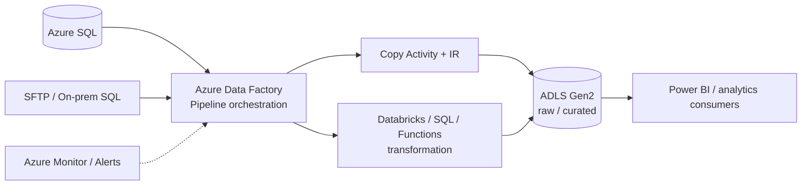

**ETL** (*Extract, Transform, Load*) thường xử lý trước khi ghi vào đích. **ELT** (*Extract, Load, Transform*) thường đưa dữ liệu thô vào một kho/lake trước rồi xử lý bằng engine chuyên dụng. ADF có thể điều phối cả hai; việc chọn hoạt động phụ thuộc dữ liệu, compliance, SLA và chi phí.

### 1.1. Chọn ADF khi nào?

ADF phù hợp khi cần:

- Di chuyển dữ liệu từ Azure SQL, Storage, SFTP, một số SaaS và nguồn được connector hỗ trợ.
- Lên lịch tải dữ liệu định kỳ, chạy theo cửa sổ thời gian hoặc sự kiện lưu trữ.
- Thực hiện chuỗi **Copy → Validate → Transform → Notify** với phụ thuộc rõ.
- Tách cấu hình nguồn/đích khỏi logic pipeline và tái sử dụng qua nhiều datasets.
- Quan sát pipeline run/activity run, điều tra lỗi và chạy lại có kiểm soát.

Không nên dùng ADF như giải pháp thay thế mọi nhu cầu:

- **Realtime streaming** độ trễ rất thấp: xem xét Event Hubs, Azure Functions, Stream Analytics hoặc hệ xử lý streaming.
- **Business API** cần phản hồi dưới vài chục mili giây: nên dùng ứng dụng/API hoặc service phù hợp.
- **Kho lưu dữ liệu**: cần SQL, Data Lake, warehouse hoặc database chuyên dụng.
- **Thuật toán biến đổi rất phức tạp**: có thể dùng Spark, Databricks, Synapse hoặc engine khác do pipeline gọi.

## 2. Bảy thành phần trong một data factory

| Khái niệm | Trả lời câu hỏi | Ví dụ |
|---|---|---|
| **Data factory** | Tài nguyên Azure quản lý các đối tượng tích hợp? | `adf-sales-prod` |
| **Pipeline** | Quy trình gồm các bước nào? | `pl_ingest_orders_daily` |
| **Activity** | Một bước thực thi làm gì? | `CopyOrders`, `ValidateCount` |
| **Dataset** | Tệp/bảng/vị trí dữ liệu nào được dùng? | `ds_orders_sql`, `ds_orders_csv` |
| **Linked service** | Kết nối hệ thống và xác thực bằng cách nào? | `ls_sql_orders`, `ls_adls_lake` |
| **Integration Runtime** | Dùng môi trường compute/kết nối nào để di chuyển hoặc biến đổi dữ liệu? | `AutoResolveIntegrationRuntime`, `ir-onprem` |
| **Trigger** | Khi nào/điều kiện nào bắt đầu pipeline? | Lịch 01:00, tumbling window, storage event |

**Ghi nhớ:**

> *Linked service = đường kết nối; dataset = vị trí/cấu trúc dữ liệu; activity = thao tác; pipeline = luồng điều phối; Integration Runtime = môi trường thực hiện/kết nối; trigger = thời điểm kích hoạt.*

### 2.1. Sơ đồ quan hệ

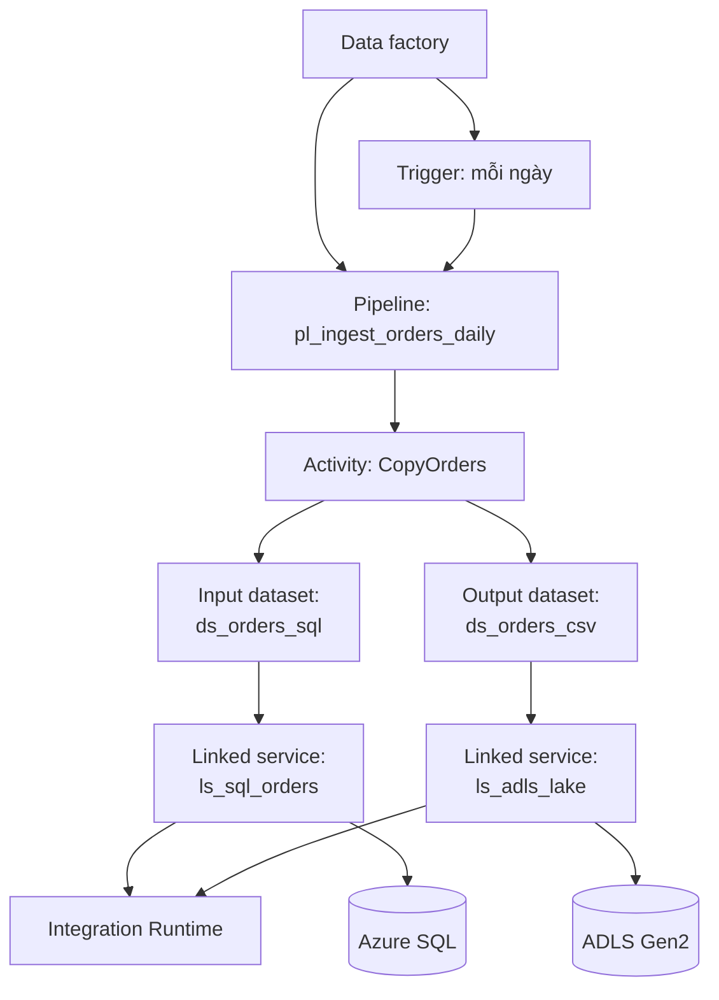

Sơ đồ thể hiện **quan hệ logic**, không phải cam kết mọi connector đều có một đường kết nối vật lý giống nhau. Khi có Self-hosted IR hoặc nhiều IR, đường dữ liệu, vùng chạy và khả năng truy cập source/sink cần xác định riêng.

### 2.2. Ví dụ so sánh dễ nhớ

Hình dung việc chuyển hàng:

- **Linked service** là thông tin địa chỉ/giấy phép vào kho và cách xác thực.
- **Dataset** là kệ/khu vực hoặc kiện hàng cụ thể.
- **Activity** là thao tác bốc hàng/vận chuyển.
- **Pipeline** là kế hoạch gồm nhiều chuyến và điều kiện.
- **Integration Runtime** là xe/đội vận chuyển.
- **Trigger** là lịch xuất phát.

Trong ADF, **một linked service** có thể được nhiều datasets dùng; **một dataset** có thể được nhiều pipelines tham chiếu. Không tạo một linked service mới cho từng bảng nếu đều truy cập cùng server bằng cùng trust boundary.

## 3. Tài nguyên Data Factory và tổ chức môi trường

Data factory được tạo trong Azure subscription, resource group và region xác định. Định nghĩa pipelines/datasets/linked services nằm trong scope factory, còn các hệ nguồn/đích có thể ở resource groups hoặc subscriptions khác khi mạng và quyền cho phép.

Một cách tổ chức:

```text
Subscription: data-platform-prod
  Resource group: rg-data-integration-prod
    Data Factory: adf-retail-prod
      Linked services:
        ls_sql_orders
        ls_adls_raw
        ls_keyvault
      Datasets:
        ds_orders_sql
        ds_orders_csv
      Pipelines:
        pl_ingest_orders_daily
        pl_validate_orders
      Triggers:
        tr_orders_daily
```

Tên trên chỉ là ví dụ. Tách **dev, test, production**, áp RBAC và chính sách triển khai riêng. Tránh cho cùng một Data Factory vừa debug dữ liệu thật của production vừa chạy các pipeline phát triển không kiểm soát.

### 3.1. Factory region không phải vị trí dữ liệu duy nhất

ADF là dịch vụ điều phối; data movement có thể đi qua IR ở region riêng. Vì vậy khi chọn region:

- Xem dữ liệu nguồn/đích đang ở vùng nào, yêu cầu lưu trú dữ liệu (*data residency*).
- Chọn IR location và network path phù hợp để giảm truyền dữ liệu xuyên vùng.
- Kiểm tra các connector và managed virtual network capabilities tại vùng/tier.
- Tính độ trễ, phí egress, tuân thủ và khả năng phục hồi khi region gặp sự cố.

Không kết luận “ADF ở region A thì mọi bytes dữ liệu luôn được xử lý ở A” nếu IR/data movement thực tế ở vùng khác.

## 4. Linked service: kết nối và xác thực hệ thống

**Linked service** chứa thông tin về **endpoint, database/account, loại connector, phương thức xác thực và tham chiếu Integration Runtime**. Nó tương đương cấu hình connection, nhưng không chứa schema cụ thể của mọi bảng/tệp.

Ví dụ:

| Linked service | Hệ thống đích | Thành phần kết nối |
|---|---|---|
| `ls_sql_orders` | Azure SQL Database | Host, database, authentication, IR |
| `ls_adls_raw` | ADLS Gen2 | `https://...dfs.core.windows.net`, identity, IR |
| `ls_keyvault` | Azure Key Vault | Vault URI, authentication |
| `ls_sftp_partner` | SFTP đối tác | Host, port, credential/certificate, IR |
| `ls_onprem_sql` | SQL Server nội bộ | Server, database, authentication, Self-hosted IR |

### 4.1. Linked service và dataset khác nhau

Nếu có một SQL server chứa 200 bảng, bạn không nhất thiết cần 200 linked services. Thường một linked service kết nối database, sau đó các datasets trỏ tới những bảng khác nhau. Với Storage, một linked service trỏ tới account/service, còn datasets mô tả filesystem/container, folder và file format.

### 4.2. Không hardcode credentials trong JSON

Ưu tiên **system-assigned hoặc user-assigned managed identity** theo connector hỗ trợ. Nếu phải dùng password/client secret, lưu trong **Azure Key Vault** và để ADF tham chiếu secret qua connection mechanism được hỗ trợ.

Không viết:

```json
{
  "server": "database.example.internal",
  "username": "etl_admin",
  "password": "do-not-put-a-real-password-here"
}
```

Đây là **anti-pattern minh họa**, không phải linked service JSON hợp lệ để deploy. Đưa credentials thật vào Git, pipeline variables không được bảo vệ hoặc output logs tạo rủi ro rò rỉ và khó rotation.

### 4.3. Linked service Azure SQL: JSON minh họa

```json
{
  "name": "ls_sql_orders",
  "properties": {
    "type": "AzureSqlDatabase",
    "typeProperties": {
      "server": "sql-retail-prod.database.windows.net",
      "database": "ordersdb",
      "authenticationType": "SystemAssignedManagedIdentity"
    },
    "connectVia": {
      "referenceName": "AutoResolveIntegrationRuntime",
      "type": "IntegrationRuntimeReference"
    }
  }
}
```

Đây là **mẫu thuộc tính giải thích** cho linked service Azure SQL, không phải ARM deployment template đầy đủ. Phiên bản connector, chế độ authentication, identity và các tham số kết nối yêu cầu có thể thay đổi; xác minh JSON do ADF Studio/management API hỗ trợ tại thời điểm triển khai. **Managed identity của Data Factory** vẫn phải được tạo quyền **trong database SQL**, không chỉ có quyền Azure Contributor.

### 4.4. Linked service ADLS Gen2: JSON minh họa

```json
{
  "name": "ls_adls_lake",
  "properties": {
    "type": "AzureBlobFS",
    "typeProperties": {
      "url": "https://stretaildatalake.dfs.core.windows.net"
    },
    "connectVia": {
      "referenceName": "AutoResolveIntegrationRuntime",
      "type": "IntegrationRuntimeReference"
    }
  }
}
```

Đoạn này minh họa **endpoint** và IR reference, chưa khẳng định cơ chế authentication đã hoàn chỉnh. Trong Studio, chọn phương thức auth đúng loại linked service (managed identity, service principal hoặc lựa chọn được hỗ trợ), cấp quyền **Storage Blob Data Contributor**/Data Reader phù hợp trên scope thực tế và kiểm tra **ADLS Gen2 ACLs** khi áp dụng.

**Lưu ý:** một identity có Azure Storage RBAC role không đồng nghĩa mọi thao tác ACL/path đều tự hoạt động trong mọi cấu hình. Phải kiểm tra cơ chế xét quyền, networking và path permissions theo môi trường.

## 5. Dataset: mô tả dữ liệu, không phải bản sao dữ liệu

**Dataset** là đối tượng khai báo **vị trí và định dạng** của dữ liệu mà activities tham chiếu. Dataset không tự kéo dữ liệu hoặc lưu từng bản sao của file/table vào ADF.

Ví dụ:

- SQL table dataset: `sales.Orders` trong database qua `ls_sql_orders`.
- Delimited text dataset: `raw/orders/orders-2026-11-20.csv` ở ADLS qua `ls_adls_lake`.
- Parquet dataset: đường dẫn một folder/file `.parquet` cùng cấu trúc.

### 5.1. Dataset cho Azure SQL Database

```json
{
  "name": "ds_orders_sql",
  "properties": {
    "linkedServiceName": {
      "referenceName": "ls_sql_orders",
      "type": "LinkedServiceReference"
    },
    "type": "AzureSqlTable",
    "typeProperties": {
      "tableName": "[sales].[Orders]"
    }
  }
}
```

Dataset này **tham chiếu bảng**, không chứa kết quả `SELECT`. Một Copy Activity có thể dùng source query cụ thể để chọn subset, với các tuỳ chọn được connector hỗ trợ.

### 5.2. Dataset ADLS Gen2 có tham số tên file

```json
{
  "name": "ds_orders_csv",
  "properties": {
    "linkedServiceName": {
      "referenceName": "ls_adls_lake",
      "type": "LinkedServiceReference"
    },
    "parameters": {
      "fileName": {
        "type": "String"
      }
    },
    "type": "DelimitedText",
    "typeProperties": {
      "location": {
        "type": "AzureBlobFSLocation",
        "fileSystem": "raw",
        "folderPath": "orders",
        "fileName": {
          "value": "@dataset().fileName",
          "type": "Expression"
        }
      },
      "columnDelimiter": ",",
      "firstRowAsHeader": true
    }
  }
}
```

**Giải thích:**

- `fileSystem` là tên ADLS Gen2 filesystem (thường tương ứng blob container).
- `folderPath` là đường dẫn bên trong filesystem.
- `fileName` lấy từ `@dataset().fileName` nên mỗi pipeline run có thể đặt tên tệp khác nhau.
- `DelimitedText` xác định format CSV-style; sản xuất thực tế cần kiểm soát encoding, quote, escape, null values, column mapping và schema.

Ví dụ là **JSON định nghĩa dataset ở mức minh họa**. Khi import, kiểm tra schema của connector và những thuộc tính định dạng được phiên bản hỗ trợ.

### 5.3. Dataset có cần khai báo schema?

Tuỳ connector và activity, ADF có thể import schema, infer schema hoặc dùng mapping động. Không phải mọi dataset luôn bắt buộc khai báo đầy đủ danh sách cột. Tuy nhiên, với production:

- Xác định các trường bắt buộc, type, nullability và encoding.
- Chốt contract về thêm/bớt cột, đổi tên, precision/scale và datetime/time zone.
- Kiểm tra column mapping của Copy Activity.
- Không xem “Copy succeeded” là bảo đảm nội dung có business semantics đúng.

### 5.4. Dataset parameter khác linked service parameter

Nếu cần truy cập nhiều database servers, có thể parameterize linked service endpoint theo cơ chế hỗ trợ. Nếu cùng ADLS account nhưng folder thay đổi theo ngày, parameterize **dataset folder/file** thường hợp lý hơn. Tránh tạo hàng nghìn datasets chỉ vì một tên file thay đổi mỗi lần chạy.

## 6. Pipeline: workflow gồm các activities

Một pipeline là **định nghĩa luồng thực thi**: steps nào chạy, dependency nào phải thỏa, tham số gì và hành vi lỗi ra sao.

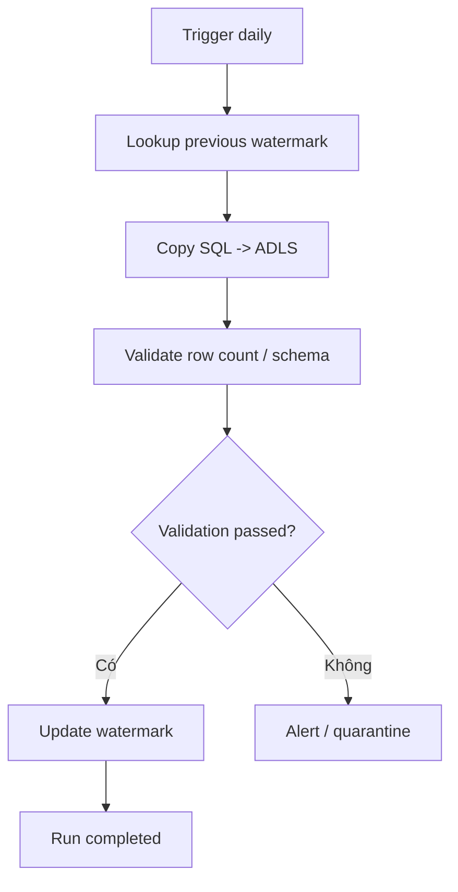

Một **pipeline run** là một lần thực thi của định nghĩa pipeline. Hai runs cùng pipeline có thể có các giá trị parameters khác nhau, ngày chạy khác nhau và kết quả khác nhau.

### 6.1. Copy Activity mẫu có cấu trúc pipeline

Ví dụ minh họa **full copy** từ Azure SQL sang CSV ở ADLS:

```json
{
  "name": "pl_copy_orders",
  "properties": {
    "parameters": {
      "runDate": {
        "type": "String",
        "defaultValue": "2026-11-20"
      }
    },
    "activities": [
      {
        "name": "CopyOrders",
        "type": "Copy",
        "dependsOn": [],
        "policy": {
          "timeout": "0.12:00:00",
          "retry": 2,
          "retryIntervalInSeconds": 30
        },
        "typeProperties": {
          "source": {
            "type": "AzureSqlSource",
            "sqlReaderQuery": "SELECT OrderId, TenantId, Amount, CreatedAtUtc FROM sales.Orders"
          },
          "sink": {
            "type": "DelimitedTextSink",
            "storeSettings": {
              "type": "AzureBlobFSWriteSettings"
            },
            "formatSettings": {
              "type": "DelimitedTextWriteSettings"
            }
          }
        },
        "inputs": [
          {
            "referenceName": "ds_orders_sql",
            "type": "DatasetReference"
          }
        ],
        "outputs": [
          {
            "referenceName": "ds_orders_csv",
            "type": "DatasetReference",
            "parameters": {
              "fileName": {
                "value": "@concat('orders-', pipeline().parameters.runDate, '.csv')",
                "type": "Expression"
              }
            }
          }
        ]
      }
    ]
  }
}
```

**Giới hạn của ví dụ:**

- Đây là **pipeline JSON minh họa ý tưởng**, không phải bộ triển khai hoàn chỉnh (cần linked services, datasets, permissions, trigger, đúng runtime và validation connector).
- `runDate` chỉ được dùng **đặt tên tệp đầu ra**; câu SQL `SELECT` ở đây **không lọc theo ngày**. Không coi ví dụ này là incremental load.
- Nếu chạy lại cùng ngày, hiệu ứng overwrite/append/multiple output files phụ thuộc sink settings, path và activity behavior thực tế. **Chưa có idempotency contract**, do đó chưa nên áp dụng vào production.
- `retry: 2` là cấu hình ví dụ, không phải lời khuyên retry mọi lỗi hoặc bảo đảm không có dữ liệu trùng sau retry.

### 6.2. Activity dependency và trạng thái

ADF cho phép nối các activities qua dependency conditions:

| Điều kiện dependency | Ý nghĩa |
|---|---|
| **Succeeded** | Activity trước chạy thành công |
| **Failed** | Activity trước thất bại |
| **Skipped** | Activity trước bị bỏ qua do dependency/nhánh |
| **Completed** | Activity trước kết thúc, không yêu cầu thành công |

Các tên/trạng thái cụ thể được biểu diễn trong JSON/Studio theo hợp đồng ADF. Không nối **UpdateWatermark** ở nhánh **Completed** nếu việc cập nhật chỉ được phép sau khi Copy **và validation** thành công.

## 7. Những loại activity quan trọng

| Nhóm | Activity tiêu biểu | Khi nào dùng |
|---|---|---|
| **Di chuyển dữ liệu** | Copy | Sao chép giữa connector nguồn và đích |
| **Truy vấn metadata** | Lookup, Get Metadata | Lấy watermark, danh sách tệp, thuộc tính |
| **Điều khiển luồng** | If Condition, Switch, ForEach, Until | Rẽ nhánh, lặp theo config, polling có giới hạn |
| **Gọi pipeline khác** | Execute Pipeline | Reuse luồng chung, chia pipeline phức tạp |
| **Tích hợp bên ngoài** | Web, Azure Function, Stored Procedure | Gọi API/job, ghi control state |
| **Chuyển đổi** | Mapping Data Flow | Biến đổi dữ liệu bằng compute thích hợp |
| **Đợi/kiểm tra** | Wait, Validation | Đồng bộ tiến độ và điều kiện cần đạt |
| **Biến/đầu ra** | Set Variable, Append Variable | Quản lý trạng thái run ở mức workflow |
| **Compute chuyên dụng** | Azure Databricks / Synapse / HDInsight hoạt động phù hợp | Điều phối notebook/job của engine khác |

Khả năng và tên activity có thể khác nhau theo product/tier/connector. Một pipeline không nên nhét mọi logic vào một Web Activity có hàng nghìn bước được viết trong expression; hãy để business transformation nằm ở engine/app có test và version control phù hợp.

### 7.1. Lookup vs Get Metadata

- **Lookup** đọc một tập dữ liệu nhỏ phù hợp, ví dụ row chứa watermark hoặc danh sách bảng trong control database.
- **Get Metadata** lấy thông tin file/folder, tồn tại, thời điểm sửa hoặc thuộc tính theo connector.

Lookup có **giới hạn về kích thước/kết quả**; không dùng nó như một phép tải toàn bộ hàng triệu rows. Với danh sách lớn, dùng query có phân trang, metadata store hoặc pipeline thiết kế thành batches.

### 7.2. ForEach và biến dùng chung

`ForEach` có thể chạy iterations song song theo cấu hình. Nhưng **pipeline variables không nên được xem như state thread-safe giữa các vòng lặp song song**. Nếu mỗi iteration cùng thay một biến dùng chung, kết quả có thể không ổn định. Truyền parameters tới child pipeline hoặc lưu kết quả theo key trong kho điều khiển bền vững thay vì tạo race condition.

### 7.3. Execute Pipeline

Một pipeline cha có thể gọi pipeline con với parameters: `tableName`, `sourceSystem`, `dateWindow`, `destinationFolder`. Khi phù hợp, thiết lập phụ thuộc vào **kết quả child pipeline** thay vì chỉ coi “đã gửi lệnh gọi pipeline” là business completion. Kiểm tra `waitOnCompletion` và failure propagation theo cấu hình activity.

## 8. Integration Runtime (IR): nơi thực hiện data movement

**Integration Runtime** là lớp hạ tầng tính toán/kết nối phục vụ sao chép, chuyển đổi hoặc thực thi package theo loại IR. Chọn IR là quyết định về **network, performance, region và vận hành**, không chỉ một trường trong linked service.

| Loại IR | Khi nào dùng | Lưu ý |
|---|---|---|
| **Azure IR** | Copy giữa dịch vụ Azure/public endpoints; hoạt động data movement được quản lý | Chọn region, DIU/parallelism, networking và managed virtual network nếu phù hợp |
| **Self-hosted IR** | Truy cập nguồn/đích trong on-prem/private network có đường ra phù hợp; một số connectors yêu cầu nó | Cần cài đặt, bảo trì, bảo mật và scale nodes |
| **Azure-SSIS IR** | Chạy các packages **SQL Server Integration Services (SSIS)** trong môi trường Azure được hỗ trợ | Khác data flow Spark; có chi phí compute riêng |

### 8.1. Azure IR

Azure IR phù hợp nếu network/access của nguồn và đích cho phép ADF-managed compute kết nối. Có những lựa chọn **Managed Virtual Network** và **Managed Private Endpoints** cho các nguồn/đích được hỗ trợ, nhưng không phải mọi connector hoặc đường dữ liệu đều hỗ trợ giống nhau.

Lựa chọn IR region có thể ảnh hưởng:

- Độ trễ kết nối và data movement.
- Egress/inter-region transfer charges.
- Data residency/compliance.
- Data Integration Units (DIU), parallel copies và số concurrent activities.

### 8.2. Self-hosted IR (SHIR)

SHIR chạy trên **máy Windows do tổ chức quản lý** trong mạng có quyền kết nối tới nguồn/đích. Ví dụ:

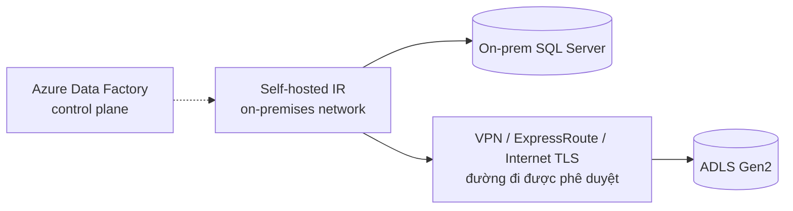

SHIR cần:

1. Host đủ CPU/RAM/disk, bản runtime được cập nhật.
2. Network outbound phù hợp tới ADF control endpoints và hệ nguồn/đích.
3. Kiểm soát proxy, TLS, firewall và DNS.
4. Quyền đọc SQL/SFTP/file share tối thiểu và chỗ lưu credentials an toàn.
5. Availability: nhiều nodes khi phù hợp và kế hoạch restart/upgrade.
6. Capacity: concurrent jobs, network throughput, source load và telemetry.

**ADF là dịch vụ managed nhưng Self-hosted IR không tự được Azure patch toàn bộ máy chủ của doanh nghiệp.** Trách nhiệm hệ điều hành/runtime, credential rotation và local monitoring vẫn thuộc tổ chức.

### 8.3. Azure-SSIS IR không phải lựa chọn mặc định cho CSV Copy

Azure-SSIS IR dành cho workload SSIS packages. Nếu chỉ cần copy Azure SQL → ADLS, thường không cần bật Azure-SSIS IR; việc này có thể phát sinh chi phí compute và vận hành không cần thiết.

## 9. Quy trình thực hành: Azure SQL sang ADLS Gen2

**Mục tiêu lab:** copy một tập orders từ bảng `sales.Orders` ở Azure SQL Database sang tệp CSV ở ADLS Gen2 bằng ADF. Lab không dùng thông tin production, không yêu cầu quyền admin rộng hoặc public network mặc định.

### 9.1. Tiền đề

- Một Azure subscription/resource group và Data Factory được phép sử dụng.
- Azure SQL Database chứa bảng thử nghiệm `sales.Orders`.
- ADLS Gen2 storage account có hierarchical namespace và filesystem `raw`.
- ADF managed identity được cấp quyền **đọc SQL** và **ghi Storage** đúng scope.
- Network DNS/TLS/firewall/private endpoints đã được cấu hình để IR truy cập.
- Người học có quyền tạo/chỉnh ADF artifacts trong môi trường lab.
- Có ngân sách, alert và chính sách xóa dữ liệu thử.

### 9.2. Tạo linked services

Trong ADF Studio:

1. Mở **Manage → Linked services**.
2. Tạo `ls_sql_orders` cho Azure SQL Database, chọn authentication/IR phù hợp.
3. Tạo `ls_adls_lake` cho ADLS Gen2, dùng managed identity khi connector hỗ trợ.
4. Kiểm tra **Test connection** sau khi xác minh quyền và networking.
5. Tạo hoặc xác minh IR phù hợp nếu nguồn/đích không truy cập công khai.

**Test connection thành công chưa chứng minh mọi bảng/path đều được đọc/ghi.** Nó kiểm tra một phần khả năng kết nối/xác thực. Phải kiểm tra quyền table/schema/path với activity thực tế.

### 9.3. Tạo datasets

1. `ds_orders_sql` chọn linked service SQL và bảng `sales.Orders`.
2. `ds_orders_csv` chọn ADLS Gen2 linked service, filesystem `raw`, folder `orders`, format DelimitedText, parameter `fileName`.
3. Xác minh delimiter, header, quotes, UTF-8, null/date/numeric formats.
4. Kiểm tra tên file không chứa input chưa validate hoặc path traversal.

### 9.4. Tạo pipeline

1. Tạo `pl_copy_orders`.
2. Kéo **Copy Data Activity**; chọn source dataset và sink dataset.
3. Chọn table hoặc query nguồn, cấu hình mapping nếu cần.
4. Tạo pipeline parameter `runDate`.
5. Truyền `@concat('orders-', pipeline().parameters.runDate, '.csv')` vào output dataset parameter.
6. Đặt timeout, retry và dependencies theo SLA.
7. Chạy **Debug** với dữ liệu lab; xem rows read/written, thời gian và lỗi.
8. Khi đã review, **Publish** theo quy trình triển khai và gắn trigger.

**Không nhầm Debug với lịch production:** Debug có thể chạy bản chưa publish, trong khi triggers đang chạy bản artifacts được publish/deploy theo mode. Quản lý version của mỗi môi trường rõ ràng.

### 9.5. Kiểm thử kết quả thực

Đừng chỉ nhìn activity có trạng thái `Succeeded`. Kiểm tra:

- Tệp có tồn tại ở filesystem/path mong muốn không?
- Số rows đọc/ghi có phù hợp, có bị skip/truncate không?
- UTF-8, timestamp UTC, decimal, null và kiểu dữ liệu có giữ đúng không?
- Có header và column ordering chính xác không?
- Khi chạy lại cùng `runDate`, có tạo duplicate hoặc overwrite không chủ ý không?
- Đối tượng nhạy cảm có bị đưa vào `raw` hoặc logs vượt quyền không?

## 10. Pipeline parameters và variables

**Parameters** là các đầu vào được cung cấp khi tạo pipeline run. **Variables** là trạng thái được dùng/thay đổi trong suốt một run theo semantics của ADF.

| Đối tượng | Mục đích | Ví dụ |
|---|---|---|
| **Pipeline parameter** | Cấu hình đầu vào cho mỗi run, thường bất biến trong run | `sourceTable`, `loadDate`, `targetFolder` |
| **Pipeline variable** | Tích lũy/đọc giá trị trong pipeline | Một biến cờ kiểm tra hoặc danh sách nhỏ |
| **Dataset parameter** | Đổi path/table cụ thể của dataset | `fileName`, `folderPath` |
| **Linked service parameter** | Đổi endpoint/database theo trường hợp hỗ trợ | Server/database connection endpoint |
| **Global parameter** | Giá trị factory-wide theo tính năng hỗ trợ | Environment code, cấu hình dùng chung |

### 10.1. Truyền parameter xuống dataset

Trong một Copy Activity:

```text
Pipeline parameter: runDate = "2026-11-20"

Dataset parameter fileName:
  @concat('orders-', pipeline().parameters.runDate, '.csv')

Dataset location fileName:
  @dataset().fileName

Kết quả:
  raw/orders/orders-2026-11-20.csv
```

Đây là luồng tham số theo thiết kế. Trên thực tế, tên dataset/parameter là **case-sensitive** ở những bối cảnh expression nhất định; review để tránh lỗi chỉ xuất hiện ở runtime.

### 10.2. Dynamic content expressions

| Expression ADF | Ý nghĩa |
|---|---|
| `@pipeline().parameters.runDate` | Đọc pipeline parameter `runDate` |
| `@pipeline().RunId` | ID của pipeline run hiện tại |
| `@utcNow()` | Thời điểm UTC tại lúc expression thực thi |
| `@formatDateTime(utcNow(), 'yyyy-MM-dd')` | Tạo ngày ISO để làm path |
| `@concat('raw/orders/', pipeline().parameters.runDate)` | Ghép path bằng tham số |
| `@dataset().fileName` | Đọc dataset parameter từ định nghĩa dataset |
| `@activity('LookupWatermark').output.firstRow.WatermarkUtc` | Đọc một output field từ Lookup nếu cấu trúc output đúng |
| `@item().tableName` | Đọc thuộc tính của item hiện tại trong ForEach |

Dynamic expressions của ADF **khác cú pháp SQL** và khác template expressions trong Bicep/Terraform. Không chèn raw input của user vào SQL query/URI chỉ bằng `concat`; dùng parameterization/validation và allowlist cho tên bảng/cột.

### 10.3. Dùng `utcNow()` cẩn thận

Nếu mỗi activity gọi `utcNow()` vào thời điểm khác nhau, một pipeline chạy qua nửa đêm có thể ghi các tệp vào **hai folder ngày khác nhau**. Tốt hơn truyền **runDate/windowStart/windowEnd** từ trigger hoặc xác định một cutoff cố định lúc run bắt đầu rồi reuse.

### 10.4. Dynamic table name và SQL injection

Nếu pipeline metadata-driven cho phép `tableName`, không chấp nhận tên bảng tùy ý do một đối tác gửi. Giới hạn vào **allowlist của nguồn được phê duyệt**; escape identifiers đúng SQL dialect; dùng stored procedure/parameterized query cho **giá trị** chứ không dùng nối chuỗi tùy tiện.

## 11. Triggers: chạy khi nào?

ADF hỗ trợ các kiểu trigger tùy tính năng/nguồn:

| Loại | Cách kích hoạt | Phù hợp |
|---|---|---|
| **Manual / Trigger Now** | Người vận hành gọi chạy một lần | Kiểm thử, backfill có phê duyệt |
| **Schedule** | Lịch lặp theo thời gian | Báo cáo hằng ngày, giờ |
| **Tumbling Window** | Chia thời gian thành các cửa sổ tuần tự có trạng thái | Incremental loads, backfill theo window |
| **Storage event-based** | Sự kiện phù hợp từ Azure Storage/Event Grid integration | File mới đến tạo pipeline ingestion |
| **Custom event** | Kịch bản Event Grid được hỗ trợ | Workflow dựa trên event nghiệp vụ |

### 11.1. Schedule trigger

Ví dụ mỗi ngày lúc 01:00 theo múi giờ doanh nghiệp. Khi cấu hình:

- Chọn time zone và xử lý thay đổi daylight saving nếu vùng có DST.
- Xác định cách làm khi pipeline hôm trước còn chạy.
- Kiểm soát concurrency và trường hợp source chưa chốt dữ liệu.
- Không tạo pipeline chạy nhiều lần chỉ vì trigger bị deploy/start lại mà không có dedup.

### 11.2. Tumbling Window

Tumbling Window hữu ích cho chia dữ liệu thành các khoảng **không chồng lấn theo lý thuyết**, ví dụ mỗi giờ:

```text
Window 1: (00:00, 01:00]
Window 2: (01:00, 02:00]
Window 3: (02:00, 03:00]
```

Ứng dụng có thể dùng `windowStartUtc` và `windowEndUtc` làm tham số cho query, theo contract. Trong ADF, khi binding pipeline parameters từ tumbling trigger, expressions có thể lấy window start/end từ **trigger metadata** theo cú pháp của trigger type, ví dụ `@trigger().outputs.windowStartTime` và `@trigger().outputs.windowEndTime` khi được hỗ trợ.

**Đừng suy rằng chạy lại một window sẽ tự loại duplicate rows ở sink.** Tumbling window quản lý lịch/cửa sổ; idempotent writing vẫn thuộc thiết kế pipeline.

### 11.3. Storage event trigger

Khi một Blob được tạo, trigger có thể khởi động ingestion qua cơ chế event integration được hỗ trợ. Luồng cần xét:

- Event delivery có thể bị gửi lại hoặc đến ngoài thứ tự theo model.
- File có thực sự **upload hoàn tất** chưa? Xác định event type/điều kiện của nguồn.
- Event path phải được validate, tránh xử lý file sai prefix/extension/tenant.
- Pipeline phải idempotent theo **file identity/ETag/version**, không chỉ tên.
- Có cơ chế tìm file bị lỡ nếu event source/delivery gặp lỗi.

Không dùng event trigger như một bằng chứng tuyệt đối rằng mọi tệp trong storage đã được xử lý chính xác một lần.

## 12. Incremental load: vì sao full copy không đủ?

**Full load** sao chép toàn bộ bảng mỗi lần. Nó đơn giản và phù hợp dataset nhỏ hoặc snapshot định kỳ, nhưng khi bảng đạt hàng tỷ dòng, full copy làm tăng database I/O, network, thời gian và chi phí.

**Incremental load** chỉ lấy dữ liệu thay đổi từ lần xử lý trước. Những chiến lược phổ biến:

1. **Watermark timestamp**: `LastModifiedUtc` và khoảng thời gian đã xử lý.
2. **High-watermark key**: ID tăng đơn điệu khi contract nguồn cho phép.
3. **CDC/Change Tracking**: nhận thay đổi insert/update/delete theo khả năng nguồn.
4. **File manifest/arrival metadata**: theo dõi file đã ingestion.

### 12.1. Watermark control table

Một bảng control do pipeline/worker được ủy quyền quản lý:

```sql
-- SQL minh họa; chưa phải DDL sẵn sàng triển khai production.
CREATE TABLE etl.WatermarkState (
    PipelineName nvarchar(128) NOT NULL PRIMARY KEY,
    LastSuccessUtc datetime2(7) NOT NULL,
    UpdatedAtUtc datetime2(7) NOT NULL
);
```

Đây là **lệnh ghi schema**, chỉ chạy trong lab khi đã tạo schema `etl` và có quyền. Có thể thêm run ID, version, lease, status và kiểm tra concurrent updates. Tên cột/kiểu thời gian cần khớp engine và độ chính xác `LastModifiedUtc` của source.

### 12.2. Query incremental theo cửa sổ

Giả sử pipeline đọc từ `lastSuccessUtc` tới `cutoffUtc`:

```sql
SELECT
    OrderId,
    TenantId,
    Amount,
    LastModifiedUtc
FROM sales.Orders
WHERE LastModifiedUtc > @FromUtc
  AND LastModifiedUtc <= @ToUtc;
```

Đây là **query T-SQL có parameters khái niệm**; activity/connector phải bind hoặc xây query bằng cơ chế an toàn được hỗ trợ. Không copy raw `@FromUtc` vào ADF dynamic string mà nghĩ SQL tự lấy pipeline parameters. Có thể dùng stored procedure hoặc một lớp query được kiểm soát để xử lý binding.

**Tại sao dùng `(From, To]`?** Một window kế tiếp bắt đầu từ mốc `To` của window trước; quy tắc nhất quán giúp giảm duplicate/missing ở ranh giới khi timestamps tuân theo assumptions.

### 12.3. Quy trình incremental an toàn

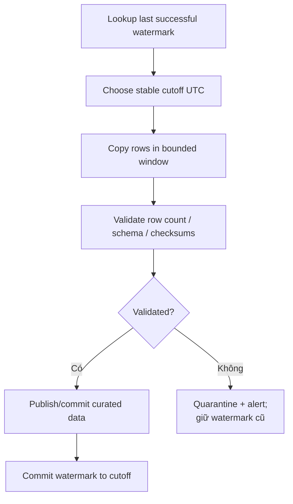

**Nguyên tắc cốt lõi:** chỉ nâng watermark sau khi dữ liệu đã được ghi bền vững và qua validation theo yêu cầu. Nếu cập nhật watermark trước Copy rồi Copy fail, lần chạy sau có thể **bỏ sót dữ liệu**.

### 12.4. Timestamp bằng nhau, late commits và deletes

Watermark timestamp không hoàn hảo nếu:

- Nhiều records có cùng `LastModifiedUtc`.
- Transaction commit muộn hơn mốc cutoff nhưng timestamp gán sớm.
- Clock nguồn không đồng bộ hoặc thời gian được user nhập.
- Record bị **DELETE** mà không có tombstone/soft-delete marker.
- Pipeline chạy song song cùng ghi watermark.

Giải pháp theo nguồn:

- **Composite cursor** như (`LastModifiedUtc`, `OrderId`) khi có thứ tự/ID ổn định.
- Safety overlap window và upsert/dedup ở sink.
- CDC/change tracking cho insert/update/delete khi engine hỗ trợ.
- Snapshot isolation/cutoff được nguồn bảo đảm.
- Concurrency control hoặc optimistic lock trên watermark control record.

**Không coi `MAX(LastModifiedUtc)` từ dữ liệu vừa copy là bằng chứng chắc chắn mọi transaction trong database đã commit đến thời điểm đó.** Đối với ingestion nghiêm ngặt, phải đánh giá isolation và late arriving records.

### 12.5. CDC khác Copy Activity

Copy Activity là thao tác sao chép dữ liệu theo source query/dataset. Nó **không tự hiểu mọi row delete** nếu nguồn chỉ trả các rows còn tồn tại. CDC/Change Tracking thường cần cấu hình ở nguồn và pipeline riêng để diễn giải **insert/update/delete**. Kiểm tra tính năng nguồn và phương pháp ADF/connector hỗ trợ thay vì gắn chữ “CDC” cho mọi query lọc theo timestamp.

## 13. Idempotency: chạy lại pipeline không làm nhân đôi dữ liệu

Một pipeline có thể chạy lại vì retry, trigger trùng, operator resubmit, network timeout hoặc DR. **Pipeline run ID mới** không tự đại diện một batch nghiệp vụ mới.

### 13.1. Một thiết kế dễ lỗi

```text
Mỗi run:
  SELECT orders WHERE ModifiedUtc > watermark
  APPEND tất cả rows vào curated/orders.csv

Nếu Copy fail sau khi ghi được 70%, retry APPEND cả batch:
  => có thể duplicate rows trong sink
```

### 13.2. Các chiến lược idempotent

| Pattern | Cách làm | Đánh đổi |
|---|---|---|
| **Overwrite partition/path theo window** | Ghi kết quả cho `loadDate=...` vào staging rồi thay/publish có kiểm soát | Cần cơ chế atomic visibility hoặc cutover |
| **Staging theo runId** | `raw/orders/runId=...`; validate trước khi publish | Tăng storage, cần cleanup |
| **MERGE/UPSERT theo business key** | Curated table merge theo `OrderId + version` | Compute/query cost, xử lý deletes và conflict |
| **Batch ledger** | Lưu `source + window + version` đã commit | Control state cần transaction/concurrency |
| **Immutable event rows + downstream dedup** | Lưu event ID/sequence, xử lý trùng ở curated | Tăng raw volume, cần logic reconciliation |

### 13.3. Path versioning

Một lựa chọn cho raw:

```text
raw/orders/ingest_date=2026-11-20/run_id=<pipeline-run-id>/part-0001.parquet
```

Path mang run ID giúp tránh ghi đè nhầm và giữ bằng chứng phục hồi, nhưng **tự nó không chống duplicate** nếu consumer đọc mọi runs như dữ liệu mới. Curated layer phải quyết định **run/window nào đã commit**.

### 13.4. Exactly-once không đến từ trạng thái Succeeded

ADF có thể báo Copy succeeded dù downstream transformation sau đó fail; hoặc một activity retry tạo output trung gian bị lặp. Muốn kết quả đúng, cần business key, version/checkpoint, transaction và validation ở **source/sink**, không chỉ nhìn màu xanh trong Monitor.

## 14. Xử lý lỗi: retry, timeout, dependency và failure paths

Một activity có thể fail do network, auth, throttling, schema mismatch, quyền Storage, source timeout, file không tồn tại hoặc sink quá tải.

| Lỗi | Phản ứng phù hợp |
|---|---|
| Timeout/network reset tạm thời | Retry có giới hạn/backoff khi hoạt động an toàn |
| SQL/Storage throttling | Điều tiết concurrency, xem quota/IR và retry policy |
| 401/403 hoặc permission denied | Sửa identity, role/ACL/network policy; không retry vô hạn |
| Schema change/column type mismatch | Dừng/quarantine; cập nhật contract/mapping |
| File missing | Phân biệt chưa tới hạn với sai path; có nhánh chờ/alert |
| Sink đầy/quota/thất bại vĩnh viễn | Escalate/capacity/quarantine; bảo vệ watermark |
| Copy success nhưng row count sai | Validation failed, không publish watermark |
| Retry khi output đã ghi một phần | Cần idempotent staging/merge, tránh duplicate |

### 14.1. Retry ở cấp activity

Có thể đặt policy như:

```json
{
  "policy": {
    "timeout": "0.01:00:00",
    "retry": 3,
    "retryIntervalInSeconds": 60,
    "secureInput": false,
    "secureOutput": true
  }
}
```

Đây là **fragment policy minh họa**, không phải activity JSON hoàn chỉnh. Các tham số có giới hạn theo activity và runtime; không phải mọi retry được thực hiện với exponential jitter tùy chỉnh. Nếu workflow xử lý cả sự kiện một lần duy nhất hoặc đang append dữ liệu, retry có thể tạo side effect lặp.

### 14.2. Failure dependency và thông báo

Đặt pipeline flow:

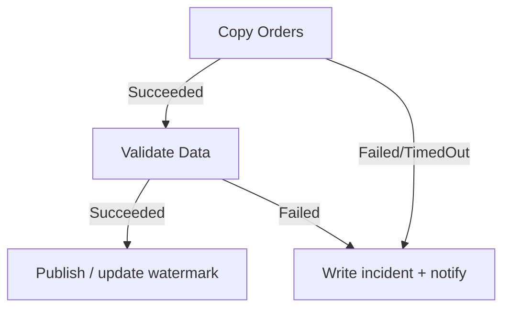

Nhánh thông báo nên chứa **pipeline run ID, activity, source, target, window và error category**, nhưng không xuất secret hoặc raw PII. Nếu thông báo/monitoring cũng lỗi, runbook phải có kênh khác; đừng coi email gửi thành công là điều kiện duy nhất để ghi nhận incident.

### 14.3. Không cập nhật watermark theo “Completed”

Một activity được coi **Completed** có thể là kết thúc với lỗi. Nếu `UpdateWatermark` chạy sau một dependency không yêu cầu success/validation, pipeline có thể ghi “đã xử lý” khi đích thiếu dữ liệu.

### 14.4. Pipeline concurrency

Hai runs của cùng pipeline cùng lấy watermark cũ có thể cạnh tranh ghi vào một output path và control table. Khi cần chỉ một writer theo source/window, dùng:

- Concurrency setting và trigger design phù hợp.
- Lease/lock hoặc optimistic concurrency ở control database.
- Staging theo run ID.
- Validation và commit có phiên bản.

Không dựa vào ForEach sequential trong một pipeline để suy ra **không có hai pipeline runs** cùng chạy.

## 15. Copy Activity: throughput và partitioning

**Copy Activity** có thể sử dụng tài nguyên data movement của IR, parallel copies và các tối ưu theo connector. Các yếu tố ảnh hưởng:

- Băng thông mạng và độ trễ.
- Năng lực đọc SQL/SFTP/source, indexes và source CPU.
- Kích thước/định dạng file, compression, serialization.
- DIU/concurrency, partitioned reads và batch settings được connector hỗ trợ.
- Năng lực ghi Storage/database đích.
- Số tác vụ chạy cùng lúc trong factory.

### 15.1. Parallel copy không luôn nhanh hơn

Ví dụ tăng parallelism từ 4 lên 32 có thể đẩy SQL CPU lên 100%, làm ứng dụng OLTP chậm và khiến Copy retry nhiều hơn. Tối ưu cần đo **rows/s, bytes/s, source load, sink load, activity duration và chi phí**.

### 15.2. Chia dữ liệu theo partition/cửa sổ

Đối với bảng lớn, có thể chia theo ID range/ngày hoặc source partitioning được connector hỗ trợ. Nhưng:

- Các ranges phải đủ bao phủ không mất/duplicate records.
- Không được làm mất tính nhất quán giữa các partitions khi nguồn đang thay đổi.
- Cần kiểm soát quá nhiều small files ở lake.
- Data skew có thể khiến một partition chậm hơn mọi partition còn lại.

### 15.3. Small files problem

Nếu mỗi lần Copy tạo hàng nghìn CSV/Parquet rất nhỏ, lake analytics có thể phải mở rất nhiều files và tốn thời gian/chi phí. Cân nhắc:

- Kích thước file mục tiêu theo engine đích.
- Batch grouping/compaction ở curated stage.
- Partition folder theo các dimensions có truy vấn thực sự.
- Không tạo một folder cho mỗi record/user nếu không cần.

**ADF Copy succeeded không đồng nghĩa layout của Data Lake đã tối ưu** cho Spark/SQL/BI.

## 16. Mapping Data Flow và Transformation

**Mapping Data Flow** là lựa chọn trực quan để xây biến đổi dữ liệu theo các operations hỗ trợ, với compute do Azure quản lý theo mô hình Data Flow (thường dựa trên Spark). Nó khác **Copy Activity** vốn ưu tiên di chuyển và mapping dữ liệu.

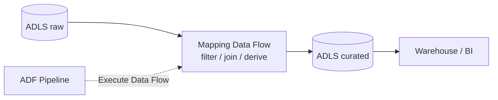

### 16.1. Khi nào dùng Data Flow?

Phù hợp cho nhiều bước:

- Filter, Derived Column, Select, Aggregate.
- Join, Lookup, Conditional Split.
- Schema drift handling theo tính năng được hỗ trợ.
- Sink transformations và một số upsert/update patterns tùy destination.

**Đổi lại:** compute startup time, cluster/vCore billing, memory/cost và debug behavior khác Copy. Với một phép đổi tên cột đơn giản, Copy mapping có thể rẻ và dễ vận hành hơn. Với xử lý Spark nặng hoặc logic đặc biệt, có thể cân nhắc Databricks/Synapse thay vì ép mọi thuật toán vào Data Flow.

### 16.2. Debug sessions có thể tính phí

Trong môi trường Data Flow, **debug cluster/session** có thể khởi tạo compute và phát sinh phí, ngay cả khi người học chỉ thử vài transformations. Cần đặt thời gian hoạt động hợp lý, shutdown khi không dùng và theo dõi workspace billing.

## 17. Data validation: đúng dữ liệu quan trọng hơn có file

Một pipeline đáng tin cần kiểm tra sau Copy:

1. **Existence:** tệp/bảng đích có tồn tại đúng path không?
2. **Row count:** source và target có số lượng phù hợp sau khi xét filter/dedup không?
3. **Schema:** các cột bắt buộc, type, nullability và precision có đúng không?
4. **Freshness:** dữ liệu thuộc đúng window và cutoff không?
5. **Uniqueness:** business key có bị lặp không?
6. **Completeness:** có thiếu partition/date/tenant nào không?
7. **Quality rules:** số tiền không âm theo business rule, ID có giá trị hợp lệ.
8. **Security:** output có chứa PII không được phép hoặc path truy cập quá rộng không?

### 17.1. Row count chưa đủ

Nếu source có 100 records và sink cũng 100 records, chưa chắc dữ liệu đúng: có thể một record bị thiếu, một record khác bị trùng. Với pipeline quan trọng, cần thêm **key-level reconciliation, range/hash/checksum, version hoặc quality assertions** theo chi phí chấp nhận được.

### 17.2. Quarantine thay vì bỏ dữ liệu lỗi

Khi CSV chứa một record bị sai schema:

- Lưu file/batch ở **quarantine path** với access control và retention riêng.
- Ghi error reason, source, file ID, run ID, timestamp.
- Không tự làm mất record không hợp lệ mà không có audit.
- Có quy trình sửa schema, replay và kiểm tra idempotency.

Không đưa raw PII vào email thông báo hoặc log để “debug nhanh”.

## 18. Bảo mật: Microsoft Entra ID, managed identity và Key Vault

Một kiến trúc dữ liệu có **ít nhất ba nhóm quyền**:

1. **Azure control-plane RBAC:** ai được tạo/sửa data factory, pipelines, linked services, triggers.
2. **Data-plane access:** ADF identity/IR client được đọc SQL/SFTP/Blob tới mức nào.
3. **Vận hành/log access:** ai được xem pipeline history, linked service config và data diagnostics.

### 18.1. Managed identity của ADF

Data Factory có thể dùng **managed identity** được cấu hình cho factory theo khả năng hỗ trợ của connector. Khi copy từ SQL tới ADLS:

- Azure SQL: identity cần được nhận diện trong database và có `SELECT` trên bảng/view cần đọc.
- ADLS Gen2: identity cần role data-plane hoặc ACLs tương ứng để ghi đúng folder.
- Key Vault: identity cần quyền đọc secrets phù hợp nếu linked service tham chiếu secret.

Không cấp `Owner` trên subscription chỉ để Test connection thành công. Hầu hết workload cần một bộ quyền nhỏ và tách migration/administration khỏi runtime.

### 18.2. T-SQL cấp quyền minh họa

Giả sử managed identity của ADF đã được xác định đúng principal trong tenant và Entra admin/database admin có quyền:

```sql
-- LỆNH GHI: chỉ chạy trong ordersdb ở lab/staging có approval.
CREATE USER [adf-retail-prod] FROM EXTERNAL PROVIDER;

CREATE ROLE role_adf_orders_reader;
GRANT SELECT ON OBJECT::sales.Orders TO role_adf_orders_reader;

ALTER ROLE role_adf_orders_reader
    ADD MEMBER [adf-retail-prod];
```

Ở production, cần xử lý trường hợp principal/role đã tồn tại, object ID ambiguous, migration order và việc directory lookup. Không dùng `db_owner` hoặc `db_datareader` toàn database nếu chỉ cần một bảng. SQL user **không được tạo tự động** chỉ nhờ role Azure Contributor.

### 18.3. Key Vault và secret rotation

Nếu connector chỉ hỗ trợ credential kiểu password/API key:

- Lưu secret trong **Azure Key Vault**.
- Cấu hình linked service tham chiếu secret qua supported mechanism.
- Giới hạn quyền `get`/RBAC tới identity cần dùng.
- Xoay credentials theo kế hoạch; kiểm thử lại linked services và SHIR nếu có.
- Không đưa secret vào debug outputs, parameter mặc định, ticket hoặc Git.

### 18.4. Secure input/output

Một số activities hỗ trợ cấu hình **secureInput/secureOutput** để hạn chế dữ liệu nhạy cảm xuất hiện trong monitoring. Nhưng bật secure output có thể gây khó điều tra lỗi; nên thiết kế logging tối thiểu cần thiết thay vì log payload thô. Tính năng này không bảo vệ dữ liệu nếu pipeline tự ghi secret sang Storage/public webhook.

## 19. Network: Private Endpoint, DNS và Self-hosted IR

Ngay cả khi identity có quyền đúng, Copy vẫn có thể thất bại vì DNS hoặc firewall:

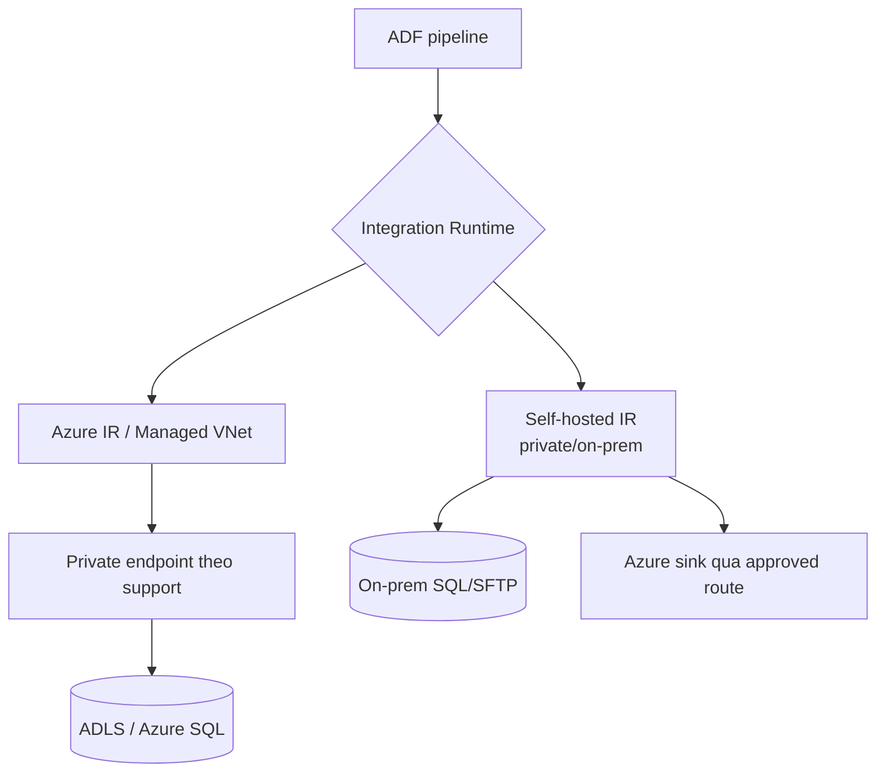

### 19.1. Ba lớp cần chẩn đoán

| Lớp | Triệu chứng | Kiểm tra |
|---|---|---|
| **Connectivity** | DNS failure, timeout, connection refused | IR placement, VNet, private DNS, firewall, proxy, port |
| **Authentication** | Token acquisition/login failure | Identity, tenant, token audience, credential expiry |
| **Authorization** | SQL permission denied, Storage 403/ACL error | DB roles/GRANT, Storage data-plane RBAC/ACL |

**Private Endpoint Approved không chứng minh mọi IR đều phân giải hostname về private IP.** Phải kiểm tra ở môi trường thực sự chạy data movement.

### 19.2. Self-hosted IR và network segmentation

Khi nguồn SQL chỉ ở nội bộ:

1. Đặt SHIR trên host được phê duyệt trong mạng có đường tới SQL.
2. Dùng outbound TLS tới Azure control endpoints theo tài liệu IR.
3. Định tuyến đến ADLS/sink bằng đường được phê duyệt.
4. Hạn chế local service account, quyền filesystem và SQL read.
5. Giám sát CPU/RAM, concurrent jobs, runtime version và availability.
6. Kiểm thử failover/restart nếu triển khai nhiều SHIR nodes.

Không tự mở SQL Server ra public Internet chỉ để AutoResolve Azure IR truy cập dễ hơn, đặc biệt nếu tổ chức có yêu cầu mạng riêng và dữ liệu nhạy cảm.

### 19.3. Managed virtual network không thay identity

Nếu Azure IR chạy trong managed VNet, kết nối private vẫn phải thỏa điều kiện của **managed private endpoint approval**, DNS/connector support và data-plane permissions. “Đã kết nối mạng” chỉ giải quyết đường truyền, không tự cấp quyền đọc bảng hay ghi Blob.

## 20. Monitoring: pipeline run, activity run và trigger run

ADF có các góc quan sát chính:

- **Pipeline runs:** trạng thái toàn run, duration, parameters và thời điểm.
- **Activity runs:** bước nào được chạy, source/sink metrics, lỗi.
- **Trigger runs:** lịch/sự kiện có kích hoạt như mong đợi không.
- **Azure Monitor/diagnostic logs:** telemetry và alert khi được cấu hình.
- **Data quality/curated freshness:** kết quả dữ liệu có đúng SLA của người dùng hay không.

### 20.1. KPI đáng theo dõi

| KPI | Câu hỏi |
|---|---|
| Pipeline success/failure rate | Có bao nhiêu runs hoàn tất đúng? |
| Duration p50/p95/p99 | Pipeline có bị kéo dài bất thường? |
| Trigger latency / missed windows | Cửa sổ tải có bắt đầu đúng lúc? |
| Rows read/written, bytes copied | Data movement có đủ khối lượng? |
| Copy throughput | Có bottleneck ở source, IR hay sink? |
| Freshness lag | Data Lake có dữ liệu mới trễ bao lâu? |
| Validation failure count | Dữ liệu có sai schema/khóa/trùng? |
| Watermark age | Đã xử lý dữ liệu mới nhất tới đâu? |
| SHIR health, CPU và queue | Runtime nội bộ có quá tải không? |
| Cost per successful batch | Luồng có tối ưu về compute, network và storage? |

### 20.2. Correlation ID

Một bản log do ứng dụng/control store sinh có thể chứa:

```json
{
  "pipelineName": "pl_ingest_orders_daily",
  "runId": "example-run-id",
  "sourceSystem": "azure-sql-orders",
  "windowStartUtc": "2026-11-19T00:00:00Z",
  "windowEndUtc": "2026-11-20T00:00:00Z",
  "target": "raw/orders",
  "rowsRead": 10240,
  "rowsWritten": 10240,
  "validation": "passed"
}
```

Đây là **schema log minh họa**, không phải JSON output mặc định của ADF. Không ghi password, SAS URL, connection string, token hoặc raw rows chứa PII.

### 20.3. “Succeeded” vẫn có thể tạo dữ liệu sai

Một pipeline copy thành công vào folder **nhầm ngày** vẫn có trạng thái Succeeded về mặt runtime. ADF không tự biết ngày đó đúng business SLA hay không. Do vậy alert nên bao gồm **data freshness, completeness, schema quality và aggregate reconciliation** bên cạnh trạng thái activity.

### 20.4. Alert và owner

Thiết lập alerts có người chịu trách nhiệm khi:

- Pipeline fail/timed out hoặc trigger không tạo run theo lịch.
- Watermark không tiến trong nhiều windows.
- Copy throughput/rows written giảm bất thường.
- Self-hosted IR node offline hoặc queue backlog tăng.
- SQL/Storage 429/403/timeout tăng.
- Chi phí Data Flow hoặc copy compute tăng đột biến.

Đừng đặt alert chỉ gửi email về hộp thư cá nhân không có on-call rotation. Với dữ liệu quan trọng, cần escalation và runbook.

## 21. CI/CD và publish: quản lý phiên bản của artifacts

ADF Studio hỗ trợ mô hình authoring có thể dùng **Git integration** và publish/deployment phù hợp. Pipeline, linked service và dataset là **đối tượng cần version control**, không nên chỉ chỉnh tay ở production.

### 21.1. Phân biệt ba trạng thái

1. **Authoring:** chỉnh sửa pipeline/dataset/linked service trong branch hoặc studio.
2. **Debug:** thử logic với dữ liệu lab; chưa chắc là artifact được scheduler production dùng.
3. **Publish/deploy:** đưa định nghĩa được chấp thuận lên factory/runtime đích, trigger chạy theo version đó.

Với ADF Git integration, thao tác publish có thể sinh/publish artifacts ARM theo mô hình cấu hình; trong CI/CD cũng có thể validate/generate templates và deploy qua pipeline được hỗ trợ. Cơ chế chính xác phụ thuộc repo/branch/publishing strategy.

### 21.2. Không dùng chung credentials giữa môi trường

Tách:

```text
dev:
  adf-retail-dev -> sql-dev -> adls-dev

test:
  adf-retail-test -> sql-test -> adls-test

prod:
  adf-retail-prod -> sql-prod -> adls-prod
```

Truyền endpoint, database, storage account và Key Vault references bằng **parameters/variable groups/secure configuration** theo pipeline deploy. Không đưa production secrets vào Git và không copy một linked service dev có password vào prod.

### 21.3. Trigger khi deploy

Khi chỉnh sửa triggers hoặc pipelines có thay đổi không tương thích:

- Xác định có cần **stop/start triggers** theo công cụ và change window được duyệt không.
- Tránh trigger đang chạy khi source/sink đang ở trạng thái migrate một nửa.
- Đối soát các windows chưa chạy hoặc chạy trùng sau deploy.
- Xác nhận identity/IR connections ở factory đích.
- Có rollback/cutover plan và business owner phê duyệt.

## 22. Azure CLI: kiểm kê Data Factory (read-only)

Các lệnh sau chỉ đọc cấu hình ADF theo **Azure CLI và extension/version** hỗ trợ. Không chạy tạo/sửa/xóa tài nguyên production.

### 22.1. Kiểm tra subscription và factory

```bash
RG="rg-data-integration-prod"
FACTORY="adf-retail-prod"

az account show \
  --query "{subscription:name,id:id,tenant:tenantId}" \
  -o table

az datafactory show \
  --resource-group "$RG" \
  --factory-name "$FACTORY" \
  --query "{name:name,location:location,identity:identity}" \
  -o json
```

### 22.2. Liệt kê pipelines, datasets và linked services

```bash
az datafactory pipeline list \
  --resource-group "$RG" \
  --factory-name "$FACTORY" \
  --query "[].name" \
  -o table

az datafactory dataset list \
  --resource-group "$RG" \
  --factory-name "$FACTORY" \
  --query "[].name" \
  -o table

az datafactory linked-service list \
  --resource-group "$RG" \
  --factory-name "$FACTORY" \
  --query "[].name" \
  -o table
```

**Thận trọng:** output metadata linked service có thể chứa endpoint và cấu hình nhạy cảm. Chỉ liệt kê **tên** trước; không gửi toàn bộ JSON connection secrets lên chat/ticket.

### 22.3. Xem một pipeline definition

```bash
az datafactory pipeline show \
  --resource-group "$RG" \
  --factory-name "$FACTORY" \
  --name "pl_ingest_orders_daily" \
  --query "{name:name,activities:activities,parameters:parameters}" \
  -o json
```

Tuỳ CLI version, JSON returned fields có thể nằm dưới phần `properties` hoặc được hiển thị ở cấp khác. Nếu query không trả dữ liệu, xem output đầy đủ trong môi trường kiểm soát, kiểm tra field names rồi mới kết luận pipeline trống.

### 22.4. ADF CLI khác SQL/Storage CLI

Lệnh liệt kê ADF pipelines chỉ kiểm tra **control plane**. Nó không chứng minh ADF identity có quyền đọc `sales.Orders` hay ghi `raw/orders`. Việc xác minh data-plane cần kiểm tra SQL roles, Storage RBAC/ACL, IR networking và hoạt động Copy thực tế.

## 23. Tính chi phí: orchestration, movement, transform và vận hành

Chi phí ADF có thể đến từ nhiều **billing meters** khác nhau theo tính năng và mô hình giá hiện hành:

| Nhóm | Thành phần chi phí cần xem |
|---|---|
| **Orchestration** | Activity/pipeline executions, trigger và các hoạt động điều phối theo meter |
| **Data movement** | Copy Activity, data movement compute/DIU/runtime, duration |
| **Data Flow** | Compute/vCore-hours, cluster startup/debug sessions |
| **Azure-SSIS IR** | Nodes/hours/runtime compute |
| **Self-hosted IR** | VM/server Windows, CPU/RAM, network, maintenance do tổ chức vận hành |
| **Data destinations** | SQL compute, ADLS capacity/transactions, warehouse/Databricks compute |
| **Network** | Cross-region egress, connectivity/gateway, private endpoints theo cấu hình |
| **Monitoring** | Log Analytics ingestion/retention, alerts và metrics ngoài mức miễn phí |

**Không thể tính bill chính xác chỉ bằng số rows Copy.** Thời gian, IR type, parallelism, transfer bytes, Data Flow startup, connector, region và service tier đều tác động.

### 23.1. Một ví dụ sizing

Giả sử mỗi đêm cần copy:

```text
Rows:                   20.000.000
Kích thước trung bình:         400 bytes/row
Raw payload ước tính:       8.000.000.000 bytes (~8 GB)
Source read window:            2 giờ
```

Đây là phép tính **payload thô** để lập kế hoạch, chưa tính CSV escaping, compression, overhead network, index, data types hoặc transaction logs. Để sizing:

1. Đo bytes và rows thực ở source.
2. Test một phần dữ liệu đại diện.
3. Xem throughput source/sink và IR.
4. Dự phòng thời gian retry/validation.
5. So sánh phương án full vs incremental.
6. Tính tổng cost including SQL impact và analytics overhead.

### 23.2. Giảm chi phí đúng cách

- Dùng **incremental load** khi nguồn hỗ trợ và dữ liệu đủ lớn.
- Tránh ForEach hàng nghìn items cho những thao tác có thể batch.
- Chọn đúng IR region/network, giảm cross-region transfer không cần.
- Giới hạn Data Flow debug compute và chỉ bật khi dùng.
- Chia Data Lake file sizes hợp lý, tránh small-file explosion.
- Điều chỉnh parallelism theo **điểm nghẽn thực**, không chọn số cao nhất.
- Chỉ giữ logs/pipeline runs theo yêu cầu audit/retention.

**Không giảm chi phí bằng cách tắt validation và cảnh báo của một pipeline quan trọng** khi rủi ro sai dữ liệu lớn hơn số tiền tiết kiệm.

## 24. Case study A: Azure SQL → ADLS → Power BI hằng ngày

**Bối cảnh:** hệ bán lẻ cần dữ liệu doanh thu trước 07:00 mỗi sáng. Source SQL là hệ OLTP, không thể chịu full table scan nặng lúc cao điểm.

### 24.1. Thiết kế đề xuất

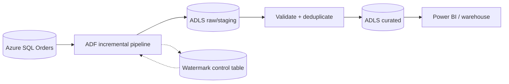

Các thành phần:

| ADF object | Tên ví dụ | Trách nhiệm |
|---|---|---|
| Linked service | `ls_sql_orders` | Entra MI tới SQL database |
| Linked service | `ls_adls_lake` | Truy cập ADLS Gen2 raw/curated |
| Dataset | `ds_orders_sql` | Source table/query |
| Dataset | `ds_orders_parquet` | Partition folder/output format |
| Pipeline | `pl_ingest_orders_incremental` | Watermark → Copy → validation → commit |
| Trigger | `tr_orders_daily_0200` | Chạy theo lịch với thời gian ổn định |
| IR | Azure IR phù hợp network | Di chuyển dữ liệu |

### 24.2. Xử lý nghiệp vụ

1. Lookup watermark đã commit gần nhất.
2. Xác định stable source cutoff UTC hoặc watermark theo nguồn.
3. Copy chỉ rows thay đổi trong cửa sổ.
4. Ghi staging theo **window và runId**.
5. Validate row counts/schema và đối soát keys.
6. Merge/upsert ở curated theo `OrderId`, xử lý delete/tombstone nếu nguồn hỗ trợ.
7. Chỉ sau validation/publish thành công mới cập nhật watermark.
8. Ghi audit và kiểm tra freshness trước 07:00.

### 24.3. Điều kiện lỗi phải test

- SQL tạm 503/timeout: retry có giới hạn, watermark không tiến sai.
- Copy ghi được một phần rồi fail: run sau không tạo duplicate curated.
- Một order update sát cutoff: không mất change do late commit.
- Storage ACL bị từ chối: fail sớm, alert và không đánh dấu hoàn thành.
- Trigger chạy lại cùng window: dữ liệu cuối vẫn nhất quán.

## 25. Case study B: SQL Server on-premises → Azure Data Lake

**Bối cảnh:** hệ ERP chỉ truy cập được trong mạng công ty. Azure Data Factory không có đường public đến SQL Server và doanh nghiệp không muốn mở inbound port Internet.

### 25.1. Kiến trúc

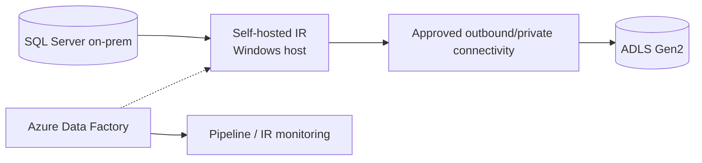

**Thực hiện:**

1. Cài SHIR trên máy được phê duyệt, đủ CPU/RAM và đường mạng đến SQL.
2. Đăng ký SHIR với đúng Data Factory theo workflow hỗ trợ.
3. Tạo linked service SQL Server trỏ qua SHIR, credentials tối thiểu.
4. Tạo linked service ADLS với authentication/IR phù hợp.
5. Thiết kế source query theo mốc incremental hoặc file export.
6. Chạy Copy và xác minh throughput, CPU nguồn, network egress.
7. Giám sát SHIR version, availability, failed activities và backup config.

### 25.2. Rủi ro quan trọng

Không gộp mọi workloads doanh nghiệp vào một SHIR node duy nhất không có headroom. Nếu node offline, pipelines phụ thuộc nó có thể dừng. Có thể dùng nhiều nodes trong một SHIR để tăng availability/capacity theo support, nhưng cần kiểm tra giới hạn, cluster topology và security.

## 26. Case study C: Metadata-driven pipelines cho nhiều bảng

**Bối cảnh:** đội dữ liệu cần đồng bộ 120 bảng từ nhiều SQL databases. Sao chép 120 pipelines gần giống nhau làm bảo trì khó, dễ lệch retry/monitoring và không biết bảng nào đã hoàn tất.

### 26.1. Bảng metadata điều khiển

Ví dụ mỗi row:

```json
{
  "sourceSystem": "orders-sql",
  "sourceSchema": "sales",
  "sourceTable": "Orders",
  "targetFolder": "raw/orders",
  "loadMode": "incremental",
  "watermarkColumn": "LastModifiedUtc",
  "enabled": true
}
```

Đây là **metadata record minh họa**, không phải ADF configuration schema bắt buộc. Metadata phải được kiểm soát quyền và validate allowlist; không dùng một row do người không tin cậy sửa để đọc tùy ý `sys.*` hoặc exfiltrate data.

### 26.2. Pipeline mẹ và pipeline con

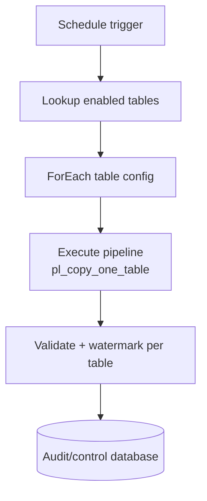

**Lợi ích:** logic Copy/retry/alerts dùng chung, nhưng từng table có config riêng. **Cạm bẫy:** một ForEach có concurrency 50 có thể tạo 50 SQL reads cùng lúc và làm nguồn ERP quá tải. Cần giới hạn concurrent tables, ưu tiên business critical và theo dõi source pressure.

### 26.3. Lỗi bảng cụ thể có nên làm cả batch fail?

Tùy SLA:

- Với báo cáo tài chính cần tính đầy đủ, thiếu một bảng có thể làm **toàn batch không được publish**.
- Với ingestion nhiều hệ độc lập, có thể ghi trạng thái từng bảng rồi cho các bảng còn lại hoàn tất, nhưng dashboard phải thể hiện **partial success** và cảnh báo.

Không để một pipeline mẹ hiện Succeeded vì đã Catch lỗi của pipeline con nhưng bỏ qua trạng thái dữ liệu thực tế.

## 27. Runbook: pipeline không chạy, chạy chậm hoặc dữ liệu sai

### Giai đoạn 1 — Phân loại sự cố

1. Xác định **factory, pipeline, runId, trigger, time window và environment**.
2. Kiểm tra trigger có fired không, pipeline có được publish/deploy chưa.
3. Mở activity runs: bước nào Failed/TimedOut/Skipped, error category.
4. Kiểm tra linked service connection, token/secret và authorization.
5. Xác định IR nào chạy activity, region, network path và health.
6. Kiểm tra source/sink capacity, SQL CPU, Storage throttling/ACL và data volume.
7. Đối soát dữ liệu đích, watermark và batch ledger trước khi resubmit.

### Giai đoạn 2 — Ổn định

1. Khi auth fail: sửa **managed identity, SQL GRANT hoặc ACL**, không tăng retry.
2. Khi DNS/private connection fail: kiểm tra IR placement, private DNS/route/firewall.
3. Khi throttled: giảm concurrency, điều tiết Copy và tối ưu query; không tăng parallelism vô điều kiện.
4. Khi schema mismatch: cách ly batch, cập nhật mapping/contract qua change control.
5. Khi data duplicated: dừng publish downstream, giữ staging/audit và phân tích retry/resubmit.
6. Khi watermark sai: **không tự sửa tới thời gian hiện tại**; xác định data gap và kế hoạch backfill.

### Giai đoạn 3 — Khôi phục và đối soát

1. Xác minh dependency đã healthy.
2. Chạy lại **window cụ thể** bằng pipeline có idempotency và staging riêng.
3. Validate row count, business keys, nulls, timestamps và schema.
4. Commit/publish result, cập nhật watermark với concurrency control.
5. Theo dõi freshness, backlog windows và BI refresh.
6. Ghi RCA, nguyên nhân gốc, dữ liệu bị ảnh hưởng, cost impact và biện pháp phòng ngừa.

### 27.1. Các hành động không nên làm

- Tự động `TRUNCATE` bảng production để khôi phục một Copy lỗi khi chưa đối soát.
- Tăng SQL quyền lên `db_owner` chỉ vì Copy báo permission denied.
- Mở public endpoint Storage/SQL để “thử cho nhanh” khi hệ thống có chính sách private.
- Resubmit cả tháng dữ liệu theo append sink không có dedup.
- Thay watermark thành `utcNow()` để bỏ qua lỗi mà không xử lý data gap.
- Log toàn bộ SQL connection strings hoặc khách hàng PII.
- Bật Data Flow debug cluster vô thời hạn.

## 28. Những nhầm lẫn thường gặp

| Hiểu nhầm | Thực tế |
|---|---|
| “Pipeline chứa kết nối SQL” | Pipeline điều phối; linked service mô tả kết nối |
| “Dataset chứa toàn bộ dữ liệu” | Dataset mô tả location/format/reference, không phải bản sao item |
| “Linked service cho mọi bảng” | Một linked service có thể dùng cho nhiều datasets |
| “Trigger làm Copy” | Trigger khởi chạy; activities và IR thực hiện |
| “Chọn IR nào cũng như nhau” | IR quyết định khả năng kết nối, compute, region và vận hành |
| “Copy Succeeded là data quality đạt” | Cần validation, business reconciliation và freshness |
| “Retry bảo đảm exactly-once” | Retry có thể tạo duplicate nếu sink không idempotent |
| “Watermark cập nhật trước để đỡ quên” | Có thể mất dữ liệu nếu Copy fail |
| “Event trigger chỉ phát một lần/file” | Event redelivery/ordering cần được đánh giá |
| “Đã có RBAC Contributor thì SQL SELECT được” | Azure control-plane khác SQL database permissions |
| “Private Endpoint approved là ADF kết nối được” | Còn IR routing, DNS, auth và ACL |
| “ForEach càng song song càng nhanh” | Có thể làm SQL/connector bị throttled |
| “Full load là incremental khi đổi file name theo ngày” | Source vẫn copy toàn bộ nếu query không có filter |
| “Debug chạy là scheduler dùng ngay” | Artifact thường cần publish/deploy đúng môi trường |
| “ADF là nơi chạy mọi Spark job” | ADF điều phối; Data Flow có compute riêng hoặc gọi engine khác |
| “Log mọi input/output giúp debug” | Có thể lộ secrets/PII và tăng log cost |

## 29. Bài thực hành và câu hỏi tự kiểm tra

### 29.1. Thực hành A — thiết kế ba thành phần

Thiết kế luồng lấy `customers` từ Azure SQL và ghi `raw/customers/customers-<date>.parquet`:

1. Đặt tên **hai linked services**, ghi rõ endpoint, auth và IR.
2. Đặt tên **hai datasets**, nêu table/format/path và parameters.
3. Thiết kế **pipeline** có Copy, Validate, Audit.
4. Chọn trigger và xác định ngày được truyền xuống dataset.
5. Mô tả cách cấp quyền SQL/ADLS và kiểm tra Test connection.

**Tiêu chí:** phân biệt rõ **kết nối** và **dữ liệu**, không ghi password vào pipeline JSON.

### 29.2. Thực hành B — incremental load

Cho bảng 5 triệu records có `LastModifiedUtc`:

1. Tạo bảng watermark trong database điều khiển.
2. Xác định query window `(fromUtc, toUtc]` và cutoff an toàn.
3. Lưu staging theo run ID rồi validate.
4. Thiết kế curated upsert/idempotency.
5. Chỉ cập nhật watermark sau commit thành công.
6. Mô phỏng lỗi ở phút cuối của Copy và chạy lại cùng window.

**Tiêu chí:** sau retry, không mất rows và không nhân đôi business records.

### 29.3. Thực hành C — on-premises source

Thiết kế pipeline lấy tệp từ SFTP/SQL nội bộ qua Self-hosted IR:

1. Nêu host IR, outbound requirements và security controls.
2. Thiết kế khả năng phục hồi khi node offline.
3. Bảo vệ credentials bằng Key Vault hoặc cơ chế phù hợp.
4. Đặt alert cho IR unhealthy và Copy activity failure.
5. Định nghĩa kế hoạch reprocess các files bị lỡ.

### 29.4. Câu hỏi tự kiểm tra

1. Pipeline, dataset và linked service trả lời ba câu hỏi gì?
2. Integration Runtime đóng vai trò gì trong Copy Activity?
3. Có cần tạo linked service mới cho từng bảng SQL trên cùng một server không? Vì sao?
4. Dataset parameter `fileName` khác pipeline parameter `runDate` thế nào?
5. `@pipeline().parameters.runDate` và `@dataset().fileName` được đánh giá ở đối tượng nào?
6. Nếu JSON Copy có `runDate` nhưng SQL source vẫn `SELECT` toàn bảng, đó là full hay incremental load?
7. Vì sao Debug thành công chưa bảo đảm trigger production chạy bản thay đổi mới nhất?
8. Azure IR và Self-hosted IR khác nhau ra sao về kết nối và trách nhiệm vận hành?
9. Khi nào dùng Azure-SSIS IR thay vì Azure IR?
10. Trigger Schedule khác Tumbling Window ở quản lý các cửa sổ thế nào?
11. Tại sao event trigger BlobCreated không nên được coi là exactly-once ingestion?
12. Khi nào cần Lookup, Get Metadata, ForEach và Execute Pipeline?
13. Vì sao pipeline variables có thể gây vấn đề trong ForEach chạy song song?
14. Tại sao watermark phải được cập nhật sau validation thay vì ngay sau Lookup?
15. Làm sao xử lý rows có timestamp bằng nhau hoặc cập nhật muộn?
16. Nếu source row bị xóa, một query chỉ lọc `LastModifiedUtc` có tự phát hiện việc xóa không?
17. Vì sao Copy retry sau khi ghi 70% output có thể tạo duplicate?
18. Succeeded và Completed dependency khác nhau thế nào khi quyết định update watermark?
19. Managed identity cần những quyền nào để đọc Azure SQL và ghi ADLS Gen2?
20. Private Endpoint đã Approved nhưng Copy bị DNS timeout: kiểm tra ở lớp nào?
21. ADF run history chứng minh điều gì, và chưa chứng minh điều gì về dữ liệu BI?
22. Vì sao Mapping Data Flow có thể tốn chi phí khác Copy Activity?
23. Khi nào metadata-driven pipeline giúp ích, và vì sao ForEach concurrency phải giới hạn?
24. Nêu ba metric phân biệt source bottleneck, IR bottleneck và sink bottleneck.
25. Nếu phải backfill 30 ngày, làm sao bảo đảm các windows được xử lý đủ và không trùng?

## 30. Checklist triển khai production

- [ ] Đã chọn đúng ADF thay vì nhầm với database, event streaming hoặc Fabric Data Factory.
- [ ] Factory, pipeline, datasets, linked services, IR và triggers có owner/tên rõ.
- [ ] Linked services dùng managed identity/Key Vault theo khả năng hỗ trợ.
- [ ] SQL permissions và ADLS RBAC/ACL chỉ cấp đúng source/path cần thiết.
- [ ] Dataset có schema/format/encoding/path và parameters được kiểm tra.
- [ ] Pipeline có source/sink mapping và validation cho dữ liệu quan trọng.
- [ ] Mỗi run nhận window/cutoff ổn định, không tính ngày khác nhau ở nhiều activities.
- [ ] Incremental load có watermark/CDC và xử lý deletes/late commits khi cần.
- [ ] Output idempotent khi retry/resubmit, có staging/quarantine và reconciliation.
- [ ] Activity timeout/retry và failure dependencies được kiểm tra.
- [ ] `UpdateWatermark` chỉ chạy sau publish/validation thành công.
- [ ] Pipeline concurrency/ForEach parallelism không làm source/sink quá tải.
- [ ] IR region/capacity phù hợp, SHIR có health/patching/backup nếu sử dụng.
- [ ] Private Endpoint, DNS, firewall và TLS được xác minh từ đúng IR.
- [ ] Triggers có lịch/múi giờ/event filters và cách xử lý runs chồng lấn.
- [ ] Debug, publish/deploy và CI/CD phân biệt đúng môi trường.
- [ ] Có dashboard cho trigger/pipeline/activity runs, freshness và data quality.
- [ ] Logs không lộ password, SAS, tokens hoặc dữ liệu nhạy cảm.
- [ ] Đã đo throughput, data volume, network egress, Data Flow/IR cost.
- [ ] Có runbook reprocess, backfill, rollback, watermark correction và on-call owner.

## Kết luận

Trong **Azure Data Factory**, ba đối tượng **pipeline, dataset và linked service** có trách nhiệm khác nhau nhưng gắn chặt: **linked service** mô tả hệ thống và cách kết nối; **dataset** mô tả bảng/tệp/vị trí/định dạng cụ thể; **pipeline** điều phối các **activities** sử dụng những đối tượng đó. **Integration Runtime** cung cấp năng lực/kết nối để sao chép hoặc thực thi, còn **trigger** quyết định khi nào bắt đầu run. Kiến trúc vận hành tốt cần tiến thêm một bước: không chỉ Copy được dữ liệu mà còn phải chọn **full/incremental/CDC đúng**, giữ **watermark an toàn**, ghi đích **idempotent**, kiểm tra **chất lượng và độ mới** của dữ liệu, phân quyền Entra/Storage/SQL tối thiểu, kiểm soát mạng riêng, theo dõi pipeline và tính **tổng chi phí**. Với thiết kế như vậy, ADF trở thành lớp điều phối đáng tin cậy để đưa dữ liệu từ các ứng dụng Azure và on-premises vào nền tảng phân tích mà không đánh đổi tính đúng đắn, bảo mật hoặc khả năng phục hồi.
