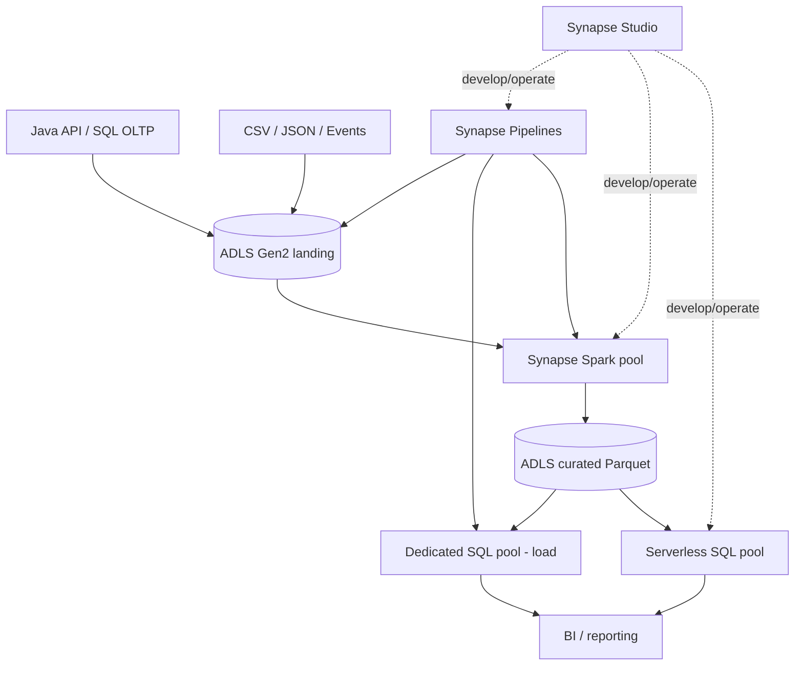
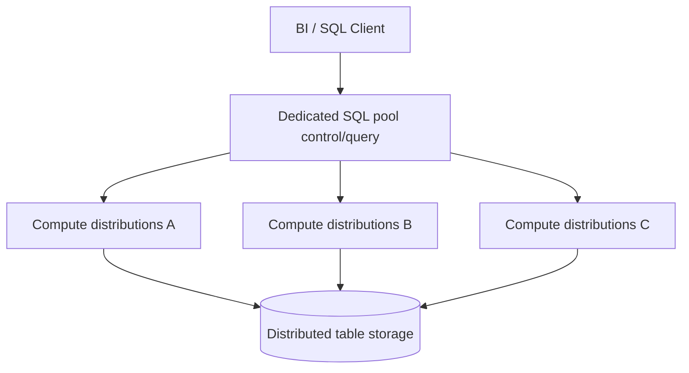
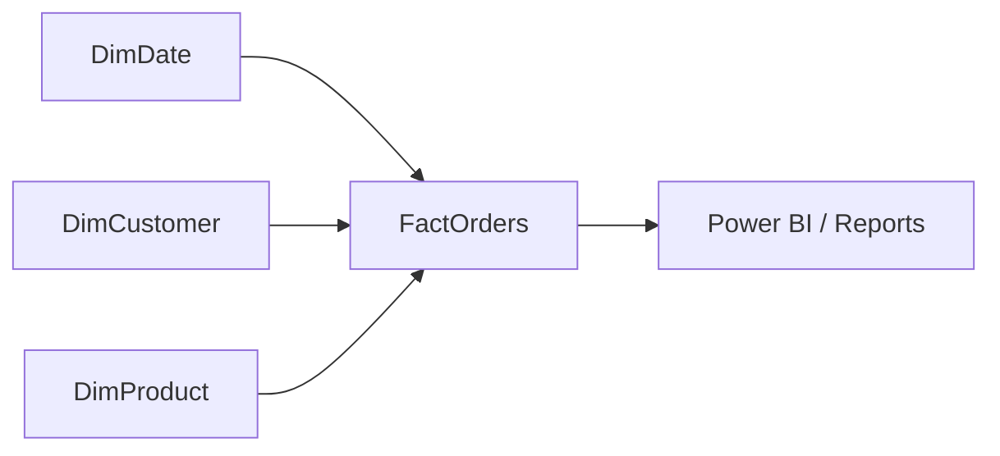
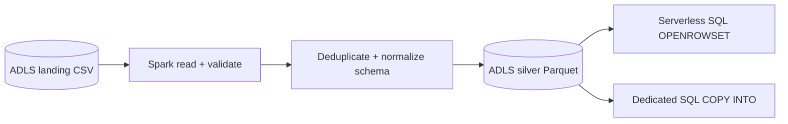
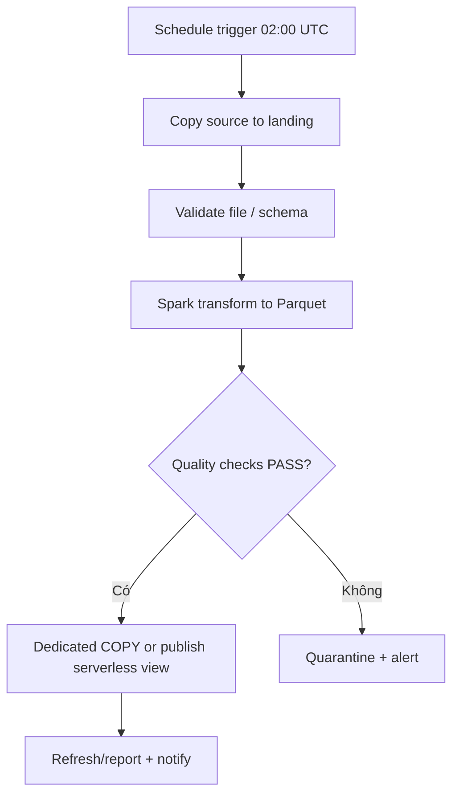
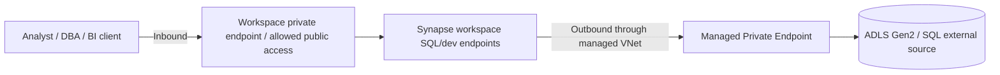

# Azure Synapse Analytics và truy vấn dữ liệu phân tích

Một công ty bán hàng có ứng dụng Java Spring Boot ghi đơn hàng vào Azure SQL, dữ liệu truy cập website lưu dưới dạng nhật ký JSON, còn hệ thống kho xuất tệp CSV mỗi ngày. Bộ phận phân tích muốn trả lời: **doanh thu theo tháng là bao nhiêu, khách hàng nào mua nhiều nhất và chiến dịch quảng cáo nào đem lại lợi nhuận?** Việc chạy các câu truy vấn tổng hợp lớn trực tiếp trên cơ sở dữ liệu giao dịch có thể ảnh hưởng hiệu năng API, trong khi dữ liệu lại nằm ở nhiều định dạng và vị trí.

**Azure Synapse Analytics** là nền tảng phân tích tích hợp trên Azure, kết hợp các khả năng **SQL analytics, Apache Spark, data integration pipelines và kết nối với dữ liệu trong Azure Data Lake Storage Gen2 (ADLS Gen2)**. Tùy bài toán, ta có thể truy vấn trực tiếp tệp trên data lake bằng **serverless SQL pool**, tổ chức kho dữ liệu có tài nguyên SQL chuyên dụng bằng **dedicated SQL pool**, hoặc xử lý dữ liệu lớn bằng **Apache Spark pool**. **Synapse workspace và Synapse Studio** là không gian làm việc để phối hợp những thành phần đó.

Bài học thuộc chương **Nền tảng dữ liệu và phân tích** của module **CLOUD_PROVIDERS_AZURE**. Kiến thức kết nối Azure subscription, resource group, Microsoft Entra ID, mạng ảo, dịch vụ tính toán, Blob/ADLS storage, cơ sở dữ liệu, bảo mật, giám sát và kiểm soát chi phí của kiến trúc ứng dụng. Chủ đề trực tiếp là **“Azure Synapse Analytics và truy vấn dữ liệu phân tích”**.

> **Phạm vi:** Bài tập trung Synapse workspace với **serverless SQL pool, dedicated SQL pool, Spark và pipelines**. Microsoft Fabric, Azure Databricks, Azure Data Factory và Azure Data Explorer là các dịch vụ liên quan nhưng không đồng nhất với Synapse. Khả năng, SKU, region, quyền truy cập, connector và giá có thể thay đổi; cần kiểm chứng trong môi trường đích. Các lệnh/script dưới đây là ví dụ cho lab được cấp phép, không phải thao tác đã chạy trên Azure.

## Mục tiêu học tập

Sau bài học, bạn có thể:

1. Giải thích vai trò của Synapse workspace, Synapse Studio, ADLS Gen2 và những compute engines.
2. Phân biệt **serverless SQL pool**, **dedicated SQL pool** và **Apache Spark pool** theo dữ liệu, hiệu năng và chi phí.
3. Truy vấn tệp CSV/Parquet trên data lake bằng `OPENROWSET`, chọn schema và lọc đường dẫn phù hợp.
4. Thiết kế bảng external, view, CETAS và hiểu giới hạn ghi dữ liệu của serverless SQL.
5. Tạo bảng phân tích ở dedicated SQL pool, chọn distribution và columnstore, nạp dữ liệu với `COPY INTO`.
6. Biến đổi CSV thành Parquet có phân vùng bằng PySpark và hiểu cách kết hợp Spark–SQL.
7. Xây dựng một pipeline có landing, validation, transformation, serving và giám sát.
8. Cấu hình quyền Microsoft Entra ID, managed identity, Azure RBAC, ACL và network isolation đúng phạm vi.
9. Tối ưu partition pruning, data scanning, query plans, resource management và throughput.
10. Kiểm soát chi phí riêng cho serverless SQL, dedicated SQL, Spark, pipelines và data lake.
11. Điều tra các lỗi thường gặp: 403, sai schema, query chậm, data skew, pipeline fail và dữ liệu không khớp.
12. Lập quy trình thực hành/kiểm chứng an toàn cho một báo cáo doanh thu nhiều nguồn.

## 1. Từ OLTP tới OLAP: tại sao cần nền tảng phân tích?

**OLTP (Online Transaction Processing)** tối ưu việc ghi/đọc giao dịch nhỏ với độ trễ thấp: tạo đơn hàng, thanh toán, cập nhật trạng thái. **OLAP (Online Analytical Processing)** tối ưu việc đọc lượng dữ liệu lớn, tổng hợp và so sánh lịch sử: doanh thu theo năm, phân tích cohort, tỷ lệ chuyển đổi.

| Khía cạnh | OLTP | OLAP |
|---|---|---|
| Tác vụ | Insert/update theo khóa, transaction ngắn | Scan, join, aggregate trên nhiều dòng |
| Dữ liệu | Bản ghi nghiệp vụ hiện hành | Lịch sử từ nhiều nguồn, dữ liệu biến đổi |
| Chỉ số quan trọng | Transaction latency, concurrency, integrity | Scan throughput, query latency, freshness, cost |
| Mô hình | Thường chuẩn hóa để giao dịch | Có thể star schema, Parquet/columnar, facts/dimensions |
| Ví dụ Azure | Azure SQL Database, Cosmos DB | Synapse SQL/Spark, data lake, các sản phẩm analytics khác |

### Ví dụ tác động

Một truy vấn `GROUP BY` quét vài trăm triệu dòng để tính doanh thu sẽ cạnh tranh CPU, I/O và locks với API đặt hàng nếu chạy thẳng trên database giao dịch. Di chuyển workload phân tích sang data lake/warehouse, sử dụng ingestion theo lịch hoặc gần thời gian thực, giúp **tách nhu cầu reporting khỏi đường giao dịch**.

Tách hệ thống không đồng nghĩa báo cáo luôn cập nhật ngay. Cần công bố rõ **data freshness SLA**, ví dụ “dữ liệu chậm tối đa 15 phút” hoặc “tổng hợp lúc 02:00 UTC hằng ngày”.

## 2. Synapse workspace gồm những thành phần nào?

Một **Azure Synapse workspace** là phạm vi tổ chức các artifact và compute tích hợp. Những thành phần thường gặp:

- **Synapse Studio:** giao diện web phát triển SQL scripts, notebooks, pipelines, linked services, monitoring và quản trị workspace.
- **Serverless SQL pool:** endpoint SQL dùng tài nguyên theo nhu cầu để đọc dữ liệu trực tiếp từ lake, không cần cấp phát một dedicated DWU cluster.
- **Dedicated SQL pool:** kho dữ liệu MPP với tài nguyên compute riêng, bảng được nạp vào pool.
- **Apache Spark pools:** cluster Spark managed cho ETL/ELT, notebook, xử lý dữ liệu lớn và machine learning.
- **Pipelines/integration runtimes:** điều phối copy/transform activity, dependency và trigger.
- **ADLS Gen2:** lưu dữ liệu thực tế dưới dạng files/folders/objects; không phải “nằm bên trong” Synapse Studio.
- **Linked services/datasets/artifacts:** cấu hình kết nối và metadata để các hoạt động truy cập data sources.
- **Security/monitoring:** Azure RBAC, Synapse RBAC, SQL permissions, storage permissions, network policies và Azure Monitor.



Mọi thành phần không nhất thiết phải dùng cùng lúc. Một báo cáo đọc vài Parquet files có thể chỉ cần **ADLS Gen2 + serverless SQL**, trong khi một kho dữ liệu doanh nghiệp có SLA cao có thể cần dedicated SQL và pipeline phức tạp.

## 3. Chọn đúng công cụ: serverless SQL, dedicated SQL hay Spark?

| Tiêu chí | Serverless SQL pool | Dedicated SQL pool | Apache Spark pool |
|---|---|---|---|
| Mục tiêu | SQL trực tiếp trên file trong data lake | MPP data warehouse với bảng lưu trong pool | Biến đổi/khai thác dữ liệu lớn bằng Spark |
| Compute | Theo nhu cầu query, không cấp dedicated cluster cố định | Cấp phát cấu hình DWU/capacity | Spark sessions/clusters theo cấu hình |
| Định dạng quen thuộc | CSV, Parquet và hỗ trợ giới hạn cho một số định dạng khác như Delta | Bảng quan hệ trong warehouse, nạp từ lake | CSV, Parquet, JSON, Delta và nhiều nguồn theo runtime |
| Ngôn ngữ | T-SQL subset cho truy vấn file | T-SQL dành cho MPP warehouse | PySpark, Spark SQL, Scala/.NET for Spark theo support |
| Lưu dữ liệu chính | Trên ADLS/Blob; views/metadata trong SQL DB | Dữ liệu bảng trong dedicated SQL pool | Thường đọc/ghi lake; Spark pool là compute |
| Ghi dữ liệu | Không phải engine UPDATE/DELETE lên files; CETAS có thể xuất kết quả theo hỗ trợ | INSERT, CTAS, COPY, DML theo khả năng pool | Spark DataFrame write/transform |
| Bài toán | Khám phá lake, ad hoc, báo cáo không tải quá nặng | BI và warehouse có tải lặp lại, mô hình star | Cleaning, joins, ML, semi-structured, ETL lớn |
| Điều cần tối ưu | Bytes scanned, partition/file layout | Distribution, columnstore, statistics, DWUs | Shuffle, partitioning, memory, compute lifetime |
| Cơ chế chi phí | Dữ liệu xử lý theo biểu giá | Compute/capacity và storage | Compute runtime/pool và storage |

**Không có một “SQL pool” chung cho cả hai kiểu.** Câu truy vấn hoặc DDL hỗ trợ trên dedicated không nhất thiết chạy được trên serverless và ngược lại.

### Quy tắc chọn nhanh

- Muốn kiểm tra dữ liệu Parquet hôm nay, chưa cần mô hình warehouse cố định → **serverless SQL**.
- Muốn BI với nhiều người dùng, dữ liệu đã chuẩn hóa và SLA query ổn định → đánh giá **dedicated SQL pool**.
- Muốn chuyển hàng triệu tệp CSV/JSON thành Parquet, làm clean/dedup/machine learning → **Spark**.
- Muốn chạy có lịch, nạp incremental và báo lỗi qua nhiều bước → **Synapse Pipelines**.
- Nếu kiến trúc mới cũng cân nhắc **Microsoft Fabric** hoặc dịch vụ khác, đánh giá tổng chi phí và yêu cầu kỹ thuật thay vì mặc định mọi dự án bắt buộc dùng Synapse.

## 4. Synapse Studio: nơi viết và vận hành

Trong Synapse Studio, các khu vực thường gặp:

| Khu vực | Công việc |
|---|---|
| **Data** | Duyệt linked data, databases, tables, lake files nếu có quyền |
| **Develop** | Viết SQL scripts, notebooks, data flows và artifacts |
| **Integrate** | Xây pipelines, triggers, chạy orchestration |
| **Monitor** | Theo dõi pipeline runs, Spark applications, SQL requests và hoạt động được hỗ trợ |
| **Manage** | Quản lý linked services, Spark/SQL pools, integration runtimes, access/networking theo quyền |

Tên menu có thể thay đổi theo phiên bản giao diện và quyền. Synapse Studio không phải đường tắt bỏ qua **ADLS permissions**: thấy một workspace trong Portal chưa chắc có quyền mở tệp trong storage account.

### Các mối quan hệ cần nhớ

- **Workspace** nằm trong subscription/resource group của Azure.
- **Primary ADLS Gen2 storage account/container** được liên kết trong quá trình cấu hình workspace; dữ liệu vẫn thuộc storage resource.
- **SQL/Spark pools** là compute do workspace tổ chức.
- **Linked service** chứa thông tin kết nối/auth tới external systems.
- **Dataset** mô tả cấu trúc/địa điểm dữ liệu cho pipeline activities; không phải data storage mới.
- **Pipeline** định nghĩa workflow; **trigger** quyết định khi nào workflow khởi chạy.

## 5. Data lake và kiến trúc bronze–silver–gold

Một cách phổ biến tổ chức dữ liệu phân tích là theo các lớp:

```text
adls://lake/
  landing/orders/*.csv
  bronze/orders/ingest_date=2026-11-20/*.parquet
  silver/orders/year=2026/month=11/*.parquet
  gold/daily_sales/year=2026/month=11/*.parquet
```

Đây là **cấu trúc logic minh họa**. Trong ADLS Gen2, đường truy cập qua Spark/SQL thường có dạng `abfss://<container>@<storage-account>.dfs.core.windows.net/...` hoặc HTTPS tương ứng, không dùng `adls://` như một URL SDK thực tế.

### Ý nghĩa

- **Landing/raw:** dữ liệu nhận từ nguồn, ít biến đổi, phục vụ debug/reprocess.
- **Bronze:** bản ghi có schema ingest và metadata nguồn, lưu được quá trình nhập.
- **Silver:** dữ liệu đã làm sạch, chuẩn hóa timezone, loại duplicate, kiểm tra khóa.
- **Gold:** dữ liệu tổng hợp/semantic phục vụ BI và KPI nghiệp vụ.

Không phải kiến trúc nào cũng cần đủ ba lớp. Điểm quan trọng là xác định **data contract**, lineage, retention và freshness cho mỗi dataset.

### Vì sao chọn Parquet?

**Parquet** lưu dữ liệu theo cột, hỗ trợ compression/column pruning và thường hiệu quả cho các câu truy vấn analytics. CSV dễ trao đổi nhưng không có schema typed/columnar như Parquet. Nếu chỉ cần hai cột của tệp có rất nhiều cột, Parquet có thể giảm lượng dữ liệu phải đọc khi engine sử dụng column pruning.

## 6. Chuẩn bị workspace và dữ liệu mẫu

Giả sử có sẵn các tài nguyên lab:

```text
Resource group:       rg-synapse-lab
Synapse workspace:    syn-analytics-lab
ADLS Gen2 account:    stanalyticslab
Container/filesystem: lake
Folder:               landing/orders/
Sample file:          orders_2026_11_20.csv
```

Tên chỉ là minh họa, không được đảm bảo khả dụng hoặc là tài nguyên đang tồn tại.

Nội dung CSV mẫu:

```csv
order_id,customer_id,order_ts,amount,status
1001,201,2026-11-20T08:15:00,120.50,PAID
1002,202,2026-11-20T08:30:00,80.00,CANCELLED
1003,201,2026-11-20T09:00:00,45.25,PAID
1004,203,2026-11-20T10:00:00,19.99,PAID
```

Kết quả doanh thu mẫu nếu chỉ tính `status='PAID'` là:

- Đơn 1001: 120,50
- Đơn 1003: 45,25
- Đơn 1004: 19,99
- **Tổng: 185,74** (đơn vị tiền tệ phải xác định ở dữ liệu thực tế)

Không giả định một cột `amount` đã được chuẩn hóa cùng currency, bao gồm thuế/hoàn tiền hay có cùng timezone. Production cần dữ liệu về currency, refunds, tax và trạng thái thanh toán rõ ràng.

## 7. Truy cập endpoint serverless SQL đúng cách

Serverless SQL pool được cung cấp thông qua endpoint SQL của workspace, thường có dạng:

```text
<workspace-name>-ondemand.sql.azuresynapse.net
```

Dedicated SQL endpoint của workspace thường có dạng:

```text
<workspace-name>.sql.azuresynapse.net
```

**Không dùng lẫn hai endpoint**. Dù sử dụng T-SQL ở cả hai, compute và tính năng khác nhau.

### Truy cập qua Synapse Studio

1. Mở workspace đúng subscription/resource group.
2. Vào **Synapse Studio → Develop → SQL script**.
3. Chọn **Connect to: Built-in (serverless)** hoặc pool tương ứng.
4. Xác nhận database context và quyền truy cập dữ liệu.
5. Thử một truy vấn nhỏ trước khi quét toàn bộ lake.

### Truy cập bằng công cụ SQL

SSMS/Azure Data Studio hoặc client hỗ trợ TDS có thể kết nối theo endpoint, auth và network policy. Với Microsoft Entra authentication cần đăng nhập đúng tenant/principal. Nếu workspace đang có Private Endpoint/firewall, public client có thể không truy cập được.

**Serverless không có nghĩa miễn phí:** dữ liệu được quét/xử lý trong query có thể phát sinh phí. Không chạy `SELECT *` trên một thư mục nhiều terabyte chỉ để xem cấu trúc.

## 8. OPENROWSET: đọc trực tiếp tệp Parquet

Một lợi ích lớn của serverless SQL là truy vấn file trên lake mà **chưa phải nạp vào bảng warehouse**.

Ví dụ file Parquet đã có trên ADLS Gen2:

```text
https://stanalyticslab.dfs.core.windows.net/lake/silver/orders/year=2026/month=11/part-00000.parquet
```

Truy vấn:

```sql
SELECT TOP (20)
    orders.order_id,
    orders.customer_id,
    orders.order_ts,
    orders.amount,
    orders.status
FROM OPENROWSET(
    BULK 'https://stanalyticslab.dfs.core.windows.net/lake/silver/orders/year=2026/month=11/*.parquet',
    FORMAT = 'PARQUET'
) AS orders
WHERE orders.status = 'PAID'
ORDER BY orders.order_ts DESC;
```

**Giả định:** files trong đường dẫn tồn tại, cột Parquet có những tên và types trên, SQL principal có quyền đọc lake, mạng cho phép và engine/serverless hỗ trợ schema tương ứng.

### Điều cần hiểu

- `OPENROWSET` tạo rowset tạm thời từ files, không copy file vào bảng thường trực.
- `BULK` có thể chỉ định đường dẫn hoặc wildcard theo cú pháp engine hỗ trợ.
- `FORMAT='PARQUET'` yêu cầu đọc Parquet.
- `TOP(20)` không bảo đảm chỉ quét 20 records ở file: engine có thể phải đọc metadata/nhiều partitions.
- `ORDER BY` trên dữ liệu lớn có thể tạo sort cost; phải đo bytes scanned và latency.
- Nếu schema Parquet không nhất quán giữa files, query có thể lỗi hoặc trả type không mong đợi.

### Read-only không đồng nghĩa cost-free

Đọc trên data lake **không thay đổi file** nhưng có thể phát sinh data processed charges và Azure Storage transaction/network costs. Hãy lọc đường dẫn/file, chọn cột và dùng một tập dữ liệu nhỏ ở lab.

## 9. OPENROWSET: đọc CSV và khai báo schema

CSV không mang đầy đủ metadata types. Nếu suy luận schema sai, `amount` có thể trở thành text hoặc ngày giờ bị parse theo định dạng không mong muốn.

Ví dụ:

```sql
SELECT
    src.order_id,
    src.customer_id,
    src.order_ts,
    src.amount,
    src.status
FROM OPENROWSET(
    BULK 'https://stanalyticslab.dfs.core.windows.net/lake/landing/orders/orders_2026_11_20.csv',
    FORMAT = 'CSV',
    PARSER_VERSION = '2.0',
    HEADER_ROW = TRUE
)
WITH (
    order_id BIGINT,
    customer_id BIGINT,
    order_ts VARCHAR(32),
    amount DECIMAL(18,2),
    status VARCHAR(20)
) AS src
WHERE src.status = 'PAID';
```

Đây là ví dụ dành cho **serverless SQL pool** với parser version/CSV options hỗ trợ. Khi dữ liệu thực có quoted commas, encoding, field terminator hoặc CRLF khác, cần bổ sung/điều chỉnh parser options và kiểm tra bản ghi lỗi.

### Vì sao dùng text cho `order_ts` ở bước đầu?

Dữ liệu CSV có thể thiếu timezone, lẫn định dạng hoặc chứa giá trị không hợp lệ. Đọc nguyên text trước cho phép chuyển đổi có kiểm soát bằng `TRY_CONVERT`:

```sql
SELECT
    order_id,
    TRY_CONVERT(datetime2(0), order_ts, 126) AS order_time_utc,
    amount
FROM OPENROWSET(
    BULK 'https://stanalyticslab.dfs.core.windows.net/lake/landing/orders/orders_2026_11_20.csv',
    FORMAT = 'CSV',
    PARSER_VERSION = '2.0',
    HEADER_ROW = TRUE
)
WITH (
    order_id BIGINT,
    order_ts VARCHAR(32),
    amount DECIMAL(18,2)
) AS src;
```

Kiểm tra **NULL do TRY_CONVERT không thành công** và đưa records lỗi tới quarantine. Không âm thầm bỏ records chưa parse được rồi báo doanh thu thấp hơn thực tế.

### Cẩn trọng với CSV encoding/collation

Tiếng Việt có dấu, UTF-8, delimiter và kiểu text cần cấu hình phù hợp. Không mặc định mọi CSV xuất từ Excel đều UTF-8 hoặc có dấu phẩy làm field delimiter. Trước khi chạy trên dữ liệu thật, xác minh encoding, quote/escape, header, row terminator và collation.

## 10. Phân tích doanh thu bằng SQL serverless

Sau khi các tệp đã chuẩn hóa sang Parquet, truy vấn tổng hợp:

```sql
SELECT
    CAST(orders.order_ts AS date) AS order_date,
    COUNT_BIG(*) AS paid_orders,
    SUM(orders.amount) AS gross_sales
FROM OPENROWSET(
    BULK 'https://stanalyticslab.dfs.core.windows.net/lake/silver/orders/year=2026/month=11/*.parquet',
    FORMAT = 'PARQUET'
) AS orders
WHERE orders.status = 'PAID'
GROUP BY CAST(orders.order_ts AS date)
ORDER BY order_date;
```

Kết quả giả lập dựa trên bốn dòng ví dụ nếu chuyển đổi đúng:

| Ngày UTC | Số đơn PAID | Tổng amount |
|---|---:|---:|
| 2026-11-20 | 3 | 185,74 |

Cần hiểu **gross_sales** trong ví dụ chỉ là tổng `amount` của đơn ở trạng thái PAID. Trong hệ thống thật, định nghĩa doanh thu phải xét currency, refunds, shipping, tax, partial payment, time of recognition và đơn bị hủy sau thanh toán.

### Chỉ số data freshness

Hãy gắn `data_loaded_at` hoặc `batch_id` ở pipeline để dashboard hiển thị:

```text
As of: 2026-11-20 10:05:00 UTC
Pipeline batch: orders-20261120-10
Rows validated: 4
Rows quarantined: 0
```

Không mô tả báo cáo là “real-time” nếu dữ liệu chỉ được copy một lần/ngày.

## 11. Tại sao nên tạo view trên dữ liệu lake?

Lặp lại URL `OPENROWSET` ở mọi dashboard gây khó bảo trì, phân quyền và quản lý schema. Với serverless SQL, có thể dùng **view** trong user database để cung cấp lớp truy cập SQL ổn định.

Ví dụ, trong database phục vụ reporting:

```sql
CREATE OR ALTER VIEW dbo.vwPaidOrders
AS
SELECT
    orders.order_id,
    orders.customer_id,
    orders.order_ts,
    orders.amount
FROM OPENROWSET(
    BULK 'https://stanalyticslab.dfs.core.windows.net/lake/silver/orders/year=2026/month=11/*.parquet',
    FORMAT = 'PARQUET'
) AS orders
WHERE orders.status = 'PAID';
```

**Lưu ý:** `CREATE OR ALTER VIEW` chạy trong một **user database** có quyền DDL, không phải giả định mọi thao tác tạo metadata được phép trong database `master`. Đường dẫn cố định theo tháng chỉ dùng lab; production cần chọn folder/path strategy để xử lý nhiều tháng.

### View không lưu sẵn data

Serverless view là SQL metadata và logic truy vấn, **không phải materialized table**. Mỗi lần đọc view, engine vẫn truy cập dữ liệu nguồn theo query plan/permissions và có chi phí scan. Nếu muốn cải thiện latency báo cáo lặp lại, cần cân nhắc **công bố dataset Gold, CETAS hoặc dedicated SQL pool** thay vì nghĩ view tự cache kết quả.

## 12. External data source và database scoped credential

Thay vì ghi URL dài trong mọi SQL statement, có thể tạo **external data source** tham chiếu ADLS Gen2 và dùng credential theo mô hình bảo mật phù hợp.

Ví dụ conceptual cho serverless SQL user database:

```sql
-- Chỉ tạo master key khi database chưa có và có approval.
-- Dùng mật khẩu mạnh từ secret manager, không commit vào Git.
CREATE MASTER KEY ENCRYPTION BY PASSWORD =
    '<USE_A_LONG_RANDOM_SECRET_FROM_APPROVED_STORE>';

CREATE DATABASE SCOPED CREDENTIAL WorkspaceIdentity
WITH IDENTITY = 'Managed Identity';

CREATE EXTERNAL DATA SOURCE ReportingLake
WITH (
    LOCATION = 'https://stanalyticslab.dfs.core.windows.net/lake',
    CREDENTIAL = WorkspaceIdentity
);
```

### Điều kiện

- Database đã tồn tại và chưa có master key nếu chạy dòng `CREATE MASTER KEY`; không chạy lại mù quáng trên database đã có.
- Workspace managed identity hoặc identity được tính năng hiện tại sử dụng có **Storage Blob Data Reader/Contributor** phù hợp ở storage/container.
- Với ADLS Gen2 hierarchical namespace, **POSIX-like ACLs** trên folder/file cũng phải cho phép truy cập theo auth model.
- Storage firewall/Private Endpoint phải cho phép network path từ Synapse engine.
- SQL principal tạo credential/data source cần quyền database phù hợp.
- Không dùng secret mẫu như một password thật.

### OPENROWSET dùng DATA_SOURCE

```sql
SELECT TOP (10)
    src.order_id,
    src.amount
FROM OPENROWSET(
    BULK 'silver/orders/year=2026/month=11/*.parquet',
    DATA_SOURCE = 'ReportingLake',
    FORMAT = 'PARQUET'
) AS src;
```

Ưu điểm là đường dẫn truy vấn trở thành **relative path** dưới location của external data source. Bảo mật vẫn cần đúng ACL/RBAC/network; việc có metadata `ReportingLake` **không tạo quyền Storage tự động**.

## 13. External table: lớp metadata trên file

**External table** cho phép khai báo schema và vị trí dữ liệu ngoài SQL database. Với serverless SQL, nó giúp người dùng/query tool thấy một đối tượng dạng bảng khi đọc dữ liệu lake.

Ví dụ:

```sql
CREATE EXTERNAL FILE FORMAT ParquetFormat
WITH (FORMAT_TYPE = PARQUET);

CREATE EXTERNAL TABLE dbo.OrdersExternal
(
    order_id BIGINT,
    customer_id BIGINT,
    order_ts DATETIME2(0),
    amount DECIMAL(18,2),
    status VARCHAR(20)
)
WITH (
    LOCATION = 'silver/orders/',
    DATA_SOURCE = ReportingLake,
    FILE_FORMAT = ParquetFormat
);
```

Đây là ví dụ metadata, giả sử files dưới folder có schema tương thích và tính năng external table/Parquet version được hỗ trợ. Với lake partition folders hoặc mixed schemas, cách external table quét folder và partition pruning cần được kiểm chứng. Trong nhiều tình huống cần lọc path chính xác, **OPENROWSET + view** linh hoạt hơn.

### External table không đồng nghĩa table warehouse

`dbo.OrdersExternal` **không copy Parquet vào Synapse SQL database**. Thay đổi file nguồn có thể làm kết quả query thay đổi. Không phát lệnh `UPDATE dbo.OrdersExternal` như một cách sửa file lake trong serverless SQL.

### Khi nào dùng external table?

- Muốn một catalog SQL ổn định cho tools/BI.
- Schema tương đối ổn định.
- Dùng nhiều truy vấn trên cùng dataset.
- Đã quản trị data source credentials và quyền data lake rõ ràng.

## 14. CETAS: xuất kết quả SQL sang file trên data lake

**CETAS (CREATE EXTERNAL TABLE AS SELECT)** có thể tạo external table kèm dữ liệu kết quả được ghi ra vị trí external storage trong các trường hợp được hỗ trợ. Với serverless SQL, CETAS thường hữu ích để công bố tập dữ liệu đã lọc/tổng hợp cho downstream đọc lại.

Ví dụ minh họa:

```sql
CREATE EXTERNAL TABLE dbo.DailySalesExport
WITH (
    LOCATION = 'gold/daily_sales/export_20261120/',
    DATA_SOURCE = ReportingLake,
    FILE_FORMAT = ParquetFormat
)
AS
SELECT
    CAST(order_ts AS date) AS order_date,
    COUNT_BIG(*) AS paid_orders,
    SUM(amount) AS gross_sales
FROM dbo.vwPaidOrders
GROUP BY CAST(order_ts AS date);
```

**Điều kiện:** external data source/format đã tạo; target path cần **trống, không xung đột**; managed identity/credential phải có quyền ghi phù hợp; tên view/schema đúng; engine và result types được CETAS hỗ trợ.

### Tại sao chọn đường dẫn mới cho mỗi batch?

Không nên coi CETAS là `INSERT OVERWRITE` tùy ý vào thư mục có sẵn. Nên:

1. Ghi kết quả vào **versioned output folder**.
2. Validate row counts/checksum/freshness.
3. Cập nhật một manifest/view/current pointer theo quy trình được phê duyệt.
4. Chỉ dọn dữ liệu cũ sau thời hạn retention và đối soát.

### Giới hạn cần nhớ

- Serverless SQL không phải relational store với UPDATE/DELETE thường trực.
- CETAS ghi file/metadata theo chức năng hỗ trợ, không cung cấp transaction toàn bộ pipeline nhiều services.
- Dữ liệu tệp hiện có trong thư mục xuất không nên bị ghi đè thiếu kiểm soát.
- Quyền **Storage Blob Data Contributor** hoặc tương đương và ADLS ACLs có thể cần thiết, ngoài quyền SQL DDL.

## 15. Parquet, partition pruning và file layout

Với dữ liệu lớn, truy vấn nhanh không chỉ phụ thuộc engine, mà còn vào cách sắp xếp file.

Ví dụ:

```text
silver/orders/
  year=2025/month=12/part-00001.parquet
  year=2026/month=01/part-00001.parquet
  year=2026/month=11/part-00001.parquet
  year=2026/month=11/part-00002.parquet
```

Muốn truy vấn tháng 11/2026, **lọc ngay vào path**:

```sql
SELECT
    COUNT_BIG(*) AS paid_orders
FROM OPENROWSET(
    BULK 'https://stanalyticslab.dfs.core.windows.net/lake/silver/orders/year=2026/month=11/*.parquet',
    FORMAT = 'PARQUET'
) AS orders
WHERE orders.status = 'PAID';
```

Thay vì quét `silver/orders/**/*.parquet` rồi mới lọc, cách giới hạn path có thể giảm lượng files cần mở, phù hợp query pruning.

### Những kỹ thuật khác

- **Column pruning:** chọn đúng cột, tránh `SELECT *`.
- **Partition pruning:** chia theo ngày/tháng/tenant nếu phù hợp truy vấn.
- **File size:** tránh quá nhiều file vài KB; cũng không nén mọi dữ liệu thành một file khổng lồ.
- **Compression:** chọn codec/format được engine hỗ trợ.
- **Statistics:** hiểu metadata và data distribution.
- **Sort/clustering:** theo engine/file format nếu workload cần.
- **Schema consistency:** cột cùng type/case giữa files.
- **Data freshness:** đồng bộ marker “batch ready” để tránh query một phân vùng đang ghi dở.

**Phân vùng theo từng khách hàng khi có hàng triệu khách** có thể tạo quá nhiều folders/files. Partition key của lake phải dựa trên query patterns và file volume chứ không sao chép trực tiếp partition key Cosmos DB.

## 16. Những giới hạn phải biết khi dùng serverless SQL

Serverless SQL thuận tiện nhưng không phải thay thế SQL Server/SQL Database/dedicated warehouse.

| Nhóm | Giới hạn hoặc cảnh báo |
|---|---|
| **Storage** | Không lưu bảng dữ liệu quan hệ thường trực theo cách dedicated SQL pool |
| **DML** | Không dùng INSERT/UPDATE/DELETE để sửa tệp lake trực tiếp như table SQL thông thường |
| **Performance** | Mỗi query có thể đọc nhiều dữ liệu; file layout ảnh hưởng lớn |
| **Schema** | Mixed-schema files và một số types/encoding có thể gây lỗi |
| **Delta Lake** | Hỗ trợ đọc Delta có giới hạn theo phiên bản và features; không mặc định tương thích mọi Delta protocol features |
| **Security** | SQL permissions + Storage RBAC/ACL + network đều phải đúng |
| **Data mutation** | Cần Spark/pipeline hoặc công cụ khác để sửa/ghi dataset |
| **Workload pattern** | Query BI nặng, lặp lại tần suất cao có thể cần so sánh với dedicated |
| **Transactions** | Không bảo đảm ACID transaction trên file lake qua nhiều steps chỉ bằng SQL view |
| **Costs** | Tính theo dữ liệu xử lý; câu query nhỏ về kết quả chưa chắc rẻ nếu scan rất lớn |

### Delta Lake có thể gây hiểu lầm

Một số Synapse serverless SQL configurations hỗ trợ truy vấn Delta ở mức protocol/feature được cung cấp, nhưng không nhất thiết đọc được mọi Delta Lake feature mới như advanced column mapping hoặc deletion vectors. **Không phát biểu “Synapse SQL đọc mọi Delta table”** nếu chưa kiểm tra Delta protocol version và support matrix. Với dữ liệu Lakehouse hiện đại, cần đánh giá Spark/Fabric/engine tương thích phù hợp.

## 17. Dedicated SQL pool: khi cần kho dữ liệu MPP

**Dedicated SQL pool** cung cấp mô hình **Massively Parallel Processing (MPP)**: dữ liệu bảng được phân phối qua các nodes/distributions để nhiều phần dữ liệu được xử lý song song.



### Khi nào phù hợp?

- Nhiều người dùng BI với câu truy vấn ổn định trên bảng đã mô hình hóa.
- Workload thường xuyên join facts/dimensions lớn.
- Cần performance governance, materialization và indexing.
- Có nhu cầu ingestion định kỳ và SLA dashboard cần benchmark.
- Ngân sách cho tài nguyên compute cấp phát phù hợp.

### Dedicated không phải “Synapse serverless nhanh hơn”

Chúng là hai mô hình khác nhau. Dedicated phải **nạp dữ liệu** vào tables và tối ưu distributions/indexes/statistics. Serverless đọc file tại chỗ. Chỉ dùng kết quả benchmark workload và chi phí để quyết định, không chọn theo tên.

## 18. DWU, pause/resume và chi phí dedicated SQL

Capacity của dedicated SQL pool thường được biểu diễn bằng mức hiệu năng như **DWU (Data Warehouse Units)** hoặc cấu hình dịch vụ tương ứng. Tăng capacity có thể cải thiện throughput/concurrency cho những workload phù hợp nhưng **không tự sửa query plan xấu hoặc dữ liệu phân phối lệch**.

### Compute chạy khác serverless

- Khi dedicated SQL pool **running**, compute có thể tiếp tục phát sinh phí kể cả workload đang ít.
- Có thể **pause** compute của pool theo chức năng được hỗ trợ để tránh phí compute khi không cần, nhưng storage vẫn có phí và queries sẽ không được phục vụ khi paused.
- **Resume** cần thời gian để pool sẵn sàng; không phù hợp nếu ứng dụng BI đòi 24/7 mà không có kế hoạch.
- Spark pools cũng có lifecycle/auto-pause riêng, không nhầm với dedicated SQL.
- Không pause production pool chỉ vì dashboard đang không có người truy cập ở một thời điểm ngắn.

### Đọc trạng thái bằng Azure CLI

```bash
az synapse sql pool show \
  --resource-group "<RESOURCE_GROUP>" \
  --workspace-name "<WORKSPACE_NAME>" \
  --name "<DEDICATED_SQL_POOL_NAME>" \
  --output json
```

### Pause/resume trong lab được phép

```bash
az synapse sql pool pause \
  --resource-group "<RESOURCE_GROUP>" \
  --workspace-name "<WORKSPACE_NAME>" \
  --name "<DEDICATED_SQL_POOL_NAME>"

az synapse sql pool resume \
  --resource-group "<RESOURCE_GROUP>" \
  --workspace-name "<WORKSPACE_NAME>" \
  --name "<DEDICATED_SQL_POOL_NAME>"
```

Hai lệnh **thay đổi trạng thái tài nguyên**; chỉ chạy với pool lab và có approval. Kiểm tra syntax theo Azure CLI version/SKU thực tế. Không thực hiện “pause để thử” nếu có pipeline hoặc người dùng đang truy cập.

## 19. Distribution của bảng trong dedicated SQL pool

Dedicated SQL pool yêu cầu lựa chọn cách phân phối dữ liệu:

- **HASH:** phân phối rows theo giá trị cột được chọn; tốt khi join/fact và data distribution phù hợp.
- **ROUND_ROBIN:** phân phối rows tương đối đều mà không dựa trên khóa; dễ cho staging, nhưng joins có thể cần data movement.
- **REPLICATE:** bản sao table nhỏ đến các compute distributions để giảm data movement khi join với bảng lớn, theo điều kiện được hỗ trợ.

| Table | Distribution gợi ý | Lý do |
|---|---|---|
| `FactOrders` | HASH theo một customer/order key phân phối tốt | Join lớn có thể hưởng lợi nếu cùng khóa, tránh skew |
| `StageOrders` | ROUND_ROBIN | Staging nhanh, ít cần chọn khóa từ đầu |
| `DimCurrency` | REPLICATE | Dimension nhỏ, ít thay đổi |
| `DimCustomer` | HASH hoặc REPLICATE tùy kích thước/join pattern | Phải benchmark |

### Data skew

Nếu 80% đơn hàng thuộc một customer duy nhất mà `FactOrders` HASH theo `CustomerId`, một phần dữ liệu có thể bị dồn vào một distribution. MPP không giúp nhiều nếu một worker phải xử lý phần lớn dữ liệu.

### Data movement

Một query join hai bảng phân phối theo khóa khác nhau có thể phải **shuffle/broadcast** rows giữa distributions. Vì vậy cần thiết kế cùng join keys, kích thước bảng và cardinality. Không tối ưu bằng cách chọn HASH ở tất cả bảng.

## 20. Tạo bảng Fact trong dedicated SQL pool

Ví dụ tạo bảng warehouse trên **dedicated SQL pool**:

```sql
CREATE TABLE dbo.FactOrders
(
    OrderId BIGINT NOT NULL,
    CustomerId BIGINT NOT NULL,
    OrderDateKey INT NOT NULL,
    Amount DECIMAL(18,2) NOT NULL,
    Status VARCHAR(20) NOT NULL
)
WITH
(
    DISTRIBUTION = HASH(CustomerId),
    CLUSTERED COLUMNSTORE INDEX
);
```

### Giải thích

- **HASH(CustomerId):** phân phối theo khóa được chọn, giả sử CustomerId phân bố đều và hỗ trợ join với một số dimension/fact phù hợp.
- **CLUSTERED COLUMNSTORE INDEX:** lưu trữ columnar và compression, thường thích hợp cho bảng fact lớn với truy vấn scan/aggregate.
- **DECIMAL(18,2):** tránh float cho tiền tệ trong ví dụ.
- **OrderDateKey:** khóa ngày dạng `YYYYMMDD` phục vụ star schema.
- `Status` có thể được đưa vào dimension/thiết kế nghiệp vụ trong warehouse thực.

**Không dùng code này ở serverless SQL pool** để tạo bảng warehouse thường trực. Các constraint/primary key trong MPP warehouse có thể khác SQL Server OLTP và một số không được engine thực thi như kỳ vọng; tính duy nhất/quan hệ phải được bảo đảm trong pipeline và data validation.

### Đừng dùng columnstore cho mọi bảng

Bảng staging nhỏ hoặc lookup table cập nhật thường xuyên có thể phù hợp với kiểu lưu khác. Columnstore phát huy lợi ích khi dữ liệu đủ lớn và pattern scan/aggregate thích hợp. Hãy benchmark size và workload.

## 21. CTAS và ELT trong dedicated SQL

**CTAS (CREATE TABLE AS SELECT)** là cách hiệu quả để tạo bảng mới từ kết quả query trong warehouse MPP, thường dùng trong data transformation/partition replacement.

Ví dụ khái niệm:

```sql
CREATE TABLE dbo.PaidOrders2026
WITH
(
    DISTRIBUTION = HASH(CustomerId),
    CLUSTERED COLUMNSTORE INDEX
)
AS
SELECT
    OrderId,
    CustomerId,
    OrderDateKey,
    Amount,
    Status
FROM dbo.FactOrders
WHERE OrderDateKey BETWEEN 20260101 AND 20261231
  AND Status = 'PAID';
```

### Lưu ý vận hành

- Table đích chưa tồn tại; CTAS không phải UPDATE in-place.
- Cần đủ capacity/storage, quyền DDL và phương án cleanup.
- Bảng được tạo có dữ liệu **tại thời điểm query**; không tự được cập nhật theo nguồn.
- Nếu chạy lại, phải quản lý naming, idempotency, versioning và release.
- Cần tạo/rebuild statistics hoặc tối ưu sau khi nạp theo workload.
- Không dùng CTAS trên production fact table mà không hiểu transaction/cutover.

## 22. Nạp Parquet vào dedicated SQL bằng COPY INTO

Một đường ingestion phổ biến là **COPY INTO** từ Azure Storage/ADLS vào bảng dedicated.

Ví dụ giả sử một vùng **curated/orders_flat/** chứa những Parquet files có schema phù hợp với `dbo.FactOrders`:

```sql
COPY INTO dbo.FactOrders
FROM 'https://stanalyticslab.dfs.core.windows.net/lake/curated/orders_flat/'
WITH
(
    FILE_TYPE = 'PARQUET',
    CREDENTIAL = (IDENTITY = 'Managed Identity')
);
```

### Điều kiện

- Truy vấn chạy trên **dedicated SQL pool**, không phải serverless.
- Table `dbo.FactOrders` đã tồn tại và schema columns tương thích với dữ liệu nguồn.
- Identity của workspace/SQL workload theo cơ chế `COPY INTO` đang dùng có quyền **đọc dữ liệu** ở ADLS.
- Đường mạng từ SQL engine tới storage hợp lệ.
- Storage path đúng container và files đã sẵn sàng.
- Các tùy chọn COPY/credential khác có thể cần thiết theo data source/network và engine version.

### Tránh duplicate khi rerun

`COPY INTO` có thể nạp lại dữ liệu nếu pipeline chạy lại trên cùng files mà không có cơ chế quản lý batch. Nên:

1. Ghi `batch_id` và source file manifest vào ingestion log.
2. Dùng staging table/batch rồi validate row counts.
3. Kiểm tra duplicate business keys.
4. Merge/upsert hoặc partition replace theo pattern MPP được hỗ trợ.
5. Ghi trạng thái batch **committed** sau khi kết quả kiểm tra đạt.
6. Không complete pipeline chỉ vì COPY statement không ném exception.

**Không sử dụng làm lý do bỏ qua idempotency** chỉ vì COPY nhanh hơn INSERT.

## 23. Truy vấn warehouse: fact, dimension và doanh thu

Warehouse thường dùng **star schema**:



Ví dụ khi `FactOrders` và `DimCustomer` đã được nạp:

```sql
SELECT
    c.Region,
    f.OrderDateKey,
    COUNT_BIG(*) AS PaidOrders,
    SUM(f.Amount) AS Sales
FROM dbo.FactOrders AS f
JOIN dbo.DimCustomer AS c
  ON c.CustomerId = f.CustomerId
WHERE f.Status = 'PAID'
  AND f.OrderDateKey >= 20261101
  AND f.OrderDateKey < 20261201
GROUP BY c.Region, f.OrderDateKey
ORDER BY f.OrderDateKey, c.Region;
```

### Đọc đúng ý nghĩa số liệu

- `Sales` là doanh thu ghi nhận theo định nghĩa mô hình, không nhất thiết tiền thực thu.
- `DimCustomer.Region` phải có quy ước region tại thời điểm mua hàng hay hiện tại.
- Khi dùng **slowly changing dimension (SCD)**, join theo surrogate key và effective dates theo model.
- Nếu `FactOrders` có một row cho mỗi order line, `COUNT_BIG(*)` là **số dòng**, không nhất thiết số đơn.
- Business metrics cần data contract và tests.

### Chênh lệch báo cáo không phải lúc nào do SQL sai

Có thể do nguồn chưa nạp hết, order bị hoàn tiền, timezone khác, join duplication, missing dimension row hoặc pipeline chạy lại. Vì vậy cần so sánh dữ liệu từ **raw → silver → gold → BI**.

## 24. Synapse Spark: xử lý file lớn trước khi dùng SQL

Spark phù hợp để clean, transform, deduplicate và ghi dữ liệu có định dạng tối ưu cho analytics.

### Ví dụ pipeline



**Spark pool là compute**, không tự trở thành nơi lưu dữ liệu vĩnh viễn. DataFrames có thể tồn tại trong bộ nhớ/cluster lúc job chạy, còn output cần được **ghi bền vững** tới ADLS/warehouse.

### PySpark notebook ví dụ

```python
from pyspark.sql import functions as F
from pyspark.sql import types as T

storage = "stanalyticslab"
lake = "lake"

input_path = (
    f"abfss://{lake}@{storage}.dfs.core.windows.net/"
    "landing/orders/orders_2026_11_20.csv"
)

output_path = (
    f"abfss://{lake}@{storage}.dfs.core.windows.net/"
    "silver/orders/"
)

schema = T.StructType([
    T.StructField("order_id", T.LongType(), False),
    T.StructField("customer_id", T.LongType(), False),
    T.StructField("order_ts", T.StringType(), True),
    T.StructField("amount", T.DecimalType(18, 2), True),
    T.StructField("status", T.StringType(), True),
])

raw = (
    spark.read
    .option("header", True)
    .schema(schema)
    .csv(input_path)
)

clean = (
    raw
    .withColumn(
        "order_ts",
        F.to_timestamp("order_ts", "yyyy-MM-dd'T'HH:mm:ss")
    )
    .filter(
        F.col("order_id").isNotNull()
        & F.col("customer_id").isNotNull()
        & F.col("order_ts").isNotNull()
        & F.col("amount").isNotNull()
    )
    .dropDuplicates(["order_id"])
    .withColumn("year", F.year("order_ts"))
    .withColumn("month", F.format_string("%02d", F.month("order_ts")))
)

(
    clean.write
    .mode("overwrite")    # LAB ONLY: do not overwrite shared data.
    .partitionBy("year", "month")
    .parquet(output_path)
)

print("Valid rows:", clean.count())
```

### Quan trọng

- Đây là notebook chạy trong Spark session có quyền vào ADLS; `spark` phải tồn tại.
- `overwrite` có thể xóa/thay dữ liệu ở destination; **chỉ chạy trên folder lab riêng**. Production nên dùng batch-specific output và transaction/manifest plan.
- `dropDuplicates(["order_id"])` giả định mỗi order ID duy nhất trong phạm vi dữ liệu; trên dữ liệu đa phiên bản, cần chọn bản đúng theo timestamp/version, không loại ngẫu nhiên.
- `to_timestamp` phụ thuộc timezone semantics; dữ liệu thực cần lưu UTC, offset hoặc zone policy rõ ràng.
- Rows không đạt schema/validation phải được **quarantine**, không chỉ lọc rồi quên.
- Spark writes tạo nhiều `part-*.parquet`, số files/partitions phụ thuộc số executors và data volume.
- Trên sản xuất nên xây schema tests và một output commit marker chỉ sau khi ghi thành công.

## 25. Dùng Spark SQL và notebooks để khám phá dữ liệu

Sau khi tạo DataFrame `clean`, Spark SQL cho phép tổng hợp tạm thời:

```python
clean.createOrReplaceTempView("orders_clean")
```

```sql
-- Chạy trong ô Spark SQL của notebook,
-- KHÔNG phải endpoint T-SQL serverless.
SELECT
    to_date(order_ts) AS order_date,
    count(*) AS paid_orders,
    sum(amount) AS gross_sales
FROM orders_clean
WHERE status = 'PAID'
GROUP BY to_date(order_ts)
ORDER BY order_date
```

### Spark SQL khác Synapse T-SQL

| Spark SQL | Synapse serverless/dedicated T-SQL |
|---|---|
| `to_date(order_ts)` | `CAST(order_ts AS date)` hoặc `CONVERT` |
| `count(*)` | `COUNT(*)`/`COUNT_BIG(*)` |
| `CREATE OR REPLACE TEMP VIEW` | SQL views trong SQL database theo DDL hỗ trợ |
| Spark DataFrame API | Không có DataFrame API ở SQL endpoint |
| Tính toán trên Spark cluster | Tính toán trên SQL engine tương ứng |

**Không copy toàn bộ Spark SQL syntax vào T-SQL endpoint** và mong kết quả giống nhau. SQL dialect, type semantics, collation và xử lý timezones có khác biệt.

### Khi nào chọn notebook?

- Khám phá schema mới/JSON lồng nhau.
- Transform ETL phức tạp.
- Feature engineering/ML.
- Kiểm tra data quality.
- Sinh curated Parquet/Delta theo runtime hỗ trợ.

Không dùng notebook thử nghiệm thủ công làm pipeline production thiếu lịch, quyền, retry và monitoring.

## 26. SQL và Spark có chia sẻ bảng/dữ liệu như một database không?

Hai engines có thể cùng đọc dữ liệu trên **ADLS Gen2**, nhưng điều này khác với việc cùng ghi một relational table duy nhất có ACID contract thống nhất.

```text
Spark: writes curated Parquet / Delta according to its format/commit rules
Serverless SQL: reads supported files through OPENROWSET/views/external tables
Dedicated SQL: COPY/ETL into independent warehouse tables
```

### Các ranh giới cần thiết kế

- **Storage path:** Spark ghi đúng nơi serverless SQL đọc.
- **Schema evolution:** người ghi đổi cột/type phải phối hợp người đọc.
- **File commit:** SQL reader không nên quét output khi Spark job mới ghi một phần.
- **Access control:** Spark identity và SQL identity có thể khác.
- **Metadata/catalog:** View/external table không tự cập nhật mọi schema changes.
- **Freshness:** dedicated warehouse chưa tự refresh sau Spark overwrite.
- **Transactions:** một bước Spark write thành công không tự làm dedicated COPY atomic với cả pipeline.

### Pattern publish an toàn

1. Spark ghi tập tin vào **versioned folder**.
2. Validation theo row count/quality/checksum.
3. Xuất manifest/ready marker khi dữ liệu hoàn chỉnh.
4. Pipeline cập nhật view/pointer hoặc nạp dedicated SQL.
5. Business dashboard chỉ đọc phiên bản đã được publish.
6. Cleanup old versions sau thời hạn retention.

## 27. Synapse Pipelines: điều phối dữ liệu đầu cuối

**Synapse Pipelines** cung cấp orchestration tương tự các pattern của Azure Data Factory: linked services, datasets, activities, control flow, scheduling/trigger và integration runtime.

### Pipeline ví dụ hằng ngày



### Các activity thường gặp

- **Copy activity:** chuyển dữ liệu giữa nguồn và sink được hỗ trợ.
- **Notebook/Spark activity:** khởi chạy notebook hoặc Spark job.
- **SQL script/stored procedure activity:** chạy tác vụ SQL trong engine tương thích.
- **Lookup/Get Metadata:** đọc thông tin cấu hình/file, phục vụ branching.
- **If/ForEach/Until:** flow control, cần kiểm soát concurrency.
- **Web/Azure Function activities:** tích hợp hệ thống khác theo connector support.
- **Triggers:** lịch, window hoặc sự kiện theo khả năng, không nên tạo vòng lặp vô hạn.

### Pipeline là workflow, không phải transaction xuyên services

Nếu Spark write thành công nhưng dedicated SQL load thất bại, pipeline cần biết **chạy lại từ bước nào** mà không nhân đôi dữ liệu. Sử dụng `batch_id`, staging outputs, checkpoints và idempotent activities.

## 28. Linked services, datasets và integration runtime

Ba khái niệm dễ nhầm:

| Khái niệm | Vai trò | Ví dụ |
|---|---|---|
| **Linked service** | Cấu hình kết nối tới resource/external system | ADLS Gen2, Azure SQL Database, SQL Server on-prem |
| **Dataset** | Định nghĩa vị trí/cấu trúc dữ liệu được activity dùng | Folder CSV ngày hiện tại, table SQL staging |
| **Integration runtime (IR)** | Nền tảng compute/network thực thi hoạt động copy/data movement theo tính năng | Azure IR, self-hosted IR |
| **Pipeline** | Luồng điều phối, dependencies, retries, variables/parameters | Hằng đêm copy → Spark → validate → publish |
| **Trigger** | Cơ chế khởi chạy pipeline | Lịch UTC, sự kiện hợp lệ theo loại connector |

### Khi nào self-hosted IR?

Nếu cần đọc SQL Server trong datacenter riêng mà Azure IR không truy cập được, có thể dùng **self-hosted integration runtime** đặt trong mạng on-premises, thiết kế outbound/auth phù hợp.

### Managed VNet integration runtime

Một số Synapse workspaces dùng **managed virtual network** và **managed private endpoints** để bảo vệ đường outbound tới Storage/SQL. Các tính năng cần được chọn/configure theo quá trình tạo workspace và supported networking model; không coi mọi workspace đều có thể bật/tắt tùy ý sau khi đã provision.

### Tách dữ liệu khỏi credentials

Linked service có thể tham chiếu **managed identity** hoặc Key Vault, không nên chứa user/password hardcoded trong JSON artifacts được commit lên Git.

## 29. CI/CD, artifact publish và quản lý môi trường

Synapse Studio cho phép phát triển/publish artifacts theo workflow được hỗ trợ. Production cần tránh chỉnh sửa trực tiếp mọi artifact bằng tay.

### Các môi trường

- **Dev:** notebooks/SQL scripts/pipelines thử nghiệm, dữ liệu giả.
- **Test/Staging:** kiểm thử quyền, data quality, pipeline rerun, performance.
- **Production:** vận hành có approvals/monitoring/SLO và data governance.

### Cần version những gì?

- Notebook và SQL scripts.
- Pipeline definitions, datasets, linked service references và triggers.
- Schema/contracts và các câu kiểm tra data quality.
- Dedicated SQL table DDL, phân phối/index/statistics.
- Spark package/runtime configuration.
- Data lake folder conventions và retention.
- Managed identity/RBAC/ACL/network IaC.
- Runbooks, dashboards và alert rules.

### Không commit những gì?

- Storage account keys, SAS tokens, SQL passwords.
- Key Vault secrets hoặc full connection strings có credentials.
- Dữ liệu cá nhân/đơn hàng production trong repo.
- Notebook outputs chứa token hoặc raw customer records.

**Artifact publish** không tự đồng nghĩa database schema migration, dedicated table data load và Spark package deployment đều đã hoàn tất. Cần xác minh từng thay đổi ở runtime target.

## 30. Identity và quyền: bốn lớp khác nhau

Một Synapse workspace có thể xuất hiện đầy đủ trong Azure Portal nhưng query `OPENROWSET` vẫn nhận 403. Nguyên nhân thường là phân quyền giữa các tầng.

| Tầng | Ví dụ quyền | Mục đích |
|---|---|---|
| **Azure RBAC** | Reader/Contributor ở subscription/resource | Quản lý tài nguyên Azure theo scope |
| **Synapse RBAC** | Workspace, SQL/Spark/pipeline artifact access theo role được hỗ trợ | Quản trị artifact, publish, execute/monitor |
| **SQL permissions** | `CONNECT`, `SELECT`, `CREATE VIEW`, `ALTER`, grants theo schema | Quyền trong SQL engine/database |
| **ADLS data RBAC + ACL** | Storage Blob Data Reader/Contributor, ACL execute/read/write | Truy cập file/folder trong lake |
| **Network** | Firewall, managed private endpoint, public/private endpoint | Có đường kết nối tới Storage/SQL hoặc không |

### Ví dụ

Analyst có quyền mở Synapse Studio (Synapse RBAC) và đọc view (SQL SELECT), nhưng SQL engine dùng workspace managed identity chưa được cấp quyền đọc container `lake`. Truy vấn vẫn có thể thất bại ở bước Storage access.

Ngược lại, Storage Blob Data Reader không tự cho phép principal tạo stored procedure trong dedicated SQL pool.

### Quy tắc xác định identity thực thi

Đối với mỗi bước hãy hỏi:

1. **Ai chạy?** Human Entra user, workspace managed identity, pipeline identity, Spark session principal hay service principal?
2. **Dùng token/credential nào?**
3. **Storage path hoặc SQL object nào được truy cập?**
4. **Quyền control plane và data plane đã cấp đúng scope chưa?**
5. **ADLS ACLs có traverse quyền `x` trên các directories cha không?**
6. **Có network connectivity từ chính runtime đó không?**

Không cấp `Owner` toàn subscription để chữa lỗi `403` trên file Parquet.

## 31. ADLS Gen2 và mô hình phân quyền an toàn

Azure Data Lake Storage Gen2 dùng Azure Blob Storage với **hierarchical namespace (HNS)**. Quyền truy cập có thể kết hợp Azure RBAC data-plane roles và **ACLs** trên file/directory, tùy auth model.

### Các nhóm truy cập

- **Data engineer:** đọc landing, ghi silver/gold, quản lý một số pipeline.
- **BI analyst:** chỉ đọc gold và SQL views.
- **Synapse workspace managed identity:** đọc/ghi những folders mà pipelines/SQL credentials được phép.
- **Java API producer:** chỉ ghi landing hoặc event source, không được xóa gold.
- **Security/auditor:** truy cập logs/metadata, không mặc định đọc raw PII.

### Rủi ro khi dùng Storage account key

Account key có quyền rộng và có thể bỏ qua phân quyền identity dự kiến. Với production, ưu tiên **Microsoft Entra ID/managed identity và least privilege**, dùng SAS có thời hạn hoặc key rotation theo policy khi thật sự cần.

### Chia vùng dữ liệu nhạy cảm

- `raw/customer_pii/` có ACL và retention chặt.
- `silver/anonymized/` chứa dữ liệu đã giảm nhạy cảm.
- `gold/aggregates/` phục vụ dashboard, không tiết lộ từng người.
- SQL views hạn chế cột, truy vấn theo policy.
- Audit logs về ai đọc/xuất dữ liệu và kết quả được quản trị.

**Một view lọc PII không bảo vệ được nếu cùng analyst còn có quyền trực tiếp đọc raw files.** Cần kiểm tra cả data lake permissions.

## 32. Mạng riêng: workspace private endpoints và managed VNet

Synapse có nhiều đường mạng độc lập cần phân biệt:



### Inbound tới Synapse

- Analyst, SSMS/Power BI/gateway hoặc pipeline client cần tới được workspace **SQL/dev endpoints**.
- Private Endpoint của workspace giới hạn đường inbound theo configuration và features.
- Public network access/firewall của workspace quyết định một số đường công khai.
- Synapse Studio web UX và service endpoints có hostname/đường truy cập riêng; cần kiểm tra network architecture cho môi trường private-only.

### Outbound từ Synapse tới dữ liệu

- SQL/Spark/pipelines phải đến được ADLS/SQL/Key Vault.
- Managed VNet và **managed private endpoints** có thể cấp private outbound connectivity từ managed network tới PaaS services.
- Managed private endpoint thường phải được **phê duyệt ở tài nguyên đích**, ví dụ Storage.
- Private DNS/endpoint policy/network firewall phải phù hợp với runtime/compute cụ thể.

**Workspace inbound Private Endpoint không tự tạo outbound access tới Storage.** Ngược lại, managed private endpoint không làm analyst ở laptop truy cập SQL endpoint nếu firewall chặn.

### Một lưu ý khó

Serverless SQL, dedicated SQL, Spark và pipeline activities có thể có **network/auth execution contexts khác nhau**. Một Spark notebook đọc được ADLS không chứng minh serverless SQL OPENROWSET sẽ đọc được cùng path. Phải kiểm thử từng engine với đúng identity.

## 33. Bảo vệ dữ liệu: encryption, private access và masking

Một analytics platform xử lý dữ liệu từ nhiều nguồn nên áp dụng:

1. **TLS** cho client ↔ SQL endpoint và integration connections.
2. **Encryption at rest** của ADLS, warehouse và các hệ thống nguồn theo khả năng dịch vụ.
3. Microsoft Entra ID auth và managed identity thay vì shared secrets.
4. SQL permissions, schema-level grants, views và giới hạn quyền xuất data.
5. Data lake RBAC/ACL theo folder, container và identity.
6. Private network cho nguồn nhạy cảm, firewall/network policy phù hợp.
7. Key Vault để lưu secrets/keys khi cần.
8. Auditing/diagnostic logs, activity logs và truy cập đặc quyền theo quy trình.
9. Data classification, retention, masking/anonymization trước khi công bố gold.
10. Data lineage/documentation và approval cho sharing/export.

### Phân quyền trên Synapse Studio không thay security bên dữ liệu

Nếu một analyst có đường truy cập tới Storage Explorer với credential riêng, việc ẩn một bảng trong Synapse Studio **không chặn** analyst đọc file trực tiếp. Security phải đặt **đúng tại nguồn dữ liệu và principal**, không chỉ ở giao diện.

### Không tắt certificate validation

Nếu SSL/TLS handshake lỗi, cần kiểm tra endpoint, CA, DNS và driver. Không đặt `TrustServerCertificate=true` trong production để “sửa” lỗi connection.

## 34. Tối ưu serverless SQL: giảm data processed

Chi phí và tốc độ của serverless SQL phụ thuộc lớn vào **số bytes cần đọc**. Các nguyên tắc:

- Chọn **Parquet** thay CSV khi phù hợp query scan.
- Chỉ chọn cột cần dùng; bỏ `SELECT *` trên dataset rộng.
- Chọn đúng folder/partition qua `BULK` path và filters.
- Không quét nhiều năm nếu chỉ cần một tháng.
- Tránh quá nhiều small files; compaction ở Spark khi cần.
- Dùng schema types phù hợp tránh cast tốn và không chính xác.
- Tránh self-join/cross-join lớn trên data lake chưa chuẩn hóa.
- Pre-aggregate gold datasets cho KPI thường xuyên.
- Giới hạn ad hoc experiments trong môi trường có cost controls.

### Sai lầm TOP 10

```sql
SELECT TOP (10) *
FROM OPENROWSET(
    BULK 'https://stanalyticslab.dfs.core.windows.net/lake/raw/huge/*.parquet',
    FORMAT='PARQUET'
) AS r;
```

Câu query trả 10 rows **không tự bảo đảm chỉ xử lý 10 rows hoặc tốn chi phí rất nhỏ**. Để xem mẫu, dùng vài files nhỏ hoặc path/partition cụ thể.

### Khi view làm chi phí tăng

Một dashboard refresh mỗi 1 phút gọi view quét hàng terabyte có thể tạo chi phí đáng kể. Giải pháp: gold aggregates, cache/reporting model thích hợp, giảm refresh frequency hoặc cân nhắc dedicated warehouse sau benchmark.

## 35. Tối ưu dedicated SQL: distributions, stats và workload

Với dedicated SQL pool, tập trung:

- Chọn distribution phù hợp joins và tránh **data skew**.
- Dùng **clustered columnstore** cho bảng fact lớn khi phù hợp.
- **Replicate** dimensions nhỏ, không replicate facts lớn.
- **Statistics:** cập nhật sau nạp dữ liệu hoặc biến đổi lớn.
- Xem query plans, data movement và skew.
- Dùng partitioning trên tables lớn khi phù hợp data retention/load strategies.
- Giới hạn query concurrency và resource classes/workload management.
- Đảm bảo CTAS/COPY stages được tối ưu.
- Scale DWU khi workload chứng minh compute bottleneck.
- Pause pool theo lịch **chỉ khi SLA cho phép**.

### Truy vấn DMV minh họa

Trong dedicated SQL pool với quyền phù hợp:

```sql
SELECT TOP (20)
    request_id,
    status,
    submit_time,
    start_time,
    end_time,
    total_elapsed_time
FROM sys.dm_pdw_exec_requests
ORDER BY submit_time DESC;
```

Tên cột/DMV và quyền truy cập cần xác minh theo dedicated SQL pool version; câu query chỉ minh họa hướng đọc lịch sử requests.

### Vì sao HASH chọn sai rất nguy hiểm?

Khi join phải di chuyển nhiều rows qua network giữa distributions hoặc một distribution quá lớn, nâng DWU không nhất thiết tỷ lệ thuận cải thiện latency. Phải kiểm tra **data movement và skew** trước khi thay capacity.

## 36. Tối ưu Spark: shuffle, partitions và runtime

Spark có mô hình tính toán khác SQL.

| Hiện tượng | Giả thuyết |
|---|---|
| Job đọc nhanh nhưng write chậm | Shuffle, quá nhiều partitions/files, sink throttling |
| Một task kéo dài bất thường | Skew key, uneven partition sizes |
| Driver/executor OOM | Collect dữ liệu quá lớn, caching không phù hợp |
| Hàng chục nghìn file nhỏ | Repartition/coalesce không hợp lý, streaming microbatches |
| Không thể đọc ADLS | Managed identity/linked service/ACL/network lỗi |
| Spark pool chạy khi không dùng | Auto-pause/lifecycle chưa cấu hình đúng |
| Query serverless lỗi sau Spark write | Mixed schema, write chưa hoàn tất, Delta feature mismatch |
| Pipeline chạy lại tạo duplicate | Không có batch manifest/idempotent writer |

### Kỹ thuật

- Dùng `select`/`filter` sớm.
- Tránh `collect()` về driver cho hàng triệu records.
- Dùng broadcast join có kiểm soát cho dimension nhỏ.
- Repartition theo khóa hợp lý và tránh skew.
- Kiểm tra Spark UI stages/tasks/executor metrics.
- Chọn pool size, autoscale/auto-pause theo mức hỗ trợ và giờ chạy.
- Persist/cache DataFrame chỉ khi có lợi và có khả năng bộ nhớ.
- Ghi Parquet file sizes phù hợp query engine downstream.

**Không tối ưu bằng cách tăng Spark executors vô hạn.** Cấu trúc dữ liệu sai, dependency/network bottleneck hoặc data skew vẫn tồn tại.

## 37. Data quality, lineage và freshness

Một báo cáo có thể chạy nhanh nhưng **sai số liệu** nếu dữ liệu nguồn không đúng. Trước khi publish gold, kiểm tra:

| Kiểm tra | Ví dụ |
|---|---|
| Schema | `order_id` kiểu BIGINT, `amount` DECIMAL |
| Completeness | Không thiếu ngày dữ liệu, đủ batch files |
| Uniqueness | Không có trùng `order_id + source_version` theo contract |
| Validity | `amount` hợp lệ, status nằm trong danh sách cho phép |
| Timeliness | Batch trễ dưới SLA |
| Consistency | Tổng raw → silver → gold giải thích được |
| Referential integrity | Fact tham chiếu đúng dimension |
| Privacy | Không xuất PII vượt phạm vi quyền |
| Lineage | Biết nguồn, notebook/pipeline version, batch ID |
| Recoverability | Có thể reprocess từ raw khi transform bug |

### Quarantine

Dữ liệu lỗi không nên bị xóa âm thầm:

```text
quarantine/orders/batch=20261120/
  invalid_schema/
  missing_customer_id/
  invalid_timestamp/
```

Chỉ lưu những trường được phép; không phát tán raw PII trong thông báo lỗi hoặc application logs.

### Data contract

Một dataset gold cần mô tả schema, currency, timezone, freshness, owner, lifecycle và cách xử lý refund. Không dùng cùng tên `revenue` cho hai báo cáo có định nghĩa khác nhau.

## 38. Monitoring: quan sát pipeline, SQL và Spark

Theo dõi riêng từng lớp để xác định lỗi chính xác.

| Lớp | Tín hiệu |
|---|---|
| **Data source** | File arrival, source DB change watermark, late events |
| **Pipeline** | Trigger/run status, failed activities, retries, duration |
| **Spark** | Job stages, executor failures, memory, shuffle, output rows |
| **Serverless SQL** | Query failures, scanned/processed data, latency, access errors |
| **Dedicated SQL** | Queueing/concurrency, DWU use, distribution skew, query duration |
| **ADLS** | Storage transactions, throttling, capacity, authorization failures |
| **Data quality** | Invalid row rate, missing partitions, schema drift, duplicates |
| **Business** | Report freshness, daily sales reconciliation, dashboard availability |
| **Cost** | Serverless scan charges, dedicated uptime, Spark vCore/time, pipelines |

### Azure Monitor/Log Analytics

Có thể cấu hình diagnostic settings/monitoring cho tài nguyên tương ứng, tùy khả năng và categories. Chọn bảng/schema thực tế thay vì tự đoán tên mọi cột.

Ví dụ KQL khám phá logs ở workspace có bảng `AzureDiagnostics`:

```kusto
AzureDiagnostics
| where TimeGenerated > ago(1h)
| summarize Records = count() by ResourceProvider
| order by Records desc
```

Bảng `AzureDiagnostics` không luôn tồn tại nếu dùng **resource-specific tables**. KQL chỉ dùng để điều tra logs trong Log Analytics, **không phải câu SQL chạy trong Synapse SQL endpoint**.

### Báo cáo incident nên có

- Workspace/pool/pipeline/resource ID.
- Batch ID, source path, UTC start/end, execution ID.
- Principal/identity và target storage object đã mask.
- Error category, retry count và symptom.
- Expected/actual row counts, output version.
- Ảnh hưởng business freshness/SLA.
- Thay đổi gần thời điểm lỗi và phương án rollback.

## 39. Azure CLI: kiểm tra workspace và pools

Chỉ đọc thông tin từ subscription được phép:

```bash
az account show --output table

az account set --subscription "<SUBSCRIPTION_ID>"

RG="<RESOURCE_GROUP>"
WORKSPACE="<SYNAPSE_WORKSPACE_NAME>"

az synapse workspace show \
  --resource-group "$RG" \
  --name "$WORKSPACE" \
  --output json
```

Kiểm tra dedicated SQL pool:

```bash
az synapse sql pool show \
  --resource-group "$RG" \
  --workspace-name "$WORKSPACE" \
  --name "<DEDICATED_SQL_POOL_NAME>" \
  --output json
```

Kiểm tra Spark pool:

```bash
az synapse spark pool show \
  --resource-group "$RG" \
  --workspace-name "$WORKSPACE" \
  --name "<SPARK_POOL_NAME>" \
  --output json
```

Với Azure CLI version khác, chạy `az synapse ... --help` để xác minh tham số hoặc feature availability. Một workspace có thể **không có dedicated SQL pool** hoặc Spark pool nào, đó không nhất thiết là lỗi.

### Không chia sẻ nguyên output cấu hình

Nếu response chứa connection properties, network IDs hoặc các metadata nhạy cảm, chỉ trích các trường cần thiết cho điều tra. Không đăng keys/SAS/credentials lên ticket/chat.

### Metric definitions

```bash
WORKSPACE_ID=$(az synapse workspace show \
  --resource-group "$RG" \
  --name "$WORKSPACE" \
  --query id --output tsv)

az monitor metrics list-definitions \
  --resource "$WORKSPACE_ID" \
  --output table
```

Dedicated/Spark pool có thể có **resource IDs riêng** cho một số metrics. Khi metric mong muốn không xuất hiện ở workspace scope, xác định đúng resource và supported metric definitions trước khi kết luận monitoring không hoạt động.

## 40. Runbook: serverless SQL OPENROWSET nhận 403

Giả sử query:

```sql
SELECT TOP (10) *
FROM OPENROWSET(
    BULK 'https://stanalyticslab.dfs.core.windows.net/lake/silver/orders/*.parquet',
    FORMAT = 'PARQUET'
) AS r;
```

trả lỗi truy cập.

### Điều tra theo thứ tự

1. **Chọn đúng endpoint:** workspace built-in serverless SQL, không phải dedicated SQL hoặc Spark.
2. **Storage path:** account, filesystem/container, folder, file và protocol đúng?
3. **Identity:** Entra user passthrough, workspace managed identity hay database scoped credential?
4. **Storage RBAC:** identity thực có Blob Data Reader/Contributor ở scope phù hợp?
5. **ADLS ACLs:** identity có traverse `x` trên đường dẫn thư mục và quyền đọc `r` ở file không?
6. **SQL permission:** principal có quyền cần cho query/credential/external data source không?
7. **Network:** Storage firewall có chặn engine không? Managed private endpoint đã được target approve?
8. **Private DNS:** endpoint DFS/Blob name resolution đã cấu hình theo network model?
9. **Token/credential:** token còn hợp lệ, cấu hình credential đúng và không lộ secrets?
10. **Retest nhỏ:** thử một file đã biết hợp lệ, không quét toàn bộ path.

### Không được làm

- Không cấp **Owner** toàn subscription chỉ để đọc một file.
- Không bật Storage public access cho mọi IP trong production.
- Không đưa account key vào T-SQL được commit lên repo.
- Không sửa tất cả NSG/DNS/identity cùng lúc, vì sẽ mất khả năng tìm root cause.

**403 không nhất thiết là SQL engine hỏng:** thường là tầng Storage/RBAC/ACL/firewall.

## 41. Runbook: SQL query chậm hoặc chi phí tăng

### Với serverless SQL

- Xác nhận path `OPENROWSET` có wildcard quét nhiều tháng không.
- Kiểm tra format CSV vs Parquet và cột được đọc.
- Xem file sizes và số small files.
- Kiểm tra predicate pushdown/partition pruning có hiệu quả không.
- Có dashboard refresh quá thường xuyên không.
- Có mixed schema, conversion lỗi hoặc nhiều rows không cần thiết không.
- Pre-aggregate gold hoặc đổi mô hình reporting nếu workload lặp lại quá nhiều.

### Với dedicated SQL

- Có pool đang queue requests do concurrency/resource limits?
- Distribution của tables join có phù hợp không?
- Dữ liệu có skew mạnh?
- Statistics sau COPY/CTAS có được cập nhật?
- Có columnstore phù hợp cho bảng lớn?
- Nâng DWU có làm giảm thời gian đúng workload không?
- Có query regression sau schema/index thay đổi?
- Pool có đang running ngoài giờ không?

### Với Spark

- Stage nào shuffle/GC/OOM?
- Có skew, small files hoặc data explosion do join?
- Pipeline khởi chạy quá nhiều Spark sessions song song?
- Auto-pause có hoạt động?
- Sink ADLS có throttling/network issues?

**Không chuyển dữ liệu sang dedicated pool chỉ vì một truy vấn serverless viết kém.** Tối ưu file layout và kiểm tra query trước, sau đó benchmark chi phí tổng thể.

## 42. Runbook: báo cáo khác nguồn giao dịch

Một dashboard cho tổng doanh thu là 185,74, còn hệ thống nguồn báo 205,74.

### Các câu hỏi cần hỏi

1. Có sự kiện hoàn tiền/điều chỉnh sau batch chưa?
2. Dữ liệu đã được nạp đầy đủ đến thời điểm UTC nào?
3. Pipeline có skip file, truncate CSV hoặc schema drift?
4. Spark `dropDuplicates` có bỏ một dòng hợp lệ?
5. Có đơn hủy rồi thanh toán lại/partial payment?
6. Có lỗi chuyển đổi currency hoặc timezone?
7. `COUNT(*)` đang đếm order lines thay vì orders?
8. Join với dimension làm nhân đôi hoặc mất rows?
9. Dedicated COPY vào staging/fact đã commit đầy đủ chưa?
10. Dashboard đang cache hoặc xem bản partition cũ?

### Cách đối soát

```text
Source records by batch
  → Landing file manifest count
  → Bronze accepted/quarantined count
  → Silver distinct valid records
  → Gold aggregated totals
  → Dedicated fact load count
  → BI visual/report filters
```

Ghi row counts và checksums theo `batch_id`. Nếu chênh lệch, khoanh vùng **bước đầu tiên tạo sai khác** thay vì sửa trực tiếp report number bằng một biểu thức không được kiểm chứng.

## 43. Kiểm soát chi phí của Synapse và ADLS Gen2

Chi phí Synapse có nhiều lớp:

| Thành phần | Driver chi phí thường gặp |
|---|---|
| **Serverless SQL** | Dữ liệu processed/queried theo mô hình billing hiện hành |
| **Dedicated SQL pool** | Compute capacity/DWU và thời gian running, storage |
| **Spark pool** | Compute resources và thời lượng session/job theo SKU |
| **Pipelines / IR** | Activities, data movement, orchestration/runtime theo biểu giá |
| **ADLS Gen2** | Storage capacity, transaction count, redundancy và data transfer |
| **Network** | Private Endpoints, firewall/NAT/DNS Resolver/egress nếu sử dụng |
| **Monitoring** | Log Analytics ingestion/retention, alerts, Application Insights |
| **Governance** | Catalog/lineage/classification và dịch vụ bổ sung nếu dùng |

### Các lỗi dự toán thường gặp

- Cho rằng serverless SQL không phí vì không provision pool.
- Để dedicated SQL pool chạy cả đêm dù chỉ dùng một giờ.
- Không bật auto-pause/giới hạn Spark runtime theo yêu cầu.
- Ghi hàng triệu file nhỏ tăng Storage operations và query overhead.
- Quét lại dữ liệu lịch sử lớn mỗi lần làm dashboard.
- Bật debug logs chi tiết cho mọi Spark job lâu dài.
- Dùng Private Endpoint/Firewall/networking mà không dự toán chi phí.
- Mua capacity lớn trước khi biết bottleneck ở file layout/query.

### Tối ưu theo nhu cầu

1. Đặt **data freshness SLA** để chọn lịch xử lý.
2. Đo query cost/bytes processed, RU? **Không gọi data processed của Synapse là Cosmos RU**.
3. Materialize gold aggregates khi phù hợp.
4. Chọn serverless cho truy vấn thưa/ad hoc; benchmark dedicated khi truy vấn lặp lại thường xuyên.
5. Pause/resume dedicated theo lịch khi chấp nhận downtime.
6. Chạy Spark theo job/auto-pause, tắt session nhàn rỗi.
7. Có retention/lifecycle cho raw, staging, temp và old versions.
8. Cấu hình Azure Cost Management budgets/alerts/tags.
9. Kiểm tra prices hiện hành và chi phí peak thực tế trước khi tăng capacity.

**Budget alert không tự dừng tài nguyên**; những thao tác tự động pause/delete phải được đánh giá tác động SLA và dữ liệu.

## 44. Thực hành tổng hợp: từ CSV tới báo cáo bằng Synapse

### Mục tiêu

Tạo báo cáo doanh thu ngày từ `orders_2026_11_20.csv`, truy vấn bằng serverless SQL và tùy chọn nạp sang dedicated SQL pool nếu lab đã có. Phần thực hành được chia thành bước **read-only** và bước **tạo/ghi dữ liệu** cần quyền/approval.

### Điều kiện lab

- Azure subscription/resource group thử nghiệm được phép.
- Synapse workspace đã tạo và có serverless SQL built-in.
- ADLS Gen2 container `lake` và đường dẫn lab đã cấp quyền.
- Có Synapse Spark pool **nếu muốn** thực hiện phần biến đổi; có thể chuẩn bị Parquet sẵn bằng công cụ được duyệt để thực hành serverless-only.
- Dedicated SQL pool **không bắt buộc**, chỉ dùng nếu có lab pool và ngân sách.
- Data engineer có quyền ghi folder lab; analyst có quyền SQL/Storage đọc folder curated.
- Có Azure Monitor và cách theo dõi usage/cost.
- Không dùng file đơn hàng chứa PII production.

### Bước 1 — Ghi topology và chi phí dự kiến

Ghi workspace, storage account, filesystem, SQL endpoints, Spark/dedicated pools (nếu tồn tại), managed identity, network mode, quyền truy cập và owner của lab.

### Bước 2 — Chuẩn bị CSV mẫu

Dùng bốn dòng CSV ở phần 6 và lưu vào `landing/orders/orders_2026_11_20.csv`, chỉ trong container thử nghiệm.

Xác nhận UTF-8, delimiter, header và số dòng. Ghi input checksum/row count trước biến đổi.

### Bước 3 — Truy vấn CSV bằng serverless SQL

Dùng SQL ở phần 9, chọn user database/context và xác thực phù hợp. Kỳ vọng tổng 4 rows; 3 rows có `status=PAID`.

Không bỏ qua lỗi `403` bằng cách mở toàn bộ Storage account cho Internet.

### Bước 4 — Biến đổi bằng Spark

Chạy PySpark notebook phần 24 trên **folder riêng của lab**. Sau khi chạy:

- Có các files Parquet dưới `silver/orders/year=2026/month=11/`.
- Có thể mở hoặc liệt kê files bằng công cụ được phép.
- Query lại bằng `OPENROWSET` ở phần 8/10.
- Đối soát số rows và tổng doanh thu mẫu = 185,74.

### Bước 5 — Tạo view và báo cáo

Trong user database serverless tạo `dbo.vwPaidOrders` theo mẫu phù hợp đường dẫn đã publish. Sử dụng SQL để tổng hợp ngày. Khi connected BI tool, không cấp quyền đọc raw data vượt nhu cầu.

### Bước 6 — Tùy chọn: thử dedicated SQL

Nếu có dedicated pool lab:

1. Tạo bảng staging/fact theo DDL đã kiểm tra.
2. Tạo một **flat Parquet export path** có schema khớp table.
3. Dùng `COPY INTO` dưới identity có quyền Storage.
4. Validate row counts, sums và duplicate keys.
5. Chạy query group by trên dedicated.
6. Ghi thời gian query/compute charges, không kết luận engine nào rẻ hơn từ một sample chỉ 4 dòng.

Không tự tạo dedicated pool lớn hoặc pause pool dùng chung chỉ để làm bài.

### Bước 7 — Tạo pipeline (tùy chọn)

Thiết kế một pipeline có trigger chạy trong lab với các bước Copy/Notebook/Validation/Publish. Dùng `batch_id` và folder đầu ra mới để bảo đảm rerun không ghi đè dữ liệu khác.

### Bước 8 — Quan sát và thử lỗi an toàn

- Tạo file CSV sai một dòng trong folder lab, kiểm tra quarantine.
- Thử một user không có quyền đọc gold, xác minh truy cập bị từ chối.
- Thử query theo path sai, phân biệt file-not-found với permission.
- Đo data scanned khi query tháng cụ thể so với query path rộng.
- Không sửa firewall/NSG của Storage dùng chung để tạo lỗi.

### Bước 9 — Báo cáo kết quả

| Hạng mục | Cần ghi nhận |
|---|---|
| Nguồn | File, schema, encoding, checksum/row count |
| SQL serverless | Query, output, số bytes/data processed nếu hiển thị |
| Spark | Notebook version, job duration, partitions/files |
| Dedicated | Pool tier/capacity, schema/distribution, COPY count nếu thử |
| Governance | User/managed identity, Storage ACL/RBAC, SQL permissions |
| Network | Workspace/private endpoints/Storage access |
| Data quality | Accepted, quarantined, duplicates và totals |
| Freshness | UTC pipeline completed và báo cáo as-of |
| Costs | Serverless scans, Spark run, dedicated time, Storage/monitoring |
| Validation | PASS/FAIL và blocker chưa giải quyết |

### Bước 10 — Dọn dẹp đúng phạm vi

Chỉ xóa file/bảng/view/pipeline **do bài lab tạo**, sau khi xác minh ownership và policy retention. Không xóa workspace, dedicated pool, private endpoints hoặc container dùng chung. Để nguyên dữ liệu production và ghi lại các kết quả phục vụ QA ở bước tiếp theo.

## 45. Checklist kiến trúc production

- [ ] Xác định rõ yêu cầu OLAP, data sources, consumers và freshness SLA.
- [ ] Chọn serverless SQL/dedicated SQL/Spark/pipelines theo workload thực.
- [ ] Có sơ đồ Synapse workspace ↔ ADLS ↔ nguồn dữ liệu ↔ BI.
- [ ] Dữ liệu raw, bronze/silver/gold có naming, schema và retention rõ ràng.
- [ ] Có data contract cho amount, currency, status, timezone và business KPIs.
- [ ] SQL serverless giới hạn file paths, columns và partition scan.
- [ ] Đã đánh giá CSV encoding, Parquet schemas và Delta compatibility.
- [ ] Views/external tables/CETAS có ownership, versioning và quyền rõ ràng.
- [ ] Nếu có dedicated, chọn distribution/index/stats từ benchmark, tránh skew.
- [ ] Pipeline có batch IDs, idempotency, retries và quarantine.
- [ ] Spark notebooks không overwrite folder dùng chung khi rerun.
- [ ] Integration runtime/linked services có auth và connectivity đúng.
- [ ] Microsoft Entra identity, Azure RBAC, Synapse RBAC và SQL grants phân biệt rõ.
- [ ] ADLS data RBAC và ACLs cho đúng identity/path.
- [ ] Private Endpoint/managed VNet/DNS được kiểm thử từ từng execution engine.
- [ ] Có Key Vault và quản lý secrets/keys, không hardcode trong notebooks.
- [ ] Có monitoring pipeline/Spark/serverless/dedicated/ADLS và alert SLA.
- [ ] Có data lineage, row counts/checksums và đối soát nguồn–báo cáo.
- [ ] Có CI/CD/IaC, dev/staging/prod, approvals và rollback.
- [ ] Có capacity/price baseline cho serverless scans, dedicated, Spark và Storage.
- [ ] Pause/resume/auto-pause được thiết kế theo giờ và SLA, không phá production.
- [ ] Có quyền tối thiểu cho BI analyst; raw PII không bị expose qua Storage trực tiếp.
- [ ] Đã thử query performance trên dữ liệu đủ lớn, không chỉ 4 dòng lab.
- [ ] Đã thực hành khôi phục khi pipeline fail giữa chừng hoặc dataset sai schema.
- [ ] Có runbook, owner và quy trình phản ứng sự cố dữ liệu.

## 46. Câu hỏi tự kiểm tra

1. Vì sao không nên chạy truy vấn OLAP lớn trực tiếp trên database OLTP?
2. Synapse workspace và Synapse Studio khác gì SQL/Spark compute?
3. Serverless SQL pool và dedicated SQL pool khác nhau ở đâu về storage và chi phí?
4. Vì sao Spark phù hợp xử lý JSON/CSV quy mô lớn?
5. ADLS Gen2 đóng vai trò gì trong kiến trúc Synapse?
6. Bronze/silver/gold giúp kiểm soát dữ liệu và chất lượng như thế nào?
7. Tên hai loại SQL endpoint Synapse thường có khác biệt gì?
8. `OPENROWSET` làm gì, và có nạp dữ liệu vào dedicated pool không?
9. Khi đọc CSV, vì sao nên khai báo schema và kiểm tra encoding?
10. Vì sao `SELECT TOP 10` chưa bảo đảm query serverless rất rẻ?
11. Parquet giúp giảm data scanned như thế nào?
12. Vì sao nên lọc theo path `year=2026/month=11`?
13. View serverless khác materialized warehouse table ra sao?
14. External data source và database scoped credential có chức năng gì?
15. Vì sao có SQL SELECT nhưng thiếu Storage permission vẫn đọc file thất bại?
16. CETAS thường dùng để làm gì và có được overwrite path đang chứa data tùy ý không?
17. Vì sao cần kiểm tra support của Delta protocol trước khi query?
18. Dedicated MPP xử lý dữ liệu được phân phối như thế nào?
19. HASH, ROUND_ROBIN và REPLICATE distributions khác nhau ở đâu?
20. Data skew và data movement làm chậm join ra sao?
21. Khi nào nên dùng clustered columnstore?
22. COPY INTO khác CTAS ở vai trò nạp/biến đổi gì?
23. Vì sao rerun COPY/Spark jobs có thể tạo dữ liệu trùng?
24. Spark DataFrame và Spark SQL khác serverless T-SQL ở điểm nào?
25. Pipeline, dataset, linked service và integration runtime khác nhau thế nào?
26. Managed private endpoint có thay workspace inbound private endpoint không?
27. Vì sao một Spark notebook đọc được ADLS chưa chứng minh SQL OPENROWSET đọc được?
28. Azure RBAC Contributor có tự cho quyền SELECT trong SQL không?
29. ACL `x` trên ADLS directories liên quan gì tới quyền đọc file?
30. Cần những tín hiệu nào để giám sát freshness và data quality?
31. Vì sao một dashboard có số liệu sai vẫn có thể trả HTTP 200?
32. Serverless SQL, dedicated SQL và Spark có những driver chi phí khác nhau nào?
33. Khi query chậm, tại sao không nên lập tức nâng compute?
34. Làm sao xác định root cause của lỗi 403 khi truy cập Parquet?
35. Nếu số liệu gold và OLTP không khớp, phải đối soát từ đâu?
36. Những gì cần xác minh trước khi xóa dữ liệu/pool sau thực hành?

## Kết luận

**Azure Synapse Analytics** cung cấp một không gian tích hợp để đưa dữ liệu từ các nguồn nghiệp vụ vào **ADLS Gen2**, xử lý bằng **Apache Spark/pipelines**, truy vấn files bằng **serverless SQL** hoặc xây dựng data warehouse **dedicated SQL pool**. Chọn engine theo mục tiêu cụ thể: serverless để khám phá và đọc lake theo nhu cầu, Spark để biến đổi dữ liệu lớn, dedicated cho những workload warehouse được mô hình hóa/cấp tài nguyên, và pipelines để điều phối có kiểm soát.

Một nền tảng phân tích có ích không chỉ ở việc chạy được câu `SELECT`. Nó phải có **data contract, bảo mật nhiều tầng (Entra ID, RBAC, SQL permissions, ADLS ACL), kết nối mạng đúng, pipeline idempotent, data quality, monitoring/freshness, tối ưu file layout và kiểm soát chi phí**. Với những nguyên tắc đó, đội ngũ có thể xây báo cáo đáng tin cậy trên Azure mà không làm ảnh hưởng hệ thống giao dịch và vẫn duy trì khả năng kiểm toán, khôi phục, mở rộng khi dữ liệu tăng.
