# Microsoft Purview, data catalog và data lineage

Một công ty bán lẻ lưu dữ liệu đơn hàng trong Azure SQL Database, sự kiện giao dịch ở Azure Data Lake Storage, danh mục sản phẩm trong hệ thống ERP, sau đó dùng Azure Data Factory để chuyển đổi dữ liệu và Power BI để xây dashboard doanh thu. Khi giám đốc tài chính hỏi: **“Doanh thu trên báo cáo này lấy từ đâu? Có dùng số đơn bị hủy không? Ai chịu trách nhiệm về cột doanh thu? Dữ liệu khách hàng có thông tin nhạy cảm không?”**, nhóm dữ liệu cần trả lời từ **metadata, định nghĩa nghiệp vụ, chủ sở hữu và đường đi dữ liệu**, không chỉ nhìn một biểu đồ.

**Microsoft Purview** cung cấp các khả năng quản trị, khám phá và tìm hiểu tài sản dữ liệu trong hệ sinh thái Microsoft và nhiều nguồn khác. Với quản trị dữ liệu, các khái niệm quan trọng gồm **Data Map**, **data catalog/Unified Catalog**, **metadata**, **data classification**, **business glossary**, **data products**, **data ownership**, **data lineage** và quy trình quản trị truy cập. Khi áp dụng đúng, tổ chức có thể tìm dataset đáng tin cậy, biết người phụ trách, hiểu ý nghĩa của chỉ số và theo dấu những biến đổi từ nguồn đến báo cáo.

Bài thuộc chương **Nền tảng dữ liệu và phân tích** trong module `CLOUD_PROVIDERS_AZURE`. Module khám phá hệ sinh thái Azure từ subscription, resource group, Microsoft Entra ID, mạng ảo, dịch vụ tính toán và lưu trữ đến dữ liệu, cùng các quyết định triển khai, giám sát, bảo mật và chi phí. Bài học này hướng dẫn thiết kế và vận hành **lớp quản trị metadata và data lineage cho kiến trúc dữ liệu Azure**, không nhầm data governance với bản thân cơ sở dữ liệu hoặc công cụ ETL.

> **Lưu ý về tên và giao diện:** Microsoft Purview là một họ sản phẩm, bao gồm các nhóm khả năng quản trị dữ liệu và bảo mật/tuân thủ. Các trải nghiệm như **Purview Data Map**, **Data Catalog truyền thống** và **Unified Catalog** có tên, mô hình tài nguyên, vai trò, tính năng và cách tính phí thay đổi theo thời điểm, vùng, tenant và gói dịch vụ. Ví dụ dưới đây giải thích các khái niệm ổn định và nêu rõ điểm cần xác minh trên portal hiện hành; không khẳng định mọi tài khoản Purview đều có cùng tính năng. Không dùng thông tin thật của khách hàng trong lab.

## Mục tiêu học tập

Sau bài học, bạn có thể:

1. Giải thích vì sao tổ chức cần **metadata management, data discovery, business glossary, classification và lineage**.
2. Phân biệt Microsoft Purview **Data Map**, **data catalog/Unified Catalog**, **data governance** và các chức năng **data security/compliance** khác trong Purview.
3. Mô tả cách **đăng ký data source, thiết lập scan, chọn scan rule set và integration runtime**, rồi xuất bản metadata để người dùng tìm kiếm.
4. Phân biệt **technical metadata, business metadata, operational metadata** và cách xác định owner/steward.
5. Sử dụng **glossary terms, business domains, data products, descriptions và classifications** để tạo ngữ cảnh cho tài sản dữ liệu.
6. Đọc biểu đồ **data lineage**: upstream/downstream assets, transformation/process edges, pipeline dependencies và blast radius.
7. Hiểu giới hạn của **automatic lineage** từ Azure Data Factory, Synapse, Fabric/Power BI, custom SQL, notebooks và hệ thống ngoài Azure.
8. Thiết kế quy trình **impact analysis và root-cause analysis** khi schema hoặc chất lượng dữ liệu thay đổi.
9. Xác định ranh giới bảo mật: **Microsoft Entra ID, Purview governance roles/collections, data-source permissions, managed identity và private networking**.
10. Thực hiện lab khám phá data assets, phân loại, mô tả business metadata, kiểm tra lineage và giám sát chi phí/quá trình scan.

## 1. Vì sao một doanh nghiệp cần data governance?

Khi dữ liệu phân tán trên nhiều hệ thống, người sử dụng thường gặp những câu hỏi:

- “Bảng `orders` của phòng tài chính khác gì bảng `orders` của thương mại điện tử?”
- “Cột `customer_id` có chứa dữ liệu nhận dạng cá nhân không?”
- “KPI `net_revenue` có trừ hoàn tiền và đơn hủy chưa?”
- “Pipeline nào sẽ bị ảnh hưởng nếu đổi tên `order_status`?”
- “Dashboard này lấy dữ liệu cập nhật lúc mấy giờ?”
- “Dataset này có được phép dùng cho chiến dịch marketing không?”
- “Ai có thẩm quyền phê duyệt chia sẻ dữ liệu?”

Không có governance, mỗi nhóm có thể tự tạo từ điển khác nhau, nhân bản dữ liệu và giải thích KPI không nhất quán.

### Data governance giải quyết việc gì?

| Nhu cầu | Khả năng cần có | Kết quả mong đợi |
|---|---|---|
| Tìm dữ liệu | **Catalog/search** | Biết dataset nào tồn tại và ở đâu |
| Hiểu ý nghĩa | **Glossary/business metadata** | Phân biệt “doanh thu gộp” và “doanh thu thuần” |
| Xác định trách nhiệm | **Owner/steward/contact** | Biết ai quản trị và xử lý vấn đề dữ liệu |
| Nhận biết dữ liệu nhạy cảm | **Classification/sensitivity context** | Định vị email, số điện thoại, dữ liệu tài chính |
| Theo dõi nguồn gốc | **Data lineage** | Từ báo cáo truy ngược hệ thống nguồn và pipeline |
| Đánh giá thay đổi | **Impact analysis** | Biết downstream jobs/dashboards có thể bị ảnh hưởng |
| Tìm nguyên nhân sai lệch | **Root-cause investigation** | Khoanh vùng nguồn, phép biến đổi hoặc bước refresh |
| Theo dõi độ tin cậy | **Data quality, freshness và chứng cứ** | Người dùng có cơ sở quyết định dataset phù hợp |
| Kiểm soát sử dụng | **Policies và approvals** | Quyền và mục đích sử dụng theo quy định |

**Purview không thay thế trách nhiệm của người sở hữu dữ liệu.** Scan có thể phát hiện một cột `email`, nhưng **không tự biết** tổ chức định nghĩa doanh thu thuần ra sao hoặc thông tin nào đủ điều kiện dùng cho một mục đích pháp lý.

## 2. Data catalog không phải kho chứa toàn bộ dữ liệu

**Data catalog** là một danh mục các **tài sản dữ liệu (data assets)** và thông tin mô tả để người dùng khám phá, hiểu và đánh giá cách sử dụng.

Một catalog entry cho bảng `commerce.orders` có thể chứa:

```text
Asset: commerce.orders
Platform: Azure SQL Database
Schema: commerce
Columns: order_id, customer_id, order_status, gross_amount, created_at
Description: Các đơn hàng bán lẻ do Orders API tạo
Business owner: Sales Operations
Technical owner: Data Platform Team
Steward: Finance Data Steward
Classification: customer_id = internal identifier
Glossary term: Order / Gross Revenue
Last scan: 2026-11-20 08:00 UTC
Lineage: Azure SQL → Data Factory → Curated Lake → BI Report
```

Đây là **mô hình metadata minh họa**, không phải JSON schema của API Purview. Những trường và khả năng hiển thị trong UI phụ thuộc loại asset và governance experience.

### Catalog lưu cái gì và không lưu cái gì?

| Catalog/Data Map có thể quản lý | Không nên mặc định catalog thực hiện |
|---|---|
| Tên source, schema, tables, files, columns | Nhân bản toàn bộ rows/documents của nguồn |
| Mô tả, classifications, glossary terms | Tự sửa dữ liệu sai trong database |
| Chủ sở hữu, thông tin liên hệ, business context | Tự cấp quyền data-plane để query nguồn |
| Liên kết upstream/downstream lineage | Hiểu được mọi custom transform nếu không có metadata |
| Scan status và metadata freshness | Đồng bộ tức thời mọi thay đổi nguồn không cần scan/integration |
| Data product/dataset discovery | Chứng minh chất lượng và tính hợp pháp của từng record |

**Catalog access ≠ data access.** Người dùng có thể nhìn thấy metadata “bảng tồn tại” nhưng vẫn phải được cấp quyền riêng trên Azure SQL, Storage, Fabric hay hệ thống nguồn trước khi đọc dữ liệu.

### Data discovery khác data governance

**Discovery** trả lời “có dữ liệu nào, ở đâu?”. **Governance** bổ sung “có thể tin cậy và sử dụng dữ liệu đó khi nào, ai chịu trách nhiệm, ai được dùng và vì sao?”.

Một catalog được scan tự động nhưng thiếu descriptions/owners/glossary dễ trở thành danh sách kỹ thuật khó dùng. Mặt khác, một từ điển nghiệp vụ đẹp nhưng không gắn với assets thật cũng không giúp tra cứu lineage.

## 3. Các thành phần của Microsoft Purview

Microsoft Purview là một họ khả năng. Trong phạm vi **data governance**, một mô hình khái niệm:

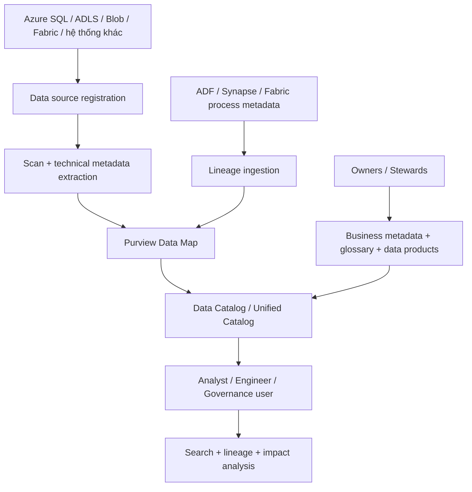

### Data Map

**Data Map** là lớp quản lý metadata kỹ thuật của dữ liệu đã được phát hiện/đăng ký, mối quan hệ assets, kết quả scan/classification và lineage trong các tính năng hỗ trợ. Các data sources được scan hoặc tích hợp để làm giàu map.

### Data Catalog và Unified Catalog

Một **catalog** là trải nghiệm khám phá và quản lý thông tin về data assets. Những giao diện Purview có thể sử dụng tên **Data Catalog** trong trải nghiệm truyền thống và **Unified Catalog** trong mô hình quản trị dữ liệu mới hơn. Unified Catalog còn tổ chức một số khả năng quản trị theo **governance domains, data products, business concepts** và các trải nghiệm dữ liệu được hỗ trợ.

Không nên xem hai tên này là luôn cùng một UI với cùng nút menu và permission model. Khi làm bài lab, xác định **tenant đang dùng trải nghiệm nào, loại resource nào, feature set nào** rồi ánh xạ các bước tương ứng.

### Data governance và data security/compliance

Microsoft Purview cũng có khả năng bảo mật/tuân thủ như information protection, DLP, audit hoặc records management trong những sản phẩm được cấp phép. Chúng **có thể phối hợp** với governance nhưng không đồng nhất:

- Scan một bảng và gắn classification trong Data Map **không tự động** cấu hình DLP chặn email chứa dữ liệu đó.
- Gắn business term “PII” **không tự động** thay đổi RBAC trên Azure SQL/Storage.
- Thiết lập sensitivity labeling trong một hệ thống được hỗ trợ **không phải** bằng chứng mọi bản sao dữ liệu ở hệ khác đã được bảo vệ.

Thiết kế cần xác định rõ công cụ nào **phát hiện/ghi nhận**, công cụ nào **enforce policy**, và hệ thống nào **lưu audit**.

## 4. Metadata là nền móng của catalog

**Metadata** là “dữ liệu về dữ liệu”. Nó giúp người dùng hiểu asset mà không nhất thiết đọc nội dung nhạy cảm.

### Ba nhóm metadata

| Nhóm | Ví dụ | Nguồn tạo |
|---|---|---|
| **Technical metadata** | Table/column/schema, data type, path, format, partition info | Scan connector, data platform |
| **Business metadata** | Mô tả “đơn hàng hoàn tất”, business glossary, owner, data product, usage rules | Steward, domain owner, governance workflow |
| **Operational metadata** | Last scan, pipeline run, refresh time, errors, quality/freshness signal | Scan logs, orchestration, observability systems |

### Asset và business term khác nhau

**Asset** là tài nguyên cụ thể: `adls://lake/curated/orders`, bảng `dw.fact_orders`, một Power BI semantic model.

**Business term** là khái niệm được định nghĩa: “Đơn hàng”, “Khách hàng hoạt động”, “Doanh thu thuần”.

Một term có thể liên kết **nhiều assets**. Một asset có thể liên hệ **nhiều terms** và nhiều người sở hữu ở các vai trò khác nhau. Đây không phải một phép đổi tên cột.

### Business definition cần đủ chi tiết

Ví dụ:

```text
Tên thuật ngữ: Net Revenue
Định nghĩa: Doanh thu sau giảm giá và hoàn tiền của đơn
  được ghi nhận hợp lệ, chưa gồm khoản thuế tách riêng.
Đơn vị: VND
Loại trừ: Đơn hủy trước giao hàng; đơn hoàn 100%.
Thời gian ghi nhận: Theo paid_at UTC chuyển sang kỳ kế toán.
Owner: Finance Analytics
Steward: Finance Data Steward
Version: 2.1
Ngày hiệu lực: Theo phê duyệt chính sách tài chính
Mapping: fact_orders.net_revenue_amount
```

Đây là **định nghĩa minh họa**, không phải quy tắc kế toán chung cho mọi doanh nghiệp. Nếu Finance và Sales dùng công thức khác, phải có version, approval và mục đích dùng rõ, thay vì đặt cùng tên `revenue` cho hai công thức.

## 5. Vai trò chủ sở hữu, steward và data consumer

Quản trị không bền vững nếu không ai chịu trách nhiệm.

| Vai trò | Trách nhiệm |
|---|---|
| **Business/domain owner** | Xác định ý nghĩa, mục đích, quyền sử dụng dữ liệu theo business policy |
| **Data steward** | Curate metadata, glossary, classifications/definitions, kiểm tra chất lượng và điều phối thay đổi |
| **Data engineer** | Quản lý source/pipeline/schema/lineage/technical metadata |
| **Data platform administrator** | Cấu hình Purview, network, scans, credentials, logs và capacity |
| **Security/compliance team** | Xác định chính sách bảo mật, retention, nghĩa vụ tuân thủ |
| **Data analyst/consumer** | Tìm datasets, đánh giá fit-for-purpose và báo lỗi chất lượng |
| **Pipeline/application owner** | Chịu trách nhiệm về code và vận hành transformations cụ thể |

**Owner không nhất thiết là người có Azure RBAC Owner role.** Business owner là trách nhiệm quản trị, Azure RBAC Owner là quyền quản lý Azure resources. Hai khái niệm khác nhau.

### RACI minh họa

| Hoạt động | Business owner | Steward | Engineer | Security |
|---|---|---|---|---|
| Phê duyệt định nghĩa Net Revenue | A | R | C | I |
| Đăng ký/scan nguồn | I | C | R | C |
| Sửa pipeline/SQL transform | C | C | R/A | I |
| Phân loại cột nhạy cảm | C | R | C | A/C theo policy |
| Cấp quyền đọc dữ liệu nguồn | A theo chính sách | C | R technical | C/A security |
| Điều tra số liệu sai | A | R | R | I |

`R` = Responsible, `A` = Accountable, `C` = Consulted, `I` = Informed. Đây là **một mô hình tham khảo**, cần điều chỉnh theo cơ cấu tổ chức.

## 6. Data Map collections và governance domains khác nhau

Trong những mô hình Purview hỗ trợ **collections**, collection là cấu trúc quản trị metadata và phân quyền truy cập/quản lý theo cây; có thể được dùng để tách trách nhiệm scan/curation theo business unit hoặc hệ thống.

Trong **Unified Catalog**, **governance domains** và **data products** biểu diễn cách tổ chức dữ liệu theo nghiệp vụ, người chịu trách nhiệm và tài sản được cung cấp để người khác sử dụng.

### Ví dụ

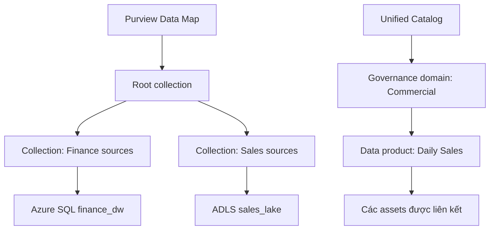

**Collection tree không bắt buộc trùng business domain tree.** Một nguồn ADLS chứa cả dữ liệu Sales và Finance có thể cần tổ chức access/scan scope một cách khác với data product mà consumer tìm kiếm.

### Tránh ba lỗi thiết kế

1. **Dùng một collection cho mọi nguồn** và cấp quyền curator rộng không cần thiết.
2. **Tạo collection theo từng bảng nhỏ** đến mức khó vận hành.
3. **Nhầm data product với dataset**: một data product có thể gom nhiều datasets/assets và mang thông tin cam kết sử dụng, owner, refresh, quality, access request.

### Data product là gì?

Một **data product** là gói dữ liệu có mục đích và cam kết sử dụng rõ: ai sở hữu, phục vụ vấn đề nào, tập assets nào, điều kiện truy cập ra sao, mức độ tin cậy và cách hỗ trợ người dùng. Một product “Daily Sales” có thể gồm bảng doanh số tổng hợp, semantic model, quy định Net Revenue và tài liệu về độ tươi dữ liệu.

Không phải cứ đặt tag “data product” lên một bảng là đã có một sản phẩm dữ liệu chất lượng.

## 7. Đăng ký nguồn (register) khác quét (scan)

Để đưa metadata của một hệ thống nguồn vào Data Map, một luồng thông thường gồm:

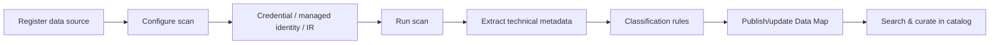

**Register** khai báo một nguồn và metadata kết nối/đường dẫn. **Scan** mới thực hiện việc kết nối (theo cơ chế được cấp phép) để phát hiện data assets/schemas/classifications. Nếu chỉ register mà chưa scan, catalog có thể chưa thấy tables/files/columns mong muốn.

### Một data source registration có thể chứa

- Loại nguồn: Azure SQL Database, Azure Blob/ADLS, Synapse, Power BI/Fabric hoặc hệ thống hỗ trợ khác.
- Resource identifier/endpoint và scope cần scan.
- Collection/management context được gán.
- Credential configuration hoặc identity.
- Scan rule set và scheduling.
- Integration runtime hoặc network route phù hợp.

**Không quét toàn bộ subscription** chỉ vì được cấp quyền Contributor. Scan scope cần theo data owner, sensitivity và khả năng của connector.

### Những điều scan không tự làm

- Không đảm bảo khám phá tất cả dữ liệu trong network mà identity không có quyền.
- Không tự hiểu business formula từ tên field.
- Không mặc định phát hiện mọi transform được viết trong custom application.
- Không tự thay đổi permission trên nguồn dữ liệu.
- Không bảo đảm data source được scan tức thời khi có schema change.
- Không đảm bảo mọi loại file/bảng được đọc nội dung trong cùng một quy tắc classification.

## 8. Scan rule set và phạm vi quét

**Scan rule set** có thể quy định những loại dữ liệu/định dạng, classification rules hoặc cách khám phá metadata theo nguồn và phiên bản hỗ trợ.

### Ví dụ phạm vi an toàn

```text
Data source: Azure Data Lake Storage Gen2
Container/filesystem: analytics
Included paths:
  /raw/orders/
  /curated/orders/
Excluded paths:
  /sandbox/tmp/
  /backups/private/
Scan schedule: mỗi ngày / sau pipeline release theo chính sách
Identity: Purview scan identity có quyền đọc phù hợp
Classification rules: built-in + custom theo governance standard
```

Các trường trên là **bản kế hoạch scan**, không phải YAML cấu hình chính thức của Purview. Include/exclude patterns và lịch hỗ trợ thay đổi theo connector.

### Vì sao không scan mọi thứ?

- Có dữ liệu không thuộc phạm vi hợp đồng với data owner.
- Scan có thể cần đọc schema và đôi khi sample data theo cấu hình, liên quan quyền dữ liệu nhạy cảm.
- Kết nối private/gateway có capacity và chi phí.
- Scan lớn có thể tiêu thụ năng lực ingestion/metadata xử lý và phát sinh phí theo mô hình dịch vụ.
- Một số files là temporary/artifacts khiến catalog nhiễu.
- Nguồn có thể bị ảnh hưởng bởi scan/query overhead và audit log.

**Chỉ cấp những quyền thực sự cần thiết cho scan**, kiểm tra data source-specific permission và đáp ứng chính sách riêng tư.

## 9. Azure SQL và ADLS: metadata được thu thập khác nhau

### Azure SQL Database

Scan SQL có thể khám phá các đối tượng được connector hỗ trợ, ví dụ:

```text
server / database
  └── schema commerce
       ├── table orders
       │    ├── order_id       varchar
       │    ├── customer_id    varchar
       │    ├── order_status   varchar
       │    └── gross_amount   decimal
       └── view completed_orders
```

Khả năng scan views, stored procedures, column-level metadata, data profiling và lineage phụ thuộc connector/cấu hình; **đừng giả định bất kỳ stored procedure nào cũng được parse thành lineage tự động**.

### Azure Data Lake Storage Gen2

Data Lake chứa filesystem, directories và files:

```text
adls://commerce-lake/
  raw/
    orders/
      load_date=2026-11-20/
        part-0001.parquet
  curated/
    orders/
      order_date=2026-11-20/
        part-0001.parquet
  quality/
    quarantine/
```

Scan có thể khám phá asset/file-level metadata, định dạng và schema theo loại file được hỗ trợ. Không đồng nhất **directory/file** với một “bảng” logic: partitioned Parquet folder có thể được biểu diễn khác nhau theo scanner, data source và mô hình catalog.

### Cần xác nhận identity riêng của scan

Với Azure SQL, có thể cần principal/database reader permissions và network rules phù hợp. Với ADLS, scan identity cần Azure Storage data-plane role hoặc ACL/path permissions theo cấu hình. **Có quyền Microsoft Purview admin không tự cấp quyền đọc SQL rows hay ADLS files.**

## 10. Data classification và dữ liệu nhạy cảm

**Classification** giúp nhận diện các loại dữ liệu như email address, phone number, national identifier, financial data hoặc dữ liệu riêng theo chính sách.

### Ví dụ

| Cột | Nhận diện có thể có | Cần người kiểm tra |
|---|---|---|
| `customer_email` | Email address | Là email khách hàng thật hay test? |
| `contact_phone` | Phone number | Dữ liệu có được phép dùng marketing? |
| `credit_card_last4` | Payment-card-related field | Có chứa đủ yếu tố nhạy cảm không? |
| `order_total` | Financial/transactional | Chính sách nội bộ xác định sensitivity nào? |
| `customer_code` | Internal identifier | Có khả năng liên kết để định danh người không? |
| `shipping_address` | Personal address | Retention/usage policy của tổ chức |

**Classifier tự động là tín hiệu, không phải phán quyết pháp lý.** Có thể có:

- **False positive:** chuỗi giống số điện thoại nhưng thực chất là mã kho.
- **False negative:** dữ liệu nhạy cảm đã được mã hóa/viết tắt khiến scanner không nhận diện.
- **Context-dependent sensitivity:** một mã khách hàng riêng lẻ ít nhạy cảm hơn khi kết hợp với tên và địa chỉ.

### Quy trình xử lý classification

1. Scan trong phạm vi nguồn được phê duyệt.
2. Xem các classifications phát hiện.
3. Steward kiểm tra mẫu/metadata theo quyền và chính sách.
4. Bổ sung hoặc sửa business classifications/tags khi được hỗ trợ.
5. Liên kết đến policy quản trị truy cập/retention thích hợp.
6. Kiểm tra enforcement thực tế **ở nơi dữ liệu được lưu/xử lý**.
7. Theo dõi thay đổi classification khi schema và dữ liệu đổi.

Một classification “Confidential” trong catalog **không tự mã hóa** một Blob đang public. Bảo mật Storage/SQL cần cấu hình riêng.

## 11. Data lineage là gì và trả lời câu hỏi nào?

**Data lineage** là mô tả về **nguồn gốc, hướng di chuyển và sự biến đổi dữ liệu** qua các hệ thống, datasets, pipelines, jobs và báo cáo.

Một biểu đồ lineage đơn giản:

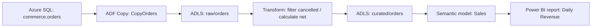

Người dùng click vào `Daily Revenue` và muốn truy ngược tới **cột/asset gốc**, quy tắc transform và người chịu trách nhiệm.

### Upstream và downstream

- **Upstream lineage:** những nguồn và transformations tạo ra một asset hiện tại.
- **Downstream lineage:** những assets, jobs, dashboard hoặc consumers có thể phụ thuộc vào asset đó.

Với bảng `curated/orders`:

```text
Upstream:
  commerce.orders → ADF CopyOrders → raw/orders → TransformNetRevenue

Downstream:
  Sales semantic model → Daily Revenue dashboard
  Finance reporting export → Monthly Close
```

### Lineage phục vụ ba nhóm câu hỏi

| Mục đích | Câu hỏi cụ thể |
|---|---|
| **Trust / transparency** | Chỉ số trên report đến từ nguồn nào? |
| **Impact analysis** | Sửa/xóa cột `order_status` sẽ ảnh hưởng những nơi nào? |
| **Root cause analysis** | Doanh thu giảm đột ngột vì nguồn, pipeline hay transform? |

### Lineage không phải audit log

Lineage mô tả **mối quan hệ dữ liệu** và transformation/flow đã được hệ thống ghi nhận. Audit log mô tả **ai đã làm gì, lúc nào**, ví dụ người dùng đổi quyền Storage hay một pipeline bị deploy. Cần cả hai để điều tra sự cố.

**Lineage graph cũng không mặc định chứng minh giá trị của mỗi record**. Một edge `orders → sales_report` chưa đủ để khẳng định toàn bộ SQL lọc/aggregation, độ đúng từng dòng hay việc dữ liệu đã được refresh gần nhất.

## 12. Thành phần của một lineage graph

Một lineage graph có thể xem như một đồ thị có hướng:

\[
G=(V,E)
\]

trong đó:

- \(V\) là tập **nodes**: tables, files, datasets, processes, notebooks, semantic models hoặc reports.
- \(E\) là tập **edges**: data flow/dependency hoặc quá trình biến đổi theo semantics của connector.

### Những loại node thường gặp

| Node | Ví dụ | Ý nghĩa |
|---|---|---|
| **Source asset** | SQL table `commerce.orders` | Tài sản đầu vào |
| **Processing activity** | ADF Copy Activity | Chuyển dữ liệu từ source sang sink |
| **Transformation job** | Synapse SQL transform, Data Flow, notebook | Áp dụng logic xử lý |
| **Intermediate asset** | ADLS raw Parquet | Dữ liệu trung gian |
| **Curated asset** | `dw.fact_orders` | Dữ liệu được làm sạch và chuẩn hóa |
| **Semantic model** | Power BI Sales Model | Lớp định nghĩa metrics/relationships |
| **Report/dashboard** | Sales Executive Report | Cách người dùng cuối sử dụng dữ liệu |

### Ý nghĩa của một edge

Edge từ `A` sang `B` thường nói `B` được tạo ra hoặc phụ thuộc vào `A` trong mô hình lineage của hệ thống. Nó **không luôn có nghĩa** cứ một dòng ở A tạo đúng một dòng ở B: phép GROUP BY/JOIN/FILTER có thể thay đổi số rows, granularity hoặc ý nghĩa dữ liệu.

### Asset-level, dataset-level, column-level lineage

| Độ chi tiết | Ví dụ | Khi nào cần |
|---|---|---|
| **System-level** | Azure SQL → Data Lake → Power BI | Tổng quan kiến trúc |
| **Asset/table-level** | `orders` → `fact_orders` | Quản lý dependency khi đổi bảng |
| **Column-level** | `orders.total_amount` → `fact_orders.net_revenue` | Impact analysis khi đổi cột/định nghĩa |
| **Transformation expression-level** | `SUM(paid_amount - refund)` | Kiểm toán logic chỉ số |

**Không giả định Purview tự có column-level lineage cho mọi nguồn, mọi ETL tool hay mọi loại SQL.** Mức chi tiết phụ thuộc connector, hoạt động được hỗ trợ, metadata integration và cách pipeline được viết. Khi không có column lineage, phải dùng code review, mapping spec và quy trình lineage thủ công/ingestion được hỗ trợ.

### Lineage edge “được hệ thống quan sát” và “được suy đoán”

Một tổ chức nên ghi rõ **nguồn chứng cứ** cho edge:

```text
Edge:
  source: commerce.orders
  target: curated.fact_orders
Provenance:
  observed-from: ADF CopyActivity metadata
  pipeline-version: release-2026-11-20
  verified-by: data engineering
  last-verified: date/time
Confidence:
  automatic / manually curated / inferred
```

Đây là **cấu trúc metadata tự định nghĩa để giải thích**, không phải schema REST API của Microsoft Purview. Việc lưu confidence/provenance vào catalog như thế nào tùy governance feature hoặc hệ thống quản trị bổ sung.

## 13. Data Map asset identity và nguồn gốc của edge

Khi cùng một bảng được phát hiện qua nhiều integration jobs, cần tránh tạo **các thực thể trùng nhau** trong catalog.

### Tài sản có định danh kỹ thuật

Ví dụ các chuỗi:

```text
Azure SQL:
  server: sales-sql.database.windows.net
  database: commerce
  schema: sales
  table: orders

ADLS:
  account: adlssalesprod
  filesystem: analytics
  path: /curated/orders/
```

Hệ thống quản lý metadata có thể xây qualified name/resource identity để phân biệt các assets. Không chỉ dùng display name `orders` làm khóa, vì nhiều database và regions có bảng cùng tên.

### Điều gì xảy ra khi nhận lineage?

1. Purview hoặc connector nhận metadata của source/process/sink.
2. Tìm asset phù hợp trong Data Map theo identity/qualified name.
3. Liên kết nodes/edges cho activity được hỗ trợ.
4. Hiển thị graph trong catalog/lineage viewer khi đủ quyền.

Nếu chưa scan sink hoặc identity không khớp, một số trải nghiệm có thể hiển thị **placeholder/unknown asset** hoặc thiếu edge. Ngay cả khi pipeline chạy tốt, catalog có thể chưa đầy đủ do registration, scan, connector permissions hoặc matching.

**Không tự đổi tên qualified name để “ghép” các assets** nếu điều đó làm sai identity nguồn. Cần xác định cách connector sinh asset identity và có quy trình đối chiếu đúng.

## 14. Tự động thu thập lineage từ Azure Data Factory

**Azure Data Factory (ADF)** là dịch vụ data integration/orchestration. Một pipeline có thể Copy dữ liệu giữa nguồn và đích, thực hiện Data Flow hoặc gọi hoạt động khác. Khi được kết nối với Microsoft Purview theo tính năng và quyền được hỗ trợ, ADF có thể cung cấp **lineage metadata** cho các activities/nguồn/đích phù hợp.

### Ví dụ một pipeline

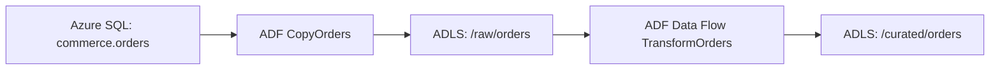

Trên portal/configuration phù hợp:

1. Tạo/định danh Microsoft Purview data governance account/trải nghiệm đang dùng.
2. Đăng ký và scan dữ liệu nguồn/đích trong Data Map khi cần để nhìn thấy metadata assets.
3. Kết nối ADF với tài khoản/trải nghiệm Purview qua phần tích hợp được hỗ trợ.
4. Cấp các vai trò/permission cần cho việc publish lineage và đọc metadata.
5. Chạy pipeline thật với **activities/connector được hỗ trợ**.
6. Đợi metadata lineage ingestion; kiểm tra lineage graph trong portal.
7. Đối chiếu qualified names và các nodes/edges với pipeline, datasets, tables thật.

**Không phải mọi activity ADF tạo lineage tự động.** Một `Web Activity` gọi API tùy ý, một Script Activity chạy SQL động hoặc một Custom Activity có logic chưa được hỗ trợ có thể tạo **lỗ hổng lineage**. Việc gọi ADF không đủ để chứng minh toàn bộ biến đổi của các dòng dữ liệu đã được ghi lại.

### Copy Activity dễ hiểu hơn custom transformation

Ví dụ `CopyOrders` đọc Azure SQL `commerce.orders` và ghi ADLS `/raw/orders`. Edge table → file/path có thể được ghi nhận nếu nguồn, sink, integration và connector support khớp. Nhưng khi một Azure Function tùy chỉnh đọc Parquet và tạo JSON mới, Purview có thể không biết chức năng này làm gì trừ khi có integration/metadata bổ sung.

### Lineage có thể cần thời gian cập nhật

Workflow chạy xong tại 08:00 không có nghĩa Purview viewer cập nhật đúng 08:00:00. Hệ thống metadata có lịch xử lý, ingestion/scan và eventual propagation riêng. Khi xem lineage **phải kiểm tra last updated / pipeline run / scan time** thay vì cho rằng graph luôn phản ánh release mới nhất.

## 15. Azure Synapse, Fabric và Power BI trong lineage

Mục tiêu doanh nghiệp thường là theo dấu từ data warehouse/lake tới semantic model và report.

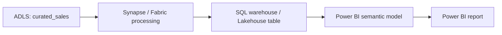

### Synapse pipelines và SQL processing

Các tính năng Synapse tích hợp quản trị/lineage có thể phản ánh một số pipelines và data assets, nhưng không nên mặc định mọi notebook SQL/Spark được parse tự động thành graph chi tiết tới từng cột.

### Power BI/Fabric lineage

Power BI/Fabric có những trải nghiệm lineage/dependency riêng. Tùy cấu hình quản trị, quyền truy cập và integration được hỗ trợ, Purview có thể nhận diện một số assets và quan hệ từ semantic models, dataflows, reports, lakehouses hoặc warehouses.

Để làm việc đúng:

1. Xác định **workspace, tenant và quyền scanner/API** phù hợp.
2. Tìm hiểu nguồn assets nào được connector/integration hỗ trợ.
3. Xác minh có thấy semantic model và report đúng tên không.
4. Kiểm tra các dataset tables/columns và mối quan hệ tới upstream asset.
5. Nếu nguồn là custom DAX, dynamic query hoặc external script, cần xác minh mức chi tiết lineage có thực sự xuất hiện.

### Đừng nhầm hai dạng lineage UI

- **Lineage view trong Power BI/Fabric** mô tả quan hệ giữa các items trong môi trường đó theo tính năng riêng.
- **Lineage view trong Microsoft Purview** liên kết metadata assets qua những integrations/Data Map được hỗ trợ.

Chúng có thể bổ sung cho nhau nhưng **không tự bảo đảm graph giống hệt nhau**. Khi điều tra, đối chiếu cả hai và pipeline source code.

### Ví dụ báo cáo lệch

Report `Daily Net Revenue` dùng measure:

```dax
Net Revenue =
    SUM ( Sales[PaidAmount] )
    - SUM ( Sales[RefundAmount] )
```

Đoạn DAX là ví dụ tính toán đơn giản, chưa xử lý currency, tax và một số nghiệp vụ hoàn trả. Một lineage graph chỉ nối `Sales` tới `Daily Net Revenue` chưa nói đã hiểu được biểu thức DAX này hoặc từng cột nguồn. Cần lưu **metric definition/version** và review với Finance.

## 16. Lineage thủ công và tích hợp custom pipelines

Không phải mọi transformation chạy qua sản phẩm có native integration với Purview. Ví dụ:

```text
SQL Server on-prem
→ custom Python ETL
→ SFTP CSV
→ Spark notebook
→ curated Parquet
→ dashboard
```

Khi thiếu auto lineage, có một số hướng:

1. Sử dụng connector tích hợp được hỗ trợ nếu có.
2. Thu thập metadata qua orchestration hooks/logs của pipeline.
3. Tạo **lineage metadata theo interface/REST integration** được tài khoản Purview hỗ trợ.
4. Lưu manual lineage + evidence trong catalog/governance process nếu UI có chức năng phù hợp.
5. Bổ sung định danh source/sink và transformation version vào pipeline contract.

**Không tự gọi một API không được hỗ trợ rồi ghi đè hệ thống metadata production.** Purview có nhiều mô hình API/SDK theo trải nghiệm; trước khi viết connector custom phải xác nhận tài liệu API, model, auth, quotas và schema đúng phiên bản.

### OpenLineage và metadata interchange

Một số công cụ orchestration/ETL dùng chuẩn hoặc hệ sinh thái như **OpenLineage** để mô tả jobs/runs/datasets. Điều này có thể giúp chuẩn hóa metadata từ custom pipelines, nhưng **không mặc định Microsoft Purview sẽ nhập trực tiếp mọi sự kiện OpenLineage** mà không cần bridge/connector có hỗ trợ.

Một metadata record minh họa:

```json
{
  "job": "daily-sales-transform",
  "runId": "run-20261120-0800",
  "inputs": [
    "adls://sales/raw/orders/"
  ],
  "outputs": [
    "adls://sales/curated/orders/"
  ],
  "transformationVersion": "git-sha-example",
  "status": "SUCCEEDED"
}
```

Đây **không phải** payload chính thức của OpenLineage hoặc Microsoft Purview API. Nó chỉ liệt kê thông tin tối thiểu một custom lineage collector có thể dùng.

### Chất lượng lineage tùy thuộc mức logging

Nếu custom ETL không ghi input/output identity, một hệ thống governance không thể tự suy ra nguồn dữ liệu chính xác từ một dòng log `“Completed 25,000 records”`. Duy trì **lineage contract** trong pipeline code/release là một việc của Data Engineering.

## 17. Lineage ở mức cột: cần gì để kiểm tra một KPI?

Giả sử pipeline tạo `net_revenue`:

```sql
SELECT
    order_id,
    order_date,
    paid_amount - refunded_amount AS net_revenue
FROM staging.orders
WHERE order_status = 'Paid';
```

Để giải thích `fact_orders.net_revenue`, cần ít nhất:

```text
Source columns:
  staging.orders.paid_amount
  staging.orders.refunded_amount
Filter dependency:
  staging.orders.order_status
Output:
  fact_orders.net_revenue
Transform:
  paid_amount - refunded_amount
Business term:
  Net Revenue (definition version 2.1)
Pipeline/source revision:
  commit ... / run ...
```

### Hai loại phụ thuộc dễ bị bỏ sót

- **Value dependency:** cột đầu ra được tính từ cột đầu vào (`paid_amount` và `refunded_amount`).
- **Control/filter dependency:** `order_status` không xuất hiện trong biểu thức giá trị nhưng thay đổi nó có thể làm thay đổi **những dòng được đưa vào kết quả**.

Một hệ thống chỉ vẽ lineage cho những field trực tiếp trong `SELECT` có thể bỏ qua ảnh hưởng của `WHERE`, `JOIN`, `GROUP BY` hoặc UDF. Vì vậy **column-level lineage tự động phải được kiểm thử** nếu dùng làm cơ sở impact analysis quan trọng.

### SQL động làm lineage khó hơn

```sql
-- Ví dụ minh họa rủi ro: tên bảng được chọn tại runtime.
EXEC(@dynamic_sql);
```

Pipeline dùng dynamic SQL, stored procedures, UDF hoặc notebook notebooks tự xây có thể thiếu static lineage extraction. Muốn truy vết, có thể cần instrument runtime inputs/outputs, parse SQL đủ độ tin cậy và lưu artifact/version tương ứng.

### Không “ngụy tạo” lineage để cho graph đẹp

Nếu chưa biết biểu thức transform, nên ghi **unknown/manual verification required**, thay vì vẽ edge chi tiết từ `customer_name` sang `net_revenue` chỉ vì cùng bảng. Lineage sai có thể nguy hiểm hơn lineage thiếu vì khiến người dùng tin vào impact analysis không chính xác.

## 18. Impact analysis: thay đổi schema mà không phá dashboard

Khi muốn đổi tên cột `order_status` thành `fulfillment_state` trong Azure SQL, câu hỏi không chỉ là “ALTER TABLE chạy được không?”.

### Quy trình dựa trên lineage

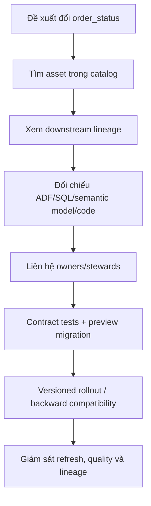

### Bước cụ thể

1. Tìm asset `commerce.orders` và cột `order_status`.
2. Mở lineage để xác định downstream jobs/datasets/reports.
3. Kiểm tra **lineage freshness/coverage**: connector và scan có bắt kịp release không?
4. Tra cứu code: ADF datasets, SQL views/procedures, Spark notebooks, Power BI measures.
5. Lập danh sách owners và thông báo kế hoạch thay đổi.
6. Đề xuất giai đoạn dual-column hoặc view tương thích nếu cần.
7. Chạy tests: schema contracts, data counts, financial metric checks.
8. Deploy có khả năng rollback.
9. Đọc monitoring để xác minh pipelines, reports và metadata ingestion.
10. Cập nhật glossary, catalog descriptions và deprecation notice.

### Ước lượng tác động theo graph

Nếu asset A có 3 tuyến phụ thuộc và mỗi tuyến mở rộng nhiều nodes, số affected assets **không chỉ bằng direct children**. Cần traverse downstream (khi graph tin cậy và đủ dữ liệu), tránh đếm trùng nodes khi các tuyến hội tụ.

**Một graph thiếu custom ETL edge không chứng minh hệ thống đó không phụ thuộc vào A.** Impact analysis phải kết hợp lineage, code search (trong quy trình phát triển riêng), data contracts và owner review.

## 19. Root-cause analysis: báo cáo doanh thu sai

Tình huống: sau một bản phát hành, dashboard Daily Revenue giảm 18% nhưng số đơn hàng bán ra không giảm tương ứng.

### Điều tra theo hướng upstream

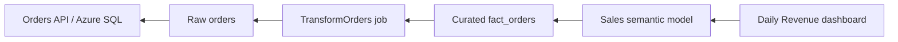

### Từng bước

1. **Dashboard:** xác nhận bộ lọc, kỳ báo cáo và semantic model refresh time.
2. **Metric definition:** kiểm tra “Net Revenue” có đổi định nghĩa/version không.
3. **Curated dataset:** kiểm tra row counts, null rates, amount distributions, duplicate keys.
4. **Transform job:** kiểm tra SQL/Data Flow mới đổi `WHERE`, currency conversion hay join không.
5. **Raw dataset:** so sánh số đơn theo ngày với hệ thống nguồn.
6. **Source:** kiểm tra event ingestion, transactional records và late-arriving orders.
7. **Lineage completeness:** xác minh asset/edge cuối cùng được cập nhật khi nào.
8. **Owner escalation:** Finance chấp thuận điều chỉnh hoặc ghi lại exception.

### Ví dụ đối chiếu dữ liệu

```sql
-- Query minh họa trong SQL warehouse có schema tương thích.
SELECT
    CAST(order_date AS date) AS business_date,
    COUNT(*) AS order_count,
    SUM(net_revenue_amount) AS net_revenue
FROM dw.fact_orders
WHERE order_date >= '2026-11-19'
GROUP BY CAST(order_date AS date)
ORDER BY business_date;
```

Đây là **query kiểm chứng dữ liệu ở kho đích**, không phải query thực thi trong Microsoft Purview Catalog. Data catalog chỉ giúp biết nên kiểm tra asset nào, ai sở hữu và những transformation nào có liên quan.

### Không kết luận vội

Nếu báo cáo sai và Purview lineage hiển thị đầy đủ edges, điều đó chưa chứng minh **mọi row/aggregation đúng**. Lineage và data quality phải kết hợp với số liệu thực tế, data reconciliation và kiểm thử business rules.

## 20. Data quality và lineage bổ sung cho nhau

Một asset có lineage rõ ràng nhưng chứa dữ liệu sai vẫn chưa đáng tin. Ngược lại, một dataset có chất lượng tốt ở thời điểm hiện tại nhưng thiếu nguồn gốc, owner và định nghĩa nghiệp vụ sẽ khó được tái sử dụng có trách nhiệm.

### Sáu chiều chất lượng thường dùng

| Chiều chất lượng | Câu hỏi | Ví dụ kiểm tra |
|---|---|---|
| **Completeness** | Có thiếu records/fields không? | 99,9% đơn hàng có customer_id |
| **Validity** | Dữ liệu có đúng schema/rule không? | `order_status` thuộc enum cho phép |
| **Uniqueness** | Có duplicate business keys không? | Một `order_id` duy nhất trong fact table |
| **Consistency** | Các hệ thống có thống nhất không? | Tổng đơn theo ngày giữa raw/curated |
| **Timeliness/freshness** | Dữ liệu có đủ mới không? | Bản cập nhật cuối không quá 30 phút |
| **Accuracy** | Có phản ánh thực tế nghiệp vụ không? | Số tiền đơn khớp chứng từ đã phê duyệt |

Các mục tiêu phần trăm/thời gian là **ví dụ SLO**; phải do domain owner phê duyệt.

### Gắn data quality vào data product

Một product `Daily Sales` có thể công bố:

```text
Owner: Finance Analytics
Refresh frequency: mỗi 60 phút
Freshness SLO: 95% các lần refresh hoàn tất trong 75 phút
Completeness: paid orders >= 99,9% so với nguồn giao dịch
Uniqueness: không có duplicate order IDs
Known limitations: refunds trễ có thể được điều chỉnh trong 2 ngày
Certified/endorsed status: chỉ khi có review thực tế
Last quality check: <thời gian>
Incident contact: Finance Data Steward
```

Không gắn nhãn “certified” theo cảm tính. Cần quy trình phê duyệt, checks có chứng cứ và lịch kiểm tra lại.

### Purview data quality capabilities

Một số trải nghiệm **Purview data governance/Unified Catalog** cung cấp tính năng đánh giá hoặc quản trị data quality theo gói/điều kiện hỗ trợ. Nhưng không mặc định mọi tenant/region/asset type đều có cùng chất lượng scan, rule execution, alerting và billing. Nếu cần dữ liệu đo chi tiết, có thể tích hợp **SQL tests, Spark validations, pipeline data quality checks** hoặc công cụ được tổ chức phê duyệt và gắn kết quả trở lại data product/catalog theo khả năng.

**Purview catalog không tự chạy toàn bộ kiểm thử business rules chỉ vì người dùng mở một asset page.**

## 21. Security boundary: catalog metadata và dữ liệu thật

Một kiến trúc an toàn phải phân biệt **quyền quản trị Purview**, **quyền xem/curate metadata**, **quyền scan nguồn**, **quyền đọc dữ liệu nguồn** và **quyền áp dụng policy**.

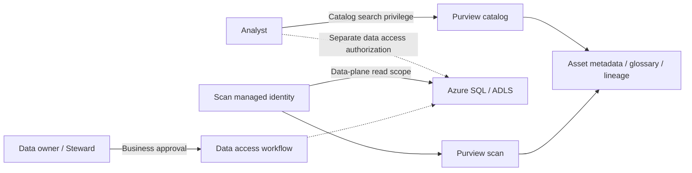

### Những loại quyền cần xem

| Phạm vi | Hành động | Nguyên tắc |
|---|---|---|
| **Azure ARM/RBAC** | Tạo/quản lý Purview resource, networking, diagnostics | Least privilege ở resource group/resource |
| **Purview Data Map/collection roles** | Quản lý collection, data source, scan, đọc/curate metadata | Gán theo vai trò và scope được trải nghiệm hỗ trợ |
| **Unified Catalog governance roles** | Tổ chức domains/products/terms/approvals | Kiểm tra mô hình quyền riêng của Unified Catalog |
| **Source data plane** | Scan SQL schema, ADLS files/metadata | Principal/managed identity có quyền dữ liệu cụ thể |
| **Consumer data plane** | Query SQL/Storage/Fabric dataset | Người dùng cần quyền trực tiếp trên data platform |
| **Security policy enforcement** | DLP, sensitivity labeling, retention, access control | Dùng service thực sự thực thi policy |

### Một số role có thể gặp

Trong trải nghiệm **Data Map/collections truyền thống**, có các tên vai trò như **Collection Administrator, Data Source Administrator, Data Curator, Data Reader** theo mô hình hỗ trợ. Cách cấp các roles này khác với **Azure RBAC Contributor** và có thể khác mô hình governance roles ở Unified Catalog.

**Không áp dụng role names/click path của classic catalog vào Unified Catalog mà chưa kiểm tra UI và tài liệu tenant đang dùng.** Ngoài ra, ngay cả Data Source Administrator trong Purview cũng không phải “sysadmin SQL”.

### Metadata cũng nhạy cảm

Dù không chứa toàn bộ rows, catalog có thể tiết lộ:

- hệ thống nào tồn tại và endpoint của nó;
- tên bảng lương/khách hàng/doanh thu;
- metadata mô tả dự án bí mật;
- đường đi dữ liệu qua những hệ thống hạn chế;
- owner/contact của hệ thống;
- classifications cho biết nơi có dữ liệu nhạy cảm.

Do đó quyền **search metadata** cũng cần được quản lý, không mặc định mọi nhân viên được xem tất cả assets.

## 22. Identity và credentials cho scan

### Dùng managed identity khi phù hợp

Một scan của Purview có thể dùng **managed identity hoặc credential methods khác** tùy connector và network environment. Quy trình:

1. Xác định scan identity thật sự của Purview/integration runtime.
2. Cấp quyền **đọc tối thiểu** trên data source.
3. Chọn scope đúng table/path/database.
4. Cấu hình connection/scan bằng authentication mode được connector hỗ trợ.
5. Kiểm thử một source nhỏ.
6. Xem logs để xác định lỗi 401/403/network riêng biệt.
7. Thu hồi quyền tạm sau khi kết thúc thử nghiệm.

### ADLS Gen2 có nhiều lớp quyền

Nếu ADLS có hierarchical namespace, quyền truy cập có thể liên quan:

- Azure RBAC data-plane roles như `Storage Blob Data Reader` theo scope.
- Filesystem/directory ACL và quyền traverse theo thiết kế.
- Firewall/private network rules.
- Token/identity từ runtime thực sự truy cập.

Một role Azure `Reader` trên storage account **không đồng nghĩa** đọc nội dung Blob được. Có RBAC quyền đọc nhưng thiếu đường mạng/DNS cũng không scan được.

### Azure SQL Database

Scan SQL cần credential/database principal và quyền metadata phù hợp với connector. Có thể cần cấu hình Microsoft Entra authentication, SQL permissions, firewall và database access riêng. Không đưa một SQL admin password vào cấu hình demo nếu managed identity hoặc scoped principal được hỗ trợ.

### Key Vault

Khi phải dùng secret:

- lưu trong Azure Key Vault hoặc secret store được phê duyệt;
- cấp quyền đọc secret cho principal phù hợp;
- có owner, expiry và rotation schedule;
- không dán secret/connection string vào tài liệu scan;
- xác minh hạ tầng scan có đường mạng tới Key Vault nếu restricted.

**Rotate một password mà không cập nhật nơi connector đọc có thể làm scans thất bại lặp lại**, khiến catalog metadata cũ mà không ai nhận ra.

## 23. Kết nối nguồn trong mạng riêng

Nguồn có thể nằm sau firewall hoặc private endpoint:

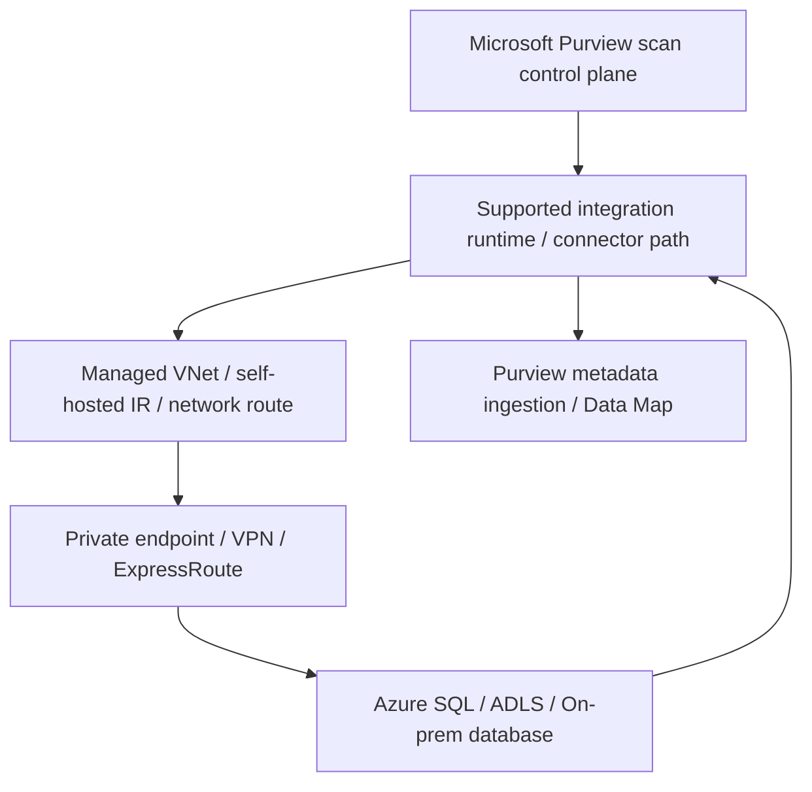

Sơ đồ là **khái niệm**: không phải mọi source dùng cùng loại integration runtime hay cùng private endpoint, và networking implementation thay đổi theo connector/trải nghiệm.

### Những mô hình cần đánh giá

- **Public service endpoint có firewall/identity** cho nguồn được chính sách cho phép.
- **Private endpoint** cho nguồn Azure như Storage/SQL, kèm DNS/route hợp lệ.
- **Managed virtual network integration runtime** cho một số Purview scanning scenarios được hỗ trợ.
- **Self-hosted integration runtime** hoặc gateway tương ứng khi kết nối hệ thống on-premises hoặc network không mở trực tiếp.
- **VPN/ExpressRoute** khi nguồn trong datacenter và tổ chức đã triển khai kết nối riêng.

### Checklist mạng

1. Scanner thực thi ở đâu?
2. Hostname nguồn giải về IP nào từ chính runtime đó?
3. Port/NSG/firewall/outbound proxies có cho phép không?
4. Private endpoint/managed private endpoint đã được approved chưa?
5. Identity có quyền data-plane phù hợp chưa?
6. Có private DNS zone resolution đúng theo resource type không?
7. Từ source đến metadata ingestion endpoints có connectivity theo mô hình hỗ trợ không?
8. Scan có timeout do network hay lỗi authorization?

**Không bật public access cho SQL/Storage chỉ để test Purview** nếu chính sách yêu cầu private-only. Phân biệt `403 Forbidden` do auth với `timeout` do DNS/route để xử lý đúng lớp.

## 24. Data access request: catalog không tự cấp quyền

Trong những trải nghiệm/governance products được hỗ trợ, người dùng có thể tìm data product và gửi **access request** hoặc đi qua quy trình phê duyệt được cấu hình. Tuy nhiên cần xác định rõ hệ thống nào thực thi quyền.

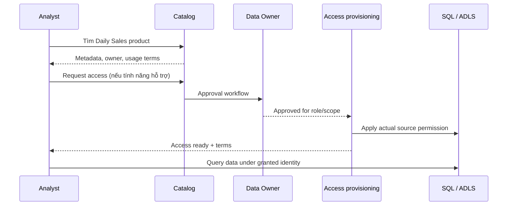

Các bước provisioning có thể là manual, IaC/ITSM, identity governance hoặc connector/tích hợp policy được hỗ trợ. **Approval trong catalog không đồng nghĩa tự động Azure SQL GRANT hoặc Storage RBAC được cấp**, trừ khi đã cấu hình một cơ chế thực thi cụ thể.

### Quy trình chuẩn

- Request nêu rõ data product, mục đích sử dụng, scope và thời hạn.
- Data owner/security đánh giá tính phù hợp.
- Chọn role tối thiểu, hạn dùng và hệ thống nguồn thực thi.
- Lưu audit approval và ai đã provision quyền.
- Định kỳ review/revoke access.
- Theo dõi việc data product thay đổi classification và ảnh hưởng quyền.

Với dữ liệu khách hàng nhạy cảm, catalog có thể công bố metadata nhưng access vẫn cần approval riêng và masking/row-level security trong nền tảng dữ liệu.

## 25. Từ glossary đến semantic layer và KPI

Một doanh nghiệp có thể có ba tên:

```text
Azure SQL: dbo.order_amount
Data Lake: facts.gross_sale_value
Power BI: Total Sales
```

Chúng có thể cùng mô tả một khái niệm — hoặc không. **Data catalog không nên tự đồng nhất chúng chỉ vì tên gần giống.**

### Quản lý business terms

Ví dụ:

| Thuật ngữ | Định nghĩa | Ánh xạ |
|---|---|---|
| **Gross Sales** | Giá trị đơn bán trước giảm/hoàn | `fact_orders.gross_amount` |
| **Net Revenue** | Theo quy tắc Finance đã phê duyệt | `fact_orders.net_revenue_amount` |
| **Active Customer** | Khách có hoạt động đáp ứng ngưỡng kỳ | `customer_activity.is_active` |
| **Refund Rate** | Refunds trên đơn đủ điều kiện | `finance.refund_rate` |

### Governance của KPI

1. Định nghĩa câu hỏi nghiệp vụ và đơn vị.
2. Xác định thời gian ghi nhận, timezone và handling late data.
3. Chốt inclusion/exclusion logic với domain owner.
4. Liên kết term với data assets và semantic model measures.
5. Lưu version/approval và có kỳ review.
6. Xác minh lineage từ nguồn đến KPI.
7. Đặt data quality checks/freshness expectations.

Một chỉ số có lineage kỹ thuật đầy đủ vẫn có thể **sai định nghĩa** nếu Finance và Sales chưa thống nhất cách tính.

## 26. Data product và data contract

### Data product

Một gói dữ liệu `Customer Orders Analytics` có thể mô tả:

```text
Business domain: Commerce
Product name: Customer Orders Analytics
Purpose: Phân tích tỷ lệ giao hàng đúng hạn và hoàn đơn
Assets: fact_orders, order_status_history, Sales semantic model
Product owner: Sales Analytics
Steward: Commerce Data Steward
Access: Request/Approval, read-only analytics scope
Refresh: mỗi 30 phút
Freshness target: < 45 phút
Quality expectations: order_id unique, status enum valid
Sensitive fields: customer IDs; không cấp email mặc định
Lineage: Orders API → ingestion → curated → semantic model
Support channel: Data Platform service desk
```

### Data contract

Một **data contract** ghi lại schema, semantics, quality, freshness, owner và compatibility kỳ vọng giữa producer/consumer. Ví dụ một schema có:

```json
{
  "contractName": "orders-curated",
  "version": "2.0",
  "owner": "Commerce Data Platform",
  "fields": [
    {"name": "order_id", "type": "string", "required": true},
    {"name": "order_status", "type": "string", "required": true},
    {"name": "net_revenue_amount", "type": "decimal", "required": true}
  ],
  "freshnessTargetMinutes": 45,
  "backwardCompatibility": "review-required"
}
```

Đây là **một ví dụ contract nội bộ**, không phải schema Purview API và không có tác dụng enforce tự động. Có thể dùng contract tests trong CI/CD, còn catalog chứa metadata mô tả và liên kết.

### Data products và data contracts không thay thế lineage

Contract nói **đầu ra phải như thế nào**; lineage nói **đầu ra đến từ đâu và đi qua biến đổi nào**; data quality checks nói **đầu ra hiện có đáp ứng yêu cầu hay không**. Cần kết hợp cả ba.

## 27. Monitoring cho một chương trình data catalog

Không nên chỉ đo “bao nhiêu data sources đã register”. Một catalog có 10.000 tài sản nhưng không owner, không description và lineage lỗi có thể kém giá trị.

### Technical telemetry

| Chỉ số | Cách sử dụng |
|---|---|
| **Scan success/failure rate** | Phát hiện credentials/network/schema scan issues |
| **Scan duration** | Theo dõi nguồn lớn, lịch và capacity |
| **Asset count / scan coverage** | Ước lượng mức độ khám phá so với inventory |
| **Last successful scan age** | Phát hiện metadata stale |
| **Classification rule hits** | Theo dõi nhạy cảm/false positives |
| **Lineage ingestion success** | Biết integrations có đưa edge vào map không |
| **Unmatched/placeholder assets** | Xác định vấn đề identity/missing scans |
| **Role/access failures** | Thiếu quyền Data Map, source hoặc Key Vault |
| **Integration runtime health** | Scan on-prem/private connectivity có hoạt động không |

### Governance adoption telemetry

| Chỉ số | Ý nghĩa |
|---|---|
| **% critical assets có business owner** | Trách nhiệm rõ đến đâu |
| **% curated assets có business description** | Người dùng hiểu dataset được không |
| **% important KPIs có glossary term** | Định nghĩa đã thống nhất chưa |
| **% critical data products có lineage được verify** | Đủ mức tin cậy cho impact analysis không |
| **% nhạy cảm được review classification** | Quản trị privacy và false positives |
| **Median time to find a dataset** | Catalog có thực sự giúp người dùng |
| **Access request lead time** | Quá trình provisioning hiệu quả không |
| **Data quality SLO compliance** | Sản phẩm dữ liệu có đủ tin cậy |

### Một bộ SLO minh họa

```text
Tier-1 assets có owner:                 >= 98%
Tier-1 assets có description:           >= 95%
Tier-1 data sources scan trong 24h:     >= 99%
Critical pipeline lineage verified:    >= 95%
Classification review với PII assets:  theo chu kỳ phê duyệt
Data product incidents acknowledged:  < 1 giờ
```

Các mục tiêu này **không phải SLA mặc định của Microsoft Purview**, mà là ví dụ tổ chức có thể chọn sau khi khảo sát nguồn lực và rủi ro.

### Phân biệt scan freshness và data freshness

- **Scan freshness:** Metadata/catalog được cập nhật lần cuối lúc nào?
- **Data freshness:** Bảng/dataset thật có dữ liệu mới đến lúc nào?
- **Lineage freshness:** Quan hệ nguồn-đích trong graph có phản ánh pipeline/release hiện tại không?
- **Dashboard freshness:** Semantic model/report được refresh thành công khi nào?

Bốn mốc này có thể khác nhau nhiều giờ. “Scan PASS lúc 09:00” **không chứng minh** warehouse đã nhập dữ liệu của ngày hôm nay.

## 28. Chi phí của Purview và hệ thống liên quan

Một chương trình governance có thể phát sinh chi phí ở nhiều nơi; cách tính phụ thuộc mô hình dịch vụ, gói, region và khả năng sử dụng.

| Thành phần | Những yếu tố cần xác minh |
|---|---|
| **Purview Data Map/metadata capability** | Mức sử dụng metadata/scan/data map capacity theo chính sách giá của giai đoạn triển khai |
| **Unified Catalog/data governance features** | Gói/quyền sử dụng, data product/quality capabilities và mô hình metering hiện hành |
| **Scans** | Số nguồn, phạm vi, tần suất, loại scan/connector và khả năng source |
| **Integration runtime** | Self-hosted VM/compute/network hoặc runtime được quản lý có điều kiện |
| **Azure Storage/SQL** | Data-source requests/transactions khi scan, logs và source compute |
| **Network** | Private endpoints, cross-region data transfer, VPN/ExpressRoute |
| **Key Vault** | Secret/certificate operations và hosting liên quan |
| **Azure Monitor** | Diagnostic log ingestion, storage và retention |
| **Data quality/analytics** | Compute/query nếu có chạy rules hoặc pipeline tests |

**Không thể đưa bảng giá cố định chỉ từ tên “Microsoft Purview”.** Một số trải nghiệm governance đã thay đổi đơn vị billing so với những tài liệu về Purview account truyền thống. Luôn dùng bảng giá chính thức, giá theo subscription/region và Cost Management hiện hành để ước lượng trước khi bật tính năng.

### Bài toán chi phí vận hành scan

Giả sử có:

```text
20 data sources
12 nguồn Tier-1 scan 4 lần/ngày
8 nguồn Tier-2 scan 1 lần/ngày
Tổng số scan executions dự kiến/ngày:
  12 × 4 + 8 × 1 = 56
```

Số 56 chỉ là **số lần chạy**. Chi phí thực tế còn phụ thuộc **loại nguồn, công suất, thời lượng, dữ liệu, cách tính phí và các tài nguyên liên quan**. Một scan SQL schema nhỏ và một scan ADLS chứa hàng triệu files không nhất thiết tốn như nhau.

### Tối ưu dựa trên giá trị

1. Ưu tiên nguồn Tier-1 có rủi ro/giá trị cao.
2. Chọn scan schedule theo tốc độ schema thay đổi, không theo cảm tính.
3. Loại bớt temporary/test/private paths.
4. Dùng incrementals/change detection khi connector hỗ trợ và đã kiểm chứng.
5. Bảo trì self-hosted IR hoặc gateway trên capacity phù hợp.
6. Giảm diagnostic logging payload dư thừa, nhưng giữ audit cần thiết.
7. Đo catalog adoption và lineage coverage cùng chi phí.
8. Dùng Azure Cost Management budgets/alerts và kiểm kê tài nguyên được tạo.

### Đánh giá ROI

Mục tiêu governance không chỉ là giảm phí scan. Có thể định lượng:

- thời gian tìm đúng dataset giảm bao nhiêu;
- thời gian phân tích impact trước schema change giảm bao nhiêu;
- số báo cáo bị hỏng do thay đổi nguồn giảm;
- thời gian điều tra số liệu sai/incident giảm;
- số asset không owner/classification giảm;
- số yêu cầu truy cập được xử lý đúng SLA tăng.

Không dựa vào số lượng scans như chỉ số thành công duy nhất.

## 29. Lab: khám phá Azure Data Lake bằng Microsoft Purview

### Mục đích

Xây dựng một minh chứng end-to-end về **metadata discovery**:

1. Một nguồn Storage/ADLS chứa dữ liệu giả.
2. Microsoft Purview đăng ký và scan nguồn.
3. Catalog cho phép tìm asset theo tên và classification.
4. Steward bổ sung description/owner/glossary term.
5. Nhóm kiểm thử phân biệt quyền xem metadata với quyền đọc Blob.
6. Theo dõi scan status và dọn dẹp lab.

Lab này **không yêu cầu tạo hay truy cập dữ liệu khách hàng thật**. Nếu doanh nghiệp không cấp quyền tạo resources, dùng các bảng/checklist trong bài để thực hiện design review trên dữ liệu mẫu.

### Kiến trúc lab

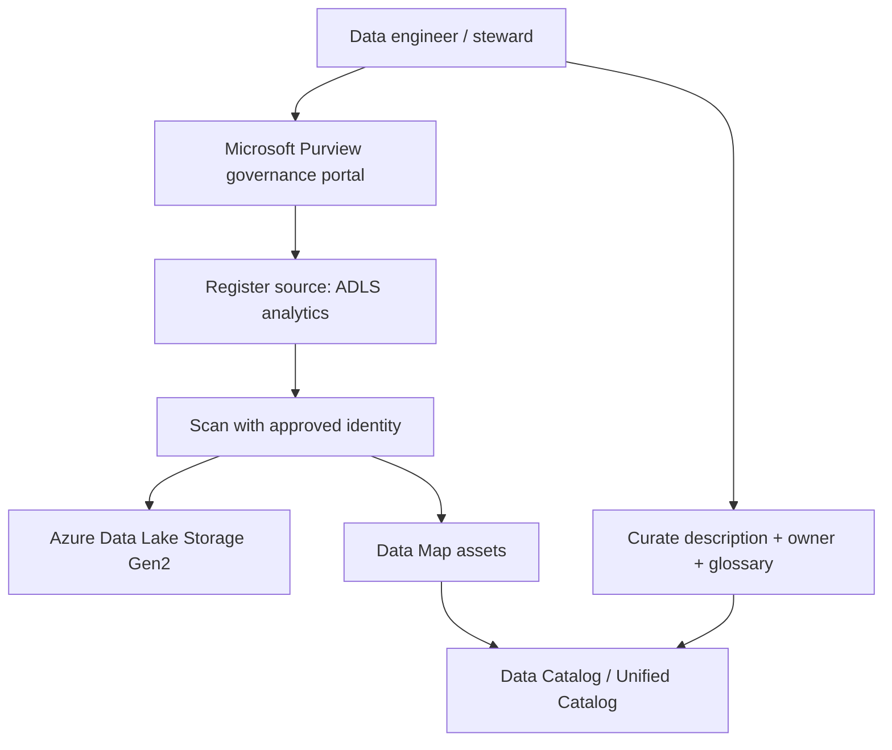

### Điều kiện

- Subscription sandbox, Azure resource group và budget được cấp phép.
- Một tài nguyên Microsoft Purview/Data Governance experience mà tổ chức đã cho phép sử dụng.
- Storage account/ADLS Gen2 chỉ phục vụ lab, không có dữ liệu sản xuất.
- Danh tính có quyền cấu hình Purview scan trong mô hình quản trị đang dùng.
- Danh tính scan có Storage data-plane read permission trong phạm vi được phê duyệt.
- Network/DNS cho integration runtime có thể kết nối tới nguồn.
- Có owner/steward test được phép curate metadata.

**Không tự khởi tạo thêm tài nguyên tính phí** nếu sandbox đã có Purview account dùng chung: cần tránh cấp quyền admin quá rộng hoặc thay đổi cấu hình nguồn đang dùng bởi nhóm khác.

### Bước 1 — Thiết kế bộ dữ liệu giả

Chọn một path trong Storage lab:

```text
Account: stpurviewlab<unique>
Filesystem: analytics
Path: /raw/orders/order_date=2026-11-20/
File: orders-sample.csv
```

Dữ liệu CSV:

```csv
order_id,customer_code,customer_email,order_status,gross_amount,paid_at
ord-001,cust-1001,user1@example.test,Paid,1200000,2026-11-20T08:00:00Z
ord-002,cust-1002,user2@example.test,Cancelled,500000,2026-11-20T08:10:00Z
ord-003,cust-1001,user1@example.test,Paid,350000,2026-11-20T09:05:00Z
```

Địa chỉ `example.test` và các giá trị đều là **giả lập**. Không đưa email thật hoặc số định danh cá nhân vào Storage chỉ để thử tính năng phân loại.

### Bước 2 — Tạo/kiểm tra nguồn Storage

Trong Azure Portal:

1. Chọn subscription/resource group sandbox.
2. Xác nhận Storage account có hierarchical namespace nếu lab dùng ADLS Gen2.
3. Tạo filesystem/container `analytics` và path thử theo cơ chế Storage Explorer/portal.
4. Upload CSV giả.
5. Kiểm tra network policy, encryption và quyền truy cập.
6. Ghi resource ID, tên account/filesystem/path và owner lab.

**Không mở anonymous public Blob access**. Người học có thể dùng tài khoản được phê duyệt hoặc managed identity/Storage RBAC.

### Bước 3 — Đăng ký nguồn trong Purview

Trong **Data Map / Sources / Register** hoặc chức năng tương ứng trên trải nghiệm đang dùng:

1. Chọn connector loại ADLS Gen2/Storage được hỗ trợ.
2. Nhập endpoint/resource identity của Storage lab.
3. Chọn collection/management scope phù hợp.
4. Xác nhận nguồn hiển thị ở inventory/sources.
5. Ghi nhận source name và environment/owner.

Sau bước này **có thể chưa thấy file/columns trong catalog** vì mới register, chưa thực hiện scan.

### Bước 4 — Cấp quyền scan

1. Xác định identity Purview thực sự dùng cho scan.
2. Cấp Storage data-plane role/ACL cần thiết tại scope tối thiểu.
3. Nếu Storage có firewall/private endpoint, đảm bảo integration runtime có network route được phê duyệt.
4. Không lưu account key trong ghi chú lab.
5. Test connection/scan theo chức năng được cung cấp.

Nếu xuất hiện lỗi 403, kiểm tra **data-plane RBAC/ACL**; nếu timeout, kiểm tra private DNS/firewall/IR. Không đổi network access bừa bãi.

### Bước 5 — Tạo và chạy scan

Chọn:

```text
Source: ADLS lab
Scope: /analytics/raw/orders/
Scan rule set: CSV/structured files được hỗ trợ
Classification: built-in classifiers phù hợp
Run mode: one-time lab
Owner: Data Platform training
```

Thực hiện scan một lần và đợi kết quả. Đừng thiết lập recurrence hàng phút trong sandbox nếu không cần.

### Bước 6 — Kiểm tra kết quả khám phá

Trong Data Map/Catalog:

- Tìm `orders-sample.csv` hoặc path/tên asset tương ứng.
- Xem source resource, schema/columns nếu connector nhận diện.
- Xem có `customer_email` được phân loại Email Address hay không.
- Ghi lại last scan time, classification confidence và owner status.
- Nếu catalog không thấy columns, xác định scanner có hỗ trợ schema extraction từ loại file hiện dùng không.

**Không chấm lab sai chỉ vì classifier không phát hiện email trong một tệp rất nhỏ**: kết quả phân loại phụ thuộc sampling, rule set, connector, định dạng và policy. Cần kiểm tra logs/config và có thể kiểm chứng thủ công.

### Bước 7 — Curate metadata

Người có quyền steward/curator trong mô hình đang dùng bổ sung:

```text
Description:
  Dữ liệu đơn hàng thử nghiệm phục vụ đào tạo quản trị metadata.
Business term:
  Order
Owner:
  Commerce Training Owner
Steward:
  Data Governance Lab Steward
Sensitivity context:
  Demo synthetic customer contact data
Approved use:
  Internal training only
Retention:
  Xóa sau lab theo chính sách
```

Các trường có thể được nhập trong asset detail, glossary/business concepts hoặc data product tương ứng, tùy trải nghiệm. **Không sửa phân loại production** chỉ vì lab có quyền Data Curator.

### Bước 8 — Kiểm thử phân quyền metadata và data

Với một test user:

1. Kiểm tra user có thể tìm metadata theo role/catalog settings.
2. Kiểm tra user **không tự đọc được file** khi chưa có Storage data-plane permission.
3. Nếu được phê duyệt, cấp quyền đúng scope rồi truy cập lại.
4. Thu hồi quyền và xác minh data access bị ngăn theo cơ chế.

Mục tiêu là chứng minh **catalog discovery tách khỏi quyền đọc dữ liệu nguồn**. Không cố đọc Blob production của người khác để chứng minh quyền bị từ chối.

### Bước 9 — Ghi kết quả

```text
Purview experience: Data Map / classic Data Catalog / Unified Catalog
Storage resource: <resource ID>
Registered source: <name>
Scan identity: <principal identifier, đã ẩn nhạy cảm>
Scan connection: PASS/FAIL
Scan execution: PASS/FAIL
Discovered asset: <qualified name/path>
Columns discovered: <list>
Classification detection: <result + verification>
Business term linked: <name/version>
Owner/steward assigned: PASS/FAIL
Metadata search: PASS/FAIL
Unauthorized data read blocked: PASS/FAIL
Scan duration/metric: <value>
Estimated cost: <value>
Cleanup owner: <person>
```

### Bước 10 — Dọn dẹp

1. Chỉ xóa CSV/container/resource **do lab sở hữu**.
2. Thu hồi Storage role assignments tạm.
3. Dừng hoặc xóa lịch scan lab khi không còn cần.
4. Xem data source registration/metadata artifacts còn nằm trong Purview không, áp dụng quy trình cleanup phù hợp.
5. Kiểm tra Storage, Key Vault, integration runtime, private endpoint và logs có chi phí còn lại không.
6. **Không xóa Purview account dùng chung của tổ chức** chỉ để làm sạch bài lab.

## 30. Lab lineage: Azure SQL → Data Factory → ADLS

### Mục tiêu

Tiếp tục tư duy từ lab khám phá, tạo một pipeline minh họa để biết **data lineage được thu thập ở đâu và giới hạn của automatic lineage**.

### Sơ đồ

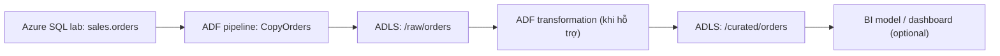

### Phương án A — Có tài nguyên sandbox thật

1. Tạo Azure SQL database lab hoặc dùng SQL sandbox đã được cấp phép; thêm bảng `sales.orders` chứa dữ liệu giả.
2. Dùng ADLS lab ở trên làm sink.
3. Tạo Azure Data Factory và linked services với managed identity/credential được phê duyệt.
4. Tạo `CopyOrders` pipeline gồm source/sink được connector hỗ trợ.
5. Register/scan Azure SQL và ADLS trong Purview khi phù hợp.
6. Kết nối ADF với Purview theo tính năng và quyền đúng phiên bản.
7. Chạy pipeline với dữ liệu giả.
8. Mở lineage viewer và tìm source, activity, sink edges.
9. Đối chiếu run ID, timestamp và path qualified name.
10. Nếu thiếu edges, kiểm tra connector support, integration/scan, permissions và latency ingestion.

### Phương án B — Không có quyền tạo tài nguyên

Sử dụng sơ đồ và bảng metadata mock sau để thực hành impact analysis mà không chạy Azure resources:

| Node | Kiểu | Qualified name minh họa |
|---|---|---|
| A | Azure SQL table | `sql://sales-db/sales.orders` |
| B | ADF Copy Activity | `adf://sales-adf/CopyOrders` |
| C | ADLS raw dataset | `adls://sales-lake/raw/orders` |
| D | Transform job | `adf://sales-adf/TransformOrders` |
| E | ADLS curated dataset | `adls://sales-lake/curated/orders` |
| F | Power BI semantic model | `pbi://sales-workspace/SalesModel` |

Những **qualified names chỉ là mẫu mô tả**; không phải định danh chính thức trong Purview. Hãy vẽ:

```text
A → B → C → D → E → F
```

Sau đó giả định:

- `sales.orders.order_status` bị đổi tên.
- Activity B Copy không lỗi nhưng Transform D còn dùng tên cũ.
- Report F đang dùng E của kỳ trước.

Yêu cầu: liệt kê affected nodes, root-cause candidates, owners cần liên hệ và kế hoạch backward-compatible migration.

### Bài tập lineage thiếu edge

Thay D bằng một custom Python script:

```text
C → [Custom Python ETL] → E
```

Nếu Purview chỉ nhìn thấy ADF Copy và không thu metadata của script, graph có thể trông như:

```text
A → B → C
             E → F
```

Đây là **data lineage gap**, không chứng minh E độc lập với C. Đề xuất một kế hoạch bổ sung lineage:

1. Xác định inputs/outputs và schema của script.
2. Ghi job ID/run ID và code commit.
3. Dùng metadata ingestion/connector được hỗ trợ.
4. Reconcile nodes với assets đã scan.
5. Đưa kết quả qua steward review.
6. Cảnh báo khi metadata không còn khớp pipeline version.

## 31. Lab glossary và impact analysis cho Net Revenue

### Bối cảnh

Finance muốn đổi cách tính Net Revenue:

```text
v1: gross_amount - discounts
v2: gross_amount - discounts - refunds
```

Nếu không quản lý version, hai reports có thể tiếp tục dùng cùng tên `Net Revenue` nhưng số liệu khác nhau.

### Quy trình

1. Tạo/cập nhật business term `Net Revenue` với definition và owner.
2. Ghi version, ngày hiệu lực và đơn vị tiền tệ.
3. Link term tới asset cột `fact_orders.net_revenue_amount`.
4. Mở lineage từ cột/bảng tới reports có phụ thuộc.
5. Với những reports không được auto-discover, bổ sung manual dependency có bằng chứng theo quy trình.
6. Lập danh sách owners downstream cần review.
7. Tạo test data với refunded_amount dương.
8. So sánh kết quả v1 và v2; xác minh chênh lệch dự kiến.
9. Publish change notice cùng migration plan.
10. Verify lineage và business definitions sau deployment.

### Dataset ví dụ

| Order | Gross | Discount | Refund | Net v1 | Net v2 |
|---|---:|---:|---:|---:|---:|
| O-01 | 1.000.000 | 100.000 | 0 | 900.000 | 900.000 |
| O-02 | 500.000 | 0 | 200.000 | 500.000 | 300.000 |
| O-03 | 800.000 | 50.000 | 50.000 | 750.000 | 700.000 |
| **Tổng** | 2.300.000 | 150.000 | 250.000 | **2.150.000** | **1.900.000** |

Sự chênh lệch **250.000** do thay đổi rule trừ refund, không phải số đơn bị thất lạc. Lineage và business metadata giúp giải thích nguồn biến động, còn SQL/data tests chứng minh số liệu.

### Yêu cầu nghiệm thu

- Định nghĩa v1 và v2 có owner/approval.
- Tất cả affected reports được thông báo.
- Không nhầm thay đổi KPI với lỗi ingestion.
- Tests đúng về số tiền/đơn vị.
- Data products ghi rõ version và effective date.
- Người dùng cuối biết số liệu trước/sau đổi định nghĩa có thể không so sánh trực tiếp.

## 32. Kiểm tra Microsoft Purview resource bằng Azure CLI

Với một tài nguyên Purview truyền thống đã được tạo và bạn có quyền ARM, có thể kiểm tra **metadata hạ tầng** ở control plane:

```bash
az login --tenant "<tenant-id>"
az account set --subscription "<subscription-id>"

az account show \
  --query "{name:name,id:id,tenantId:tenantId}" \
  --output json

az resource show \
  --resource-group "rg-purview-lab" \
  --resource-type "Microsoft.Purview/accounts" \
  --name "<purview-account-name>" \
  --query "{id:id,name:name,location:location,properties:properties}" \
  --output json
```

**Giới hạn:** lệnh ARM trên chỉ phù hợp với một số tài nguyên Microsoft Purview account theo mô hình resource đó. Trong một số trải nghiệm governance hoặc tenant mới, UI/resource structure có thể khác. Kết quả `az resource show` **không chứng minh** Data Map scan đã thành công, các data assets đã được phát hiện, data product được phê duyệt hay lineage đúng.

### Không lạm dụng query metadata REST

Để làm việc với assets/lineage bằng REST, cần chọn **API/model đúng trải nghiệm** đang có (Data Map metadata/Atlas-derived APIs hoặc các API quản trị mới được hỗ trợ). Một REST endpoint từ tài liệu cũ có thể không áp dụng cho Unified Catalog. Hãy version và test API client trong sandbox, tránh đưa tenant-specific endpoint/token vào code samples công khai.

### Dùng IaC ở mức nào?

Có thể quản lý theo Bicep/ARM/Terraform hoặc pipeline được tổ chức phê duyệt:

- resource groups, Purview hạ tầng khi provider hỗ trợ;
- network/private endpoints, Key Vault, identities;
- scan scheduling/configuration qua API/automation được hỗ trợ;
- governance metadata definitions qua công cụ/API phù hợp và quy trình review;
- Azure Monitor alerts/budgets/tags.

**Không giả định mọi business term/data product/scan là một ARM resource hỗ trợ cùng cách deployment.** Data plane/governance APIs và control plane có vòng đời khác nhau.

## 33. Troubleshooting: scan thành công nhưng không thấy asset

Một tình huống phổ biến là “Scan status = Succeeded” nhưng người dùng không tìm được dữ liệu mong muốn.

### Những khả năng cần kiểm tra

1. **Search scope/permissions:** người dùng không có quyền xem asset hoặc đang lọc nhầm collection/domain.
2. **Path/source scope:** scan chỉ bao phủ `/raw`, còn dữ liệu nằm ở `/curated`.
3. **Connector support:** định dạng file/table không được hỗ trợ ở mức chi tiết người dùng kỳ vọng.
4. **Metadata propagation:** scan vừa kết thúc, catalog/search index chưa cập nhật.
5. **Asset identity:** cùng tên được tạo ở nguồn khác; đang tìm nhầm qualified name.
6. **Object permissions:** scan account thấy filesystem nhưng không đọc được directory/table cụ thể.
7. **Scan rules:** pattern loại trừ hoặc rule set không bao gồm định dạng.
8. **Tenant/experience mismatch:** người dùng đang mở một catalog/governance experience khác với account đã scan.

### Quy trình xử lý

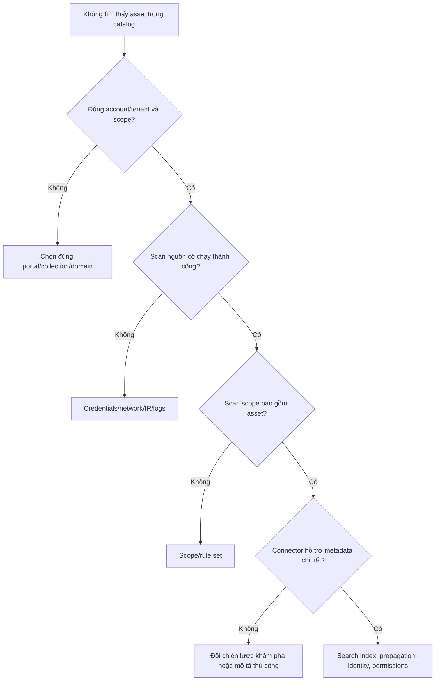

Không giải quyết bằng cách scan toàn bộ subscription với credential rộng hơn trước khi xác định nguyên nhân. Việc mở rộng quyền/scope không kiểm soát có thể đưa dữ liệu ngoài phạm vi quản trị vào catalog.

## 34. Troubleshooting: lineage bị thiếu hoặc sai

### Một checklist theo từng lớp

| Dấu hiệu | Nguyên nhân có thể | Hướng kiểm tra |
|---|---|---|
| Không thấy ADF pipeline trong lineage | ADF–Purview integration chưa cấu hình hoặc chưa có run phù hợp | Integration settings, connector support, metadata ingestion |
| Có source nhưng không có sink | Sink chưa scan/register hoặc identity không khớp | Qualified names, path, source coverage |
| Có sink nhưng không có upstream | Job custom không hỗ trợ auto lineage | Runtime metadata và manual/connector ingestion |
| Node trùng tên | Assets có cùng display name trong nhiều systems | Qualified name/resource identity |
| Graph thể hiện pipeline cũ | Metadata ingestion/scan chưa cập nhật | Last successful scan/run, pipeline version |
| Report không nối tới data model | Workspace metadata integration/permissions hạn chế | Power BI/Fabric permissions và feature support |
| Column-level lineage trống | Connector chỉ hỗ trợ asset-level hoặc transform khó parse | Compatibility matrix, SQL/ADF source code |
| Column lineage có vẻ sai | SQL động/aliases/joins/filters không được biểu diễn đầy đủ | Manual verification, lineage contract |
| Một bảng có nhiều upstream không rõ | Nhiều jobs ghi cùng sink hoặc trùng qualified names | Run history và ownership/data contracts |
| Đổi tên bảng làm đứt edge | Qualified name mới không khớp asset cũ | Migration lineage mapping, deprecation |
| Lineage từ Power BI chỉ có một phần | Semantic model/DAX/refresh integration khác biệt | Đối chiếu Power BI lineage và Purview |
| Catalog hiện “unknown” process | Connector thiếu hoạt động trung gian hoặc source/sink chưa resolve | Metadata source, scan coverage |

### Không đồng nhất ba câu khẳng định

- **Pipeline succeeded:** tác vụ đã chạy thành công theo hệ thống điều phối.
- **Data is correct:** kết quả đáp ứng business and quality rules.
- **Lineage is complete:** graph ghi nhận đầy đủ những nguồn và transformations liên quan.

Ba điều này **độc lập tương đối**. Một ADF pipeline PASS có thể tạo dữ liệu sai do logic lọc; một lineage graph đầy đủ có thể phản ánh pipeline đã cũ; một report hiển thị đúng hôm nay có thể thiếu lineage cho custom transform.

## 35. Troubleshooting tổng hợp: bảo mật, scan và governance

| Triệu chứng | Khả năng | Bước tiếp theo |
|---|---|---|
| Register source được nhưng scan trả 403 | Identity không có SQL/Storage data-plane access | Kiểm tra principal, RBAC/SQL permission/ACL |
| Scan timeout tới nguồn private | DNS/route/firewall/IR chưa đúng | Test từ chính runtime, private endpoint approval |
| Key Vault secret không đọc được | Thiếu role hoặc secret đã rotate | Role, secret version, network policy |
| Một số paths ADLS không có metadata | ACL traverse, scope exclude, file type hỗ trợ | ACL, rule set, path inventory |
| Bảng không có classification mong đợi | Rule/sampling/connector limitations | Kiểm tra rule, false negative, review thủ công |
| Classification nhận diện sai | False positive | Steward review và annotate đúng policy |
| User thấy asset nhưng không query được | Catalog permission khác source permission | Data access approval/SQL grant/Storage RBAC |
| User không thấy asset dù có data access | Thiếu metadata/catalog role hoặc search scope | Purview permissions và catalog experience |
| Không sửa được description | Thiếu curator/steward quyền trong mô hình | Role, collection/domain scope |
| Data product không xuất hiện | Chưa publish/approval hoặc scope không đúng | Unified Catalog governance workflow |
| Business term bị trùng | Thiếu owner và quy tắc glossary version | Steward review, naming conventions |
| Scan bị trễ sau đổi schema | Chưa có scheduled scan hoặc connector chậm | Scan schedule, source changes, logs |
| Metadata đã mới nhưng dashboard cũ | BI refresh chưa chạy thành công | Semantic model refresh, lineage, source state |
| Cost governance tăng đột biến | Scan scope/tần suất, paid features, IR/network | Cost Management và inventory |
| Xóa source nhưng asset vẫn còn trong catalog | Lifecycle/soft delete/metadata retention khác nhau | Asset retirement process, permissions |
| Lộ thông tin nhạy cảm trong description | Curator đưa dữ liệu thật vào metadata | Governance review, audit, redact đúng quy trình |

### Quy trình điều tra ưu tiên

1. Xác định **scope** (account, source, collection, catalog experience).
2. Xác định **principal** (người dùng, managed identity, service principal, self-hosted IR).
3. Xác định **lớp lỗi** (network, auth, connector, scan rule, metadata indexing, lineage ingestion, business curation).
4. Thu thập **logs/scan run IDs** và timestamps, hạn chế dữ liệu nhạy cảm.
5. Thử lại ở **phạm vi nhỏ nhất** để xác nhận nguyên nhân.
6. Sửa configuration theo least privilege.
7. Re-run scan/lineage ingestion và xác minh asset.
8. Ghi runbook/incident record để tránh lặp lại.

## 36. Kiến trúc tham chiếu: governance cho doanh nghiệp đa nguồn

### Bối cảnh

Một doanh nghiệp có:

- Azure SQL dùng cho giao dịch bán hàng.
- ADLS Gen2 lưu raw/curated dữ liệu.
- Azure Data Factory và Synapse/Fabric phục vụ ETL/analytics.
- Power BI cho báo cáo kinh doanh.
- Hệ thống SQL Server on-prem chứa thông tin ERP.
- Các domain Sales, Finance và Supply Chain.
- Dữ liệu khách hàng và thông tin nhân viên cần quản lý quyền chặt chẽ.

### Kiến trúc đề xuất

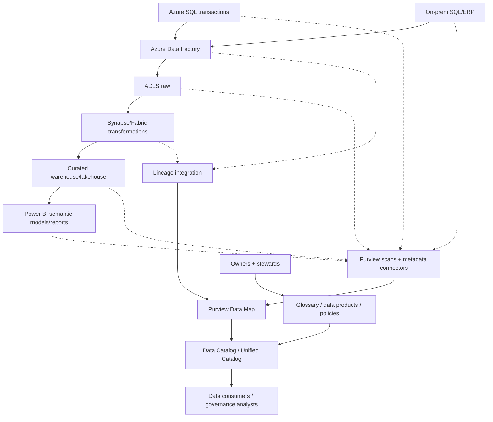

Các nét đứt đại diện **metadata collection**, không phải luồng dữ liệu nghiệp vụ. Khả năng ingest metadata/lineage từ từng nguồn phải được xác minh; sơ đồ không tuyên bố mọi nguồn được hỗ trợ tự động ở cùng mức.

### Phân công trách nhiệm

| Thành phần | Owner | Điều cần duy trì |
|---|---|---|
| SQL/Storage source | Source platform owner | Data-plane permission, schema, classification policy |
| ADF/ETL pipeline | Data engineering | Code, run status, lineage integration |
| Warehouse/lakehouse | Analytics platform | Schema contracts, freshness, data quality |
| Power BI reports | BI team | Semantic models, refresh, KPI definitions |
| Purview Data Map | Governance platform | Data sources, scans, collection model, metadata freshness |
| Unified Catalog/products | Domain stewards | Business glossary, owners, product status/usage |
| Security/compliance | Security team | Access, sensitivity, retention, audits |
| Cost monitoring | FinOps/platform | Purview/governance costs, scan schedules, capacity |

### Trình tự triển khai hợp lý

1. **Inventory:** xác định 10–20 nguồn dữ liệu quan trọng nhất, không vội scan toàn bộ công ty.
2. **Foundation:** xác định Purview experience, tenant, IAM, private network, logging và budget.
3. **Source onboarding:** register/scan nguồn Tier-1.
4. **Curation:** gán owner, glossary terms, classifications và data product descriptions.
5. **Lineage integration:** kết nối ADF/BI theo connector support và test graph.
6. **Business validation:** so sánh metric/lineage với source code và business definition.
7. **Access governance:** liên kết data product discovery với approval/provisioning.
8. **Operating model:** scan schedule, freshness/error alerts, incident owner.
9. **Scale by domain:** mở rộng Sales → Finance → Supply Chain có controls.
10. **Quarterly review:** đo adoption, coverage, quality, costs và quyền metadata.

### Vì sao không scan 100% nguồn ngay?

Không có danh sách owners, classifications và nguồn được cấp quyền, một scan diện rộng tạo ra rất nhiều assets không rõ trách nhiệm. Dễ phát sinh **metadata catalog debt**: tên tài sản có nhưng định nghĩa/lineage stale, không ai dám dùng.

## 37. Thực hành thiết kế lineage contract cho pipeline

Một đội data engineering có thể quy định mỗi pipeline production cung cấp:

```text
Pipeline identity:
  name: commerce-orders-curation
  owner: commerce-data-platform
  code version: commit hash
Inputs:
  - source qualified name
  - schema version / partition
Outputs:
  - target qualified name
  - schema version / partition
Transformation:
  - business rule version
  - SQL/notebook/script artifact reference
Runtime:
  - run ID
  - start/end timestamps
  - status
  - records read/written
  - quality checks
Governance:
  - sensitive fields
  - linked business terms
  - downstream owner contacts
```

Tài liệu này là **mẫu contract để đội kỹ thuật thực thi**, không phải định dạng bắt buộc của Purview. Công cụ ingest cần chuyển contract thành metadata/lineage phù hợp khi API hỗ trợ.

### Liên hệ với CI/CD

Với mỗi pull request thay pipeline:

- Kiểm tra có đổi nguồn/đích không.
- Kiểm tra có thêm/xóa cột hoặc đổi business logic không.
- Tính affected assets/reports theo lineage hiện tại.
- Xác minh owner/steward approval.
- Cập nhật schema contracts và test fixtures.
- Cập nhật metadata/lineage registration khi cần.
- Deploy ở staging, so sánh output với baseline.
- Monitor scans/ingestion và KPI sau release.

**Không dùng một lineage graph cũ để tự động phê duyệt schema breaking change**. Graph là input cho quy trình review, không phải nguồn quyết định duy nhất.

## 38. Quản trị vòng đời asset: tạo, thay đổi, ngừng dùng

Catalog có thể trở nên nhiễu nếu assets không bao giờ được nghỉ hưu (retire).

### Các trạng thái nội bộ minh họa

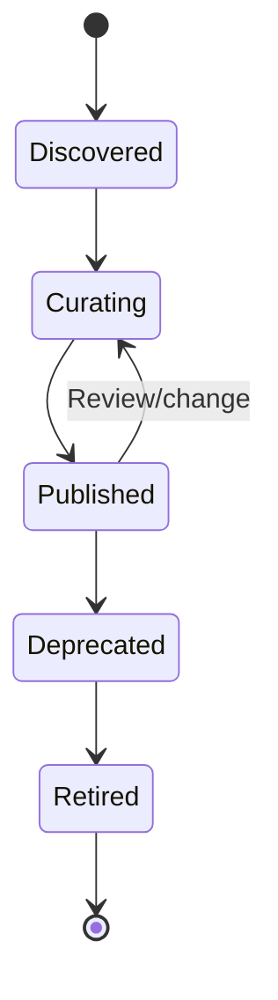

Đây là **workflow nội bộ đề xuất**, không phải một bộ trạng thái mặc định có trong mọi UI Purview.

### Quy trình deprecation

1. Data owner đề xuất retire dataset `old_sales_summary`.
2. Dùng downstream lineage xác định consumers/BI assets có thể bị ảnh hưởng.
3. Gửi thông báo deprecation và replacement dataset.
4. Cung cấp giai đoạn chuyển tiếp có thể đo mức sử dụng.
5. Đảm bảo clients/BI đã chuyển sang nguồn thay thế.
6. Xóa/quản lý dữ liệu nguồn theo retention/security policy.
7. Cập nhật metadata status, glossary links và lineage references.
8. Ghi audit quyết định retire.

Không xóa một raw dataset đang phục vụ reconciliation chỉ vì không còn thấy trong Power BI report. Có thể tồn tại custom consumers không được auto lineage ghi nhận.

## 39. Data governance không phải data masking/retention mặc định

### Phân biệt bốn hành động

| Hành động | Ví dụ | Công cụ thực thi cuối cùng |
|---|---|---|
| **Khám phá** | Phát hiện bảng có `email` | Data Map scan/catalog |
| **Mô tả** | Gắn term “Customer Email” | Steward/governance |
| **Hạn chế truy cập** | Chỉ nhóm CS được đọc email | RBAC/SQL GRANT/RLS/ACL/masking theo source |
| **Lưu giữ/xóa** | Xóa dữ liệu theo policy 3 năm | Storage lifecycle/SQL/retention workflows và compliance |

Purview có thể tham gia nhận diện/điều phối chính sách hoặc các tính năng enforcement cụ thể, nhưng phải chứng minh **hệ thống nào enforce policy**. **Gắn một tag `PII` không tự làm tài khoản Storage mã hóa, xóa hay che cột.**

### Mô hình defense in depth

- Entra ID cho workforce identity và workload identity.
- Data-source RBAC/SQL permissions và row/column controls.
- Private networking, encryption, monitoring.
- Purview governance cho catalog, ownership, lineage, classification.
- Purview security/compliance tools khi được tổ chức cấp phép và cấu hình phù hợp.
- Audit/incident response và periodic access review.

### Khi áp dụng luật riêng tư

Nghĩa vụ bảo vệ dữ liệu phụ thuộc khu vực pháp lý, mục đích sử dụng và chính sách tổ chức. Bài học không cung cấp kết luận pháp lý; với thông tin nhạy cảm, **Data Protection Officer/Legal/Security** cần review phân loại, retention, quyền truy cập và cách xử lý yêu cầu xóa dữ liệu.

## 40. Checklist trước khi triển khai Purview trong production

### Scope và kiến trúc

- [ ] Xác định business goals: discovery, glossary, lineage, classification, impact analysis, data products.
- [ ] Phân biệt Purview governance và security/compliance features cần dùng.
- [ ] Xác nhận trải nghiệm Data Map/classic catalog/Unified Catalog và licensing hiện hành.
- [ ] Lập inventory nguồn Tier-1, chọn thứ tự onboarding có owner.
- [ ] Chọn collection/domain model không làm lẫn ranh giới phân quyền với business ownership.
- [ ] Chọn scan scope, schedule, rule set và nguồn credentials phù hợp.
- [ ] Xác minh connector support/metadata granularity của từng source.

### Lineage và data quality

- [ ] Liệt kê pipelines: ADF, Synapse, Fabric/Power BI, custom code.
- [ ] Phân loại các edges auto-discovered, manually curated và chưa xác minh.
- [ ] Test lineage từ source qua transform đến report bằng dữ liệu mẫu.
- [ ] Kiểm tra actual support cho column-level lineage.
- [ ] Có cách thu thập lineage của custom ETL và dynamic SQL.
- [ ] Có business glossary term cho KPI quan trọng, version và approval.
- [ ] Có owner/steward và SLO về metadata freshness/quality.
- [ ] Có process kiểm tra downstream impact trước schema change.

### Security và compliance

- [ ] Có least-privilege IAM ở cả Purview metadata và data source.
- [ ] Managed identity/credentials được xác định rõ, có rotation/audit.
- [ ] Purview scan không dùng broad admin credentials không cần thiết.
- [ ] Private network/IR/Key Vault/DNS đã được kiểm tra từ đúng runtime.
- [ ] Metadata có sensitivity controls; không công khai danh sách nguồn nhạy cảm ngoài scope.
- [ ] Classification được review, không coi tag là enforcement.
- [ ] Data access approvals có nguồn thực thi và thời hạn truy cập rõ.
- [ ] Retention/data deletion policy được áp dụng trên source/backup/replica phù hợp.

### Operations và FinOps

- [ ] Monitoring scan errors, scan duration và metadata freshness.
- [ ] Monitoring lineage ingestion/coverage và missing edges.
- [ ] Có runbook 403, network timeout, source mismatch, catalog stale.
- [ ] Có ngân sách, tags, chargeback và lịch tối ưu scan.
- [ ] Data assets/data products có lifecycle/deprecation policy.
- [ ] Có CI/CD/change review cho glossary, pipeline, data contracts.
- [ ] Có kế hoạch kiểm thử DR/restore của data sources, không dựa vào catalog như backup.
- [ ] Có metric adoption và người chịu trách nhiệm cải thiện catalog.

## 41. Những hiểu nhầm phổ biến

**“Microsoft Purview chỉ là dịch vụ quét PII.”** Không. Trong data governance, nó còn phục vụ discovery, metadata catalog, business glossary, ownership và data lineage theo khả năng được hỗ trợ.

**“Purview Data Map và Unified Catalog là cùng một bảng dữ liệu với tên gọi khác.”** Không nên hiểu như vậy. Chúng có vai trò và trải nghiệm quản trị khác nhau; tính năng/permissions có thể khác theo tenant và thời điểm.

**“Register nguồn dữ liệu là đã scan đầy đủ cột và bảng.”** Sai. Register định nghĩa source; scan/integration mới thu thập metadata chi tiết khi được hỗ trợ.

**“Scan chỉ đọc metadata nên không cần permission trên nguồn.”** Không đúng. Scanner cần credential/data-plane permissions phù hợp và một số classification có thể truy cập nội dung mẫu theo connector/policy.

**“Purview Reader có quyền query Azure SQL.”** Không tự động. Metadata roles và source data-plane permissions là hai ranh giới khác nhau.

**“Data Catalog có thể thay toàn bộ data warehouse.”** Không. Catalog quản lý metadata; warehouse/lake/database lưu và xử lý dữ liệu thật.

**“Tên bảng giống nhau nghĩa là cùng một asset.”** Sai. Cần qualified name/resource identity của hệ thống nguồn.

**“Quét một file CSV chắc chắn tự suy được mọi column data type.”** Không. Format, scan rule, sampling và connector support quyết định.

**“Tất cả classifications đều chính xác 100%.”** Không. Có false positives và false negatives; steward phải review.

**“Gắn classification Sensitive tự động mã hóa Storage.”** Không. Classification metadata không thay enforcement của Storage/SQL.

**“Data lineage là danh sách ai đã xem dữ liệu.”** Không. Đó là quan hệ nguồn-đích/chuyển đổi; user access logs là một nguồn audit khác.

**“Lineage luôn cho biết công thức tính từng cột.”** Không. Tùy connector/transform support; custom SQL/notebook có thể chỉ có asset-level lineage hoặc không có edge.

**“ADF pipeline chạy thành công nghĩa Purview chắc chắn có đầy đủ lineage.”** Không. Cần integration, permissions và activity/source support, và metadata ingestion có thể trễ.

**“Power BI lineage UI giống Purview lineage UI trong mọi trường hợp.”** Không. Hai hệ thống ghi nhận assets/dependencies theo các tính năng/tầng tích hợp riêng.

**“Không thấy downstream trong graph nghĩa không ai dùng bảng.”** Không chắc. Có custom scripts/exports không được ghi nhận.

**“Một graph đẹp chứng minh dữ liệu chính xác.”** Sai. Cần quality checks và xác nhận business logic.

**“Owner trong catalog là Azure RBAC Owner.”** Không nhất thiết. Business ownership khác quyền quản trị resource.

**“Governance domain luôn trùng Data Map collection.”** Không. Một bên tổ chức quản trị theo nghiệp vụ, một bên có thể là scope technical metadata/permissions.

**“Data product chỉ là tên khác của một table.”** Không. Data product có thể tập hợp nhiều assets, owner, description, usage/access terms và cam kết chất lượng.

**“Có glossary term thì mọi KPI tự đồng bộ giá trị.”** Không. Terms mô tả/định nghĩa, còn pipelines/semantic model và tests phải thực thi logic đúng.

**“Data contract JSON trong Git tự là data lineage trong Purview.”** Không. Cần integration/ingestion và source identity phù hợp.

**“Purview sẽ tự quét tất cả SQL động và custom Python.”** Không mặc định. Phải xác nhận connector support, bổ sung instrumentation/manual lineage khi cần.

**“Scan thành công lúc 09:00 đồng nghĩa dữ liệu BI mới nhất cũng là 09:00.”** Sai. Scan freshness, data freshness, lineage freshness và BI refresh time khác nhau.

**“Chỉ cần tăng tần suất scan là chất lượng dữ liệu sẽ tăng.”** Không. Scan metadata không tự sửa missing/duplicate hoặc sai business definition.

**“Bật Purview là mọi quyền truy cập data source đều được kiểm soát tự động.”** Không. Source ACL/RBAC/policies cần cấu hình và được audit riêng.

**“Có private endpoint nghĩa scan không cần identity.”** Sai. Private routing và authentication là hai yêu cầu độc lập.

**“Xóa dataset gốc vì không thấy lineage downstream là an toàn.”** Không. Metadata có thể không bao phủ custom consumers.

**“Catalog có 50.000 assets là đã governance thành công.”** Không. Cần coverage, descriptions, owners, lineage verified và adoption.

**“Scan nhiều lần mỗi ngày chắc chắn rẻ.”** Không thể biết nếu chưa đo tài nguyên/giá theo connector và governance plan.

**“Có geo-replication của nguồn nghĩa Purview là backup.”** Không. Backup/restore của data source vẫn cần quản lý riêng.

## 42. Câu hỏi tự kiểm tra

**Câu 1.** Microsoft Purview giải quyết những vấn đề nào trong data governance?

**Đáp án:** Discovery/catalog, metadata, classifications, glossary, ownership, lineage, data product/governance workflows và quản trị tin cậy theo tính năng được hỗ trợ.

**Câu 2.** Data Map và Data Catalog khác nhau về vai trò như thế nào?

**Đáp án:** Data Map quản lý metadata assets/relationships và scan/classification/lineage; Catalog/Unified Catalog phục vụ tìm kiếm, diễn giải và curate dữ liệu cho người dùng theo mô hình trải nghiệm.

**Câu 3.** Vì sao chỉ đăng ký data source chưa đủ để thấy tất cả bảng/cột?

**Đáp án:** Register mới khai báo nguồn, còn scan/integration phải kết nối, thu thập technical metadata và đưa assets vào Data Map/catalog.

**Câu 4.** Ba loại metadata chủ yếu là gì?

**Đáp án:** Technical, business và operational metadata.

**Câu 5.** Data asset và business glossary term khác nhau ở đâu?

**Đáp án:** Asset là tài nguyên cụ thể (bảng/file/model), term là khái niệm nghiệp vụ có định nghĩa và có thể liên kết nhiều assets.

**Câu 6.** Data owner có đồng nghĩa Azure RBAC Owner không?

**Đáp án:** Không. Business owner chịu trách nhiệm ý nghĩa/quyền sử dụng; Azure RBAC Owner là quyền quản trị resource.

**Câu 7.** Collection trong Data Map và governance domain trong Unified Catalog có bắt buộc trùng nhau không?

**Đáp án:** Không. Chúng phục vụ mục đích tổ chức technical metadata/access scope và mô hình quản trị nghiệp vụ khác nhau.

**Câu 8.** Một analyst tìm thấy bảng SQL trong catalog, có tự query được không?

**Đáp án:** Không. Vẫn cần được cấp SQL/database permission và network access phù hợp.

**Câu 9.** Purview scan nhận diện `customer_email` là email thì đã đủ để bảo vệ cột này chưa?

**Đáp án:** Chưa. Classification là metadata/tín hiệu; phải cấu hình bảo vệ ở source, kiểm tra chính sách truy cập, masking/encryption/retention phù hợp.

**Câu 10.** Data lineage dùng để trả lời ba nhóm câu hỏi nào?

**Đáp án:** Nguồn gốc/trust, impact analysis và root-cause analysis.

**Câu 11.** Upstream lineage và downstream lineage khác nhau thế nào?

**Đáp án:** Upstream là nguồn/quá trình tạo ra asset; downstream là các assets/processes/reports phụ thuộc vào asset đó.

**Câu 12.** Một ADF pipeline đã chạy thành công nhưng không thấy lineage. Kể ba khả năng.

**Đáp án:** Integration chưa cấu hình, activity/connector không được hỗ trợ, metadata assets chưa scan/match hoặc ingestion chưa cập nhật; cũng cần kiểm tra quyền.

**Câu 13.** Lineage cấp bảng và cấp cột khác gì?

**Đáp án:** Cấp bảng chỉ thấy asset-to-asset dependencies; cấp cột xác định field output liên quan field input, hữu ích khi đổi schema.

**Câu 14.** Vì sao `WHERE order_status='Paid'` quan trọng với lineage `net_revenue` dù không nằm trong biểu thức trừ tiền?

**Đáp án:** Nó là dependency điều kiện lọc, quyết định rows nào góp vào metric; thay đổi filter có thể thay đổi kết quả.

**Câu 15.** Custom Python ETL có tự tạo Purview lineage không?

**Đáp án:** Không mặc định. Phải có connector/instrumentation/metadata ingestion hoặc lineage được curate thủ công theo tính năng hỗ trợ.

**Câu 16.** Vì sao không thấy downstream edge chưa đủ để xóa một dataset?

**Đáp án:** Graph có thể thiếu consumers tùy chỉnh hoặc metadata chưa cập nhật; cần kết hợp code inventory, owners và access logs khi phù hợp.

**Câu 17.** Scan freshness và data freshness khác nhau thế nào?

**Đáp án:** Scan freshness là tuổi của metadata được khám phá; data freshness là mức cập nhật của records/datasets thật.

**Câu 18.** Một report doanh thu sai, lineage giúp gì?

**Đáp án:** Truy ngược semantic model, curated dataset, transform, raw input và system source để khoanh vùng, nhưng vẫn cần đối chiếu dữ liệu thật và công thức nghiệp vụ.

**Câu 19.** Data quality và data lineage có thể thay thế nhau không?

**Đáp án:** Không. Lineage nói nguồn và biến đổi, quality nói dữ liệu có đáp ứng tiêu chí completeness/accuracy/timeliness không.

**Câu 20.** Khi scan ADLS private-only bị timeout, cần xem gì?

**Đáp án:** Integration runtime/managed VNet/self-hosted IR phù hợp, private DNS, private endpoint approval, firewall/route; đồng thời kiểm tra identity/permission riêng.

**Câu 21.** Một scan identity có Azure Reader trên Storage account, liệu có đủ đọc Blob không?

**Đáp án:** Không mặc định. Phải có Storage data-plane role/ACL và network path đúng.

**Câu 22.** Tại sao nên version business glossary term Net Revenue?

**Đáp án:** Định nghĩa/công thức có thể thay đổi; version, owner và effective date giúp người dùng biết vì sao báo cáo các kỳ khác nhau.

**Câu 23.** Một data product khác một data asset đơn lẻ như thế nào?

**Đáp án:** Product là gói giá trị sử dụng có thể gồm nhiều assets, business context, owner, access/quality/freshness expectations.

**Câu 24.** Có thể kết luận scanning tự động tạo column-level lineage cho mọi Power BI report và SQL procedure không?

**Đáp án:** Không. Connector, tính năng và khả năng parse expression quyết định độ chi tiết.

**Câu 25.** Khi đổi tên cột trong nguồn dữ liệu, quá trình impact analysis nên gồm những bước nào?

**Đáp án:** Tìm asset, xem downstream lineage, xác minh coverage, đối chiếu code/owners, chạy contract tests, phát hành có tương thích/rollback và theo dõi.

**Câu 26.** Vì sao Data Catalog không phải backup solution?

**Đáp án:** Catalog quản lý metadata/relationships, không mặc định lưu đầy đủ dữ liệu nguồn hay hỗ trợ restore toàn bộ business records.

**Câu 27.** Một lỗi 403 khi scan Azure SQL có nhất thiết do Purview collection role không?

**Đáp án:** Không. Có thể do database principal/data-plane permission, firewall/policy hoặc authentication của nguồn.

**Câu 28.** Nên đo kết quả chương trình catalog bằng metric nào ngoài số assets?

**Đáp án:** Coverage có owner/description, lineage completeness/verification, glossary adoption, thời gian tìm dataset, access request SLA và data quality SLO.

**Câu 29.** Vì sao chạy 56 scans/ngày không đủ để tính hóa đơn Purview?

**Đáp án:** Còn scan scope/size, connector, model giá governance/Data Map hiện hành, compute/IR/network, source operations và logs.

**Câu 30.** Làm sao phân biệt Purview data governance với Purview DLP/information protection?

**Đáp án:** Governance tập trung metadata/catalog/lineage/ownership; các cơ chế data security/compliance có policy/label/audit/enforcement riêng và phải được cấp phép/cấu hình đúng.

## 43. Bài tập tình huống tổng hợp

**Đề bài:** Một tập đoàn bán lẻ có báo cáo “Top Customers by Net Revenue”. Báo cáo do Power BI đọc bảng `dw.customer_revenue`, bảng này được tạo từ Azure Data Factory chạy SQL transform trên ADLS Parquet. Dữ liệu gốc đến từ Azure SQL `commerce.orders` và một nguồn trả hàng trên hệ thống on-premises. Sau một cập nhật schema, báo cáo giảm 12% doanh thu và một số khách hàng thiếu dòng.

Giả thiết:

```text
Source A: Azure SQL commerce.orders
Source B: On-prem ERP returns
ADF step 1: Copy orders → ADLS raw_orders
ADF step 2: Copy returns → ADLS raw_returns
Custom transform: SQL/Spark with business mapping
Curated: dw.customer_revenue
Power BI semantic model: Customer Sales
Report: Top Customers by Net Revenue
```

Yêu cầu thực hành:

1. Vẽ lineage graph upstream/downstream, đánh dấu nơi thiếu auto lineage.
2. Chọn các data sources cần register và scan.
3. Xác định thông tin cần có trong glossary term Net Revenue.
4. Chỉ ra cột có thể chứa PII/sensitivity, ai xác nhận classification?
5. Viết danh sách owners/stewards/pipeline contacts cần phối hợp.
6. Phân biệt scan freshness, data freshness và report refresh.
7. Đề xuất 5 data quality checks để tìm 12% chênh lệch.
8. Nêu các quyền/network cần scan nguồn on-premises.
9. Đề xuất CI/CD và versioning cho transform có SQL động.
10. Soạn checklist nghiệm thu sau khi sửa lỗi.

### Gợi ý đáp án

| Câu hỏi | Ý chính |
|---|---|
| **Lineage** | Azure SQL + ERP returns → raw ADLS → transform → warehouse → semantic model → report |
| **Lineage gap** | Custom SQL/Spark có thể cần ingestion/instrumentation riêng |
| **Glossary** | Gross, refunds, discount, recognition date, currency, effective version |
| **Sensitivity** | Customer IDs/contact info có thể nhạy cảm, steward/security review |
| **Owners** | Commerce, ERP, Data Engineering, Finance, BI, Governance |
| **Freshness** | Scan metadata ≠ pipeline data arrival ≠ report refresh |
| **Quality** | Uniqueness, null checks, row count reconciliation, refund matches, revenue total |
| **On-prem** | Scan runtime/network route, SQL auth/data-plane rights, firewall/DNS |
| **CI/CD** | Data contract, tests, change impact, code version, lineage update |
| **Nghiệm thu** | Metric khớp baseline, report refresh, lineage verified, permissions và owner approval |

### Một tập kiểm tra dữ liệu đơn giản

```sql
-- Minh họa trên warehouse có cú pháp SQL tương thích.
SELECT
    COUNT(*) AS total_rows,
    COUNT(DISTINCT order_id) AS unique_orders,
    SUM(CASE WHEN customer_id IS NULL THEN 1 ELSE 0 END) AS null_customers,
    SUM(net_revenue_amount) AS net_revenue
FROM dw.customer_revenue
WHERE business_date = '2026-11-20';
```

Nếu `dw.customer_revenue` lưu **một dòng mỗi customer** chứ không phải mỗi order, `COUNT(DISTINCT order_id)` không phù hợp và cần kiểm tra ở bảng đúng granularity. Đây chính là lý do business/technical metadata phải nêu **grain** của dataset trước khi thiết kế quality checks.

## Tổng kết

**Microsoft Purview** giúp doanh nghiệp **khám phá, mô tả và quản trị tài sản dữ liệu** thông qua metadata, Data Map, data catalog/Unified Catalog, classifications, glossary, data products và **data lineage**. Với **data lineage**, người sử dụng có thể theo dấu dữ liệu từ nguồn qua pipelines/transformations tới warehouse, semantic models và reports, hỗ trợ impact analysis và tìm nguyên nhân sai lệch.

Để hệ thống governance thực sự đáng tin cậy, cần **phân biệt register với scan; metadata access với quyền dữ liệu nguồn; classification với policy enforcement; lineage graph với data quality và audit**. Automatic lineage từ Azure Data Factory, Synapse, Fabric/Power BI hoặc các connectors khác phải được xác minh theo phiên bản/tính năng; custom code, SQL động và hệ thống on-prem có thể cần bổ sung lineage metadata và review thủ công.

Hãy bắt đầu từ những nguồn và KPIs quan trọng, gán **business owner/steward**, đặt glossary/data product contracts, thiết kế least-privilege scans và networking, kết hợp lineage với quality checks, monitor độ tươi metadata và chi phí. Làm như vậy, Purview trở thành **lớp tin cậy và điều phối tri thức dữ liệu** cho kiến trúc phân tích trên Azure, thay vì chỉ là một danh sách tên bảng không được sử dụng.
