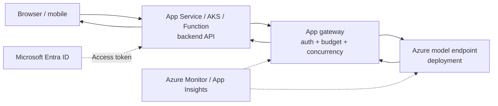
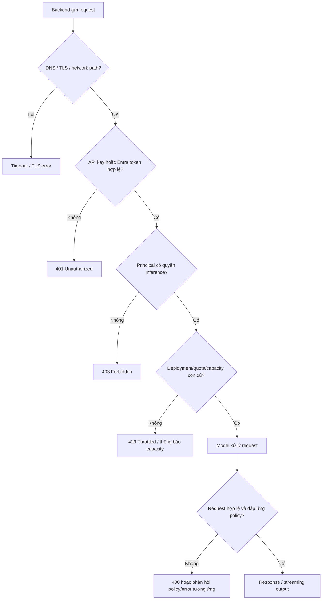
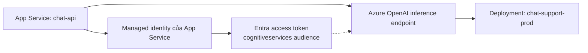
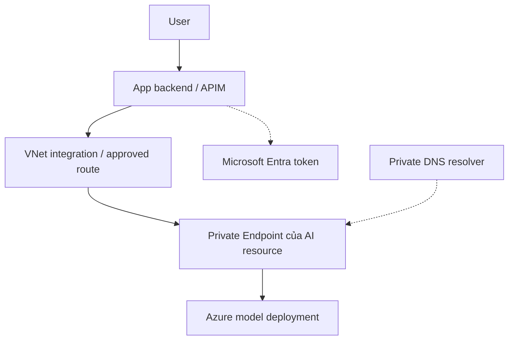
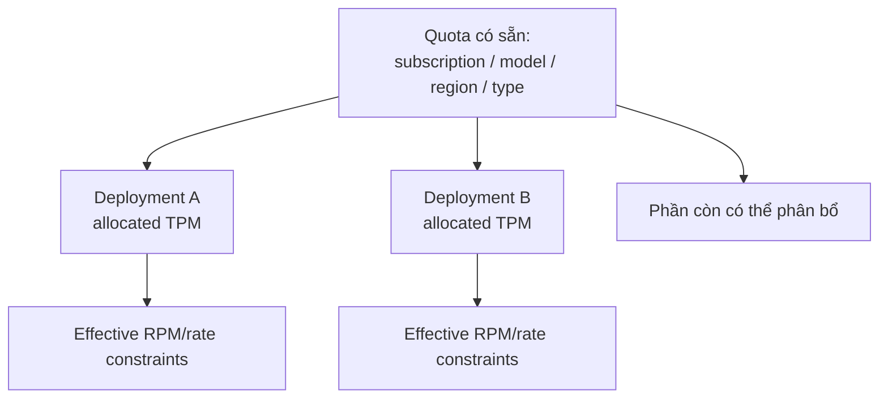
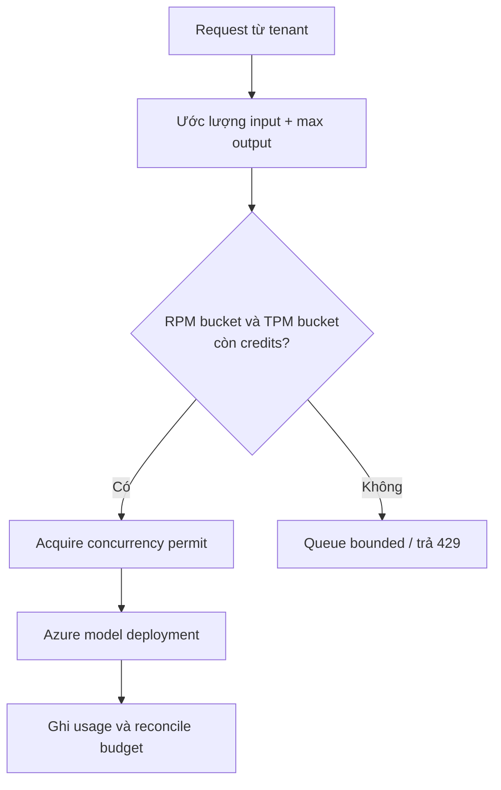
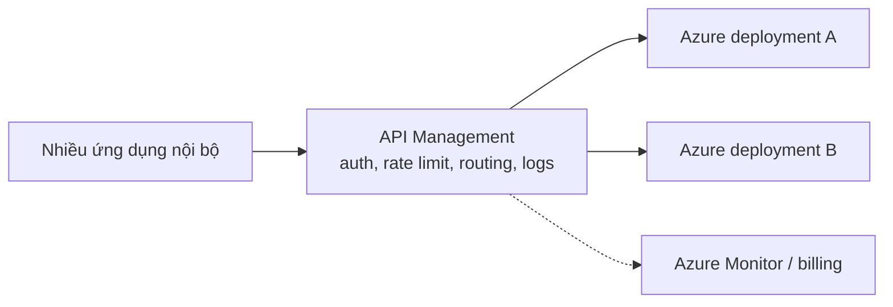
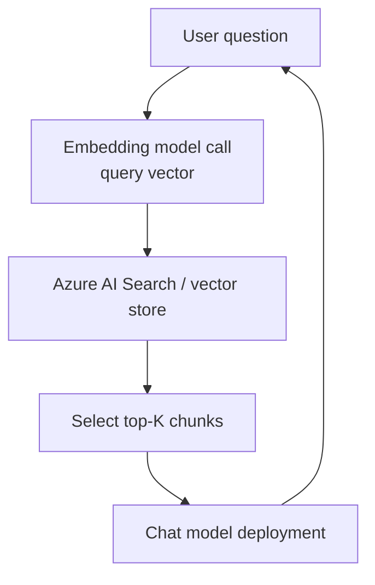
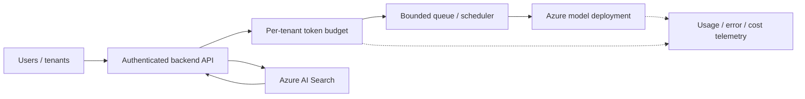

# Xác thực, quota và quản lý giới hạn gọi mô hình

Một ứng dụng chăm sóc khách hàng trên Azure App Service gọi mô hình ngôn ngữ để trả lời câu hỏi từ tài liệu doanh nghiệp. Khi có ít người dùng, API hoạt động tốt. Đến giờ cao điểm, nhiều yêu cầu đồng thời bắt đầu nhận **HTTP 429**, độ trễ tăng vì retry, trong khi một số yêu cầu khác báo **401/403** sau khi nhóm vận hành chuyển từ API key sang Microsoft Entra ID. Đội phát triển tăng `max_tokens` để “tránh câu trả lời bị cắt”, vô tình làm lượng token dự kiến mỗi request tăng và quota bị tiêu thụ nhanh hơn. Nếu không có **giới hạn theo người dùng/tenant** và **ngân sách chi phí**, một tenant bận rộn có thể làm các tenant khác bị từ chối.

Để vận hành ứng dụng AI trên Azure, cần giải quyết **ba bài toán độc lập nhưng liên hệ chặt chẽ**:

1. **Xác thực và phân quyền:** ứng dụng nào được phép gọi endpoint/deployment mô hình, bằng danh tính hay secret nào, từ mạng nào?
2. **Quota và rate limits:** subscription, region, deployment, model/loại triển khai đang được cấp bao nhiêu năng lực? Requests hoặc tokens có vượt tốc độ được phép không?
3. **Quản lý năng lực và chi phí ở lớp ứng dụng:** phân bổ ngân sách cho từng tính năng/tenant, xếp hàng, retry an toàn, kiểm soát concurrency và quan sát usage như thế nào?

Bài thuộc chương **AI và học máy trên Azure** của module **CLOUD_PROVIDERS_AZURE**. Module tìm hiểu Azure từ subscription, resource group, Microsoft Entra ID đến mạng, compute, storage và dữ liệu, đồng thời triển khai, giám sát, bảo vệ và kiểm soát chi phí một kiến trúc ứng dụng. Trong bài này, **Azure OpenAI / các model deployments được hỗ trợ trong hệ sinh thái Azure AI Foundry (Microsoft Foundry)** là ví dụ trung tâm. Tên portal/SDK/endpoint và cách quota của các mô hình bên thứ ba có thể khác; không áp cơ chế riêng của Azure OpenAI cho mọi model trong catalog.

**Sau bài học, bạn có thể:**

- Phân biệt **API key, Microsoft Entra access token, Azure RBAC, data-plane authorization và network access**.
- Gọi Azure OpenAI bằng **managed identity** qua Azure Identity SDK hoặc dùng API key đã được quản lý an toàn.
- Phân biệt **model, deployment, endpoint, API version, context window, TPM, RPM và quota allocation**.
- Phân tích **HTTP 429**, phản hồi retry/throttling và thời điểm nên giảm tốc độ thay vì tăng retries.
- Thiết kế **token budget, request queue, per-tenant rate limiter, concurrency cap, timeouts** và fallback.
- Đo usage/cost/latency theo deployment, người dùng và workload; tránh nhầm **rate-limit accounting** với token đã thực sự bị tính phí.
- Triển khai kiểm soát production bằng **API Management, Azure Monitor, Application Insights, Key Vault và Private Link** khi phù hợp.

## 1. Các thành phần của một lời gọi mô hình trên Azure

Ứng dụng không chỉ “gọi tên model”. Với một triển khai Azure OpenAI, các thành phần thường là:

| Thành phần | Vai trò | Ví dụ minh họa |
|---|---|---|
| **Azure resource** | Tài nguyên cung cấp endpoint, identity/network settings, quyền và deployment quản lý | `aoai-support-prod` |
| **Endpoint** | Địa chỉ HTTPS client kết nối | `https://aoai-support-prod.openai.azure.com/` |
| **Model** | Họ/phiên bản mô hình có các khả năng và giới hạn riêng | Một model chat hoặc embeddings được cung cấp trong Azure |
| **Deployment** | Tên cấu hình triển khai mô hình gắn với resource/SKU/capacity | `chat-support-prod` |
| **API version / route** | Contract của API/SDK cho operation được gọi | Chat Completions hoặc API khác khi hỗ trợ |
| **Credential** | Cách client chứng minh danh tính | Entra token hoặc API key |
| **Quota / rate limit** | Năng lực được cấp và tốc độ chấp nhận requests/tokens | TPM/RPM hoặc capacity model tương ứng |
| **Usage** | Token/requests thực tế và chi phí theo meter | Input/output tokens, request count |

Đường đi khái quát:



**Nguyên tắc quan trọng:** browser/mobile không nên giữ Azure OpenAI resource key. Backend xác thực người dùng, kiểm tra quyền/tenant, sau đó mới dùng **danh tính workload** để gọi model endpoint. Không tin `tenantId` hay `deployment` do client tùy ý gửi để chọn tài nguyên/quota.

### 1.1. Model không đồng nghĩa deployment

Trong Azure OpenAI, `model` trong một số SDK request có thể là **deployment name** của resource Azure, dù tham số đó mang tên `model`. Nếu deployment thực tế tên `chat-support-prod`, truyền tên model catalog thay cho deployment có thể gây lỗi “deployment not found”.

Một resource có thể có nhiều deployments; cùng model family được triển khai ở nhiều region/resource/SKU cho mục tiêu capacity hoặc dữ liệu. Không mặc định tên deployment tồn tại trên mọi endpoint.

### 1.2. Azure OpenAI và model khác trong Foundry

Azure AI Foundry/Microsoft Foundry có thể cung cấp nhiều loại deployment/inference endpoints. Một số hỗ trợ kiểu API/OpenAI-compatible, một số có SDK/URL/auth hoặc quota khác. Trước khi áp dụng ví dụ:

1. Xác nhận **nhà cung cấp, model và deployment type**.
2. Đọc contract endpoint/SDK/auth chính xác của deployment đó.
3. Kiểm tra khả năng **Entra ID**, API keys và Private Endpoint.
4. Xác định quota/rate-limit đơn vị áp dụng, billing meter và supported regions.
5. Không giả định mọi model trả cùng fields `usage` hay hỗ trợ cùng parameter `max_tokens`.

Các ví dụ kỹ thuật phía dưới **ghi rõ khi chỉ áp dụng Azure OpenAI Chat Completions**.

## 2. Bốn lớp bảo vệ request

Một lời gọi mô hình có thể thất bại ở nhiều lớp:



Sơ đồ giúp **phân loại lỗi**, không cam kết một HTTP status duy nhất cho mọi loại endpoint hay model. Ví dụ nội dung bị content filter có thể được phản ánh qua lỗi đầu vào hoặc trường trạng thái/finish reason theo API.

| Lớp | Điều khiển | Sai lầm phổ biến |
|---|---|---|
| Network | Private Endpoint, DNS, firewall, TLS | Mở public endpoint để chữa lỗi thiếu quyền |
| Authentication | Entra OAuth token hoặc API key | Dùng Azure ARM token để gọi model |
| Authorization | Azure RBAC/data-plane roles và policy của service | Cấp Owner/Contributor toàn subscription cho API |
| Capacity | TPM/RPM, model deployment, resource capacity | Retry liên tục khi 429 mà không giảm demand |
| Application governance | Tenant quota, token budget, content policy | Cho client tự chọn max output và deployment vô hạn |

## 3. Hai cách xác thực cơ bản: API key và Microsoft Entra ID

### 3.1. API key

Với nhiều deployment Azure OpenAI, API key được cấp ở mức tài nguyên/service và có thể truyền bằng header `api-key` hoặc qua cấu hình SDK.

**Ưu điểm:** triển khai đơn giản cho thử nghiệm hoặc integration tương thích. **Đổi lại:** key là **bearer secret**; ai sở hữu key có thể gọi tài nguyên trong phạm vi quyền của key, và key không đại diện danh tính từng end user.

**Nguyên tắc:**

- Không đặt key trong JavaScript/SPA/mobile app hoặc source code Git.
- Lưu trong **Azure Key Vault** hoặc secret manager được duyệt.
- Dùng application settings/secret injection với quyền truy cập tối thiểu; không log giá trị.
- Có quy trình **rotation** và kiểm tra cả các clients cũ.
- Chỉ sử dụng local development secret theo chính sách, không gửi lên ticket/chat.
- Không coi key là biện pháp **rate-limit từng tenant**; gateway của bạn phải thực thi chính sách đó.

### 3.2. Microsoft Entra ID

Với Azure OpenAI hỗ trợ Entra authentication, backend có thể dùng **managed identity** hoặc service principal/workload identity được cấp token phù hợp, sau đó gọi endpoint qua bearer token.

**Ưu điểm:**

- Không cần lưu secret dài hạn trong code của workload Azure.
- Có principal ID, Azure RBAC assignment và vòng đời danh tính rõ.
- Dễ thu hồi/quản trị access theo nhóm quyền và môi trường.
- Có thể kết hợp network restrictions, monitoring và governance.

**Lưu ý:** Entra token chỉ chứng minh danh tính. Principal **vẫn cần role phù hợp** để gọi model inference ở resource và có network path hợp lệ.

### 3.3. So sánh

| Tiêu chí | API key | Microsoft Entra ID |
|---|---|---|
| Identity gắn với request | Thường resource key, không biểu thị tenant/user cuối | Principal của user/service/managed identity |
| Credential lifecycle | Secret phải lưu, xoay vòng, thu hồi | Token ngắn hạn, identity/role được quản lý |
| Phân quyền | Theo semantics key/service | Role/scope của service, tùy khả năng hỗ trợ |
| Phù hợp backend Azure | Có thể dùng nhưng tăng công quản trị secret | **Ưu tiên managed identity** khi hỗ trợ |
| Browser/mobile trực tiếp | Không nên vì lộ credential | Không tự động an toàn; cần xét token audience và giới hạn quyền |
| Theo dõi per-tenant | Cần business gateway/correlation | Vẫn cần app-level tenant mapping và quota |

**Không coi Entra auth là giấy phép gửi nguyên token của người dùng cuối trực tiếp tới model**. Backend thường dùng danh tính riêng của workload; việc ánh xạ end-user và audit phải được làm ở lớp ứng dụng.

## 4. Azure RBAC cho mô hình: vai trò nào được gọi?

Với **Azure OpenAI** sử dụng Entra ID, một role thông dụng cho lời gọi inference là **Cognitive Services OpenAI User** ở scope của resource phù hợp. Các role quản trị như **Cognitive Services OpenAI Contributor** có thể cấp khả năng rộng hơn và không nên gán cho workload chỉ cần inference.

Phân tách trách nhiệm:

| Principal | Quyền cần thiết | Không nên mặc định có |
|---|---|---|
| `mi-chat-api-prod` | Gọi deployment inference được phê duyệt | Quyền tạo/xóa deployments, đọc keys |
| `sp-model-deployment-ci` | Triển khai/cập nhật model theo IaC, approval | Đọc dữ liệu khách hàng không cần thiết |
| `grp-ai-platform-admins` | Quản trị resource, capacity, policy theo phân công | Trực tiếp sử dụng dữ liệu người dùng nếu không cần |
| `grp-ai-auditors` | Đọc metrics/audit theo scope cho phép | Model admin và secrets |

**Owner/Contributor trên resource group không đồng nghĩa tất cả data-plane requests được cho phép.** Với từng resource/model endpoint, phải xác nhận role definition và inference authorization thực tế.

### 4.1. Cấp role tại scope tối thiểu

Sơ đồ:

```text
Subscription
  Resource group: rg-ai-prod
    Azure OpenAI resource: aoai-support-prod
      Role assignment:
        principal = mi-chat-api-prod
        role = Cognitive Services OpenAI User
        scope = resource
```

Cấp ở mức subscription khi chỉ cần một resource là **quá rộng**. Cũng cần kiểm tra các role inherited qua management group/subscription/resource group vì principal có thể nhận thêm quyền từ nguồn khác.

### 4.2. Role propagation và token

Sau khi cấp role, quyền có thể cần thời gian để có hiệu lực. Token hoặc các phiên/caches đang dùng có thể chưa phản ánh policy mới ngay. Nếu ứng dụng nhận 403 sau khi vừa assign role, hãy kiểm tra:

1. Đúng Entra tenant và object ID của managed identity chưa?
2. Role đúng scope resource/endpoint chưa?
3. Token audience đúng chưa?
4. Role assignment đã propagate chưa?
5. Networking và resource policy có chặn không?

Không tăng quyền lên `Owner` để “sửa nhanh” một lỗi 403 chưa được chẩn đoán.

## 5. Token audience và OAuth scope của Azure OpenAI

Đối với Azure OpenAI qua Entra ID, một scope phổ biến khi lấy token bằng Azure Identity SDK là:

```text
https://cognitiveservices.azure.com/.default
```

Trong khi đó:

```text
https://management.azure.com/.default
```

là scope dùng cho **Azure Resource Manager control plane**, không phải token audience cho một inference request Azure OpenAI.

Nếu client dùng scope sai, Entra có thể vẫn cấp token nhưng model endpoint từ chối token vì **audience** không khớp.

### 5.1. Managed identity thuộc tài nguyên nào?

Ví dụ App Service có system-assigned managed identity:



Managed identity của App Service **không phải** managed identity của resource Azure OpenAI; phải cấp role cho đúng principal thực sự lấy token ở phía client. Với user-assigned managed identity, phân biệt **client ID**, **object/principal ID** và **Azure resource ID**.

## 6. Ví dụ Python: Azure OpenAI bằng managed identity

Ví dụ sau minh họa **Azure OpenAI Chat Completions** dùng thư viện `openai` và `azure-identity`. SDK phải là bản có hỗ trợ `AzureOpenAI` và `azure_ad_token_provider`.

```python
import os

from azure.identity import DefaultAzureCredential, get_bearer_token_provider
from openai import AzureOpenAI

# Environment examples:
# AZURE_OPENAI_ENDPOINT=https://aoai-support-prod.openai.azure.com/
# AZURE_OPENAI_DEPLOYMENT=chat-support-prod
# AZURE_OPENAI_API_VERSION=<version-supported-by-deployment>

credential = DefaultAzureCredential()
token_provider = get_bearer_token_provider(
    credential,
    "https://cognitiveservices.azure.com/.default",
)

client = AzureOpenAI(
    azure_endpoint=os.environ["AZURE_OPENAI_ENDPOINT"],
    api_version=os.environ["AZURE_OPENAI_API_VERSION"],
    azure_ad_token_provider=token_provider,
    timeout=20.0,
    max_retries=0,  # Demo: retry được quản lý bên ngoài.
)

result = client.chat.completions.create(
    model=os.environ["AZURE_OPENAI_DEPLOYMENT"],
    messages=[
        {"role": "system", "content": "Trả lời ngắn gọn bằng tiếng Việt."},
        {"role": "user", "content": "Giải thích khái niệm quota TPM."},
    ],
    max_tokens=120,
)

print(result.choices[0].message.content)
if result.usage:
    print("Input tokens:", result.usage.prompt_tokens)
    print("Output tokens:", result.usage.completion_tokens)
    print("Total tokens:", result.usage.total_tokens)
```

**Điều kiện để code chạy:**

1. Resource và deployment Azure OpenAI đã tồn tại; endpoint và API version tương thích **với operation và model**.
2. Principal mà `DefaultAzureCredential` chọn có role inference phù hợp.
3. SDK `openai`/`azure-identity` và Python version tương thích.
4. Mạng TLS/DNS/private endpoint cho phép request.
5. Deployment hỗ trợ tham số `max_tokens`. **Một số model/API mới sử dụng `max_completion_tokens` hoặc tham số khác**; phải chỉnh đúng contract.
6. Phải có đủ quota/capacity; lệnh gọi **tiêu thụ quota và có thể phát sinh chi phí**.

Trong local development, `DefaultAzureCredential` có thể dùng Azure CLI/IDE identity, còn production dùng managed identity. **Local chạy được không chứng minh production đã được cấp cùng quyền.**

### 6.1. Vì sao đặt `max_retries=0` trong ví dụ?

Thư viện client có thể có **retry tích hợp**. Nếu ứng dụng còn tự retry bên ngoài, số attempts có thể tăng ngoài dự kiến. Ví dụ chủ động tắt retry mặc định để giải thích một chiến lược retry tập trung ở các mục sau; trong production có thể dùng retry SDK nhưng phải **đặt ngân sách attempts tổng** rõ ràng.

### 6.2. Không lạm dụng account key khi đã có managed identity

Nếu workload chạy trên Azure và SDK hỗ trợ token provider, ưu tiên Entra managed identity để giảm nhu cầu phân phối secret. Tuy nhiên, việc chuyển từ API key sang Entra cần kiểm thử role, token refresh, SDK và network; không đơn giản chỉ xóa biến API key khỏi cấu hình.

## 7. API key qua SDK và rotation an toàn

Trong một môi trường chỉ hỗ trợ API key hoặc lab được duyệt, có thể cung cấp key qua **secret-injected environment variable**:

```python
import os
from openai import AzureOpenAI

client = AzureOpenAI(
    azure_endpoint=os.environ["AZURE_OPENAI_ENDPOINT"],
    api_version=os.environ["AZURE_OPENAI_API_VERSION"],
    api_key=os.environ["AZURE_OPENAI_API_KEY"],
    timeout=20.0,
)

# Lưu ý: không print api_key, endpoint có embedded secret hoặc HTTP headers.
```

Đây chỉ là **khởi tạo client**, chưa gửi request. Biến môi trường an toàn đến đâu phụ thuộc cách nó được inject/log/đọc trong process; dùng **Key Vault** và access restrictions phù hợp.

### 7.1. Kế hoạch rotation hai key (khi resource hỗ trợ)

1. Kiểm kê clients dùng key hiện tại và owner.
2. Tạo/key rotate giá trị dự phòng theo cơ chế service.
3. Cập nhật Key Vault và các application references.
4. Restart/refresh clients được kiểm soát để dùng credential mới.
5. Quan sát inference success/401/403 ở từng client.
6. Chỉ sau khi không còn phụ thuộc, thu hồi/regenerate key cũ.
7. Audit thay đổi và đảm bảo không còn secret trong image, pipeline hay logs.

Không regenerate **cả hai keys** cùng lúc nếu sẽ làm mọi client mất kết nối. Với service/model endpoint không có dual-key rotation, cần phương án cutover riêng.

### 7.2. Không đưa API key đến frontend

Browser/app mobile có thể bị reverse engineer; client-side key nhanh chóng bị lộ, dẫn đến request không kiểm soát, phát sinh chi phí và khó attribution. Tốt hơn:

```text
Client -> Backend (user auth/rate limit) -> Azure AI endpoint
```

Backend phải xác thực end-user, giới hạn requests/tokens và che Azure credential.

## 8. Private networking, TLS và xác thực là các lớp riêng

Một endpoint Azure OpenAI có thể được thiết kế với public access hạn chế hoặc Private Endpoint theo dịch vụ/tier hỗ trợ.



Khi thiết kế:

- Kiểm tra **private endpoint/subresource** và DNS zone của **resource/endpoint type thực tế**.
- FQDN dùng trong SDK vẫn phải phân giải đúng private IP khi gọi từ client network.
- Cấu hình VNet integration, NSG/firewall/UDR, DNS forwarding theo kiến trúc.
- Xác minh **public network access** được đóng nếu chính sách yêu cầu; Private Endpoint tồn tại không tự đóng mọi public paths.
- Bảo đảm client còn đường lấy Entra token và tới các dependencies cần thiết.
- TLS certificate hostname phải khớp FQDN; không thay bằng raw IP hoặc `verify=False`.

**Không tăng quyền role để sửa DNS timeout; không mở firewall chỉ vì token bị 401.** Nếu dịch vụ AI Foundry dùng hostname hoặc private DNS khác Azure OpenAI classic, áp dụng tài liệu đúng cho endpoint đó.

## 9. Quota khác rate limit, budget và context window

Các từ “limit”, “quota” và “token” thường bị dùng lẫn.

| Khái niệm | Quy định điều gì? | Ví dụ |
|---|---|---|
| **Quota allocation** | Khả năng được phân bổ trong phạm vi subscription/region/model/deployment type theo service | Tổng TPM có thể phân phối cho các deployments |
| **TPM** (*Tokens per minute*) | Tốc độ xử lý tokens được chấp nhận/ước tính trong cửa sổ giới hạn | 60.000 TPM minh họa |
| **RPM** (*Requests per minute*) | Số requests được nhận trong cửa sổ giới hạn | 120 RPM minh họa |
| **Context window** | Số tokens đầu vào + phần output/overhead model có thể xử lý trong một request | Giới hạn theo model/version |
| **Max output tokens** | Trần độ dài output của request/deployment | `max_tokens` hoặc equivalent |
| **Billing usage** | Phần sử dụng được tính phí theo pricing meter | Input/output tokens hoặc capacity |
| **App-level budget** | Chính sách tổ chức tự đặt cho tenant/team/user | 10.000 requests/ngày, giới hạn chi phí |
| **Concurrency cap** | Số requests đồng thời mà ứng dụng cho phép | Tối đa 8 in-flight calls |

**Những con số trong bảng là giả định học tập**, không phải quota mặc định cho một model/resource/region. Azure có thể thay đổi quota, eligibility, deployment types và request enforcement; phải xem giá trị được cấp trong Azure portal/management API cho resource cụ thể.

### 9.1. Token là gì?

Token là đơn vị mà model tokenizer dùng để biểu diễn text hoặc nội dung theo cách của model/API. Một token **không cố định** là một từ, một ký tự hay một byte. Với ảnh, âm thanh, video, tool calls hoặc structured output, cách quy đổi/counting có thể khác.

**Đừng lấy số ký tự chia một hằng số rồi coi đó là số token tuyệt đối.** Dùng tokenizer/usage estimation phù hợp khi có, và đối chiếu `usage` thực tế sau request.

### 9.2. Context overflow không phải rate-limit

Một request vượt context length có thể nhận lỗi validation (thường nhóm 400) hoặc bị giới hạn theo contract, **không phải HTTP 429 vì quá RPM**. Tăng quota TPM không làm một model có context window 128k xử lý được prompt vượt khả năng chỉ vì subscription được cấp nhiều RU/token.

### 9.3. Quota không đồng nghĩa hạn mức thanh toán

Quota TPM là khả năng/tốc độ xử lý, không mặc nhiên là “trần chi phí tháng”. Nếu tài nguyên chạy 24 giờ mỗi ngày và luôn đủ traffic, tổng tokens được xử lý có thể rất lớn dù mỗi phút không vượt TPM. Phải đặt **cost budgets, alerts và application caps** riêng.

## 10. Phạm vi quota: subscription, region, model và deployment

Với Azure OpenAI theo mô hình quota allocation, năng lực thường được quản lý trong phạm vi **subscription + region + model/deployment type** theo quy tắc của dịch vụ, rồi **phân bổ cho các deployments**. Các vùng triển khai/loại triển khai như regional, Global Standard, Data Zone, provisioned hoặc batch có **cơ chế và pool quota không nhất thiết giống nhau**.

Sơ đồ minh họa:



Ví dụ **giả định** cho cùng một pool:

```text
Tổng quota được duyệt:                  120.000 TPM
Deployment chat-support-prod:            80.000 TPM
Deployment chat-batch-service:           30.000 TPM
Chưa phân bổ:                            10.000 TPM
```

Điều này **không có nghĩa** một deployment tự động vay quota của deployment khác khi một bên rảnh. Quy tắc điều chỉnh allocation cần được thực hiện qua management plane/portal và tùy deployment type.

### 10.1. Quota được cấp khác availability

Một resource có quota allocation không đảm bảo:

- Model/deployment đó khả dụng ở mọi region.
- Có thể tạo thêm deployments bất kỳ lúc nào.
- Có capacity tức thì cho một deployment type.
- Requests luôn không bị 429/503 dù traffic lên đỉnh.
- Có thể bỏ qua quota của APIs khác như embeddings/image/audio.

Khi lập kế hoạch, kiểm tra **regional availability, quota pool, deployment SKU, supported versions, capacity reservation và limits hiện hành**.

### 10.2. Quota increase không tự tối ưu code

Nếu request rất lớn, retries gây bão hoặc một tenant chiếm hết traffic, tăng quota có thể chỉ đẩy chi phí cao hơn và để lại latency không ổn định. Trước khi yêu cầu tăng quota, đo demand thực, token estimates, request mix, throughput per deployment và throttling reasons.

## 11. TPM và RPM cùng giới hạn một workload

Ví dụ giả định cho một deployment:

```text
TPM: 60.000
RPM:    120
Mỗi request trung bình cần: 1.200 tokens (ước lượng budget)
```

TPM cho phép tối đa gần:

\[
\frac{60000\ \mathrm{tokens/min}}{1200\ \mathrm{tokens/request}}
=50\ \mathrm{requests/min}
\]

RPM cho phép tối đa 120 requests/min. Vậy dưới những giả định này, **TPM là ràng buộc chặt hơn**. Đổi lại, nếu mỗi request chỉ cần 200 token thì theo TPM có thể là 300 requests/min, nhưng RPM 120 sẽ thành ràng buộc.

**Quan trọng:** đây là phép tính **capacity planning xấp xỉ**, không phải thuật toán nội bộ của Azure. Service có thể giới hạn theo cửa sổ ngắn hơn một phút, đo token estimate của từng request và áp thêm capacity/throughput constraints.

### 11.1. Một request có thể “giữ chỗ” nhiều tokens

Với một số deployment Azure OpenAI, bộ kiểm tra rate limit ước tính token demand **khi request được nhận**, có thể dựa trên prompt size, `max_tokens`/`max_completion_tokens`, số completions hoặc các tham số liên quan. Nó **không đơn giản đợi model trả xong rồi chỉ trừ tokens thực sự xuất ra**.

Ví dụ:

```text
Prompt thực tế:                   400 tokens
Max output đặt trong request:  4.000 tokens
Output thực sự sinh:              180 tokens
```

Một request có thể bị tính **tải dự kiến cho rate limit** lớn hơn nhiều so với usage của response. Vì vậy đặt output maximum quá cao làm tăng xác suất throttling dù invoice token usage có thể thấp hơn.

Cơ chế estimation cụ thể khác theo model/API/deployment; không dùng ví dụ này để suy ra công thức billing.

### 11.2. Streaming không miễn TPM/RPM

`stream=True` giúp client nhận output dần, thường cải thiện *time to first token*, nhưng request vẫn tiêu thụ quota/capacity. Đừng coi mỗi chunk là một request mới để tự cộng RPM, và đừng giả định streaming được miễn token cost.

## 12. Đặt token budget trước khi gọi mô hình

Một request nên có **ngân sách đầu vào** và **giới hạn đầu ra**.

### 12.1. Phân rã budget

```text
System/developer instructions:       600 tokens
Lịch sử chat gần nhất:             1.000 tokens
RAG context/doc snippets:          2.500 tokens
User request:                        250 tokens
Tool/function schema overhead:       350 tokens
-----------------------------------------------
Ước tính input:                    4.700 tokens
Max output dự kiến:                1.000 tokens
Tổng budget request:               5.700 tokens
```

Các số chỉ minh họa. Với model mới, phần tool schema, image tokens, audio tokens hoặc reasoning tokens có thể cần tính khác. Không tin một ước tính text-only nếu request chứa multimodal content.

### 12.2. Context budget và capacity budget khác nhau

Hai điều kiện cần thoả đồng thời:

1. **Model input/output context constraint:** request có đủ chỗ trong context window không?
2. **Deployment TPM/RPM constraint:** tổng tốc độ requests/tokens của nhiều requests có trong hạn mức không?

Một prompt 10.000 tokens có thể **hợp lệ về context** nhưng khiến tốc độ xử lý vượt TPM khi 20 người cùng gửi.

### 12.3. Giảm token theo thứ tự ưu tiên

1. Chỉ đưa vào prompt **dữ liệu cần thiết**, không nhồi toàn bộ database/tài liệu.
2. Giới hạn và xếp hạng **RAG chunks**; bỏ trùng, bỏ metadata không cần.
3. Tóm tắt lịch sử hội thoại dài, nhưng giữ các ràng buộc quan trọng.
4. Dùng response schema/structured output khi model hỗ trợ để giảm sinh lời thừa.
5. Đặt `max_tokens` phù hợp với nhiệm vụ thực tế.
6. Dùng model nhỏ hơn cho phân loại/định tuyến, model lớn cho yêu cầu khó khi phù hợp.
7. Dùng caching nếu tính năng/model có semantics rõ và dữ liệu cho phép.

Không cắt prompt mù quáng làm mất chính sách bảo mật, câu hỏi, trích dẫn hay quyền truy cập người dùng.

## 13. HTTP 429: hiểu throttling trước khi retry

**HTTP 429 Too Many Requests** thường báo request vượt rate limit hoặc năng lực được cấp theo một cơ chế service. Với Azure model inference, 429 có thể liên quan RPM, TPM hoặc công suất khả dụng của deployment/model.

### 13.1. Một 429 nói gì?

- **Không** nhất thiết nói tài khoản hết tiền.
- **Không** nhất thiết nghĩa prompt không hợp lệ.
- **Không** nhất thiết nghĩa tăng API key sẽ tăng quota.
- **Không** tự chứng minh chỉ một tenant gây ra lỗi.
- **Không** bảo đảm retry ngay lập tức sẽ thành công.

Để tìm nguyên nhân:

1. Ghi nhận deployment, model family/version, region, deployment type.
2. Quan sát request rate, token estimate, `max output`, số concurrent calls.
3. Kiểm tra response status, service error code, retry headers nếu có.
4. Đối chiếu quota allocation thực trong Azure portal và metrics.
5. Xem request spikes hoặc retries lặp ở client/gateway.

### 13.2. Các cửa sổ giới hạn không luôn tròn một phút

Tên TPM/RPM gợi ý “mỗi phút”, nhưng hệ thống có thể thực thi bằng sliding window, short-interval enforcement hoặc nội bộ khác. **Gửi 120 requests trong một giây** vào deployment có 120 RPM có thể vẫn bị 429, ngay cả khi phút đó trước đó không có traffic.

Vì vậy cần **pacing/smoothing** ở phía client, không chỉ reset counter vào đầu phút.

### 13.3. Phân biệt 429, 503 và 400

| Dạng lỗi | Giải thích thường gặp | Ứng xử mặc định |
|---|---|---|
| `429` | Rate/capacity throttling | Backoff có jitter, hạ tốc độ, queue/fallback |
| `503` | Service hoặc deployment không sẵn sàng tạm thời | Retry có giới hạn nếu an toàn; xem health/capacity |
| `500/502/504` | Lỗi server/gateway/timeout | Retry có điều kiện, không vô hạn |
| `401` | Token/key sai/hết hạn/sai audience | Sửa credential; không retry liên tục |
| `403` | Role/network/policy không cho phép | Kiểm tra authorization/network; không “mua thêm TPM” |
| `404` | Endpoint/deployment/API route không có hoặc sai | Xác minh URL/deployment/API version |
| `400` | Request không hợp lệ/context/policy/parameter | Sửa request/contract, không retry y nguyên |

Mỗi API có error schema cụ thể. Luôn kiểm tra **error code/body đã được redacted** và tài liệu của model/deployment trước khi tự động phân loại.

## 14. Retry đúng: bounded exponential backoff và jitter

Một client tốt phải biết **khi nào retry, retry bao nhiêu lần, chờ bao lâu và khi nào trả lỗi**.

### 14.1. Backoff

Một chiến lược phổ biến:

\[
d_n = \min(d_{\max}, d_0 2^n)
\]

Thêm **jitter**:

\[
d_n^{\mathrm{jitter}} \sim U(0,\min(d_{\max},d_0 2^n))
\]

Ví dụ minh họa:

```text
Attempt 1: gọi ngay
429 -> chờ khoảng 0..1 giây
Attempt 2: nếu còn deadline
429 -> chờ khoảng 0..2 giây
Attempt 3: nếu còn deadline
429 -> chờ khoảng 0..4 giây
Hết attempts/deadline -> trả lỗi được kiểm soát
```

Nếu service trả **Retry-After** hoặc header hướng dẫn khác, ưu tiên/tôn trọng theo contract của endpoint. Không giả định header luôn có, luôn ở đơn vị giây hay luôn an toàn để đợi vô hạn.

### 14.2. Retry và timeout không phải một

Một request có thể timeout ở client nhưng model/server vẫn tiếp tục hoặc đã hoàn tất công việc. **Retry có thể tiêu tốn thêm token và tạo hai lần xử lý** khi kết quả trước không được nhận. Đối với một hành động nghiệp vụ có side effect (ví dụ model tạo đề xuất rồi service gọi API thanh toán), phải dùng business idempotency ở lớp thực hiện side effect.

### 14.3. Đừng retry đồng thời ở bốn tầng

```text
SDK retries × API gateway retries × application retries × queue redelivery
```

Nếu mỗi tầng thử 3 lần, số attempts có thể tăng rất nhanh. Thiết kế **một chủ sở hữu retry chính** hoặc phân bổ rõ ngân sách tổng, với correlation ID xuyên các tầng.

## 15. Python: gọi model với retry có giới hạn

Ví dụ sau dựa trên client `AzureOpenAI` đã cấu hình theo mục 6 với `max_retries=0`, dùng cho các request **không có side effect ngoài việc sinh nội dung**. Cần chỉnh parameters theo contract của model.

```python
import random
import time

from openai import APIConnectionError, APIStatusError, APITimeoutError
from openai import RateLimitError


def retry_after_seconds(exc):
    response = getattr(exc, "response", None)
    headers = getattr(response, "headers", None)
    if not headers:
        return None

    value = headers.get("retry-after")
    if not value:
        return None

    # Demo chỉ xử lý Retry-After dạng số giây.
    # HTTP-date và vendor-specific headers cần parser riêng.
    try:
        seconds = float(value)
    except ValueError:
        return None
    return max(0.0, seconds)


def chat_with_bounded_retry(client, deployment, messages):
    attempts = 3
    deadline = time.monotonic() + 25.0

    for index in range(attempts):
        try:
            return client.chat.completions.create(
                model=deployment,
                messages=messages,
                max_tokens=160,
            )
        except (RateLimitError, APIConnectionError, APITimeoutError,
                APIStatusError) as exc:
            status = getattr(exc, "status_code", None)

            # Không retry 400/401/403/404 hoặc lỗi 4xx khác
            # ngoài 429 đã phân loại.
            transient = isinstance(
                exc, (RateLimitError, APIConnectionError, APITimeoutError)
            ) or (status is not None and status >= 500)
            if not transient:
                raise

            if index == attempts - 1:
                raise

            service_hint = retry_after_seconds(exc)
            backoff = random.uniform(0.0, min(8.0, 1.5 * 2 ** index))
            delay = max(backoff, service_hint or 0.0)

            if time.monotonic() + delay >= deadline:
                raise

            time.sleep(delay)

    raise RuntimeError("retry budget exhausted")
```

**Giới hạn của ví dụ:**

- Code chạy **synchronous**; không gọi `time.sleep` trong async event loop.
- `Retry-After` dạng **HTTP-date** chưa được parse; production phải hỗ trợ theo contract nếu service dùng.
- Request timeout trong client và total deadline cần được đồng bộ: một attempt có thể tiêu hết thời gian trước khi quay về vòng lặp.
- Code không thực thi **distributed rate limiting**: nhiều replicas vẫn có thể cùng 429. Cần lớp scheduler/limiter chung.
- Không log raw prompt, token, key hoặc response chứa PII để debug retry.
- Nếu request đã kích hoạt side effect ngoài model, phải đánh giá idempotency trước khi retry.
- Không retry vô hạn khi quota đã cạn hoặc allocation không phù hợp.

### 15.1. Ai chịu trách nhiệm khi hết retries?

Một ứng dụng tương tác có thể trả `429/503` ở API **của chính ứng dụng** với thông báo “dịch vụ bận, vui lòng thử lại”, hoặc nhận vào queue và trả `202 Accepted` nếu có workflow bất đồng bộ bền vững. Không trả `200 OK` với nội dung rỗng rồi coi là câu trả lời thành công.

## 16. Rate limiter chủ động: đừng để Azure luôn là nơi từ chối

**Client-side limiting** giữ demand dưới mức được phân bổ, giảm 429, ổn định latency và phân phối công bằng.

### 16.1. Hai ngân sách song song

Theo deployment:

- **Request budget**: số requests/đơn vị thời gian.
- **Estimated token budget**: tokens dự kiến/đơn vị thời gian.

Chỉ kiểm soát RPM là chưa đủ khi request sizes biến động mạnh. Chỉ kiểm soát TPM là chưa đủ khi có hàng nghìn requests rất nhỏ.

### 16.2. Token bucket và leaky bucket

**Token bucket** giữ một lượng credit và nạp lại dần theo tốc độ cho phép; request đến phải lấy đủ credits. Credit ở đây là **đơn vị rate-limit nội bộ** (request credits hoặc estimated model token credits), không phải Entra access token.



Khi request thành công, ghi nhận **actual usage** để billing/showback. Việc **hoàn lại credits** phải cẩn thận vì Azure rate limit có thể dựa trên estimated demand và service windows khác với công thức local; đừng refund toàn bộ chênh lệch rồi vượt service limits.

### 16.3. Nhiều replicas cần limiter phân tán

Nếu mỗi trong 10 App Service instances tự giới hạn 120 RPM, tổng có thể là **1.200 RPM**, vượt giới hạn deployment 120 RPM. Cần một lớp điều phối chung, ví dụ:

- Shared Redis token bucket với thao tác atomic (Lua/function theo engine hỗ trợ).
- API Management policies khi phù hợp, kết hợp hạn mức token-aware.
- Queue/worker pool có scheduler tập trung.
- Dedicated inference gateway theo deployment/tenant.

**Distributed limiter có thể mất kết nối**; định nghĩa fail-open hay fail-closed theo dữ liệu và budget. Nếu Redis fail mà tất cả replicas bỏ giới hạn, 429 storm có thể gây outage. Ngược lại, fail-closed hoàn toàn có thể cắt traffic khẩn cấp. Chọn policy có owner, monitoring và phương án degraded mode.

## 17. Concurrency cap và queue có giới hạn

TPM/RPM đo **tốc độ**, còn concurrency là số requests đang xử lý tại cùng lúc.

### 17.1. Ước tính concurrency

Với tải ổn định, có thể dùng gần đúng từ Little's Law:

\[
L \approx \lambda W
\]

Trong đó `L` là số request in flight, `λ` là requests/giây và `W` là thời gian xử lý trung bình (giây).

Ví dụ hệ được phép **40 requests/phút** và mỗi request mất trung bình **6 giây**:

\[
\lambda=40/60\approx0.667\;\mathrm{request/s}
\]

\[
L \approx 0.667 \times 6 \approx 4\;\mathrm{requests}
\]

Khoảng **4 requests đồng thời** là mức concurrency bình quân để phục vụ 40 RPM với giả định nêu trên. Tail latency, streaming, response size và burst yêu cầu headroom/buffering riêng; **không coi 4 là quota Azure**.

### 17.2. Queue giúp gì?

Khi hàng đợi bounded:

1. API xác thực request và kiểm tra ngân sách user/tenant.
2. Tạo job ID/correlation ID, ghi bền vững công việc khi cần.
3. Worker lấy job khi có TPM/RPM và concurrency credits.
4. Worker gọi model, lưu outcome và usage.
5. Client polling/callback nhận kết quả.

`202 Accepted` chỉ có nghĩa **đã nhận công việc sau durable handoff**, không có nghĩa model đã sinh xong câu trả lời. Queue cần **TTL, retry cap, DLQ và idempotency**. Không giữ vô hạn các jobs không thể xử lý trong quota; cần queue-length/age SLO và backpressure.

### 17.3. Real-time và batch workloads không nên tranh nhau vô hạn

Một lô tóm tắt 100.000 tài liệu có thể lấy hết capacity khi chatbot realtime cần trả lời dưới vài giây. Có thể:

- Tách deployment/queue và phân bổ quota theo workload.
- Dành capacity ưu tiên cho requests tương tác.
- Chuyển tác vụ không gấp sang **Batch API/processing mode** nếu model/endpoint hỗ trợ, lưu ý quota và pricing khác.
- Có lịch batch, concurrency và request deadlines rõ.

## 18. Quản lý fairness theo người dùng, tenant và tính năng

Azure resource quota thường **không tự biết** tenant nào của SaaS cần bao nhiêu token. Lớp ứng dụng phải thực thi:

| Cấp | Policy mẫu | Mục tiêu |
|---|---|---|
| End user | Requests/phút, daily token budget | Ngăn spam/tài khoản lạm dụng |
| Tenant | Tổng tokens/ngày/tháng, burst allowance | Công bằng, tránh noisy neighbor |
| Feature | Chat vs document summarize quota | Bảo vệ tính năng quan trọng |
| Deployment | TPM/RPM/concurrency limits | Tránh Azure 429 |
| Organization | Monthly budget, spend alerts, model allowlist | Chi phí và governance |

**Ví dụ giả định:**

```text
Resource deployment:            60.000 TPM
App operating target:           48.000 estimated TPM (80% headroom)
Priority live chat:             30.000 TPM reservation
Document jobs:                  12.000 TPM reservation
Shared burst pool:               6.000 TPM
```

Đây là **application policy**, không phải tính năng allocation mặc định của Azure. Khi nhóm live chat ít traffic, công suất dư có thể được cho batch mượn theo policy, nhưng phải thu hồi khi chat demand tăng.

### 18.1. Vì sao hạn mức tenant nên tính theo token?

Tenant A gửi 100 requests với 100 tokens mỗi request; tenant B gửi 100 requests với 20.000 tokens mỗi request. Giới hạn requests bằng nhau không tạo chi phí/năng lực công bằng. Cần kết hợp request count, estimated tokens, actual usage và model price.

### 18.2. Burst limit và cost ceiling

Một tenant có thể được cấp 2.000.000 tokens/ngày nhưng vẫn nên có giới hạn **burst TPM/RPM** để không chiếm hết deployment trong vài phút. Ngược lại, giới hạn TPM không thay **monthly spend budget** vì usage có thể liên tục cả tháng.

### 18.3. Thực thi authorization trước rate limiting

Không tin `tenantId` hoặc `featureTier` trong JSON client. Backend xác thực JWT/session, xác định tenant và tier từ hệ thống được tin cậy, rồi áp đúng budget. Nếu không, client chỉ cần đổi tenantId để né giới hạn hoặc tiêu quota của người khác.

## 19. API Management như cổng quản trị inference

**Azure API Management (APIM)** có thể nằm trước model endpoint để tập trung policies:



Khi thiết kế APIM gateway cho model:

- Xác thực caller, map application/user/tenant và roles.
- Giới hạn requests hoặc tokens theo policies mà **APIM tier/policy version hỗ trợ**.
- Chọn backend deployment theo allowlist và routing rules.
- Chuyển Azure credentials an toàn bằng managed identity/Key Vault nếu được hỗ trợ.
- Bảo vệ headers/prompt/PII khỏi access logs không cần thiết.
- Chuẩn hóa retry/timeout và correlation IDs.
- Dùng dashboards phân biệt status do gateway trả và status từ model service.

### 19.1. APIM rate limiting không đồng nghĩa Azure quota

APIM policy kiểm soát traffic **đến gateway**. Azure deployment vẫn có TPM/RPM/capacity riêng. Nếu APIM có 10 instances hoặc nhiều gateways dùng chung deployments, cần xác minh **counter scope và tính nhất quán distributed limit** của policy. Không mặc định các counter per-region/per-instance luôn là một ledger chính xác cho mọi request.

### 19.2. Token-aware policies cần kiểm chứng

Một số phiên bản APIM có policies chuyên biệt cho Azure OpenAI token limiting/token metrics. Nhưng **tên policy, tier hỗ trợ, cách estimate/request-response token count, streaming và model compatibility** có thể đổi. Phải kiểm tra policy reference đúng với runtime và thử nghiệm trước khi bật production.

Một gateway không thể tự đo token usage của một model bất kỳ nếu endpoint không trả usage theo contract hoặc trả qua stream chưa được xử lý.

## 20. Standard, Global/Data Zone và Provisioned throughput

Các cách triển khai model có thể có **cơ chế capacity và billing khác nhau**. Các tên gọi trong portal hiện hành có thể thay đổi theo sản phẩm/region.

| Nhóm triển khai | Cách tư duy capacity | Cần kiểm tra |
|---|---|---|
| **Standard/shared consumption** | Quota/rate limit theo deployment/model/region và bill dựa trên usage | TPM/RPM, availability, latency, per-token cost |
| **Global Standard** (khi hỗ trợ) | Định tuyến/capacity toàn cầu theo service contract | Data processing region/residency, quota type, networking |
| **Data Zone** (khi hỗ trợ) | Capacity trong vùng dữ liệu được quy định | Phạm vi data zone và yêu cầu tuân thủ |
| **Provisioned throughput** | Capacity cam kết/đặt trước bằng **PTUs** hoặc đơn vị được hỗ trợ | Model-specific throughput, utilization, reservation/billing, overload |
| **Batch/offline** (khi hỗ trợ) | Công việc bất đồng bộ với quota/pricing/latency riêng | File/job limits, SLA, queueing, data residency |

### 20.1. PTU không phải TPM vô hạn

Với Provisioned Throughput, bạn mua/phân bổ năng lực dành cho deployment theo mô hình PTU của service, **không** có quyền gửi vô hạn requests hoặc tokens. Khi utilization cao, vẫn có thể gặp throttling hoặc latency tăng. Throughput hữu ích phụ thuộc **input/output ratio, model, concurrency, prompt size và latency target**.

### 20.2. Khi nào cân nhắc Provisioned?

- Traffic đều, lớn, có SLO quan trọng.
- Cần khả năng dự đoán capacity và chi phí.
- Đã đo được input/output tokens và concurrency distribution.
- Có người theo dõi utilization và tối ưu reservation.

Không chọn Provisioned chỉ vì thấy 429 trên Standard một lần; nên phân tích traffic pattern, khả năng tăng quota, routing và tổng chi phí trước.

### 20.3. Global/Data Zone và dữ liệu

Một deployment có tên “Global” không tự phù hợp mọi chính sách lưu trú dữ liệu. Nếu prompt chứa dữ liệu khách hàng có yêu cầu location, cần kiểm tra chính sách **data processing/residency** của deployment type và resource/region. Fallback sang region khác cũng phải tuân thủ chính sách này.

## 21. Cost governance: quota không phải ngân sách tài chính

Chi phí inference có thể dựa trên:

- Input tokens và output tokens với **đơn giá khác nhau** theo model/deployment.
- Cached input tokens hoặc các mức giá đặc biệt nếu tính năng hỗ trợ.
- Provisioned capacity/PTU và reservation.
- Batch inference hoặc API-specific billing.
- Các dịch vụ phụ trợ: Azure AI Search, Storage, Functions, APIM, Redis, Application Insights, egress.

### 21.1. Công thức ước tính theo token

Với mô hình tính phí input/output token:

\[
\mathrm{Cost} \approx
\frac{T_{\mathrm{in}}}{10^6}P_{\mathrm{in}}
+ \frac{T_{\mathrm{out}}}{10^6}P_{\mathrm{out}}
\]

Trong đó `P_in` và `P_out` là giá trên **một triệu tokens** theo bảng giá thực tế của deployment/model/region; công thức đơn giản này chưa tính caching, batch, reservation, taxes hoặc dịch vụ phụ trợ.

Ví dụ **giá giả định cho bài toán**, không phải bảng giá Azure:

```text
Input tokens/tháng:     80.000.000
Output tokens/tháng:    20.000.000
Giá input giả định:         2 USD / 1M
Giá output giả định:        8 USD / 1M

Ước tính inference:
  80 × 2 + 20 × 8 = 320 USD
```

Đơn giá thực tế phải lấy từ **Azure pricing/billing hiện hành**, đúng model, deployment type, region và contract.

### 21.2. Một prompt không cần dài để có giá trị

Giảm 30% tokens của prompt thường gặp, với cùng chất lượng câu trả lời, có thể cải thiện **cost và throughput**. Tuy nhiên, prompt rút gọn quá mức có thể làm model hallucinate vì thiếu ngữ cảnh; cần đánh giá chất lượng, không chỉ tối ưu token count.

### 21.3. Budget action phải có hiệu lực thật

Azure Cost Management budgets/alerts giúp **quan sát và cảnh báo**; không nên coi alert là cơ chế tự động cắt inference trong mọi dịch vụ. Nếu cần **hard spending cap theo tenant**, backend/gateway phải thực thi ledger/budget check và đưa request vào queue/từ chối khi đạt ngưỡng, đồng thời đối soát billing sau.

## 22. RAG, embeddings và quota của pipeline AI

Ứng dụng **Retrieval-Augmented Generation (RAG)** thường có nhiều calls:



Với RAG:

- **Embedding model** có quota/limits và billing riêng của deployment tương ứng.
- **Search** có throughput/cost của Azure AI Search hoặc vector database.
- **Chat deployment** có TPM/RPM riêng.
- Nạp nhiều chunks làm input token tăng, giảm sức chứa TPM.
- Chạy nhiều model calls song song để rerank/tóm tắt có thể nhân latency và chi phí.

### 22.1. Đừng chỉ đo chat tokens

Một câu hỏi có thể kích hoạt:

1. Embedding query.
2. Vector search.
3. LLM rewrite/re-rank.
4. LLM final answer.
5. Tool calls và thêm LLM turns.

**Budget theo user request** phải tính tổng chuỗi operations, không chỉ request cuối. Một user hỏi một câu nhưng có thể tạo nhiều lượt inference.

### 22.2. Retrieval quality quyết định token efficiency

Nếu top-K trả nhiều tài liệu gần như trùng nhau, model nhận nhiều tokens nhưng chất lượng không tăng. Cân nhắc dedup chunks, metadata filters, semantic ranking và kiểm soát độ dài trích đoạn. Không bỏ **document-level authorization** khi truy xuất chỉ để giảm latency.

## 23. Streaming, tool calls và output budget

### 23.1. Streaming

Streaming giúp người dùng thấy từng phần response. Nhưng:

- Client/người dùng có thể ngắt kết nối trước khi model dừng; không mặc định mọi phần usage đều đã quan sát được.
- Server có thể cần tiếp tục hoặc hủy request theo protocol; việc này ảnh hưởng billing/capacity.
- Gateway phải xử lý timeout, backpressure và client disconnect.
- Một stream thất bại giữa chừng không nên được ghép thẳng với stream retry mới như thể là một câu trả lời duy nhất đã được kiểm chứng.

### 23.2. Tool calling tăng số lượt xử lý

Một lượt chat có thể:

```text
LLM decides tool call
  -> Backend calls CRM/SQL
  -> LLM receives tool result
  -> LLM generates final answer
```

Đây là **hai hoặc nhiều model requests**. Quota scheduler và tenant budget phải tính cả chuỗi. Nếu tool gọi API có side effect, phải xác thực quyền, validate parameters và **idempotency**; không để model tự quyết định chuyển tiền/xóa dữ liệu chỉ dựa trên text sinh ra.

### 23.3. Output cap và finish reason

Khi đặt max output quá thấp, response có thể dừng vì `length` hoặc trạng thái tương đương tùy API. Khi đặt quá cao, một số service có thể tính estimate rate-limit lớn hơn nhu cầu thực. Cần đo:

- Distribution của output tokens theo task.
- Tỷ lệ câu trả lời bị cắt.
- Số lần user phải hỏi lại.
- Token cost và 429 correlation.

## 24. Fallback, model routing và quản lý sự cố capacity

Một ứng dụng có thể định nghĩa:

```text
Preferred deployment: chat-support-prod
Fallback: chat-support-secondary
Constraints:
  - Cùng dữ liệu/region policy
  - Model đạt quality threshold
  - Output schema và tools tương thích
  - Có quota và cost budget
```

### 24.1. Fallback không phải “gọi bừa model rẻ nhất”

Trước khi fallback:

1. Kiểm tra data residency và quyền truy cập.
2. So sánh model capabilities, tokenizer/context, structured output/tools.
3. Dùng evaluation dataset để kiểm tra chất lượng.
4. Kiểm tra pricing/capacity ở deployment đích.
5. Đảm bảo prompt/version và safety policy phù hợp.
6. Ghi log lý do routing và correlation ID.

Không biến một lỗi 403 do thiếu quyền thành fallback ngầm sang resource có bảo mật yếu hơn.

### 24.2. Circuit breaker

Khi một deployment liên tục 429/503, circuit breaker có thể tạm ngừng gửi requests đến nó để tránh retry storm. Sau cooldown, thử một lượng nhỏ requests để kiểm tra phục hồi.

**Circuit breaker khác rate limiter:**

- Rate limiter giới hạn demand chủ động.
- Circuit breaker phản ứng khi dependency đang lỗi/quá tải.

Cần kết hợp queue TTL và user-facing degradation; không để các requests đợi vô hạn trong gateway.

## 25. Monitoring và observability ở ba tầng

### 25.1. Tầng model/resource

Theo dõi các metrics mà service cung cấp, thường gồm request counts, error counts/status, token/usage throughput, latency/capacity utilization và 429 theo loại triển khai. **Tên metric và dimension khác theo Azure OpenAI/Foundry service, deployment type và thời điểm**, nên xác nhận trong Azure Monitor của resource thật.

### 25.2. Tầng API gateway

Quan sát:

- Request accepted/rejected theo tenant/feature.
- Rate limiter decisions và queue wait time.
- Gateway timeout, retry attempts, backend response code.
- Concurrency in flight, fallback rate và circuit breaker state.
- Estimated tokens reserved so với actual usage.

### 25.3. Tầng nghiệp vụ

Quan sát:

- Thời gian từ user request đến final answer (p50/p95/p99).
- Success rate tính theo **câu trả lời hữu ích**, không chỉ HTTP 200.
- Số lượt model calls cho một user task.
- Cost/task, tokens/task, chất lượng/groundedness theo evaluation.
- Tỷ lệ content filter/refusal và policy violations.
- Sự khác biệt trải nghiệm giữa các tenants/tính năng.

### 25.4. Log có cấu trúc, không lộ dữ liệu nhạy cảm

```json
{
  "correlationId": "req-chat-742",
  "tenantClass": "business-standard",
  "feature": "support-chat",
  "deployment": "chat-support-prod",
  "authMethod": "managed-identity",
  "statusCode": 200,
  "estimatedTokensReserved": 1600,
  "actualInputTokens": 850,
  "actualOutputTokens": 210,
  "latencyMs": 1920,
  "retryAttempts": 0,
  "fallbackUsed": false
}
```

Đây là **schema telemetry tự thiết kế**, không phải JSON mặc định Azure OpenAI. Tránh log full prompts, responses, access tokens, API keys, PII, dữ liệu doanh nghiệp bí mật hoặc headers authorization. Khi cần debugging nội dung, áp data minimization, redaction, encryption, retention, access review và approval.

### 25.5. Usage fields và thống kê thực

Một số response APIs cung cấp:

```text
usage.prompt_tokens
usage.completion_tokens
usage.total_tokens
```

Các API/model khác có thể dùng tên trường khác hoặc có usage breakdown (cached tokens, reasoning tokens) theo hỗ trợ. Với streaming hoặc lỗi, usage có thể vắng mặt. Cần có **reconciliation** giữa app logs/metrics và hóa đơn/resource usage; không giả định mỗi request luôn trả đủ token counts.

## 26. Azure CLI: kiểm kê tài nguyên và deployment (read-only)

Lệnh dưới đây phù hợp cho **Azure OpenAI resources qua Azure Cognitive Services management plane**, có thể cần version/extension CLI hỗ trợ. Đây là thao tác **chỉ đọc**, không gọi inference và không thay quota.

### 26.1. Kiểm tra Azure resource và endpoint

```bash
RG="rg-ai-prod"
ACCOUNT="aoai-support-prod"

az account show \
  --query "{subscription:name,id:id,tenant:tenantId}" \
  -o table

az cognitiveservices account show \
  --resource-group "$RG" \
  --name "$ACCOUNT" \
  --query "{id:id,name:name,kind:kind,location:location,endpoint:properties.endpoint,identity:identity,publicNetworkAccess:properties.publicNetworkAccess}" \
  -o json
```

### 26.2. Liệt kê deployments

```bash
az cognitiveservices account deployment list \
  --resource-group "$RG" \
  --name "$ACCOUNT" \
  --query "[].{name:name,model:properties.model.name,version:properties.model.version,sku:sku.name,capacity:sku.capacity}" \
  -o table
```

**Không coi `sku.capacity` là TPM trong mọi deployment type.** Trường capacity, model metadata và quota accounting phải được diễn giải theo SKU và service API version thực tế. Đối với Azure AI Foundry model endpoint không thuộc loại resource này, lệnh trên **không phải** phương pháp khám phá tổng quát.

### 26.3. Kiểm tra role assignments ở scope

```bash
# Thay bằng resource ID lấy từ lệnh account show.
RESOURCE_ID="<AZURE_AI_RESOURCE_ID>"

az role assignment list \
  --scope "$RESOURCE_ID" \
  --query "[].{principal:principalId,role:roleDefinitionName,scope:scope}" \
  -o table
```

Kết quả phụ thuộc quyền đọc của caller và có thể chưa gồm toàn bộ **inherited assignments** theo cách lệnh truy vấn được cấu hình. Cần kiểm tra scope, identity type, data-plane role và đường quyền thực tế trước khi kết luận ai được inference.

### 26.4. Quota hiện tại xem ở đâu?

Sử dụng trang **Quota/Deployments/Usage** tương ứng của Azure portal/Foundry UI hoặc management API chính thức **cho resource, model, region, deployment type**. Không dùng giá trị ví dụ trong bài hoặc lệnh CLI liệt kê deployments như bằng chứng đầy đủ của remaining quota. Các lệnh quản trị quota/usage có thể thay đổi và không nhất thiết được cung cấp như cùng một CLI command ở mọi dịch vụ.

## 27. Case study A: chatbot hỗ trợ khách hàng đa tenant

**Bối cảnh:** SaaS có 200 doanh nghiệp sử dụng chatbot RAG. Một tenant có chiến dịch marketing khiến traffic tăng gấp 20 lần, chiếm gần hết quota deployment; những tenant còn lại nhận 429.

### 27.1. Thiết kế



**Kiểm soát:**

1. Backend xác thực end-user, xác định tenant từ claims và dữ liệu server-side.
2. Giới hạn RPM/TPM riêng cho tenant theo subscription tier.
3. Dự trữ quota cho yêu cầu tương tác, có shared burst pool.
4. Đo tổng tokens cho embedding + RAG + chat, không chỉ câu trả lời.
5. Dùng bounded queue, retry có giới hạn và fallback được phê duyệt.
6. Không cho client chọn `max_tokens=100000` hoặc deployment tùy ý.
7. Theo dõi 429, queue wait, p95 response latency và cost/tenant.

**Bài kiểm thử:** Tenant A gửi 1.000 requests cùng lúc; Tenant B vẫn đạt SLO tối thiểu và không bị cấp nhầm response hoặc quota usage của A.

## 28. Case study B: batch tóm tắt hợp đồng

**Bối cảnh:** 50.000 hợp đồng cần tóm tắt trong vài giờ, còn ứng dụng chat phải hoạt động bình thường.

### 28.1. Sai lầm

Một script tạo 50.000 threads gọi cùng deployment, mỗi request đặt output max rất cao. Hàng nghìn 429 phát sinh, mỗi thread retry ngay lập tức, làm tăng áp lực lên endpoint và database tracking.

### 28.2. Thiết kế hợp lý

1. Kiểm tra model phù hợp, data residency, document privacy và quota.
2. Chia tệp thành jobs có stable ID; lưu trạng thái trong durable queue/database.
3. Dùng scheduler giới hạn TPM, RPM, concurrency và total deadline.
4. Nếu hỗ trợ, đánh giá **batch deployment/API** với quota/billing riêng, chấp nhận latency asynchronous.
5. Cấp reserved capacity cho chat hoặc dùng deployment khác.
6. Với retries, lưu job attempts và idempotent result path; không nhân đôi bảng kết quả.
7. Đo số jobs hoàn thành/giờ, tokens/job, 429 và chi phí.
8. Có DLQ/quarantine cho hồ sơ sai format hoặc model từ chối xử lý.

**Điểm chính:** batch không nên tranh capacity vô hạn với realtime; tăng số threads không làm tăng quota được cấp.

## 29. Case study C: chuyển từ API key sang managed identity

**Bối cảnh:** một Functions app đang dùng API key trong app settings để gọi Azure OpenAI; tổ chức muốn chuyển sang Entra và Private Endpoint.

### 29.1. Quy trình migration

1. Kiểm kê code/SDK/endpoint, deployment name, key owners và nơi lưu secrets.
2. Bật hoặc gắn managed identity cho Function App; ghi nhận chính xác **principal ID/client ID**.
3. Cấp **Cognitive Services OpenAI User** (hoặc role thích hợp cho endpoint thực tế) ở scope tối thiểu.
4. Chuyển client sang Azure Identity token provider đúng scope.
5. Thiết kế Private Endpoint, DNS resolution và Function outbound VNet path theo plan hỗ trợ.
6. Test trên staging bằng identity tương ứng, kiểm tra 401/403/timeout/429 riêng.
7. Canary một phần traffic; đo latency, usage, policy errors.
8. Khi mọi instances đã dùng Entra ổn định, ngừng dùng/rotate key cũ theo change plan.
9. Audit role assignments, access logs và không còn key trong code/image/CI logs.

### 29.2. Tình huống test

| Kịch bản | Kết quả mong đợi |
|---|---|
| Identity có role đúng, network thông | Inference success |
| Identity không có role | Authorization denied, không fallback sang key |
| Token lấy sai scope | Auth rejected; phân loại rõ |
| DNS trả public IP nhưng public access disabled | Network error, không nới role |
| Deployment sai tên | NotFound/route error, không retry vô hạn |
| Quota bị chạm | 429/backpressure, không nhầm auth |

## 30. Troubleshooting theo lớp

| Triệu chứng | Nguyên nhân cần xem | Hành động |
|---|---|---|
| `401 Unauthorized` | Key sai/hết hạn, token audience/expiry không hợp lệ | Kiểm tra auth method, scope, credential injection |
| `403 Forbidden` | Thiếu role, policy, network restriction theo endpoint | Kiểm tra principal/scope/authorization/network |
| `404 DeploymentNotFound` hoặc tương đương | Sai resource endpoint, deployment name, API route/version | Đối chiếu deployments, API version, regional availability |
| `429` đều đặn khi traffic cao | RPM/TPM/capacity limit | Đo quota, size request, pacing và concurrency |
| `429` dù RPM còn thấp | Token estimate cao, requests burst, deployment capacity | Kiểm tra `max output`, TPM, short-window bursts |
| `503` tăng đột ngột | Service capacity/unavailability hoặc upstream failure | Retry giới hạn, circuit breaker, health status |
| Timeout, không có HTTP response | DNS/TLS/network hoặc backend xử lý chậm | Phân biệt connect/read timeout, private route |
| Content filtering error | Nội dung/policy bị chặn | Sửa policy/input hợp lệ, không retry y nguyên |
| Context length error | Prompt/output vượt khả năng model | Trim/chunk/summarize, đổi strategy |
| Response bị cắt | Max output thấp, context/finish reason | Đo output distribution và đặt cap phù hợp |
| Lỗi chỉ ở production | Identity local khác managed identity, region/quota khác | So sánh tenant, role, endpoint, deployment, quota |
| 429 tăng khi SDK được nâng cấp | Retry policy, request parameter, output cap thay đổi | Kiểm tra SDK defaults và client logs |
| Chi phí tăng nhưng requests không tăng | Tokens/request lớn, tool loops, model pricing khác | Quan sát usage per feature và model |
| Một tenant gây lỗi cho tất cả | Không có fairness scheduler | Rate limiter phân tán và reserved budgets |
| API gateway vẫn báo success khi model fail | Catch lỗi sai, response contract mơ hồ | Trả trạng thái thật và correlation |
| Streaming nhận nửa câu | Client disconnect/model error giữa stream | Đánh dấu partial, cơ chế retry/recovery rõ |
| Managed private endpoint đã approved nhưng lỗi | DNS resolver, outbound VNet hoặc auth sai | Kiểm tra từng lớp từ workload thực tế |
| Metrics token khác hóa đơn | Estimate vs actual, caching/pricing/streaming | Reconcile theo usage và billing meter |

### 30.1. Phân loại sự cố theo thời gian

1. **Chỉ số ảnh hưởng:** error rate/p95 latency/tenants bị ảnh hưởng, deployment và thời điểm.
2. **Network:** DNS/TLS/Private Endpoint, không có HTTP response?
3. **Authentication:** principal/key và token audience, 401?
4. **Authorization:** role assignments/data-plane permissions, 403?
5. **Routing:** endpoint/deployment/API version, 404?
6. **Capacity:** estimated TPM/RPM, concurrency, Retry-After, 429?
7. **Policy/content:** request bị chặn/invalid, 400?
8. **Billing/governance:** budget/tenant caps, có app-level rejection?
9. **Mitigation:** hạ concurrency, queue, fallback được duyệt hoặc degrade.
10. **Recovery:** xác minh quality, usage, cost và đóng incident với RCA.

**Không chữa 429 bằng cách chuyển sang resource chưa được phê duyệt về residency; không chữa 403 bằng role Owner; không chữa timeout bằng tắt TLS.**

## 31. Runbook production: khi rate limit tăng mạnh

### Giai đoạn 1 — Thu thập bằng chứng

1. Lấy khoảng thời gian, resource/deployment/region, model, deployment type.
2. Đo requests/s, estimated tokens/request, actual usage, 429/503 và p95 latency.
3. Kiểm tra SDK built-in retries và gateway retry count.
4. Xem thay đổi gần đây: prompt templates, RAG top-K, `max_tokens`, traffic marketing, batch job.
5. Kiểm tra quota allocation, Azure Monitor metrics và app-level budgets.
6. So sánh từng tenant/feature, xác định noisy neighbor nếu có.

### Giai đoạn 2 — Giảm áp lực

1. Tạm dừng/bóp tốc độ batch không gấp.
2. Hạ concurrency, áp token/request buckets và backpressure.
3. Giảm maximum output hợp lý, loại bỏ context trùng và tool loops.
4. Tôn trọng Retry-After; chặn retry storm từ nhiều tầng.
5. Bật bounded queue/degraded response để không kéo dài vô hạn.
6. Chỉ fallback sang deployment được approved về bảo mật, capacity và quality.

### Giai đoạn 3 — Phục hồi và phòng ngừa

1. Quan sát 429 rate giảm, queue age phục hồi, latency nằm trong SLO.
2. Đối soát jobs bị lỗi/từ chối và cách resubmit idempotent.
3. Cập nhật quota dashboard, token budgeting và tenant policy.
4. Kiểm tra nhu cầu quota increase hoặc Provisioned bằng workload thực đo.
5. Ghi RCA: nguyên nhân request mix, deployment allocation, retries, data residency.
6. Tập diễn tập load test và canary để tránh tái phát.

## 32. Kiểm thử trước khi triển khai

### 32.1. Security tests

- Principal không có role inference phải bị từ chối.
- Client không thể đọc API key từ frontend, repo, logs hoặc error response.
- Managed identity lấy token đúng audience/tenant; token refresh hoạt động.
- Resource private network không bị gọi từ đường không được phép.
- Backend xác minh user/tenant và không để họ tự chọn endpoint/deployment ngoài allowlist.
- Request logs không chứa prompts/PII/authorization headers ngoài policy.

### 32.2. Capacity tests

- Kiểm thử dưới, gần và vượt RPM/TPM được cấp bằng dữ liệu thử hợp lệ.
- Gửi requests theo burst để quan sát short-window throttling.
- Tăng `max output` nhưng giữ nội dung ngắn để thấy tác động token estimation.
- So sánh streaming và non-streaming latency/usage.
- Load test 2–10 app replicas cùng một shared limiter.
- Mô phỏng 429/503, network timeout, long Retry-After và client disconnect.
- Thử đồng thời realtime chat và batch ingestion.

### 32.3. Business quality/cost tests

- Đo average/p95 input/output tokens theo từng feature.
- Kiểm tra chất lượng sau prompt truncation/RAG dedup/model fallback.
- Kiểm tra hard tenant budget và monthly spend alert.
- Đo cost/task và response SLO, không chỉ tổng tokens.
- Mô phỏng login role change/key rotation mà không làm outage.
- Xác minh usage reconciliation khi response lỗi/stream bị ngắt.

### 32.4. Tiêu chí chấp nhận mẫu

```text
Security:
  - Không lộ Azure model credentials ở client/logs
  - Unauthorized inference requests bị từ chối
  - Public/private network và RBAC khớp policy

Reliability:
  - 429 được xử lý bằng bounded backoff/backpressure
  - Queue age và p95 end-to-end latency đạt SLO nội bộ
  - Không retry storm hoặc infinite waits

Governance:
  - Per-tenant request/token budgets có hiệu lực
  - Usage, 429, fallback và cost/task quan sát được
  - Deployment routing tuân thủ data residency
```

Các mục tiêu cần được điền số liệu cụ thể theo tổ chức; không phải cam kết SLO cố định từ Azure.

## 33. Checklist thiết kế production

- [ ] Đã xác định model/provider/deployment type và API contract chính xác.
- [ ] Backend không để browser/mobile sở hữu resource API key.
- [ ] Ưu tiên managed identity/Entra ID khi endpoint và SDK hỗ trợ.
- [ ] Role inference được cấp tại resource scope tối thiểu; không dùng Owner mặc định.
- [ ] Token audience đúng, có refresh và phân biệt identities dev/prod.
- [ ] API keys (nếu có) lưu Key Vault, có rotation/thu hồi và không bị log.
- [ ] Private Endpoint/DNS/TLS/public access được kiểm tra độc lập với IAM.
- [ ] Deployment name, model, region, API version và route đúng môi trường.
- [ ] Quota allocation được kiểm tra theo subscription/region/model/deployment type.
- [ ] RPM/TPM/concurrency và context-window constraints được quản lý riêng.
- [ ] Token estimation kiểm soát cả input context và max output.
- [ ] Không tự suy rằng quota TPM là hard monthly spending cap.
- [ ] Có client/gateway rate limiter phân tán cho nhiều app replicas.
- [ ] Có per-user/per-tenant budgets, burst control và feature priority.
- [ ] Không cho client gửi tenantId/quota tier chưa được xác thực.
- [ ] Retry có giới hạn attempts/deadline, jitter, Retry-After và tránh chồng nhiều tầng.
- [ ] Có queue có giới hạn, dead-letter/expiry và idempotent job tracking nếu dùng async.
- [ ] Streaming disconnect và tool-call loops có budget rõ.
- [ ] Có fallback/circuit breaker được duyệt về data residency, quality và cost.
- [ ] Có metrics request/429/503/latency, token usage, queue wait, deployment utilization.
- [ ] Có usage/cost tracking theo tenant và reconciliation với Azure billing.
- [ ] Có phương án kiểm thử quota spikes, batch contention, key rotation và region failure.
- [ ] Có runbook, on-call owner, change approval và cost anomaly alerts.

## 34. Câu hỏi tự kiểm tra

1. Phân biệt **model**, **deployment**, **endpoint** và **API version** khi gọi Azure OpenAI.
2. API key và Microsoft Entra managed identity khác nhau thế nào về security và lifecycle?
3. Vì sao Azure Contributor trên resource group không tự bảo đảm quyền inference data-plane?
4. Scope token thường dùng để gọi Azure OpenAI bằng Entra ID là gì? Nó khác Azure Resource Manager scope thế nào?
5. Vì sao local `DefaultAzureCredential` chạy được chưa chứng minh managed identity production có quyền?
6. API key xuất hiện trong frontend tạo những rủi ro nào?
7. Quota allocation khác TPM/RPM và khác billing budget ra sao?
8. Vì sao request hợp lệ về context vẫn có thể bị 429?
9. Nếu deployment có 60.000 TPM và requests cần trung bình 1.200 tokens, throughput xấp xỉ theo TPM là bao nhiêu requests/phút?
10. Vì sao `max_tokens` đặt rất cao có thể làm rate limit bị chạm dù output thực tế ngắn?
11. Khi nào 429 có thể xảy ra dù RPM trung bình trong một phút chưa vượt ngưỡng?
12. HTTP 429, 401, 403, 404 và 503 khác nhau thế nào khi xử lý?
13. Exponential backoff và jitter giúp gì trong retry storm?
14. Vì sao không nên để SDK, APIM, backend và queue đều retry độc lập không có tổng ngân sách?
15. Nếu request timeout sau khi model xử lý, retry có thể tạo tác động gì tới cost?
16. Một hệ có 10 replicas, mỗi replica tự giới hạn 100 RPM. Vì sao tổng hệ có thể vượt quota 100 RPM?
17. Dùng token bucket cho estimated tokens khác gì dùng ngân sách tính phí thực tế?
18. Little's Law giúp ước lượng concurrency như thế nào?
19. Nếu một tenant có 100 requests rất lớn còn tenant khác 100 requests nhỏ, giới hạn RPM bằng nhau có công bằng về chi phí không?
20. Vì sao APIM rate-limit policy không tự thay thế quota của Azure deployment?
21. Provisioned throughput/PTU khác quota TPM Standard như thế nào?
22. Vì sao fallback từ regional sang global/region khác phải xét data residency?
23. Tại sao RAG phải tính cả embedding calls, retrieval và chat khi lập token/cost budget?
24. Vì sao streaming response bị ngắt có thể gây chênh lệch usage quan sát?
25. Chỉ số nào phân biệt “429 do throughput” với “400 do prompt quá context”?
26. Azure Cost Management budget alert có tự ngăn mọi model requests sau khi vượt ngân sách không?
27. Nêu các bước chuyển từ API key sang Entra managed identity mà không gây outage.
28. Khi chatbot nhận 429 hàng loạt trong giờ cao điểm, bạn ưu tiên hành động nào và tuyệt đối tránh hành động nào?

## Kết luận

Gọi mô hình AI trên Azure an toàn và ổn định không chỉ là cấu hình một endpoint. **Xác thực** quyết định principal được nhận diện qua API key hoặc Microsoft Entra token; **phân quyền** quyết định principal có quyền inference; **mạng** quyết định đường tới endpoint; **quota** đặt giới hạn năng lực theo resource/deployment/model/region; còn **backend/gateway** phải chủ động quản lý TPM, RPM, concurrency, tenant budgets và cost. HTTP 429 là tín hiệu cần **giảm tốc, xếp hàng, retry có giới hạn và tối ưu token demand**, không phải lý do để retry vô hạn hoặc cấp quyền lớn hơn. Khi kết hợp **managed identity, Azure RBAC tối thiểu, Key Vault, Private Link, API Management, Azure Monitor, token-aware rate limiting và cost telemetry**, tổ chức có thể triển khai các ứng dụng chat, RAG và batch AI trên Azure với khả năng bảo mật, quan sát và kiểm soát chi phí phù hợp nhu cầu production.
