# Azure IoT Hub và định danh thiết bị

Một doanh nghiệp vận hành 20.000 máy đo nhiệt độ trong nhà kho. Thiết bị gửi nhiệt độ mỗi phút, nhận ngưỡng cảnh báo do trung tâm điều hành thay đổi, đôi khi bị mất mạng và cần được thay thế khi hỏng. Nếu mọi thiết bị cùng dùng một mật khẩu, chỉ một thiết bị bị đánh cắp là cả hệ thống có nguy cơ bị giả mạo. Nếu cấp tài khoản thủ công cho từng thiết bị, việc đưa hàng nghìn thiết bị mới vào vận hành sẽ khó mở rộng. Đội kỹ thuật cần trả lời: **thiết bị nào đang kết nối, ai được gửi dữ liệu thay nó, ai có quyền thay ngưỡng và làm sao thu hồi thiết bị bị mất?**

**Azure IoT Hub** là dịch vụ giao tiếp IoT được quản lý trên Microsoft Azure, cung cấp điểm kết nối giữa thiết bị và hệ thống cloud, **device identity registry**, xác thực từng thiết bị, đường truyền **device-to-cloud (D2C)** và **cloud-to-device (C2D)**, **device twins**, **direct methods**, **message routing** và các cơ chế vận hành quy mô lớn. **Định danh thiết bị** là nền móng để tách các thiết bị, kiểm soát credentials và ngăn một thiết bị tự nhận danh tính thiết bị khác.

Bài thuộc chương **IoT và xử lý tại biên** của module `CLOUD_PROVIDERS_AZURE`. Trong lộ trình học Azure từ subscription, resource group, Microsoft Entra ID, mạng ảo, compute, lưu trữ đến dữ liệu và giám sát chi phí, bài này tập trung vào **kiến trúc IoT Hub và vòng đời danh tính thiết bị**: tạo danh tính, cấp chứng thực, kết nối an toàn, thu thập telemetry, quản lý trạng thái, xử lý lỗi và thu hồi quyền khi thiết bị không còn được tin cậy.

> **Phạm vi:** Ví dụ trong bài dùng tên hub, device ID, telemetry và credentials giả. Các SDK, CLI extension, cấp dịch vụ, quota, protocol, TLS và chính sách giá có thể thay đổi theo vùng/phiên bản. Chỉ chạy lab trong subscription sandbox được cấp phép; không đưa connection string, khóa đối xứng, private key hoặc mã SAS token thật vào Git, log, chat hay tài liệu công khai. Các lựa chọn hardware security và quy trình xoay vòng khóa production cần được nhóm bảo mật phê duyệt.

## Mục tiêu học tập

Sau bài, bạn có thể:

1. Giải thích vị trí của IoT Hub trong kiến trúc **device → cloud → data processing** và phân biệt với Event Hubs, MQTT broker thông thường.
2. Mô tả **IoT Hub, device identity registry, device ID, module identity, device twin** và các ranh giới quyền tương ứng.
3. So sánh xác thực thiết bị bằng **symmetric keys/SAS tokens** và **X.509 certificates**, bao gồm quyền sở hữu private key, expiration, rotation và revocation.
4. Phân biệt **per-device identity**, **DPS enrollment** và **runtime device connection**; thiết kế zero-touch provisioning cho số lượng lớn.
5. Hiểu các giao thức **MQTT, AMQP và HTTPS**, sự khác biệt giữa telemetry, commands/direct methods, C2D messages và desired/reported properties.
6. Xây dựng một luồng kết nối dùng Python SDK hoặc Azure CLI cho thiết bị mô phỏng, không tiết lộ secret trong source code.
7. Thiết kế luồng **message routing** tới Event Hubs/Storage/Service Bus và downstream analytics với quyền, retry và dead-letter phù hợp.
8. Áp dụng least privilege, TPM/secure element, managed identity cho cloud workloads, private connectivity và chính sách thu hồi thiết bị.
9. Theo dõi connection state, authentication failures, telemetry ingress, routing metrics, quota và chi phí.
10. Xây dựng checklist onboarding/offboarding, chạy thử lỗi và đánh giá an toàn khi triển khai IoT tại quy mô lớn.

## 1. IoT Hub đứng ở đâu trong kiến trúc Azure?

Một giải pháp IoT điển hình có nhiều lớp:

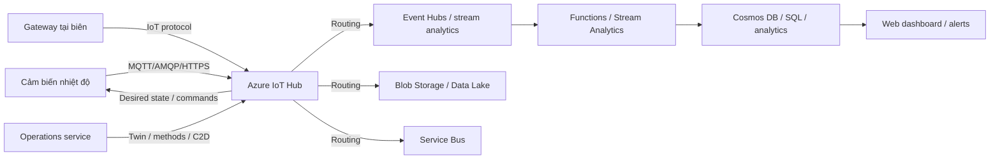

**IoT Hub không phải kho dữ liệu lịch sử vô hạn.** Nó tiếp nhận, định tuyến thông điệp và quản lý mối quan hệ cloud–device; lưu trữ lâu dài, phân tích và mô hình nghiệp vụ thường ở Storage, Cosmos DB, Azure SQL, Data Explorer hoặc những dịch vụ downstream phù hợp.

### IoT Hub có các thành phần nào?

| Thành phần | Vai trò |
|---|---|
| **IoT Hub resource** | Tài nguyên được quản lý, có hostname, tier, units, policy, routing, quota và diagnostics |
| **Device identity registry** | Lưu các bản ghi định danh thiết bị và trạng thái enable/disable/credentials |
| **Device endpoint** | Nơi thiết bị gửi telemetry/nhận thông điệp theo giao thức hỗ trợ |
| **Service endpoint** | Nơi backend quản lý thiết bị, đọc twins, gửi phương thức/thông điệp và quản trị |
| **Device twin** | Tài liệu JSON chứa desired/reported properties và metadata phục vụ đồng bộ cấu hình |
| **Module identity/twin** | Định danh/twin riêng cho module logic trên thiết bị/IoT Edge khi phù hợp |
| **Message routing** | Chọn thông điệp đưa đến endpoints/downstream services |
| **Built-in Event Hubs-compatible endpoint** | Cấp luồng sự kiện để consumer đọc theo semantics/retention của endpoint |
| **Device Provisioning Service (DPS)** | Dịch vụ **riêng** hỗ trợ đăng ký/phân bổ thiết bị vào hub theo enrollment rules |

### Đừng nhầm ba chữ “hub”

- **IoT Hub:** kết nối thiết bị, có device identity/twins/D2C/C2D.
- **Event Hubs:** ingest luồng sự kiện throughput lớn, quản lý partitions/consumer groups; không tự có device twin/per-device credential lifecycle giống IoT Hub.
- **Azure Web PubSub:** phân phối WebSocket tới ứng dụng/browser đang online, không phải registry cho hàng nghìn thiết bị IoT.

Một thiết bị có thể gửi qua IoT Hub và từ đó dữ liệu được route sang Event Hubs để xử lý stream. Điều này **không biến IoT Hub thành Event Hubs độc lập có cùng mọi giới hạn và chức năng**.

## 2. Thiết bị IoT phải được xem như một principal riêng

Trong mô hình an toàn, một thiết bị không chỉ là một chuỗi `deviceId` gửi trong payload.

### Các khái niệm định danh

| Khái niệm | Có nghĩa là | Không phải |
|---|---|---|
| **Device ID** | Mã định danh thiết bị duy nhất trong một IoT Hub registry | Bí mật xác thực |
| **Device identity record** | Bản ghi trong registry gắn ID, credential, enabled state và metadata auth | Chính dữ liệu telemetry |
| **Credential** | Khóa đối xứng hoặc chứng chỉ/khóa riêng theo authentication model | Tên thiết bị |
| **SAS token** | Token có chữ ký, tài nguyên được phép và thời hạn | Khóa gốc dùng mãi mãi |
| **X.509 certificate** | Chứng chỉ public-key dùng trong xác thực theo TLS/cấu hình | Toàn bộ chứng cứ thiết bị vật lý không thể bị sao chép |
| **Module ID** | Identity con cho module trong phạm vi device, khi được hỗ trợ | Device ID của thiết bị vật lý khác |
| **DPS registration ID** | Danh tính dùng trong quá trình provisioning qua DPS | Luôn giống IoT Hub deviceId trong mọi thiết kế |
| **Twin desired/reported** | Trạng thái cấu hình/khả năng được đồng bộ | Hệ thống xác thực danh tính |

### Nguyên tắc một thiết bị – một danh tính

Giả sử có 10.000 máy đo:

```text
hub: iothub-warehouse-prod
device IDs:
  wh-000001
  wh-000002
  ...
  wh-010000
```

Mỗi thiết bị có bản ghi identity riêng và credentials độc lập. Nếu `wh-004257` bị đánh cắp, đội bảo mật có thể **disable/revoke riêng thiết bị đó** mà không bắt buộc đổi khóa của 9.999 thiết bị còn lại.

### Bản ghi registry không phải “thiết bị đang online”

Registry chứa danh tính được phép kết nối. Một thiết bị có bản ghi `enabled` vẫn có thể:

- đang tắt nguồn;
- bị mất Wi-Fi;
- chưa từng hoàn tất provisioning;
- có certificate/clock sai;
- bị firewall chặn đường ra;
- đang dùng SDK gửi dữ liệu không đúng API.

**Registry existence ≠ online presence**. Cần connection diagnostics và telemetry freshness để đánh giá trạng thái thực tế.

## 3. Device identity registry và vòng đời thiết bị

Một thiết bị sản xuất thường đi qua các giai đoạn:

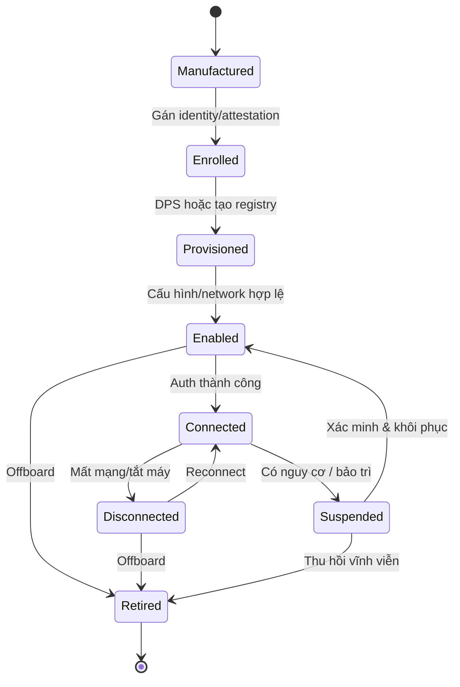

Đây là **state machine nghiệp vụ do tổ chức xây dựng**. IoT Hub identity registry chủ yếu có trạng thái enable/disable và metadata hỗ trợ; nó không tự có tất cả các state `Manufactured`, `Suspended`, `Retired` như sơ đồ.

### Mỗi giai đoạn cần một hành động kiểm soát

| Giai đoạn | Việc phải làm | Bằng chứng lưu |
|---|---|---|
| Manufacture | Gắn serial/secure element, sinh credentials | Inventory/attestation record |
| Enrollment | Tạo enrollment/DPS policy hoặc identity có kiểm soát | Owner, batch/serial, approved config |
| Provision | Thiết bị được gán đúng IoT Hub/tenant | Registration result, hub assignment |
| Connect | Auth TLS/SAS/X.509 thành công | Connection diagnostics, time |
| Operate | Báo trạng thái/telemetry, nhận config | Twin versions, metrics |
| Rotate | Cấp khóa/chứng chỉ mới an toàn | Key version, validity, success rate |
| Suspend | Chặn thiết bị rủi ro | Disabled identity, incident record |
| Retire | Thu hồi, xóa dữ liệu theo retention | Deprovision audit, certificate revocation |

Đừng xóa identity ngay khi thiết bị tạm ngừng mạng nếu cần giữ **audit/correlation**. Offboarding nên là một quy trình có approval, tách **disable để chặn** và **delete khi đủ điều kiện**.

## 4. Thiết bị kết nối bằng giao thức nào?

Azure IoT Hub hỗ trợ các giao thức thiết bị phổ biến, trong đó có **MQTT, AMQP và HTTPS** tùy trường hợp/SDK.

| Giao thức | Mô hình | Thường dùng khi | Điều cần lưu ý |
|---|---|---|---|
| **MQTT** | Kết nối publish/subscribe nhẹ qua TCP/TLS | Thiết bị nhỏ, liên tục gửi telemetry, mạng không ổn định | IoT Hub MQTT topic conventions không phải broker tùy ý |
| **AMQP** | Messaging protocol với liên kết/điều khiển flow | Gateway/services có nhu cầu multiplex/transport phù hợp | Có thể bị firewall chặn port; chọn SDK hỗ trợ |
| **HTTPS** | Request/response theo HTTP/TLS | Thiết bị không giữ socket lâu, mạng chỉ mở 443 | Khả năng nhận push/C2D/direct methods khác MQTT/AMQP |
| **MQTT over WebSockets/AMQP over WebSockets** | Bọc giao thức qua WebSocket/TLS khi hỗ trợ | Mạng chỉ cho TCP 443 | Vẫn phải dùng IoT Hub device protocol/identity, không phải browser Web PubSub |

### MQTT và topic của IoT Hub

Một IoT Hub hỗ trợ MQTT nhưng **không tương đương broker MQTT bất kỳ** cho custom topics tùy ý. Các topic/device operations phải tuân thủ **IoT Hub MQTT topic filters và service semantics** theo phiên bản giao thức. Nếu thiết bị hiện đang dùng một mạng custom MQTT topics và shared subscriptions, migration sang IoT Hub có thể cần gateway hoặc thay client topic mapping.

### TLS là bắt buộc cho tính tin cậy

Thiết bị cần xác minh endpoint certificate/TLS chain và hostname. Nếu bỏ kiểm tra certificate để “chạy được”, một attacker trong mạng có thể giả mạo server hoặc lấy thông tin nhạy cảm. Với thiết bị embedded, cần quản lý trust root, đồng hồ và vòng đời root CA tương thích với service.

### Chọn giao thức không tự quyết định quyền

Thiết bị dùng MQTT hay AMQP vẫn cần **xác thực bằng credentials được IoT Hub hỗ trợ**, có registry identity tương ứng và chỉ được thao tác trong phạm vi device. Giao thức khác nhau không cho phép thiết bị giả mạo user/service operations.

## 5. Hai nhóm xác thực thiết bị: symmetric key/SAS và X.509

### So sánh tổng quan

| Tiêu chí | Symmetric key + SAS | X.509 certificate |
|---|---|---|
| Cơ sở tin cậy | Bí mật đối xứng có ở thiết bị và service | Private key ở thiết bị, public certificate/CA được service tin cậy |
| Khi kết nối | Thường gửi SAS token đã ký và có expiry | Xác thực client certificate trong TLS theo cấu hình |
| Lưu trên thiết bị | Primary/secondary key cần bảo vệ | Private key cần bảo vệ, nên sinh trong TPM/secure element |
| Nguy cơ lộ | Lộ khóa cho phép tạo token hợp lệ tới khi revoke/rotate | Lộ private key cho phép mạo danh trong hạn và trước revoke |
| Rotation | Chuyển primary/secondary an toàn theo quy trình | Cấp cert mới, rollover trust/cert và retirement |
| Quy mô | Đơn giản cho lab và fleet vừa/nhỏ | Phù hợp khi đã có PKI/identity manufacturing |
| Provisioning | DPS symmetric enrollment/group derived key | DPS X.509 enrollment/CA attestation |
| Khó khăn | Quản lý bí mật trên thiết bị và phân phối key | PKI, chain validation, expiry, hardware protection |

**Không có lựa chọn tuyệt đối an toàn nếu private key hay symmetric key nằm trong firmware/plaintext dễ trích xuất**. Phần cứng, supply chain, bảo vệ physical access và quy trình rotation quan trọng không kém thuật toán.

### Device authentication và service authentication là hai đường khác nhau

Một thiết bị thường xác thực với IoT Hub bằng **per-device SAS/X.509** theo SDK/hub feature. Một backend quản lý hub có thể dùng **Microsoft Entra ID/managed identity** và các vai trò dữ liệu khi API hỗ trợ. **Không mặc định cấp managed identity cho hàng nghìn bo mạch embedded không có runtime/identity Azure**, và không phát hub-level shared access policy cho mỗi cảm biến.

## 6. Symmetric keys, primary/secondary và SAS token

Với mô hình symmetric-key:

```text
Device identity registry:
  deviceId = wh-000001
  authType = symmetric key
  primaryKey = (secret)
  secondaryKey = (secret)

Device:
  holds its own key securely
  creates short-lived SAS token
  connects as wh-000001
```

SAS token chứa phạm vi tài nguyên được phép, thời gian hết hạn và chữ ký theo giao thức:

```text
SharedAccessSignature sr=<resourceUri>&sig=<signature>&se=<expiry>
```

Đây là **cú pháp minh họa**; một số trường khác có thể tồn tại theo policy và cách mint token. **Token cũng là credential**, dù thời gian sống ngắn; không in token vào log.

### Đừng đánh đồng hub policy với device key

| Credential | Phạm vi | Có được đặt vào firmware thiết bị? |
|---|---|---|
| **Per-device symmetric key** | Một device identity | Chỉ khi lưu trữ an toàn và theo quy trình sản xuất |
| **SAS token theo device** | Tài nguyên thiết bị cụ thể, thời gian hữu hạn | Có thể dùng trong quá trình auth, không lưu dài hạn hoặc log |
| **Hub shared access policy key** | Quyền cấp hub theo policy, có thể quản trị nhiều devices/messages | **Không**; scope quá rộng và tạo rủi ro toàn fleet |
| **Service connection string** | Backend operations theo policy | **Không** trong firmware/client không tin cậy |

### Vì sao primary/secondary keys hữu ích?

Chúng hỗ trợ **xoay vòng không gián đoạn theo quy trình**:

1. Thiết bị đang dùng primary key.
2. Rotate secondary key theo policy được phép.
3. Cập nhật thiết bị chuyển sang secondary key mới, kiểm tra kết nối.
4. Rotate/revoke primary key cũ.
5. Có thể chuyển về primary mới khi cần.

Đây là kế hoạch khái niệm; độ trễ đồng bộ, offline devices, SDK token refresh và chính sách vận hành phải được kiểm thử trước khi rotate fleet thật. Nếu rotate primary trong lúc hàng nghìn thiết bị chưa nhận secondary, thiết bị có thể mất kết nối hàng loạt.

### Bảo vệ chống replay

SAS token có expiry; đồng hồ của thiết bị cần đúng tương đối để không mint token “đã hết hạn” hoặc sống quá lâu. **SAS không tự bảo đảm chống gửi trùng telemetry payload**; dữ liệu cần event ID/sequence và downstream idempotency nếu nghiệp vụ yêu cầu.

## 7. X.509: client certificate và quyền sở hữu private key

X.509 cho phép thiết bị trình **certificate** và chứng minh sở hữu **private key** trong quá trình xác thực theo TLS/IoT Hub configuration.

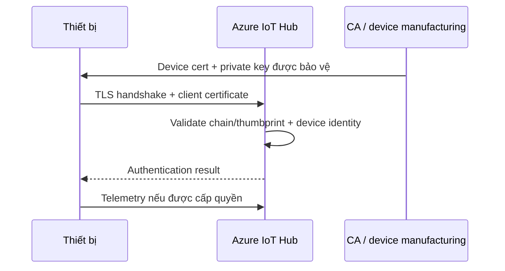

### Hai hướng xác thực certificate thường gặp

- **Thumbprint-based X.509:** Registry identity gắn một hoặc các certificate thumbprints được hỗ trợ; phù hợp một số hình thức quản trị individual certificate.
- **CA-signed X.509:** Certificate được ký bởi CA được đăng ký/kiểm chứng theo cơ chế IoT Hub hỗ trợ; cho phép xác thực dựa trên chain và device identity binding phù hợp.

Điều kiện về subject/CN, thumbprint, certificate verification và trust chain **phụ thuộc mode**; không chuyển một certificate của thiết bị A cho thiết bị B rồi chỉ đổi `deviceId` trong JSON.

### Private key phải ở đâu?

Trong production, ưu tiên:

- tạo key pair trên **TPM/secure element** nếu thiết bị hỗ trợ;
- tránh xuất private key dưới dạng file plaintext;
- không gửi private key qua email/ticket;
- thiết lập firmware secure boot/update policy phù hợp;
- kiểm tra certificate validity và chain đến CA được tin cậy;
- có kế hoạch rollover CA/root certificates và xử lý expired devices.

X.509 **không mặc định chứng minh phần cứng không bị sao chép** nếu private key có thể xuất và copy. Thiết kế manufacturing + hardware protection là phần quyết định.

### Khi nào chọn X.509?

X.509 thường đáng cân nhắc nếu:

- doanh nghiệp có PKI và quy trình sản xuất hàng loạt;
- thiết bị tồn tại nhiều năm cần rotation/attestation;
- có yêu cầu bảo vệ khóa phần cứng;
- muốn tách private key và chứng chỉ public;
- cần kết hợp với DPS provisioning theo CA.

Đổi lại, vận hành PKI/chain/certificate expiry/renewal phức tạp hơn symmetric-key lab.

## 8. Device ID, serial number và asset identity

Một doanh nghiệp có thể có ba loại định danh:

```text
Manufacturer serial:  SN-87391
IoT Hub deviceId:     wh-000001
Business assetId:     freezer-warehouse-12
```

Chúng **không bắt buộc trùng nhau**:

- **Serial:** do nhà sản xuất cấp, dùng bảo hành/supply chain.
- **DeviceId:** khóa định danh trong một hub registry, gắn credential và message path.
- **AssetId:** tài sản nghiệp vụ; một tủ đông có thể thay cảm biến nhiều lần.

### Vì sao cần mapping?

Khi thay cảm biến vật lý, không nên chỉ đổi credentials rồi tiếp tục giả vờ đó là thiết bị cũ nếu policy bảo mật yêu cầu chứng cứ phần cứng mới. Một business asset có thể gắn với **lịch sử nhiều device IDs**; lưu mapping theo thời gian:

```json
{
  "assetId": "freezer-warehouse-12",
  "currentDeviceId": "wh-000237",
  "previousDevices": ["wh-000001"],
  "deploymentRegion": "warehouse-12",
  "ownerTeam": "ColdChainOps",
  "firmwarePolicy": "stable-channel",
  "installedAtUtc": "2026-11-20T04:00:00Z"
}
```

JSON trên là **business inventory record minh họa**, không phải bản ghi registry IoT Hub. Định danh thiết bị không tự bao gồm asset warranty hoặc business ownership.

## 9. Device identity và module identity

Một **device identity** đại diện một thiết bị/kết nối được định danh trong IoT Hub. Một **module identity** đại diện module logic thuộc thiết bị đó khi mô hình được hỗ trợ, thường hữu ích với **Azure IoT Edge** hoặc hệ thống gateway chạy nhiều tác vụ độc lập.

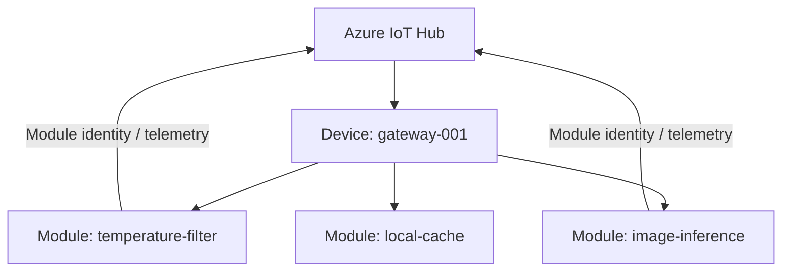

### Khi nào dùng module identity?

Một edge gateway có ba mô-đun:

- thu telemetry cảm biến;
- xử lý AI/ảnh tại biên;
- đồng bộ dữ liệu đã tổng hợp.

Tách module identities giúp có **credential và metadata/twin scope** phù hợp để quản lý từng module. Tuy nhiên **module identity không tự là sandbox OS hoặc cơ chế chống truy cập file giữa các containers**; container isolation và runtime security phải được thực thi ở biên.

### Module twin

Tương tự device twin, module twin có thể chứa desired/reported properties cho cấu hình và phản hồi của module. Không tự dùng device twin làm kho lưu credentials của tất cả modules.

## 10. Device Provisioning Service (DPS): đưa thiết bị vào hub an toàn

**Azure IoT Hub Device Provisioning Service (DPS)** là dịch vụ hỗ trợ **zero-touch, just-in-time provisioning**: thiết bị có thể xác thực với DPS, nhận thông tin phân bổ IoT Hub và đăng ký theo quy tắc enrollment, không cần hardcode tên production hub trong firmware.

### Provisioning và runtime connection khác nhau

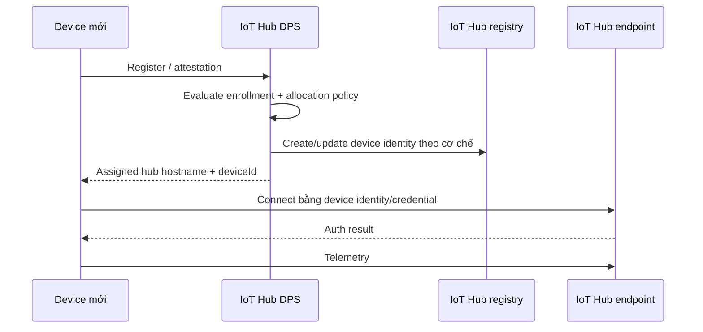

**DPS không phải điểm ingest telemetry bình thường** sau khi provisioning. Thiết bị gửi dữ liệu vận hành tới **IoT Hub đã được gán**. DPS giúp phân bổ và thiết lập identity, không phải thay thế message routing trong hub.

### Device biết gì trước lần đầu kết nối?

Tùy attestation:

- **ID Scope** của DPS instance.
- **Registration ID** và dữ liệu xác thực tương ứng.
- DPS global endpoint/SDK protocol phù hợp.
- Trust root/TLS certificate để xác thực server.

Một thiết bị không nên chứa **hub service connection string** hay privileged policy key chỉ để onboarding.

### Vai trò của ID Scope

**ID Scope** xác định DPS instance/registration context cho thiết bị; nó **không phải bí mật** và không tự cấp quyền. Một thiết bị còn phải chứng minh attestation (TPM, X.509 hoặc symmetric key) và được enrollment rules cho phép.

## 11. DPS individual enrollment và enrollment group

### Individual enrollment

Một bản enrollment áp dụng một thiết bị/registration identity cụ thể. Hữu ích khi:

- pilot với số thiết bị ít;
- thiết bị có chứng chỉ/TPM riêng;
- cần chặn/điều chỉnh policy một thiết bị;
- có quy trình manufacturing inventory đủ chi tiết.

### Enrollment group

Group enrollment có thể phục vụ **nhiều thiết bị cùng thuộc một quy tắc tin cậy**, ví dụ:

- các certificates con được ký bởi một CA/group trust policy hợp lệ;
- symmetric-key group enrollment với **derived device keys** theo cơ chế được hỗ trợ.

**Tuyệt đối không nhúng cùng một group master key không được bảo vệ vào toàn bộ firmware** rồi gọi đó là per-device identity. Với symmetric group enrollment, dùng thuật toán/provisioning hỗ trợ để **derive credential riêng cho mỗi registration ID**, lưu secret tại nơi an toàn.

### Individual vs group

| Thuộc tính | Individual enrollment | Enrollment group |
|---|---|---|
| Phạm vi | Một registration/device | Nhiều devices theo common attestation |
| Quy mô quản trị | Dễ audit từng thiết bị | Phù hợp fleet sản xuất hàng loạt |
| Thu hồi | Có thể xử lý từng enrollment/identity | Cần cơ chế chặn từng thiết bị và quản lý group trust |
| Khi sử dụng | Pilot/thiết bị đặc thù | Manufacturing batches hoặc certificate hierarchy |
| Rủi ro | Bảng đăng ký lớn, thủ công | Group master/CA bị lộ ảnh hưởng nhiều thiết bị |

### Enrollment group không có nghĩa các devices đều có một deviceId

Mỗi thiết bị vẫn cần registration ID/identity phù hợp. Group chỉ biểu diễn quy tắc cấp phát; kết quả IoT Hub registry có các device identities phân biệt. Không dùng group name làm `deviceId` cho toàn bộ sensors.

## 12. Ba dạng attestation thường gặp ở DPS

| Attestation | Chứng minh điều gì? | Điểm thiết kế |
|---|---|---|
| **Symmetric key** | Device sở hữu secret tương ứng với enrollment | Bảo vệ group key/derived key, rotate/revoke |
| **X.509 certificate** | Device sở hữu private key và certificate hợp lệ theo enrollment/certificate chain | CA hierarchy, verification, expiry, rollover |
| **TPM** | Thiết bị sở hữu khóa/chứng cứ theo phần cứng TPM và quy trình attestation được hỗ trợ | Cấu hình endorsement/registration, hardware support |

### TPM là gì trong ngữ cảnh provisioning?

**Trusted Platform Module (TPM)** là phần cứng/chức năng bảo vệ khóa. Một mô hình attestation được DPS hỗ trợ có thể ràng buộc registration với khóa/chứng cứ TPM. Không đồng nhất “có TPM” với “chắc chắn thiết bị sạch malware”: secure boot, firmware integrity, supply chain và quyền runtime vẫn cần thiết kế bổ sung.

### X.509 CA enrollment

Quy trình mẫu:

1. Nhà sản xuất/quản trị PKI chuẩn bị certificate hierarchy và giữ CA private key an toàn.
2. Đăng ký/verify public CA hoặc certificate chain theo chức năng DPS.
3. Mỗi thiết bị có leaf certificate và private key riêng.
4. Khi boot, device trình certificate/đáp ứng attestation.
5. DPS đối chiếu enrollment và gán IoT Hub.

**Verification of ownership** ở cấp CA và **runtime client certificate validation** là các bước có ý nghĩa khác nhau; phải thực hiện theo quy trình provider, không chỉ upload một file PEM vào Portal rồi cho rằng mọi thiết bị đã đáng tin.

## 13. DPS allocation: một thiết bị nên vào hub nào?

Với hàng trăm nghìn devices, doanh nghiệp có thể cần nhiều hubs theo vùng/nhóm khách hàng. DPS hỗ trợ các chiến lược allocation theo cấu hình và khả năng dịch vụ.

### Mẫu phân bổ

```text
Fleet sensors
    |
    v
  DPS
    |
    +--> IoT Hub: southeast-asia fleet
    +--> IoT Hub: europe fleet
    +--> IoT Hub: staging fleet
```

Chọn hub không chỉ dựa vào latency. Cần xét:

- **data residency** và chính sách khách hàng;
- quota/capacity/tier của hub đích;
- thiết bị được phép thuộc tenant/business domain nào;
- hub ở environment production hay test;
- supportability của allocation policy/custom allocation nếu được hỗ trợ;
- hành vi **re-provision** khi thiết bị thay đổi khu vực hoặc hub assignment.

### Chuyển hub có phải đổi DNS là xong?

Không. Thiết bị có identity, credentials, twins, routes và downstream consumers liên quan một hub cụ thể. Nếu điều chuyển thiết bị từ hub A sang hub B:

1. Xác minh chính sách re-provisioning và DPS allocation.
2. Tạo/khôi phục identity ở hub B đúng cơ chế.
3. Đồng bộ desired configuration/business mapping nếu cần.
4. Kiểm tra tuyến message/consumer ở hub mới.
5. Disable/remove identity hub cũ theo quy trình và kiểm toán.

**Không tự coi DPS sẽ migrate toàn bộ device twin, lịch sử telemetry và routing sang hub mới**. Dữ liệu nghiệp vụ phải được quản lý ở hệ thống phù hợp.

## 14. IoT Hub identity và Microsoft Entra ID: ai dùng quyền gì?

Một hệ thống IoT có **ba loại principals**:

1. **Device principal:** per-device SAS/X.509/attestation, được IoT Hub dùng để xác thực thiết bị.
2. **Service/backend principal:** App Service, Function, AKS worker hoặc automation dùng Microsoft Entra ID/managed identity hoặc credential dịch vụ được hỗ trợ.
3. **Human operator:** kỹ sư/điều phối viên thao tác trên Portal/CLI/API với Entra user identity và vai trò giới hạn.

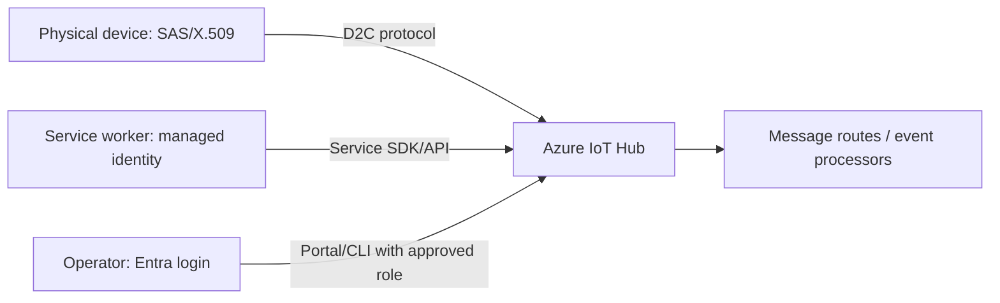

### Control-plane và data-plane khác nhau

| Lớp | Ví dụ thao tác | Cơ chế quyền cần xem |
|---|---|---|
| **Azure control plane** | Tạo hub, đổi tier, cấu hình routing, network | Azure RBAC cho tài nguyên ARM |
| **IoT Hub service data plane** | Quản lý identity/twin, gửi direct method/C2D hoặc đọc messages tùy API | IoT Hub data-plane roles/credentials được hỗ trợ |
| **Device data plane** | Device gửi telemetry, nhận desired properties | Device SAS/X.509 identity |
| **Application authorization** | Nhân viên A có quyền đổi ngưỡng của device B không? | Business roles/tenant/asset ownership trong ứng dụng |

**Azure role Reader** có thể xem metadata ARM nhưng không tự có quyền gửi C2D messages hoặc sửa twin. Ngược lại, một thiết bị có device key cũng **không** có quyền quản trị mọi device identities trong hub.

### Backend nên dùng managed identity khi có thể

Một Azure Function xử lý cảnh báo rồi cập nhật desired property có thể dùng managed identity và data-plane role phù hợp với APIs hỗ trợ. Nếu dùng connection string/IoT Hub shared access policy, credential phải được bảo vệ trong Key Vault và có kế hoạch giảm phạm vi/rotation.

**Đừng gửi service connection string qua C2D để “cấp quyền” cho device**. Nó có thể cho phép quyền ngoài thiết bị và làm tăng blast radius khi bị lộ.

## 15. Device-to-cloud telemetry (D2C)

**Telemetry** là dữ liệu do thiết bị gửi lên cloud: nhiệt độ, rung động, mức pin, GPS, trạng thái sensor.

```json
{
  "eventId": "wh-000001-000127",
  "deviceId": "wh-000001",
  "sequence": 127,
  "temperatureC": 4.8,
  "humidityPct": 66.1,
  "measuredAtUtc": "2026-11-20T09:00:00Z",
  "firmwareVersion": "1.4.2"
}
```

### Thiết bị ID trong payload không phải authentication

Nếu thiết bị `wh-000001` đã xác thực bằng device credentials nhưng payload tự khai `"deviceId":"wh-000002"`, backend không nên tự tin rằng dữ liệu đến từ thiết bị 2. Hãy dùng **device identity metadata** do IoT Hub/service route cung cấp làm nguồn đáng tin, rồi kiểm tra payload/business mapping. Payload có thể bị device firmware giả mạo.

### Luồng D2C

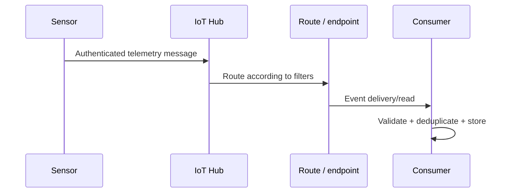

### Khi network chập chờn

Thiết bị nên có:

- local buffer theo storage/retention phù hợp;
- retry với backoff, không retry storm;
- monotonic sequence hoặc eventId chống trùng downstream;
- timestamp đo thực tế và timestamp gửi riêng;
- giới hạn số message giữ offline;
- xử lý overflow theo mức ưu tiên nghiệp vụ.

**D2C send acknowledgment không chứng minh downstream đã ghi database hay dashboard đã hiển thị**. Thiết kế consumer/idempotency và end-to-end monitoring nếu dữ liệu quan trọng.

## 16. Cloud-to-device (C2D) messages

**Cloud-to-device message** cho phép service gửi message đến thiết bị theo cơ chế IoT Hub hỗ trợ. Ví dụ:

```json
{
  "commandId": "cmd-2026-0102",
  "type": "RefreshCalibration",
  "requestedAtUtc": "2026-11-20T10:00:00Z",
  "validUntilUtc": "2026-11-20T10:05:00Z"
}
```

C2D message là **một kênh truyền command payload**, nhưng không tự biến ứng dụng thành hệ thống xử lý lệnh exactly-once. Thiết bị nên:

1. xác minh danh tính hub qua TLS;
2. parse và validate schema/command version;
3. kiểm tra expiration và authorization policy đã cấp từ backend;
4. deduplicate bằng `commandId`;
5. thực thi an toàn theo trạng thái thiết bị;
6. gửi business result telemetry hoặc reported property theo thiết kế.

### C2D không đồng nghĩa direct method

| Kênh | Mục tiêu | Khả năng đặc trưng |
|---|---|---|
| **C2D message** | Gửi message đến device, có cơ chế message lifecycle/queue theo giới hạn dịch vụ | Phù hợp yêu cầu không nhất thiết đồng bộ |
| **Direct method** | Gọi phương thức và nhận phản hồi trong timeout khi device online | Request/response tương đối đồng bộ |
| **Desired property** | Biểu đạt cấu hình/điều kiện mục tiêu cần hội tụ | Phù hợp trạng thái lâu dài/thiết bị có thể offline |

Đối với cấu hình “ngưỡng nhiệt độ mong muốn = 6°C”, desired property thường có semantics phù hợp hơn gửi command tức thời lặp lại. Đối với “chụp ảnh ngay bây giờ” khi thiết bị online, direct method có thể phù hợp. Với lệnh cần chờ xử lý lâu, cần durable job/command store riêng nếu IoT Hub semantics không đủ.

## 17. Direct methods: gọi lệnh khi thiết bị online

**Direct method** là mô hình service gọi một method trên device/module và có thể nhận status/payload response khi thiết bị kết nối, xử lý trong timeout.

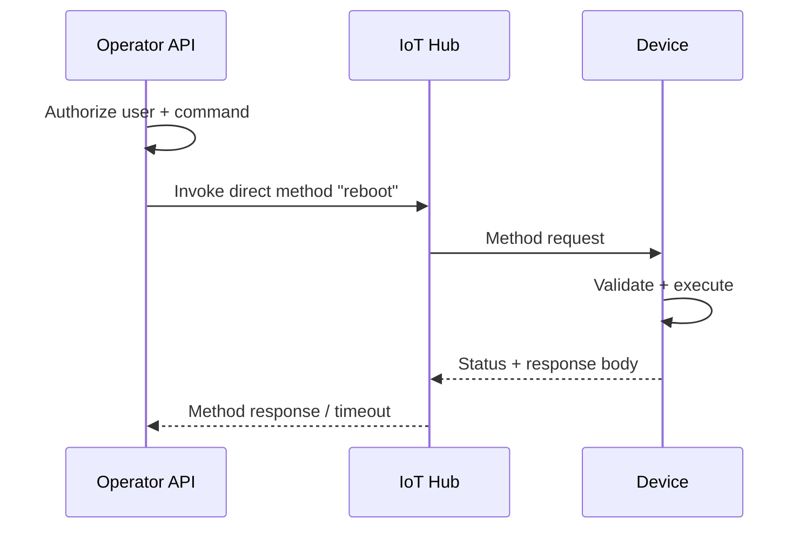

### Những điều cần tránh

- **Không gọi direct method tới thiết bị offline rồi kỳ vọng IoT Hub sẽ luôn queue lệnh cho lúc online.**
- **Không dùng status 200 của direct method làm bằng chứng firmware reboot thực sự hoàn tất** nếu thiết bị chỉ trả “accepted”; cần health check sau đó.
- Không cấp cho device client quyền tự gọi service methods trên các devices khác.
- Không dùng direct method cho tác vụ có thể mất hàng giờ nếu timeout của operation không phù hợp.

### Lệnh nguy hiểm cần business authorization

Các lệnh như reboot, firmware rollback, đóng van công nghiệp hay thay công suất máy lạnh có thể gây ảnh hưởng vật lý. Backend phải có **operator role, scope tới asset, audit, request approval và safety interlocks** phù hợp; không để bất cứ ai có connection đến hub tự thực thi.

## 18. Device twin: desired và reported properties

**Device twin** là tài liệu JSON đại diện cho trạng thái cấu hình và metadata đồng bộ giữa cloud và device:

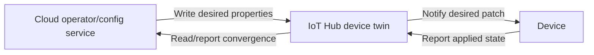

### Twin gồm những gì?

| Thành phần | Ai có thể cập nhật trong model | Công dụng |
|---|---|---|
| **Tags** | Cloud/service-side authorized principal | Metadata nghiệp vụ/nhóm thiết bị dùng cho query/quản lý |
| **Desired properties** | Cloud/service | Cấu hình mục tiêu mà thiết bị cần áp dụng |
| **Reported properties** | Thiết bị qua device connection | Trạng thái thực tế và kết quả áp dụng |
| **ETag/version/metadata** | Service manages/concurrency controls | Kiểm soát phiên bản và optimistic concurrency |

### Ví dụ twin rút gọn

```json
{
  "deviceId": "wh-000001",
  "tags": {
    "site": "warehouse-12",
    "owner": "ColdChainOps"
  },
  "properties": {
    "desired": {
      "telemetryIntervalSeconds": 60,
      "temperatureAlarmThresholdC": 6.0,
      "$version": 12
    },
    "reported": {
      "telemetryIntervalSeconds": 60,
      "temperatureAlarmThresholdC": 6.0,
      "firmwareVersion": "1.4.2",
      "appliedDesiredVersion": 12,
      "$version": 34
    }
  }
}
```

Đây là **JSON minh họa các nhóm trường chính**, không phải response hoàn chỉnh của mọi IoT Hub SDK. Các trường hệ thống như `$version`, `$metadata` và ETag có semantics riêng, không nên tự sửa chúng như business properties.

### Desired không phải actual

Nếu service ghi:

```json
{"telemetryIntervalSeconds": 30}
```

vào desired, điều đó chỉ diễn tả **mục tiêu**, không chứng minh thiết bị đã đổi tần suất. Device cần:

1. nhận patch desired hoặc đọc twin sau reconnect;
2. validate config (ví dụ khoảng hợp lệ từ 10 đến 600 giây);
3. áp dụng cấu hình thành công;
4. patch **reported properties** và ghi desired version đã xử lý;
5. gửi telemetry theo tần suất mới.

Hệ thống vận hành nên đo **desired–reported drift**: bao nhiêu devices chưa hội tụ sau một khoảng SLA.

## 19. Twin query và device inventory

Trong các API có hỗ trợ query trên registry/twins, backend có thể tìm:

```sql
SELECT * FROM devices
WHERE tags.site = 'warehouse-12'
```

Đây là **truy vấn minh họa theo cú pháp IoT Hub twin query**, không phải câu SQL dùng trong Azure SQL Database. Những fields, operators/indexes và khả năng query khác nhau theo operation/API/tier; kiểm tra SDK/CLI trước khi dùng.

### Thiết bị cần được gắn tags bởi ai?

Tags cloud-side nên được thiết lập từ **business inventory** hoặc provisioning metadata đáng tin cậy. Nếu cho device tự khai `tags.owner = "finance-admin"` và backend dùng nó làm quyền truy cập, một thiết bị compromised có thể tự nâng quyền. **Cloud-controlled tags không nên được cập nhật từ dữ liệu không xác thực của client**.

### Không dùng twin làm data warehouse

Twin phù hợp **configuration/state metadata**, không phải gửi hàng trăm telemetry samples mỗi giây rồi cập nhật một twin document vô hạn. High-frequency telemetry nên là D2C messages/streams, còn reported property có thể phản ánh trạng thái tổng hợp như firmware version, last calibration hoặc config applied version.

## 20. Device twin và offline-first configuration

Một ưu điểm của desired/reported model là **thiết bị không cần online đúng thời điểm người vận hành đổi cấu hình**. Cloud giữ desired state, device có thể lấy khi kết nối lại.

```text
09:00 Device offline
09:10 Operator sets desired.telemetryIntervalSeconds = 30
09:40 Device reconnects
09:41 Device reads latest desired version and validates
09:42 Device applies setting
09:43 Device reports appliedDesiredVersion and actual interval
```

### Tránh cập nhật “mù”

Nếu hai operators hoặc automation cùng sửa twin, cần kiểm soát concurrency theo ETag/version/update mechanism được SDK hỗ trợ. Cũng cần phân biệt:

- **patch properties:** sửa một số trường mà không thay toàn bộ cấu hình;
- **replace full twin:** có thể ghi đè các phần ngoài ý muốn nếu dùng không đúng.

Khi cấu hình thay đổi liên tục, device nên xử lý patches có version và hợp nhất trạng thái; không mặc định mọi patch đến cùng thứ tự mong muốn qua các lần ngắt mạng.

### Config rollout theo đợt

Đừng cập nhật ngưỡng hoặc firmware policy cho 100.000 devices đồng thời nếu thay đổi có thể gây quá tải hoặc tác động vật lý. Chia theo:

```text
Lab devices → 1% canary → 10% region pilot → 50% → full fleet
```

Theo dõi reported version, telemetry health, offline ratio và rollback trước khi mở đợt mới.

## 21. D2C message routing và endpoint downstream

IoT Hub có thể **route các thông điệp** phù hợp tới endpoints theo message properties, body/system metadata và conditions được hỗ trợ.

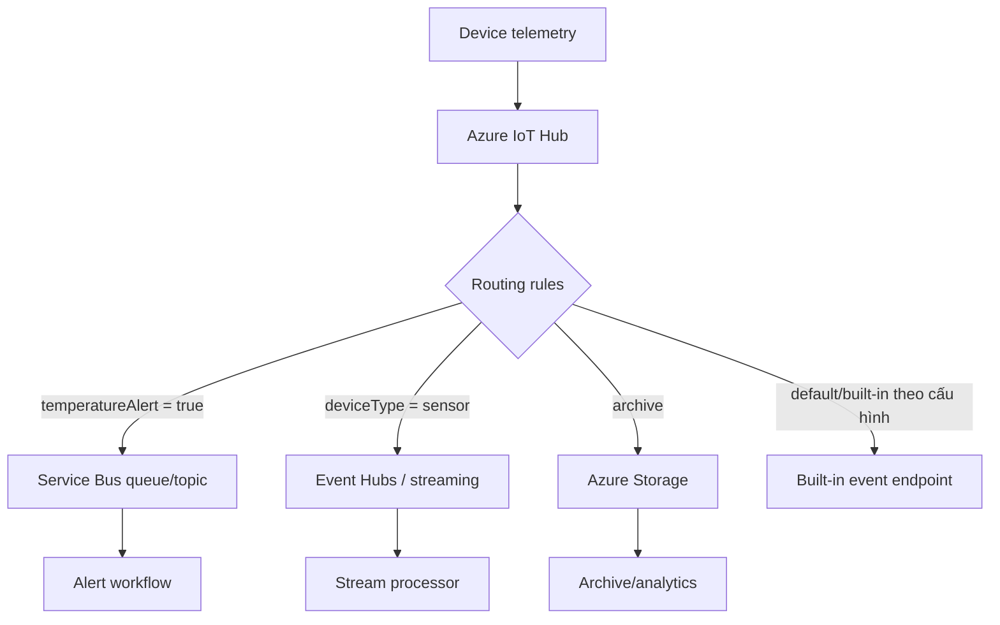

### Routing dựa vào cái gì?

Một D2C message có thể mang:

- **System properties** do giao thức/IoT Hub quản lý, gồm thông tin device identity được xác thực.
- **Application properties** do firmware đặt, ví dụ `messageType=temperature`.
- **Message body** là JSON/binary/other payload theo content type.

Ví dụ application properties:

```text
messageType = telemetry
siteCode = warehouse-12
schemaVersion = 2
contentType = application/json
contentEncoding = utf-8
```

Khi route cần lọc một trường trong body JSON, phải bảo đảm **content-type/content-encoding và tính năng body query được hỗ trợ**; nếu thiếu metadata hoặc JSON không hợp lệ, điều kiện có thể không match như kỳ vọng. Không giả định mọi protocol/SDK đều tự đặt headers chính xác.

### Ví dụ điều kiện routing

```text
Route name: coldchain-alerts
Condition: application property messageType = "alert"
Endpoint: Service Bus queue alerts
```

Đây là mô tả logic; cú pháp query filter và allowed properties phụ thuộc cấu hình IoT Hub. Không sao chép mô tả thành filter production trước khi test trên Portal/CLI.

### Routing failure không tự thành công nghiệp vụ

Nếu IoT Hub chấp nhận D2C nhưng destination endpoint đang lỗi:

- route có trạng thái health/diagnostics cần theo dõi;
- retries, fallback và endpoint behavior phụ thuộc service configuration;
- thông điệp không nên được coi là đã ghi database khi mới ack tại ingress;
- backend cần idempotency và phát hiện gap dựa trên eventId/sequence.

### Built-in endpoint và custom routes

IoT Hub có endpoint mặc định tương thích Event Hubs cho consumers. **Khi bật message routing, hãy kiểm tra cách route dữ liệu tới built-in endpoint hoặc fallback route** theo cấu hình hiện tại. Không mặc định một message sẽ vẫn xuất hiện ở built-in consumer nếu bạn thay đổi routes và loại bỏ default/fallback behavior.

## 22. IoT Hub built-in Event Hubs-compatible endpoint

Một consumer như Azure Functions, Stream Analytics hoặc application sử dụng protocol/SDK được hỗ trợ có thể đọc D2C messages từ endpoint tích hợp.

### Các đặc tính quan trọng

| Khái niệm | Ý nghĩa |
|---|---|
| **Partitions** | Chia luồng events để đọc song song theo mô hình endpoint |
| **Consumer group** | Cho phép những ứng dụng đọc độc lập với vị trí xử lý/offset riêng |
| **Offset/checkpoint** | Consumer lưu vị trí đã xử lý để tiếp tục sau restart |
| **Retention** | Messages lưu tạm trong thời gian/giới hạn của endpoint, không phải archive vĩnh viễn |
| **At-least-once processing** | Thiết kế consumer chịu được xử lý lại, không mặc định exactly-once |

### Ví dụ workflow

```text
IoT Hub D2C
→ Built-in Event Hubs-compatible endpoint
→ Azure Function / Stream Analytics
→ Validate payload + deduplicate
→ Cosmos DB / Data Explorer / Blob Storage
→ Web/API dashboard
```

Không dùng cùng một consumer group/checkpoint store cho hai ứng dụng độc lập nếu muốn chúng mỗi bên đọc đủ toàn luồng. Thiết kế consumer groups và checkpoints theo kiến trúc streaming/SDK hỗ trợ.

### Tại sao không lưu 10 năm trong IoT Hub?

Endpoint có retention và quota tương ứng. Để lưu dài hạn/audit, route sang Blob/Data Lake/đích khác với lifecycle/retention policy, backup, quyền truy cập và ngân sách riêng.

## 23. Device twin không phải cách gửi telemetry liên tục

So sánh:

| Dữ liệu | Kênh phù hợp | Vì sao |
|---|---|---|
| Nhiệt độ mỗi 5 giây | **D2C telemetry** | Dạng event stream, có thể routing/analytics |
| Model phần cứng/firmware version | **Reported twin property** | Metadata trạng thái ít thay đổi |
| Ngưỡng cảnh báo mục tiêu | **Desired twin property** | Đồng bộ config khi online trở lại |
| Chạy self-test ngay | **Direct method** | Gọi lệnh và nhận phản hồi khi online |
| Lệnh chưa cần phản hồi ngay | **C2D message** hoặc command workflow riêng | Thời hạn/giao nhận tùy chính sách |
| Danh sách thiết bị bị lỗi | **Cloud inventory + telemetry-derived state** | Hợp nhất registry, last-seen và alerts |
| Lịch sử 24 tháng | **Data Lake/analytics database** | Query và retention dài hạn |

### Một lỗi thiết kế dễ gặp

Nếu mỗi sensor gửi 10 messages/giây và backend cập nhật twin reported sau **mỗi** message:

- tăng request load/quota lên twin operations;
- dễ xung đột version/ghi không cần thiết;
- cloud chỉ cần biết reported state gần nhất nhưng phải xử lý tần suất cao;
- tạo thêm chi phí/độ trễ và khó theo dõi config drift.

Dùng D2C cho telemetry, reported cho các trạng thái hiếm đổi và phải kiểm soát tần suất patch twin.

## 24. IoT Edge và gateway danh tính

Một số cảm biến không thể kết nối trực tiếp Internet hoặc không đủ phần cứng/SDK. Chúng có thể giao tiếp với **gateway/edge device** qua giao thức nội bộ, sau đó gateway đẩy dữ liệu lên IoT Hub.

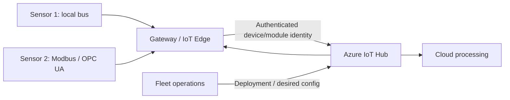

### Hai mô hình identity

1. **Gateway identity duy nhất:** nhiều sensors gửi qua gateway và payload có `sensorId`. Cloud xác thực được **gateway**, còn từng sensorId cần thêm identity/attestation/validation nếu ứng dụng muốn tin riêng từng sensor.
2. **Identities riêng cho downstream devices:** trong các transparent gateway/protocol scenarios được hỗ trợ, mỗi downstream device có identity/credentials và gateway hỗ trợ chuyển tiếp kết nối.

**Không mặc định gateway tự xác thực từng cảm biến phía sau** chỉ vì nó có IoT Hub device identity. Muốn truy nguồn từng sensor, cần thiết kế identity model ở phía field network/gateway.

### IoT Edge modules

Một IoT Edge runtime có thể chạy containerized modules ở biên, dùng module identities/twins cho cấu hình/kết nối. Các modules không đương nhiên được quyền truy cập nhau hoặc đọc host secrets; cần quản trị image signing, runtime isolation, update strategy và device hardware security.

### Offline processing

Gateway có thể đệm/thực thi logic tại biên khi mất mạng; tuy nhiên bộ nhớ đệm, routing, replay và idempotency phải được cấu hình riêng. Không coi “Edge” mặc định bảo đảm không mất bất kỳ bản ghi nào khi mất điện kéo dài.

## 25. Phân biệt IoT Hub, DPS, IoT Central và Event Grid

| Dịch vụ | Điểm mạnh | Khi nên dùng |
|---|---|---|
| **Azure IoT Hub** | Per-device identity, D2C/C2D, twins, methods, routing | Cần kiểm soát sâu kết nối và luồng thiết bị |
| **Azure IoT Hub DPS** | Provisioning/assignment theo attestation/enrollment | Đưa fleet thiết bị vào hubs mà không cấu hình thủ công từng máy |
| **Azure IoT Central** | Giải pháp IoT dạng managed application/platform mức cao | Muốn rút ngắn xây dựng app/device templates/dashboards theo khả năng sản phẩm |
| **Azure Event Hubs** | Ingest event stream throughput lớn | Nhiều producers, stream analytics; không cần per-device twins |
| **Azure Event Grid** | Routing event notifications và event-driven integrations | Phản ứng với events từ hệ thống, không thay IoT Hub device session |
| **Azure Service Bus** | Enterprise message queues/topics, DLQ/sessions | Commands/jobs bền vững giữa backend services |
| **Azure Stream Analytics** | Xử lý stream/time windows theo query | Tính toán telemetry gần realtime sau ingestion |

Khi IoT Central dùng những thành phần Azure khác ở tầng dưới, người dùng vẫn cần hiểu **mô hình quyền và trách nhiệm** tương ứng; không tự quản lý một IoT Hub resource do sản phẩm khác sở hữu nếu workflow không cho phép.

## 26. Phân quyền thiết bị không đồng nghĩa phân quyền người dùng

Một thiết bị biết gửi telemetry không có quyền tự quyết định:

- người dùng nào xem dữ liệu;
- technician nào được gửi direct methods;
- nhà kho nào được cập nhật threshold;
- ai được rotate hoặc delete identity;
- asset nào được phép gán cho khách hàng nào.

Các quyết định đó thuộc về **backend application/domain authorization**.

### Mô hình đa tenant

Giả sử IoT Hub phục vụ hai doanh nghiệp:

```text
Tenant-A:
  Device: A-wh-001
  Device: A-wh-002
Tenant-B:
  Device: B-wh-001
```

Prefix ID là một quy ước hỗ trợ quản trị, **không phải security boundary**. Backend phải ánh xạ device ID tới tenant đáng tin, kiểm tra claims/roles người dùng và chỉ truy vấn dữ liệu đúng tenant. Không để người dùng gọi `GET /devices/B-wh-001` mà không có resource authorization.

### Device metadata có thể bị làm giả

Payload firmware có thể tự khai `"tenantId":"Tenant-B"`. Hãy dựa vào **authenticated device identity** từ IoT Hub và asset inventory để xác định tenant, không dùng trường tùy ý trong payload làm nguồn quyền.

### Tránh shared devices theo client

Một hub-level connection string dùng chung cho tất cả gateways của các khách hàng tạo blast radius rất lớn. Fleet production nên có **per-device or per-module identity** và credentials độc lập, với identity lifecycle có thể audit.

## 27. Security architecture theo nhiều lớp

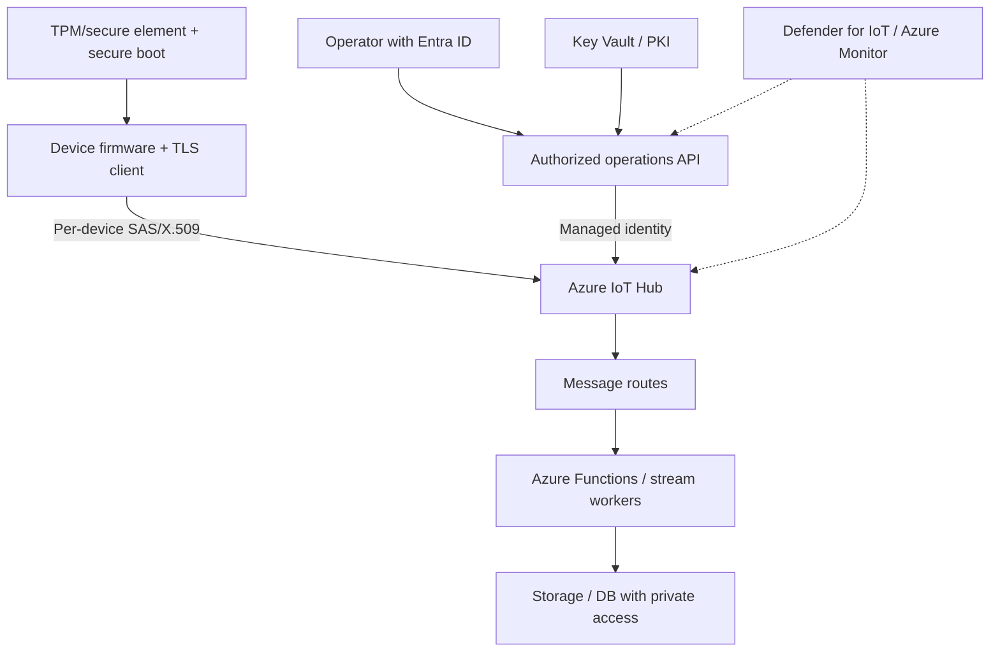

### Device layer

- Secure boot và firmware update verification nếu phần cứng hỗ trợ.
- Không hardcode hub master key trong firmware.
- Bảo vệ per-device key/private key trong secure hardware khi có thể.
- Chặn debug interfaces không được phép trong production.
- Kiểm soát serial/registration mapping và chuỗi cung ứng.
- Có policy xử lý thiết bị thất lạc hoặc bị can thiệp vật lý.

### Transport layer

- TLS server validation, CA trust store và hostname đúng.
- SAS token expiry hợp lý hoặc X.509 certificate rotation.
- Hạn chế outbound network/port cần thiết.
- Đồng hồ thiết bị đúng cho token/cert validity; có chiến lược cho mất pin RTC.
- Retry/backoff thay vì reconnect quá dày.

### Azure layer

- Least-privilege role/identity cho service/API operators.
- Hạn chế shared access policy, lưu secrets trong Key Vault.
- Network firewall/private endpoint/Private Link theo tier/feature hỗ trợ.
- Ghi diagnostics cho connection/disconnection/auth failures.
- Bảo vệ endpoints đích (Storage/Event Hubs/Service Bus) với identity và network.
- Có Azure Policy/Defender for IoT hoặc công cụ bảo mật được tổ chức triển khai khi phù hợp.

### Application layer

- Validate message schema, size, timestamp, ranges và device business mapping.
- Per-device rate limiting/quarantine khi bị abuse.
- Idempotency cho telemetry và commands.
- Operator authorization và audit khi điều khiển thiết bị.
- Phân biệt dữ liệu nhạy cảm vị trí/GPS/personal data với dữ liệu công khai.

**Không có một điều khiển duy nhất tạo bảo mật đầu-cuối.** Private Link không thay TLS identity, SAS không thay firmware security, và role Azure RBAC không tự bảo vệ dữ liệu của từng khách hàng trong ứng dụng.

## 28. Private endpoints và network topology

Trong các tier/tính năng IoT Hub hỗ trợ, có thể có cơ chế **IP filtering, private endpoints/Private Link và public network access controls**. Khi thiết kế:

```text
Device in plant LAN
→ Firewall/Proxy/VPN
→ Azure IoT Hub endpoint
→ Message route destination
```

### Câu hỏi quan trọng

1. Thiết bị thực sự ở đâu: Internet public, factory LAN, site-to-site VPN?
2. Device transport nào dùng port/proxy nào?
3. Private endpoint có được hỗ trợ trên hub tier/feature và có private DNS đúng không?
4. Thiết bị có route từ site tới private IP không?
5. DPS provisioning endpoint và IoT Hub runtime endpoint có **đường mạng khác nhau** không?
6. Backend service control/data-plane đến IoT Hub dùng identity và route nào?
7. Message routing tới Storage/Event Hubs/Service Bus có vượt firewall/network restrictions không?

### DPS network riêng cũng cần xét

Một thiết bị có thể hoàn tất provisioning qua DPS nhưng không kết nối được hub đích do DNS/firewall. Ngược lại, có thể kết nối hub cũ nhưng bị chặn re-provisioning. **Luôn kiểm tra cả provisioning path và runtime path** khi đánh giá mô hình private/hybrid.

### Không bật public endpoint trái chính sách để “test nhanh”

Nếu enterprise policy yêu cầu private networking, cần sửa DNS/route/gateway đúng nơi. Không xóa IP filters hoặc tắt TLS verification chỉ để xử lý timeout, vì điều đó bỏ bảo vệ của toàn fleet.

## 29. Standard/Basic tiers, quota và thiết kế trước khi tạo hub

IoT Hub có những tầng dịch vụ khác nhau. **Tier/units quyết định tính năng, giới hạn throughput, message quota và giá**, không chỉ quyết định dung lượng lưu trữ. Một số tính năng quản lý thiết bị như twins/direct methods/cloud-to-device theo cấu hình cần tier phù hợp, vì vậy bài lab dưới đây sử dụng **Standard tier khi cần thử twins/methods**.

### Phân biệt use case

| Nhu cầu | Câu hỏi về tier |
|---|---|
| Chỉ nhận D2C telemetry | Tier nào hỗ trợ ingress và throughput cần thiết? |
| Cần device twins/configuration | Tier đó có đầy đủ twin capability không? |
| Cần direct methods/jobs/C2D | Tier và quota có hỗ trợ không? |
| Hàng trăm nghìn devices | Bao nhiêu identities, connections, messages/day và units? |
| Private endpoint/networking | Tier/region có hỗ trợ và có giới hạn gì? |
| DPS auto enrollment | DPS service có cấu hình/cost riêng và phân bổ vào hub tier nào? |
| Message routing | Endpoint types, routing operations, throughput và retries theo tier? |

### Capacity planning bắt đầu từ messages thực

Giả sử 20.000 thiết bị gửi một telemetry message mỗi phút:

\[
\frac{20\,000}{60}\approx333{,}3\ \text{messages/giây}.
\]

Trong một ngày:

\[
20\,000\times 1\,440=28\,800\,000\ \text{messages/ngày}.
\]

Đây là **số message ứng dụng** nếu mọi thiết bị gửi đủ nhịp, không tính reconnects, retries, batching, payload size và quy tắc **IoT Hub metered message units** theo kích thước của tier. Không được nhân 28,8 triệu với một giá tùy ý mà không đọc bảng giá/tier hiện hành.

### Đặt headroom

Các sự kiện sau khiến workload thực vượt nhịp đều:

- 20% thiết bị offline trong 30 phút rồi flush backlog đồng loạt.
- Firmware update làm 10.000 thiết bị reconnect trong vài giây.
- Operator thay desired properties cho toàn fleet.
- Một cảm biến lỗi gửi 100 messages/giây thay vì 1 message/phút.
- Message size tăng sau khi bổ sung fields định danh.
- Routing một message tới nhiều endpoints.

Thiết kế quota/throughput theo **peak**, dùng jitter, batch phù hợp và rate-limit trong firmware, không chỉ theo lưu lượng trung bình.

## 30. Chi phí IoT Hub là chi phí toàn pipeline

| Thành phần | Đơn vị ảnh hưởng |
|---|---|
| **IoT Hub tier/units** | Cấp dịch vụ, đơn vị capacity, metered messages và quota |
| **DPS** | Registrations/operations và pricing model theo thời điểm |
| **Event Hubs/Service Bus routes** | Endpoint operations, throughput/retention |
| **Blob/Data Lake** | Lưu trữ raw telemetry, transactions, redundancy và retention |
| **Functions/Stream Analytics** | Compute/processing/Streaming Units, executions |
| **Cosmos DB/SQL/Data Explorer** | RU/compute/storage và query patterns |
| **Key Vault/PKI** | Secret/certificate operations và vận hành |
| **Private networking** | Private endpoints, VPN/ExpressRoute, data transfer |
| **Azure Monitor/Log Analytics** | Diagnostic log ingestion, retention và alerts |
| **Fleet operations** | Mất kết nối, firmware update, hỗ trợ phần cứng và incident |

### Tối ưu theo quy tắc “chỉ gửi điều có giá trị”

- Không gửi nhiệt độ mỗi 100 ms nếu chỉ cần cảnh báo thay đổi vượt ngưỡng trong 1 phút.
- Đẩy tổng hợp/đếm tại gateway khi dữ liệu rất dày và edge được tin cậy.
- Chia dữ liệu **realtime alert** và **bulk archive** theo policies khác nhau.
- Gửi eventId/sequence thay vì payload trùng lặp không cần thiết.
- Tránh patch twin mỗi telemetry sample.
- Chọn retention ở đích phù hợp thay vì giữ mọi raw event mãi mãi.
- Đặt budgets/alerts theo hub, DPS, processing, data storage và diagnostics.

**Tiết kiệm băng thông không được làm mất cảnh báo an toàn quan trọng.** Những sự kiện vượt ngưỡng sức khỏe/điện/công nghiệp cần SLA và cách fail-safe riêng, không tự gộp/thả giống telemetry phục vụ dashboard.

## 31. Monitoring: thiết bị “online” khác “đang khỏe”

Một thiết bị có thể đang giữ kết nối MQTT nhưng cảm biến hỏng và không gửi dữ liệu hợp lệ. Ngược lại, thiết bị dùng HTTPS định kỳ có thể không giữ connection lâu dài nhưng vẫn đang vận hành đúng.

### Các tín hiệu cần theo dõi

| Nhóm | Chỉ số | Câu hỏi |
|---|---|---|
| **Identity/auth** | Authentication success/failure, SAS/cert errors | Có thiết bị bị giả mạo/hết hạn credential? |
| **Connections** | Connects, disconnects, retries, active connections | Firmware/mạng có bất ổn? |
| **Telemetry ingress** | Messages received, rate, bytes, size failures | Fleet có gửi đúng nhịp và quota? |
| **Message routing** | Route match/drop/delivery failures, endpoint health | Dữ liệu có tới downstream? |
| **Device twins** | Desired/reported drift, update errors | Cấu hình thực tế đã áp dụng chưa? |
| **Direct methods** | Success/timeout/device response codes | Thiết bị có online và phản hồi? |
| **DPS** | Registration success/fail, assigned hubs | Onboarding có lỗi attestation/allocation? |
| **Security** | Unusual device ID failures, attempts từ IP lạ | Key bị lộ hay cấu hình lỗi? |
| **Cost/quota** | Message usage, hub units, ingress throttling | Còn headroom cho peak không? |

Tên metric và log categories khác nhau theo tier, phiên bản và cấu hình. Dùng **Azure Monitor Metrics/Diagnostic settings của resource thực** để xác định tên và mức hỗ trợ, không giả định mọi metric trong bảng tự xuất hiện.

### Business telemetry

Tạo trạng thái quản lý fleet trong data platform:

```json
{
  "deviceId": "wh-000001",
  "assetId": "freezer-warehouse-12",
  "lastTelemetryAtUtc": "2026-11-20T09:00:00Z",
  "lastSequence": 127,
  "lastTemperatureC": 4.8,
  "lastAuthFailureAtUtc": null,
  "desiredConfigVersion": 12,
  "reportedAppliedVersion": 12,
  "health": "Healthy"
}
```

Đây là **bản ghi trạng thái tổng hợp do ứng dụng tự xây**, không phải IoT Hub device registry schema. `health` nên tính từ telemetry freshness, errors và ngưỡng nghiệp vụ, không chỉ từ connection hiện tại.

### Phân biệt bốn loại thời gian

- **MeasuredAt:** sensor đo thực tế lúc nào?
- **SentAt:** firmware gửi lúc nào?
- **Enqueued/receivedAt:** IoT Hub/destination nhận lúc nào?
- **ProcessedAt:** consumer ghi database/cảnh báo lúc nào?

Thiết bị mất mạng 3 giờ rồi flush các mẫu cũ có thể tạo ingress peak “bây giờ” nhưng dữ liệu đo “3 giờ trước”. Nếu stream analytics dùng ingestion time thay vì event time, báo cáo theo giờ có thể lệch.

### Alert thiết thực

1. Authentication failures tăng mạnh theo device batch hoặc CA.
2. Nhiều devices cùng mất kết nối sau một firmware release.
3. Per-device last telemetry age vượt SLA.
4. Message ingress chạm quota/có throttling.
5. Route destination health bị lỗi/không có messages.
6. DPS registration failures tăng trong ca sản xuất.
7. Certificate/key expiry hoặc rotation window gần hết.
8. Desired–reported drift kéo dài.
9. Abnormal telemetry rate cho một device hoặc tenant.
10. Chi phí metered messages/processing vượt budget.

## 32. Quy trình xử lý incident: mất hoặc lộ device key

Thiết bị `wh-004257` bị thất lạc trong quá trình vận chuyển. Một đối tượng có thể đã lấy được symmetric key.

### Runbook đề xuất

```text
1. Nhận cảnh báo asset/device mất và xác minh deviceId.
2. Ghi incident ID, owner, serial, site, last authenticated activity.
3. Disable identity trong IoT Hub hoặc thực hiện revoke theo quy trình.
4. Chặn enrollment/re-provisioning tương ứng tại DPS nếu cần.
5. Kiểm tra telemetry/methods từ deviceId trong cửa sổ rủi ro.
6. Không tin payload deviceId tự khai; dùng IoT Hub authenticated metadata.
7. Nếu vẫn có device thay thế, cấp identity/key/certificate mới riêng.
8. Cập nhật mapping business assetId → newDeviceId.
9. Xác minh hub routing/alerts/tenant scope của thiết bị mới.
10. Kết thúc sự cố sau khi kiểm tra không còn credential cũ hoạt động.
```

### Disable khác delete

**Disable identity** có thể chặn thiết bị kết nối lại và giữ bản ghi phục vụ điều tra. **Delete identity** xóa bản ghi registry theo service semantics, có thể gây mất metadata phục vụ truy vết hoặc ảnh hưởng provisioning nếu thiết bị tự đăng ký lại được. Không xóa vội trước khi cập nhật DPS enrollment policy và thu thập audit evidence.

### Nếu lộ một group enrollment key/CA private key

Rủi ro không chỉ là một device:

- điều tra phạm vi group/CA trust và số devices có thể bị ảnh hưởng;
- revoke/rotate group trust theo khả năng;
- thiết lập enrollment restrictions, quarantine và monitoring;
- phối hợp manufacturing/PKI trước khi mở lại provisioning;
- lên kế hoạch chuyển thiết bị sang credentials mới với rollback.

Đây là **incident cấp fleet**. Không chỉ reset một device ID trong hub rồi coi nguồn nguy cơ đã biến mất.

## 33. Cert expiration và trust chain rotation

Thiết bị công nghiệp có thể chạy 5–10 năm, lâu hơn vòng đời của nhiều TLS root/CA certs. Nếu firmware không hỗ trợ cập nhật trust store, một thay đổi root CA ở endpoint có thể khiến cả nhóm không kết nối.

### Quản lý trước khi hết hạn

| Đối tượng | Theo dõi | Hành động |
|---|---|---|
| Device leaf certificate | NotBefore/NotAfter, serial, device owner | Rotate/renew trước deadline |
| Intermediate CA | Chain và validity | Rollover chain có thử tương thích |
| Root trust anchor trong firmware | Firmware version, danh sách roots | Cập nhật trust bundle có xác minh |
| DPS CA enrollment | Verification/trust policy | Rollover với batch tests |
| IoT Hub TLS root | Trust store của client | Theo dõi thông báo dịch vụ và thử nghiệm trước |
| Symmetric keys | Key version/rotation progress | Chuyển primary/secondary có kiểm soát |

### Không dùng certificate hết hạn để cố “giữ hoạt động”

Tắt kiểm tra certificate validity hoặc hostname chỉ làm suy yếu TLS. Khi đồng hồ thiết bị lệch, hãy sửa nguồn thời gian/RTC bằng cơ chế an toàn, không đặt firmware chấp nhận mọi certificate.

### Safe canary rollout

Thử trên:

```text
10 devices tại phòng lab
→ 100 devices thuộc nhiều hardware revisions
→ 1% fleet / 1 site
→ 10% theo region
→ phần còn lại
```

Theo dõi authentication failures, reconnect ratio và telemetry heartbeat. Thiết bị offline cần có phương án nhận lại cấu hình/firmware trust sau khi quay lại mạng.

## 34. Backup và disaster recovery của kiến trúc IoT

Một IoT system có thể cần khôi phục sau khi mất region/hub. Tuy nhiên **IoT Hub không phải backup của mọi telemetry và registry configuration**.

### Các thành phần cần bảo vệ

| Thành phần | Yêu cầu DR |
|---|---|
| IaC/configuration IoT Hub | Có thể tạo lại resource/tier/routes/policies được kiểm soát |
| Device registry/inventory | Có bản inventory và kế hoạch export/reconcile identities |
| DPS enrollments/allocation | Có cấu hình enrollment, keys/cert trust được quản trị an toàn |
| Device twins/desired state | Có source-of-truth của business configuration để tái áp dụng |
| Telemetry archive | Blob/Data Lake/DB backup, retention và replication riêng |
| Consumer checkpoints | Có replay/idempotency khi khôi phục streaming |
| Firmware/trust store | Có versioned release/rollback, certificate rollover |
| Cloud application | Region failover, networking, DNS, identities và secrets |

### Thiết bị có thể phải reconnect/re-provision

IoT Hub đang hoạt động ở region khác không tự chuyển tất cả **device sessions** mà không gián đoạn. Khi chuyển hub/region hoặc tạo hub dự phòng:

1. Thiết bị cần biết assignment mới (DPS/re-provisioning policy hoặc cấu hình được phân phối an toàn).
2. Identity/credential phải hợp lệ ở hub đích.
3. Downstream consumers/routing/config phải khớp.
4. Thiết bị có thể gửi lại buffered data, cần sequence/idempotency.
5. Cần test last-known desired/reported config và business asset mapping.

### RTO và RPO

- **RTO:** fleet nhận lại kết nối/khả năng cảnh báo trong bao lâu?
- **RPO:** dữ liệu đo có thể bị thiếu bao nhiêu?
- **Offline buffer:** thiết bị giữ được bao lâu khi Internet/hub mất?
- **Physical safety:** nếu cloud ngắt, thiết bị có bảo vệ cục bộ hay không?

Hệ thống điều khiển an toàn (van, động cơ, chuỗi lạnh) cần **local fail-safe behavior**, không phụ thuộc cloud command để tránh trạng thái nguy hiểm khi mất mạng.

## 35. Troubleshooting theo lớp

| Triệu chứng | Nguyên nhân có thể | Hướng xử lý |
|---|---|---|
| Device chưa có identity | Chưa tạo registry/DPS chưa phân bổ | Registry, enrollment, DPS result |
| MQTT kết nối bị từ chối | Sai device ID, SAS expiry/key, certificate, TLS | Device SDK logs, registry auth mode, token clock |
| HTTPS được nhưng MQTT bị chặn | Firewall/proxy/port và protocol | Network path/port, WebSocket transport nếu hỗ trợ |
| Thiết bị online nhưng không có telemetry | Firmware sensor loop lỗi hoặc gửi nhầm topic | Device logs, D2C metrics, payload validation |
| `deviceId` trong payload không khớp | Firmware tự khai sai/malicious | Dựa vào authenticated system identity |
| Twin desired không áp dụng | Thiết bị offline, không nhận patch, validation fail | Twin version, device handler, reported properties |
| Reported property sai | Thiết bị báo trước khi áp dụng config | Compare desired/reported, device audit |
| Direct method timeout | Offline, handler chậm hoặc lỗi runtime | Device connection, method callback, timeout |
| C2D không có phản hồi | Message chưa nhận hoặc device không ack business | Message TTL/feedback, device application telemetry |
| DPS registration failed | ID Scope/registration ID/attestation không khớp | Enrollment status, TPM/X.509/symmetric keys |
| DPS assigned hub nhưng không connect | Hub network firewall hoặc device identity auth | Hub hostname, DNS/TLS/registry |
| Rất nhiều 401 sau key rotation | Devices offline chưa nhận key mới | Rollout progress, key version, rollback |
| X.509 certificate invalid | Expiry, CN/chain/thumbprint, CA verification | Validity/chain/trust store/clock |
| Message route không match | Message properties/content type/condition | Route test, metadata, logs |
| Built-in consumer mất dữ liệu | Routing/fallback configuration hoặc checkpoint | Endpoint routes, offsets, retention |
| Consumer nhận duplicate | Retry/checkpoint/replay | eventId+deviceId+sequence idempotency |
| Giám sát nói online nhưng cảm biến chết | Connection còn nhưng telemetry stale | Per-device freshness/health metrics |
| Một thiết bị làm hub throttled | Firmware bug/spam | Per-device rate, quarantine, quota |
| Storage endpoint route bị lỗi | Auth/network/endpoint health | Managed identity/key, firewall, route diagnostics |
| Chi phí tăng | Message frequency/payload, routes/processing/logs | Cost Management và usage metrics |
| Mất kết nối sau firmware update | TLS trust/store, SDK transport hoặc clock | Canary logs, firmware rollback |

### Lưu đồ điều tra kết nối

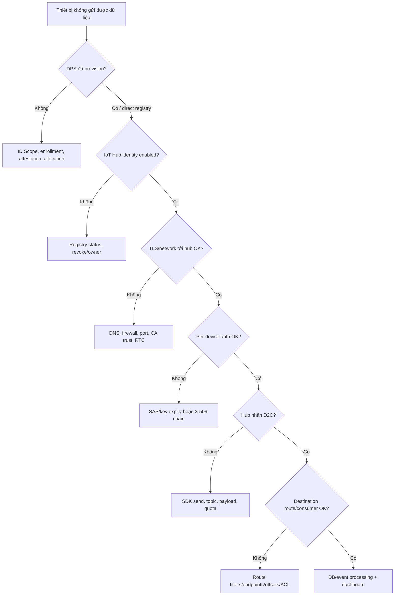

Không khắc phục một lỗi 401 bằng cách tắt TLS verification hoặc dùng hub service key trên thiết bị. Tìm **lớp thất bại** rồi sửa đúng identity, network, registry, route hoặc consumer.

## 36. Lab 1 — Tạo IoT Hub và một device identity trong sandbox

### Kết quả mong đợi

Người học tạo một IoT Hub **Standard** và một device identity `lab-sensor-001`, rồi dùng **per-device symmetric key** để kết nối thiết bị mô phỏng, gửi telemetry và xem device twin. Không dùng hub-level service policy key trên thiết bị.

### Điều kiện

| Hạng mục | Yêu cầu |
|---|---|
| Subscription | Sandbox được cấp quyền tạo Azure resources |
| Resource group | `rg-iot-identity-lab`, chỉ chứa tài nguyên lab |
| IoT Hub | `iothub-id-lab-<unique>`, tier hỗ trợ device twin |
| Device identity | `lab-sensor-001`, symmetric key, Enabled |
| Python | Môi trường lab có `azure-iot-device` |
| Azure CLI | Cần `azure-iot` extension nếu dùng nhóm lệnh IoT Hub nâng cao |
| Bảo mật | Không commit/log/export credentials trong tài liệu |
| Ngân sách | Đọc bảng giá, đặt cleanup owner |

**IoT Hub Standard có thể phát sinh chi phí ngay cả khi chỉ tạo một device.** Nếu sandbox không cấp phép tạo resource, thay lab thực tế bằng mô hình thiết kế và quan sát SDK logs giả lập.

### Bước 1 — Tạo resource trên Portal

1. Chọn subscription sandbox và resource group riêng `rg-iot-identity-lab`.
2. Tạo **Azure IoT Hub**, chọn tên duy nhất, tier/units và region được phê duyệt.
3. Xác minh network access và price estimate, không mở public endpoint nếu tổ chức yêu cầu private-only.
4. Hoàn tất provisioning, ghi lại **hub hostname** và owner.
5. Trong IoT Hub mở **Device management → Devices** hoặc menu tương ứng.
6. Tạo device identity `lab-sensor-001` với authentication **symmetric key** và status **Enabled**.
7. Lưu; kiểm tra device ID, auth type và status.

### Bước 2 — Đọc registry bằng Azure CLI

Các lệnh tham khảo cho môi trường CLI hỗ trợ Azure IoT extension:

```bash
az login --tenant "<tenant-id>"
az account set --subscription "<subscription-id>"
az extension add --name azure-iot

az iot hub device-identity show \
  --hub-name "<iot-hub-name>" \
  --device-id "lab-sensor-001" \
  --query "{deviceId:deviceId,status:status,authenticationType:authentication.type}" \
  --output json
```

Đây là **lệnh đọc**. Output đầy đủ của APIs quản lý identity có thể chứa thông tin authentication, vì vậy giới hạn projection và không đưa log thô lên kênh công khai. Nếu flag/command khác phiên bản extension, xem `az iot hub device-identity show --help` tại môi trường lab thay vì chạy bừa lệnh mutation.

### Bước 3 — Chuẩn bị credential

Lấy **device connection string riêng của `lab-sensor-001`** từ chức năng quản lý device được hỗ trợ, lưu bằng secret manager hoặc environment variable chỉ dành cho local simulator:

```text
IOTHUB_DEVICE_CONNECTION_STRING=<bí mật của duy nhất lab-sensor-001>
```

Không dùng **IoT Hub service connection string** ở Shared access policies làm device credential; đó là credential có scope/quyền khác và có thể ảnh hưởng cả fleet nếu bị lộ. Tránh đưa secret vào Git, lịch sử lệnh hoặc file cấu hình được theo dõi.

## 37. Lab 2 — Python Device SDK gửi D2C telemetry

### Chuẩn bị

Trong project lab riêng:

```bash
python -m pip install azure-iot-device
```

Script `simulator.py`:

```python
import json
import os
import time
from datetime import datetime, timezone

from azure.iot.device import IoTHubDeviceClient, Message


connection_string = os.environ["IOTHUB_DEVICE_CONNECTION_STRING"]
client = IoTHubDeviceClient.create_from_connection_string(connection_string)

try:
    client.connect()

    for sequence in range(1, 6):
        payload = {
            "eventId": f"lab-sensor-001-{sequence:04d}",
            "sequence": sequence,
            "temperatureC": round(3.5 + sequence * 0.2, 2),
            "measuredAtUtc": datetime.now(timezone.utc)
                .isoformat().replace("+00:00", "Z"),
            "schemaVersion": 1
        }
        message = Message(json.dumps(payload))
        message.content_type = "application/json"
        message.content_encoding = "utf-8"
        message.custom_properties["messageType"] = "telemetry"
        client.send_message(message)
        print("Sent telemetry sequence", sequence)
        time.sleep(2)
finally:
    client.shutdown()
```

### Giải thích

- `create_from_connection_string` sử dụng identity **một thiết bị**.
- `client.connect()` thực hiện kết nối/auth theo SDK transport và credential.
- `Message` gồm payload JSON và application properties để routing.
- `eventId` và `sequence` giúp consumer deduplicate/gap detection.
- `measuredAtUtc` nên tách khỏi `sentAtUtc` khi firmware có offline buffer.
- `send_message` thành công **không** chứng minh downstream database đã commit.
- `shutdown` đóng connection khi lab kết thúc.

### Quan sát message

Mở IoT Hub Metrics/diagnostics hoặc dùng SDK/CLI consumer được cấp quyền. Trong một Azure IoT extension phù hợp, có thể:

```bash
az iot hub monitor-events \
  --hub-name "<iot-hub-name>" \
  --device-id "lab-sensor-001"
```

Command có thể chạy liên tục đến khi dừng và cần quyền phù hợp. **Không copy message chứa thông tin thật/credentials vào log công khai**. Nếu CLI không hỗ trợ, xem help/extension version thay vì đoán lệnh.

### Kết quả kiểm tra

```text
Device identity enabled: PASS
Device connect/auth: PASS
Telemetry sequences 1..5 được gửi: PASS
IoT Hub ingress metric thay đổi: kiểm tra
Message routing/consumer: kiểm tra nếu đã cấu hình
Service connection string không xuất hiện ở firmware: PASS
```

## 38. Lab 3 — Desired/reported twin properties

### Mục tiêu

Thử một vòng điều khiển cấu hình: cloud yêu cầu `telemetryIntervalSeconds=30`, thiết bị nhận yêu cầu, validate và trả reported state. **Desired không phải actual** cho tới khi thiết bị xác nhận việc áp dụng.

### Script Python mô phỏng

```python
import os
import time

from azure.iot.device import IoTHubDeviceClient


client = IoTHubDeviceClient.create_from_connection_string(
    os.environ["IOTHUB_DEVICE_CONNECTION_STRING"]
)
current_interval = 60


def on_desired_patch(patch):
    global current_interval
    candidate = patch.get("telemetryIntervalSeconds")
    if candidate is None:
        return
    if not isinstance(candidate, int) or not 10 <= candidate <= 600:
        print("Rejected interval out of range")
        return
    current_interval = candidate
    client.patch_twin_reported_properties({
        "telemetryIntervalSeconds": current_interval,
        "configApplyStatus": "Applied",
        "appliedDesiredVersion": patch.get("$version")
    })


client.on_twin_desired_properties_patch_received = on_desired_patch

try:
    client.connect()
    client.patch_twin_reported_properties({
        "firmwareVersion": "1.4.2",
        "telemetryIntervalSeconds": current_interval
    })
    while True:
        time.sleep(1)
except KeyboardInterrupt:
    pass
finally:
    client.shutdown()
```

Mẫu chỉ phục vụ lab, chưa có persistent settings, robust reconnect/error handling hoặc safety interlocks. Không dùng trực tiếp làm firmware sản xuất.

### Thay desired từ cloud

Qua Portal twin editor hoặc service API có quyền, **patch riêng phần desired**:

```json
{
  "properties": {
    "desired": {
      "telemetryIntervalSeconds": 30
    }
  }
}
```

Đừng ghi đè toàn bộ twin hoặc các trường hệ thống `$version`, `$metadata`. Khi device nhận patch, cập nhật cấu hình và gửi reported state:

```json
{
  "telemetryIntervalSeconds": 30,
  "configApplyStatus": "Applied",
  "appliedDesiredVersion": 13
}
```

Con số version 13 chỉ là minh họa; dùng version thực tế do service cấp.

### Test offline/reconnect

1. Dừng simulator.
2. Đổi desired interval sang 45.
3. Chạy simulator lại.
4. **Đọc full twin desired state sau reconnect** trong thiết kế production, không chỉ chờ patch callback vì thay đổi xảy ra lúc offline có thể không tự tới như một patch realtime.
5. Validate desired và reported hội tụ.

Nếu nhận `telemetryIntervalSeconds=-1`, thiết bị từ chối và giữ cấu hình an toàn. Không tự đánh dấu `Applied` cho giá trị sai.

## 39. Lab 4 — Thiết kế DPS zero-touch provisioning

### Bối cảnh

Nhà sản xuất chuẩn bị 1.000 thiết bị đo rung động, giao tới ba nhà máy ở ba khu vực. Firmware chỉ biết **DPS ID Scope**, chứng chỉ/trust phù hợp và registration identity, không hardcode IoT Hub hostname production.

### Mô hình tham khảo

```text
Manufacturing:
  registration ID: unique per device
  device private key: protected by secure element
  certificate: signed by approved manufacturing CA
DPS:
  group enrollment: trusted, verified CA
  allocation policy: approved IoT hubs / regions
IoT Hub:
  separate resources per site/region policy
Application:
  mapping registrationId ↔ deviceId ↔ assetId
  device twin desired configuration
  telemetry routing + observability
```

### Các tình huống kiểm thử

| Input/scenario | Kết quả mong đợi |
|---|---|
| X.509 device certificate và registration ID hợp lệ | DPS attestation và hub assignment thành công |
| Certificate không thuộc CA được phép | Không provision trái phép |
| Device ID/registration ID trùng theo policy | Không map sai thiết bị trong inventory |
| DPS ID Scope sai | Không đăng ký vào đúng instance |
| Hub đích hết quota | Allocation error/alert theo cấu hình |
| Device đã bị thu hồi | Không tự re-provision trái chính sách |
| Thiết bị đổi nhà máy | Approval + re-provision và cập nhật asset mapping |
| CA hết hạn hoặc bị lộ | Chặn enrollment, lập kế hoạch trust rollover |
| Provisioning được nhưng hub runtime bị chặn mạng | Nhận diện đây là lỗi runtime path, không phải attestation |

### Tiêu chí nghiệm thu

1. Thiết bị không có hub-level policy keys.
2. Mỗi thiết bị có unique identity/credential.
3. Chứng chỉ/khóa bảo vệ theo manufacturing process.
4. Kết quả DPS assignment khớp tenant/site quy định.
5. Hub identity được tạo và kết nối đúng.
6. Có cách revoke một device và xử lý mất group CA.
7. Có trace từ serial đến registrationId/deviceId/assetId.
8. Có dashboard tỷ lệ provision thành công và số lỗi theo batch.

**Không bắt buộc thực hiện DPS enrollment thật trong lab đầu tiên** nếu sandbox không có thiết bị hoặc môi trường PKI tương thích. Một design review và test plan đầy đủ vẫn giúp hiểu rõ identity lifecycle.

## 40. Lab 5 — Kiểm thử lỗi và thu hồi an toàn

Chỉ dùng **device identity của lab** và tài nguyên được sở hữu riêng, không thao tác vào hub/certificate production.

| Ca thử | Thao tác có kiểm soát | Kết quả cần xác minh |
|---|---|---|
| Đúng per-device key | Simulator kết nối | Authentication thành công |
| Sai device ID | Dùng credential không khớp identity | Connection bị từ chối |
| Registry disabled | Disable device lab | Không tiếp tục được xác thực theo semantics |
| Khóa cũ sau rotation | Revoke/rotate lab key, thử key cũ | Không thể mint/auth token mới hợp lệ |
| SAS hết hạn | Dùng token quá hạn trong mô phỏng | Xác thực bị từ chối |
| X.509 cert sai/hết hạn | Dùng CA test/leaf không hợp lệ | Certificate authentication không thành công |
| Mất outbound MQTT | Chặn port ở mạng test được phép | Timeout rõ; không tắt TLS |
| Sai JSON content metadata | Gửi payload chưa đúng routing requirements | Route/query body khác kỳ vọng |
| Direct method tới device offline | Dừng simulator, invoke từ cloud test | Timeout/lỗi phù hợp, không giả success |
| Desired config sai | Gửi interval -1 | Device không apply, reported giữ giá trị an toàn |
| Offline khi desired đổi | Dừng simulator rồi đổi desired | Reconnect lấy full twin, apply bản mới nhất |
| Destination routing lỗi | Tạo lỗi với test endpoint và quyền được duyệt | Metrics route failure, ingest vs delivery được phân biệt |
| Replay telemetry | Gửi lại cùng eventId/sequence | Consumer không ghi trùng business event |

### Phải lưu thông tin nào?

```text
Test case ID:
IoT Hub resource / SKU:
Device ID (không có secret):
Authentication mode:
Firmware/SDK version:
Expected:
Actual:
IoT Hub operation status:
Device/client logs (redacted):
Cloud diagnostics/correlation:
Root cause:
Approved remediation:
Owner:
```

**Không ghi key, SAS token, certificate private key hay service connection string** vào test report. Khi có lỗi, chia sẻ thời điểm, device ID, operation ID và logs đã ẩn thông tin nhạy cảm.

## 41. Checklist production cho IoT Hub và định danh thiết bị

### Hardware và provisioning

- [ ] Mỗi thiết bị có ID, credential và inventory mapping riêng.
- [ ] Chọn SAS/symmetric hay X.509/TPM bằng threat model và khả năng hardware.
- [ ] Không dùng hub-level policy key trong firmware.
- [ ] Khóa được sinh/lưu an toàn và có quy trình chống sao chép.
- [ ] DPS ID Scope/enrollment/group attestation và allocation policy được review.
- [ ] Có quy trình revoke, disable, re-provision và thay thế thiết bị vật lý.
- [ ] CA/leaf certificate expiry, trust store và root rollover được giám sát.

### IoT Hub/cloud và ứng dụng

- [ ] Hub tier/units/quotas đủ D2C, twins, direct methods và routing cần dùng.
- [ ] IoT Hub device/registry identity khác user/backend identity.
- [ ] Backend dùng Entra/managed identity/least privilege khi được hỗ trợ.
- [ ] Application xác thực người dùng trước khi đổi twin/gửi command.
- [ ] Device-to-tenant mapping lấy từ inventory tin cậy, không từ payload tự khai.
- [ ] MQTT/AMQP/HTTPS/TLS, network và DNS được kiểm tra ở hardware thật.
- [ ] Message routing + built-in endpoint/fallback được thử end-to-end.
- [ ] Consumers idempotent, có sequence/checkpoint và retention.
- [ ] Desired/reported drift được monitor, có config rollout và rollback.
- [ ] Command/direct method có validation, timeout và safety controls.

### Reliability, privacy và chi phí

- [ ] Thiết bị có offline buffer, backoff và cơ chế chống retry storm.
- [ ] Edge có local safety behavior khi mất cloud.
- [ ] D2C payload có schemaVersion/eventId/sequence/timestamp phù hợp.
- [ ] Telemetry có classification/retention, không chứa PII vượt nhu cầu.
- [ ] Alerts cho auth failures, route issues, telemetry freshness và quota.
- [ ] Đã load test peak/reconnect surge và kiểm tra billing theo message size.
- [ ] Budget bao gồm hub, DPS, storage, downstream compute, network và logs.
- [ ] Có runbook xử lý key compromise, certificate expiry và region outage.
- [ ] Lab/shared resource ownership/cleanup rõ, không tự xóa thiết bị khác.

## 42. Những hiểu nhầm phổ biến

**“Device ID là mật khẩu.”** Không. Device ID là định danh; xác thực dùng secret/certificate theo cơ chế.

**“Mọi cảm biến dùng chung một device key cho nhanh.”** Không nên. Lộ một thiết bị sẽ gây blast radius của toàn bộ những thiết bị chia sẻ key.

**“Device connection string và IoT Hub service connection string giống nhau.”** Sai. Credential và scope quyền khác nhau; service key không được đặt vào firmware.

**“Có thiết bị trong identity registry nghĩa thiết bị online.”** Không. Registry là bản ghi cho phép, connection/telemetry freshness là tín hiệu vận hành.

**“Microsoft Entra ID trực tiếp thay thế mọi device credentials cho bo mạch embedded.”** Không mặc định. Device authentication của IoT Hub và backend/user authentication có đường khác nhau.

**“DPS là nơi lưu telemetry của IoT Hub.”** Không. DPS là provisioning/assignment, runtime telemetry đi qua hub đã được gán.

**“DPS ID Scope là một secret chứng minh thiết bị hợp lệ.”** Không. Attestation/enrollment mới quyết định việc được đăng ký.

**“Enrollment group nghĩa mọi device dùng cùng deviceId.”** Không. Group định nghĩa chính sách enrollment, thiết bị có identity riêng.

**“Có TPM thì thiết bị chắc chắn không có malware.”** Không. TPM bảo vệ khóa/attestation theo khả năng, vẫn cần secure boot, updates và runtime security.

**“X.509 certificate tự đảm bảo không bị sao chép.”** Không nếu private key xuất được; cần bảo vệ khóa và manufacturing controls.

**“Tắt TLS hostname validation sẽ giúp kết nối an toàn hơn.”** Sai. Đây là lỗ hổng cho giả mạo server/MITM.

**“SAS token hết hạn có nghĩa symmetric key gốc cũng tự hết hạn.”** Không. SAS là token ký từ key; cần rotation/revoke key riêng.

**“Đổi primary key luôn không làm gián đoạn thiết bị.”** Không chắc. Devices chưa chuyển secondary/đang offline có thể bị mất auth.

**“IoT Hub MQTT tương đương broker MQTT với mọi custom topics.”** Không. Topic/protocol semantics của IoT Hub có giới hạn và quy tắc riêng.

**“IoT Hub hỗ trợ MQTT nên tự động hỗ trợ mọi MQTT client cũ không cần sửa.”** Không chắc. Cần đổi topic/auth/SDK và kiểm thử features.

**“Thiết bị gửi payload có deviceId là được IoT Hub xác thực.”** Không. Cần registry identity + SAS/X.509, không tin field do firmware tự khai.

**“Direct method sẽ được lưu đến khi thiết bị online.”** Không mặc định. Nó có request/response/timeout riêng, không phải durable job queue.

**“C2D thành công nghĩa lệnh an toàn đã được thực thi.”** Không. Cần business acknowledgment và kiểm tra trạng thái thiết bị.

**“Desired property chính là trạng thái thực tế trên thiết bị.”** Không. Reported properties phản ánh trạng thái do device gửi sau áp dụng.

**“Device twin phù hợp để ghi 100 samples/giây.”** Không. Telemetry nên đi qua D2C/event stream; twins cho state/config.

**“Đặt tag tenantId trong payload cho phép thiết bị tự thuộc tenant đó.”** Không. Mapping tenant phải từ inventory/authorization đáng tin.

**“Gateway có IoT Hub identity thì mọi sensor phía sau được xác thực độc lập.”** Không. Gateway identity có thể chỉ chứng minh gateway; các sensor cần identity model riêng.

**“Thêm hub region mới tự migrate device twins/historical telemetry.”** Không. Có quy trình re-provision và đồng bộ dữ liệu/cấu hình riêng.

**“IoT Hub built-in endpoint lưu mọi telemetry vĩnh viễn.”** Không. Retention/quotas có giới hạn; lưu dài hạn cần Storage/DB.

**“D2C send success nghĩa database đã commit.”** Không. Ingress, route, consumer và business commit là các bước khác nhau.

**“Kết nối vẫn sống nghĩa cảm biến khỏe.”** Không. Cần freshness và validation của telemetry.

**“Tăng tier là giải quyết mọi device gửi lỗi 401.”** Không. Auth failure liên quan identity/credential/TLS/clock hơn là quota.

**“Private endpoint cho phép bất kỳ thiết bị Internet kết nối như bình thường.”** Không. Thiết bị cần route/DNS phù hợp với private endpoint.

**“Chỉ cần sao lưu firmware là đủ Disaster Recovery.”** Không. Cần hub/DPS config, identity mapping, cloud state, routes, consumers và telemetry archive.

**“Tất cả lệnh điều khiển thiết bị đều an toàn nếu người dùng có Azure Reader.”** Không. Backend cần business authorization, audit và safety interlocks.

## 43. Câu hỏi tự kiểm tra

**Câu 1.** Azure IoT Hub giải quyết vấn đề gì so với một HTTP endpoint thông thường?

**Đáp án:** Cung cấp kết nối/identity riêng cho thiết bị, D2C/C2D, twins, direct methods, routing và cơ chế quản lý IoT theo tier.

**Câu 2.** Device ID và device credential khác nhau thế nào?

**Đáp án:** Device ID là tên định danh trong registry; credential (symmetric key/SAS hoặc X.509 private key) dùng để xác thực quyền sở hữu identity.

**Câu 3.** Vì sao không nên dùng một hub service connection string trong firmware của mọi thiết bị?

**Đáp án:** Quyền rộng; nếu lộ từ một device, attacker có thể ảnh hưởng nhiều devices hoặc service operations theo policy.

**Câu 4.** SAS token chứa những loại thông tin chính nào?

**Đáp án:** Resource scope/URI, chữ ký và expiry; có thể có trường bổ sung theo policy.

**Câu 5.** Primary và secondary symmetric keys giúp gì?

**Đáp án:** Cho phép phối hợp rotate credentials theo đợt mà vẫn duy trì một đường auth hợp lệ trong chuyển tiếp, nếu đã test rollout.

**Câu 6.** X.509 có nhất thiết bảo vệ được private key khỏi bị copy không?

**Đáp án:** Không; phụ thuộc việc sinh/lưu khóa bằng secure hardware/PKI controls và chống xuất private key.

**Câu 7.** DPS khác IoT Hub ở đâu?

**Đáp án:** DPS attests/provisions/assigns devices; IoT Hub phục vụ runtime device connectivity, messaging và identity operations.

**Câu 8.** ID Scope của DPS có phải bí mật thay thế attestation key?

**Đáp án:** Không. Nó xác định DPS instance; thiết bị vẫn cần chứng minh enrollment/attestation hợp lệ.

**Câu 9.** Nêu ba dạng DPS attestation.

**Đáp án:** Symmetric key, X.509 certificate và TPM theo khả năng dịch vụ.

**Câu 10.** Individual enrollment và enrollment group khác gì?

**Đáp án:** Individual cho một registration, group cho nhiều thiết bị theo cùng chính sách tin cậy; mỗi thiết bị vẫn cần danh tính riêng.

**Câu 11.** Có ba loại định danh serial, deviceId, assetId để làm gì?

**Đáp án:** Serial xác định phần cứng, deviceId xác định principal trong hub, assetId xác định tài sản nghiệp vụ có thể gắn nhiều thiết bị qua thời gian.

**Câu 12.** Module identity có giống device identity của sensor vật lý khác không?

**Đáp án:** Không. Module là thành phần logic thuộc một device/gateway, có identity/twin scope riêng theo mô hình hỗ trợ.

**Câu 13.** IoT Hub có hỗ trợ MQTT như một broker custom topics không giới hạn không?

**Đáp án:** Không. Topic/operations phải theo quy ước và tính năng MQTT mà IoT Hub hỗ trợ.

**Câu 14.** Thiết bị gửi được D2C message có chứng minh downstream Cosmos DB đã ghi không?

**Đáp án:** Không; hub ingress, routing và consumer commit là những bước khác nhau.

**Câu 15.** Vì sao telemetry cần eventId/sequence?

**Đáp án:** Hỗ trợ deduplication, gap detection và xử lý retry/backlog ở downstream.

**Câu 16.** Khi thiết bị offline và ngưỡng mong muốn được thay đổi, kênh nào phù hợp?

**Đáp án:** Desired property trong device twin; device đọc/applies khi kết nối lại và gửi reported property để xác nhận.

**Câu 17.** Direct method có phù hợp với thiết bị offline cần nhận lệnh sau hai ngày không?

**Đáp án:** Không mặc định; direct method cần device phản hồi trong timeout, còn tác vụ chờ lâu cần desired state/command workflow phù hợp.

**Câu 18.** Reported properties có phải do cloud operator tự khai để đánh dấu “đã áp dụng” không?

**Đáp án:** Không. Chúng phản ánh trạng thái thiết bị báo về sau khi thực sự validate và apply cấu hình.

**Câu 19.** Device twin có phù hợp lưu telemetry 10 Hz không?

**Đáp án:** Không nên. Dùng D2C streams; twin dùng cấu hình và reported state ít thay đổi.

**Câu 20.** Ai nên quyết định device `wh-001` thuộc Tenant A hay B?

**Đáp án:** Business inventory/authorized provisioning service, không dựa vào trường tự khai trong telemetry payload.

**Câu 21.** Hub data-plane role của Azure Function có thay per-device SAS/X.509 không?

**Đáp án:** Không. Backend service identity và device identity có nhiệm vụ/quyền khác nhau.

**Câu 22.** Trường hợp router filter theo JSON body không match, nên kiểm tra gì?

**Đáp án:** Content-type/content-encoding, payload hợp lệ, routing query condition, metadata và endpoint health.

**Câu 23.** Built-in Event Hubs-compatible endpoint của IoT Hub dùng để làm gì?

**Đáp án:** Cho consumers đọc dòng D2C events theo partitions/retention/checkpoints được hỗ trợ, không phải archive vĩnh viễn.

**Câu 24.** Vì sao cần kiểm tra cả DPS network và IoT Hub network khi dùng Private Link?

**Đáp án:** Provisioning và runtime kết nối qua các endpoints/đường mạng khác nhau; thành công ở DPS không bảo đảm tới được hub.

**Câu 25.** Khi lộ một per-device key, xử lý ban đầu thế nào?

**Đáp án:** Xác minh device/incident, disable/revoke credential, điều tra telemetry, chặn re-provision nếu cần, cấp identity mới an toàn và audit.

**Câu 26.** Vì sao lộ CA private key/group enrollment là sự cố rộng hơn một device?

**Đáp án:** Nó có thể ảnh hưởng nhiều devices trong trust scope, cần rotate/revoke group trust và kiểm tra toàn fleet.

**Câu 27.** Một thiết bị vẫn kết nối nhưng không báo nhiệt độ trong 2 giờ. Có nên đánh dấu Healthy không?

**Đáp án:** Không chỉ dựa vào connection; phải kiểm tra telemetry freshness, sensor health và SLA.

**Câu 28.** 20.000 devices gửi mỗi phút tạo bao nhiêu message ứng dụng/ngày?

**Đáp án:** 20.000 × 1.440 = 28.800.000 messages/ngày, trước retry/batching và metered message units theo tier.

**Câu 29.** Vì sao không thể dự toán chi phí chỉ từ số devices?

**Đáp án:** Cần messages, payload size, IoT Hub tier/units, DPS registrations, routes, downstream storage/compute, network và logs.

**Câu 30.** Khi region IoT Hub không khả dụng, điều gì phải có ngoài việc tạo hub khác?

**Đáp án:** Re-provision/identity validity, hub assignment, twin/config, routing/downstream, firmware reconnect, offline buffer và business DR/runbooks.

## 44. Bài tập thiết kế tổng hợp

**Đề bài:** Một chuỗi bảo quản thực phẩm có 2.500 xe lạnh. Mỗi xe có 4 cảm biến, gateway IoT Edge, GPS và một bộ điều khiển nhiệt độ. Xe có thể mất mạng 2 giờ. Trung tâm muốn biết nhiệt độ gần realtime, thay ngưỡng cảnh báo theo lô hàng và thu hồi quyền một gateway bị đánh cắp. Dữ liệu GPS là thông tin nhạy cảm cần hạn chế truy cập.

Hãy thiết kế:

1. Device identities, module identities và mapping serial → assetId → gateway.
2. Dùng symmetric key, X.509 hay TPM cho gateway và tại sao.
3. DPS individual/group enrollment, ID Scope và allocation theo vùng.
4. Đường kết nối từ gateway tới IoT Hub khi dùng mạng di động.
5. Bộ đệm offline: lưu bao lâu, max size, eventId/sequence và replay.
6. D2C telemetry JSON có schemaVersion/timestamps và content properties.
7. Desired properties cho ngưỡng, reported properties để xác minh đã áp dụng.
8. Direct method nào cần hạn chế vì tác động vật lý.
9. Route cảnh báo tới Service Bus và archive tới Data Lake.
10. Business authorization để đội Kho A không sửa xe của Kho B.
11. Runbook khi mất thiết bị, lộ key, certificate hết hạn và mất region.
12. Dashboard metrics, SLO, tier/capacity và dự toán chi phí.

### Một lời giải tham khảo

| Thành phần | Thiết kế gợi ý |
|---|---|
| Device registry | Mỗi gateway/thiết bị được cloud xác thực có ID riêng |
| Attestation | X.509/TPM nếu manufacturing và hardware support; symmetric với secure storage trong fleet nhỏ |
| Provisioning | DPS group enrollment có verified CA, mapping site/hub rõ |
| Gateway | Thu telemetry qua local buses, buffer offline có retention |
| Runtime transport | MQTT/AMQP trên TLS, retries có exponential backoff |
| Payload | Authenticated gateway identity + sensorId mapping, timestamp, eventId, sequence |
| Config | Desired thresholds theo lô/asset; reported applied version |
| Safety | Local alarms hoạt động khi cloud/mạng mất |
| Ingress | IoT Hub Standard tier có quota/units theo peak |
| Downstream | Alerts → Service Bus; telemetry archive → Storage/Data Lake; analytics riêng |
| IAM | Managed identity backend + per-device credentials + operator business roles |
| Privacy | GPS chỉ tới authorized team, retention rõ và logs đã hạn chế |
| Operations | Certificate expiry, DPS failures, telemetry freshness, drift, route errors |

**Không điều khiển van/công suất máy lạnh nguy hiểm chỉ bằng một thông điệp cloud không có local safety interlocks.** Đây là hệ thống có tác động vật lý, cần standards và kiểm định an toàn chuyên ngành tương ứng.

## Tổng kết

**Azure IoT Hub** cung cấp lớp giao tiếp và quản lý thiết bị trên Azure với **device identity registry, per-device authentication, D2C/C2D messages, device twins, direct methods và message routing**. Nền tảng an toàn là **mỗi thiết bị có một danh tính và credential phù hợp**, không chia sẻ hub service key trên firmware. **SAS/symmetric keys**, **X.509 certificates** và **TPM/secure elements** có đặc tính vận hành khác nhau; **DPS** giúp provisioning và phân bổ fleet, còn IoT Hub phục vụ kết nối/telemetry sau khi thiết bị đã được gán.

Trong ứng dụng thực tế, hãy tách **device identity với business asset/tenant identity**, **desired config với reported actual state**, **IoT Hub ingress với downstream commit**, **direct method với durable command workflow**, và **registry enabled với device health thực tế**. Thiết kế cloud–edge phải có **TLS, credentials lifecycle, revoke/rotation, managed identity cho backend, device-specific authorization, mạng riêng theo yêu cầu, offline buffer, idempotency và local fail-safe**.

Trước production, hãy đo **messages/day, peak connections, quota/tier, routing health, authentication failures, telemetry freshness, desired/reported drift và chi phí toàn pipeline**. Thử trên nhiều firmware/hardware batches, diễn tập mất mạng, lộ khóa, certificate rollover và failover trước khi mở rộng fleet. Khi làm đúng, Azure IoT Hub không chỉ “nhận số đo” mà còn tạo một **nền tảng danh tính và vận hành thiết bị có thể quản trị, bảo vệ và kiểm toán**.
