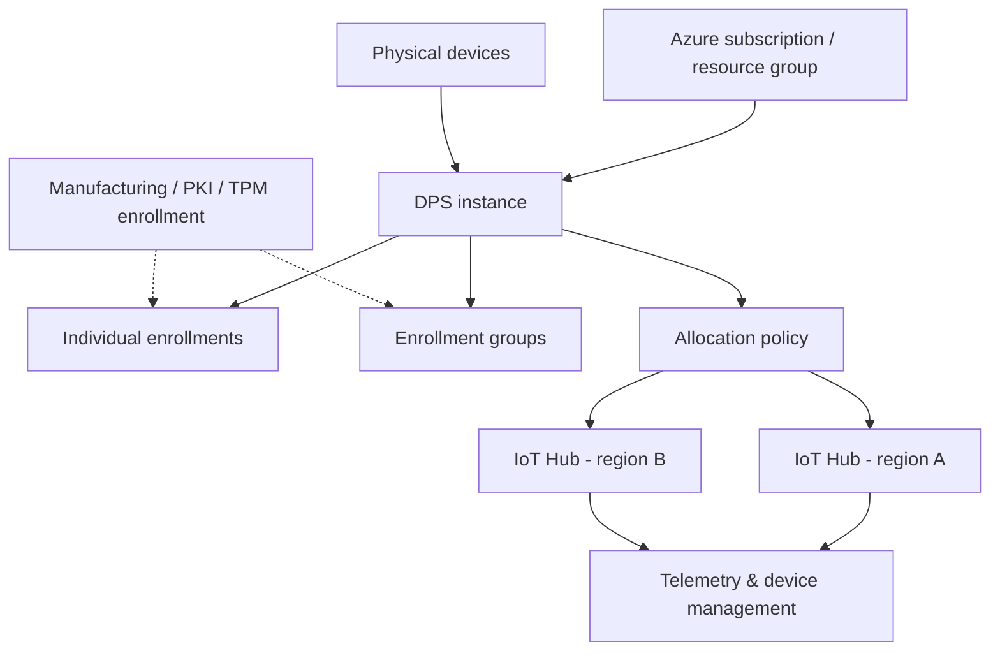
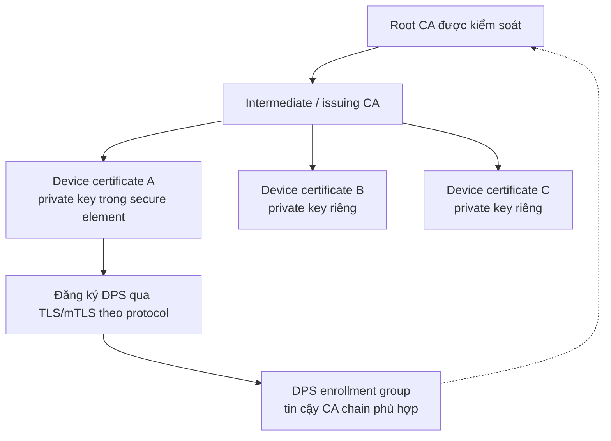
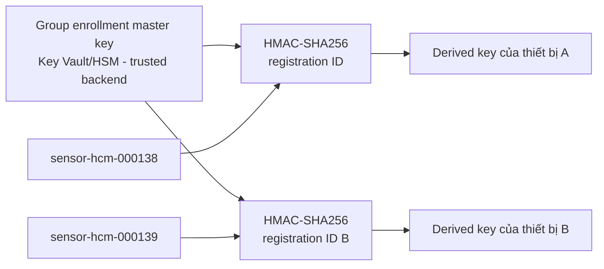
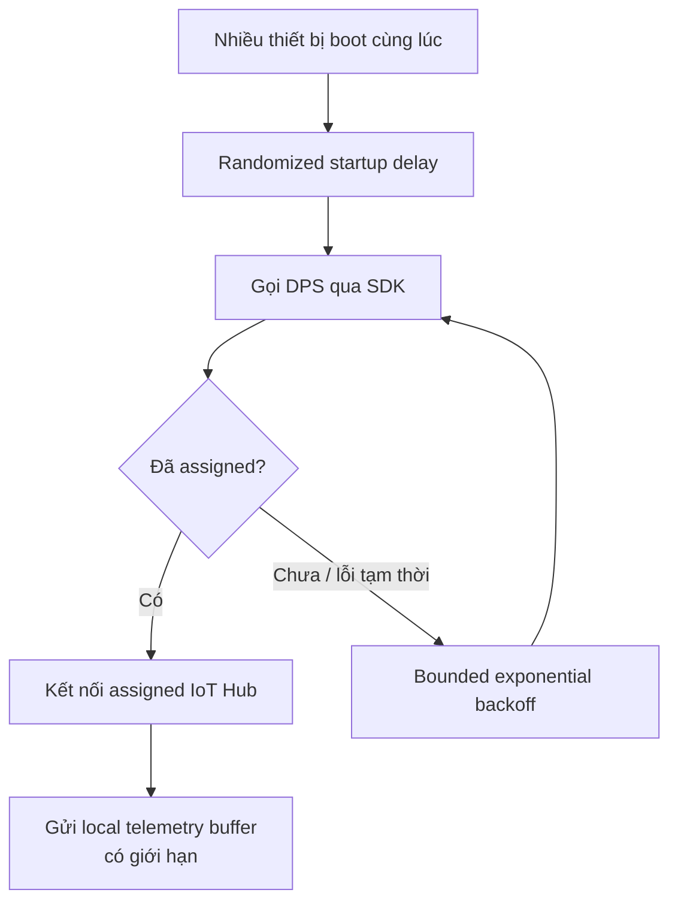
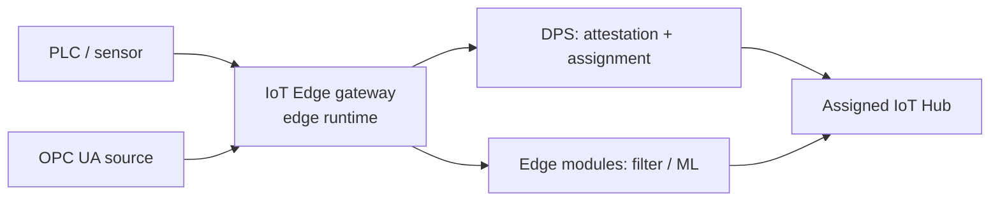
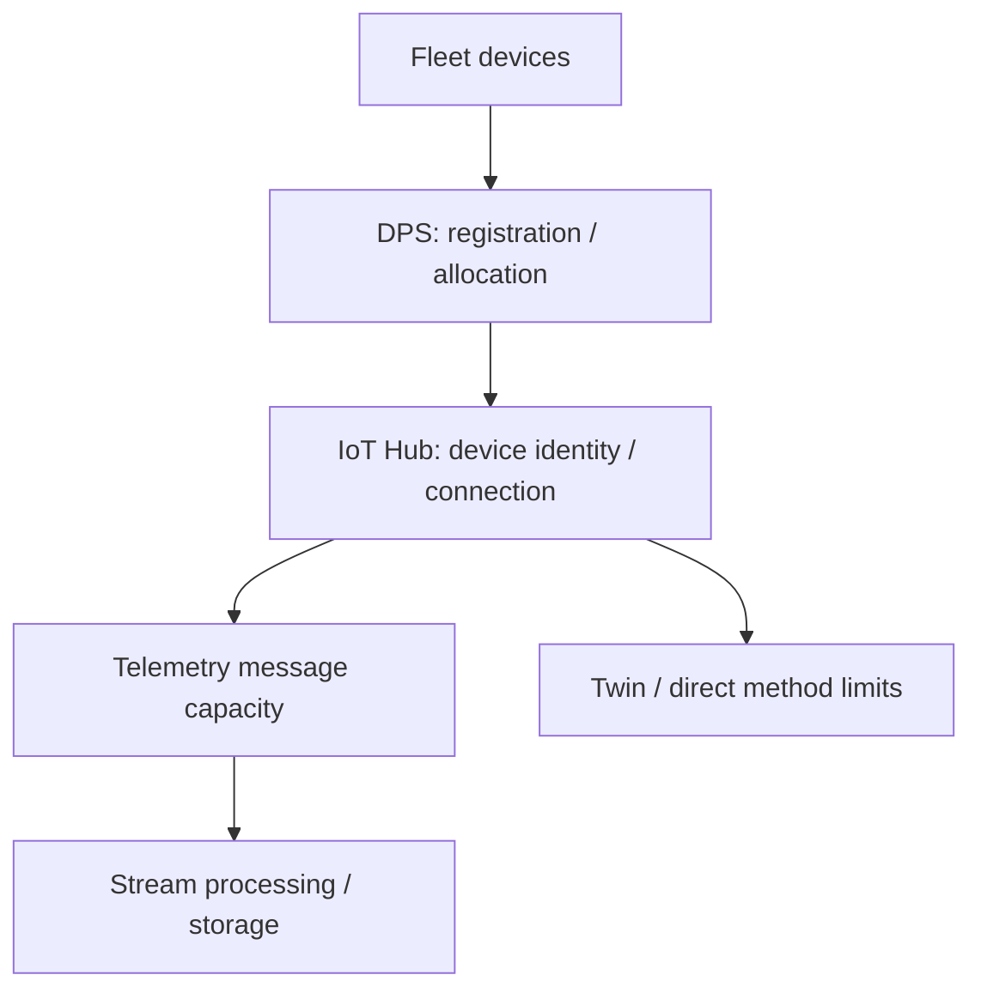
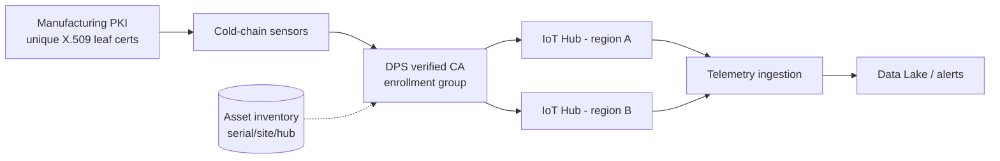

# Device Provisioning Service và cấp phát thiết bị

Một nhà sản xuất triển khai **80.000 cảm biến nhiệt độ** tại nhiều nhà máy. Mỗi thiết bị được lắp ráp ở xưởng, đóng hộp, vận chuyển tới khách hàng, sau đó mới được bật nguồn. Doanh nghiệp sử dụng **Azure IoT Hub** để nhận telemetry, quản lý danh tính thiết bị và gửi lệnh điều khiển. Nếu kỹ thuật viên phải cấu hình trước **IoT Hub hostname, device ID và thông tin xác thực** cho từng chiếc, thay đổi vùng triển khai hoặc thay thế một IoT Hub sẽ kéo theo công việc thủ công khó kiểm soát. Một thiết bị bị đánh cắp hoặc bị lộ khóa còn có thể giả mạo danh tính nếu quy trình sản xuất phân phối secret không an toàn.

**Azure IoT Hub Device Provisioning Service (DPS)** giải quyết phần **đăng ký và cấp phát ban đầu (*zero-touch provisioning*)**: thiết bị mới có thể trình bằng chứng danh tính cho DPS, nhận thông tin IoT Hub được phân bổ, rồi kết nối tới đúng IoT Hub bằng cơ chế xác thực phù hợp. DPS hỗ trợ các cách xác minh danh tính như **X.509, TPM và symmetric key**, cùng mô hình **individual enrollment**, **enrollment group** và chính sách phân bổ vào một hoặc nhiều IoT Hubs đã liên kết.

Tuy nhiên, DPS **không phải** nơi nhận telemetry liên tục, **không thay thế** IoT Hub và **không tự đảm bảo** rằng phần cứng ngoài đời không bị sao chép. Một thiết kế an toàn cần kết hợp danh tính phần cứng, chuỗi tin cậy trong sản xuất, chính sách vòng đời enrollment, mạng, giám sát, quota và phương án thu hồi khi thiết bị bị xâm phạm.

Bài học thuộc chương **IoT và xử lý tại biên** của module **CLOUD_PROVIDERS_AZURE**. Module giới thiệu Azure từ subscription, resource group, Microsoft Entra ID đến mạng ảo, compute, storage và data; đồng thời tập trung triển khai, giám sát, bảo vệ và kiểm soát chi phí. Bài này xem **DPS là control-plane onboarding của fleet IoT**, sau đó nối sang **IoT Hub**, thiết bị biên và hệ phân tích dữ liệu.

**Sau bài học, bạn có thể:**

- Phân biệt **DPS instance, ID scope, registration ID, enrollment, device identity và IoT Hub assignment**.
- Trình bày quy trình **bootstrapping → attestation → allocation → registration → IoT Hub connect**.
- Chọn đúng **X.509 certificate, TPM attestation hoặc symmetric-key attestation** theo phần cứng và mô hình sản xuất.
- Giải thích **individual enrollment**, **enrollment group**, linked IoT Hubs và các allocation policies.
- Phân tích **initial device twin**, reprovisioning, thiết bị thay thế, chuyển vùng và thu hồi.
- Thiết kế onboarding cho **IoT Edge** và môi trường thiết bị offline/đường truyền kém.
- Viết quy trình thử nghiệm bằng SDK/CLI ở môi trường lab, không hardcode group master key trên firmware.
- Theo dõi registration failures, throughput/quota, bảo mật chuỗi cung ứng và chi phí theo fleet.

## 1. Vì sao IoT cần dịch vụ provisioning riêng?

Provisioning khác với kết nối thông thường. Khi một cảm biến chưa từng kết nối Azure được khởi động, nó cần biết **mình là ai**, **ai đáng tin cậy** và **mình được phép kết nối tới IoT Hub nào**.

| Câu hỏi | Trách nhiệm chính |
|---|---|
| Đây có phải phần cứng/thiết bị được tổ chức cấp phép không? | **DPS attestation** kết hợp quy trình sản xuất tin cậy |
| Thiết bị sẽ thuộc IoT Hub nào? | **DPS enrollment + allocation policy** |
| IoT Hub có danh tính thiết bị này chưa? | DPS registration/provisioning phối hợp với **IoT Hub identity registry** |
| Ai nhận telemetry và gửi device twin/direct methods? | **IoT Hub** sau khi thiết bị kết nối |
| Ai tổng hợp dữ liệu cảm biến hoặc chạy ML? | Event Hubs-compatible endpoint, Stream Analytics, Functions, Storage, analytics services theo kiến trúc |
| Ai quản lý bản cập nhật ứng dụng/firmware hoặc cấu hình edge? | Các dịch vụ/quy trình cập nhật thiết bị riêng, IoT Edge và cơ chế quản lý được hỗ trợ |

### 1.1. Không cần nhúng cố định một IoT Hub cho toàn fleet

Một nhà sản xuất có thể đưa vào firmware **DPS global endpoint + ID scope**, kèm identity/credential riêng của từng thiết bị. Đến lúc lắp đặt, DPS quyết định hub phù hợp. Khi bổ sung IoT Hub hoặc thay đổi topology, hệ thống có thể điều chỉnh allocation/reprovisioning theo chính sách mà không phải biên dịch lại hostname của mọi hub vào firmware.

**Nhưng:** thay đổi chính sách DPS không có nghĩa tất cả thiết bị đang online tự lập tức chuyển hub. Thiết bị cần được yêu cầu/provision lại theo quy trình được hỗ trợ và phải quản lý device identity, twin/state ở hub cũ/mới.

### 1.2. Luồng tổng quát

```mermaid
sequenceDiagram
    participant D as Thiết bị mới
    participant P as Azure IoT Hub DPS
    participant H as IoT Hub được gán
    D->>P: Kết nối TLS; gửi ID scope, registration ID và attestation
    P->>P: Kiểm tra enrollment + bằng chứng danh tính
    P->>P: Áp allocation policy / chọn IoT Hub
    P->>H: Tạo/cập nhật device identity theo quy trình
    H-->>P: Kết quả cấp phát
    P-->>D: Assigned hub + device ID / status
    D->>H: Kết nối riêng, xác thực với IoT Hub
    H-->>D: Chấp nhận kết nối và dịch vụ device-to-cloud/cloud-to-device
```

Đây là luồng logic, không mô tả chi tiết từng gói tin của MQTT/AMQP/HTTPS. **Kết nối DPS** và **kết nối IoT Hub** là hai giai đoạn có endpoint, mục đích và trạng thái riêng.

## 2. Những thuật ngữ bắt buộc phân biệt

| Thuật ngữ | Ý nghĩa | Không nên nhầm với |
|---|---|---|
| **DPS instance** | Tài nguyên Azure quản lý enrollments, linked hubs và registrations | IoT Hub nhận telemetry |
| **DPS global endpoint** | Endpoint chung để client bắt đầu provisioning theo SDK/protocol | Hostname của IoT Hub được phân bổ |
| **ID scope** | Mã định danh phạm vi instance DPS, firmware/client dùng để chọn DPS | Entra tenant ID, subscription ID hoặc secret |
| **Registration ID** | Định danh thiết bị dùng khi đăng ký với DPS | Không nhất thiết trùng device ID ở IoT Hub |
| **Enrollment** | Bản ghi cho phép và cách chứng thực thiết bị | IoT Hub device twin hoặc bản ghi telemetry |
| **Individual enrollment** | Cấp quyền cho một device cụ thể | Enrollment group |
| **Enrollment group** | Chính sách nhận nhóm thiết bị dựa trên bằng chứng chung được chấp nhận | Danh sách device IDs đã tạo sẵn |
| **Attestation** | Bằng chứng cryptographic rằng device nắm giữ credential/hardware hợp lệ | Microsoft Entra user sign-in |
| **Allocation policy** | Quy tắc chọn IoT Hub từ các hubs liên kết | Quy tắc route message sang Storage |
| **Registration state** | Kết quả gán hub/thiết bị và trạng thái của một registration | Trạng thái online/offline của IoT Hub |
| **Initial twin** | Metadata desired properties/tags được áp khi khởi tạo theo khả năng hỗ trợ | Telemetry, secret store hoặc policy đẩy liên tục |
| **Reprovisioning** | Thiết bị đăng ký lại để được xử lý theo chính sách mới | Tự động migrate toàn bộ dữ liệu lịch sử |

### 2.1. Registration ID, device ID và serial number

Giả sử thiết bị có:

```text
Manufacturing serial number:  SN-FR-2026-000138
DPS registration ID:         sensor-fr-000138
IoT Hub device ID:           sensor-fr-000138
Assigned IoT Hub hostname:   iothub-europe-example.azure-devices.net
```

Các giá trị chỉ minh họa. Registration ID và IoT Hub device ID **có thể giống nhau trong workflow thông thường**, nhưng nên coi là hai khái niệm khác nhau vì enrollment/registration mapping và custom allocation có thể can thiệp theo khả năng dịch vụ. Serial number cũng có thể khác registration ID; phải có **inventory mapping** đáng tin cậy.

Registration ID phải đáp ứng **quy tắc ký tự/độ dài của DPS SDK/protocol**, có tính ổn định và tránh va chạm trong phạm vi áp dụng. Không đặt chứa API key, email khách hàng hoặc thông tin bí mật.

### 2.2. ID scope có phải mật khẩu không?

**Không.** ID scope là thông tin dùng để xác định DPS instance cần đăng ký; thiết bị có thể được cấu hình ID scope khi sản xuất. **ID scope không chứng minh quyền đăng ký**. DPS vẫn cần đánh giá bằng chứng attestation và enrollment.

## 3. Thành phần quản trị của hệ thống DPS

Một kiến trúc fleet thông thường:



**DPS và IoT Hub có thể nằm trong các resource groups khác nhau** nếu dịch vụ, identity và role permissions cho phép. Phải cấu hình **linked IoT Hubs**, quyền liên kết/đăng ký thiết bị và phân bổ phù hợp. Tạo một IoT Hub trong subscription **không tự liên kết** nó với mọi DPS instance.

### 3.1. Khác biệt control plane và data plane

- Người quản trị Azure dùng **Azure RBAC/management plane** để tạo DPS, liên kết hub, cấu hình policy hoặc quản lý enrollments theo quyền được hỗ trợ.
- Thiết bị dùng **X.509/TPM/symmetric attestation** với DPS. Thiết bị IoT nhỏ không cần được cấp vai trò **Owner** trên Azure subscription để đăng ký.
- Sau provisioning, **IoT Hub device credentials** dùng xác thực và cho phép các thao tác device-to-cloud, nhận direct methods/twin theo protocol và identity.
- Người dùng/backend quản trị IoT Hub có các quyền **service-side** riêng; không dùng credential service-side làm firmware secret.

**Đừng phát tán IoT Hub service connection string cho thiết bị.** Nó có thể chứa quyền service rộng và tạo blast radius rất lớn khi lộ.

## 4. Quy trình từ nhà máy tới IoT Hub

Có thể chia lifecycle thành bảy giai đoạn:

1. **Manufacture:** cấp serial number, identity vật lý, chứng chỉ hoặc khóa trên chip/secure element.
2. **Enroll:** phía quản trị tạo individual/group enrollment trong DPS; xác minh certificate trust hoặc TPM data.
3. **Ship:** thiết bị xuất xưởng với DPS ID scope và credential riêng, **không** nhúng group master secret.
4. **First boot:** firmware kết nối mạng và gọi DPS registration protocol bằng SDK tin cậy.
5. **Attestation + allocation:** DPS xác minh, chọn IoT Hub và tạo/ghi nhận identity.
6. **Connect:** thiết bị dùng assignment và credential phù hợp để kết nối IoT Hub.
7. **Operate/recover:** telemetry, twin, cập nhật firmware, re-provision, rotate/thu hồi khi cần.

### 4.1. Trạng thái thiết bị và trạng thái provisioning khác nhau

Một thiết bị **đã được cấp phát** nhưng chưa online vẫn có thể có registration state `assigned` ở DPS. Một thiết bị **đang gửi telemetry** không có nghĩa DPS enrollment của nó còn enabled nếu policy đã thay đổi sau khi nó kết nối. Thiết kế dashboard phải phân biệt:

```text
DPS: enrollment / registration state
IoT Hub: device identity + connection state
Fleet service: health, firmware version, last telemetry time
Business: factory/site/owner/decommission state
```

## 5. Individual enrollment: đăng ký cho một thiết bị

**Individual enrollment** áp dụng các điều kiện chứng thực/đăng ký cho **một thiết bị** được định danh rõ ràng.

Ví dụ hồ sơ quản trị dạng khái niệm:

```json
{
  "registrationId": "sensor-hcm-000138",
  "attestation": "x509-or-tpm-or-symmetric",
  "enrollmentStatus": "enabled",
  "desiredHubPolicy": "organization-policy",
  "deviceClass": "cold-chain-sensor",
  "inventoryReference": "factory-batch-2026-11"
}
```

Đây là **inventory JSON minh họa**, **không phải body REST/ARM enrollment có thể gửi trực tiếp**. Các field attestation và allocation thực tế của DPS có cấu trúc riêng tùy loại enrollment.

### 5.1. Khi nào nên dùng?

- Thiết bị có chứng thực phần cứng riêng như **TPM endorsement key**.
- Thiết bị quan trọng cần kiểm soát, revoke hoặc audit riêng.
- Số thiết bị ít hoặc quy trình cấp phát yêu cầu quản trị từng asset.
- Cần chỉ định device ID, hub assignment hoặc metadata ban đầu khác với phần còn lại của fleet.

### 5.2. Đánh đổi

Một doanh nghiệp có hàng triệu thiết bị sẽ không muốn vận hành bằng tay một triệu records không có automation. Individual enrollment nên được tạo bằng **manufacturing backend/automation** có identity, audit, batch control và giới hạn tốc độ. Với thiết bị ký chứng chỉ từ cùng CA tin cậy, enrollment group thường giảm đáng kể overhead.

## 6. Enrollment group: quy mô fleet

**Enrollment group** cho phép một nhóm thiết bị được cấp phát dựa trên cơ chế attestation chung, điển hình:

- **X.509 CA-signed certificates**: thiết bị sở hữu leaf certificate được phát hành từ chain CA được nhóm tin cậy theo quy tắc DPS.
- **Symmetric key group enrollment**: group key được dùng tại hệ thống tin cậy để **derive khóa riêng cho từng registration ID**.

Enrollment group **không có nghĩa mọi thiết bị sử dụng cùng một device password**. Với symmetric group enrollment, phải tách group master key khỏi thiết bị; với X.509, mỗi thiết bị phải giữ private key riêng của chính nó.

### 6.1. Ví dụ mô hình nhóm

```text
Enrollment group: eg-coldchain-prod
  Trust: manufacturing CA certificate / valid key policy
  Allocation: production hubs by approved policy
  Initial twin: device class + desired config

Devices:
  sensor-hcm-000138 -> unique key/certificate
  sensor-hcm-000139 -> unique key/certificate
  sensor-dn-000140  -> unique key/certificate
```

### 6.2. Nhóm không thay cho inventory

Một group có thể cho phép số thiết bị lớn đăng ký dựa trên CA/derived keys. Nhưng quản trị fleet vẫn cần biết:

- Thiết bị nào thực sự được nhà máy cấp.
- Serial number/registration ID nào được gán cho khách hàng hoặc site nào.
- Certificate nào đã bị thay thế/thu hồi.
- Device identity và hub assignment cuối cùng.
- Firmware version và trạng thái decommission.

Nếu doanh nghiệp muốn chỉ cho phép **đúng danh sách thiết bị đã bán**, cần dùng inventory/PKI controls, enrollment policy, device provisioning checks và khả năng **disable individual registrations** thích hợp. Không coi việc “có certificate ký từ CA” tự chứng minh đơn hàng hợp lệ hoặc quyền thuộc một khách hàng cụ thể.

## 7. X.509 attestation: thiết bị giữ private key riêng

X.509 dùng chứng chỉ và cryptographic proof để xác thực thiết bị. Một sơ đồ tin cậy:



**Giá trị chính:** mỗi thiết bị có private key riêng; không cần nhúng một shared fleet key vào firmware. Khi khóa private được bảo vệ trong TPM/secure element, thiết bị khó bị sao chép credential hơn so với key lưu trong flash thông thường.

### 7.1. Các loại chứng chỉ

- **CA certificate:** đại diện một certificate authority phát hành/ủy quyền device certificates.
- **Device leaf certificate:** thuộc thiết bị cụ thể, mang định danh phù hợp với registration.
- **Private key:** tuyệt đối không upload vào DPS hay gửi tới IoT Hub service/backend để “đăng ký cho tiện”.
- **Certificate chain:** giúp DPS xác minh rằng leaf cert được phát hành theo trust chain đã được chấp nhận.

Thiết bị cần chứng minh sở hữu **private key** tương ứng. Chỉ copy file `.crt` từ một thiết bị khác **không đủ** nếu không có private key.

### 7.2. CA verification / proof of possession

Khi sử dụng group enrollment dựa trên CA, cần thực hiện **verification/proof of possession** cho certificate theo quy trình DPS hỗ trợ. Chỉ upload một CA file chưa đủ để mặc định nó là tin cậy vĩnh viễn. Các bước kiểm soát điển hình:

1. Tạo/nhập CA certificate vào DPS theo supported portal/API workflow.
2. Thực hiện verification/challenge với private key của CA ở môi trường PKI được quản lý.
3. Tạo enrollment group trỏ tới certificate trust phù hợp.
4. Test device certificate chain và registration ID mapping.
5. Xác nhận quyền admin và certificate/secret storage đã được bảo vệ.

**Không ký challenge bằng private key root CA ngay trên workstation cá nhân**. Quy trình PKI production cần HSM/CA service, nhiều lớp phê duyệt và audit.

### 7.3. Rotation và revocation

Một thiết bị bị mất/compromised có thể cần thu hồi **enrollment** hoặc **IoT Hub device identity**, đồng thời xử lý certificate trust trong hệ PKI. Cấp lại certificate leaf chỉ hiệu quả khi:

- Thiết bị có cơ chế cập nhật credential an toàn.
- Chain mới được DPS/IoT Hub chấp nhận đúng thời điểm.
- Certificate cũ không còn được chấp nhận theo chính sách.
- Có phương án xử lý thiết bị offline lâu ngày.

Không khẳng định “thu hồi một CA” chỉ ảnh hưởng một sensor — nếu rất nhiều thiết bị phụ thuộc CA đó, blast radius có thể là toàn bộ fleet.

## 8. TPM attestation: ràng buộc danh tính với phần cứng

**Trusted Platform Module (TPM)** là phần cứng có khả năng bảo vệ khóa, thực hiện chứng thực cryptographic mà không cần xuất private key ra môi trường thông thường.

Trong DPS, TPM attestation có thể sử dụng **endorsement key** và registration ID cùng quy trình challenge/response/khóa dẫn xuất theo DPS SDK để xác minh thiết bị.

```text
Manufacturer:
  Device includes TPM, stable registration ID
  Trusted enrollment backend records required TPM identity data

First boot:
  Device -> DPS: registration + TPM attestation
  DPS -> Device: challenge/provisioning protocol
  Device TPM proves possession
  DPS -> Device: IoT Hub assignment
  Device -> IoT Hub: authenticate using provisioned mechanism
```

### 8.1. Khi nào chọn TPM?

- Thiết bị có TPM/secure hardware đủ khả năng và SDK được hỗ trợ.
- Muốn tránh copy private device credentials giữa các thiết bị.
- Cần khả năng gắn registration với chip vật lý.
- Fleet thiết bị công nghiệp có secure manufacturing và key lifecycle rõ.

**TPM không tự chứng minh thiết bị an toàn mọi mặt**. Firmware bị xâm phạm vẫn có thể ra lệnh TPM thực hiện thao tác được phép; thiết kế vẫn cần secure boot, signed firmware, OS hardening, update pipeline và telemetry an toàn.

### 8.2. Đừng xử lý TPM như symmetric secret

Không xuất private key khỏi chip chỉ để đặt nó trong app setting. Cũng không dùng một mã serial nhân bản thay cho TPM attestation. Nếu thay mainboard/TPM, identity có thể cần **re-enrollment** theo quy trình thiết bị thay thế.

## 9. Symmetric-key attestation: dùng đúng chỗ và bảo vệ master key

Symmetric key đơn giản và phổ biến với thiết bị hạn chế tài nguyên. Tuy nhiên nó có **rủi ro sao chép khóa**: nếu một attacker lấy được key của thiết bị, có thể giả mạo thiết bị đó trong phạm vi credential còn hiệu lực.

### 9.1. Individual symmetric key

Mỗi thiết bị có secret riêng, gắn với enrollment cá nhân. Điều này cho phép thu hồi một thiết bị mà không cần đổi khóa của toàn bộ fleet, nhưng backend sản xuất phải tạo, phân phối và lưu khóa an toàn.

### 9.2. Group symmetric key và derived device key

Trong group enrollment, một **group master key** được giữ tại một hệ thống tin cậy; khóa dùng trên thiết bị được **dẫn xuất từ group key và registration ID** theo thuật toán DPS hỗ trợ, không phải copy nguyên group master key.



**Tuyệt đối không nhúng group master key trong firmware**. Nếu master key bị lộ, attacker có thể derive credentials cho nhiều registration IDs. Thiết bị chỉ giữ **derived key riêng của nó** trong secure storage phù hợp.

### 9.3. Mã minh họa dẫn xuất khóa ở manufacturing backend

```python
import base64
import hashlib
import hmac
import os


def derive_device_key(group_key_base64: str, registration_id: str) -> str:
    """
    Demo thuật toán derive symmetric key cho DPS group enrollment.
    Chỉ chạy trong manufacturing backend đáng tin cậy.
    """
    group_key = base64.b64decode(group_key_base64, validate=True)
    digest = hmac.new(
        key=group_key,
        msg=registration_id.encode("utf-8"),
        digestmod=hashlib.sha256,
    ).digest()
    return base64.b64encode(digest).decode("ascii")


# Biến môi trường phải được secret injection, không commit hay print giá trị.
master = os.environ["DPS_GROUP_PRIMARY_KEY"]
registration_id = "sensor-hcm-000138"
device_key = derive_device_key(master, registration_id)

# Cấp device_key qua kênh manufacturing an toàn tới đúng thiết bị.
# KHÔNG in/log device_key; KHÔNG xuất master key ra nhà máy không tin cậy.
```

**Giới hạn ví dụ:**

- Thuật toán HMAC-SHA256 với UTF-8 registration ID mô tả cách derive quen thuộc của DPS symmetric group; phải kiểm tra SDK/protocol/version và chuẩn hóa registration ID trước khi production.
- Không hiển thị bất kỳ khóa thật nào.
- Không gửi group key tới thiết bị hoặc lưu nó trong file plain text.
- Không dùng mã derive key này làm cơ chế tự thiết kế token authentication thay DPS SDK.
- Nếu master key được rotation, các derived keys đã phát hành cần chiến lược re-provisioning/rotation phối hợp để thiết bị không mất kết nối.

### 9.4. Individual key vs group key

| Tiêu chí | Individual key | Group + derived keys |
|---|---|---|
| Provisioning mỗi device | Cần enrollment/credential riêng | Một enrollment group có thể phục vụ fleet |
| Vận hành số lượng lớn | Nhiều bản ghi và automation | Ít bản ghi quản trị hơn |
| Blast radius khi lộ *device key* | Chủ yếu thiết bị đó | Chủ yếu thiết bị đó nếu master an toàn |
| Blast radius khi lộ *group master key* | Không áp dụng | Có thể rất lớn |
| Thu hồi thiết bị | Tắt/xóa individual enrollment và hub identity phù hợp | Cần thiết kế denylist/disable/identity revocation theo khả năng hỗ trợ |
| Hợp với phần cứng không có PKI/TPM | Có | Có, nếu quy trình bảo vệ khóa nghiêm túc |

## 10. Chọn phương án attestation theo nguy cơ

| Tiêu chí | X.509 | TPM | Symmetric key |
|---|---|---|---|
| Phụ thuộc phần cứng | Nên có secure element/TPM để giữ key | TPM tương thích | Secure storage khuyến nghị |
| Chứng thực | Certificate chain và proof of private-key possession | Hardware-backed attestation | Proof of shared/derived key |
| Enrollment group | Phù hợp cho CA-signed group | Thông dụng là individual enrollment cho TPM identity | Phù hợp group-derived keys |
| PKI operation | Cần CA, rotation, chain verification | Cần TPM identity lifecycle | Cần secret generation/distribution/rotation |
| Rủi ro nhân bản identity | Giảm khi private key không thể xuất | Giảm nhờ TPM, vẫn phụ thuộc firmware trust | Tăng nếu key bị trích xuất |
| Khả năng thu hồi | Theo enrollment/IoT Hub/PKI policy | Theo identity/enrollment | Theo enrollment/key/IoT Hub |

**Khuyến nghị định hướng:** X.509 được cấp phát tốt với secure element là lựa chọn mạnh cho fleet quy mô lớn có PKI; TPM hữu ích khi phần cứng đã hỗ trợ; symmetric keys có thể phù hợp thiết bị giá thấp nhưng phải quản lý group secret tuyệt đối nghiêm ngặt. Quyết định cuối còn phụ thuộc chứng nhận phần cứng, chi phí manufacturing, tính năng SDK, quy định ngành và khả năng bảo trì 5–10 năm.

## 11. Registration request và kết quả cấp phát

Thiết bị thực hiện provisioning bằng một SDK/protocol được DPS hỗ trợ. Trình tự thường gồm:

1. Load **DPS ID scope**, global endpoint, registration ID.
2. Chuẩn bị attestation: leaf cert/private key, TPM hoặc derived symmetric key.
3. Mở kết nối TLS và trình identity proof.
4. Gửi yêu cầu đăng ký và xử lý trạng thái đang cấp phát (có thể phải poll/retry theo SDK).
5. Nhận kết quả **assigned hub**, **device ID** và trạng thái.
6. Tạo client IoT Hub với hostname/device ID, dùng chứng thực tương ứng.
7. Bắt đầu telemetry/heartbeat hoặc điều khiển thiết bị.

### 11.1. Registration output khái niệm

```json
{
  "registrationId": "sensor-hcm-000138",
  "status": "assigned",
  "registrationState": {
    "assignedHub": "iothub-asia-example.azure-devices.net",
    "deviceId": "sensor-hcm-000138"
  }
}
```

**Đây là bản JSON rút gọn minh họa**, không cam kết schema chính xác của mọi SDK REST response. Dữ liệu thực tế có thể có status, timestamps, substatus, error details hoặc định danh field khác. SDK thường cung cấp đối tượng registration result đã parse.

### 11.2. Khi `status` chưa phải `assigned`

Provisioning có thể đang ở trạng thái xử lý hoặc bị từ chối. Thiết bị không nên:

- Tự đoán một hub từ tên region và kết nối khi DPS chưa phân bổ.
- Tạo 10.000 retries/giây khi chưa được cấp.
- Coi mọi lỗi DPS là “khóa sai”.
- Ghi log private keys, SAS tokens hoặc toàn bộ certificate chains nhạy cảm.

Hãy dùng SDK/retry policy hỗ trợ, **bounded backoff + jitter** và có giới hạn thời gian. Khi mất mạng lâu, có thể giữ assignment đã được xác thực trước đó theo **cache/persistence policy được thiết kế**, nhưng phải xác định lúc nào cần reprovision.

## 12. SDK thực hành: đăng ký bằng derived symmetric key

Ví dụ Python minh họa **Azure IoT Device SDK** khi SDK/phiên bản hỗ trợ `ProvisioningDeviceClient`. Các package, API và version cần được xác nhận với môi trường lab.

```python
import asyncio
import os

from azure.iot.device.aio import ProvisioningDeviceClient


async def main():
    registration_id = os.environ["DPS_REGISTRATION_ID"]

    # Derived device key riêng cho một registration ID:
    # group master key KHÔNG được có trên thiết bị.
    device_key = os.environ["DPS_DERIVED_DEVICE_KEY"]

    client = ProvisioningDeviceClient.create_from_symmetric_key(
        provisioning_host="global.azure-devices-provisioning.net",
        registration_id=registration_id,
        id_scope=os.environ["DPS_ID_SCOPE"],
        symmetric_key=device_key,
    )

    try:
        result = await client.register()
        print("Provisioning status:", result.status)

        if result.status != "assigned":
            raise RuntimeError("Device is not assigned to an IoT Hub")

        state = result.registration_state
        print("Assigned IoT Hub:", state.assigned_hub)
        print("Device ID:", state.device_id)

        # Bước tiếp theo là tạo IoT Hub client với identity/credential
        # phù hợp, không coi kết quả đăng ký là telemetry connection.
    finally:
        await client.shutdown()


if __name__ == "__main__":
    asyncio.run(main())
```

**Các điều kiện trước khi chạy:**

- DPS resource, linked IoT Hub, group enrollment hợp lệ và đủ quyền đã được cấu hình trong **lab**.
- `DPS_ID_SCOPE` là ID scope đúng của instance.
- `DPS_REGISTRATION_ID` khớp định danh dùng khi derive key.
- `DPS_DERIVED_DEVICE_KEY` là khóa thiết bị, **không** phải group master key.
- Package `azure-iot-device`/Python version và API `ProvisioningDeviceClient` tương thích.
- Thiết bị kết nối được DPS qua protocol/TLS đã cấu hình.
- Lệnh `register()` là **thao tác provisioning có thể làm thay đổi registration/IoT Hub identity** và phát sinh sử dụng dịch vụ; không chạy trên production bằng identity giả.

**Giới hạn quan trọng:** ví dụ chỉ minh họa quá trình **được cấp phát**, chưa viết mã tạo IoT Hub client, xử lý TPM/X.509, retry network dài hạn, lưu assignment, certificate rotation hay telemetry. Không trộn cred của symmetric enrollment vào ví dụ TPM/X.509.

### 12.1. Device SDK là lựa chọn tốt hơn tự viết MQTT protocol

DPS có các luồng protocol, token/attestation, polling và retry riêng. Viết thủ công SAS token, MQTT topics và TLS challenge thường dễ lỗi. Dùng **SDK được Microsoft/hệ sinh thái hỗ trợ** cho ngôn ngữ/OS/MCU của thiết bị, và pin version trong firmware release.

## 13. Linked IoT Hubs: DPS phân bổ vào đâu?

Một DPS instance cần biết những IoT Hubs được phép phân bổ. Khi cấu hình **linked IoT Hubs**, chú ý:

- Hub thuộc environment đúng (dev/test/prod), không cross-environment nhầm.
- Region, SKU, capacity và service quotas của từng IoT Hub.
- Quyền của DPS để thực hiện provision identity ở IoT Hub theo cơ chế liên kết được hỗ trợ.
- Policy phân bổ toàn DPS và override theo enrollment khi có.
- An toàn dữ liệu, residency và business ownership.
- Hub nào không được nhận loại thiết bị hoặc tenant nào.

### 13.1. Vì sao nhiều IoT Hubs?

- Scale-out fleet theo số thiết bị/kết nối/telemetry quotas.
- Giảm ảnh hưởng của sự cố một hub khi thiết kế failover hợp lệ.
- Phân vùng theo geographic/data residency hoặc nhóm khách hàng.
- Tách thiết bị quan trọng khỏi thiết bị telemetry không ưu tiên.
- Giới hạn blast radius và phân quyền vận hành.

**Nhiều IoT Hubs không tự tạo automatic disaster recovery hoàn chỉnh.** Firmware, identity mapping, device twin, telemetry route và business consumer phải có kế hoạch khi chuyển hub.

## 14. Các allocation policies

Chính sách **allocation** quyết định IoT Hub đích khi DPS cấp phát thiết bị.

| Policy/kiểu | Ý nghĩa khái quát | Phù hợp khi |
|---|---|---|
| **Evenly weighted distribution** | Phân bố thiết bị qua các hub liên kết theo trọng số/cơ chế được hỗ trợ | Cần chia fleet giữa nhiều hubs |
| **Lowest latency** | Chọn hub phù hợp dựa trên thông tin latency/địa lý theo thuật toán dịch vụ | Fleet trải nhiều khu vực, ưu tiên đường kết nối |
| **Static configuration** | Cấp phát tới hub chỉ định theo cấu hình | Một phân nhóm phải ở đúng hub cụ thể |
| **Custom allocation** | Gọi logic tùy chỉnh (chẳng hạn Azure Function ở kịch bản hỗ trợ) để quyết định | Mapping tenant/site/contract phức tạp |

Tên policy và tham số portal/API có thể đổi theo phiên bản dịch vụ; bảng mô tả **ý nghĩa thiết kế**. Không giả định thuật toán “lowest latency” là một phép ping realtime từ cảm biến tới từng hub, hoặc cân bằng có nghĩa mọi hub luôn nhận đúng số thiết bị bằng nhau.

### 14.1. Evenly weighted không thay capacity planning

Nếu hub A có capacity gấp ba hub B, cần cấu hình/trọng số phù hợp theo tính năng hỗ trợ và giám sát. **Phân bổ device count** không đồng nghĩa **chia telemetry messages đều**, vì một gateway có thể gửi lượng dữ liệu nhiều hơn hàng nghìn cảm biến khác.

### 14.2. Lowest latency và data residency

Hub gần thiết bị về network có thể không nằm trong region được phép xử lý dữ liệu. Với dữ liệu nhà máy hoặc khách hàng chịu ràng buộc địa lý, **chính sách bảo mật/residency phải được áp trước** hoặc như một điều kiện quyết định, không dùng lowest latency bất chấp mọi hub liên kết.

### 14.3. Static allocation

Thích hợp nếu một nhóm thiết bị phải luôn thuộc hub riêng, ví dụ:

```text
Enrollment group: eg-factory-hcm
Allowed hub:       iothub-vietnam-approved
Reason:            site ownership, compliance, routing
```

Điều này giúp dự đoán assignment nhưng tạo phụ thuộc vào hub đã chỉ định. Cần runbook khi hub bị giới hạn capacity, ngừng hoạt động hoặc đổi chính sách.

### 14.4. Custom allocation

Custom allocation hữu ích nếu cần logic như:

```text
Registration arrives
  -> verify trusted device inventory/site/tenant
  -> select allowed IoT Hub list
  -> consider capacity/compliance/rollout segment
  -> return assignment decision
```

Khi custom allocation được cấu hình bằng Azure Function theo cơ chế DPS hỗ trợ:

- Function phải có authentication/authorization và network path phù hợp.
- Không sử dụng thông tin do thiết bị khai báo như `tenantId` mà chưa xác minh.
- Phải xử lý **timeouts, Function cold start, retries, duplicate requests và errors**.
- Nên tránh external database queries không có cache/timeout khiến mọi thiết bị mới bị treo.
- Ghi audit quyết định phân bổ với correlation IDs nhưng không log secrets.

**Không gọi function qua endpoint công khai không có bảo vệ chỉ để đơn giản hóa onboarding**. Custom allocation là thành phần trọng yếu, có thể trở thành điểm lỗi của toàn fleet.

## 15. Initial device twin: metadata ban đầu

Khi DPS tạo/cấp phát IoT Hub device identity, có thể áp dụng **initial twin** theo cấu hình enrollment/cơ chế dịch vụ hỗ trợ. Device twin trong IoT Hub là tài liệu trạng thái cấu hình gồm các phần như:

- **Tags:** metadata phía dịch vụ, thường không hiển thị trực tiếp cho device client.
- **Desired properties:** cấu hình từ cloud cho thiết bị biết điều gì đang được mong muốn.
- **Reported properties:** thông tin thiết bị cập nhật sau khi kết nối và chạy.

Ví dụ nội dung twin ban đầu ở mức khái niệm:

```json
{
  "tags": {
    "deviceClass": "cold-chain",
    "site": "factory-hcm-02",
    "environment": "production"
  },
  "properties": {
    "desired": {
      "telemetryIntervalSeconds": 60,
      "samplingProfile": "temperature-basic"
    }
  }
}
```

Đây là **ví dụ logical initial twin**, không phải JSON hoàn chỉnh của một enrollment API hoặc device twin response. Định dạng thực tế có wrapper/version/metadata riêng.

### 15.1. Cẩn trọng với twin secrets

Không đặt symmetric key, certificate private key, token API, connection string hoặc password vào **tags/desired properties**. Tags/desired phục vụ metadata/configuration, không phải secret vault. Quyền đọc twin của service/backend có thể rộng hơn dự kiến.

### 15.2. Thay enrollment không tự cập nhật mọi twin đã tồn tại

Nếu thay `telemetryIntervalSeconds` trong group enrollment sau khi 30.000 thiết bị đã được cấp phát, **đừng giả định** twin ở tất cả các IoT Hubs đang hoạt động sẽ tự đổi ngay. Để cập nhật fleet, dùng IoT Hub device twin update/jobs hoặc cơ chế cấu hình/IoT Edge deployment phù hợp và đánh giá hành vi reprovisioning.

### 15.3. Thiết bị cần báo cáo trạng thái thực

Desired property là **ý định từ cloud**, không phải bằng chứng thiết bị đã áp dụng. Thiết bị nên cập nhật **reported properties** sau khi kiểm tra cấu hình thực tế; backend so sánh desired/reported để phát hiện drift.

## 16. Reprovisioning: thiết bị đăng ký lại và chuyển IoT Hub

Thiết bị đã được cấp phát có thể cần đăng ký lại khi đổi nhà máy, thay TPM/certificate, khôi phục firmware, chuyển vùng hoặc khi hub cũ bị ngừng sử dụng. **Reprovisioning** không đồng nghĩa tự động chuyển toàn bộ dữ liệu lịch sử của thiết bị.

Các policy theo khả năng DPS hỗ trợ có thể mang ý nghĩa:

| Chính sách | Ý nghĩa | Điều cần bảo vệ |
|---|---|---|
| **Never reprovision** | Giữ hub assignment hiện có thay vì tự phân bổ lại | Có thể làm khó chuyển hub/khôi phục |
| **Reprovision and reset** | Thiết bị được cấp phát lại và áp initial config phù hợp | State cấu hình cũ có thể cần lưu/khôi phục riêng |
| **Reprovision and migrate state** | Chuyển phần trạng thái IoT Hub được hỗ trợ khi hub thay đổi | Không đồng nghĩa di chuyển telemetry history và app DB |

Tên policy/semantics chi tiết cần được xác minh với phiên bản dịch vụ và kiểu enrollment đang sử dụng.

### 16.1. Cache assignment ở thiết bị

Firmware có thể lưu **assignedHub + deviceId** trong secure storage để giảm phụ thuộc DPS khi reboot. Nhưng khi hub cũ bị xóa, thay region hoặc cần thu hồi, assignment cũ có thể không hợp lệ.

```text
If trusted cached assignment exists:
  -> try assigned IoT Hub, bounded timeout/retry
  -> if policy requests reprovision or assignment is no longer valid:
       call DPS with device attestation
       persist new assignment after success
Else:
  -> call DPS for first assignment
```

Đây là pseudocode minh họa. Quyết định cache bao lâu phụ thuộc nhu cầu bảo mật, network và SDK. Không giữ hub cũ vô hạn chỉ để giảm số lần gọi DPS.

### 16.2. Checklist khi di chuyển hub

1. Xác định danh tính và credential của device ở hub đích.
2. Đối soát **desired/reported twin**, tags và IoT Edge capabilities.
3. Cập nhật mapping `registrationId → assignedHub` trong fleet inventory và backend.
4. Kiểm tra message routes, Event Hubs consumers, alert rules và service-to-device commands.
5. Xử lý telemetry buffered/in-flight và duplicate events.
6. Đánh giá data residency, logging, backup và retention.
7. Chỉ retire hub cũ sau khi xác minh devices và consumers đã chuyển.

**DPS không tự sao chép ADLS history, consumer offsets, queue checkpoints, database rows hoặc application secrets** giữa các hubs.

## 17. Thiết bị offline và registration storm

Một nhà máy mất điện 8 giờ rồi 50.000 thiết bị cùng bật có thể tạo hàng chục nghìn registration attempts ngay lập tức. Thiết bị phải có **retry giới hạn và jitter**:



Các nguyên tắc:

- Tôn trọng SDK/service retry hints khi có; không tự gọi lại hàng trăm lần/giây.
- Lỗi **certificate/credential không hợp lệ** cần kiểm tra identity, không retry vô hạn.
- Mất DNS/TLS hoặc cellular network có thể thử lại với backoff/jitter.
- Không ép toàn fleet cập nhật firmware hoặc re-provision đúng 00:00.
- Nếu có assignment còn hợp lệ, cân nhắc kết nối hub cũ theo chính sách trước khi gọi DPS.

### 17.1. Local buffer là nhiệm vụ của thiết bị

DPS không lưu telemetry được đo khi offline. Nếu sản phẩm cần không mất sự kiện:

1. Ghi vào **bounded local queue** hoặc storage bền vững của thiết bị.
2. Mỗi event có `deviceId`, `eventId/sequence` và timestamp.
3. Khi nối lại, flush với tốc độ giới hạn để không làm quá tải IoT Hub.
4. Backend deduplicate/reorder theo business contract.
5. Có retention/drop policy khi storage tại edge đầy.

### 17.2. Secure time và TLS

Thiết bị mới chưa đồng bộ đồng hồ có thể không xác minh được TLS certificate hoặc tạo token quá hạn. Cần secure clock/RTC/time synchronization theo khả năng phần cứng, không tắt `certificate verification` vì đồng hồ sai.

## 18. IoT Edge và DPS

**Azure IoT Edge** chạy các modules và logic xử lý tại gateway. Gateway có thể được cấp phát danh tính qua DPS theo runtime/provisioning mechanism được hỗ trợ.



### 18.1. Một gateway không phải mọi sensor

- Gateway IoT Edge có **device identity** tại IoT Hub.
- Các cảm biến PLC/BLE/OPC UA ở sau gateway có thể sử dụng giao thức nội bộ, không nhất thiết từng cảm biến gọi DPS.
- Nếu dùng nested/transparent gateway hoặc identities riêng, phải có kiến trúc xác thực/đăng ký theo khả năng runtime hỗ trợ.

### 18.2. Quy trình IoT Edge qua DPS

1. Chọn X.509/TPM/symmetric attestation được runtime hỗ trợ.
2. Cấu hình enrollment và thiết lập **IoT Edge capability** thích hợp cho IoT Hub identity.
3. Đưa ID scope, registration ID và device credential riêng vào provisioning config.
4. Khởi động edge runtime, nhận hub assignment và kết nối.
5. Áp module deployment qua IoT Hub theo cơ chế IoT Edge.
6. Quan sát edgeAgent/edgeHub, desired/reported twin và module health.

**DPS cấp phát thiết bị, không tự chạy container images hay ML module** chỉ vì đã đăng ký xong. Máy hoàn toàn air-gapped cũng không thể sử dụng online provisioning nếu không có đường liên lạc được hỗ trợ.

## 19. Networking: DPS endpoint khác IoT Hub endpoint

```text
DPS global registration endpoint:
  global.azure-devices-provisioning.net

Assigned IoT Hub endpoint:
  <assigned-hub>.azure-devices.net
```

Thiết bị/SDK cần kết nối được **cả hai loại endpoint** trong giai đoạn tương ứng. Protocol có thể là MQTT, AMQP, HTTPS hoặc biến thể WebSockets tùy khả năng SDK/service. Ví dụ MQTT over TLS thường dùng cổng **8883**, WebSockets có thể dùng **443**; không coi một port là đúng cho mọi firmware.

### 19.1. Private networking và DNS

Nếu áp Private Endpoint/Private Link theo tier hỗ trợ:

- Kiểm tra DPS/IoT Hub network features và private DNS zone tương ứng.
- Đảm bảo site/gateway có approved route tới VNet/endpoint.
- Kiểm tra DNS **trong mạng thiết bị**, không chỉ từ máy quản trị Azure.
- Giữ TLS hostname verification, tránh thay FQDN bằng private IP thô.
- Kiểm tra firewall/NSG/proxy/UDR, port và outbound đến identity dependencies.
- Xác minh public network access setting riêng nếu phải khóa đường public.

**Có kết nối private không thay thế device attestation; device credential đúng cũng không vượt qua DNS timeout**. Các bước xác thực và network phải được chẩn đoán độc lập.

### 19.2. Cần kiểm thử ở mạng khách hàng

Thiết bị qua được bài kiểm tra xuất xưởng nhưng có thể gặp captive portal, cellular NAT, DNS filtering, proxy hoặc clock drift ở địa điểm lắp đặt. Điều kiện mạng thực cần nằm trong test plan và tài liệu cho kỹ thuật viên.

## 20. Bảo mật chuỗi cung ứng: từ nhà máy tới decommission

Provisioning an toàn chỉ mạnh bằng **bảo mật khóa/certificate và firmware**.

| Giai đoạn | Rủi ro | Kiểm soát |
|---|---|---|
| Sản xuất | Group master key hoặc CA private key bị lộ | HSM/Key Vault, least privilege, audit |
| Flash firmware | Copy chung identity, firmware độc hại | Secure boot, signed images, per-device keys |
| Vận chuyển | Thay chip/clone serial | Inventory chain-of-custody, tamper evidence |
| First boot | Giả mạo attestation, replay | DPS SDK, TLS, TPM/X.509/symmetric proof |
| Vận hành | Key extraction, insecure OTA | Secure element, signed updates, rotation |
| Quản trị | Admin cấp enrollment trái phép | Azure RBAC, approvals, activity monitoring |
| Thu hồi | Thiết bị mất vẫn kết nối được | Revoke ở DPS **và** IoT Hub theo quy trình |

### 20.1. Microsoft Entra và device attestation khác nhau

Người vận hành/backend dùng **Microsoft Entra ID/Azure RBAC** để quản lý resource, linked hubs và enrollments. Thiết bị nhỏ dùng **device attestation** với DPS và credentials phù hợp với IoT Hub. Không cấp role Azure subscription Owner cho firmware.

### 20.2. Manufacturing API

Backend cấp registration/enrollment cần:

- Xác thực workstation/process và giới hạn quyền.
- Validate serial, registration ID, product batch, site và loại attestation.
- Chặn duplicate/unauthorized enrollment.
- Giữ immutable audit metadata nhưng **không log private keys/group master key**.
- Giới hạn tốc độ thao tác để không tạo hàng loạt registrations lỗi.
- Có approval và phương án thu hồi theo batch.

### 20.3. Firmware là một phần của chuỗi tin cậy

TPM có thể giữ key an toàn, nhưng firmware bị xâm phạm vẫn có thể dùng API TPM để thực hiện thao tác không mong muốn. Phải kết hợp signed firmware, secure boot, update rollback protection, OS hardening và incident response.

## 21. Thu hồi enrollment và device identity

Một thiết bị hết hạn, bị mất hoặc bị xâm phạm có ít nhất hai nơi cần đánh giá:

1. **DPS enrollment/registration**: có được phép đăng ký mới/reprovision nữa không?
2. **IoT Hub device identity**: credentials có còn cho phép kết nối hub hiện tại không?

**Disable enrollment ở DPS không nhất thiết cắt ngay các phiên IoT Hub đã tồn tại.** Có thể phải disable/remove device identity ở IoT Hub, rotate keys/certificates và áp chính sách network, tùy mức độ sự cố.

### 21.1. Quy trình decommission

1. Xác nhận asset/owner, trạng thái hợp đồng và lý do thu hồi.
2. Ghi `DecommissionPending` trong inventory.
3. Vô hiệu hóa enrollment hoặc xử lý device-level denylist/override theo khả năng dịch vụ.
4. Disable IoT Hub device identity ở **hub thực tế được gán**.
5. Thu hồi/rotate credential, khóa backend commands và xác nhận không còn connect.
6. Bảo vệ audit records, xóa hoặc lưu dữ liệu theo retention.
7. Cập nhật inventory với bằng chứng hoàn tất.

### 21.2. Một group enrollment không phải một công tắc cho một device

Nếu 50.000 thiết bị thuộc cùng group CA, disable group có thể ảnh hưởng toàn bộ fleet. Cần thiết kế cách chặn **một thiết bị** theo phương thức hỗ trợ của DPS/IoT Hub và kiểm thử đăng ký lại thực tế; không chỉ nhìn một field `status`.

### 21.3. Thay thiết bị hỏng

Khi thay sensor cùng asset label, không copy private key cũ lên board mới. Cấp identity riêng hoặc rebind có kiểm soát, revoke identity cũ, cập nhật mapping serial/registration ID/hub và tránh tồn tại song song hai physical devices cùng credentials.

## 22. Quota và capacity: provisioning load khác telemetry load

Một fleet có **hai bài toán sizing**:

- **DPS**: số registrations/attestation attempts trong khoảng thời gian, enrollments, linked hubs, API throttling.
- **IoT Hub**: số device identities, đồng thời kết nối, messages, twin/method operations và throughput.



**Không hardcode quota cố định:** service limits khác theo tier, region, model dịch vụ và thời điểm. Xem quota hiện hành trong Azure và tính cả IoT Hub, storage/streaming downstream.

### 22.1. Ước lượng tải trung bình và peak

Giả sử (toàn bộ số liệu minh họa):

```text
Số thiết bị cần kích hoạt:      120.000
Thời gian triển khai mục tiêu:      6 giờ
Đăng ký lại do lỗi:               10% thêm attempts
```

Trung bình:

\[
\frac{120000}{6\times3600} \approx 5.56 \ \text{thiết bị/giây}
\]

Tính thêm 10% attempts:

\[
5.56\times 1.10 \approx 6.11 \ \text{attempts/giây}
\]

Nếu 80% devices boot trong 15 phút đầu, **peak thực tế cao hơn rất nhiều** so với 6 attempts/giây. Test ngẫu nhiên hóa startup, phân nhóm activation và giới hạn backend/custom allocation traffic.

### 22.2. Rollout theo đợt

Pilot một nhóm nhỏ, đo registration success/latency, IoT Hub connect và first telemetry; tăng dần số thiết bị theo batches. Nếu attestation failure hoặc throttling tăng, dừng rollout để chẩn đoán thay vì tăng retry trên toàn fleet.

## 23. Chi phí toàn kiến trúc

TCO cần bao gồm:

| Thành phần | Chi phí có thể phát sinh |
|---|---|
| DPS | Device provisioning operations theo pricing hiện hành |
| IoT Hub | SKU/units, messages, features và quota |
| Private networking | Private endpoints, VPN/ExpressRoute, cellular data |
| PKI/TPM | Secure element, certificate issuance, HSM |
| Custom allocation | Azure Functions, backend dependencies, monitoring |
| Analytics/storage | Data Lake, streaming, retention và AI |
| Fleet operations | Firmware OTA, credential rotation, on-site support |

Không đưa ra USD/device cố định khi chưa tra cứu bảng giá của **resource/region/tier cụ thể**. Reprovision liên tục không cần thiết làm tăng tải và có thể tăng chi phí, nhưng tránh gọi DPS bằng mọi giá cũng tạo rủi ro assignment lỗi thời.

## 24. Monitoring: từ registration tới first telemetry

| Nguồn | Tín hiệu cần giám sát | Câu hỏi |
|---|---|---|
| DPS | Registration success/fail, attestation error, allocation/throttling, duration | Thiết bị có được cấp phát không? |
| IoT Hub | Auth failures, connections, messages, twin sync | Được cấp rồi có online không? |
| Fleet app | Firmware version, site, last-seen, first telemetry, battery | Người dùng có thấy thiết bị hoạt động không? |

Tên metrics/dimensions trong Azure Monitor phụ thuộc resource/tier và diagnostic settings. Một số chỉ số cần thu thập bằng telemetry riêng, không nhất thiết có dashboard dựng sẵn.

### 24.1. Correlation không làm lộ secrets

```json
{
  "correlationId": "bootstrap-000138",
  "registrationId": "sensor-hcm-000138",
  "factoryBatch": "batch-2026-11",
  "attestationType": "x509",
  "provisioningOutcome": "assigned",
  "assignedHubAlias": "hub-asia-01",
  "firstConnectionSucceeded": true,
  "durationMs": 2750
}
```

Đây là **telemetry schema minh họa**, không phải response mặc định DPS. Không log certificate private keys, TPM private material, symmetric/group keys, SAS tokens hoặc IoT Hub service connection strings.

### 24.2. SLO có thể đặt

- Tỷ lệ first-boot registration thành công sau khi thiết bị có mạng.
- p95 provisioning duration theo loại mạng (Wi-Fi/cellular/industrial).
- Tỷ lệ device có first IoT Hub connection và first telemetry.
- Attestation failures theo batch sản xuất và firmware version.
- Tỷ lệ devices với assignment drift hoặc lâu chưa gửi dữ liệu.

Các mốc thời gian cần định nghĩa bằng đo đạc thực tế, **không** coi đây là cam kết SLA mặc định của DPS.

## 25. Azure CLI: kiểm kê DPS và IoT Hub (read-only)

Các lệnh dưới đây chỉ đọc **Azure resources**, không tạo enrollment hoặc device identities. Nhóm lệnh IoT có thể cần Azure CLI extension/version tương ứng; kiểm tra `az iot dps -h` trong môi trường lab.

```bash
# Read-only: kiểm tra đúng subscription/tenant trước.
az account show \
  --query "{subscription:name,id:id,tenant:tenantId}" \
  -o table

RG_DPS="rg-iot-prod"
RG_HUB="rg-iot-prod"
DPS_NAME="dps-fleet-prod"
HUB_NAME="iothub-fleet-asia"

az iot dps show \
  --resource-group "$RG_DPS" \
  --name "$DPS_NAME" \
  --query "{name:name,location:location,properties:properties}" \
  -o json

az iot hub show \
  --resource-group "$RG_HUB" \
  --name "$HUB_NAME" \
  --query "{name:name,location:location,sku:sku,hostName:properties.hostName}" \
  -o json
```

Nếu CLI/API trả field khác hoặc JSON query trả `null`, kiểm tra phiên bản CLI và schema response của tài nguyên thật, **không suy đoán** trạng thái dịch vụ từ một field rỗng. Output metadata có thể chứa cấu hình endpoint hoặc thiết lập mạng nội bộ; chỉ chia sẻ phần đã redact.

### 25.1. Đọc cấu hình enrollment bằng quản trị được cấp quyền

Trong portal hoặc management API/SDK được dịch vụ hỗ trợ, kiểm tra:

1. DPS **ID scope**, region và môi trường (dev/test/prod).
2. Danh sách **linked IoT Hubs** và allocation policy.
3. Individual/group enrollments, enabled state và attestation type.
4. X.509 CA verification khi dùng enrollment group.
5. Registration status/history và diagnostics theo khả năng.

Không list/regenerate symmetric group master keys chỉ để “kiểm tra connectivity”; những thao tác này nhạy cảm và có thể thay credentials của fleet. Ví dụ lệnh `show` **không thực hiện registration** hoặc kiểm tra thiết bị thực có kết nối IoT Hub được hay không.

## 26. Runbook: thiết bị không được cấp phát

### Giai đoạn 1 — Kiểm tra định danh

- Thiết bị có đúng DPS **ID scope** và registration ID?
- Registration ID có đúng quy ước/độ dài/ký tự của SDK?
- Enrollment individual/group có tồn tại, enabled và đúng environment?
- Device serial, cert/TPM/derived key có khớp inventory sản xuất?
- Thiết bị có bị thu hồi hoặc decommission?

### Giai đoạn 2 — DNS, mạng và TLS

- Từ thiết bị có phân giải được DPS endpoint không?
- Cổng/protocol SDK đã được egress firewall cho phép?
- Đồng hồ thiết bị có đúng để xác minh server certificate?
- Private DNS/endpoint route có đúng từ mạng thiết bị?
- Proxy, captive portal hoặc cellular network có gây timeout?

### Giai đoạn 3 — Attestation

| Kiểu | Kiểm tra |
|---|---|
| **X.509** | CA verification, certificate chain, validity, registration ID mapping và private key sở hữu |
| **TPM** | Endorsement/public identity data, TPM SDK/hardware flow và enrollment |
| **Symmetric** | Derived key đúng master + registration ID, rotation và key leakage |

Không chuyển tất cả thiết bị production về một symmetric group key chung chỉ để “thử nhanh”.

### Giai đoạn 4 — Allocation và IoT Hub

- Các linked IoT Hubs có sẵn và đúng SKU/capacity không?
- DPS có quyền cấp phát theo cấu hình liên kết không?
- Custom allocation function có timeout/exception hay không?
- Quy tắc region/data residency có chặn assignment?
- Có duplicate device ID hoặc conflict/reprovisioning state?
- Có DPS hoặc IoT Hub throttling/quota limits?

### Giai đoạn 5 — Thiết bị `assigned` nhưng chưa online

- Firmware đã nhận đúng `assignedHub` và `deviceId`?
- IoT Hub credential có hợp lệ với attestation method?
- Device identity tại hub có enabled không?
- Mạng tới hostname/cổng IoT Hub có thông?
- Thiết bị có gửi heartbeat hoặc telemetry thử không?
- Nếu IoT Edge, runtime/module deployment có healthy không?

### Giai đoạn 6 — Phục hồi

1. Sửa root cause theo change control.
2. Test một **lab device** có cùng hardware/firmware version.
3. Canary một batch nhỏ và giới hạn tốc độ reprovision.
4. Đối soát DPS registration, IoT Hub identity, twin và inventory.
5. Theo dõi successful/failed registrations, IoT Hub connects và first telemetry.
6. Ghi RCA, serials bị ảnh hưởng, mức độ rủi ro credential và biện pháp phòng ngừa.

## 27. Những hiểu lầm thường gặp

| Hiểu nhầm | Thực tế |
|---|---|
| “DPS là nơi nhận telemetry” | DPS bootstrap; IoT Hub là endpoint operational |
| “ID scope là mật khẩu đăng ký” | ID scope định vị DPS instance, **không phải** bằng chứng danh tính |
| “Cả fleet có thể dùng một group key trong firmware” | Lộ một thiết bị có thể lộ khóa của toàn fleet; dùng per-device derived keys |
| “Upload CA certificate là xong trust” | Cần verification/proof-of-possession theo DPS workflow |
| “Có X.509 nghĩa firmware không thể bị hack” | Cần secure boot, signed OTA, hardening và controls khác |
| “`assigned` là online” | Còn phải kết nối/xác thực với IoT Hub |
| “Initial twin update trong enrollment sẽ cập nhật mọi device” | Cần phân biệt initial state và update fleet qua IoT Hub |
| “Reprovision chuyển tất cả telemetry cũ” | DPS không tự migrate analytics/storage và consumer offsets |
| “Disabled DPS enrollment là device disconnect ngay” | Có thể phải disable device identity ở IoT Hub |
| “Even distribution cân bằng message/s” | Device count khác traffic/throughput |
| “IoT Edge qua DPS tự có modules” | Module deployment là giai đoạn riêng |
| “Mất mạng cứ retry mỗi 100 ms” | Fleet-wide storm gây 429, hao pin và overload |
| “Private DNS thành công là authentication thành công” | Network và attestation/authorization là hai lớp riêng |
| “Group enrollment tự theo dõi mọi serial đã bán” | Cần manufacturing inventory/asset ownership |
| “Chỉ nhìn DPS success là đủ SLA” | Cần first IoT Hub connect và first telemetry |

## 28. Case study A: cảm biến chuỗi lạnh tại 300 kho

**Bối cảnh:** công ty vận hành 40.000 cảm biến nhiệt độ tại 300 kho, xuất xưởng từ một dây chuyền. Các kho thuộc hai khu vực dữ liệu được phê duyệt. Thiết bị phải **zero-touch** khi lắp, có thể lưu dữ liệu offline và thu hồi từng cảm biến.



### 28.1. Thiết kế

1. Nhà máy cấp **unique device certificate/private key** (trong secure element khi có thể).
2. Xác minh CA và tạo enrollment group theo product class.
3. Liên kết các IoT Hubs ở đúng vùng được phép, cấp policy phân bổ theo site/residency.
4. Firmware chỉ lưu DPS endpoint, ID scope, registration ID và device identity.
5. Khi boot, thiết bị chứng thực với DPS, nhận assigned hub rồi đăng nhập IoT Hub.
6. Backend gắn serial ↔ registration ID ↔ device ID ↔ site ↔ hub vào inventory.
7. Device twin cung cấp desired sampling interval; device reported state xác nhận đã áp dụng.
8. Khi mất WAN, thiết bị buffer bounded telemetry rồi flush theo tốc độ cho phép.
9. Thử disable một thiết bị bị mất và xác nhận không ảnh hưởng hàng nghìn cảm biến khác.

**Tiêu chí thành công:** không hardcode IoT Hub hostname tại nhà máy, attestation sai bị từ chối, đúng vùng dữ liệu, first telemetry đầy đủ và thu hồi một device có hiệu lực.

## 29. Case study B: IoT Edge gateway xử lý tại nhà máy

**Bối cảnh:** các PLC/OPC UA sensors chỉ nối được vào một gateway công nghiệp. Gateway chạy module tính toán cảnh báo tại biên, sau đó gửi số liệu đã lọc lên IoT Hub.

```text
PLC / OPC UA source
     |
     v
IoT Edge gateway (TPM identity)
     |
     +-- Local processing / anomaly inference module
     |
     +-- edgeHub -> assigned IoT Hub
                       ^
                       |
                  DPS provisioning
```

### 29.1. Quy trình

1. Ghi TPM identity và registration ID trong manufacturing inventory.
2. Tạo **individual enrollment** cho gateway.
3. Bật IoT Edge capability theo cách được DPS/IoT Hub/runtime hỗ trợ.
4. Cấu hình runtime dùng DPS và TPM identity.
5. Khi có Internet, gateway được cấp phát, kết nối IoT Hub và nhận module deployment.
6. Theo dõi edgeAgent/edgeHub, modules, desired/reported twin và message backlog.
7. Khi mất mạng, local processing vẫn hoạt động trong phạm vi thiết kế an toàn.

### 29.2. Kiểm thử

- TPM không khớp bị từ chối.
- Thay mainboard cần re-enrollment/asset replacement hợp lệ.
- Reboot không tạo DPS registration storm.
- Module deployment tiếp tục được quản trị độc lập với DPS.
- IoT Hub reconnect xử lý buffered data và duplicates.

**DPS không phải hệ thống điều khiển an toàn máy móc tại chỗ.** Điều khiển an toàn vật lý phải thiết kế riêng, không phụ thuộc cloud luôn online.

## 30. Case study C: chuyển 25.000 thiết bị sang IoT Hub mới

**Bối cảnh:** IoT Hub cũ gần hết headroom; tổ chức mở thêm hub để chia telemetry và giới hạn blast radius.

### 30.1. Kế hoạch

1. Lập inventory: registration IDs, credentials, assigned hub, firmware và site.
2. Kiểm tra hub mới có đúng region, SKU/quotas, backend message routes và security.
3. Liên kết hub mới vào DPS, chuẩn bị allocation/reprovisioning policy được duyệt.
4. Canary 100 thiết bị, reprovision có jitter và theo dõi assignment.
5. Đối soát device twin, identity, first telemetry và backend routing.
6. Chuyển dần theo batches; không để đồng loạt 25.000 thiết bị gọi DPS.
7. Giải quyết buffered/in-flight events, duplicate messages và consumer checkpoints.
8. Chỉ disable hub cũ khi inventory và dữ liệu đã được reconciliation.

### 30.2. Không tự chuyển mọi state

**Không mặc định** các đối tượng sau theo thiết bị sang hub mới: telemetry lịch sử trong Data Lake, consumer offsets, alert rules, cloud service caches, OTA package references hoặc application database records. Cần migration plan riêng.

### 30.3. Rollback

Rollback không đơn giản là trả allocation policy về hub cũ: một số devices và consumers đã chuyển sang hub mới. Phải biết **source of truth của assignment** theo từng batch, cách khôi phục identities và chống duplicate telemetry/commands.

## 31. Lab: cấp phát một thiết bị giả lập

### 31.1. Tiền đề

- Một **DPS instance và IoT Hub trong môi trường lab** được phép sử dụng.
- Một individual enrollment symmetric key lab hoặc group enrollment với device-derived key riêng.
- Client/SDK có khả năng provisioning.
- Quyền người quản trị chỉ đủ tạo cấu hình lab, quota/budget và cleanup plan.

**Không dùng production group master key hoặc service connection string trong lab.**

### 31.2. Các bước

1. Kiểm tra Azure subscription, DPS instance và **ID scope**.
2. Liên kết IoT Hub đúng môi trường vào DPS.
3. Tạo enrollment và registration ID ổn định của thiết bị giả lập.
4. Cấu hình SDK với DPS global endpoint và **device credential riêng**.
5. Gọi registration; xác minh status `assigned`, assigned hub và device ID.
6. Kết nối IoT Hub bằng identity/credential phù hợp.
7. Gửi một telemetry event chứa event ID, timestamp và measurement.
8. Xác minh IoT Hub nhận event và backend ingestion hiển thị device ID đúng.
9. Thử credential sai: phải từ chối, không fallback sang key admin.
10. Thử network timeout và retry bounded; quan sát logs không chứa secret.
11. Thử disable enrollment và IoT Hub identity theo runbook.
12. Xóa tài nguyên lab theo chính sách cost/retention.

### 31.3. Telemetry minh họa

```json
{
  "eventId": "evt-000138-000001",
  "deviceId": "sensor-hcm-000138",
  "sequence": 1,
  "recordedAtUtc": "2026-11-20T08:30:00Z",
  "temperatureC": 3.9,
  "firmwareVersion": "3.2.1"
}
```

Đây là **application payload minh họa**, không phải format bắt buộc của DPS/IoT Hub. Không đặt private key, group key hoặc SAS token trong event.

### 31.4. Tiêu chí

- Enrollment hợp lệ được assigned, credential sai bị từ chối.
- IoT Hub connection **chỉ diễn ra sau khi** nhận assignment.
- Twin và fleet inventory ánh xạ đúng thiết bị.
- Device-level revocation có hiệu lực và không làm hỏng group.
- Logs phân loại network, attestation, allocation và IoT Hub auth failures.

## 32. Checklist production

- [ ] DPS được dùng cho provisioning, IoT Hub cho telemetry/twin/commands.
- [ ] Định nghĩa rõ ID scope, registration ID, device ID, serial number và inventory mapping.
- [ ] Không đưa shared IoT Hub service connection string vào firmware.
- [ ] Mỗi device có credential riêng: TPM/X.509/derived symmetric key theo policy.
- [ ] CA được verified theo DPS workflow; leaf private key không bị sao chép.
- [ ] Symmetric **group master key** chỉ ở trusted backend/HSM/Key Vault, không trên device.
- [ ] Enrollment individual/group có owner, approval, enabled state và audit.
- [ ] Có cơ chế thu hồi một thiết bị riêng mà không phải vô hiệu hóa cả group.
- [ ] Linked IoT Hubs đúng environment, region, capacity và compliance boundary.
- [ ] Allocation policy phù hợp geography/tenant/site và hub load.
- [ ] Custom allocation (nếu có) có auth, timeout, monitoring và failure handling.
- [ ] Initial twin không chứa secrets, có reported-state reconciliation.
- [ ] Firmware triển khai secure boot, signed updates và bảo vệ private keys.
- [ ] Device cache assignment/reprovisioning được định nghĩa và kiểm thử.
- [ ] IoT Edge capability và module deployment được xử lý riêng khi cần.
- [ ] Site network/DNS/TLS, proxy/firewall và secure time được test trên thiết bị thật.
- [ ] DPS registration có bounded retry/jitter tránh fleet-wide storm.
- [ ] Offline telemetry buffer có size/retention và backend dedup policy.
- [ ] Decommission xử lý cả **DPS enrollment và IoT Hub device identity**.
- [ ] Đã sizing DPS quota, IoT Hub identities/messages và downstream analytics.
- [ ] Có metrics provisioning, auth/attestation failures, IoT Hub first-connect và first telemetry.
- [ ] Không log private keys, symmetric keys, access tokens hoặc service credentials.
- [ ] Có multi-hub migration/rollback plan và assignment history.
- [ ] Có thử nghiệm pilot, batch activation, credential rotation và disaster recovery.
- [ ] Có cost budget, monitoring owner, runbook và cleanup policy.

## 33. Câu hỏi tự kiểm tra

1. DPS khác IoT Hub về chức năng gì?
2. Vì sao ID scope không được coi là secret chứng minh thiết bị?
3. Registration ID, IoT Hub device ID và manufacturing serial number có luôn trùng không?
4. Individual enrollment và enrollment group có ưu/nhược điểm gì?
5. Vì sao X.509 nên dùng private key **riêng cho mỗi device**?
6. CA verification/proof-of-possession giúp ngăn rủi ro nào?
7. TPM attestation giúp ràng buộc identity với phần cứng như thế nào?
8. Group master key của symmetric enrollment có được đưa vào firmware không?
9. Khi derive key theo registration ID, vì sao ID phải được chuẩn hóa và ổn định?
10. Nhận `assignedHub` từ DPS đã chứng minh IoT Hub đang nhận telemetry chưa?
11. Khi nào có thể dùng cached hub assignment để khởi động?
12. Lowest latency và evenly weighted allocation khác nhau thế nào?
13. Vì sao phân bổ đều số device không bảo đảm messages/s cân bằng?
14. Reprovisioning có tự chuyển toàn bộ dữ liệu lịch sử không?
15. Initial twin tags, desired và reported properties khác nhau thế nào?
16. Vì sao thay initial twin trong enrollment không đủ cập nhật fleet đang hoạt động?
17. DPS có tự deploy IoT Edge modules không?
18. Một gateway với nhiều PLCs có nhất thiết phải cấp DPS enrollment cho từng sensor không?
19. Vì sao mất điện quy mô lớn có thể gây DPS registration storm?
20. Thiết bị offline cần những thông tin gì để gửi telemetry sau khi kết nối lại?
21. Đúng certificate nhưng DNS timeout: nên kiểm tra bước nào?
22. Disable DPS enrollment có cần hành động thêm ở IoT Hub không?
23. Vì sao phải kiểm thử thu hồi một thiết bị khi sử dụng enrollment group?
24. DPS quota khác IoT Hub message capacity như thế nào?
25. Một fleet 120.000 thiết bị trong 6 giờ cần tính peak chứ không chỉ average ra sao?
26. Khi chuyển hub, backend cần cập nhật các ánh xạ và consumers nào?
27. Nêu các bước zero-touch onboarding một thiết bị kho lạnh bằng X.509.
28. Hãy thiết kế phương án thay TPM và re-enrollment cho IoT Edge gateway.

## Kết luận

**Azure IoT Hub Device Provisioning Service** giúp tự động hóa việc **chứng thực danh tính và phân bổ thiết bị** tới một IoT Hub thích hợp, nhờ đó fleet có thể triển khai zero-touch ở quy mô lớn mà không phải hardcode hub hostname trên từng thiết bị. Nền tảng của thiết kế là phân biệt **DPS ID scope, registration ID, enrollment và attestation**, rồi quản lý **allocation, assignment và IoT Hub connection** như những giai đoạn khác nhau. X.509, TPM và symmetric keys đều có ứng dụng riêng, nhưng phải bảo vệ **per-device credentials, CA trust và group master keys** theo chuỗi cung ứng. Khi đưa vào production, hãy kết hợp **initial twin, IoT Edge, reprovisioning, Private Link/DNS/TLS, offline buffering, bounded retry với jitter, quota/cost monitoring, asset inventory và quy trình thu hồi đồng bộ DPS–IoT Hub**. DPS là mắt xích quan trọng của chuỗi tin cậy IoT, không phải thay thế cho firmware security, backend authorization hay khả năng vận hành của toàn bộ hệ thống.
