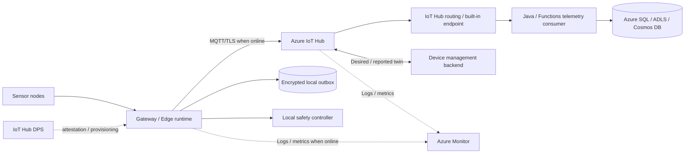
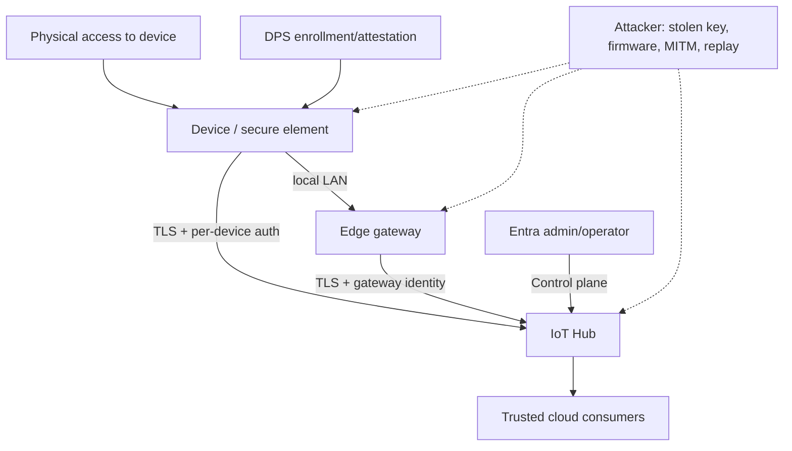
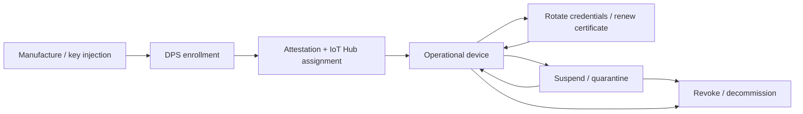
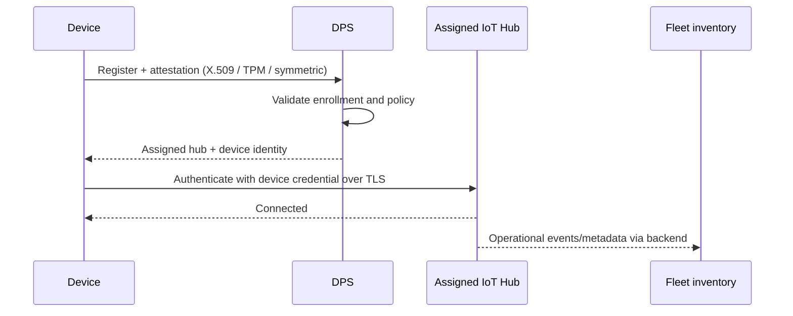
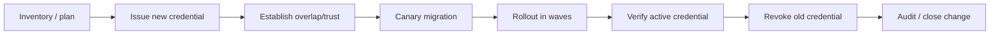
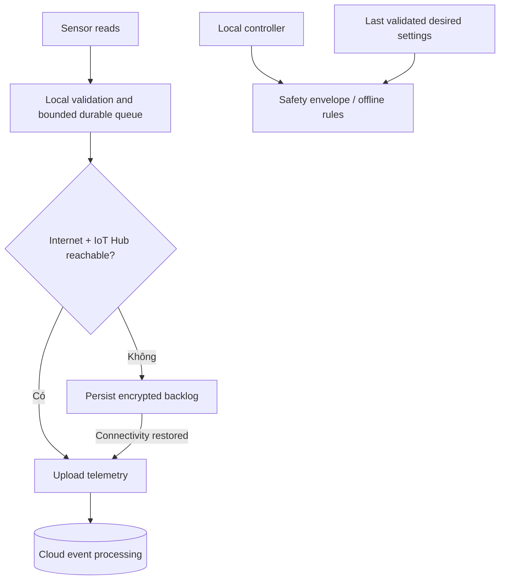
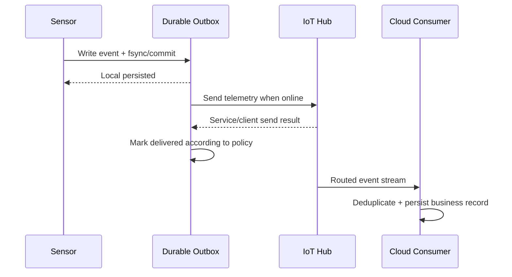
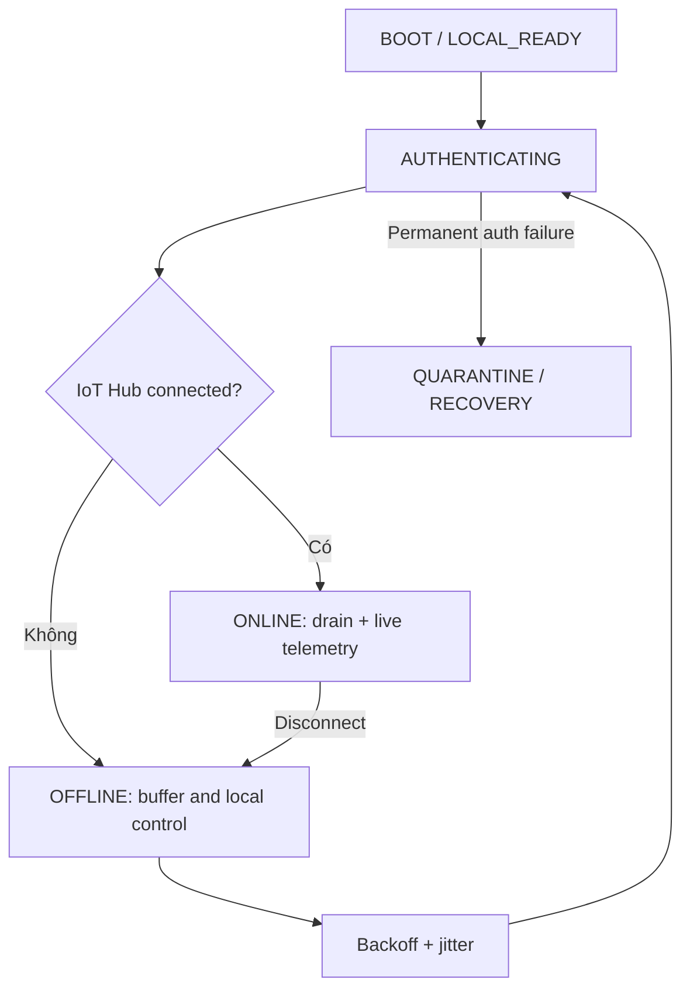
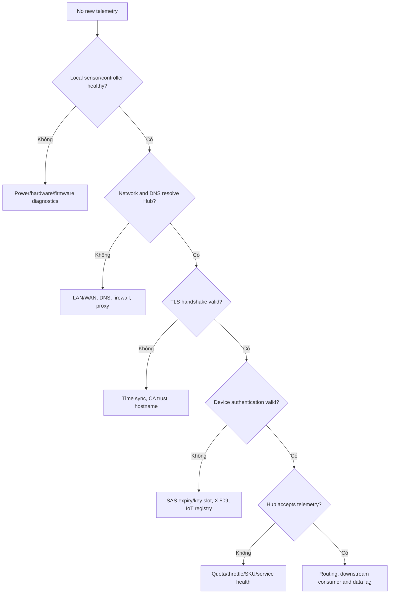

# Bảo mật thiết bị, xoay vòng credential và vận hành khi mất kết nối

Một doanh nghiệp sản xuất đặt hàng nghìn cảm biến nhiệt độ và bộ điều khiển tại các nhà máy. Thiết bị gửi telemetry về **Azure IoT Hub** để phân tích và cảnh báo, còn các **edge gateways** xử lý dữ liệu ngay trong mạng công nghiệp. Có nhà máy bị mất Internet hai ngày; một số thiết bị có đồng hồ lệch, vài khóa truy cập có nguy cơ bị lộ, và một lô chứng chỉ X.509 sắp hết hạn. Doanh nghiệp muốn bảo đảm rằng:

- Chỉ thiết bị thực sự được đăng ký mới gửi dữ liệu hoặc nhận lệnh.
- Mỗi thiết bị có danh tính riêng, không dùng chung một khóa có thể làm lộ toàn bộ đội thiết bị.
- Credential được cấp phát, thay thế và thu hồi trong suốt vòng đời.
- Thiết bị vẫn **đo, lưu và ra quyết định an toàn ở biên** khi mất mạng.
- Dữ liệu được gửi bù sau khi online mà không tạo bản ghi nghiệp vụ trùng hay sai thứ tự.
- Cập nhật firmware, thay đổi cấu hình và thu hồi quyền không làm nhà máy mất kiểm soát.
- Cloud có thể giám sát, kiểm toán, cảnh báo và tính được chi phí hạ tầng.

Chủ đề **“Bảo mật thiết bị, xoay vòng credential và vận hành khi mất kết nối”** thuộc chương **IoT và xử lý tại biên** của module **CLOUD_PROVIDERS_AZURE**. Bài kết nối kiến thức Microsoft Azure từ **subscription, resource group, Microsoft Entra ID** đến **IoT Hub, Device Provisioning Service (DPS), IoT Edge, VNet, Storage, Service Bus, Azure Monitor**, bảo vệ danh tính thiết bị và chi phí vận hành một giải pháp cloud-to-edge.

> **Phạm vi và tính thay đổi:** Nội dung tập trung vào Azure IoT Hub device identities, X.509/SAS, DPS và những mẫu xử lý offline trên thiết bị/gateway/IoT Edge. Azure IoT Operations, Azure Arc, Device Update for IoT Hub và các phiên bản IoT Edge có mô hình, khả năng và vòng đời hỗ trợ riêng; không coi chúng là cùng một runtime. Cần xác minh support matrix, API/SDK version, giới hạn vùng/tier, service lifecycle, thông số kết nối và chính sách cập nhật mới nhất trước khi triển khai. Các lệnh và dữ liệu dưới đây dùng cho **lab được phê duyệt**, không phải hành động đã chạy trên Azure.

## Mục tiêu học tập

Sau bài học, bạn có thể:

1. Mô tả trust boundaries giữa **thiết bị, gateway, IoT Hub, DPS, backend và người vận hành**.
2. Phân biệt **SAS token với khóa đối xứng**, **X.509 certificate**, **TPM/secure element** và credential bootstrap.
3. Giải thích vì sao device identity không giống Azure RBAC/managed identity của một App Service.
4. Thiết kế quy trình cấp danh tính, active, rotate, suspend/revoke và decommission.
5. Lập kế hoạch xoay vòng **primary/secondary symmetric keys** mà không cắt kết nối toàn đội thiết bị cùng lúc.
6. Thiết kế thay thế **X.509 certificate/CA trust** có cửa sổ chồng lấn và kiểm tra validity/revocation.
7. Hiểu cách **IoT Hub Device Provisioning Service** giúp cấp phát hàng loạt mà không phân phối connection string dịch vụ tới thiết bị.
8. Tách **telemetry store-and-forward**, **device twin desired/reported state** và **direct method/C2D message** khi offline.
9. Tính dung lượng hàng đợi cục bộ theo tốc độ sinh dữ liệu, thời gian mất mạng và rủi ro đầy ổ.
10. Thiết kế retry, backoff, idempotency, sequencing và clock quality sau reconnect.
11. Gắn bảo mật firmware/secure boot/OTA với vận hành credential.
12. Viết ví dụ Java IoT device SDK, thiết kế durable outbox và chạy thử các trường hợp lỗi an toàn.
13. Giám sát auth failures, offline duration, queue pressure, missed heartbeat, chi phí và data freshness.
14. Tạo runbook xử lý credential sắp hết hạn, thiết bị không kết nối và gateway đồng bộ dữ liệu sai.

## 1. Tình huống: nhà máy có mạng Internet không ổn định

Giả sử một hệ thống theo dõi kho lạnh có:

- 500 cảm biến nhiệt độ và độ ẩm trong mạng nội bộ.
- 20 gateway thu gom dữ liệu tại nhiều vị trí; một số gateway chạy Azure IoT Edge theo runtime tương thích.
- Ứng dụng Java xử lý telemetry và gửi lên IoT Hub.
- Backend Azure Functions/Stream Analytics hoặc consumer tương thích nhận sự kiện, ghi Azure Data Lake/Storage hoặc cơ sở dữ liệu.
- Một ứng dụng vận hành dùng **device twins** để gửi cấu hình mục tiêu như chu kỳ đo.
- Một trung tâm quản trị dùng DPS để đăng ký thiết bị và kiểm soát danh tính.
- Các điểm mạng có thể mất kết nối **6–48 giờ**, nhưng an toàn kho lạnh vẫn phải duy trì tại chỗ.

### Kiến trúc mục tiêu



**Điểm quan trọng:** mạng đứt không được khiến cảm biến dừng đo hoặc bộ điều khiển ngừng đảm bảo an toàn. Đám mây nhận dữ liệu muộn phải phân biệt **thời điểm đo** và **thời điểm nhận**, không coi mọi bản ghi được gửi bù là sự kiện vừa xảy ra.

## 2. Những thành phần Azure trong chuỗi tin cậy

| Thành phần | Vai trò | Vấn đề bảo mật/vận hành |
|---|---|---|
| **IoT device** | Đo/điều khiển, tạo telemetry, có device identity | Bảo vệ khóa riêng, firmware, local data |
| **Edge gateway** | Kết nối thiết bị nội bộ với cloud, có thể xử lý offline | Tách danh tính mỗi module/device, store-and-forward |
| **Azure IoT Hub** | Device-to-cloud telemetry, cloud-to-device capabilities, identity registry, twins | Device auth, quota, routing, service policies |
| **IoT Hub DPS** | Zero-touch provisioning/assignment tới IoT Hub | Attestation/enrollment, ID scope, bootstrap secrets |
| **Microsoft Entra ID** | Danh tính người vận hành và cloud applications | Azure RBAC/data-plane roles, audit |
| **Azure Key Vault** | Bảo vệ secrets/keys phía cloud, khi khả năng/kiến trúc phù hợp | Rotation/expiry, RBAC, network |
| **Azure IoT Edge runtime** | Chạy modules và hỗ trợ offline trên gateways theo version | Runtime lifecycle, local storage, edgeHub connectivity |
| **Azure Storage/SQL/Stream processing** | Lưu và tiêu thụ sự kiện | Privacy, dedup, ordering, retention |
| **Azure Monitor/Log Analytics** | Metrics, logs, alerts | Không log credentials/raw PII, thiết kế cảnh báo |

### Không nhầm vai trò

**DPS** giúp thiết bị biết **được phân vào IoT Hub nào** và được xác thực lúc provisioning. **IoT Hub** quản lý giao tiếp device-cloud và danh tính thiết bị. **IoT Edge runtime** có thể chạy module cục bộ và hỗ trợ store-and-forward khi offline. Không sản phẩm nào tự thay thế quy trình bảo vệ private key hoặc bảo đảm ứng dụng đã xử lý telemetry đúng một lần.

## 3. Threat model: những gì cần bảo vệ?

Một mô hình thiết bị thực tế có các trust boundaries:



### Đối thủ có thể làm gì?

- Lấy trộm thiết bị và đọc khóa từ flash/file cấu hình.
- Clone danh tính thiết bị nếu khóa đối xứng được lưu dạng plaintext.
- Chèn firmware độc hại, thay đổi cài đặt gateway hoặc làm hỏng outbox.
- Can thiệp mạng, dựng DNS/proxy giả, tấn công TLS nếu client bỏ xác minh chứng chỉ.
- Gửi lại telemetry cũ hoặc phát dữ liệu giả với identity bị lộ.
- Dùng một shared key của cả đội thiết bị để đăng nhập hàng loạt.
- Đánh cắp connection strings từ Git, logs, ảnh firmware hoặc dashboard.
- Chặn Internet, làm queue đầy, gây mất dữ liệu hoặc khiến bộ điều khiển quyết định sai.
- Lạm dụng quyền cloud operator để vô hiệu hóa/điều khiển thiết bị.
- Phát lệnh update/delete qua backend thiếu kiểm tra authorization.

### Tài sản phải bảo vệ

1. **Device private key/secret** và bootstrap credentials.
2. **Firmware/boot chain** và cấu hình bảo mật.
3. **Identity registry**, DPS enrollments và quyền quản trị.
4. **Telemetry integrity**: nguồn gửi, độ tươi, thứ tự, không nhân đôi.
5. **Control commands**: ai được phát và thiết bị chấp nhận trong điều kiện nào.
6. **Local safety logic** phải vận hành ngay cả khi cloud không có mặt.
7. **Sensitive measurements** và identifiers có thể liên kết tới cá nhân/tài sản.
8. **Recovery paths** khi bị khóa hoặc mất credentials.

## 4. Device identity không phải username dùng chung

Mỗi thiết bị nên có **device ID riêng**, gắn với một hồ sơ sở hữu và vòng đời. Ví dụ:

```text
Tenant:          factory-vn
Site:            cold-room-03
Device ID:       temp-sensor-00042
Serial:          CR3-2026-0042
Hardware identity: TPM/secure element certificate when available
Provisioning scope: Approved DPS enrollment
Status:          ACTIVE
Firmware:        signed release v2.4.1
Credential expiry: 2027-01-15T00:00:00Z
```

Đây là dữ liệu minh họa, không phải schema tự động của IoT Hub.

### Tránh dùng duy nhất device ID để xác thực

`deviceId` có thể đoán được hoặc được in trên vỏ thiết bị. Việc biết ID không chứng minh quyền sở hữu khóa. IoT Hub phải xác thực **chữ ký SAS hoặc chứng chỉ** theo identity đã đăng ký.

### Device identity khác cloud service identity

- **IoT Hub device identity:** thiết bị dùng SAS/X.509 được IoT Hub hỗ trợ.
- **DPS enrollment/attestation:** chứng minh thiết bị có quyền đăng ký/nhận assignment.
- **Entra managed identity:** phù hợp cho workload Azure như App Service, Functions hoặc VM có nền tảng hỗ trợ; **thiết bị IoT ngoài Azure không tự có managed identity endpoint**.
- **Azure RBAC:** cho phép admin/backend quản lý resources và data plane theo scope; không dùng RBAC Contributor như credential cho sensor.
- **Module identity** trong IoT Edge có cấu hình/lifecycle riêng, không gộp với device identity một cách tùy tiện.

### Registry nội bộ

Ngoài IoT Hub identity registry, hệ thống nên có inventory riêng cho serial, site, model, owner, firmware, warranty, credential rotation state và last successful contact. Không chứa raw private keys trong bảng inventory.

## 5. Vòng đời bảo mật của một thiết bị



### Những quyết định theo từng pha

| Giai đoạn | Việc cần làm |
|---|---|
| **Manufacture** | Sinh private key an toàn trên thiết bị/TPM, tránh sao chép, gắn serial |
| **Enrollment** | Ghi trust anchors hoặc device identity vào DPS, tách environments |
| **First boot** | Xác minh chain, endpoint và attestation, nhận hub assignment |
| **Run** | Giữ TLS, heartbeat, telemetry integrity, local policies |
| **Rotate** | Chuyển credential theo overlap/batch/canary, xác nhận |
| **Incident** | Disable device, revoke trust, quarantine network, điều tra |
| **Decommission** | Disable/delete cloud identity theo policy, xóa keys an toàn, cập nhật inventory |

**Không xóa identity trong IoT Hub ngay khi thiết bị vừa offline.** Có thể nó mất mạng hợp lệ. Cần phân biệt maintenance, network outage, compromise và thiết bị đã ngừng hoạt động vĩnh viễn.

## 6. Ba hướng xác thực thiết bị phổ biến

| Cách | Thiết bị giữ gì? | Cloud xác minh gì? | Trade-off |
|---|---|---|---|
| **Symmetric key + SAS token** | Khóa đối xứng riêng cho thiết bị | Chữ ký HMAC của SAS token | Đơn giản nhưng khóa có thể bị clone nếu lộ |
| **X.509 certificate** | Private key + certificate | TLS client cert/trust của IoT Hub/DPS | Quản lý CA/expiry/chain/revocation phức tạp hơn |
| **TPM-based attestation (DPS)** | Identity/endorsement material gắn phần cứng | DPS kiểm tra proof theo TPM attestation | Bảo vệ bootstrap tốt; phụ thuộc hardware và support |

### SAS token là gì?

**SAS token (Shared Access Signature)** là token có **thời hạn** và chữ ký được sinh từ symmetric key. Không nên nhầm token với **khóa gốc**:

- **Symmetric key:** long-lived secret cấp cho identity để tạo token.
- **SAS token:** credential ngắn hạn dùng xác thực tới endpoint/resource theo scope.
- **Token expiry:** sau thời điểm hết hạn cần token mới.
- **Key rotation:** thay khóa gốc, kéo theo yêu cầu thiết bị chuyển cách ký token.

**Đổi expiry của token không đồng nghĩa xoay vòng symmetric key**. Nếu khóa gốc bị lộ, kẻ tấn công có thể tạo token mới cho tới khi khóa bị thu hồi/đổi.

## 7. Symmetric key: riêng từng thiết bị, không chia sẻ service key

IoT Hub device identity có thể có **primary key** và **secondary key** riêng cho thiết bị khi dùng symmetric-key authentication. Đây là cơ sở để thay khóa theo hai giai đoạn.

### Không sử dụng IoT Hub service policy key trên cảm biến

Một IoT Hub service/shared access policy có thể cấp quyền rộng hơn device identity. Nếu nhúng **IoT Hub owner/service connection string** vào firmware thì chỉ cần một thiết bị bị trộm là có nguy cơ lộ quyền lớn trên toàn hub.

### Cách tiếp cận an toàn

- Device credentials **duy nhất** theo từng device/module identity.
- Không commit key vào source, firmware image chung hoặc diagnostics.
- Lưu secret trong **secure element/TPM/OS key store** khi phần cứng hỗ trợ; với symmetric key không thể tránh mọi rủi ro nếu thiết bị có thể bị root.
- Giới hạn người được phép đọc/đổi device keys trên cloud.
- Có inventory theo **key version**, không ghi raw secret.
- Dùng TLS và kiểm tra server certificate ở client.
- Có quy trình thay khóa/thu hồi khi mất thiết bị.
- Ưu tiên X.509/hardware-backed cho fleet lớn hoặc môi trường bị truy cập vật lý thường xuyên, khi hỗ trợ.

### DPS symmetric key enrollment group

Với enrollment group, thiết bị không nên đều nhúng **group master key**. Thay vào đó, mô hình thường dùng **individual derived key** từ group key và registration ID theo thuật toán DPS hỗ trợ, rồi cấp **derived key riêng cho thiết bị** trong quá trình manufacturing được kiểm soát.

**Nếu group master key bị lộ**, rủi ro ảnh hưởng nhiều thiết bị hơn. Hãy lưu/truy cập master key như secret có mức đặc quyền cao, áp rotation và phân tách lô/nhà máy khi thiết kế fleet.

## 8. SAS token: TTL, thời gian hệ thống và renewal

SAS token chứa scope/resource URI, signature và expiry, có thể bổ sung trường khác theo protocol. Thiết bị sinh token từ **khóa có quyền riêng** và kết nối qua TLS.

```text
Device key (secret)
    └── HMAC signing
           └── SAS token for IoT Hub device scope
                    └── Expires at configured UTC time
```

### Vấn đề thường gặp

- Đồng hồ thiết bị chạy chậm/nhanh làm token bị coi là hết hạn hoặc không hợp lệ.
- Firmware không thực hiện token renewal trước khi hết hạn.
- Thiết bị ngủ dài ngày, lúc thức dậy cố dùng token cũ.
- Xoay primary key ở cloud nhưng firmware vẫn ký bằng khóa cũ.
- Log URL/Authorization header vô tình chứa SAS token.
- Nhiều thiết bị dùng chung khóa, làm truy vết compromise khó.

### Quy tắc vận hành

1. Có **nguồn thời gian đáng tin** hoặc secure time mechanism thích hợp.
2. Không sử dụng đồng hồ do người dùng chỉnh tay làm nguồn duy nhất của expiry.
3. Chọn TTL phù hợp mức rủi ro và chu kỳ mất mạng; quá dài tăng rủi ro token bị lộ.
4. Gia hạn token trước expiry và có jitter để tránh cả fleet gia hạn đồng thời.
5. Nếu kết nối thất bại vì token hết hạn, tạo token mới từ **key còn hợp lệ** và reconnect.
6. Không tái sử dụng SAS token vô thời hạn trong file cấu hình.
7. Đổi key phải có **rollout protocol** riêng, không chỉ tăng TTL.

Không áp một số phút token TTL cố định cho mọi IoT SDK: khả năng token renewal và connection lifecycle tùy protocol/SDK/version.

## 9. Chứng chỉ X.509: authentication gắn với private key

Trong X.509 authentication, thiết bị giữ **private key**, xuất trình certificate và chứng minh sở hữu khóa trong TLS client authentication theo mô hình IoT Hub/DPS hỗ trợ.

### Các thành phần

- **Private key:** tuyệt đối không gửi cho cloud và không đóng gói chung trong firmware được flash cho mọi thiết bị.
- **Public certificate:** chứa public key, subject/issuer, validity, extensions.
- **Certificate chain:** thiết bị certificate → intermediate CA → trusted root CA theo cấu hình.
- **Certificate serial/subject/identifier:** dùng inventory và policy.
- **NotBefore/NotAfter:** thời gian có hiệu lực; hết hạn có thể làm reconnect thất bại.
- **Trust anchor/CA verification:** cloud/IoT Hub/DPS chỉ tin chain/identities phù hợp với cách enrollment đã chọn.
- **X.509 thumbprint registration:** IoT Hub có mô hình đăng ký fingerprints của device certificate (primary/secondary) với hành vi riêng, khác CA-signed model.

### Hai cách đăng ký cần phân biệt

1. **Thumbprint authentication:** registry có thể lưu primary/secondary thumbprints. Thay certificate thường phải cập nhật thumbprint tương ứng ở đúng identity.
2. **CA-signed authentication:** trust dựa trên CA/chain đã được thiết lập và xác minh, cùng điều kiện subject/identity theo service. Chuyển CA hoặc chain cần thiết kế trust transition.

**Certificate mới không tự được IoT Hub chấp nhận chỉ vì cùng tên thiết bị**. Nó phải đáp ứng hình thức xác thực đã cấu hình và trust/registry đúng.

## 10. TPM và secure element: giảm khả năng sao chép khóa

Một thiết bị dễ bị tháo vỏ hoặc root OS có nguy cơ lộ secret lưu ở flash. **TPM** hoặc **secure element** giúp bảo vệ khóa trong phần cứng, thường hỗ trợ private key không xuất khỏi chip.

### Những lợi ích

- Giảm rủi ro sao chép private key hàng loạt.
- Có thể thực hiện ký/chứng minh danh tính mà không trả private key dạng plaintext.
- Hỗ trợ thiết kế boot attestation hoặc secure boot theo platform.
- Với DPS TPM attestation, có thể tận dụng identity/endorsement information được platform hỗ trợ.

### Điều TPM không làm thay

- Không tự sửa một firmware có lỗ hổng RCE.
- Không tự đảm bảo sensor đo đúng hoặc bản ghi telemetry không bị giả ở application layer.
- Không tự xử lý credential expiry hoặc certificate CA rotation.
- Không chặn một thiết bị đã bị chiếm quyền thực thi lệnh hợp lệ thông qua security context đang hoạt động.
- Không tự đảm bảo thiết bị đủ nguồn điện/mạng/dung lượng offline buffer.

### Chọn theo môi trường

| Môi trường | Mức bảo vệ nên đánh giá |
|---|---|
| Lab điều kiện kiểm soát | Khóa riêng từng device, OS credential store, TLS |
| Thiết bị consumer tại nhà | Secure element/TPM khi có, signed firmware, anti-tamper |
| Nhà máy/thiết bị ngoài trời | Hardware-backed keys, secure boot, physical tamper response |
| Thiết bị an toàn trọng yếu | Root of trust, signed updates, independent safety controller, audit/quarantine |

**Threat model quyết định yêu cầu**, không chỉ vì TPM có sẵn trên board mà hệ thống mặc nhiên an toàn.

## 11. Azure DPS: bootstrap thiết bị mà không phát service credential

**Azure IoT Hub Device Provisioning Service** hỗ trợ đăng ký/attest thiết bị và chỉ định IoT Hub theo enrollment policy.



### DPS giúp giải quyết gì?

- Không phải hardcode tên IoT Hub cuối cùng vào mọi thiết bị.
- Có thể phân chia thiết bị theo enrollment group/individual enrollment.
- Hỗ trợ allocation policy cho các IoT Hub được liên kết, theo khả năng dịch vụ.
- Hỗ trợ onboarding và reprovision theo chính sách khi fleet phát triển.

### Những điều DPS không giải quyết

- Không tự tạo private key an toàn trên chip nếu manufacturing đã làm sai.
- Không tự lưu telemetry offline.
- Không đảm bảo thiết bị được cấp quyền điều khiển máy móc sau provisioning.
- Không thay firmware signature verification.
- Không tự cấp quyền Azure Resource Manager cho operator.
- Không bắt thiết bị bị mất mạng nhận ngay thay đổi policy ở cloud.

### Quy trình thiết bị khởi động

1. Thiết bị boot, kiểm tra firmware/clock/certificate.
2. Nếu chưa có assignment hợp lệ, dùng DPS ID Scope/endpoint và attestation credential để đăng ký.
3. Lấy assigned hub hostname/device ID.
4. Cache thông tin assignment theo policy, **không coi cache là credential bất tử**.
5. Kết nối assigned IoT Hub bằng device identity hợp lệ.
6. Bắt đầu telemetry/twin sync khi online.
7. Nếu provisioning/reassignment thay đổi, theo workflow được hỗ trợ để reprovision an toàn.

**Không gọi DPS để xin assignment trong mọi lần MQTT reconnect** nếu không cần. Tránh tạo storm vào provisioning service khi toàn bộ nhà máy đồng thời lên mạng trở lại.

## 12. Phân quyền: device-to-cloud khác cloud-to-device

Một thiết kế tốt tách người quản trị tài nguyên, backend gửi lệnh và thiết bị gửi dữ liệu.

| Chủ thể | Quyền phù hợp | Không nên có |
|---|---|---|
| Sensor device | Xác thực đúng device identity; gửi telemetry/nhận messages theo protocol | IoT Hub owner/service key, quyền quản trị hub |
| Edge gateway | Gateway/module identity và downstream trust theo kiến trúc | Một key “admin tất cả thiết bị” phát cho sensor |
| DPS enrollment operator | Quản lý enrollment theo quy trình duyệt | Mật khẩu/khóa lưu trong bảng tính không bảo vệ |
| Backend processing | Đọc event routing endpoint/consumer group theo quyền | Quyền xóa toàn bộ device identities nếu không cần |
| Device management service | Gửi desired changes/direct methods theo service auth được phép | Tài khoản admin dùng chung không audit |
| Cloud operator | Azure RBAC tối thiểu để quản lý resources | Quyền data-plane bất kỳ không cần |
| Auditor | Xem logs, inventory và security events | Keys/raw private data mặc định |

### Azure control plane và IoT Hub data plane

Quyền `Contributor` trên resource group không tự đồng nghĩa một sensor được phép publish telemetry. Device xác thực theo **IoT Hub device identity**. Một ứng dụng cloud dùng Entra/managed identity có thể cần **IoT Hub data-plane roles** theo API và capability hiện hành.

### Quyền truy cập device twin

**Device twin desired properties** được service/backend quản trị để đặt cấu hình; **reported properties** phản ánh trạng thái do thiết bị công bố. Client device không được phép tự sửa desired properties chỉ vì có device credential.

## 13. TLS, MQTT, AMQP và bảo vệ transport

IoT Hub hỗ trợ các transport mà IoT SDK lựa chọn theo sản phẩm/phiên bản: **MQTT**, **AMQP**, và các lựa chọn **over WebSockets** qua HTTPS/TLS, cùng HTTP trong những tình huống được hỗ trợ.

| Transport | Cổng thường gặp | Ghi chú |
|---|---|---|
| MQTT over TLS | TCP **8883** | Thiết bị trực tiếp, stateful connection |
| MQTT over WebSockets/TLS | TCP **443** | Hữu ích trong mạng chỉ cho HTTPS/WebSockets |
| AMQP over TLS | TCP **5671** | Stateful, SDK tùy runtime |
| AMQP over WebSockets/TLS | TCP **443** | Proxy-friendly theo network support |
| HTTPS | TCP **443** | Mô hình request/response khác MQTT |

Cổng và hostname phải được xác minh theo hướng dẫn **IoT Hub/Edge gateway/SDK** thực tế. Không mở cả dải cổng/địa chỉ Internet chỉ để thử nhanh.

### Security checks

- Thiết bị xác minh **server certificate chain và hostname**; không tắt TLS validation.
- Kiểm tra clock/certificate validity, hệ thống CA store cập nhật.
- Mỗi device có client credentials độc lập.
- Không log SAS token, certificate private key hoặc connection string.
- DNS resolution và proxy configuration phải được kiểm chứng.
- WebSocket fallback có thể cần thiết ở mạng corporate, nhưng không phải “cứ 443 là mọi proxy đều cho”.
- Bảo vệ local edge LAN bằng segmentation và mutual TLS khi khả năng gateway hỗ trợ; đừng giả định thiết bị nội bộ tự đáng tin.

## 14. Firmware, secure boot và cập nhật OTA

Credential có thể an toàn nhưng firmware chứa lỗ hổng vẫn khiến attacker điều khiển thiết bị.

### Phòng vệ nhiều lớp

1. **Secure boot/verified boot:** chỉ chạy firmware đã ký bằng trust anchor hợp lệ.
2. **Signed OTA packages:** xác thực signature/hash, version và target model trước flash.
3. **Anti-rollback:** tránh bị cài lại firmware lỗi đã bị thu hồi, trong khả năng phần cứng hỗ trợ.
4. **A/B partitions hoặc recovery image:** có đường quay lại khi update thất bại.
5. **Phased deployment:** canary 1%, 5%, 20%, rồi mở rộng theo health gates.
6. **Power-loss safety:** không làm hỏng boot image nếu mất điện giữa lúc update.
7. **Credential compatibility:** update không xóa/hỏng private key trong TPM hoặc secret store.
8. **Local fallback:** không reboot hàng loạt khi gateway không kết nối cloud.
9. **Inventory/attestation:** báo cáo firmware version và update result.
10. **Incident response:** isolate device bị xâm nhập, quay về bản signed/known-good.

### Device Update for IoT Hub

Có thể đánh giá khả năng **Device Update for IoT Hub** để điều phối OTA và trạng thái cập nhật khi sản phẩm/tier/runtime hỗ trợ. Nó không thay trách nhiệm tạo **firmware ký số, test phần cứng, rollback và phê duyệt**. Kiểm tra service lifecycle/availability của feature trước khi xây kiến trúc phụ thuộc.

**Không phát lệnh cài firmware mới nếu thiết bị đang điều khiển quy trình an toàn trọng yếu** và chưa có local maintenance/safety window.

## 15. Xoay vòng credential: mục tiêu và các điều kiện

**Credential rotation** là thay thông tin xác thực hiện hữu bằng bản mới, xác nhận client đã chuyển thành công rồi thu hồi bản cũ.

### Vì sao phải rotate?

- Giới hạn thời gian một key bị lộ còn hữu dụng.
- Đáp ứng chính sách security và certificate expiry.
- Thay trust khi employee/vendor rời tổ chức.
- Phục hồi sau compromised firmware/secret.
- Thay CA/crypto algorithm theo policy.

### Các pha chung



### Không thể chỉ “đổi khóa trong Portal”

Nếu cloud đổi key mà thiết bị **đang offline** chưa biết key mới, thiết bị có thể mất khả năng kết nối khi quay lại. Cần đảm bảo một trong những điều kiện:

- Thiết bị đã nhận key mới an toàn trước khi old key bị thu hồi.
- Có **hai credential slots** đồng thời được IoT Hub hỗ trợ để overlap.
- Thiết bị có bootstrap/root of trust độc lập để lấy credential mới.
- Có quy trình **re-enrollment/field recovery** khi mọi credential hiện tại đã bị vô hiệu hóa.

Điểm này quyết định khả năng vận hành fleet, không phải thủ thuật đổi một tham số API.

## 16. Rotation symmetric keys với primary/secondary: quy trình hai pha

Giả sử device `temp-sensor-00042` có:

```text
Primary device key   = Key A (device đang dùng)
Secondary device key = Key B (dự phòng)
```

IoT Hub cho phép mô hình primary/secondary symmetric keys theo identity registry. Để xoay vòng mà hạn chế gián đoạn, phải biết **device đang dùng slot nào** và cả cloud lẫn device có hỗ trợ dual-key rollover.

### Một chu kỳ rotation điển hình

1. **Preflight:** inventory, connectivity, firmware version, xem device dùng primary hay secondary; có approved maintenance window.
2. **Bảo đảm khóa dự phòng:** Secondary key B đang hợp lệ trên hub và đã được device nhận **qua một kênh bảo mật đáng tin** hoặc đã được provision trước.
3. **Chuyển dùng B:** firmware ký SAS mới bằng B và reconnect; đo auth success và xác nhận bằng telemetry mới.
4. **Chờ quan sát:** không chỉ thấy device “connected”; xác minh app báo đang dùng slot B theo metadata **không tiết lộ khóa**.
5. **Thay A:** tạo key A' an toàn và cập nhật **primary key của identity** trên IoT Hub; key A cũ không còn được chấp nhận cho những lần xác thực mới. Không mặc định token ký bằng A cũ vẫn dùng đến expiry khi key đã bị đổi.
6. **Phân phối A':** gửi tới device bằng kênh được bảo vệ hoặc chờ cơ chế bootstrap hợp lệ khi online; xác minh device đã lưu bền vững.
7. **Chuyển dùng A':** canary và rollout dần, xác nhận kết nối/telemetry.
8. **Thay B** bằng B' ở pha sau nếu policy yêu cầu, chỉ khi toàn fleet mục tiêu đã chuyển khỏi B.
9. **Đóng change:** audit key versions, failures, offline devices, rollback/remediation plan.

### Những điều kiện an toàn

- Không gửi **raw key** qua telemetry, device twin thường, email hoặc dashboard logs.
- Nếu thiết bị không hỗ trợ **kênh nhận secret an toàn**, không dùng remote C2D arbitrary text để phát keys. Cần OTA được bảo vệ, hardware bootstrap hoặc reprovision.
- Phải xác minh **slot được dùng để ký SAS**. Nếu firmware chọn random slot, có thể làm mất dịch vụ khi rotate.
- Với thiết bị offline, giữ slot cũ còn hiệu lực đến hết cửa sổ chấp nhận đã thiết kế, trừ sự cố bảo mật đòi thu hồi khẩn.
- Không rotate cả primary và secondary cùng lúc trên fleet production.
- Có **emergency override** khi key bị compromise: ưu tiên cô lập/ngừng quyền truy cập, chấp nhận mất kết nối thay vì giữ backdoor.

### Điểm bất khả thi về mặt mạng

Nếu device mất kết nối và không có **credential dự phòng đã provision trước** hoặc bootstrap trust còn sống, cloud không thể “gửi key mới trong lúc offline”. Đây là bài toán vật lý/kiến trúc, không thể khắc phục bằng tăng số lần retry.

## 17. Rotation chứng chỉ X.509 và CA trust

Certificate có hạn `NotAfter`, nên việc gia hạn phải bắt đầu **trước** ngày hết hạn và có cửa sổ đủ cho những thiết bị ít online.

### Với thumbprint-based identity

1. Kiểm tra certificate đang dùng và **primary/secondary thumbprints** tương ứng.
2. Sinh **private key mới tại thiết bị/secure element** nếu có.
3. Tạo CSR, xác thực danh tính, phát certificate mới từ CA được phép.
4. Đưa certificate mới/chain tới device an toàn, giữ private key không export.
5. Cập nhật thumbprint dự phòng trong IoT Hub registry khi mô hình sử dụng thumbprints.
6. Thử kết nối với certificate mới, kiểm tra TLS và device identity.
7. Chuyển từng đợt, xác nhận credential version, firmware/clock.
8. Thu hồi/loại thumbprint cũ sau khi fleet đã chuyển hoặc theo incident policy.
9. Ghi audit serial/issuer/expiry, không log private key.

### Với CA-signed authentication

- Bảo đảm **CA chain mới được trust** ở đúng IoT Hub/DPS enrollment model trước khi device dùng cert mới.
- Nếu thay root/intermediate CA, thiết kế **dual-trust overlap** theo capabilities của dịch vụ.
- Không chỉ cấp certificate mới rồi quên cập nhật trust chain trong device/registry.
- Kiểm tra yêu cầu certificate subject/common name/identity binding của DPS/IoT Hub theo phương thức attestation.
- Áp policy revocation/disable identity nếu certificate bị lộ; **không hứa mọi hình thức CRL/OCSP của PKI sẽ tự khiến IoT Hub lập tức từ chối** nếu chưa kiểm tra behavior của phương thức xác thực.

### Thiết bị offline lâu hơn thời hạn chứng chỉ

Thiết bị có thể thức dậy với X.509 client certificate **đã hết hạn**. Nếu toàn bộ đường xác thực tới cloud dựa trên cert đó, remote renewal qua cùng IoT Hub có thể không còn khả thi. Phải chuẩn bị **secure bootstrap/reprovision**, certificates dự phòng phù hợp hoặc field maintenance. **Không tắt kiểm tra thời hạn chứng chỉ** để qua cửa hậu.

## 18. DPS enrollment group: rotate không được gây lỗi hàng loạt

DPS có thể dùng **individual enrollment** hoặc **enrollment group** tùy attestation method.

| Loại | Mức độ quản trị | Rủi ro |
|---|---|---|
| Individual enrollment | Quản từng device/attestation | Nhiều enrollment records, dễ cô lập thiết bị |
| Symmetric-key enrollment group | Đăng ký đội thiết bị có derived keys | Group key lộ ảnh hưởng nhiều thiết bị |
| X.509 CA enrollment group | Dùng CA chain để đăng ký nhiều thiết bị | CA compromise/trust rollover phải quản trị chặt |
| TPM individual attestation | Phù hợp hardware-backed identity riêng | Phụ thuộc TPM hardware/attestation lifecycle |

### Sai lầm cần tránh

- Nhúng **group enrollment master key** vào mọi thiết bị.
- Đổi group master key rồi mong derived keys đã có tự tương thích.
- Xóa enrollment group cũ trong khi nhiều thiết bị chưa bao giờ nhận bootstrap material mới.
- Reprovision toàn bộ fleet đồng thời tạo DPS storm.
- Dùng registration ID không đảm bảo mapping unique/đúng hardware.
- Quên phân biệt DPS enrollment disabled với IoT Hub device identity disabled.
- Dùng chung enrollment/CA trust cho dev và production nếu compliance yêu cầu tách.

### Kế hoạch rollout

Thiết kế lô canary nhỏ theo **hardware model, firmware release, region, nhà máy và thời gian mất mạng thường gặp**. Có bảng theo dõi:

```text
deviceId | lastSeen | currentAttestation | targetVersion
rotationState | assignedHub | deadline | retryCount
```

Trong mọi trường hợp, lưu **metadata/trạng thái** thay vì raw keys.

## 19. Orchestration rotation cho cả fleet

Với 50.000 thiết bị, rotation cần một workflow có persistence, retries và chấp thuận riêng cho từng pha.

### Ví dụ state machine

```text
PLANNED
  → PRECHECKED
  → NEW_CREDENTIAL_ISSUED
  → DELIVERED_OR_PRESTAGED
  → CLIENT_SWITCHED
  → VERIFIED
  → OLD_REVOKED
  → COMPLETE

On problems:
  → PAUSED / RETRY_PENDING / MANUAL_RECOVERY / QUARANTINED
```

### Các health gates

- Đã gặp device trong khoảng hoạt động hợp lệ.
- Thiết bị có firmware hỗ trợ two-slot rotation.
- Có dung lượng đủ để lưu credential mới/rollback.
- NTP/secure clock không bị lỗi.
- Update signature/PKI chain hợp lệ.
- Azure IoT Hub provisioning/authentication quota còn headroom.
- Không có cảnh báo telemetry hoặc offline rate bất thường.
- Canaries truyền dữ liệu được sau khi đổi.
- Không làm gián đoạn thiết bị thuộc nhóm an toàn cao đang chạy quy trình quan trọng.

### Bảo vệ kênh điều phối

Một controller quản lý rotation là **mục tiêu tấn công giá trị cao**. Nó cần identity riêng, role tối thiểu, Key Vault/HSM hoặc dịch vụ cấp certificate chuyên dụng, audit bất biến khi có thể, approval và khả năng dừng rollout.

## 20. Vận hành khi offline: phân biệt ba loại trạng thái

Khi một thiết bị mất kết nối cloud, có ba chuyện khác nhau:

1. **Telemetry:** dữ liệu cảm biến đang sinh ra; có thể buffer cục bộ và gửi bù khi online.
2. **Desired configuration:** cấu hình mới từ cloud không đến được ngay; thiết bị tiếp tục dùng cấu hình cuối đã xác thực hoặc local fallback.
3. **Commands:** lệnh điều khiển mới không thể giả định sẽ thực thi khi thiết bị offline; cần policy về expiry, safety và cách đồng bộ sau.



### Phân biệt “offline” ở nhiều tầng

- Sensor mất Wi-Fi tới gateway.
- Gateway có LAN nhưng mất Internet.
- DNS không phân giải IoT Hub hostname.
- TLS/connectivity hoạt động nhưng device credential bị từ chối.
- IoT Hub có sự cố/giới hạn quota.
- Cloud consumer không đọc telemetry dù device-to-cloud gửi thành công.
- Thiết bị có Internet nhưng DPS/Iot Hub network policy chặn.

**Một metric connected/disconnected đơn lẻ không chỉ ra nguyên nhân**. Runbook cần phân tầng: local LAN, network/DNS/TLS, auth, IoT Hub, routing và downstream consumers.

## 21. Store-and-forward: đệm dữ liệu offline ở đâu?

**Store-and-forward** nghĩa là giữ các sự kiện chưa gửi thành công ở nơi lưu trữ cục bộ, sau đó gửi lại khi mạng phục hồi.

### Hai trường hợp rất khác nhau

| Kiểu thiết bị | Cơ chế buffering | Trách nhiệm |
|---|---|---|
| Thiết bị Java kết nối thẳng IoT Hub | **Ứng dụng phải thiết kế durable outbox** hoặc dùng SDK feature được xác minh đủ yêu cầu | SDK retry/in-memory queue không mặc nhiên lưu qua reboot |
| Gateway chạy **Azure IoT Edge** với edgeHub | Có cơ chế **store-and-forward** được hỗ trợ theo runtime/deployment settings | Cấu hình TTL, disk space, host storage và kiểm tra disk health |
| Sensor gửi tới gateway local custom | Gateway nhận dữ liệu, ACK theo local protocol, ghi bền vững rồi forward | Cần local delivery/ack contract rõ |
| PLC/bộ điều khiển chỉ có RAM | Buffer có thể mất khi mất nguồn | Cần thiết kế lưu bền vững hoặc chấp nhận RPO |
| Consumer cloud sau IoT Hub | Event streaming/consumer checkpoint và storage riêng | IoT Hub không thay event archive dài hạn |

### Cảnh báo về “SDK tự retry”

Một IoT SDK có thể tự retry network và giữ một số messages tạm thời trong bộ nhớ. Nếu process crash, power loss hoặc host reboot, **memory không còn**. Vì vậy đối với telemetry bắt buộc không mất trong khoảng offline, hãy đưa event vào **durable local store** *trước* khi coi quá trình thu thập đã hoàn tất.

### Bảo đảm ở từng điểm ACK



**IoT Hub chấp nhận event** không có nghĩa **cloud consumer đã commit vào database**. Nếu nghiệp vụ phải xác nhận end-to-end, cần receipt/acknowledgment riêng từ downstream hoặc cách đối soát events đã lưu.

## 22. Durable local outbox: schema và transaction

Trên gateway Linux, một lựa chọn đơn giản là **SQLite (WAL)** hoặc embedded database bền vững được platform hỗ trợ. Cơ chế filesystem/event journal phù hợp cũng có thể dùng, miễn có transaction, recovery và giới hạn dung lượng.

### Một schema mẫu

```sql
CREATE TABLE IF NOT EXISTS telemetry_outbox (
    event_id TEXT PRIMARY KEY,
    device_id TEXT NOT NULL,
    boot_id TEXT NOT NULL,
    sequence_no INTEGER NOT NULL,
    event_time_utc TEXT,
    gateway_received_utc TEXT NOT NULL,
    payload_ciphertext BLOB NOT NULL,
    priority INTEGER NOT NULL DEFAULT 1,
    expires_utc TEXT,
    state TEXT NOT NULL DEFAULT 'PENDING',
    retry_count INTEGER NOT NULL DEFAULT 0,
    created_utc TEXT NOT NULL
);

CREATE INDEX IF NOT EXISTS idx_outbox_pending
    ON telemetry_outbox(state, priority, sequence_no);
```

Đây là SQL ví dụ hướng tới SQLite; không phải định nghĩa sẵn của Azure IoT Hub. **Payload phải mã hóa/chống sửa đổi** theo storage/TPM/key management và threat model. Không lưu device credential trong cùng bảng.

### Vòng đời event

1. Sensor/gateway tạo **eventId duy nhất**.
2. Bắt đầu local transaction, ghi payload, sequence, time quality, priority.
3. Commit và xác nhận dữ liệu đã bền vững theo yêu cầu (fsync/WAL policy).
4. Sender lấy một batch `PENDING` phù hợp.
5. Gửi khi IoT Hub kết nối được; chờ kết quả theo **ack semantics của SDK/transport**.
6. Nếu success, mark `DELIVERED` hoặc xóa theo retention policy.
7. Nếu transient failure, tăng retry_count, backoff và giữ event.
8. Nếu invalid permanent payload, tách **local quarantine** và alert thay vì retry vô hạn.
9. Nếu local storage cạn, áp drop/prioritization policy được duyệt.
10. Khi reboot, scan những records chưa xác nhận để gửi lại.

### Cảnh báo “send + delete” không atomic với cloud

Không thể atomic-commit cùng một transaction vừa xóa SQLite event vừa xác nhận IoT Hub ở remote network. Nếu gửi thành công rồi mất điện trước khi mark delivered, event sẽ được gửi lần nữa. Đây là lý do cần **idempotency ở cloud**, không hứa exactly-once delivery chỉ với outbox.

## 23. Tính dung lượng lưu trữ offline thực tế

Dung lượng tối thiểu phụ thuộc tốc độ sự kiện, kích thước payload, thời gian mất mạng, indexing và biến động tải.

Công thức xấp xỉ:

\[
S_{\text{raw}} = N \times f \times b \times T
\]

Trong đó:

- \(N\): số sensors phục vụ bởi một gateway.
- \(f\): số events/giây/sensor.
- \(b\): kích thước bytes/event sau encoding, chưa tính overhead.
- \(T\): thời gian offline tính bằng giây.

### Ví dụ

Một gateway nhận từ **25 sensors**; mỗi sensor gửi **một sự kiện/10 giây**; mỗi event sau khi đóng gói chiếm khoảng **600 bytes**. Cần giữ **48 giờ**:

```text
N = 25 sensors
f = 0.1 events/sensor/second
b = 600 bytes/event
T = 48 × 3600 = 172,800 seconds

Raw = 25 × 0.1 × 600 × 172,800
    = 259,200,000 bytes
    ≈ 247.2 MiB
```

Với **hệ số dự phòng 2×** cho metadata, SQLite pages, WAL, log, peak/retry/backlog và disk reserve, phải dự trù cỡ **495 MiB** trở lên cho workload ví dụ. Hệ số 2× chỉ minh họa; thiết kế thật đo file sizes, write amplification, compression, encryption và an toàn flash wear.

### Không chỉ tính đĩa

- CPU/flash wear do ghi nhiều.
- Thời gian backlog drain khi online.
- Băng thông LTE/satellite và data plan.
- Quota/speed của IoT Hub khi hàng nghìn thiết bị gửi bù.
- Dung lượng còn lại nếu offline lâu hơn dự kiến.
- Bản ghi ưu tiên cao khác bản ghi debug thông thường.
- RTO sau mạng phục hồi và deadline của dữ liệu.

### Ví dụ drain time

Nếu mỗi gateway tích lũy 259,2 MB và đường uplink thực tế chỉ đạt **100 KB/s cho telemetry**, tối thiểu mất khoảng **43 phút** chỉ để truyền payload (chưa tính retry/protocol overhead). Không gửi toàn bộ backlog đồng thời từ 20 gateway nếu điều đó bão hòa đường truyền nhà máy hoặc vượt IoT Hub throttling.

## 24. Offline retention: TTL, ưu tiên và chính sách khi đầy ổ

Không phải mọi dữ liệu đều có giá trị bằng nhau.

| Loại dữ liệu | Độ ưu tiên | Chính sách khi offline |
|---|---|---|
| Alarm vượt ngưỡng an toàn | Rất cao | Lưu bền vững; local actuator và escalation |
| Dữ liệu đo cần truy vết chất lượng | Cao | Lưu theo retention, gửi bù có thứ tự |
| Trạng thái thiết bị / heartbeat | Trung bình | Có thể gộp/tổng hợp nếu policy cho phép |
| Diagnostic/debug verbose | Thấp | Có thể sampling/drop khi vượt quota |
| Ảnh/video kích thước lớn | Phụ thuộc nghiệp vụ | Lưu riêng, upload có lịch/bandwidth cap |
| Dữ liệu đã quá TTL nghiệp vụ | Thấp hoặc yêu cầu archive | Archive/quarantine/drop theo policy, có audit |

### Những nguyên tắc quan trọng

- Áp **storage high-watermark** và low-watermark.
- Dành reserve cho logs/OS; không để outbox chiếm toàn ổ.
- Theo dõi `oldestPendingAge`, `pendingCount`, bytes used, estimated drain time.
- Khi cạn ổ, phải quyết định **drop oldest, drop low priority, aggregate hoặc fail safe** trước khi sự cố xảy ra.
- Không âm thầm vứt alarm an toàn rồi báo telemetry pipeline “khỏe”.
- Nếu telemetry có retention pháp lý, xóa dữ liệu phải theo chính sách.
- Bảo vệ local data bằng encryption at rest/ACL và chống sửa dữ liệu.
- Kiểm soát clock không đáng tin để tránh một sự kiện bị đánh giá “quá hạn” sai.

### Timeout và TTL khác nhau

**SAS token TTL**, **IoT Edge store-and-forward TTL**, **cloud-to-device message TTL** và **local retention** là bốn thứ khác nhau. Không đặt một giá trị 24h rồi cho rằng mọi tầng sẽ giữ dữ liệu đúng 24h.

## 25. IoT Edge edgeHub store-and-forward

Với gateway dùng **Azure IoT Edge**, edgeHub hỗ trợ routing và **store-and-forward** cho messages được cấu hình theo cơ chế của runtime, giúp lưu khi mất upstream connectivity và chuyển khi kết nối phục hồi.

### Ví dụ cấu hình phần desired properties

Trong cấu hình triển khai của `$edgeHub`, có thể có:

```json
{
  "properties.desired": {
    "schemaVersion": "1.2",
    "routes": {
      "telemetryToCloud": "FROM /messages/* INTO $upstream"
    },
    "storeAndForwardConfiguration": {
      "timeToLiveSecs": 172800
    }
  }
}
```

Đây là **trích đoạn khái niệm**; không phải deployment manifest đầy đủ để áp trực tiếp. Property paths, schema version và cách runtime đọc cấu hình phải xác minh theo **Azure IoT Edge version hiện hành**. `timeToLiveSecs=172800` minh họa 48 giờ; TTL không đảm bảo ổ cứng đủ chứa mọi message.

### Những thành phần khác

- edgeAgent quản lý deployment/running state của modules theo phiên bản runtime.
- edgeHub thực hiện routing/protocol handling và store-and-forward theo configuration.
- Module có thể nhận desired properties và báo reported properties trong phạm vi hỗ trợ.
- Host cần **đĩa bền vững**, permissions và cấu hình storage để dữ liệu tồn tại khi container/runtime khởi động lại.
- Thực tế lưu trữ, quotas và lỗi offline cần kiểm thử với runtime/OS/container storage driver.
- Không để container filesystem ephemeral là nơi duy nhất giữ backlog quan trọng.

### Khả năng và giới hạn

Store-and-forward **không tự biến tất cả ứng dụng downstream thành exactly-once**. Dữ liệu quá TTL, đĩa đầy, gateway mất nguồn hoặc lỗi local storage vẫn có thể gây mất messages. Cần theo dõi disk pressure/edgeHub queue và thiết kế dedup cloud.

**Không áp cấu hình IoT Edge cho thiết bị Java kết nối thẳng IoT Hub** nếu thiết bị đó không chạy edgeHub.

## 26. Format telemetry để chống trùng và sai thứ tự

Gợi ý event schema độc lập với protocol:

```json
{
  "schemaVersion": 1,
  "eventId": "temp-sensor-00042-boot-8fa2-00000731",
  "deviceId": "temp-sensor-00042",
  "siteId": "cold-room-03",
  "bootId": "boot-8fa2",
  "sequenceNo": 731,
  "measuredAtUtc": "2026-11-20T09:00:00Z",
  "gatewayReceivedAtUtc": "2026-11-20T09:00:01Z",
  "timeQuality": "synchronized",
  "temperatureC": -14.7,
  "unit": "C"
}
```

### Các trường có ý nghĩa

- **eventId:** duy nhất khi retry/reboot; cloud dùng làm idempotency key.
- **deviceId + bootId + sequenceNo:** hỗ trợ phát hiện missing/duplicate/out-of-order messages.
- **measuredAtUtc:** thời điểm cảm biến ghi nhận, có thể không đáng tin nếu clock sai.
- **gatewayReceivedAtUtc:** thời điểm gateway thấy dữ liệu, có provenance khác.
- **cloud enqueuedAtUtc:** server timestamp được tạo khi hub/consumer nhận, thường phải lấy từ service hoặc backend.
- **timeQuality:** `synchronized`, `estimated`, `unknown` theo logic device, không giả định đồng hồ luôn đúng.
- **schemaVersion:** cho phép kiểm soát thay đổi payload trong fleet nhiều firmware versions.

### Không chỉ dựa vào timestamp

Thiết bị có thể reboot và bắt đầu sequence lại từ 0. Vì vậy phải có **boot ID** đủ duy nhất hoặc monotonic persistent counter. Nếu thiết bị offline và clock drift, so sánh timestamp giữa các sensors có thể sai. Hệ thống phân tích cần giữ cả source/gateway/cloud times và có quy tắc tin cậy.

## 27. Cloud consumer: idempotency và ordering

IoT Hub hỗ trợ telemetry forwarding đến event endpoints/routing targets theo khả năng; message delivery và consumer recovery có thể tạo **at-least-once semantics** hoặc duplicates theo pipeline. Không dựa vào giả định toàn bộ IoT Hub → consumer → database là **exactly once**.

### Mẫu chống duplicate

Trong database downstream, đặt unique constraint phù hợp:

```sql
CREATE TABLE TelemetryReadings (
    EventId VARCHAR(160) NOT NULL PRIMARY KEY,
    DeviceId VARCHAR(128) NOT NULL,
    BootId VARCHAR(80) NOT NULL,
    SequenceNo BIGINT NOT NULL,
    MeasuredAtUtc DATETIME2 NULL,
    CloudReceivedUtc DATETIME2 NOT NULL,
    TemperatureC DECIMAL(10,3) NOT NULL
);
```

Đây là schema **minh họa SQL Server/Azure SQL**. Trong hệ thống thật, dùng type/length, partitioning, indexing và retention dựa trên data volume; khóa sự kiện phải phù hợp semantics của nguồn.

### Ingestion

```text
On telemetry event:
  1. Validate device identity from trusted message metadata.
  2. Parse schemaVersion, eventId and sequence.
  3. Reject or quarantine invalid payload.
  4. Insert event using EventId unique key.
  5. If already exists, treat as duplicate; do not count twice.
  6. Track gaps/out-of-order per device/boot.
  7. Commit database before checkpointing stream offset.
```

### Bảo đảm order

Thứ tự gửi/nhận có thể chịu ảnh hưởng network retries, buffer draining, partitions và số consumers. **Không dùng arrival order của IoT Hub làm đồng hồ sự kiện duy nhất**. Nếu phân tích cần thời gian đo, áp event-time windows, watermark và late-data policy.

Một telemetry record từ hôm qua xuất hiện sau khi mạng phục hồi phải được gắn **late arrival**, không làm dashboard nói nhiệt độ hiện tại chính là giá trị cũ.

## 28. Retry, reconnect và tránh bão dữ liệu

Khi Internet phục hồi, mọi thiết bị có thể reconnect gần như đồng thời. Điều này làm tăng:

- DNS/TLS handshakes.
- DPS registration nếu firmware re-provision không cần thiết.
- IoT Hub connection/throttling requests.
- Số lượng SAS token renewals.
- Uplink utilization của mạng nhà máy.
- Backlog drain và queue depth ở cloud consumer.
- Pin/CPU của các thiết bị vốn phải xử lý an toàn cục bộ.

### State machine



### Chính sách reconnect

1. **Exponential backoff có jitter**, không cố connect mỗi 50 ms.
2. **Retry budget** và phân loại lỗi network vs authentication.
3. Tái tạo SAS token khi cần, nhưng không tự gửi device secret qua logs.
4. Dùng **DPS** khi reprovision thật sự cần, không cho mọi reconnect.
5. Có giới hạn **events/giây và bytes/giây** khi drain outbox.
6. Cho telemetry mới ưu tiên phù hợp so với backlog.
7. Không để backlog đẩy lệnh điều khiển an toàn xuống mức ưu tiên thấp.
8. Quan sát cloud throttling và điều chỉnh sending rate.
9. Nếu token/cert invalid permanent, chuyển trạng thái **RECOVERY_REQUIRED** thay vì retry vô hạn.
10. Tránh firmware auto-reboot liên tục khiến thiết bị bỏ lỡ cập nhật local.

### QoS không phải exactly-once end-to-end

Ngay cả MQTT QoS 1 bảo đảm một dạng giao nhận transport, **không bảo đảm consumer downstream lưu database đúng một lần**. Cần application eventId/dedup và storage/commit strategy.

## 29. Device twin khi offline: desired, reported và version

**IoT Hub device twin** lưu desired/reported properties theo mô hình dịch vụ, phù hợp quản lý cấu hình cần thiết bị áp dụng khi có kết nối.

```json
{
  "properties": {
    "desired": {
      "samplingIntervalSec": 30,
      "alarmThresholdC": -10,
      "configRevision": 12
    },
    "reported": {
      "samplingIntervalSec": 60,
      "alarmThresholdC": -9,
      "appliedRevision": 11,
      "lastApplyResult": "OFFLINE_PENDING"
    }
  }
}
```

Đây là **mẫu rút gọn khái niệm**, không phải device twin document đầy đủ hay schema chuẩn bắt buộc. Cấu trúc revision được ứng dụng tự thiết kế; IoT Hub twin còn có metadata/version/etag riêng.

### Quy trình thiết bị khi online trở lại

1. Kết nối được IoT Hub bằng identity hợp lệ.
2. Lấy desired properties mới nhất và version/etag theo SDK.
3. So sánh với **last applied revision** đã lưu bền vững.
4. Validate phạm vi an toàn và dependency (firmware/hardware model).
5. Áp dụng cấu hình theo transaction hoặc rollback được thiết kế.
6. Ghi reported properties để cloud thấy **appliedRevision, success/failure reason**.
7. Đồng bộ trạng thái cục bộ và theo dõi thay đổi tiếp theo.

### Khi offline phải làm gì?

Thiết bị tiếp tục sử dụng **last-known-good configuration** đã kiểm chứng, có TTL/safety bounds theo nghiệp vụ. Nếu cấu hình cũ không còn an toàn khi môi trường thay đổi, bộ điều khiển chuyển **safe operating mode**, không suy đoán nội dung desired mới.

**Desired được ghi ở cloud không có nghĩa thiết bị đã áp dụng.** Chỉ báo reported/app acknowledgment mới chứng minh thiết bị đã quan sát và xử lý thay đổi.

## 30. Direct methods, C2D messages và twin: dùng khi nào?

| Cơ chế | Mục đích | Khi offline |
|---|---|---|
| **Direct method** | Gọi hành động có phản hồi theo phiên kết nối active | Không thể giả định gọi được device offline; cần timeout/fallback |
| **Cloud-to-device message** | Gửi message xuống device với delivery/TTL semantics được hỗ trợ | Có thể có queue/buffering trong phạm vi chức năng, expiry và quota; không bảo đảm thực thi tức thì |
| **Device twin desired property** | Đồng bộ cấu hình/trạng thái mục tiêu | Phù hợp eventual configuration khi device kết nối lại |
| **Telemetry D2C** | Gửi đo đạc từ device lên cloud | Device/gateway cần local buffer |
| **OTA deployment** | Phát version/update theo workflow hỗ trợ | Thực thi khi device có kết nối/đủ điều kiện; cần fallback |

### Ví dụ phân biệt

- “Đổi chu kỳ đo từ 60 giây xuống 30 giây” → **desired property**.
- “Thực hiện self-test ngay bây giờ” → **direct method** nếu online; khi offline, đánh dấu pending hoặc operator action, không hứa đã chạy.
- “Cập nhật firmware phiên bản 2.5” → **signed OTA deployment**, phụ thuộc runtime và maintenance window.
- “Bật máy nén dù cảm biến báo quá nhiệt” → **không cho cloud override safety interlock** nếu thiếu điều kiện an toàn tại chỗ.

### Command có hạn sử dụng

Lệnh nguy hiểm cần có **commandId, issuer, issuedAt, expiresAt, scope và expected preconditions** được ký/xác thực. Nếu device nhận lệnh “mở van” sau 24 giờ mất mạng, không thể tự thực hiện chỉ vì message cuối cùng đã tới. Kiểm tra command age, state và local safety policy.

## 31. Vận hành an toàn khi offline: tính tự chủ ở biên

Không phải mọi phần mềm IoT đều được phép tiếp tục hành động như bình thường khi cloud không phản hồi.

### Các nhóm quyết định

| Loại | Khi mất kết nối cloud |
|---|---|
| Đọc cảm biến | Tiếp tục đo và ghi local |
| Alarm quá ngưỡng | Trigger còi/relay tại chỗ theo safety specification |
| Điều khiển nhiệt độ | Tiếp tục local PID/rule trong giới hạn an toàn |
| Thay đổi ngưỡng bảo vệ | Không chấp nhận remote override chưa xác thực |
| Đồng bộ dashboard | Hiển thị stale-data indicator và thời điểm đo |
| Điều phối từ cloud | Queue/reject theo command expiry và business policy |
| OTA firmware | Hoãn hoặc tiếp tục theo safe/update transaction design |
| Khôi phục credentials | Chỉ qua channel bootstrap hợp lệ, không tự mở auth |
| Emergency stop | Independent fail-safe hardware path nếu hazard analysis yêu cầu |

### Thiết kế fail-safe hay fail-operational?

- **Fail-safe:** chuyển về trạng thái an toàn khi không còn đủ dữ liệu để điều khiển.
- **Fail-operational:** duy trì chức năng ở mức giới hạn nhờ cảm biến và controller cục bộ.
- Không có một lựa chọn đúng cho mọi nhà máy. Phải dựa trên **hazard analysis và yêu cầu safety engineering**, được chuyên gia xác nhận.

**Cloud command không thay hệ thống điều khiển an toàn có chứng nhận**. Azure IoT Hub là kênh kết nối/điều phối, không phải bộ bảo vệ vật lý thời gian thực cho thiết bị nguy hiểm.

## 32. Java IoT device SDK: gửi telemetry có xác nhận

Trong ví dụ học tập, một gateway Java kết nối trực tiếp Azure IoT Hub bằng **device-specific connection string** lưu trong môi trường lab đã bảo vệ.

### Maven dependency

```xml
<dependency>
  <groupId>com.microsoft.azure.sdk.iot</groupId>
  <artifactId>iot-device-client</artifactId>
  <version><!-- PIN_A_SUPPORTED_COMPATIBLE_VERSION --></version>
</dependency>
```

Phiên bản package/API và support lifecycle cần kiểm tra; ví dụ không cam kết được biên dịch với mọi SDK/JDK.

### Java minh họa

```java
package vn.example.azure.iot;

import com.microsoft.azure.sdk.iot.device.DeviceClient;
import com.microsoft.azure.sdk.iot.device.IotHubClientProtocol;
import com.microsoft.azure.sdk.iot.device.Message;

import java.nio.charset.StandardCharsets;
import java.util.UUID;
import java.util.concurrent.CountDownLatch;
import java.util.concurrent.TimeUnit;

public final class TelemetrySenderDemo {

    private TelemetrySenderDemo() {}

    public static void main(String[] args) throws Exception {
        String connectionString =
            System.getenv("IOTHUB_DEVICE_CONNECTION_STRING");

        if (connectionString == null || connectionString.isBlank()) {
            throw new IllegalStateException(
                "Missing device-specific connection string");
        }

        String eventId = UUID.randomUUID().toString();
        String payload = "{"
            + "\"eventId\":\"" + eventId + "\","
            + "\"schemaVersion\":1,"
            + "\"temperatureC\":-14.7"
            + "}";

        CountDownLatch acknowledged = new CountDownLatch(1);

        DeviceClient client = new DeviceClient(
            connectionString, IotHubClientProtocol.MQTT);

        try {
            client.open();

            Message message = new Message(
                payload.getBytes(StandardCharsets.UTF_8));

            message.setMessageId(eventId);
            message.setContentType("application/json");
            message.setContentEncoding("utf-8");

            client.sendEventAsync(
                message,
                (status, context) -> {
                    System.out.println(
                        "SDK send completion status: " + status);
                    acknowledged.countDown();
                },
                null
            );

            if (!acknowledged.await(30, TimeUnit.SECONDS)) {
                System.out.println("Send not confirmed by timeout");
            }
        } finally {
            client.closeNow();
        }
    }
}
```

### Đọc đúng ý nghĩa mã nguồn

- Ví dụ dùng **SDK callback**, không gọi một HTTP endpoint nào từ IoT Hub bằng tay.
- Device connection string chỉ dùng cho **một device lab**, không dùng IoT Hub owner policy key.
- `UUID` chỉ là minh họa; production cần eventId **được tạo và lưu bền vững trước khi gửi**, không tạo ID mới cho mỗi retry cùng event.
- `sendEventAsync` có thể báo các kết quả khác success; mẫu chỉ in status, **chưa đủ để mark local outbox delivered**.
- Callback success là tín hiệu theo SDK/transport, không chứng minh Azure SQL consumer đã commit.
- `CountDownLatch` giúp chờ thử nghiệm, không phải architecture production cho nhiều sự kiện.
- Cần xử lý SDK exceptions, auth renewal, reconnect, message max size, quota và telemetry backpressure.
- `closeNow()` và callback APIs có thể khác theo phiên bản SDK; xem version thực tế.
- **Không có durable local outbox trong đoạn Java này**, vì vậy không dùng nó như giải pháp lưu 48 giờ offline.

## 33. Java durable outbox: tách thu thập và gửi

Một gateway production nên có hai luồng chính:

1. **Collector** ghi dữ liệu cảm biến vào local transactional store.
2. **Sender** đọc records pending, gửi theo giới hạn mạng và cập nhật trạng thái sau ACK hợp lệ.

### Java-style pseudocode

```java
// Conceptual architecture, not a drop-in implementation.
public final class OfflineTelemetryAgent {

    private final LocalOutbox outbox;
    private final IoTHubTransport transport;

    public void onSensorReading(SensorReading reading) {
        TelemetryEvent event =
            TelemetryEvent.withDurableIdAndClockMetadata(reading);

        outbox.insertInTransaction(event); // Commit before returning.
        runLocalSafetyRules(reading);       // Never wait for cloud.
    }

    public void flushWhenConnected() {
        if (!transport.isAuthenticated()) {
            return;
        }

        for (TelemetryEvent event : outbox.pendingBatch(100)) {
            if (event.isExpiredByApprovedRetentionPolicy()) {
                outbox.recordExpiryAndApplyPolicy(event);
                continue;
            }

            SendResult result = transport.sendAndAwaitAck(event);
            if (result.isAcceptedByHub()) {
                outbox.markDelivered(event.eventId());
            } else if (result.isPermanentFailure()) {
                outbox.quarantine(event.eventId(), result.reason());
            } else {
                outbox.incrementRetry(event.eventId());
                break; // Backoff, avoid busy spin.
            }
        }
    }
}
```

Các interfaces/records trong mẫu **không có triển khai**, nhằm minh họa contract cần xây. Quan trọng:

- Collector không đợi Internet.
- Outbox local phải **transactional và durable**.
- Sender dùng eventId cũ khi retry, có bounded concurrency/backoff.
- Không assume ACK from Hub = backend DB committed.
- Lưu telemetry in-flight state/recovery rules khi process restart.
- Quota/TTL/priorities là business policy, không được xóa báo động an toàn thiếu kiểm soát.
- Cần chống local SQLite corruption, storage wear và secret exposure.

### Thử nghiệm tối thiểu

Ngắt Internet → đo 100 events → reboot gateway → mở lại → kiểm tra 100 events vẫn chờ; bật Internet → so sánh số event unique ở DB; kill process ngay sau khi send thành công → retry → DB vẫn chỉ có một bản ghi cho mỗi eventId.

## 34. Quan sát: online, credential expiry và backlog health

Một dashboard fleet nên có cả **cloud metrics** và **reported/device-side telemetry**.

| Signal | Câu hỏi |
|---|---|
| Last successful telemetry time | Lần cuối có dữ liệu nào được cloud xử lý? |
| Device reported heartbeat | Firmware/controller vẫn hoạt động? |
| Current auth method/version (không secret) | Đã dùng key slot/certificate mới? |
| Certificate NotAfter | Bao nhiêu ngày trước khi hết hạn? |
| SAS renewal failures | Token/key/clock có vấn đề? |
| DPS registration failures | Enrollment/attestation có bị lỗi? |
| Offline duration | Đã mất kết nối bao lâu? |
| Local pending count/bytes | Outbox có gần đầy? |
| Oldest pending age | Bao lâu có data chưa gửi? |
| Predicted drain time | Uplink đủ để gửi bù trước SLA? |
| IoT Hub connect/route errors | Hub/network/data plane có lỗi? |
| Cloud consumer lag | Events đã vào Hub nhưng chưa được lưu? |
| Device twin desired vs reported revision | Cấu hình mới đã áp dụng chưa? |
| Firmware version/boot errors | Có deployment lỗi hoặc reboot loop? |
| Disk health, storage encryption status | Outbox có bền vững/an toàn không? |
| Cost and throttling | Lượng telemetry/quota có bất thường? |

### Connection state không phải nguồn sự thật tuyệt đối

IoT Hub device connection state có thể **trễ hoặc không chính xác tức thời** cho mọi protocol/lifecycle. Không quyết định một actuator an toàn dựa trên trường “connected” trên Portal. Dùng **heartbeat app với timestamps/counter, telemetry freshness và local safety state**.

### Alert theo deadline

Ví dụ:

- Certificate hết hạn trong **30/14/7 ngày** theo tier rủi ro.
- Device chưa có heartbeat trong **10 phút** dù site có Internet.
- Offline > **6 giờ** và oldest pending tăng đều.
- Outbox dùng > **70%** dung lượng dự trù.
- Device twin desired revision > applied revision trong **1 giờ**.
- Auth failures vượt baseline sau một đợt rotation.
- Cloud consumer checkpoint lag tăng dù hub throughput bình thường.

Đây là thresholds **minh họa**, cần hiệu chỉnh theo tần suất đo, mạng nhà máy và SLA.

## 35. Azure Monitor, IoT Hub CLI và logs an toàn

### Kiểm tra tài nguyên read-only

```bash
az account show --output table
az account set --subscription "<SUBSCRIPTION_ID>"

RG="<IOT_RESOURCE_GROUP>"
HUB="<IOT_HUB_NAME>"

az iot hub show \
  --resource-group "$RG" \
  --name "$HUB" \
  --query "{name:name,location:location,sku:sku,hostName:properties.hostName}" \
  --output json
```

Các tham số và response fields có thể khác theo Azure CLI/extension version; nếu query null, xem schema được hỗ trợ thay vì đoán hub đang lỗi.

### Kiểm tra metadata device

```bash
az iot hub device-identity show \
  --hub-name "$HUB" \
  --device-id "temp-sensor-00042" \
  --output json
```

**Không đăng nguyên response nếu có trường credentials/keys**. Chỉ trích các fields an toàn cần cho ticket và không dùng commands show-connection-string/list-keys trong báo cáo. Azure IoT CLI command group có thể yêu cầu extension; kiểm tra `az extension list`/`az iot hub --help` theo quyền được phép.

### Device twin metadata

```bash
az iot hub device-twin show \
  --hub-name "$HUB" \
  --device-id "temp-sensor-00042" \
  --output json
```

Twin có thể chứa metadata nhạy cảm hoặc customer identifiers. Chỉ log bản rút gọn/masked. Không ghi plaintext keys vào twin properties.

### Metrics definitions

```bash
HUB_ID=$(az iot hub show \
  --resource-group "$RG" \
  --name "$HUB" \
  --query id --output tsv)

az monitor metrics list-definitions \
  --resource "$HUB_ID" \
  --output table
```

Chọn **tên metrics và dimensions thực tế** của IoT Hub SKU/region. Không hardcode tên metric phỏng đoán. Có thể cấu hình diagnostic settings tới Log Analytics/Storage/Event Hubs theo categories được dịch vụ hỗ trợ.

### KQL thăm dò

Nếu Log Analytics workspace có bảng `AzureDiagnostics`:

```kusto
AzureDiagnostics
| where TimeGenerated > ago(24h)
| summarize Records = count() by ResourceProvider
| order by Records desc
```

Nếu dùng resource-specific tables, tên bảng/cột khác. Không có `AzureDiagnostics` không chứng minh IoT Hub không phát logs; phải kiểm tra diagnostic categories và workspace schema thực.

## 36. Runbook: thiết bị không thể kết nối IoT Hub

Triệu chứng: một gateway chưa có telemetry trong 20 phút và báo nhiều retry.



### Trình tự điều tra

1. Ghi `deviceId`, serial, site, firmware version, credential method, UTC time.
2. Xác minh nguồn điện, free disk, local control/collection.
3. Kiểm tra local DNS, TCP/TLS tới đúng IoT Hub endpoint và protocol port.
4. Kiểm tra device clock, CA chain và hostname validation.
5. Đối chiếu device identity enabled, auth type, key/cert version.
6. Nếu SAS auth error: expiry, ký đúng scope, slot, token renewal.
7. Nếu X.509: subject/chain, validity, registry thumbprint hoặc CA trust.
8. Nếu device mới: DPS ID Scope/enrollment/assignment.
9. Kiểm tra IoT Hub throttle/quotas, Azure Service Health, diagnostics.
10. Nếu Hub đã nhận event: kiểm tra routes/consumer/storage và checkpoint lag.
11. Chỉ sau khi root cause rõ mới thay keys, network rules hoặc firmware.
12. Khi kết nối phục hồi, đối soát pending events và device twin revision.

### Không nên làm

Không bật public access vô giới hạn, tắt TLS verify, dán connection string vào ticket hoặc reset thiết bị hàng loạt. Không xóa local outbox khi reboot chỉ để “cho online nhanh”.

## 37. Runbook: xoay vòng khóa thất bại hoặc cert hết hạn

### Tình huống A: thiết bị không thể đăng nhập sau key rotation

1. Dừng rollout tới các thiết bị còn lại.
2. Ghi danh sách canaries failed và lastSeen.
3. Kiểm tra IoT Hub identity có **primary/secondary** keys đúng phiên bản.
4. Xác minh **slot mà device thực sự đang dùng** và SAS token scope/expiry.
5. Nếu có slot dự phòng còn được phép, chuyển device sang slot đó theo secure channel.
6. Không gửi raw key qua device twin/log.
7. Nếu không còn credential hợp lệ, chuyển sang **secure bootstrap/field reprovision** đã thiết kế.
8. Điều tra lý do key mới không được lưu bền vững, firmware lỗi hay clock không đúng.
9. Đối soát telemetry backlog trước khi restart/update.
10. Ghi postmortem và bổ sung rollout gates.

### Tình huống B: X.509 hết hạn khi device offline

- Xác nhận `NotAfter` bằng secure diagnostic, chain và hub registry/trust.
- Nếu device có **valid spare cert/key** đã provision trước, dùng kênh hợp lệ đó theo policy.
- Nếu không, thực hiện **secure recovery** dựa trên TPM/DPS/bootstrap còn hợp lệ hoặc field service.
- Không đặt đồng hồ lùi để qua hạn hoặc tắt certificate validation.
- Nếu CA bị compromise, cần **revoke/quarantine ngay** theo incident policy; availability không vượt lên trên bảo mật.

### Tình huống C: DPS enrollment group rollover lỗi

- Phân biệt device đã provision vào Hub hay chưa.
- Kiểm tra group key/derived key hoặc CA trust version và registration ID mapping.
- Không thay group master key đồng loạt mà thiếu overlap.
- Theo dõi registration failures và tránh fleet storm.
- Chỉ dùng rollback khi đường trust cũ **không bị compromise**.
- Với compromised trust, ưu tiên disable/revoke và secure re-enrollment.

## 38. Runbook: offline buffer đầy, gửi trùng hoặc dữ liệu muộn

### Khi buffer sắp đầy

1. Đọc dung lượng/health của disk, queue depth và oldest pending age.
2. Kiểm tra gateway còn thu thập local sensor không.
3. Kiểm tra chính sách priority/TTL/retention và storage high-watermark.
4. Giảm debug events, sampling hoặc aggregation **theo policy được phê duyệt**.
5. Nếu uplink có mạng, hạn chế drain rate để không làm sập hub/consumer.
6. Không xóa alarm/safety records tùy tiện.
7. Ghi sự kiện drop/quarantine kèm số lượng và thời gian.
8. Lên kế hoạch tăng storage hoặc giảm payload/telemetry frequency có kiểm chứng.

### Khi cloud xuất hiện duplicate

- Đối chiếu `eventId`, deviceId, bootId, seq.
- Kiểm tra worker đã gửi thành công rồi crash trước khi mark delivered?
- Kiểm tra cloud consumer có upsert/unique eventId và commit-before-checkpoint?
- Không cố tắt retry hoàn toàn để tránh duplicate—có thể làm mất dữ liệu.
- Áp idempotent inserts và alert khi duplicate rate tăng bất thường.

### Khi dữ liệu “hiện tại” có timestamp cũ

- Phân biệt `measuredAtUtc` với `cloudReceivedUtc`.
- Kiểm tra clockQuality và lệch NTP.
- Đánh dấu late arrival và không thay live dashboard value bằng event cũ.
- Dùng event-time windows/watermarks trong pipeline phân tích.
- Kiểm tra desired config đã cập nhật chu kỳ đo hay device vẫn dùng last-known-good.

## 39. Kiến trúc HA và phân vùng lỗi

Không phải mọi sự cố “IoT offline” đều bắt nguồn từ Azure region.

### Những failure domains

| Phạm vi | Ví dụ | Hướng giảm thiểu |
|---|---|---|
| Sensor | Pin hỏng, chip lỗi | Redundant sensors/maintenance |
| Gateway | Mất điện, hỏng SSD | UPS, disk monitoring, local backup |
| Factory LAN | Wi-Fi/AP/switch down | Wired redundant path, network segmentation |
| WAN | ISP mất kết nối | Dual ISP/LTE, store-and-forward |
| DNS/CA/clock | Không thể TLS handshake | Trusted time, CA lifecycle, DNS tests |
| IoT Hub | Service/quota/region incident | Azure monitoring, DR design, backoff |
| DPS | Không thể provision thiết bị mới | Assignment caching và reprovision policy |
| Cloud consumer | Backend ngừng đọc | Checkpoints/replay/retention và autoscaling |
| Remote command plane | Device twin change không đến | Applied revision/ack, local safe defaults |

### DR có cần Hub thứ hai?

Một số hệ thống yêu cầu **nhiều IoT Hubs hoặc chiến lược reprovision/failover** theo region. Không giả định IoT Hub có một toggle automatic cross-region failover giống Cosmos DB; cần thiết kế **DPS reassignment, per-device credentials, endpoint update, backend routing, data duplication/consumer state** theo capabilities thực tế.

**Một thiết bị offline vẫn phải an toàn**, ngay cả khi cloud HA hoạt động tốt. Tách **RTO của điều khiển tại chỗ** khỏi **RTO telemetry/reporting của cloud**.

## 40. Chi phí bảo mật và vận hành offline

Thiết kế này có chi phí ở nhiều lớp:

| Lớp | Driver chi phí |
|---|---|
| **IoT Hub** | Tier/units, messages/day, quota, routing features |
| **DPS** | Provisioning/operations theo pricing và quota hiện hành |
| **IoT Edge gateway** | Hardware, storage/SSD wear, CPU, updates, support |
| **Credential PKI** | CA issuance, HSM/secure elements, renewals và vận hành |
| **Connectivity** | Internet/LTE/satellite, data volume, redundancy |
| **Storage** | Local disk + cloud routing/storage retention |
| **Backends** | Functions/Stream Analytics/Java consumers, SQL/ADLS |
| **Monitoring** | Azure Monitor logs, alerts, Log Analytics ingestion |
| **Security operations** | Inventory, incident handling, field re-provision |
| **DR** | Standby infrastructure, additional region/resources nếu cần |

### Quyết định tối ưu

- Giảm telemetry không cần thiết bằng filtering/aggregation tại edge, nhưng **không bỏ những sự kiện phải lưu**.
- Dùng batch/bounded compression nếu protocol và dữ liệu cho phép.
- Tính dung lượng outbox theo **48 giờ offline thực tế**, không theo 1 giờ trung bình.
- Không dùng group master key chung để tiết kiệm quy trình cấp phát.
- Xoay credential theo waves và inventory, tránh truck roll hàng loạt.
- Chọn IoT Hub tier dựa trên features/quota, không chỉ giá thấp nhất.
- Theo dõi data ingress, retry storms và cloud consumer backlog.
- Đặt Azure Cost Management budget/alerts theo resource group/tags.
- Dự toán tuổi thọ flash/disk nếu ghi hàng nghìn events/phút.

**Budget alerts không tự chặn chi phí;** tăng throttling hoặc cắt telemetry bắt buộc chỉ để giảm phí có thể gây nguy cơ an toàn và vi phạm SLA.

## 41. Bài thực hành: mất Internet 30 phút và rotate credential an toàn

### Mục tiêu

Thiết kế và quan sát một quy trình **IoT Hub device identity, local outbox, reconnect/replay và twin reconciliation** trên một thiết bị/gateway lab. Tùy phạm vi cho phép, diễn tập rotation **chỉ trên device test**, không làm thay đổi nhà máy thật.

### Điều kiện

- Azure subscription/resource group lab được cấp quyền.
- Một IoT Hub test, có thể thêm DPS test nếu cần.
- Một identity `temp-sensor-00042-lab` dùng credential riêng.
- Java SDK/IoT simulator hoặc gateway test có storage bền vững.
- Một consumer test có idempotent persistence theo eventId.
- Telemetry giả lập, không kết nối actuator thật.
- Có quyền xem IoT Hub metrics/logs mà **không phải xuất khóa**.
- Có approval cho key change/disable trên lab identity nếu diễn tập.
- Có phương án khôi phục device identity test khi rotation lỗi.

### Bước 1 — Kiểm tra tài nguyên read-only

```bash
az account show --output table
az iot hub show \
  --resource-group "<LAB_RESOURCE_GROUP>" \
  --name "<LAB_IOT_HUB>" \
  --output json
```

Chỉ trích metadata an toàn; không chia sẻ credentials trong output.

### Bước 2 — Xác định loại identity

Từ Portal/CLI read-only, ghi:

- Device ID, authentication type.
- Primary/secondary key **slot metadata, không raw values** hoặc X.509 method/expiry.
- Last known firmware.
- DPS enrollment (nếu có).
- Hub assignment và connection history.
- Các quyền cloud operator, backend, device.

### Bước 3 — Tạo 100 telemetry events

Chạy một simulator Java ghi 100 events khác nhau vào durable local outbox; event IDs và seq được tạo **một lần trước khi gửi**. Xác minh database local chứa đủ 100 events.

### Bước 4 — Giả lập offline ở môi trường lab

Dùng network emulator/test router của lab để chặn đường ra IoT Hub trong 30 phút; **không thay NSG/firewall resource dùng chung** để cố tình tạo outage. Trong lúc đó:

- Simulator tiếp tục đo dữ liệu giả lập.
- Local outbox pending tăng.
- Local safety rule vẫn chạy.
- Cloud dashboard hiển thị stale-data indicator.
- Không có “đã áp dụng” cho desired config mới chưa đến device.

### Bước 5 — Bật lại mạng

- IoT client reconnect có backoff, không flood IoT Hub.
- Sender drain backlog với rate limit.
- Cloud consumer lưu unique eventIds.
- Nếu có duplicate do retry, unique constraint ngăn đếm hai lần.
- Đối soát số events collected vs accepted vs persisted.
- Theo dõi drain time/oldest pending age.

### Bước 6 — Thử desired/reported twin

Thay đổi **samplingIntervalSec** trên device test qua backend được phép, đặt revision mới. Nếu offline, device tiếp tục dùng last-known-good. Khi online, device lấy desired, validate rồi ghi reported `appliedRevision`.

Không thực hiện thay đổi nguy hiểm như tắt cảnh báo nhiệt độ ở thiết bị vật lý thật.

### Bước 7 — Diễn tập key rotation trên lab identity

Với device test dùng symmetric keys:

1. Xác định slot đang dùng.
2. Bảo đảm slot dự phòng còn hợp lệ và device test có khả năng chuyển an toàn.
3. Chuyển ký token sang slot dự phòng, xác minh telemetry.
4. Chỉ khi thành công, đổi key ở slot cũ trên cloud theo hướng dẫn sản phẩm.
5. Cấp lại key slot cũ cho device bằng kênh bảo vệ được phê duyệt.
6. Test reconnect/rollback phù hợp.
7. Ghi kết quả; không gửi raw keys trong báo cáo.

Nếu thiết bị test dùng X.509, thực hành **CSR + certificate mới + trust overlap** theo model thumbprint/CA. Không lấy private key production để thực hành.

### Bước 8 — Thử reboot/duplicate

Trong lab, kill process ngay sau khi SDK báo send success nhưng trước khi local outbox mark delivered theo test hook; khởi chạy lại, xác minh cloud chỉ có **một unique business event**, dù transport có thể gửi lại.

### Bước 9 — Thu bằng chứng

| Hạng mục | Bằng chứng |
|---|---|
| Device/Hub | Resource ID, deviceId, firmware version đã mask |
| Authentication | SAS/X.509/TPM method, credential version/expiry |
| Offline | Start/end UTC, local pending count/bytes |
| Outbox | Local durable writes, reboot recovery, queue high-watermark |
| Cloud | IoT Hub ingestion, consumer unique event count |
| Duplicate | Số events retried, số duplicates deduplicated |
| Twin | Desired vs reported revision |
| Rotation | Old/new credential slot, canary PASS/FAIL |
| Security | No secrets in logs, TLS certificate validation |
| Cost | Messages, storage, worker/runtime/network estimate |
| Runbook | RTO/RPO quan sát được và blockers |

### Bước 10 — Hoàn nguyên lab

Khôi phục network emulator, rotate/disable test credentials theo policy và dọn telemetry giả theo retention. **Không xóa IoT Hub, DPS enrollment group hay device identity dùng chung**. Chỉ thay đổi/xóa resource do lab sở hữu và được phê duyệt.

## 42. Checklist production

- [ ] Có inventory theo deviceId, serial, site, owner, firmware và auth method.
- [ ] Mỗi device có credential riêng; không nhúng IoT Hub service key trong firmware.
- [ ] Đã chọn SAS/X.509/TPM từ threat model và hardware capabilities.
- [ ] Private keys/derived keys được lưu an toàn, không xuất sang logs hoặc backend tùy tiện.
- [ ] TLS hostname/certificate validation và secure time được kiểm tra.
- [ ] Có DPS enrollment/provisioning policy theo từng nhóm thiết bị.
- [ ] Không đặt group enrollment master key trên mọi device.
- [ ] Device được phân biệt với cloud workload managed identity và Azure RBAC.
- [ ] Có kế hoạch rotation key hai slot/certificate CA trust overlap.
- [ ] Không rotate hai slots đồng thời khi thiết bị còn chưa chuyển.
- [ ] Có phương án cho thiết bị offline lâu hơn rotation window.
- [ ] Có break-glass/field reprovision nhưng không bypass auth.
- [ ] Có cơ chế disable/quarantine khi compromised identity.
- [ ] Có signed firmware, secure boot/rollback phù hợp hardware.
- [ ] OTA được triển khai theo canary/waves và safety windows.
- [ ] Có local safety logic hoạt động không phụ thuộc cloud.
- [ ] Có durable local outbox hoặc IoT Edge store-and-forward đúng runtime.
- [ ] Local buffer có encryption/ACL, disk health/quota/TTL/priority.
- [ ] Đã tính storage cho worst-case outage và drain time.
- [ ] Telemetry có eventId, sequence, bootId, measuredAtUtc và timeQuality.
- [ ] Cloud consumer idempotent theo eventId và xử lý late arrivals.
- [ ] Retry có backoff/jitter, phân loại auth failure vs transient network.
- [ ] Reconnect không gọi DPS vô hạn hoặc flood Hub.
- [ ] Device twin desired và reported được đối soát bằng revision.
- [ ] Không coi direct method là command được đảm bảo khi offline.
- [ ] Mỗi lệnh điều khiển có auth, expiry, preconditions và safety policy.
- [ ] Không để dữ liệu offline quá cũ thay thế current status trên dashboard.
- [ ] IoT Hub routing/consumers/storage có checkpoint/replay/retention phù hợp.
- [ ] Có metrics cho credential expiry, offline age, buffer bytes, errors và gaps.
- [ ] Azure Monitor/Log Analytics không lưu raw keys/SAS tokens.
- [ ] Có runbooks 401/403, cert expiry, buffer full, duplicate, DPS failure và DR.
- [ ] Có owner OT/safety, IT/network, security, cloud và incident response.
- [ ] Có quota/cost budgeting cho Hub, DPS, storage, edge compute và uplink.
- [ ] Mọi thay đổi credential hoặc firmware đều có rollback/approval và audit.
- [ ] Đã diễn tập network disconnect, reboot giữa send, key rotation và safe mode.
- [ ] Chưa xem bài lab là chứng minh production safety khi chưa QA/chứng nhận theo chuẩn áp dụng.

## 43. Câu hỏi tự kiểm tra

1. Vì sao device ID không phải một bằng chứng xác thực?
2. IoT Hub và DPS khác nhau về chức năng gì?
3. Device identity khác managed identity của App Service thế nào?
4. Vì sao không nhúng IoT Hub service policy key trong firmware?
5. SAS token khác symmetric key về thời hạn và vai trò gì?
6. Thiết bị cần làm gì khi SAS token sắp hết hạn?
7. Đồng hồ RTC sai có thể gây vấn đề gì cho TLS/SAS?
8. Primary và secondary keys giúp thiết kế rotation như thế nào?
9. Vì sao không được thay cả hai keys cùng lúc trên fleet đang offline?
10. Khi thiết bị offline không có dự phòng, cloud có thể gửi key mới bằng cách nào?
11. Thumbprint-based X.509 khác CA-signed authentication ở đâu?
12. Vì sao CA trust phải được cập nhật trước khi device dùng certificate mới?
13. Nếu certificate đã hết hạn khi offline, đường khôi phục an toàn là gì?
14. TPM/secure element cải thiện bảo mật ở khía cạnh nào?
15. TPM có thể bảo đảm firmware không có lỗ hổng không?
16. DPS enrollment group symmetric key có nguy cơ gì nếu lộ master key?
17. Vì sao không gọi DPS lại cho mọi lần MQTT reconnect?
18. EdgeHub store-and-forward khác SDK in-memory retry như thế nào?
19. Vì sao local outbox phải commit trước khi ACK cảm biến?
20. “Hub đã accept message” có chứng minh cloud SQL đã commit không?
21. Vì sao gửi event thành công rồi reboot vẫn có thể tạo duplicate?
22. EventId, bootId và sequenceNo có vai trò gì?
23. Tại sao cần measuredAtUtc và cloudReceivedUtc riêng?
24. Nếu clock thiết bị sai, dùng timestamp nào để đánh giá dữ liệu?
25. Cách tính dung lượng offline buffer theo sensor count, size và thời gian?
26. Những loại event nào cần ưu tiên khi local disk gần đầy?
27. TTL của edgeHub có tương đương SAS token TTL không?
28. Khi mạng phục hồi, tại sao không flush tối đa đồng thời trên toàn fleet?
29. Device twin desired properties có chứng minh thiết bị đã áp dụng cấu hình không?
30. Khi nào dùng direct method, khi nào dùng desired property?
31. Lệnh điều khiển cũ tới sau 24 giờ offline phải được kiểm tra gì?
32. Vì sao safety controller không nên phụ thuộc vào kết nối Azure luôn online?
33. Tại sao connectionState trong Portal không phải tín hiệu online tuyệt đối?
34. Khi device không connect, runbook nên kiểm tra những tầng nào?
35. Auth failure khác 429 throttling/5xx transient như thế nào?
36. Nếu IoT Hub nhận được telemetry nhưng dashboard không đổi, điều tra tiếp ở đâu?
37. Vì sao cloud consumer cần unique eventId và checkpoint sau DB commit?
38. Những sự cố nào có thể khiến IoT Edge mất dữ liệu dù bật store-and-forward?
39. Có cần Hub DR khác region tự động không? Phải thiết kế những gì?
40. Tại sao rotation cần canary và đo credential version chứ không chỉ connected count?
41. Những dữ liệu nào tuyệt đối không được ghi trong IoT telemetry logs?
42. Chi phí vận hành offline gồm những phần nào ngoài giá IoT Hub?
43. Bài diễn tập nào chứng minh được outbox còn dữ liệu sau reboot và không nhân đôi?
44. Nếu khóa gốc của một device đã bị compromise, còn được phép giữ old slot lâu vì uptime không?

## Kết luận

**Bảo mật thiết bị IoT** không chỉ là bật TLS hoặc lưu một connection string. Mỗi thiết bị cần **identity riêng, root of trust phù hợp, provisioning qua DPS khi cần, quyền tối thiểu, firmware được xác minh và quy trình xoay vòng credential có cửa sổ chồng lấn**. Với **symmetric keys**, cần điều phối primary/secondary slots, tránh thay cả hai cùng lúc; với **X.509**, phải quản lý certificate expiry, chain/CA trust và phương án khôi phục cho thiết bị mất mạng. Khi identity bị compromise, **thu hồi/cô lập** là ưu tiên bảo mật dù có thể ảnh hưởng availability.

**Vận hành offline** đòi hỏi nhiều hơn SDK retry: thiết bị/gateway phải đo và duy trì **safety logic cục bộ**, ghi telemetry vào **durable bounded outbox** hoặc dùng **IoT Edge store-and-forward** đúng phiên bản, đồng bộ bằng eventId/sequence sau reconnect và quản lý desired/reported twin một cách có kiểm chứng. Cloud consumer cần idempotent ingestion, phát hiện dữ liệu đến muộn và đo được **offline duration, buffer pressure, auth failures, firmware/certificate health và chi phí**. Khi tất cả lớp này được thử với các sự cố mất mạng, reboot và rotation có kiểm soát, hệ thống Azure IoT có thể phục hồi tốt mà vẫn bảo vệ dữ liệu, thiết bị và an toàn tại hiện trường.
