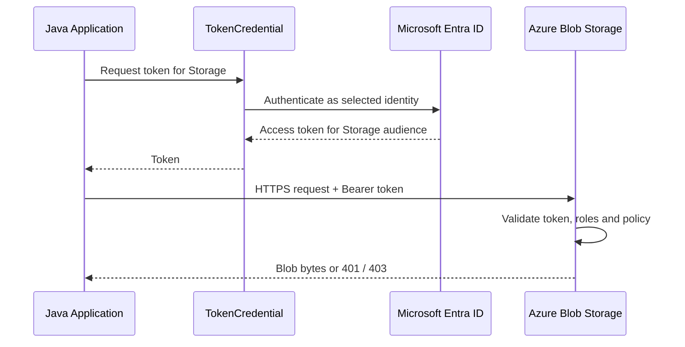
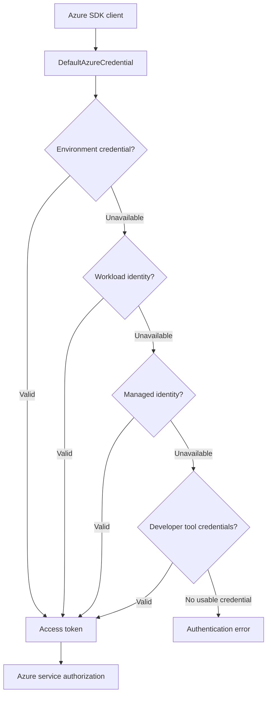
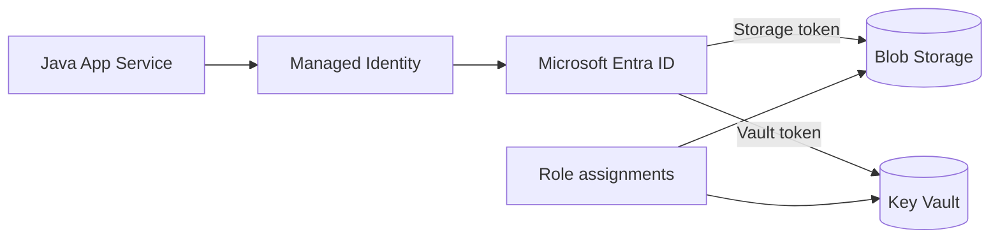
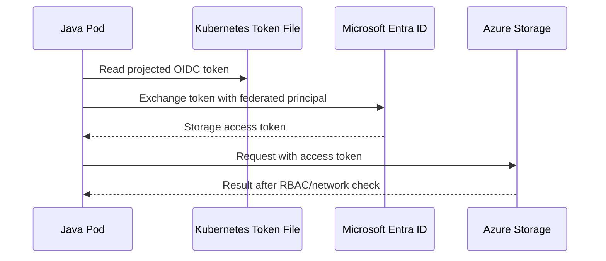
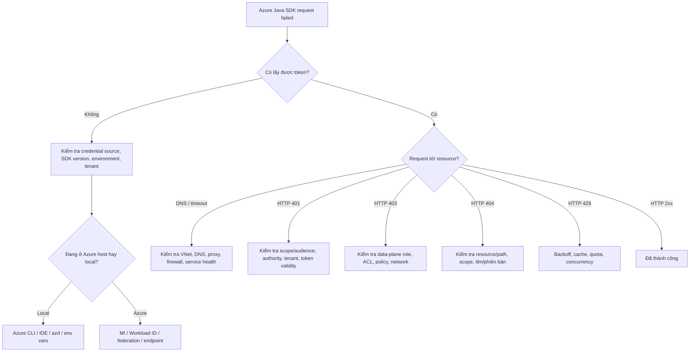
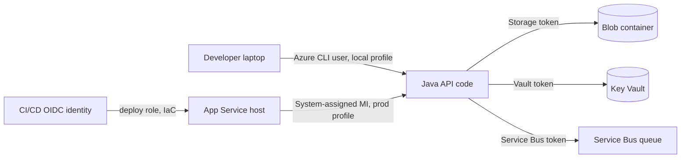

# DefaultAzureCredential và chuỗi xác thực

Ứng dụng Java trên Azure cần chứng minh danh tính trước khi đọc Azure Blob Storage, lấy secret từ Azure Key Vault, gửi thông điệp đến Azure Service Bus hoặc gọi API quản lý tài nguyên. Trên laptop, lập trình viên thường đã đăng nhập Azure CLI hoặc IDE. Trên Azure App Service, Azure Functions, Azure Kubernetes Service (AKS) hay Azure Container Apps, ứng dụng nên hoạt động **không phụ thuộc đăng nhập thủ công**, không hard-code mật khẩu và chỉ có quyền tối thiểu cần thiết.

Thư viện **Azure Identity cho Java** cung cấp giao diện `TokenCredential` và nhiều phương thức xác thực. **`DefaultAzureCredential`** là một **credential chain**: nó thử những nguồn danh tính được hỗ trợ theo thứ tự của **phiên bản SDK đang chạy**, có thể dùng developer credentials ở máy local và managed identity/workload identity trong Azure. Nếu một nguồn không khả dụng, chuỗi có thể thử nguồn tiếp theo; nếu nguồn đã được cấu hình nhưng xác thực thất bại, chính sách dừng/tiếp tục phụ thuộc loại credential và phiên bản SDK.

Điều này tiện lợi nhưng cũng chứa rủi ro: ứng dụng có thể **dùng nhầm service principal trong biến môi trường** thay vì Azure CLI user hoặc managed identity mong muốn. Một chương trình chạy tốt ở local chưa chắc được cấp data-plane roles trong production; có token hợp lệ cũng chưa đồng nghĩa được phép đọc Blob.

Bài học thuộc chương **Azure SDK cho Java** của mô-đun `CLOUD_PROVIDERS_AZURE`: tìm hiểu subscription, resource group, Microsoft Entra ID, mạng, compute, lưu trữ, dữ liệu, bảo mật, giám sát và kiểm soát chi phí trên Azure. Trọng tâm là **Azure SDK Java + Microsoft Entra ID**, không phải việc tự viết OAuth 2.0 token protocol.

> **Lưu ý phiên bản:** Các thành viên, thứ tự của `DefaultAzureCredential` và quy tắc tiếp tục sau một lỗi có thể thay đổi theo version `com.azure:azure-identity`. Phần chuỗi trong bài là **mô hình khái niệm**. Khi triển khai thật, cố định SDK version và xác minh hành vi trên đúng runtime; không coi sơ đồ bên dưới là danh sách thứ tự bất biến trên mọi Java SDK version.

## Mục tiêu học tập

Sau bài học, bạn có thể:

1. Phân biệt **authentication** (bạn là ai?) và **authorization** (bạn được làm gì?).
2. Hiểu `TokenCredential`, access token, OAuth scopes/audience và Microsoft Entra ID.
3. Phân tích các nhóm nguồn trong `DefaultAzureCredential`: **environment, workload identity, managed identity và developer tool credentials**.
4. Biết khi nào chuỗi tiếp tục, khi nào lỗi đáng báo ngay, và vì sao **401 khác 403**.
5. Dùng `DefaultAzureCredentialBuilder` trong Java SDK để đọc Blob Storage hoặc gọi Azure Key Vault.
6. Xác minh danh tính ở môi trường local bằng **Azure CLI/IDE/azd** và chọn đúng tenant/subscription.
7. Thiết kế production với **system-assigned/user-assigned managed identity**; CI/CD với **OIDC/workload identity federation**.
8. Chọn explicit credentials khi phải khóa một danh tính duy nhất, tránh fallback không mong muốn.
9. Áp dụng Azure RBAC/data-plane roles, bảo vệ secrets, network và quyền tối thiểu.
10. Chẩn đoán `CredentialUnavailableException`, authentication failed, HTTP 401/403, tenant/scope sai và timeout.
11. Viết tests bằng fake credential và xác minh hành vi thật bằng integration tests an toàn.

## 1. Xác thực và phân quyền là hai lớp khác nhau

Giả sử ứng dụng Java cần tải hợp đồng từ Blob Storage:



- **Authentication:** Microsoft Entra ID xác định principal và phát token có phạm vi/audience phù hợp.
- **Authorization:** Azure Blob Storage quyết định principal đó có quyền đọc blob, chịu ảnh hưởng bởi data-plane RBAC, ACL nếu áp dụng, cấu hình account và network.
- **Authentication của ứng dụng không phải authorization của người dùng cuối:** Một web API có managed identity đọc dữ liệu backend vẫn phải kiểm tra quyền người dùng đang gọi API.

**`DefaultAzureCredential` chỉ giúp lấy token.** Nó không tự tạo Azure role assignment hoặc đi qua firewall, Private Endpoint hay Azure Policy.

### 1.1. Các khái niệm không thể trộn lẫn

| Khái niệm | Vai trò | Ví dụ |
|---|---|---|
| **Tenant** | Phạm vi danh tính Microsoft Entra ID. | Tenant doanh nghiệp có users và applications. |
| **Principal** | Định danh người dùng/app/managed identity thực hiện thao tác. | User đăng nhập CLI hoặc service principal của Function. |
| **Subscription** | Ranh giới quản lý, thanh toán và scope tài nguyên. | Subscription production hoặc lab. |
| **Resource/scope** | Đối tượng token được phát để truy cập. | `https://storage.azure.com/.default`. |
| **Role assignment** | Quyền đối với một resource/scope. | `Storage Blob Data Reader` trên container phù hợp. |
| **Network policy** | Có thể kết nối endpoint hay không. | Storage firewall và Private Endpoint. |

Một principal có quyền `Reader` quản lý resource group thường **không có quyền đọc nội dung Blob**. Và một token dành cho `https://vault.azure.net/.default` không tự dùng được để đọc Storage.

### 1.2. Từ Azure Java client tới token

Trong Java:

- `TokenCredential` là một interface của Azure Core.
- `DefaultAzureCredential` triển khai `TokenCredential` bằng một chuỗi nguồn.
- `ManagedIdentityCredential`, `WorkloadIdentityCredential`, `ClientSecretCredential`, `AzureCliCredential` là những cơ chế xác thực cụ thể.
- Azure clients như `BlobServiceClient` hoặc `SecretClient` nhận `TokenCredential` qua builder và để SDK quản lý request/access token lifecycle.
- Token có thời gian sống hữu hạn; SDK và credential thường quản lý cache/refresh theo implementation.

**Đừng ghi access token vào logs, cấu hình hoặc file để dùng lại.** Với Azure SDK, truyền credential object cho client builder thay vì tự thao tác raw Bearer token là lựa chọn mặc định an toàn hơn.

## 2. DefaultAzureCredential thử những nguồn nào?

`DefaultAzureCredential` mang tới một chuỗi các lựa chọn:



Đây là **sơ đồ nhóm các nguồn**, không phải cam kết một thứ tự chính xác trong mọi Java SDK version. Một credential đã được cấu hình nhưng trả lỗi authentication có thể **dừng chuỗi** theo quy tắc hiện hành, thay vì luôn đến node kế tiếp.

### 2.1. Các nhóm credential thường gặp

| Nguồn | Điều kiện | Ví dụ sử dụng |
|---|---|---|
| **EnvironmentCredential** | Biến môi trường nhận diện app và service principal secret/certificate theo contract. | Legacy CI/hosting có credentials cấu hình. |
| **WorkloadIdentityCredential** | Entra federated workload identity, OIDC token file và client/tenant identity. | AKS hoặc CI có OIDC federation. |
| **ManagedIdentityCredential** | Azure host cung cấp endpoint danh tính được hỗ trợ. | App Service, Functions, VM, Container Apps. |
| **IDE/identity broker credentials** | User đã đăng nhập vào IDE/broker mà Azure Identity version hỗ trợ. | Local developer. |
| **AzureCliCredential** | Có phiên đăng nhập Azure CLI phù hợp. | Laptop sau `az login`. |
| **AzurePowerShellCredential** | Có phiên Azure PowerShell được hỗ trợ. | Local/automation kiểm soát. |
| **AzureDeveloperCliCredential** | Có phiên Azure Developer CLI được hỗ trợ. | Local sau `azd auth login`. |

Các nguồn như **IntelliJ, Shared Token Cache, Visual Studio Code hoặc broker** có mặt/được kích hoạt hay không tùy Java Identity SDK version và dependencies. Không mặc định một bản Java giống thứ tự `DefaultAzureCredential` của .NET, Python hoặc JavaScript.

### 2.2. Cùng một code, nhiều danh tính thực tế

```java
import com.azure.core.credential.TokenCredential;
import com.azure.identity.DefaultAzureCredentialBuilder;

TokenCredential credential = new DefaultAzureCredentialBuilder().build();
```

- **Local:** có thể dùng Azure CLI hoặc IDE login.
- **App Service/Functions:** nếu được cấu hình, thường chọn managed identity khi không có nguồn ưu tiên khác thành công.
- **AKS có Azure Workload Identity:** có thể chọn workload federated credential phù hợp.
- **CI:** có thể dùng workload federation hoặc một credential rõ ràng khác.

**Không có gì bảo đảm principal của local bằng principal của production**, và đó thường là điều tốt: production nên có riêng một workload identity với quyền tối thiểu.

### 2.3. “Không khả dụng” không giống “xác thực thất bại”

Một nguồn credential **không khả dụng** có thể do:

- Azure CLI chưa được cài/đăng nhập.
- Laptop không có managed identity endpoint.
- Biến môi trường của một nguồn còn thiếu thành phần.

Trong những trường hợp này, chain có thể thử nguồn tiếp theo.

Một nguồn credential **đã được cấu hình nhưng thất bại** có thể do:

- Client secret sai/hết hạn.
- Certificate không còn hợp lệ.
- Federated identity issuer/subject/audience sai.
- Tenant ID/client ID không khớp.
- Workload token invalid.

Chính sách continuation khác nhau giữa **deployed credentials** và **developer credentials** theo SDK version. Không nên “giấu lỗi” bằng cách cho phép đổi danh tính khi nguồn production được cấu hình sai.

### 2.4. Đã có token nhưng service trả 403 sẽ không kích hoạt fallback

```text
1. EnvironmentCredential tạo token thành công cho service principal A.
2. Java client dùng token của A gọi Blob Storage.
3. Blob trả HTTP 403 do A không có Storage Blob Data Reader.
4. Client báo lỗi 403, không tự chuyển sang AzureCliCredential của user B.
```

**Credential chain được dùng để có token**, không phải cơ chế thử từng tài khoản cho tới khi một tài khoản có đủ RBAC.

## 3. Thứ tự ưu tiên và nguy cơ chọn nhầm danh tính

Một máy có cả `az login` và các biến `AZURE_CLIENT_ID`, `AZURE_TENANT_ID`, `AZURE_CLIENT_SECRET` hợp lệ có thể dùng **EnvironmentCredential trước Azure CLI**, dù người vận hành nghĩ chương trình đang dùng user của mình. Trong production, một client secret cũ còn tồn tại trong environment có thể làm chương trình bỏ qua managed identity mong muốn.

**Phải kiểm chứng:**

1. Credential source nào được dùng?
2. Principal/object ID và tenant nào nhận token?
3. Token được phát cho resource nào?
4. Resource cấp role cho principal nào?
5. Có nguồn thứ hai ngoài ý muốn do IDE/CLI/environment không?
6. Nếu credential production bị cấu hình sai, chương trình có dừng hay vô tình fallback?

### 3.1. Hai chiến lược theo môi trường

**Development:**

```java
TokenCredential credential = new DefaultAzureCredentialBuilder().build();
```

Có thể hữu ích vì Azure CLI/IDE login thuận tiện.

**Production yêu cầu identity cố định:**

```java
import com.azure.identity.ManagedIdentityCredentialBuilder;

TokenCredential credential =
    new ManagedIdentityCredentialBuilder().build();
```

Khi chủ trương production chỉ dùng system-assigned managed identity, một **`ManagedIdentityCredential` cụ thể** tránh tình huống service principal/environment hoặc developer tooling khác được chọn. Với AKS/OIDC có thể chọn explicit `WorkloadIdentityCredential` tương ứng nếu kiến trúc yêu cầu.

**`DefaultAzureCredential` không “kém bảo mật” theo bản chất**, nhưng cấu hình production phải được kiểm soát, nhất là khi chuỗi có nhiều nguồn. Nếu dùng chuỗi mặc định trong production, rà soát environment, cơ chế exclude/selection nếu SDK hỗ trợ và test đúng danh tính qua deployment.

### 3.2. Không lựa chọn credential bằng cách bắt 403 rồi thử tên khác

Một anti-pattern:

```text
try ManagedIdentity
on 403: try AzureCLI
on 403: try EnvironmentSecret
```

Điều này có thể biến lỗi phân quyền thành “lách” bằng danh tính mạnh hơn. Với production, khi principal được chọn không có quyền, sửa **role assignment** hoặc yêu cầu đúng quyền; không tự chuyển principal.

## 4. Cấu hình Azure SDK Java bằng Maven

Azure SDK chia thành các modules:

- `com.azure:azure-identity`: `DefaultAzureCredential` và các loại credential.
- `com.azure:azure-core`: `TokenCredential` và các abstractions chung.
- `com.azure:azure-storage-blob`: các client Blob Storage.
- `com.azure:azure-security-keyvault-secrets`: Azure Key Vault Secret client.
- `com.azure:azure-messaging-servicebus`: Service Bus client nếu dùng.

Dùng Azure SDK **BOM** để quản lý phiên bản đồng bộ khi có thể:

```xml
<dependencyManagement>
  <dependencies>
    <dependency>
      <groupId>com.azure</groupId>
      <artifactId>azure-sdk-bom</artifactId>
      <version>YOUR_TESTED_AZURE_SDK_BOM_VERSION</version>
      <type>pom</type>
      <scope>import</scope>
    </dependency>
  </dependencies>
</dependencyManagement>

<dependencies>
  <dependency>
    <groupId>com.azure</groupId>
    <artifactId>azure-identity</artifactId>
  </dependency>
  <dependency>
    <groupId>com.azure</groupId>
    <artifactId>azure-storage-blob</artifactId>
  </dependency>
  <dependency>
    <groupId>com.azure</groupId>
    <artifactId>azure-security-keyvault-secrets</artifactId>
  </dependency>
</dependencies>
```

`YOUR_TESTED_AZURE_SDK_BOM_VERSION` phải được thay bằng một version **thực sự tồn tại, tương thích với JDK và đã kiểm thử**. Đoạn XML không phải một `pom.xml` tự chạy được, vì còn thiếu các phần project, plugin và dependency của ứng dụng. Không dùng `latest`/version range trôi nổi trên production; nâng version có kiểm thử vì hành vi identity chain có thể đổi.

### 4.1. Cấu hình endpoint không phải secret

```text
AZURE_STORAGE_BLOB_ENDPOINT=https://<storage-account>.blob.core.windows.net
AZURE_KEYVAULT_URI=https://<key-vault-name>.vault.azure.net/
```

Đây là tên biến cấu hình **tự định nghĩa trong ứng dụng**, không phải biến mà `DefaultAzureCredential` tự đọc để lấy danh tính. Chúng chứa endpoint đích; credential lấy token và dịch vụ xử lý RBAC. Không viết account key, connection string, client secret vào source hoặc image Docker.

### 4.2. Tạo credential một lần và tái sử dụng

```java
import com.azure.core.credential.TokenCredential;
import com.azure.identity.DefaultAzureCredentialBuilder;

public final class AzureIdentity {
    private static final TokenCredential CREDENTIAL =
        new DefaultAzureCredentialBuilder().build();

    private AzureIdentity() {}

    public static TokenCredential credential() {
        return CREDENTIAL;
    }
}
```

Trong Spring Boot/Quarkus/Micronaut nên quản lý `TokenCredential` và service clients bằng dependency injection hoặc singleton theo vòng đời ứng dụng. Tránh tạo credential mới cho **mỗi HTTP request** vì thêm overhead khởi tạo và có thể làm caching/diagnostics kém hiệu quả. Azure SDK thường xử lý token refresh; không tự lưu raw access tokens vào static variables.
## 5. Ví dụ Java: đọc Azure Blob Storage

Giả sử ứng dụng có cấu hình:

```text
AZURE_STORAGE_BLOB_ENDPOINT=https://stworkspacelab.blob.core.windows.net
Container: project-documents
Runtime identity: được cấp Storage Blob Data Reader ở đúng scope
```

Các tên là ví dụ; tài nguyên/role cần có trước khi chạy.

```java
import com.azure.core.credential.TokenCredential;
import com.azure.identity.DefaultAzureCredentialBuilder;
import com.azure.storage.blob.BlobContainerClient;
import com.azure.storage.blob.BlobServiceClient;
import com.azure.storage.blob.BlobServiceClientBuilder;
import com.azure.storage.blob.models.BlobItem;

public final class ListDocuments {
    public static void main(String[] args) {
        String endpoint = System.getenv("AZURE_STORAGE_BLOB_ENDPOINT");
        if (endpoint == null || endpoint.isBlank()) {
            throw new IllegalArgumentException("Missing Storage endpoint");
        }

        TokenCredential credential =
            new DefaultAzureCredentialBuilder().build();

        BlobServiceClient service = new BlobServiceClientBuilder()
            .endpoint(endpoint)
            .credential(credential)
            .buildClient();

        BlobContainerClient container =
            service.getBlobContainerClient("project-documents");

        for (BlobItem item : container.listBlobs()) {
            // Không in nội dung Blob hay secret.
            System.out.println("Name: " + item.getName());
        }
    }
}
```

**Điểm cần hiểu:**

- Tạo `DefaultAzureCredential` **chưa chắc đã lấy token**; đa số lỗi xảy ra khi SDK gửi request đầu tiên.
- `BlobServiceClientBuilder` tự yêu cầu token với scope phù hợp; không tự xây Bearer token HTTP.
- `Storage Blob Data Reader` là **data-plane role**, khác role `Reader` quản trị resource.
- Nếu Storage dùng firewall/Private Endpoint hoặc ADLS Gen2 ACL, token hợp lệ vẫn có thể bị chặn.
- Việc in tên Blob cũng có thể lộ dữ liệu; chỉ dùng lab/dữ liệu được phép.
- Với file lớn, dùng streaming/download-to-file API thay vì tải toàn bộ vào RAM.
- Code không tự tạo storage account/container, gán RBAC, cấu hình network hay bật managed identity.

### 5.1. Truy cập blob cụ thể

```java
// Đoạn bổ sung, giả định container client đã tạo.
byte[] bytes = container.getBlobClient("manuals/start-here.txt")
                        .downloadContent()
                        .toBytes();
// Chỉ phù hợp file nhỏ được phép đọc; không ghi nội dung vào log.
```

Đường dẫn và tên Blob phải đến từ nguồn đáng tin hoặc được kiểm tra quyền ở application. Nếu đây là web API đa người dùng, **managed identity của API đọc Blob không đồng nghĩa người dùng cuối được phép xem file đó**. Bắt buộc xác thực/ủy quyền người dùng trước khi chuyển bytes về client.

### 5.2. Token scope của Storage

Một scope thường được dùng khi request token cho Storage là:

```text
https://storage.azure.com/.default
```

Scope này **không phải** endpoint `https://stworkspacelab.blob.core.windows.net`. SDK cho Storage chịu trách nhiệm xin scope thích hợp; account/Blob được gọi tiếp tục kiểm tra quyền riêng.

## 6. Ví dụ Java: đọc secret từ Azure Key Vault

Khi ứng dụng thật sự cần một secret để kết nối dịch vụ **chưa hỗ trợ Microsoft Entra auth**, Azure Key Vault giúp lưu secret tách khỏi source code và container image.

```java
import com.azure.core.credential.TokenCredential;
import com.azure.identity.DefaultAzureCredentialBuilder;
import com.azure.security.keyvault.secrets.SecretClient;
import com.azure.security.keyvault.secrets.SecretClientBuilder;
import com.azure.security.keyvault.secrets.models.KeyVaultSecret;

public final class LoadSecret {
    public static void main(String[] args) {
        String vaultUrl = System.getenv("AZURE_KEYVAULT_URI");
        if (vaultUrl == null || vaultUrl.isBlank()) {
            throw new IllegalArgumentException("Missing vault URI");
        }

        TokenCredential credential =
            new DefaultAzureCredentialBuilder().build();

        SecretClient client = new SecretClientBuilder()
            .vaultUrl(vaultUrl)
            .credential(credential)
            .buildClient();

        KeyVaultSecret secret = client.getSecret("external-api-token");
        if (secret.getValue() == null || secret.getValue().isBlank()) {
            throw new IllegalStateException("Secret not configured");
        }

        // Chỉ truyền giá trị tới API client cần nó trong memory.
        // Không in secret, không ghi vào telemetry hoặc disk.
    }
}
```

Vault có thể dùng **Azure RBAC permission model** (ví dụ vai trò `Key Vault Secrets User` để đọc secrets theo scope) hoặc **legacy access policy**. Phải cấp permission theo đúng mô hình vault đang dùng; có role `Reader` trên resource group vẫn có thể không đọc được secret. Cần mạng/DNS phù hợp nếu Vault có Private Endpoint.

**Đừng biến Key Vault thành kho account keys không cần thiết**: nếu Blob, Service Bus hoặc dịch vụ đích chấp nhận token Entra ID, dùng identity trực tiếp thường giảm nhu cầu giữ long-lived secrets.

## 7. Local development bằng Azure CLI và IDE

### 7.1. Azure CLI

Các bước trên laptop:

```bash
az login
az account list --output table
az account show --query "{tenant:tenantId,subscription:id,user:user.name}" -o json

# Khi có nhiều tenant/subscription:
az login --tenant "<tenant-id>"
az account set --subscription "<subscription-id>"
az account show -o json
```

Đăng nhập CLI là **một nguồn** cho chain nếu SDK version hỗ trợ `AzureCliCredential`. `az account set` chọn default subscription cho CLI commands; nó **không khẳng định** DefaultAzureCredential đã chọn CLI (ví dụ EnvironmentCredential có thể đứng trước).

### 7.2. Sử dụng AzureCliCredential tường minh khi debug

```java
import com.azure.core.credential.TokenCredential;
import com.azure.identity.AzureCliCredentialBuilder;

TokenCredential localCredential =
    new AzureCliCredentialBuilder().build();
```

Dùng đoạn này trong local/dev profile nếu bạn muốn chắc chắn ứng dụng lấy danh tính từ Azure CLI. Nó phụ thuộc `az` được cài và login hợp lệ; không phải cách xác thực mặc định trên App Service production.

### 7.3. IDE, Azure Developer CLI, broker

Tùy SDK version và dependencies:

- Một số IDE cung cấp cached account/broker được hỗ trợ.
- `azd auth login` (Azure Developer CLI) là một phiên đăng nhập **khác** `az login`.
- Đăng nhập Microsoft Azure Portal bằng browser không tự làm Java SDK có token Azure CLI.
- Nếu nhiều công cụ đăng nhập user hoặc tenant khác nhau, cần kiểm tra source được chain chọn.

Dùng diagnostics phù hợp, không log token values. Khi nghi ngờ nhầm danh tính, dùng explicit dev credential tạm thời và kiểm tra đúng principal/tenant.

### 7.4. Lập trình viên có quyền rộng không phải bằng chứng production sẽ thành công

Một user `Owner` trên subscription có thể đọc tài nguyên hoặc cấu hình mà MI production không có quyền tương ứng. Điều đó cần được phát hiện bằng integration test chạy với **runtime identity** thực tế, thay vì giải quyết bằng cách cấp MI quyền Owner.

## 8. Production với Managed Identity

**Managed Identity** do Azure quản lý cho workloads được hỗ trợ. App runtime có thể lấy token qua host/identity endpoint mà không phải nhúng client secret trong ứng dụng. Cần bật identity, gán roles và cấu hình network riêng.

### 8.1. System-assigned và user-assigned

| Kiểu | Vòng đời | Tình huống |
|---|---|---|
| **System-assigned** | Gắn với một Azure resource; thường mất khi resource bị xóa. | App Service/Function/VM cần danh tính riêng. |
| **User-assigned** | Là Azure resource danh tính độc lập, gắn cho nhiều workload được hỗ trợ. | Đổi compute mà vẫn giữ principal hoặc chia sẻ identity có chủ đích. |

Tái sử dụng một user-assigned MI giữa quá nhiều apps làm tăng phạm vi thiệt hại khi app bị xâm nhập. Chọn tách identity theo security domain và data sensitivity.

### 8.2. Sơ đồ xác thực



Một quy trình triển khai:

1. Bật system-assigned hoặc gắn user-assigned MI cho Azure resource.
2. Lấy **principal/object ID** để gán Azure RBAC, và **client ID** khi cần chọn user-assigned MI cụ thể.
3. Cấp `Storage Blob Data Reader` ở scope đúng cho thao tác chỉ đọc.
4. Cấp Key Vault secret read permission theo permission model của vault.
5. Đưa **endpoint URIs**, không phải account keys, vào app settings.
6. Thiết lập network/DNS cho Storage và Key Vault.
7. Kiểm thử từ **runtime Azure thật** (không chỉ từ local CLI).
8. Giám sát auth errors và role assignment changes.

### 8.3. Explicit ManagedIdentityCredential

Khi production chỉ được dùng MI:

```java
import com.azure.core.credential.TokenCredential;
import com.azure.identity.ManagedIdentityCredentialBuilder;

TokenCredential credential =
    new ManagedIdentityCredentialBuilder().build();
```

Nếu MI không tồn tại/không được gắn hoặc endpoint hỏng, **credential này không tự fallback tới Azure CLI user**. Đó là điểm có lợi khi cần khóa danh tính production. Trên laptop thông thường, MI endpoint không tồn tại nên code sẽ không xác thực được; dùng local dev profile khác.

### 8.4. Chọn user-assigned identity

```java
String miClientId = System.getenv("AZURE_MI_CLIENT_ID");
if (miClientId == null || miClientId.isBlank()) {
    throw new IllegalArgumentException("Missing MI client ID");
}

TokenCredential credential =
    new ManagedIdentityCredentialBuilder()
        .clientId(miClientId)
        .build();
```

`AZURE_MI_CLIENT_ID` là **biến cấu hình ứng dụng trong ví dụ**; không phải client secret. Phải phân biệt **client ID** với **principal/object ID**. Chỉ đặt biến này không tự tạo/gắn MI vào Azure host. Một số SDK versions hỗ trợ `DefaultAzureCredentialBuilder.managedIdentityClientId`, nhưng cấu hình đó **không khóa toàn bộ chain** thành chỉ MI khi các credential ưu tiên khác khả dụng.

## 9. Workload Identity Federation cho AKS và CI/CD

**Workload identity federation** cho phép một token OIDC từ một workload/CI issuer được trao đổi với Microsoft Entra ID để lấy access token, giảm nhu cầu lưu client secret dài hạn.

### 9.1. Azure Kubernetes Service Workload Identity

Một deployment thường bao gồm:

- AKS với OIDC issuer và Azure Workload Identity integration được cấu hình.
- Kubernetes `ServiceAccount` và federated identity credential liên kết đúng Entra application/managed identity.
- Workload Pod dùng service account và annotation/label được integration yêu cầu.
- Token file và các biến như `AZURE_CLIENT_ID`, `AZURE_TENANT_ID`, `AZURE_FEDERATED_TOKEN_FILE` được inject theo contract.
- Java Azure Identity SDK đổi federated token lấy Azure access token.
- Entra principal có RBAC tối thiểu trên Storage, Key Vault hoặc dịch vụ đích.



Federation chỉ thành công khi **issuer, subject (namespace/service-account) và audience** khớp trust configuration. Chỉ có `AZURE_CLIENT_ID` hoặc một service account name **không đủ**.

### 9.2. Java WorkloadIdentityCredential

```java
import com.azure.core.credential.TokenCredential;
import com.azure.identity.WorkloadIdentityCredentialBuilder;

// Chỉ chạy khi environment/token file/federation đã được cấu hình.
TokenCredential credential =
    new WorkloadIdentityCredentialBuilder().build();
```

Đây là ví dụ dùng builder có trong SDK versions hỗ trợ. Với production cần pin SDK version, xác minh environment contract và phát hiện lỗi federated token sớm. Không copy token file từ Pod sang máy khác hoặc đưa token vào logs.

### 9.3. CI/CD OIDC federation

Một hệ thống CI như GitHub Actions/Azure DevOps có thể phát hành OIDC token theo cấu hình provider. Quy trình tổng quát:

1. Thiết lập federated credential trust giữa issuer của CI và Entra principal.
2. Ràng buộc repository/branch/environment hoặc service connection subject đủ chặt.
3. Cấp role tối thiểu cho **deployment identity**, không lấy runtime identity làm admin mặc định.
4. CI nhận short-lived OIDC token và sử dụng SDK/login flow được hỗ trợ.
5. Giám sát workflow permissions, tránh người không được phép sửa CI definition để chiếm quyền cloud.
6. Không lưu client secret lâu dài khi có thể dùng federation.

Một CI runner chạy trên Azure VM có MI khác một runner thông thường trên Internet. Đừng nhầm **managed identity endpoint** với **federated OIDC token exchange**; chọn mechanism theo topology thực tế.
## 10. EnvironmentCredential và service principal: dùng khi nào?

Một số hệ thống cũ hoặc runtime chưa hỗ trợ managed identity/workload federation vẫn phải dùng **service principal** có client secret hoặc certificate. Azure Identity hỗ trợ các nguồn đó thông qua `EnvironmentCredential` khi đủ cấu hình.

### 10.1. Biến môi trường phổ biến cho client secret

```text
AZURE_TENANT_ID=<tenant-id>
AZURE_CLIENT_ID=<application-client-id>
AZURE_CLIENT_SECRET=<client-secret-value>
```

Đây là **tên các biến cấu hình được Azure Identity nhận biết** trong những versions hỗ trợ. Chúng **không** phải một file `.env` nên đưa vào Git, ví dụ build log hoặc issue tracker. `AZURE_CLIENT_SECRET` là thông tin bí mật, không phải object ID. Có thể tồn tại lựa chọn certificate với những biến liên quan certificate path/password tùy SDK version.

**Ưu tiên khi có thể:** managed identity trên Azure host hoặc OIDC/workload identity federation để tránh secret có vòng đời dài. Với hệ thống bắt buộc dùng secret, lưu ở secret manager, xoay vòng, ràng buộc quyền tối thiểu và giới hạn người có thể đọc app settings.

### 10.2. EnvironmentCredential có thể làm chọn sai identity

Nếu cả các biến service principal hợp lệ và Azure CLI login tồn tại, `DefaultAzureCredential` có thể chọn environment source trước. Khi đó:

```text
Developer tin đang dùng:  user@company.example qua Azure CLI
Runtime thực tế dùng:    service principal từ AZURE_CLIENT_*
Kết quả:                 lỗi 403 khác mong đợi, hoặc quyền rộng ngoài ý muốn
```

**Không khắc phục bằng cách tăng quyền cho cả hai principals.** Kiểm tra source được chọn; xóa các biến không thuộc môi trường hiện tại hoặc dùng explicit credential cho profile cần xác minh.

### 10.3. AZURE_CLIENT_ID có nhiều vai trò tùy credential

`AZURE_CLIENT_ID` là một định danh, không phải bằng chứng có secret hay federated identity. Tùy môi trường nó có thể tham gia:

- Client secret/certificate service principal configuration.
- Federated workload identity lựa chọn principal.
- Managed identity selection theo host/SDK configuration.

Không đặt một biến mà suy đã kích hoạt đúng phương thức. Đối chiếu **bộ biến đầy đủ, token file/host endpoint và role assignment** của cơ chế bạn chọn.

### 10.4. Khi cần khai báo credential tường minh

```java
import com.azure.core.credential.TokenCredential;
import com.azure.identity.ClientSecretCredentialBuilder;

String tenant = System.getenv("AZURE_TENANT_ID");
String client = System.getenv("AZURE_CLIENT_ID");
String secret = System.getenv("AZURE_CLIENT_SECRET");

// Chỉ dùng với secret lấy từ secret manager/runtime environment an toàn.
TokenCredential credential = new ClientSecretCredentialBuilder()
    .tenantId(tenant)
    .clientId(client)
    .clientSecret(secret)
    .build();
```

Đây là ví dụ **để hiểu API**, không phải khuyến nghị lưu secret vào code. Thực tế cần kiểm tra null/empty, không log/print secret hoặc exception chứa tham số nhạy cảm, và ưu tiên identity không có secret khi Azure host/CI hỗ trợ.

## 11. Token scopes, tenant, authority và caching

### 11.1. Token có audience theo dịch vụ

Mỗi SDK client thường biết scope tương ứng của dịch vụ:

| Dịch vụ | Scope minh họa phổ biến | Hạn chế |
|---|---|---|
| Azure Blob Storage | `https://storage.azure.com/.default` | Token Storage không cấp quyền nội dung Blob nếu thiếu RBAC/ACL. |
| Azure Key Vault | `https://vault.azure.net/.default` | Permission model và firewall của vault vẫn áp dụng. |
| Azure Service Bus | `https://servicebus.azure.net/.default` | Cần quyền send/receive đúng entity namespace. |
| Azure Resource Manager | `https://management.azure.com/.default` | Đây là management plane, không tự có data-plane quyền. |

Đây là ví dụ cho **Azure public cloud**, không phải khẳng định đúng URL ở các sovereign clouds. Azure Government/China hoặc các cloud environments khác có authority/endpoints riêng. Với Azure SDK client builder, ưu tiên để SDK xin token với audience/scope chuẩn thay vì tự hard-code strings.

### 11.2. Token hợp lệ không đồng nghĩa đúng tenant

Một danh tính có thể là guest/B2B hoặc thuộc nhiều tenants. Một token có thể được phát từ một tenant không như dự kiến; resource đích có thể từ chối do tenant/principal không hợp lệ, hoặc role assignment được tạo nhầm cho một service principal object khác.

Một quy trình kiểm tra:

1. Xác định tenant của resource/app registration và tenant dự kiến của principal.
2. Kiểm tra tenant thực tế trong CLI/IDE/environment/managed identity configuration.
3. Kiểm tra **application client ID** khác **service principal object ID**.
4. So role assignment/principal ID tại resource scope.
5. Xác minh authority cloud/endpoints phù hợp.
6. Nếu cross-tenant là yêu cầu thật, thiết kế trust/tenant selection có kiểm soát và kiểm thử, không vô điều kiện cho mọi tenant.

### 11.3. Token caching và thời hạn

Access token có thời gian hết hạn. Azure Identity SDK thường hỗ trợ caching/refresh theo credential và SDK client. Chiến lược hợp lý:

- Tạo **credential và Azure clients một lần cho lifecycle phù hợp**.
- Tránh gọi `getToken()` thủ công mỗi request nếu service client builder đã xử lý.
- Không tự tính thời hạn “token luôn sống đúng 60 phút” cho mọi loại token.
- Không ghi raw token vào logs để “debug JWT”.
- Đảm bảo máy/host có đồng hồ đúng thời gian và network để lấy token mới.
- Khi revoke quyền, token đã phát có thể tồn tại một khoảng thời gian; authorization chính sách còn phụ thuộc dịch vụ và caching của hệ thống đích.

### 11.4. Thử lấy token an toàn (chỉ để chẩn đoán)

Nếu cần kiểm chứng Azure Identity lấy được token **mà không gọi dịch vụ đích**, có thể request scope phù hợp, rồi chỉ hiển thị thời điểm hết hạn:

```java
import com.azure.core.credential.TokenCredential;
import com.azure.core.credential.TokenRequestContext;
import com.azure.identity.DefaultAzureCredentialBuilder;

// Chỉ dùng trong công cụ lab; không in AccessToken.getToken().
TokenCredential credential =
    new DefaultAzureCredentialBuilder().build();

TokenRequestContext context = new TokenRequestContext()
    .addScopes("https://storage.azure.com/.default");

var token = credential.getToken(context).block();
if (token == null) {
    throw new IllegalStateException("Token not obtained");
}
System.out.println("Token expiry: " + token.getExpiresAt());
```

**Điều này chỉ kiểm tra token acquisition**, không chứng minh principal có `Storage Blob Data Reader`. Muốn kiểm tra authorization cần **thử một request data-plane** tới đúng container bằng identity đó. Đừng in `token.getToken()` hoặc dán output của `az account get-access-token` vào chat, issue hay log.

## 12. Azure RBAC: cấp quyền tối thiểu đúng tầng

Một ứng dụng có thể xác thực tốt nhưng nhận 403 nếu RBAC chưa được cấp. Ngược lại, cấp quyền quá rộng làm tăng tác động khi workload bị xâm nhập.

### 12.1. Ví dụ role tương ứng với thao tác

| Thao tác ứng dụng | Loại quyền thường cần |
|---|---|
| Chỉ đọc Blob objects trong container | `Storage Blob Data Reader` tại scope phù hợp. |
| Ghi/cập nhật Blob trong container | `Storage Blob Data Contributor` hoặc quyền data plane thích hợp. |
| Đọc giá trị secret từ Key Vault RBAC model | `Key Vault Secrets User` hoặc vai trò/permission phù hợp. |
| Gửi thông điệp tới Service Bus | `Azure Service Bus Data Sender` tại namespace/entity scope phù hợp. |
| Nhận thông điệp từ Service Bus | `Azure Service Bus Data Receiver` tại scope phù hợp. |
| Quản lý resource group, deployments | Management-plane roles cho CI/deployment identity. |
| Đọc/ghi Azure Cosmos DB for NoSQL data | **Native Cosmos DB data-plane RBAC** (khác management-plane role). |

Không áp `Storage Blob Data Contributor` cho service chỉ liệt kê file; không cấp `Key Vault Administrator` chỉ để đọc một secret. Key Vault có thể dùng **access policies** thay Azure RBAC: quyền phải kiểm tra theo mô hình vault đang cấu hình.

### 12.2. RBAC scope có tính phân cấp, data plane còn có quy tắc riêng

Azure role assignment có scope như subscription, resource group, resource và một số child scopes được dịch vụ hỗ trợ. Cấp `Storage Blob Data Reader` ở subscription có thể cho phép đọc nhiều containers/accounts hơn mức cần. Cấp tại đúng container có thể giới hạn phạm vi hơn, nếu role/scope được hỗ trợ.

Ngoài RBAC, ADLS Gen2 có **ACLs** và quyền traverse/execute ở các thư mục; Blob Storage có firewall/private networking. Không được kết luận có role tương ứng là đủ cho mọi resource/data path.

### 12.3. CLI đọc role assignments

Ví dụ lệnh **chỉ đọc** (giả định bạn có quyền đọc metadata tương ứng):

```bash
az login
az account set --subscription "<subscription-id>"

# Object/principal ID cần đối chiếu, không thay bằng client secret.
PRINCIPAL_ID="<principal-object-id>"
STORAGE_SCOPE="/subscriptions/<sub-id>/resourceGroups/<rg>/providers/Microsoft.Storage/storageAccounts/<account>"

az role assignment list \
  --assignee "$PRINCIPAL_ID" \
  --scope "$STORAGE_SCOPE" \
  --include-inherited \
  --output table
```

Kết quả hiển thị assignments trong phạm vi truy vấn và phụ thuộc quyền nhìn thấy của tài khoản CLI. Nó không phải cách duy nhất để xác minh group-based inheritance, denies, role propagation hoặc mọi policy của dịch vụ. Nếu chưa thấy role mới cấp, kiểm tra propagation delay và principal/scope đúng thay vì lập tức gán Owner.

### 12.4. Gán role là thay đổi bảo mật

Việc tạo role assignment trong Portal/IaC/CLI cần approval và role-assigning permission phù hợp. Một ví dụ logic để reviewer hiểu:

```text
Principal:  system-assigned MI of api-orders-prod
Role:       Storage Blob Data Reader
Scope:      /subscriptions/<...>/storageAccounts/<...>/blobServices/default/containers/project-documents
Reason:     chỉ đọc tài liệu phục vụ API
Owner:      Order Platform Team
Review:     theo chu kỳ và khi ứng dụng ngừng hoạt động
```

Đây là **bản mô tả cấu hình**, không phải lệnh tự động cấp quyền. Giữ có thể audit được **ai đã cấp, khi nào, vì sao và quyền có hết hạn/thu hồi được không**.

## 13. DefaultAzureCredential và Service Bus: một ví dụ khác

Nếu API cần gửi thông điệp tới Azure Service Bus, có thể dùng cùng `TokenCredential` thay vì connection string chứa shared access policy key:

```java
import com.azure.core.credential.TokenCredential;
import com.azure.identity.DefaultAzureCredentialBuilder;
import com.azure.messaging.servicebus.ServiceBusClientBuilder;
import com.azure.messaging.servicebus.ServiceBusSenderClient;
import com.azure.messaging.servicebus.ServiceBusMessage;

TokenCredential credential =
    new DefaultAzureCredentialBuilder().build();

ServiceBusSenderClient sender = new ServiceBusClientBuilder()
    .credential(credential)
    .fullyQualifiedNamespace("sb-workspace-lab.servicebus.windows.net")
    .sender()
    .queueName("events-demo")
    .buildClient();

try {
    sender.sendMessage(new ServiceBusMessage("hello-from-java"));
} finally {
    sender.close();
}
```

**Điều kiện tiên quyết:** namespace/queue đã tồn tại, SDK version hỗ trợ builder, principal có `Azure Service Bus Data Sender` ở đúng scope, mạng/AMQP connectivity hoạt động. Đây là **lệnh gửi thật** nếu chạy, chỉ sử dụng lab được phép. Không dùng nội dung mật/PII trong message hoặc log.

### 13.1. Một credential dùng cho nhiều Azure SDK clients

```text
TokenCredential
  +--> Blob SDK: Storage audience, Storage RBAC
  +--> Key Vault SDK: Vault audience, Key Vault policy/RBAC
  +--> Service Bus SDK: Service Bus audience, Data Sender/Receiver RBAC
```

Đây là lý do tái sử dụng `TokenCredential` rất tiện. Nhưng **một credential không phải tấm vé toàn năng**: từng service kiểm tra token đúng audience và authorization của chính nó.

## 14. Các lỗi xác thực thường gặp và ý nghĩa

### 14.1. Bảng phân loại

| Tín hiệu | Lớp lỗi điển hình | Việc nên kiểm tra |
|---|---|---|
| `CredentialUnavailableException` | Một nguồn credential không có điều kiện để hoạt động. | CLI/IDE login, managed identity endpoint, environment vars, token file. |
| `ClientAuthenticationException` hoặc thông báo authentication failed | Đã thử xác thực nhưng Entra/token endpoint từ chối. | Tenant/client IDs, secret/certificate, federation, authority, SDK version. |
| HTTP **401 Unauthorized** | Request tới dịch vụ không có token hợp lệ/đúng audience hoặc lỗi token. | Authorization header do SDK tạo, scope/audience, tenant, clock, proxy. |
| HTTP **403 Forbidden** | Service đã từ chối quyền hoặc access policy/network. | RBAC/data plane, Key Vault policy, firewall/private endpoint, role propagation. |
| HTTP **404 Not Found** | Resource/path/version không tồn tại; đôi khi chính sách bảo mật cố ý ẩn tài nguyên. | Resource name, scope, API, data path và quyền xem. |
| **Timeout/connection refused/DNS failure** | Không tới được Entra/IMDS/resource endpoint. | DNS, outbound, proxy, Private Endpoint, service health. |
| **429 Too Many Requests** | Dịch vụ/token endpoint bị giới hạn tải. | Throttle source, retries/backoff, caching, concurrency. |

Một message “DefaultAzureCredential failed to retrieve a token” thường gồm nhiều diagnostics của từng nguồn. **Đừng chỉ đọc dòng cuối** và suy source Azure CLI là nguyên nhân; credential deployment đầu chain có thể đã lỗi đáng chú ý.

### 14.2. 401 và 403 khác nhau ra sao?

```text
Token acquisition thành công
           |
           v
Request được gửi tới Azure service
           |
     +-----+------+
     |            |
    401          403
     |            |
Check token   Check RBAC/ACL,
scope/aud,    data-plane policy,
tenant,       network, resource
clock/API     scope/propagation
```

Trên một số dịch vụ, Storage firewall cũng có thể biểu hiện thành **403**. Vì vậy 403 không phải luôn “thiếu role”; phải xem error code, response details và network path. Ngược lại, role có sẵn không có nghĩa token lấy đúng audience.

### 14.3. Managed Identity không khả dụng

Nếu code chạy trên laptop dùng explicit `ManagedIdentityCredential`, “Managed Identity endpoint unavailable” là điều dễ hiểu. Nếu code chạy trên App Service mà nhận lỗi tương tự, hãy kiểm tra:

1. MI đã bật/gắn với resource đúng chưa?
2. Nếu user-assigned, client ID được chọn đúng chưa?
3. App đã restart/redeploy sau thay đổi identity/config theo yêu cầu của host?
4. Network/host metadata/endpoint có hoạt động đúng không?
5. SDK đã cập nhật và hỗ trợ hosting mode hiện tại chưa?
6. Có đang chạy code trong container/pod không được cấu hình workload identity như tưởng không?

Không tự gọi IMDS endpoint thủ công và không log response token để debug. Hãy dựa vào SDK logs/host diagnostics với redaction.

### 14.4. CredentialUnavailable không đồng nghĩa resource không tồn tại

Một Azure Storage account có thể hoạt động bình thường trong khi CLI user chưa đăng nhập. Ngược lại, AzureCliCredential có thể lấy token thành công nhưng resource path sai gây 404. Phân tách **credential acquisition**, **request transport**, **service authorization**, **resource operation** trước khi chữa lỗi.
## 15. Quy trình chẩn đoán chuỗi xác thực có hệ thống

Khi một ứng dụng Java không truy cập được Azure resource, **đừng bắt đầu bằng việc cấp thêm quyền hoặc thay connection string**. Hãy xác định chính xác điểm thất bại.

### 15.1. Lưu đồ quyết định



### 15.2. Xác định chính xác danh tính dự kiến

Ví dụ app chạy trên App Service production:

```text
Expected authentication mechanism: System-assigned Managed Identity
Expected tenant:                  <production-tenant-id>
Expected principal object ID:     <app-mi-principal-id>
Expected resource:                Storage account <production-account>
Expected role:                    Storage Blob Data Reader
Expected role scope:              Container project-documents
Actual selected credential:       <redacted source name>
Actual result:                    403 AuthorizationPermissionMismatch
```

Những trường `<...>` là **thông tin phải thu thập có kiểm soát từ môi trường thật**. Tránh ghi token, client secret, SAS, connection string hoặc toàn bộ HTTP Authorization header.

Nếu expected MI có role đúng nhưng app đang dùng EnvironmentCredential của một service principal khác, giải pháp là **điều chỉnh cấu hình chọn danh tính**, không phải gán thêm role cho principal nhầm.

### 15.3. Azure Identity diagnostics và log redaction

Khi điều tra có thể bật logging ở mức phù hợp cho `com.azure.identity`, Azure Core và service client theo logging framework/version đang dùng. Nhưng:

- **Không bật body/header logging vô điều kiện** ở production.
- Không đưa `Authorization: Bearer ...`, raw access token, refresh token, secret hoặc SAS vào log.
- Chỉ giữ thông tin **credential type**, error classification, timestamp, correlation IDs và endpoint đã giảm nhạy cảm.
- Giới hạn thời gian bật verbose logs, quyền truy cập logs và retention.
- Azure SDK diagnostics có thể thay đổi text giữa versions; đừng viết parser phụ thuộc nguyên văn một message lỗi.

### 15.4. Khi chain có nhiều lỗi cùng lúc

Ví dụ tóm tắt thông báo (giả lập):

```text
DefaultAzureCredential authentication failed:
  EnvironmentCredential: unavailable (missing required variables)
  WorkloadIdentityCredential: unavailable (token file not configured)
  ManagedIdentityCredential: unavailable (endpoint not detected)
  AzureCliCredential: unavailable (not logged in)
  AzureDeveloperCliCredential: unavailable (not installed/logged in)
```

Trên laptop, ba dòng đầu có thể **bình thường**; cần đăng nhập một developer tool được SDK hỗ trợ. Trên production đã yêu cầu MI, dòng `ManagedIdentityCredential unavailable` lại là vấn đề cốt lõi, kể cả Azure CLI tool tình cờ có mặt.

### 15.5. Kiểm tra role mới gán và propagation

Role assignment có thể mất thời gian để phát huy, tùy dịch vụ/token caching và propagation. Một runbook nên:

1. Xác minh principal/object ID đúng.
2. Xác minh role và resource scope đúng (không phải một resource group cùng tên ở subscription khác).
3. Kiểm tra role assignment được tạo thành công và không có deny/policy chặn.
4. Đợi khoảng propagation hợp lý theo môi trường và thử lại có giới hạn.
5. Kiểm tra token/source caching hoặc khởi động lại process khi có căn cứ.
6. Nếu vẫn 403, xem service error code và firewall, không gán Owner để “thử”.

## 16. Kiến trúc Java có kiểm soát: Local và Production profile

Một ứng dụng cần **tính dự đoán được của danh tính**. Có thể chọn credential trong một chỗ duy nhất dựa trên **deployment mode được quản lý**, tránh từng service tự tạo chuỗi khác nhau.

### 16.1. Credential factory minh họa

```java
import com.azure.core.credential.TokenCredential;
import com.azure.identity.AzureCliCredentialBuilder;
import com.azure.identity.ManagedIdentityCredentialBuilder;
import com.azure.identity.WorkloadIdentityCredentialBuilder;

public final class CloudCredentialFactory {
    private CloudCredentialFactory() {}

    public static TokenCredential fromTrustedDeploymentMode(String mode) {
        switch (mode) {
            case "local-cli":
                return new AzureCliCredentialBuilder().build();
            case "azure-system-mi":
                return new ManagedIdentityCredentialBuilder().build();
            case "aks-workload-identity":
                return new WorkloadIdentityCredentialBuilder().build();
            default:
                throw new IllegalArgumentException(
                    "Unsupported credential mode: " + mode);
        }
    }
}
```

**Quan trọng:**

- Đây là một **mẫu thiết kế**, không phải yêu cầu mọi app phải dùng một factory. Không tạo mode dựa trên HTTP request do người dùng tùy ý gửi.
- Giá trị `mode` phải do deployment configuration **được vận hành và kiểm soát** cung cấp.
- Không fallback “nếu MI fail thì CLI” trong production.
- Với user-assigned MI cần định nghĩa client ID có kiểm chứng, không dùng system-assigned mặc định.
- Nếu môi trường local muốn dùng `DefaultAzureCredential` để tận dụng IDE/CLI, có thể thêm một mode **chỉ được cho phép ở local**.
- Các biến environment của azure-identity và Azure SDK versions vẫn cần được khóa/rà soát theo production policy.

### 16.2. Dependency injection thay vì hard-code trong business code

```text
Application startup
  └── CloudCredentialFactory
      └── singleton TokenCredential
          ├── BlobServiceClient
          ├── SecretClient
          └── ServiceBusSenderClient

Business services nhận các client interfaces/adapters,
không quyết định tenant hoặc loại credential từng request.
```

Cách này giúp:

- Unit tests thay Azure client bằng mock/fake.
- Đảm bảo tất cả clients dùng danh tính runtime mong muốn.
- Chẩn đoán credential source một lần tại startup/first request.
- Thay đổi cách xác thực không phải sửa code nghiệp vụ.
- Quản lý timeout/retry/logging và vòng đời clients một cách tập trung.

### 16.3. Startup health check: đủ nhưng không quá mức

Có thể kiểm tra **một thao tác data-plane read nhỏ** với quyền cho phép, ví dụ đọc metadata một Blob test hoặc list container trong scope. Tuy nhiên:

- Không chạy tất cả external calls mỗi giây làm health probe trở thành source gây throttling/cost.
- Không bắt buộc truy cập mọi hệ thống phụ nếu ứng dụng vẫn phục vụ các chức năng độc lập.
- Phân biệt readiness (có thể phục vụ yêu cầu cần resource) và liveness (process có sống không).
- Không đặt secret value trong response của health endpoint.
- Nếu check chỉ gọi `getToken()`, nó **không kiểm tra role resource**.

## 17. Kiểm thử TokenCredential và service clients

### 17.1. Unit test không cần token thật

Mã nghiệp vụ không nên bắt buộc chạy Azure CLI khi unit test. Bạn có thể inject một `TokenCredential` giả hoặc mock adapter.

Ví dụ fake `TokenCredential` chỉ dùng trong bài test:

```java
import com.azure.core.credential.AccessToken;
import com.azure.core.credential.TokenCredential;
import com.azure.core.credential.TokenRequestContext;
import reactor.core.publisher.Mono;

import java.time.OffsetDateTime;

public final class FakeTokenCredential implements TokenCredential {
    @Override
    public Mono<AccessToken> getToken(TokenRequestContext request) {
        // Fake token này KHÔNG hợp lệ với Azure; không gọi dịch vụ thật.
        return Mono.just(new AccessToken(
            "unit-test-only-not-a-real-token",
            OffsetDateTime.now().plusMinutes(15)));
    }
}
```

Đoạn trên minh họa implement interface có phương thức `getToken`; cần dependencies Azure Core/Reactor tương thích với project. Fake chỉ dùng để kiểm tra **code sử dụng credential contract**, không chứng minh authenticating được với Entra ID. Tốt hơn nữa, unit test business logic qua fake `DocumentStore`/`SecretProvider` thay vì tạo HTTP client thật.

### 17.2. Integration test dùng danh tính thật ở môi trường lab

Một test hữu ích:

1. Gắn một managed identity riêng cho Function App lab.
2. Cho MI chỉ quyền **Storage Blob Data Reader** trên container `test-documents`.
3. Dùng explicit ManagedIdentityCredential và Blob client để list/read một Blob giả.
4. Kiểm tra attempt upload bị **403** vì MI **không** được cấp write role.
5. Kiểm tra identity đọc một container khác ngoài scope cũng bị từ chối.
6. Tắt hoặc xóa các credentials environment ngoài ý muốn.
7. Xem logs chỉ chứa principal ID đã được phép công bố, không chứa token.
8. Ghi lại Azure Identity version, kết quả và role assignments.

**Negative tests** (truy cập vượt quyền phải thất bại) quan trọng ngang positive tests. Nếu một app chỉ đọc Blob có thể xóa container production, role design đã sai.

### 17.3. Unit test không đủ kiểm tra continuation policy

Một fake credential có thể không mô phỏng các tình huống SDK thật quyết định dừng chuỗi sau lỗi EnvironmentCredential hay tiếp tục developer tools. Muốn xác minh continuation behavior phải dùng **test harness với exact Azure Identity SDK version** và các nguồn cố ý unavailable/authentication-failed trong môi trường được kiểm soát. Không thay đổi tenant/secrets production chỉ để test thứ tự chain.

### 17.4. Tests cho rotate/revoke và scale

- Khi user-assigned MI client ID đổi, app có phát hiện cấu hình sai không?
- Khi role bị thu hồi, app có nhận 403 và ngừng thao tác không?
- Khi token hết hạn, SDK có refresh theo cơ chế được hỗ trợ không?
- Khi Entra endpoint tạm thời lỗi, retry/backoff có bị lặp vô hạn không?
- Khi scale 100 replicas, credential creation có gây token acquisition storms không?
- Khi workload federation token file được rotate, SDK có lấy token mới trong điều kiện thực tế không?

Các test bảo mật/revoke phải dùng lab resources và được phê duyệt; tuyệt đối không gỡ quyền của workload production để “xem điều gì xảy ra” ngoài một exercise có runbook.

## 18. Security checklist cho credentials

### 18.1. Những điều cần tránh

- Hard-code client secret, certificate private key, SAS token hoặc Storage account key trong Java/source control.
- In `AccessToken.getToken()` hoặc kết quả raw `az account get-access-token`.
- Cấp Owner/Contributor ở subscription cho runtime identity chỉ để đọc/ghi data plane.
- Chọn fallback sang user CLI ở production nếu managed identity thất bại.
- Tái sử dụng service principal quyền deploy để làm runtime principal.
- Đưa `AZURE_CLIENT_SECRET` vào container build arguments, logs, stack traces hoặc artifact manifest.
- Lưu secret trong `application.properties` bị commit hoặc Docker image layer.
- Dùng Azure CLI `az login` thủ công trên server production và mong process không bao giờ bị logout.
- Nhầm token acquisition success với hoàn thành kiểm tra RBAC, tenant, network.
- Lấy `AZURE_CLIENT_ID` từ user HTTP request để chọn danh tính tùy ý.

### 18.2. Các biện pháp đúng

1. **Production host:** dùng managed identity khi hỗ trợ, hoặc workload federation theo kiến trúc.
2. **Local dev:** dùng CLI/IDE dev principal tách quyền, không dùng production Owner account thường xuyên.
3. **CI/CD:** dùng federated OIDC credentials và principal riêng theo environment.
4. **Least privilege:** chỉ cấp role data plane phù hợp với thao tác; scope nhỏ nhất khả thi.
5. **Separation of duties:** deploy operator khác runtime identity, Key Vault admin khác app reader.
6. **Network:** HTTPS/TLS, private networking khi cần và outbound policy có chủ đích.
7. **Audit:** log role assignments/config changes và auth failures có redaction.
8. **Credential lifecycle:** tách accounts, rà soát roles định kỳ, revoke khi app ngừng hoạt động.
9. **Version governance:** pin Azure Identity/SDK versions; kiểm thử chain sau mỗi upgrade.
10. **Incident response:** nếu phát hiện credential leak, revoke/rotate theo runbook; xem access logs và đánh giá data exposure.

## 19. Hiệu năng, quota, chi phí và khả năng vận hành

### 19.1. Identity không thay thế kiến trúc retry

Một token request hoặc data-plane call vẫn có thể gặp 429, DNS timeout, 5xx. SDK thường cung cấp retry policies thích hợp, nhưng bạn cần:

- Bounded retry với exponential backoff/jitter theo service recommendations.
- Phân biệt **429/throttling** với **403 do thiếu quyền**; retry 403 vô hạn không tạo quyền.
- Reuse credential/clients để hạn chế churn và tận dụng token caching.
- Tối ưu connection pooling, thread count và service API requests.
- Đánh giá regional latency và Private Endpoint routing.
- Tránh tạo hàng nghìn SDK clients riêng trong mỗi HTTP request.

### 19.2. Chi phí liên quan gián tiếp

Dùng managed identity thường tránh việc phải quản lý client secrets/rotation thủ công, nhưng **đọc Blob, lấy secret, gửi Service Bus message, truy vấn Azure services và ghi logs vẫn có thể phát sinh chi phí** theo dịch vụ. Không có con số chi phí cố định cho một lần gọi `DefaultAzureCredential` mà có thể cộng thẳng vào mọi kiến trúc.

| Tài nguyên | Cost driver cần xem |
|---|---|
| Blob Storage | Capacity, read/list operations, egress, redundancy. |
| Azure Key Vault | Secret operations, tier/capabilities và nhu cầu truy cập. |
| Service Bus | Namespace tier, messaging operations/capacity. |
| App Service/AKS/Container Apps | Compute, instances, network, logs. |
| Azure Monitor/Log Analytics | Ingested telemetry và retention. |
| Private connectivity | Các thành phần networking tính phí theo cấu hình. |

Dùng Azure Pricing Calculator/Cost Management theo đúng region/SKU và workload, không suy tất cả lần gọi xác thực có giá bằng chi phí một request đọc Blob.

### 19.3. Observability có ích

Nên đo và ghi:

- Authentication outcome, credential source type nếu SDK/diagnostics cho phép.
- Thời gian token acquisition theo buckets.
- Service latency và HTTP status codes.
- 401/403/429/5xx rates theo service.
- Managed identity/federation configuration changes.
- Role assignment change events, không log access token.
- Network/DNS failures.
- SDK version và deployment revision.

Không tự tuyên bố Azure Monitor có sẵn metric tên `DefaultAzureCredentialSourceSelected`; nhiều tín hiệu phải thu thập từ **application telemetry** đã được redacted.
## 20. Tình huống thực tế: Java API chuyển từ laptop lên App Service

Một nhóm phát triển xây ứng dụng `orders-api` bằng Java/Spring Boot. Ứng dụng cần:

- Đọc tài liệu từ container Blob `order-documents`.
- Lấy một secret trong Key Vault để gọi API đối tác chưa hỗ trợ Entra ID.
- Gửi event `OrderConfirmed` tới Service Bus.
- Chạy local bằng Azure CLI.
- Chạy production trên Azure App Service bằng **system-assigned managed identity**.
- Có deployment pipeline riêng với federated OIDC identity, không dùng runtime MI làm admin.
- Dùng private networking/identity permissions được cấu hình phù hợp.

### 20.1. Kiến trúc



### 20.2. Phân vai rõ

| Principal | Phạm vi quyền nên có | Không cần |
|---|---|---|
| Local developer | Chỉ lab Storage/Key Vault/Service Bus theo vai trò được phê duyệt. | Quyền production rộng chỉ để debug local. |
| App Service MI | Đọc Blob `order-documents`, đọc secret cụ thể theo policy, gửi Service Bus event. | Owner của resource group hoặc quyền xóa toàn bộ storage. |
| CI deployment identity | Quyền triển khai hạ tầng/ứng dụng theo scope đã duyệt. | Truy cập dữ liệu đơn hàng và Key Vault secrets nếu không cần. |
| Operations/security | Quản lý role assignments, logs, Key Vault, network. | Dùng chung runtime identity hoặc ghi secrets vào CI logs. |

### 20.3. Từng bước chuyển từ dev sang prod

1. **Local:** `az login --tenant ...`, chọn subscription lab, thử Blob/Key Vault/Service Bus bằng `DefaultAzureCredential` hoặc explicit AzureCliCredential.
2. **Code:** tạo `TokenCredential` tại application startup; inject vào các Azure clients qua builders.
3. **Azure resource:** tạo/định danh App Service đúng subscription/resource group, bật system-assigned managed identity.
4. **RBAC:** lấy principal ID của MI, cấp role đọc Blob/send Service Bus theo scope hẹp; cấu hình quyền Vault theo permission model.
5. **Network:** đảm bảo outbound từ App Service tới endpoints theo firewall/Private Endpoint/Private DNS, và từ Search/khác nếu dùng.
6. **Production identity:** dùng `ManagedIdentityCredential` explicit theo security policy hoặc cấu hình `DefaultAzureCredential` đã khóa nguồn và kiểm chứng.
7. **Deployment:** CI có identity được phê duyệt, không nhét client secret vào Dockerfile/Java config.
8. **Verification:** chạy GET/health route có kiểm soát để đọc một Blob test và gửi message lab/test namespace nếu được phép.
9. **Negative tests:** app không được ghi/xóa Blob, không được đọc unrelated container, không được quản trị Key Vault.
10. **Observability:** theo dõi error 401/403/timeout, role changes và SDK version trong release metadata.

### 20.4. Một lần chuyển môi trường gặp lỗi 403

**Triệu chứng:** Trên laptop, Java `BlobContainerClient.listBlobs()` thành công; trên App Service, request trả 403.

**Chẩn đoán có căn cứ:**

```text
Local:
  selected identity: developer via Azure CLI
  roles: Storage Blob Data Reader ở lab subscription
  resource: st-order-lab / order-documents

Production:
  expected identity: App Service system-assigned MI
  actual resource: st-order-prod / order-documents
  error: 403
```

Điều tra:

- App Service có dùng MI đúng hay bị EnvironmentCredential lấy token bằng một principal cũ?
- MI đã có data-plane role trong container production chưa?
- App đang gọi đúng account/container/tenant chưa?
- Role propagation đã có hiệu lực chưa?
- Storage firewall/network có từ chối không?
- Có ADLS Gen2 ACL/deny policy riêng không?

**Không phải giải pháp:** cấp subscription Owner cho App Service chỉ vì một request Blob bị 403. Cách khắc phục phải dựa trên **principal + scope + error code + network evidence**.

### 20.5. Lần chuyển sang AKS với workload federation

Sau này doanh nghiệp chuyển từ App Service sang AKS. Thay vì đưa MI secret vào Pod, thiết kế:

- AKS OIDC issuer và workload identity integration.
- Kubernetes service account gắn federated identity credential đến principal phù hợp.
- Pod chọn đúng service account, nhận token file/config và Java `WorkloadIdentityCredential`.
- Quyền data plane được gán cho principal federated (hoặc principal mới), không tự kế thừa quyền App Service MI nếu đó là identity khác.
- Test role restrictions, token refresh và scale-out trong lab.
- Bảo vệ permissions của người có thể sửa service account/Pod specs vì chúng ảnh hưởng identity workload.

**Bài học:** đổi hạ tầng có thể đổi authentication mechanism và principal, dù các service clients Java không cần thay đổi business logic.

## 21. Ma trận kiểm thử các tình huống xác thực

| Test | Thiết lập tình huống trong lab | Kết quả kỳ vọng |
|---|---|---|
| **Local CLI valid** | Đăng nhập đúng tenant bằng Azure CLI. | SDK lấy token và gọi resource có quyền. |
| **CLI chưa đăng nhập** | Logout dev profile/test machine riêng. | AzureCliCredential unavailable; default chain thử nguồn hợp lệ khác hoặc báo lỗi. |
| **Environment biến thiếu** | Chỉ đặt AZURE_CLIENT_ID, thiếu các biến để xác thực SP. | Không tự xem đây là client secret hợp lệ; xem diagnostics về unavailable/config. |
| **Environment secret sai** | SP test với secret không còn hợp lệ. | Authentication failure được báo theo SDK continuation policy, không âm thầm dùng sai principal production. |
| **Environment & CLI cùng có** | Hai principals được cấu hình trên dev machine. | Ghi nhận credential thực sự được chọn, không suy là CLI. |
| **Managed identity chưa bật** | App Service lab chưa gắn MI. | Explicit MI báo không có endpoint/identity phù hợp. |
| **User-assigned MI client ID sai** | Chọn client ID không gắn host. | Không lấy token với identity không tồn tại trên host. |
| **AKS federated subject sai** | Federated credential subject không khớp service account lab. | Token exchange thất bại, không thay bằng secret fallback. |
| **Token đúng nhưng thiếu Storage role** | MI chỉ có management-plane Reader. | Blob data-plane operation bị 403; kiểm chứng separation. |
| **Key Vault permission model khác** | Vault dùng access policy, app chỉ có RBAC role không phù hợp. | Secret read bị từ chối; cấu hình đúng permission model. |
| **Storage private network sai** | Tạm chặn outbound route trong lab. | DNS/network/403 được phân loại, không tự nới public access. |
| **Scope/audience sai** | Dùng token cho Vault với raw Storage API trong test cô lập. | Storage không chấp nhận token sai audience. |
| **Principal có read, không write** | Gán Blob Data Reader chỉ trong test container. | Read PASS, write/delete DENIED. |
| **CI OIDC chưa thiết lập trust** | OIDC token có issuer/subject không khớp. | Không lấy được token qua federation. |
| **Role mới cấp** | Gán role lab được phê duyệt rồi test ngay. | Hiểu propagation, không tự gán thêm quyền rộng. |
| **Token hết hạn** | Test long-running workload theo cơ chế an toàn. | SDK refresh token/khôi phục được theo implementation. |
| **Concurrent requests** | Tăng request workload với client/credential tái sử dụng. | Không tạo token request storm mỗi HTTP call. |
| **SDK upgrade** | Đổi azure-identity trong environment test. | Kiểm tra source/continuation behavior không thay đổi ngoài ý muốn. |

Không test bằng cách **thu hồi role production** hoặc phát tán secret thử nghiệm ra repository. Lưu test evidence gồm environment, SDK version, expected/actual principal, resource/scope và kết quả; không lưu raw tokens.

### 21.1. Tiêu chí PASS khi nghiệm thu

- **Identity determinism:** production chỉ dùng principal/method đã được phê duyệt.
- **Least privilege:** đọc/ghi chỉ ở resource và thao tác cần thiết; negative tests chứng minh quyền vượt phạm vi bị chặn.
- **No secrets in artifacts:** CI logs, container images và source code không chứa secret.
- **Correctness:** Blob/Key Vault/Service Bus requests thành công theo đúng data-plane permissions.
- **Recovery:** khi token endpoint/network bị lỗi tạm thời, ứng dụng có retry/backoff/monitoring phù hợp; không fallback sai principal.
- **Auditability:** có thể giải thích auth failures, role changes và SDK upgrades mà không truy xuất secrets.
- **Security under scale:** nhiều replicas/requests không làm mở rộng quyền hoặc token storms ngoài ý muốn.

## 22. Câu hỏi tự kiểm tra và đáp án gợi ý

1. **`DefaultAzureCredential` có tự cấp RBAC không?** Không; nó lấy token, còn resource kiểm tra authorization.
2. **`az account set` có bảo đảm Java app dùng Azure CLI identity không?** Không; chuỗi có thể chọn Environment/Workload/MI/IDE source khác theo SDK.
3. **Vì sao `AZURE_CLIENT_ID` không đủ để xác thực?** Nó chỉ là identifier, cần managed host/federated token/secret/certificate tương ứng.
4. **Có token Storage nghĩa là đọc được mọi Blob trong subscription?** Không; còn RBAC/ACL, network và resource scope.
5. **Khi Blob trả 403, chain có thử sang Azure CLI user không?** Không; đã có token và request bị service từ chối.
6. **Khi nào nên dùng explicit ManagedIdentityCredential?** Khi production chỉ chấp nhận MI và không muốn fallback sang một principal khác.
7. **System-assigned khác user-assigned MI?** Vòng đời theo resource vs identity resource độc lập có thể gắn nhiều workloads.
8. **WorkloadIdentityCredential cần gì ngoài client ID?** OIDC token/issuer, federated trust, tenant/subject/audience và workload integration được cấu hình.
9. **Khác nhau giữa role Reader và Storage Blob Data Reader?** Reader là quyền quản trị resource; Data Reader cấp đọc Blob data plane.
10. **Vì sao không ghi AccessToken.getToken vào logs?** Bearer token bị lộ có thể bị sử dụng trái phép cho tới khi hết hiệu lực/được vô hiệu hóa theo cơ chế.
11. **Khi Key Vault secret read lỗi 403, nên cấp Key Vault Administrator ngay không?** Không; kiểm tra đúng permission model và scope quyền đọc secret tối thiểu.
12. **Token scope cho Storage và Key Vault giống nhau?** Không; audiences khác nhau.
13. **Tại sao unit tests không cần `az login`?** Business logic có thể test với fake adapters/TokenCredential không gọi cloud.
14. **Đổi phiên bản azure-identity có cần regression test không?** Có, vì credential chain members/behavior có thể thay đổi.
15. **Khi scale nhiều replicas, nên tạo TokenCredential theo mỗi request?** Không; tái sử dụng theo application lifecycle, trừ trường hợp thiết kế có căn cứ.
16. **Nếu production MI không có role đúng, có nên dùng client secret của admin làm fallback?** Không; sửa chính sách quyền và chủ động xử lý lỗi.
17. **Azure CLI user và Azure app service MI có thể có các tenant/principal khác nhau không?** Có.
18. **Managed identity có vượt qua Private Endpoint/firewall không?** Không; identity và network là hai lớp khác nhau.

## 23. Checklist triển khai DefaultAzureCredential/Java SDK

- [ ] Đã xác định môi trường local, CI, staging, production và **expected credential source** cho mỗi môi trường.
- [ ] Đã phân biệt Microsoft Entra tenant, subscription, client ID, principal/object ID và token resource/audience.
- [ ] Đã pin và kiểm thử `com.azure:azure-identity` và các Azure SDK dependencies/BOM versions.
- [ ] Đã đối chiếu thứ tự chain và continuation behavior theo phiên bản đang deploy.
- [ ] Local developer chỉ dùng tenant/subscription được phê duyệt, không dựa vào browser Portal login.
- [ ] Không có biến `AZURE_CLIENT_*` hoặc token file ngoài ý muốn có thể thay đổi danh tính runtime.
- [ ] Production dùng managed identity/workload federation hoặc credential tường minh phù hợp threat model.
- [ ] Không fallback sang developer CLI credentials hoặc admin secret khi production auth thất bại.
- [ ] Với user-assigned MI, client ID đúng và identity đã được gắn vào host.
- [ ] Với AKS federation, issuer/subject/audience/service account và token file đã được kiểm chứng.
- [ ] CI OIDC identity tách khỏi runtime identity, tránh long-lived secrets khi có lựa chọn tốt hơn.
- [ ] Azure service clients nhận `TokenCredential` qua builder và được tái sử dụng theo application lifecycle.
- [ ] Không hard-code secrets, connection strings, access tokens, SAS hoặc account keys trong Java/image/repo.
- [ ] Không in raw token, Authorization header hoặc Key Vault secret values vào logs.
- [ ] Data-plane RBAC/ACL và role scopes được cấp tối thiểu theo thao tác đọc/ghi.
- [ ] Key Vault dùng permission model đã xác định (RBAC hoặc access policies), không gán admin role bừa bãi.
- [ ] Storage/Key Vault/Service Bus network, Private Endpoint, DNS và outbound đã được thử với đúng runtime.
- [ ] Có phân loại `CredentialUnavailable`, authentication failure, 401, 403, 404, timeout và 429.
- [ ] Không nhầm 403 do RBAC/network với lỗi không lấy được token.
- [ ] Có startup/integration tests từ Azure host với identity thật và **negative access tests**.
- [ ] Unit tests có fake credential/adapter, không phụ thuộc tài khoản Azure của developer.
- [ ] SDK upgrades có regression tests về selected credential và continuation policy.
- [ ] Có audit cho role/identity/config changes, monitoring token acquisition và service errors.
- [ ] Retry/backoff giới hạn, token/cache/client reuse và quota được đánh giá khi scale.
- [ ] Có runbook thay/thu hồi identity, phản ứng với secret leak và sự cố network/Entra.
- [ ] Đã xác minh toàn bộ ví dụ dùng tên placeholders trước khi chạy trên tài nguyên Azure có phí.

## Kết luận

**`DefaultAzureCredential`** giúp ứng dụng Java sử dụng một `TokenCredential` thống nhất để xác thực với nhiều Azure services: thuận tiện ở local bằng Azure CLI/IDE và tương thích với các cơ chế **managed identity/workload identity** khi môi trường Azure được cấu hình đúng. Tuy nhiên, chuỗi xác thực **không tự cấp quyền** và không nên được hiểu là “tự thử mọi danh tính cho tới khi thao tác được phép”. Ở production, phải xác định **principal nào được chọn**, hiểu ranh giới của **tenant, scope, RBAC/data plane, network** và cân nhắc **explicit credential** khi cần tính dự đoán cao. Một hệ thống an toàn sử dụng **least privilege, identity không có secret khi phù hợp, token caching, SDK version pinning, error diagnostics, kiểm thử quyền âm tính và monitoring**, thay vì hard-code key hoặc cấp quyền quản trị rộng để chữa lỗi xác thực. Nắm vững các nguyên tắc này giúp ứng dụng Java trên Azure chuyển từ môi trường phát triển sang vận hành thực tế mà vẫn giữ được tính bảo mật, khả năng giải thích và khả năng khôi phục.


