# Dùng managed identity từ ứng dụng Java trên Azure

Một ứng dụng Spring Boot chạy trên Azure App Service cần đọc bí mật cấu hình từ Azure Key Vault, tải báo cáo từ Azure Blob Storage và gửi thông điệp vào Azure Service Bus. Cách triển khai dễ nghĩ đến là đưa **connection string, account key hoặc client secret** vào environment variables. Tuy nhiên, các giá trị này có thể bị lộ qua pipeline CI/CD, file cấu hình, logs hoặc một sự cố máy chủ. Khi phải xoay vòng secrets, nhiều ứng dụng cần được cập nhật cùng lúc.

**Managed identity (danh tính được Azure quản lý)** giải quyết phần lớn bài toán đó cho những dịch vụ hỗ trợ Microsoft Entra ID: tài nguyên chạy ứng dụng được gắn một danh tính, Java SDK lấy **access token ngắn hạn** qua môi trường Azure và dùng token gọi dịch vụ đích. Ứng dụng không cần lưu client secret/certificate để chứng minh danh tính của chính workload. Quyền vẫn phải được cấp rõ ràng bằng **Azure RBAC, cơ chế phân quyền riêng của dịch vụ hoặc SQL database permissions**, và mạng vẫn phải thông suốt.

Trong module **CLOUD_PROVIDERS_AZURE**, bạn khám phá Microsoft Azure từ subscription, resource group, Microsoft Entra ID tới mạng ảo, compute, storage và dữ liệu, rồi triển khai, giám sát, bảo vệ và kiểm soát chi phí kiến trúc ứng dụng. Bài thuộc chương **Azure SDK cho Java**, tập trung vào đề bài **“Dùng managed identity từ ứng dụng Java trên Azure”**: hiểu mô hình danh tính, cấu hình trên các dịch vụ chạy Java, viết code SDK, phân quyền, xử lý lỗi, kiểm thử và vận hành an toàn.

> **Phạm vi thực hành:** Các tên tài nguyên và lệnh bên dưới chỉ dành cho lab hoặc môi trường đã được ủy quyền. Gán identity, tạo role assignment, đổi Key Vault/Storage networking và database permissions đều là thao tác thay đổi quyền/tài nguyên. Không tự thử trên production; kiểm tra Azure CLI, Java SDK, hosting plan và API version hiện được hỗ trợ trước khi triển khai.

## 1. Mục tiêu học tập

Sau bài này, bạn có thể:

- Giải thích **managed identity**, **service principal**, Microsoft Entra token và quyền truy cập dữ liệu.
- So sánh **system-assigned** với **user-assigned managed identity**, cùng vòng đời và tình huống dùng phù hợp.
- Phân biệt **client ID, principal/object ID, resource ID, tenant ID** và sử dụng đúng ID khi gán quyền.
- Cấu hình Java SDK với **`DefaultAzureCredential`**, **`ManagedIdentityCredential`**, và sử dụng **`TokenCredential`** chung cho các Azure service clients.
- Truy cập **Azure Key Vault** và **Blob Storage** bằng token thay vì connection string có key.
- Hiểu cách dùng managed identity cho **Azure SQL, Service Bus** và các dịch vụ dữ liệu khác.
- Cấu hình identity trên **App Service, Azure Functions, Virtual Machines, Container Apps**; phân biệt cách làm trên **AKS với Microsoft Entra Workload ID**.
- Thiết lập **data-plane RBAC**, kiểm tra networking/Private Endpoint và truy lỗi `CredentialUnavailable`, `401`, `403`, `404`.
- Thiết kế phát hành và vận hành có logging, token caching/refresh, quyền tối thiểu, không rò rỉ secrets và có rollback.

## 2. Managed identity là gì, và không phải là gì?

Managed identity là một loại danh tính workload do Azure tạo và quản lý trong **Microsoft Entra ID** cho tài nguyên Azure được hỗ trợ. Workload có thể yêu cầu token từ cơ chế identity của môi trường mà không phải tự quản lý mật khẩu hay certificate lâu dài.

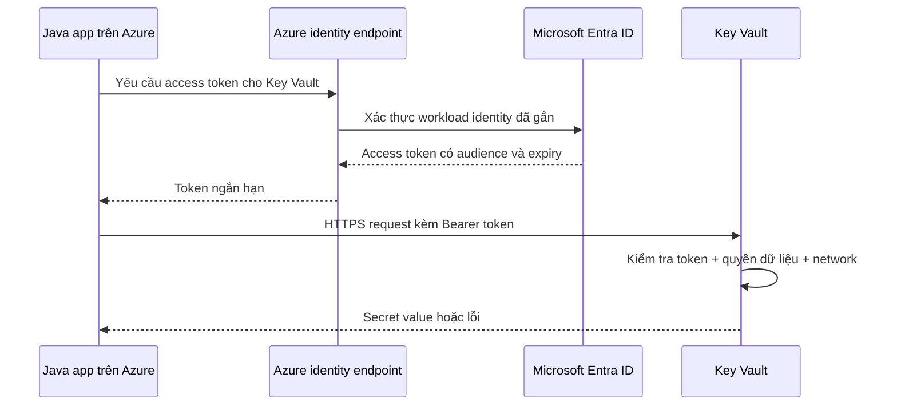

Điểm quan trọng:

1. **Identity** trả lời “workload này là ai?”.
2. **Authentication** chứng minh danh tính bằng token hợp lệ.
3. **Authorization** kiểm tra “danh tính đó được làm gì đối với tài nguyên nào?”.
4. **Network control** quyết định có đường kết nối tới dịch vụ hay không.
5. **Audit** cho biết quyền và hoạt động nào được thực hiện.

**Managed identity không tự cấp quyền.** Một App Service có system-assigned identity nhưng chưa được gán role `Key Vault Secrets User` vẫn có thể nhận token hợp lệ và sau đó bị Key Vault từ chối với `403`.

**Managed identity cũng không tự giải quyết** quyền truy cập của người dùng cuối, row-level security, secret dùng cho dịch vụ ngoài Azure, encryption của dữ liệu ứng dụng hay kết nối private network. Nó là **workload identity**, không phải cơ chế bypass chính sách bảo mật.

## 3. System-assigned và user-assigned managed identity

| Đặc điểm | **System-assigned** | **User-assigned** |
|---|---|---|
| Gắn với | Một Azure resource hỗ trợ identity | Tài nguyên identity độc lập được gắn vào một hoặc nhiều workloads |
| Vòng đời | Tồn tại cùng tài nguyên sở hữu và cấu hình identity | Quản lý riêng; có thể giữ khi workload được thay thế |
| Chia sẻ | Không gắn cùng một identity cho nhiều resources khác nhau | Có thể gắn cho nhiều resources được hỗ trợ |
| Principal ID | Thuộc system identity của resource | Thuộc identity resource độc lập |
| Client ID lựa chọn | Thường SDK tự phát hiện khi chỉ có một identity thích hợp | Cần chỉ rõ khi có nhiều identities để tránh dùng nhầm |
| Role assignments | Cấp cho principal của resource | Cấp cho principal của user-assigned identity |
| Dùng khi | Ứng dụng đơn lẻ, quyền gắn theo vòng đời resource | Blue/green deployment, nhiều instances chia sẻ một định danh có kiểm soát |

### Hình dung hai loại

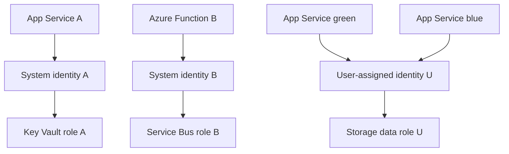

### Chọn loại nào?

**Bắt đầu với system-assigned** khi một ứng dụng có lifecycle rõ và không cần giữ identity khi thay resource. Khi deploy lại một resource mới, identity mới thường có principal ID mới, nên cần cấp lại quyền.

**Chọn user-assigned** khi muốn chuẩn bị quyền trước khi thay workload, giữ danh tính ổn định khi nâng cấp/swap hoặc có nhiều instances cần truy cập cùng tài nguyên. Tuy nhiên, **chia sẻ identity cũng chia sẻ quyền**: nếu một trong các apps bị xâm nhập, token của identity chung có thể truy cập mọi dịch vụ mà identity đó được cấp. Không mặc định dùng một user-assigned identity cho toàn bộ microservices.

### Nhiều identity trên một resource

Một workload có thể được gắn system-assigned và một/nhiều user-assigned identities theo khả năng host. Khi ấy Java code phải **xác định đúng identity**, thay vì tin rằng “Azure sẽ chọn identity hợp lý”. Với user-assigned identity, thường dùng **client ID** trong `ManagedIdentityCredentialBuilder.clientId(...)` hoặc cấu hình `AZURE_CLIENT_ID` cho credential chain thích hợp.

## 4. Bốn loại ID rất dễ nhầm

Giả sử một user-assigned identity dùng cho ứng dụng `java-orders-api` có metadata:

```text
Azure resource ID:
  /subscriptions/.../resourceGroups/rg-java-lab/
  providers/Microsoft.ManagedIdentity/userAssignedIdentities/id-orders-api

Client ID (application ID):
  <guid-client-id>

Principal ID (service principal object ID):
  <guid-principal-id>

Tenant ID (Entra tenant):
  <guid-tenant-id>
```

| ID | Mục đích thông dụng |
|---|---|
| **Resource ID** | Gắn user-assigned identity vào tài nguyên Azure/tra cứu bằng ARM |
| **Client ID** | Chọn identity khi SDK/runtime có nhiều managed identities |
| **Principal ID / object ID** | Gán Azure RBAC role cho đối tượng Entra cụ thể |
| **Tenant ID** | Chỉ tenant nơi identity thuộc về và Azure Entra phát hành token |

Không dùng **client ID** thay cho **object ID** trong tham số `--assignee-object-id` rồi nghĩ rằng role assignment đã được gán đúng. Một số lệnh chấp nhận các dạng `--assignee` khác nhau, nhưng cách rõ nhất khi có principal ID là `--assignee-object-id` kết hợp `--assignee-principal-type ServicePrincipal`.

### Azure RBAC áp ở scope nào?

Azure Resource Manager có hierarchy:

```text
Tenant / Management groups
  └── Subscription
      └── Resource group
          └── Resource
              └── Subresource scope (khi dịch vụ hỗ trợ)
```

Role gán ở scope cha có thể áp xuống scopes con. **Nguyên tắc quyền tối thiểu**: không cấp Reader/Contributor/Owner trên toàn subscription nếu ứng dụng chỉ cần đọc một Key Vault hoặc một Blob container. Phân biệt **control-plane role** (quản trị resource) với **data-plane role** (đọc/ghi secret, blob, messages).

## 5. Managed identity khác service principal có client secret như thế nào?

Trước managed identity, một Java service thường dùng client credentials:

```text
AZURE_TENANT_ID=...
AZURE_CLIENT_ID=...
AZURE_CLIENT_SECRET=...  <-- giá trị bí mật phải lưu, cấp phát, xoay vòng
```

Với managed identity trên Azure, app không cần lưu **client secret của chính workload**. Azure host cung cấp cơ chế lấy token dựa vào identity đã gắn.

| Phương án | Cần secret ứng dụng? | Phù hợp |
|---|---|---|
| **System-assigned managed identity** | Không cho workload authentication | Một app trên Azure, lifecycle gắn với resource |
| **User-assigned managed identity** | Không cho workload authentication | Dùng danh tính độc lập, nhiều deployments theo chính sách |
| **Service principal + client secret** | Có | Môi trường không hỗ trợ MI khi có quy trình bảo mật/rotation |
| **Service principal + certificate** | Chứng thư/khóa riêng phải quản lý | Workload ngoài Azure hoặc kịch bản riêng |
| **Federated workload identity** | Không cần client secret dài hạn | Kubernetes/CI platforms hỗ trợ OIDC federation |
| **Developer login** | Dựa vào phiên đăng nhập của developer | Chỉ local dev/test, không phải production credential |

**Không lưu client secret vào Key Vault rồi tuyên bố đã dùng managed identity** nếu ứng dụng vẫn cần một secret khác để xác thực tới Key Vault. Mô hình đúng thường là: managed identity lấy token để đọc Key Vault; Key Vault chỉ giữ những secrets ứng dụng vẫn cần cho hệ thống bên thứ ba.

## 6. Access token, audience, scope và thời hạn

Java Azure SDK thường dùng interface **`com.azure.core.credential.TokenCredential`**. Credential có nhiệm vụ lấy `AccessToken` cho một resource/scope thích hợp. Ví dụ scope:

```text
Azure Key Vault: https://vault.azure.net/.default
Azure Storage:   https://storage.azure.com/.default
Azure ARM:       https://management.azure.com/.default
```

Đây là **các audience khác nhau**. Token được phát cho Azure Resource Manager không tự hợp lệ khi dùng trực tiếp để đọc Blob; ứng dụng/client phải yêu cầu token cho đích tương ứng.

### Token không phải mật khẩu

- Access token thường có **expiration** và do SDK/identity subsystem quản lý refresh.
- Token chỉ có giá trị đối với resource/audience và điều kiện được dịch vụ chấp nhận.
- Token **vẫn là bearer credential nhạy cảm**: ai lấy được token hợp lệ có thể dùng nó theo quyền được cấp cho đến khi hết hiệu lực hoặc bị từ chối.
- Không ghi `accessToken.getToken()` vào console, diagnostics, exception telemetry hay HTTP access logs.
- Không tự parse JWT làm nguồn quyết định ủy quyền business logic nếu chưa kiểm tra token hợp lệ/issuer/audience; backend xác thực request của người dùng theo cơ chế riêng.

### Vì sao không tự caching token bằng String tĩnh?

Nếu lưu token vào `static String TOKEN` và dùng mãi, sau khi token hết hạn ứng dụng sẽ gặp `401`. Azure SDK clients nhận `TokenCredential` thường yêu cầu/refresh token đúng lúc; hãy **tái sử dụng client/credential** và để thư viện xử lý token lifecycle. Khi tự gọi REST ngoài SDK, sử dụng cơ chế cache/expiration an toàn hoặc lấy token qua `TokenCredential` khi cần, không xây global token bí mật không có thời hạn.

## 7. Java Azure Identity SDK: DefaultAzureCredential

**`DefaultAzureCredential`** của Azure Identity là một **credential chain**: tùy phiên bản SDK và môi trường, nó thử những cách xác thực đã được cấu hình, như environment/workload identity/managed identity hoặc developer tools login. Điều này cho phép **cùng một mã ứng dụng**:

- Trên máy phát triển: dùng Azure CLI login hoặc credential developer hợp lệ.
- Trên Azure App Service/VM/Functions: dùng managed identity của tài nguyên.
- Trong AKS sử dụng Microsoft Entra Workload ID: dùng projected OIDC token/federated credential theo cơ chế được hỗ trợ.

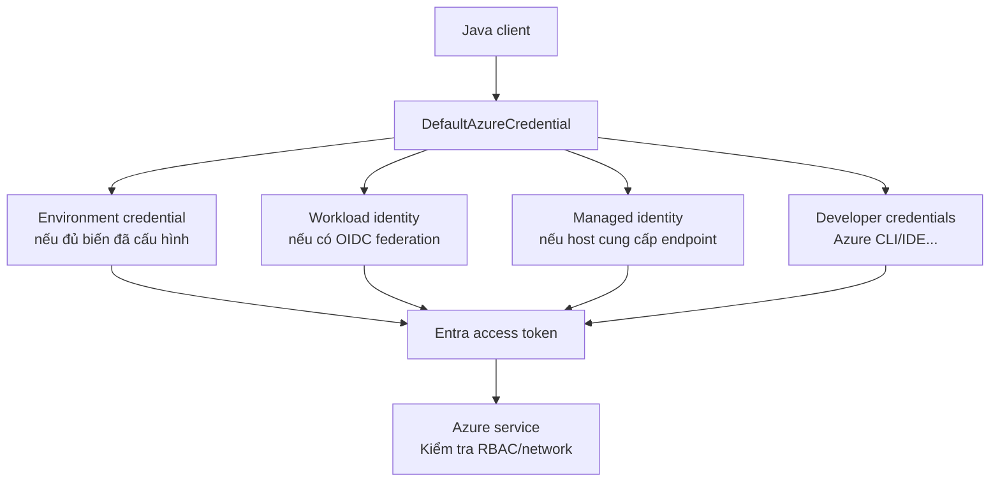

Sơ đồ là **mô hình khái niệm**, không cam kết thứ tự hoặc danh sách credential providers cố định giữa mọi phiên bản SDK. Kiểm tra tài liệu Azure Identity version đang dùng khi cần chẩn đoán thứ tự chính xác.

### Lưu ý bảo mật trong production

**`DefaultAzureCredential` tiện nhưng không phải lúc nào cũng là lựa chọn chặt nhất** nếu production environment vô tình chứa `AZURE_CLIENT_SECRET` từ cấu hình cũ. Credential chain có thể chọn một identity khác với managed identity bạn định dùng.

Với runtime production được xác định chắc chắn dùng managed identity, có thể dùng **`ManagedIdentityCredential` trực tiếp** để tránh fallback sang những cơ chế không mong muốn. Trên AKS Workload ID cần dùng **`WorkloadIdentityCredential` hoặc chain hỗ trợ federation**, không ép mọi pod vào ManagedIdentityCredential của VM/node.

### Lỗi thường gặp

`DefaultAzureCredential` thất bại không có nghĩa Entra ID đang lỗi. Nó có thể đơn giản do:

- Local dev chưa chạy `az login` hoặc đăng nhập nhầm tenant.
- Managed identity chưa gắn với resource.
- Java process chạy ở môi trường không có identity endpoint.
- `AZURE_CLIENT_ID` chọn user-assigned identity chưa được gắn.
- Workload identity OIDC env/token/ServiceAccount chưa được cấu hình.

Đọc thông tin exception chain **đã loại bỏ dữ liệu nhạy cảm** để biết credential nào đã thử và vì sao chưa khả dụng.

## 8. Khai báo Maven dependencies và tạo TokenCredential

Các ví dụ dùng Azure SDK for Java có hỗ trợ Microsoft Entra token. Với dự án Maven, quản lý phiên bản bằng một **Azure SDK BOM** hoặc versions được tổ chức phê duyệt.

```xml
<!-- Ví dụ dependencies; đưa phiên bản qua Azure SDK BOM hợp lệ
     hoặc khai báo từng version đã được kiểm tra trước khi build. -->
<dependencies>
    <dependency>
        <groupId>com.azure</groupId>
        <artifactId>azure-identity</artifactId>
        <version>REPLACE_WITH_APPROVED_VERSION</version>
    </dependency>
    <dependency>
        <groupId>com.azure</groupId>
        <artifactId>azure-security-keyvault-secrets</artifactId>
        <version>REPLACE_WITH_APPROVED_VERSION</version>
    </dependency>
    <dependency>
        <groupId>com.azure</groupId>
        <artifactId>azure-storage-blob</artifactId>
        <version>REPLACE_WITH_APPROVED_VERSION</version>
    </dependency>
</dependencies>
```

**`REPLACE_WITH_APPROVED_VERSION` không phải version thực.** Nếu dùng BOM, có thể bỏ `version` theo quy tắc của BOM đã cấu hình. Không thêm credentials vào `pom.xml`, `application.yml` hoặc tài liệu source control.

### Một class quản lý credential chung

```java
import com.azure.core.credential.TokenCredential;
import com.azure.identity.DefaultAzureCredentialBuilder;

public final class AzureCredentials {
    private static final TokenCredential CREDENTIAL =
            new DefaultAzureCredentialBuilder().build();

    private AzureCredentials() {
    }

    public static TokenCredential shared() {
        return CREDENTIAL;
    }
}
```

Đây là code Java đầy đủ có thể đặt trong `AzureCredentials.java`. **`TokenCredential` là interface**, nên Key Vault, Blob và nhiều Azure SDK clients có thể nhận cùng một instance. Bạn không cần tự lấy token rồi gắn `Authorization` header cho từng SDK request.

### Chọn mô hình theo môi trường

| Môi trường | Loại credential nên xem xét | Ghi chú |
|---|---|---|
| Local developer | `DefaultAzureCredential` với Azure CLI/IDE | Đảm bảo đúng tenant/subscription, chỉ cấp quyền trên dev |
| App Service/Functions/VM | `ManagedIdentityCredential` hoặc `DefaultAzureCredential` được kiểm soát | Gắn identity đúng resource |
| Container Apps | Managed identity được host cấp và SDK hỗ trợ | Chú ý revision/identity configuration |
| AKS với Workload Identity | `WorkloadIdentityCredential` hoặc `DefaultAzureCredential` hỗ trợ | FIC, OIDC issuer, ServiceAccount token |
| CI/CD ngoài Azure | OIDC federation nếu được hỗ trợ | Không tự giả định đã có Azure managed identity |

**Dùng Developer credential để debug local không có nghĩa production app được quyền tương tự.** Principal của người phát triển và principal của ứng dụng là hai đối tượng khác nhau, cần gán quyền riêng.

## 9. ManagedIdentityCredential: chọn danh tính rõ ràng

Khi hệ thống đã chạy trên một Azure host có identity endpoint, bạn có thể hạn chế authentication chỉ bằng managed identity.

### System-assigned identity

```java
import com.azure.core.credential.TokenCredential;
import com.azure.identity.ManagedIdentityCredentialBuilder;

TokenCredential credential =
        new ManagedIdentityCredentialBuilder().build();
```

Đây là **snippet trong method**. Môi trường host phải hỗ trợ identity và đã bật system-assigned identity (hoặc cấu hình có thể chọn identity mặc định phù hợp). Không sử dụng như một “bằng chứng thử nghiệm” trên máy local thông thường vì máy local không có Azure managed identity endpoint.

### User-assigned identity theo client ID

```java
import com.azure.core.credential.TokenCredential;
import com.azure.identity.ManagedIdentityCredentialBuilder;

String clientId = System.getenv("AZURE_CLIENT_ID");
if (clientId == null || clientId.isBlank()) {
    throw new IllegalStateException("Missing AZURE_CLIENT_ID");
}

TokenCredential credential = new ManagedIdentityCredentialBuilder()
        .clientId(clientId)
        .build();
```

Ở đây `AZURE_CLIENT_ID` **không phải secret**, nhưng sai client ID khiến app lấy token thất bại hoặc dùng identity không đúng. Với user-assigned identity, **client ID phải thuộc identity thực sự đã gắn vào đúng resource**. Không copy ID của một identity “cùng tên” ở subscription khác.

### Code chọn theo môi trường một cách tường minh

```java
import com.azure.core.credential.TokenCredential;
import com.azure.identity.DefaultAzureCredentialBuilder;
import com.azure.identity.ManagedIdentityCredentialBuilder;

public final class ProductionIdentity {
    private ProductionIdentity() {}

    public static TokenCredential create() {
        String runtime = System.getenv("APP_RUNTIME");
        if ("local".equals(runtime)) {
            return new DefaultAzureCredentialBuilder().build();
        }
        if ("azure-managed-identity".equals(runtime)) {
            String clientId = System.getenv("AZURE_CLIENT_ID");
            ManagedIdentityCredentialBuilder builder =
                    new ManagedIdentityCredentialBuilder();
            return (clientId == null || clientId.isBlank())
                    ? builder.build()
                    : builder.clientId(clientId).build();
        }
        throw new IllegalStateException(
                "APP_RUNTIME must be explicitly configured");
    }
}
```

Mẫu này **fail closed** khi runtime không xác định; phù hợp với những app chỉ chạy local hoặc host-managed identity. Với AKS Workload ID, bổ sung nhánh riêng dùng credential hỗ trợ federation — **không đặt `APP_RUNTIME=azure-managed-identity` chỉ để bỏ qua thiết lập OIDC của pod**.

### Không yêu cầu token thủ công nếu SDK đã hỗ trợ

Trong đa số trường hợp, viết:

```java
new SecretClientBuilder()
    .vaultUrl(vaultUrl)
    .credential(credential)
    .buildClient();
```

đơn giản và an toàn hơn việc tự gửi `getToken()`, tự cache, tự refresh rồi chèn header. Khi cần gọi một API tùy biến bằng REST, lúc đó mới phải cân nhắc token acquisition/expiry thủ công.

## 10. Ví dụ Java: đọc bí mật từ Azure Key Vault

Giả sử App Service có identity `id-orders-api` được cấp **Key Vault Secrets User** trên vault `kv-orders-lab` (theo mô hình Azure RBAC authorization). Ứng dụng cần đọc một secret `external-api-token` để gọi đối tác không hỗ trợ Entra ID.

### Bố cục

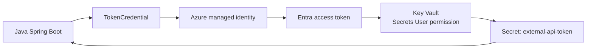

### Code hoàn chỉnh

```java
import com.azure.core.credential.TokenCredential;
import com.azure.identity.DefaultAzureCredentialBuilder;
import com.azure.security.keyvault.secrets.SecretClient;
import com.azure.security.keyvault.secrets.SecretClientBuilder;
import com.azure.security.keyvault.secrets.models.KeyVaultSecret;

public final class KeyVaultReadExample {
    public static void main(String[] args) {
        String vaultUrl = required("AZURE_KEY_VAULT_URL");

        TokenCredential credential =
                new DefaultAzureCredentialBuilder().build();
        SecretClient secretClient = new SecretClientBuilder()
                .vaultUrl(vaultUrl)
                .credential(credential)
                .buildClient();

        KeyVaultSecret secret =
                secretClient.getSecret("external-api-token");

        // Sử dụng trong memory để gọi partner được phép.
        // KHÔNG in secret.getValue(), không trả về trong API response.
        System.out.println("Secret retrieved. Name=" + secret.getName());
    }

    private static String required(String key) {
        String value = System.getenv(key);
        if (value == null || value.isBlank()) {
            throw new IllegalArgumentException("Missing env " + key);
        }
        return value;
    }
}
```

Ví dụ cấu hình:

```text
AZURE_KEY_VAULT_URL=https://kv-orders-lab.vault.azure.net/
```

**Biến endpoint không phải secret**. Giá trị `external-api-token` được lấy lúc chạy; không xuất ra logs hoặc crash dumps cố ý. Khi ứng dụng cần đọc secret nhiều lần, có thể cache giá trị **trong thời hạn giới hạn** theo chính sách rotation; khác với việc cache token Entra, việc cache **giá trị secret** cần chủ động invalidation/refresh để không dùng credential cũ quá lâu.

### Vì sao vẫn cần Key Vault nếu đã có managed identity?

Managed identity loại bỏ **secret dùng để ứng dụng xác thực với Azure services hỗ trợ Entra**. Nhưng một hệ thống bên thứ ba có thể chỉ hỗ trợ API key; Key Vault giữ và kiểm soát vòng đời API key đó. Đừng dùng Key Vault để lưu **Storage account key** khi Java Azure Blob SDK có thể gọi trực tiếp bằng Entra token, trừ khi tồn tại yêu cầu kỹ thuật đặc biệt đã được duyệt.

### Khi getSecret trả 403

Kiểm tra bốn yếu tố:

1. Identity đang được dùng có **principal ID** nào?
2. Vault dùng **Azure RBAC permission model** hay **legacy access policies**? Cấp quyền đúng mô hình.
3. Principal có quyền đọc secrets ở **scope chính xác** không?
4. Vault firewall/private endpoint/DNS có cho phép runtime kết nối không?

**Key Vault Reader** thường là role đọc metadata, không tương đương **Key Vault Secrets User** để đọc giá trị secret. **Key Vault Secrets Officer** có quyền quản lý secrets rộng hơn và không nên cấp cho ứng dụng chỉ cần đọc.

## 11. Ví dụ Java: ghi và đọc Azure Blob bằng managed identity

Với Blob Storage, Java SDK dùng `BlobServiceClientBuilder` và `TokenCredential`. Ứng dụng upload báo cáo cần **Storage Blob Data Contributor** ở scope phù hợp; ứng dụng chỉ đọc file có thể chỉ cần **Storage Blob Data Reader**.

### Code upload trong lab

```java
import com.azure.core.credential.TokenCredential;
import com.azure.identity.DefaultAzureCredentialBuilder;
import com.azure.storage.blob.BlobClient;
import com.azure.storage.blob.BlobContainerClient;
import com.azure.storage.blob.BlobServiceClient;
import com.azure.storage.blob.BlobServiceClientBuilder;

import java.io.ByteArrayInputStream;
import java.nio.charset.StandardCharsets;

public final class BlobManagedIdentityExample {
    public static void main(String[] args) {
        String endpoint = required("AZURE_STORAGE_BLOB_ENDPOINT");
        String containerName = required("AZURE_STORAGE_CONTAINER");

        TokenCredential credential =
                new DefaultAzureCredentialBuilder().build();

        BlobServiceClient blobService = new BlobServiceClientBuilder()
                .endpoint(endpoint)
                .credential(credential)
                .buildClient();

        BlobContainerClient container =
                blobService.getBlobContainerClient(containerName);

        // Container được provision trước qua IaC/portal.
        BlobClient blob = container.getBlobClient(
                "reports/lab-report-001.txt");

        byte[] data = "Báo cáo thử nghiệm - không chứa PII"
                .getBytes(StandardCharsets.UTF_8);
        blob.upload(new ByteArrayInputStream(data), data.length, true);

        // Chỉ in metadata không nhạy cảm.
        System.out.println("Uploaded bytes=" + blob.getProperties().getBlobSize());
    }

    private static String required(String key) {
        String value = System.getenv(key);
        if (value == null || value.isBlank()) {
            throw new IllegalArgumentException("Missing env " + key);
        }
        return value;
    }
}
```

```text
AZURE_STORAGE_BLOB_ENDPOINT=https://storderslab01.blob.core.windows.net
AZURE_STORAGE_CONTAINER=reports-lab
```

**Lệnh `upload(..., true)` có thể ghi đè file đích**. Chỉ dùng với tên/tài nguyên lab; production cần quy định uniqueness, ETag/If-Match, checksum và idempotency. Nếu app chỉ cần download, dùng read-only role và download API phù hợp thay vì cấp quyền write.

### Blob endpoint, DFS endpoint và HNS

Storage account có ADLS Gen2 hierarchical namespace có thể có cả **Blob** và **DFS** endpoints. Đoạn code trên dùng Blob API, vì vậy kết nối qua `blob.core.windows.net`. Nếu chuyển sang `DataLakeServiceClientBuilder` của `azure-storage-file-datalake` thì dùng DFS endpoint `dfs.core.windows.net` theo API, với role/ACL và Private Endpoint/DNS đúng. **Một Blob private endpoint không tự bảo đảm DFS operations đều có đường private phù hợp**, và ngược lại.

### Data-plane role không phải management role

`Contributor` của Azure Resource Manager không mặc định tương đương `Storage Blob Data Contributor` khi dùng Entra token để upload blob. Role cần tương ứng loại operations và scope data. Ngược lại, cấp `Storage Blob Data Contributor` ở account level có thể cho phép ghi quá rộng, không nên dùng nếu chỉ cần một container.

## 12. Ví dụ Java: gửi message Azure Service Bus không dùng connection string

**Azure Service Bus** hỗ trợ authentication bằng Microsoft Entra ID và data-plane roles. Một Java worker chỉ cần gửi thông điệp tới queue có thể được gán **Azure Service Bus Data Sender** ở namespace/queue scope được hỗ trợ, thay vì lưu connection string có Shared Access Key.

### Maven dependency

```xml
<dependency>
    <groupId>com.azure</groupId>
    <artifactId>azure-messaging-servicebus</artifactId>
    <version>REPLACE_WITH_APPROVED_VERSION</version>
</dependency>
```

### Code gửi message

```java
import com.azure.core.credential.TokenCredential;
import com.azure.identity.DefaultAzureCredentialBuilder;
import com.azure.messaging.servicebus.ServiceBusClientBuilder;
import com.azure.messaging.servicebus.ServiceBusMessage;
import com.azure.messaging.servicebus.ServiceBusSenderClient;

public final class ServiceBusSenderExample {
    public static void main(String[] args) {
        String namespace = required("AZURE_SERVICEBUS_NAMESPACE");
        String queue = required("AZURE_SERVICEBUS_QUEUE");

        TokenCredential credential =
                new DefaultAzureCredentialBuilder().build();

        try (ServiceBusSenderClient sender = new ServiceBusClientBuilder()
                .fullyQualifiedNamespace(namespace)
                .credential(credential)
                .sender()
                .queueName(queue)
                .buildClient()) {
            ServiceBusMessage message =
                    new ServiceBusMessage("OrderCreated:lab-order-001");
            message.setMessageId("lab-order-001-created-v1");
            sender.sendMessage(message);
            System.out.println("Sent test message to queue");
        }
    }

    private static String required(String key) {
        String value = System.getenv(key);
        if (value == null || value.isBlank()) {
            throw new IllegalArgumentException("Missing env: " + key);
        }
        return value;
    }
}
```

```text
AZURE_SERVICEBUS_NAMESPACE=sb-orders-lab.servicebus.windows.net
AZURE_SERVICEBUS_QUEUE=orders-created-lab
```

**Phân biệt fully qualified namespace và connection string:** giá trị `sb-orders-lab.servicebus.windows.net` là hostname, không có password/SAS. Không dùng `Endpoint=sb://...;SharedAccessKey=...` trong code managed identity nếu SDK hỗ trợ Entra credential.

### Roles và idempotency

| Workload | Role |
|---|---|
| Chỉ gửi messages | **Azure Service Bus Data Sender** |
| Nhận, complete/abandon/dead-letter | **Azure Service Bus Data Receiver** |
| Quản lý data plane entities rộng | **Azure Service Bus Data Owner** (chỉ khi cần) |

Managed identity chỉ giải quyết authentication. Nó **không bảo đảm “exactly-once processing”**: producer có thể gửi thành công nhưng timeout trước khi nhận acknowledgement, rồi gửi lại. Hãy dùng `MessageId` ổn định, duplicate detection nếu entity hỗ trợ và **idempotency tại consumer**.

## 13. Azure SQL Database: identity token và database user

**Azure SQL** là ví dụ rõ nhất về sự khác biệt giữa việc **lấy được token** và **có quyền với dữ liệu**. Java kết nối bằng Microsoft Entra authentication có thể dùng managed identity, nhưng database cần có **user/role/permissions** tương ứng với principal.

### Luồng quyền

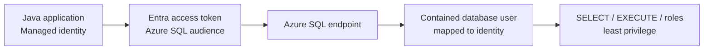

Để thiết lập, một database administrator có quyền thích hợp thường:

1. Cấu hình Microsoft Entra administrator/identity integration cho SQL resource theo mô hình được hỗ trợ.
2. Tạo **contained database user** cho managed identity bằng cú pháp hỗ trợ.
3. Gán quyền `SELECT`, `EXECUTE` trên những objects/schemas cần thiết hoặc một custom database role.
4. Kiểm tra connectivity, TLS/firewall/private endpoint và token audience.
5. Chạy integration test bằng **đúng managed identity của Java host**.

### T-SQL minh họa trên database lab

```sql
-- Chạy trong đúng database, bằng principal quản trị được phép.
-- Tên identity được tra cứu trong Entra; cú pháp/cơ chế hỗ trợ
-- có thể khác theo Azure SQL offering và cấu hình tenant.

CREATE USER [id-orders-api] FROM EXTERNAL PROVIDER;

-- Ví dụ chỉ cho đọc một bảng, không cấp db_owner.
GRANT SELECT ON OBJECT::dbo.Orders TO [id-orders-api];
```

Nếu identity có tên trùng hoặc quy trình Entra object resolution phức tạp, cần dùng cú pháp/định danh theo khả năng engine/phiên bản; không đoán identity từ display name. Azure SQL roles **khác Azure RBAC roles** của SQL server management plane.

### Microsoft JDBC Driver for SQL Server

Driver có các chế độ Microsoft Entra authentication phụ thuộc phiên bản, bao gồm **`ActiveDirectoryManagedIdentity`** trên môi trường hỗ trợ. Thay vì tự cache access token, có thể để driver xử lý auth khi cấu hình đúng.

```properties
# Ví dụ cấu hình JDBC cho lab; kiểm tra version Microsoft JDBC driver
# và options user-assigned identity tương ứng trước khi dùng.
spring.datasource.url=jdbc:sqlserver://sql-orders-lab.database.windows.net:1433;database=ordersdb;encrypt=true;authentication=ActiveDirectoryManagedIdentity
spring.datasource.driver-class-name=com.microsoft.sqlserver.jdbc.SQLServerDriver
```

Đây là **đoạn cấu hình hướng dẫn**, không có username/password. Với user-assigned managed identity hoặc pool/driver version khác, cần kiểm tra tham số chọn identity (client ID) được driver đó hỗ trợ; không tự điền thông số không được tài liệu xác nhận. Nếu driver chưa hỗ trợ chế độ mong muốn, có thể dùng Azure Identity lấy access token qua cơ chế JDBC được driver hỗ trợ, nhưng phải tính **token refresh và connection pooling**.

### Các lỗi riêng của SQL

- Có token nhưng SQL trả `Login failed`: user/permission mapping hoặc database/tenant sai.
- SQL connection timeout: firewall, VNet, Private Endpoint/DNS, port 1433 hoặc network policies.
- User tạo đúng nhưng query bị `SELECT permission denied`: cần grant tối thiểu cho object, không cấp `db_owner`.
- App Service identity đổi sau khi recreate resource: database principal cũ có thể tham chiếu identity trước đó; cần reconcile.

## 14. Azure App Service chạy Java: bật system-assigned managed identity

**Azure App Service** có thể chạy Java/Spring Boot WAR/JAR hoặc container theo cấu hình supported. Khi bật system-assigned identity, Azure tạo/gắn service principal cho web app. App cần role assignment riêng trên resource đích.

### Kiến trúc

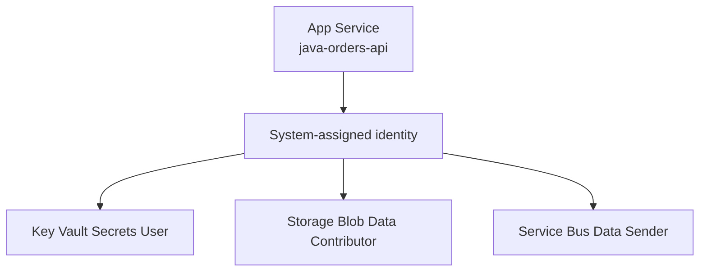

### 14.1. Bật identity bằng Azure portal

1. Chọn đúng **App Service** trong subscription/resource group được phép.
2. Mở **Identity → System assigned**.
3. Chuyển trạng thái **On**, Save (thao tác thay đổi cấu hình).
4. Ghi lại **Principal ID** và **Tenant ID** được Azure cấp.
5. Tại Key Vault/Storage/Service Bus, gán data-plane roles cần thiết cho principal.
6. Restart/deploy ứng dụng nếu cần theo thay đổi cấu hình, rồi thử truy cập bằng SDK.

### 14.2. Azure CLI

```bash
az login
az account set --subscription "<subscription-id>"

RG="rg-java-lab"
APP="java-orders-api"

# Thay đổi: bật system-assigned managed identity.
az webapp identity assign \
  --resource-group "$RG" \
  --name "$APP"

# Đọc lại identity metadata.
az webapp identity show \
  --resource-group "$RG" \
  --name "$APP" \
  --output json
```

Phần phản hồi thường chứa `principalId` và `tenantId`. Đây là những ID phục vụ RBAC; **không phải secret**. Sau khi bật identity, bạn có thể gán role mà không cần cấp secret cho Java app.

### 14.3. Application settings

```text
APP_RUNTIME=azure-managed-identity
AZURE_KEY_VAULT_URL=https://kv-orders-lab.vault.azure.net/
AZURE_STORAGE_BLOB_ENDPOINT=https://storderslab01.blob.core.windows.net
AZURE_STORAGE_CONTAINER=reports-lab
AZURE_SERVICEBUS_NAMESPACE=sb-orders-lab.servicebus.windows.net
AZURE_SERVICEBUS_QUEUE=orders-created-lab
```

Không đặt `AZURE_CLIENT_SECRET` hoặc `AZURE_STORAGE_KEY` chỉ để ứng dụng hoạt động. Nếu dùng system-assigned, thường không cần `AZURE_CLIENT_ID`; nếu biến này vẫn tồn tại từ môi trường khác, kiểm tra xem credential chain có bị điều hướng sang identity khác không.

### 14.4. Deployment slots

App Service deployment slots có những đặc điểm về identity, app settings và swap mà bạn phải kiểm tra theo môi trường. **Không mặc định slot staging và production luôn sử dụng cùng managed identity hoặc cùng role assignments**. Nếu cần danh tính ổn định qua blue/green deployment, cân nhắc user-assigned identity có quản trị riêng và kiểm thử chính xác slot behavior.

## 15. App Service với user-assigned managed identity

Một doanh nghiệp triển khai `java-orders-api-blue` và `java-orders-api-green` rồi đổi traffic. Nếu sử dụng **user-assigned managed identity `id-orders-runtime`**, principal có thể được cấp quyền trước và gắn cho workload mới trước cutover.

### 15.1. Tạo identity (môi trường lab)

```bash
RG="rg-java-lab"
IDENTITY="id-orders-runtime"

az identity create \
  --resource-group "$RG" \
  --name "$IDENTITY"

az identity show \
  --resource-group "$RG" \
  --name "$IDENTITY" \
  --query "{id:id,clientId:clientId,principalId:principalId,tenantId:tenantId}" \
  --output json
```

### 15.2. Gắn identity vào App Service

```bash
IDENTITY_ID=$(az identity show \
  --resource-group "$RG" \
  --name "$IDENTITY" \
  --query id --output tsv)

az webapp identity assign \
  --resource-group "$RG" \
  --name "java-orders-api" \
  --identities "$IDENTITY_ID"

az webapp identity show \
  --resource-group "$RG" \
  --name "java-orders-api" \
  --output json
```

### 15.3. Chọn đúng identity từ Java

Ghi lại `clientId` của **user-assigned identity** và đặt application setting:

```text
AZURE_CLIENT_ID=<client-id-of-id-orders-runtime>
APP_RUNTIME=azure-managed-identity
```

Trong ứng dụng `ProductionIdentity.create()` ở mục 9, `ManagedIdentityCredentialBuilder.clientId(clientId)` chỉ rõ identity được chọn. Đừng dùng `principalId` tại chỗ `AZURE_CLIENT_ID`.

### Điều nên cân nhắc

Identity chia sẻ giúp giảm gián đoạn khi thay workload nhưng cũng tạo **blast radius** chung. Nếu Blue và Green thuộc môi trường có dữ liệu khác (dev/prod, EU/US), **không nên chia sẻ cùng identity** chỉ để tiết kiệm vài role assignments. Tạo identity theo trust boundary và mức độ nhạy cảm dữ liệu.

## 16. Azure Functions dùng Java

**Azure Functions** hỗ trợ Java Functions trên những hosting plans được Azure hỗ trợ. Khi bật managed identity cho Function App, mã Java có thể dùng `DefaultAzureCredential` hoặc `ManagedIdentityCredential` trong activity/handler để truy cập Key Vault, Storage hoặc Service Bus.

### Bật identity

```bash
az functionapp identity assign \
  --resource-group "rg-java-lab" \
  --name "fn-orders-lab"

az functionapp identity show \
  --resource-group "rg-java-lab" \
  --name "fn-orders-lab" \
  --output json
```

### Ví dụ logic handler

```java
import com.azure.core.credential.TokenCredential;
import com.azure.identity.DefaultAzureCredentialBuilder;
import com.azure.security.keyvault.secrets.SecretClient;
import com.azure.security.keyvault.secrets.SecretClientBuilder;
import com.microsoft.azure.functions.ExecutionContext;
import com.microsoft.azure.functions.annotation.FunctionName;
import com.microsoft.azure.functions.annotation.HttpTrigger;
import com.microsoft.azure.functions.annotation.AuthorizationLevel;
import com.microsoft.azure.functions.HttpMethod;
import com.microsoft.azure.functions.HttpRequestMessage;
import com.microsoft.azure.functions.HttpResponseMessage;

import java.util.Optional;

public final class ConfigHealthFunction {
    private static final TokenCredential CREDENTIAL =
            new DefaultAzureCredentialBuilder().build();

    private static final SecretClient SECRET_CLIENT =
            new SecretClientBuilder()
                    .vaultUrl(System.getenv("AZURE_KEY_VAULT_URL"))
                    .credential(CREDENTIAL)
                    .buildClient();

    @FunctionName("config-health")
    public HttpResponseMessage run(
            @HttpTrigger(
                name = "req",
                methods = {HttpMethod.GET},
                authLevel = AuthorizationLevel.FUNCTION)
            HttpRequestMessage<Optional<String>> req,
            final ExecutionContext context) {
        // Không đưa secret value vào HTTP response.
        SECRET_CLIENT.getSecret("external-api-token");
        context.getLogger().info("Key Vault read succeeded");
        return req.createResponseBuilder(
                com.microsoft.azure.functions.HttpStatus.OK)
                .body("Configuration accessible")
                .build();
    }
}
```

**Đây là ví dụ học tập có side effect đọc Key Vault mỗi request**, không nên public trực tiếp. Trong production:

- Health endpoint **không nên gọi Key Vault mỗi lần probe**, tránh tạo chi phí/throttling và vô tình phơi bày dependency.
- Function-level authorization không tương đương OAuth authentication cho end users; giới hạn route/network và kiểm soát quyền phù hợp.
- Tái sử dụng `TokenCredential`/`SecretClient`, cache secret theo chính sách.
- Nếu dùng Functions triggers/bindings riêng, **authentication của binding** có thể cần app settings/connection configuration hỗ trợ identity; Java SDK credential trong code không tự thay authentication của trigger.

### Một ranh giới thường bị quên

Function App có thể chạy trên identity chính của workload nhưng vẫn cần kết nối Storage dùng bởi runtime/trigger. Những binding hoặc host storage configurations yêu cầu **cấu hình identity-based connections riêng** theo Functions runtime/extension/hosting plan. Không xóa storage connection setting đang hoạt động chỉ vì code `SecretClient` đã dùng managed identity.

## 17. Azure Virtual Machines và VM Scale Sets

Một Java service có thể chạy trên Azure VM bằng `systemd`, Docker hoặc một application server. VM/VMSS có thể được gắn managed identity; Java application chạy bên trong VM nhận token thông qua **Azure Instance Metadata Service (IMDS)** theo môi trường host được Azure hỗ trợ.

### Bật system-assigned identity trên Azure VM

```bash
az vm identity assign \
  --resource-group "rg-java-lab" \
  --name "vm-java-worker-lab"

az vm identity show \
  --resource-group "rg-java-lab" \
  --name "vm-java-worker-lab" \
  --output json
```

Sau đó gán role data plane cho `principalId` trả về; Java SDK có thể dùng:

```java
TokenCredential credential = new ManagedIdentityCredentialBuilder()
        .build();
```

Nhớ import `TokenCredential` và `ManagedIdentityCredentialBuilder` như mục 9. Đoạn code này phải được chạy **bên trong VM có identity đã bật**, không phải trên laptop chỉ có Azure CLI kết nối vào subscription.

### IMDS và quyền của process trong VM

Trên Azure VM, IMDS thường được truy cập qua địa chỉ link-local `169.254.169.254` với yêu cầu metadata header/protocol cụ thể. Azure Identity SDK xử lý những chi tiết này; **không cần tự gọi IMDS** để gắn token thủ công.

Về an toàn:

- Mọi process đủ khả năng truy cập identity endpoint trong cùng VM có thể có cơ hội lấy token theo cơ chế host. **Managed identity không tự tạo cô lập quyền giữa hai ứng dụng không tin nhau chạy trên cùng VM**.
- Giới hạn SSH/RDP, local privileges, container escape và các endpoints có thể bị lạm dụng để thực hiện **server-side request forgery (SSRF)** tới metadata endpoint.
- Không cấp một VM identity quyền rộng trên nhiều databases chỉ vì VM chứa nhiều Java services.
- Nếu cần trust boundaries mạnh hơn, tách workload/VMs hoặc chọn nền tảng hỗ trợ workload-specific identity.

### VMSS

Với **Virtual Machine Scale Sets (VMSS)**, cấu hình identity thường áp ở cấp scale set/instances theo khả năng deployment model. Cần xác minh rằng instances mới tạo khi autoscale thực sự có identity phù hợp. Nếu Java app được cấu hình chọn user-assigned client ID, phải gắn identity đó vào scale set trước rollout.

## 18. Azure Container Apps chạy Java

**Azure Container Apps** có thể chạy Java container dưới hình thức app, revisions và scale rules. Managed identity được cấu hình trên Container App để container dùng token khi gọi Key Vault, Storage hoặc Service Bus; cách cấp identity **khác** Kubernetes ServiceAccount Workload Identity của AKS.

### Bật system-assigned identity

CLI có lệnh identity cho Container Apps; cú pháp tham khảo (xác minh với Azure CLI/extension đang cài):

```bash
az containerapp identity assign \
  --resource-group "rg-java-lab" \
  --name "ca-orders-api-lab" \
  --system-assigned

az containerapp identity show \
  --resource-group "rg-java-lab" \
  --name "ca-orders-api-lab" \
  --output json
```

Khi dùng user-assigned identity, phải tạo identity độc lập và gắn nó với Container App theo CLI/IaC supported, rồi cấu hình `AZURE_CLIENT_ID` trong container để Java chọn đúng principal.

### Lưu ý về revisions và scale

- Container Apps có thể scale về zero, tạo lại replicas/revisions. Code không được phụ thuộc access token lưu bền trên local container filesystem.
- Chỉ gán quyền tối thiểu cho identity của app; nếu revisions cũ và mới cùng identity, cả hai có thể truy cập dữ liệu trong thời gian cùng chạy.
- Cấu hình environment, managed identity và ingress/egress phải được kiểm tra đúng revision/deployment.
- Một Container App sử dụng registry có private image và dùng identity để **pull image** có thể có yêu cầu IAM/cấu hình riêng; Java SDK credential cho Key Vault không tự cấp quyền pull ACR.
- Với Container Apps jobs hoặc Dapr component bindings, authentication có thể được cấu hình ở **runtime/component level**; không suy rằng mọi binding dùng đúng credential Java đang dùng.

### Java app chạy trong container

```java
TokenCredential credential = new DefaultAzureCredentialBuilder().build();
SecretClient client = new SecretClientBuilder()
        .vaultUrl(System.getenv("AZURE_KEY_VAULT_URL"))
        .credential(credential)
        .buildClient();
```

Mẫu code không thay đổi so với App Service. Khác biệt nằm ở **platform identity endpoint, container deployment và policy egress**. SDK có thể nhận biết host nếu identity được gắn và môi trường hoạt động đúng.

## 19. AKS: Managed Identity của node khác Microsoft Entra Workload ID của pod

**AKS** có nhiều loại identity:

- **AKS control plane identity** để quản lý những tài nguyên của cluster.
- **Kubelet identity** và những quyền phục vụ hoạt động node/image pull theo cấu hình.
- **Microsoft Entra Workload ID** cho các **Kubernetes pods** để đổi projected OIDC service-account token lấy Entra access token.

Không mặc định Java pod có quyền của managed identity trên control plane hoặc kubelet. Trên AKS hiện đại, hướng được đề xuất cho workload thường là **Microsoft Entra Workload ID** với OIDC federation, thay vì cấp một managed identity rộng ở node cho mọi container.

### Kiến trúc token exchange

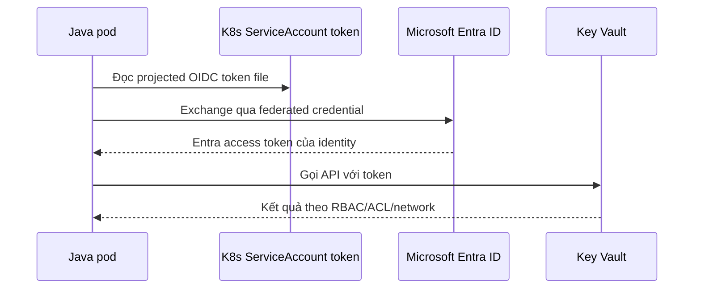

### Các thành phần chính

| Thành phần | Vai trò |
|---|---|
| **OIDC issuer** | Issuer được cấu hình/trust cho AKS cluster |
| **Kubernetes ServiceAccount** | Danh tính workload bên trong cluster, gắn namespace |
| **ServiceAccount annotation** | Trỏ đến **client ID** của user-assigned identity/app identity |
| **Federated identity credential (FIC)** | Cho phép Entra trust issuer+subject+audience cụ thể |
| **Projected service account token** | Token được pod cung cấp để exchange, không phải client secret |
| **WorkloadIdentityCredential** | Java credential đọc OIDC token và xin Entra access token |

### Bật AKS OIDC và Workload ID (thay đổi cluster)

```bash
az aks update \
  --resource-group "rg-aks-lab" \
  --name "aks-java-lab" \
  --enable-oidc-issuer \
  --enable-workload-identity

OIDC_ISSUER=$(az aks show \
  --resource-group "rg-aks-lab" \
  --name "aks-java-lab" \
  --query "oidcIssuerProfile.issuerUrl" \
  --output tsv)
```

Thay đổi cấu hình AKS chỉ được thực hiện khi bạn có quyền và change plan. Cú pháp, điều kiện node pool/cluster và yêu cầu hỗ trợ SDK phụ thuộc phiên bản hiện hành.

### Tạo federated identity credential

Giả sử đã có user-assigned identity `id-aks-orders` và Kubernetes ServiceAccount `orders-api` trong namespace `apps`:

```bash
az identity federated-credential create \
  --resource-group "rg-aks-lab" \
  --identity-name "id-aks-orders" \
  --name "fc-orders-api" \
  --issuer "$OIDC_ISSUER" \
  --subject "system:serviceaccount:apps:orders-api" \
  --audiences "api://AzureADTokenExchange"
```

**Issuer, subject và audience phải khớp chính xác** với token mà pod thực sự cung cấp. Nếu đổi namespace hoặc ServiceAccount name, cần cập nhật FIC phù hợp. Một FIC không tự cấp quyền Key Vault: bạn vẫn phải gán **data-plane RBAC** cho principal ID của identity.

### ServiceAccount và pod mẫu

```yaml
apiVersion: v1
kind: ServiceAccount
metadata:
  name: orders-api
  namespace: apps
  annotations:
    azure.workload.identity/client-id: "<client-id-of-id-aks-orders>"
---
apiVersion: apps/v1
kind: Deployment
metadata:
  name: orders-api
  namespace: apps
spec:
  replicas: 2
  selector:
    matchLabels:
      app: orders-api
  template:
    metadata:
      labels:
        app: orders-api
        azure.workload.identity/use: "true"
    spec:
      serviceAccountName: orders-api
      containers:
        - name: orders-api
          image: "<approved-registry>/orders-api:<tag>"
          env:
            - name: AZURE_KEY_VAULT_URL
              value: "https://kv-orders-lab.vault.azure.net/"
```

Đây là YAML **minh họa**, không triển khai nguyên bản vì còn thiếu registry image thực, resource requests/limits, readiness probes, network/security policies và cấu hình production khác. Admission webhook của AKS Workload ID khi được bật có thể inject các biến môi trường và mounted token file cần thiết.

### Java WorkloadIdentityCredential

```java
import com.azure.core.credential.TokenCredential;
import com.azure.identity.WorkloadIdentityCredentialBuilder;

// Pod đã được cấu hình OIDC token projection theo AKS Workload ID.
TokenCredential credential =
        new WorkloadIdentityCredentialBuilder().build();
```

SDK có thể đọc `AZURE_CLIENT_ID`, `AZURE_TENANT_ID` và `AZURE_FEDERATED_TOKEN_FILE` do môi trường cung cấp theo integration được hỗ trợ. Nếu dùng `DefaultAzureCredential` trên AKS, cần đảm bảo nó thực sự chọn **WorkloadIdentityCredential** từ federation configuration, không vô tình dùng developer credentials hoặc endpoint của node.

### Những nhầm lẫn phải tránh

1. Gán Key Vault role cho **AKS control plane identity** thay vì user-assigned identity đã liên kết ServiceAccount.
2. Dùng subject `apps:orders-api` thay vì `system:serviceaccount:apps:orders-api`.
3. Cấu hình đúng ServiceAccount nhưng thiếu pod label `azure.workload.identity/use` theo webhook configuration.
4. Dùng namespace khác với FIC.
5. Sao chép projected token file ra logs, image hoặc host filesystem.
6. Dùng `ManagedIdentityCredentialBuilder` trong pod AKS chỉ vì “cluster đã có managed identity” mà chưa biết nền tảng identity endpoint của workload.

## 20. CI/CD: build pipeline có cần managed identity không?

Pipeline GitHub Actions, Azure DevOps hoặc hệ CI khác thường chạy **bên ngoài** Azure resource đã gắn managed identity. Chỉ vì deploy mục tiêu là App Service có managed identity **không có nghĩa runner CI cũng có identity đó**.

### Tách hai principal

```text
Deployment pipeline identity
    -> quyền deploy image/app/IaC ở management plane

Runtime application managed identity
    -> quyền đọc Key Vault, Blob hoặc gửi Service Bus ở data plane
```

Pipeline có thể dùng **OIDC workload federation** theo khả năng của hệ CI và Entra; tránh secret dài hạn nếu có thể. Nhưng đây là một **identity riêng** của quá trình triển khai. Khi deploy, pipeline không cần mang token/secret runtime vào container image.

### Những điều cần đảm bảo

- Quyền pipeline chỉ đủ deploy/update đúng resources, không mặc định có quyền đọc production secrets.
- Role assignments cho runtime identity được quản lý bằng IaC hoặc bước có phê duyệt.
- Không export `az account get-access-token` rồi lưu token vào artifact/job logs.
- Những integration tests thực sự cần runtime identity nên chạy trên host phù hợp hoặc môi trường test được cấp identity tương ứng.
- Khi tái tạo App Service với system-assigned identity, pipeline phải cập nhật role assignments theo **principal ID mới**.

## 21. Gán Azure RBAC role: từ principal ID đến data-plane permissions

Giả sử `java-orders-api` chạy App Service, dùng system-assigned identity để:

- Đọc bí mật `external-api-token` từ `kv-orders-lab`.
- Upload báo cáo vào Blob Storage `storderslab01`.
- Gửi `OrderCreated` đến Service Bus namespace `sb-orders-lab`.

Identity cần **ba quyền riêng biệt**, mỗi quyền tại scope nhỏ nhất phù hợp. Để đơn giản, đoạn lab gán role tại resource-level; trong production, có thể giảm scope tới container/queue khi role/scope đó được dịch vụ hỗ trợ.

### 21.1. Lấy principal ID của App Service

```bash
az login
az account set --subscription "<subscription-id>"

RG="rg-java-lab"
APP="java-orders-api"

PRINCIPAL_ID=$(az webapp identity show \
  --resource-group "$RG" \
  --name "$APP" \
  --query "principalId" --output tsv)

echo "Principal ID: $PRINCIPAL_ID"
```

**Nếu `PRINCIPAL_ID` rỗng hoặc `null`**, system-assigned identity có thể chưa bật; đừng tiếp tục gán role cho một ID tưởng tượng. Với user-assigned identity, lấy `principalId` từ `az identity show` của identity thực sự đã gắn vào app.

### 21.2. Gán quyền đọc Key Vault secret

```bash
KV_ID=$(az keyvault show \
  --resource-group "$RG" \
  --name "kv-orders-lab" \
  --query id --output tsv)

az role assignment create \
  --assignee-object-id "$PRINCIPAL_ID" \
  --assignee-principal-type ServicePrincipal \
  --role "Key Vault Secrets User" \
  --scope "$KV_ID"
```

Điều kiện: vault đang dùng **Azure RBAC permission model**. Nếu vault dùng **access policy permission model**, role này không tự giải quyết quyền đọc secret; cần điều chỉnh theo mô hình vault hiện hành qua quy trình quản trị được duyệt.

### 21.3. Gán quyền ghi Blob

```bash
STORAGE_ID=$(az storage account show \
  --resource-group "$RG" \
  --name "storderslab01" \
  --query id --output tsv)

az role assignment create \
  --assignee-object-id "$PRINCIPAL_ID" \
  --assignee-principal-type ServicePrincipal \
  --role "Storage Blob Data Contributor" \
  --scope "$STORAGE_ID"
```

Nếu chỉ cần ghi `reports-lab`, xem xét scope **container** khi được Azure RBAC hỗ trợ thay vì cấp toàn Storage account. Nếu chỉ đọc, đổi thành **Storage Blob Data Reader**. **Storage Blob Data Contributor có thể xóa/ghi đè dữ liệu** theo scope và quyền role, nên phải hạn chế khi ứng dụng không cần.

### 21.4. Gán quyền gửi Service Bus

```bash
SB_ID=$(az servicebus namespace show \
  --resource-group "$RG" \
  --name "sb-orders-lab" \
  --query id --output tsv)

az role assignment create \
  --assignee-object-id "$PRINCIPAL_ID" \
  --assignee-principal-type ServicePrincipal \
  --role "Azure Service Bus Data Sender" \
  --scope "$SB_ID"
```

Có thể cấp quyền hạn chế tới đúng queue/topic theo scope được dịch vụ hỗ trợ. Data Sender không có mục đích đọc/settle messages; một consumer cần **Azure Service Bus Data Receiver**.

### 21.5. Kiểm tra assignments

```bash
az role assignment list \
  --assignee "$PRINCIPAL_ID" \
  --scope "$KV_ID" \
  --include-inherited \
  --output table

az role assignment list \
  --assignee "$PRINCIPAL_ID" \
  --scope "$STORAGE_ID" \
  --include-inherited \
  --output table
```

Một số CLI/Graph lookup có thể cần thêm quyền đọc directory hoặc cách tra cứu object ID phù hợp. Đừng diễn giải output trống tức thời là “role assignment chưa được tạo” khi có độ trễ propagation/cache. Lưu audit thời điểm và người cấp quyền, chờ propagation hợp lý rồi thử lại.

### Không tự cấp quyền cho mình

Mã Java runtime không cần có quyền `Microsoft.Authorization/roleAssignments/write` và không nên được phép tự cấp quyền cao hơn khi bị `403`. Role assignments phải do **pipeline hạ tầng hoặc quản trị viên được ủy quyền** thực hiện, với review và logging.

## 22. Phân quyền theo dịch vụ: role phù hợp thay vì “Contributor cho tất cả”

| Dịch vụ đích | Authentication của Java | Vai trò/phân quyền cần kiểm tra |
|---|---|---|
| Key Vault secrets | `SecretClient` + Entra token | `Key Vault Secrets User` hoặc access policy theo vault model |
| Blob Storage | `BlobServiceClient` + Entra token | `Storage Blob Data Reader/Contributor` |
| Azure Files | SDK/API và auth model được hỗ trợ | Không mặc định dùng Blob data role; kiểm tra SMB/REST/Entra integration |
| Service Bus | `ServiceBusClientBuilder` + Entra | `Azure Service Bus Data Sender/Receiver` |
| Event Hubs | Event Hubs SDK + Entra | `Azure Event Hubs Data Sender/Receiver` |
| Azure Cosmos DB for NoSQL | Cosmos SDK phù hợp với token | Built-in/native data-plane RBAC role theo Cosmos account/database/container |
| Azure SQL | JDBC/Entra authentication | Contained database user và GRANT/database roles |
| Azure AI Search | Search SDK + Entra | `Search Index Data Reader/Contributor` theo chức năng |
| Azure Resource Manager | Management SDK + Entra | ARM RBAC roles/scopes cho thao tác quản trị |
| Azure OpenAI | SDK/API credential theo tính năng | `Cognitive Services OpenAI User` hoặc role phù hợp |

**Có tên “Data Reader” không có nghĩa các role giữa hai sản phẩm tương đương nhau.** Role của Storage Blob không cho phép query Azure AI Search, và role Contributor quản trị Azure SQL server không tự grant `SELECT` trên bảng SQL.

### Data plane và control plane

```text
Control plane:
  Tạo Storage account / đổi network / scale SQL
  -> Microsoft Azure Resource Manager RBAC

Data plane:
  Đọc blob / lấy Key Vault secret / gửi message
  -> Azure service data RBAC hoặc ACL/SQL permissions
```

App Java phục vụ người dùng thường chỉ cần **data-plane rights** và **không cần tạo/xóa Azure resources**. Nếu vẫn cần provision container/queue/index lúc triển khai, tách logic đó sang CI/IaC identity riêng.

### Quy tắc chia scope

1. Bắt đầu từ thao tác thật: read, write, delete, send, receive, manage.
2. Chọn **role ít quyền nhất** hỗ trợ thao tác.
3. Chọn resource/scope nhỏ nhất hợp lý.
4. Dùng identity riêng cho ứng dụng có trust boundary khác nhau.
5. Review inherited role assignments từ subscription/resource group, tránh quyền bất ngờ.
6. Ghi audit quyền lúc deploy và định kỳ kiểm tra quyền không còn sử dụng.

## 23. Managed identity không thay thế Private Link, DNS và firewall

Một Java app có token hợp lệ vẫn có thể không truy cập được Key Vault hoặc Storage vì service chỉ chấp nhận mạng riêng. Ngược lại, một máy kết nối được tới private endpoint không đồng nghĩa nó có quyền đọc secret.

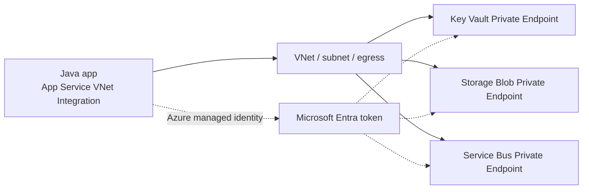

### Private DNS thường gặp

| Dịch vụ | Hostname công khai chuẩn | Private DNS zone thường dùng |
|---|---|---|
| Key Vault | `<vault>.vault.azure.net` | `privatelink.vaultcore.azure.net` |
| Blob Storage | `<account>.blob.core.windows.net` | `privatelink.blob.core.windows.net` |
| ADLS Gen2 DFS | `<account>.dfs.core.windows.net` | `privatelink.dfs.core.windows.net` |
| Service Bus | `<namespace>.servicebus.windows.net` | `privatelink.servicebus.windows.net` |
| Azure SQL Database | `<server>.database.windows.net` | `privatelink.database.windows.net` |

Các zones chỉ là ví dụ phổ biến; cần xác minh theo cloud/region/service và cấu hình thực tế. **Giữ hostname dịch vụ chuẩn** trong Java SDK clients; đừng tự hard-code private IP vào HTTPS URL, vì có thể phá TLS hostname validation và thay đổi khi endpoint được tái cấu hình.

### Cách kiểm tra từ đúng runtime

```bash
# Chạy từ VM/container hoặc App Service console khi được phép.
nslookup kv-orders-lab.vault.azure.net
nslookup storderslab01.blob.core.windows.net
nslookup sb-orders-lab.servicebus.windows.net
```

Sau đó kiểm tra HTTPS/AMQP ports phù hợp với SDK và network policy. Service Bus Java SDK có thể dùng AMQP qua TCP hoặc WebSockets theo cấu hình; nếu egress network chỉ cho HTTPS 443, phải thiết kế transport được hỗ trợ thay vì coi mọi TCP 443 test đều đủ chứng minh AMQP hoạt động.

### App Service VNet integration

**App Service VNet Integration** hỗ trợ workload truy cập các resource trong VNet/private endpoints theo networking plan được cấu hình, còn Private Endpoint của App Service dùng cho inbound access là khái niệm khác. Gắn identity không tự tạo integration; hãy xác định:

- Outbound route từ app instance.
- Private DNS resolution của service đích.
- Firewall/NSG/UDR và peering/hub-and-spoke.
- Service endpoint/private endpoint được phê duyệt.
- Truy cập Microsoft Entra token/managed identity endpoint và các dịch vụ dependencies cần thiết.

**Không mở public network access toàn Internet** chỉ để chữa một lỗi `403`. Hãy phân biệt lỗi authorization, DNS, TLS và connect timeout bằng log/metric tương ứng.

## 24. Phát triển local: dùng Azure CLI nhưng không giả làm managed identity

Máy phát triển thông thường **không có** managed identity endpoint của App Service/VM. Khi chạy cùng code local, `DefaultAzureCredential` có thể nhận được token từ `az login` hoặc developer credentials khác đã được Azure Identity SDK hỗ trợ.

### Các bước local dev

```bash
az login
az account list --output table
az account set --subscription "<dev-subscription-id>"
az account show \
  --query "{tenantId:tenantId,subscriptionId:id,name:name}" \
  --output json
```

Đảm bảo developer principal được cấp quyền ở **dev Key Vault/Storage/Service Bus**, không dùng permissions production một cách mặc định. Khi chạy Java:

```java
TokenCredential credential =
        new DefaultAzureCredentialBuilder().build();
```

Nếu terminal đăng nhập đúng nhưng IntelliJ/VS Code app vẫn thất bại, kiểm tra môi trường shell, đường dẫn tới Azure CLI, phiên đăng nhập, tenant và các environment variables của process Java.

### Vì sao `az login` không đủ?

`az login` chứng minh người phát triển đã đăng nhập vào Azure CLI; nó **không tự gán** role `Key Vault Secrets User`, `Storage Blob Data Contributor` hoặc tạo database user. Nếu SDK lấy token thành công nhưng dịch vụ trả `403`, xử lý **authorization** thay vì chạy `az login` lặp lại.

### Test production identity ở đâu?

Để thực sự test **managed identity**, deploy vào App Service/Function/VM/Container App **được phép** có identity đã bật. Developer credential trên máy local không mô phỏng được host-managed identity, token endpoint, VNet egress hoặc workload identity projection.

Một ma trận kiểm thử:

| Case | Môi trường | Điều cần xác minh |
|---|---|---|
| Local happy path | Dev laptop với Azure CLI | Java SDK sử dụng dev principal và quyền dev đúng |
| Azure host happy path | App Service staging | Java dùng đúng system/user-assigned identity |
| Missing role | Staging identity bị thu hẹp trong môi trường test | Token có thể lấy nhưng dịch vụ từ chối 403 |
| Wrong client ID | Staging với user-assigned | Credential báo không tìm thấy identity được chọn |
| Private-only destination | VNet-connected staging | DNS/routing/SDK request thành công |
| Revoke access | Lab có phê duyệt | Sau propagation/cache, request không còn được cho phép |

## 25. Token lifecycle, caching, timeout và retry

Trong một Java service nhận hàng nghìn requests/giây, không nên tạo mới `DefaultAzureCredential` hay `SecretClient` cho **mỗi HTTP request**. Các Azure SDK clients thường được thiết kế để tái sử dụng; token acquisition có caching và refresh theo implementation.

### Một cách tổ chức dependency injection

Ví dụ Spring Boot:

```java
import com.azure.core.credential.TokenCredential;
import com.azure.identity.DefaultAzureCredentialBuilder;
import com.azure.security.keyvault.secrets.SecretClient;
import com.azure.security.keyvault.secrets.SecretClientBuilder;
import org.springframework.context.annotation.Bean;
import org.springframework.context.annotation.Configuration;

@Configuration
public class AzureClientConfiguration {

    @Bean
    public TokenCredential azureTokenCredential() {
        return new DefaultAzureCredentialBuilder().build();
    }

    @Bean
    public SecretClient secretClient(TokenCredential credential) {
        String vaultUrl = System.getenv("AZURE_KEY_VAULT_URL");
        if (vaultUrl == null || vaultUrl.isBlank()) {
            throw new IllegalStateException("Missing Key Vault endpoint");
        }
        return new SecretClientBuilder()
                .vaultUrl(vaultUrl)
                .credential(credential)
                .buildClient();
    }
}
```

Spring quản lý bean singleton mặc định, tránh tạo credential mới khi request đến. Trong production, có thể dùng `@ConfigurationProperties` và validation thay vì chỉ đọc `System.getenv`; quan trọng là **endpoint và danh tính rõ ràng**, client không bị tạo lại vô ích.

### Ba loại cache không giống nhau

| Cache | Đối tượng | Cần chú ý |
|---|---|---|
| **Access token cache** | Entra access token có expiry | Để SDK/credential quản lý khi có thể |
| **Resource data cache** | Secret value, Blob metadata, configuration | Có TTL/refresh/rotation và chính sách nhạy cảm |
| **Authorization cache** | Group membership/entitlements của người dùng | Thu hồi quyền có độ trễ và cần giới hạn |

Đừng dùng `getSecret()` trên mỗi health probe; nhưng cũng không cache external API secret vĩnh viễn vì nó có thể bị rotate. Thiết kế timeout/cache theo business SLA và chính sách bảo mật.

### Lỗi tạm thời và lỗi vĩnh viễn

| Loại lỗi | Có nên tự động retry? | Ví dụ |
|---|---|---|
| Throttling/tạm mất kết nối | Có thể, có **backoff/jitter/deadline** | `429`, `503` hoặc network transient |
| Identity endpoint tạm chưa sẵn sàng | Có thể retry ngắn theo SDK policy | Instance vừa khởi tạo |
| Managed identity không được gắn | Không retry vô hạn | Credential unavailable do cấu hình |
| Chọn nhầm client ID | Không retry mù | User-assigned identity không gắn vào host |
| Thiếu data RBAC | Không retry mù | `403` vì thiếu role |
| Key Vault secret không tồn tại | Không retry mù | `404` do tên/path sai |
| Token sai audience | Phải sửa code/config | `401`/authentication error |
| ETag/data conflict | Cần logic nghiệp vụ | `409`, `412` ở dịch vụ hỗ trợ |

### Đừng nhân retry ở nhiều tầng

Ví dụ một HTTP API có retry 3 lần, Azure SDK retry thêm 3 lần và một queue worker cũng giao message lại nhiều lần. Một lỗi `403` không thể tự chữa có thể gây **retry storm**, tăng tải/cost và làm chậm incident detection.

Chỉ retry lỗi thực sự tạm thời, đặt retry budget tổng, sử dụng idempotency cho writes và giám sát retries theo dependency. **Không giả định mọi `401` là do token hết hạn**; SDK thường xử lý token refresh, còn 401 có thể do sai audience/tenant/endpoint/configuration.

### Rotation và thay identity

Khi chuyển từ system-assigned sang user-assigned identity:

1. Tạo identity mới và gắn với workload.
2. Gán quyền tối thiểu cho principal mới.
3. Cấu hình Java chọn **client ID mới**.
4. Triển khai staging rồi chạy end-to-end tests.
5. Chuyển traffic theo quy trình.
6. Rà soát và thu hồi role assignments của identity cũ sau thời gian rollback.

Nếu chỉ đổi `AZURE_CLIENT_ID` mà chưa gán identity mới vào host hoặc chưa cấp data roles, app sẽ lỗi. Nếu xóa system-assigned identity cũ trước khi kiểm chứng user-assigned mới, dễ gây downtime.

## 26. Observability: biết app đang dùng identity nào mà không lộ token

Một sự cố đáng sợ là Java app vẫn lấy được token, nhưng đó là **identity staging** đang chạy trên môi trường production do cấu hình sai. Để phát hiện, cần theo dõi identity metadata và role assignments an toàn.

### Ghi gì vào logs?

| Trường | Có thể log? | Lý do |
|---|---|---|
| App deployment/environment | Có, không chứa bí mật | Khoanh vùng instance |
| Credential mode (`managed identity`/`workload identity`) | Có | Biết chain dự kiến |
| Client ID (đã được duyệt/định danh nội bộ) | Cân nhắc theo policy | Debug chọn user-assigned identity |
| Principal ID | Có thể trong logs truy cập hạn chế | Đối chiếu Azure RBAC |
| Tenant ID | Có thể trong logs hạn chế | Chẩn đoán wrong-tenant |
| Target service hostname | Có | Phát hiện nhầm môi trường/region |
| Operation, duration, status code, request ID | Có, đã loại PII | Tracing và SLO |
| **Raw access token** | **Không** | Bearer credential nhạy cảm |
| **Client secret, SAS, storage key** | **Không** | Lộ quyền truy cập |
| **Key Vault secret value** | **Không** | Dữ liệu nhạy cảm |
| User data/connection strings chứa password | Không | PII/credential leakage |

Không tự gọi IMDS rồi in JWT lên stdout để “xác minh identity”. Cách an toàn hơn:

1. Dùng Azure CLI/portal đọc **identity metadata** được gắn vào workload.
2. Đọc **role assignment** tương ứng.
3. Từ app staging gọi một thao tác **read-only, không nhạy cảm** đến target service.
4. Ghi success/failure và operation/request IDs, **không log token**.

### Azure Monitor và Application Insights

- Theo dõi tỷ lệ lỗi `401`, `403`, `429`/`503` theo dependency.
- Đo p50/p95 latency của Key Vault, Blob, SQL và Service Bus SDK operations.
- Ghi correlation IDs để nối request từ API với lỗi dependency.
- Bật diagnostic settings/audit logs phù hợp cho Key Vault/Storage/Service Bus.
- Theo dõi **role assignments, identity enable/disable, firewall changes** qua Azure Activity Logs.
- Tạo alert khi production đang thành công bỗng tăng mạnh `403` sau deployment/role change.

Không để logging framework in full `Authorization` header, exception request headers hoặc HTTP body có secret. Đánh giá cấu hình Azure SDK HTTP logging trước khi bật DEBUG/TRACE trong production.

### Độ trễ role assignment và token cache

Role mới có thể cần thời gian propagation, và token/cache của service có thể làm độ trễ hiệu lực khác nhau. Không hứa “gán role xong là app lập tức truy cập được trong vài giây”; ghi timestamp thay đổi, thử lại trong giới hạn hợp lý, xác minh principal/scope và có cảnh báo nếu vượt ngưỡng triển khai cho phép.

## 27. Bảo mật managed identity trước các mối đe dọa thực tế

Managed identity loại bỏ một lớp bí mật tĩnh, nhưng không thể ngăn **mọi kiểu truy cập trái phép**. Nếu kẻ tấn công chạy được mã trong đúng workload hoặc lợi dụng server-side request forgery (SSRF) tới identity endpoint, họ có thể tìm cách lấy/đánh cắp token trong phạm vi những gì host cung cấp.

### Mô hình đe dọa

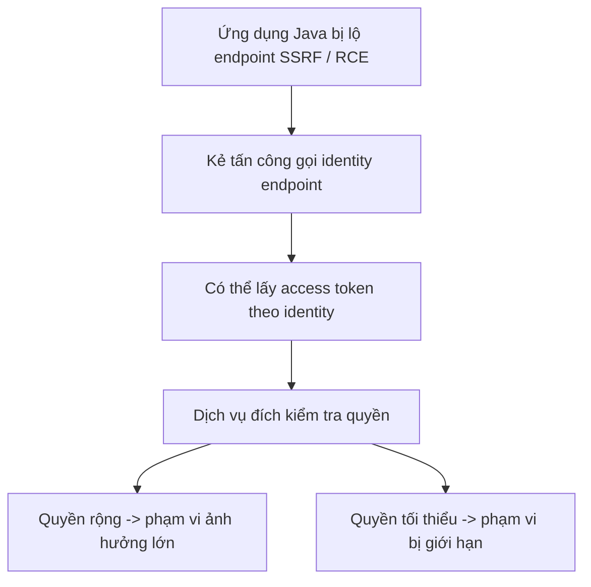

### Những kiểm soát quan trọng

1. **Ngăn SSRF:** validate URL/domain, chống redirect độc hại và block link-local/internal destinations khi ứng dụng tải URL do người dùng nhập.
2. **Giảm remote code execution:** cập nhật thư viện, hạn chế shell/process execution, scan dependencies và bảo vệ deployment pipeline.
3. **Không dùng identity chung toàn tổ chức:** chia identity theo ứng dụng, môi trường và trust boundary.
4. **Role và scope tối thiểu:** một identity bị lộ không nên có quyền delete toàn bộ data lake hoặc quản lý Key Vault.
5. **Tách management plane/data plane:** runtime không cần quyền tạo role assignments hoặc thay network firewall.
6. **Chạy process/container với quyền OS tối thiểu:** hạn chế lạm dụng host identity endpoint và quyền đọc file/token.
7. **Kiểm soát outbound network:** chỉ cho workload kết nối những destinations cần thiết.
8. **Theo dõi bất thường:** access pattern lạ, số lần lấy token tăng bất thường, data exfiltration indicators.
9. **Kiểm soát xóa/rebuild identity:** identity deletion/recreate có thể làm đổi principal và role assignments.
10. **Ứng cứu:** có quy trình vô hiệu hóa/thu hồi quyền phù hợp, cô lập workload và phục hồi an toàn.

### “Không có client secret” không có nghĩa “không có secrets”

Java service có thể vẫn giữ:

- OAuth token của khách hàng/đối tác trong memory.
- JWT của người dùng cuối.
- API key đối tác được lấy từ Key Vault.
- TLS client certificate hoặc dữ liệu nhạy cảm.

Hãy giữ các secrets này trong phạm vi cần thiết, không log, không đưa vào exception messages, không gắn vào URL query string và có cơ chế rotation phù hợp.

### Thận trọng khi dùng system-assigned identity trên VM dùng chung

Nhiều containers/processes trong cùng VM có thể bị ảnh hưởng bởi quyền identity ở host. Với ứng dụng không tin nhau, đừng chỉ tách container rồi coi đó là ranh giới Entra identity mạnh; nếu cần workload-specific identity thực, cân nhắc platform có cơ chế cô lập identity như AKS Workload ID.

## 28. Troubleshooting: tại sao Java managed identity không hoạt động?

Khi Java app báo “Could not acquire token” hoặc một Azure service từ chối truy cập, nên xác định **lỗi xảy ra ở lớp nào**:

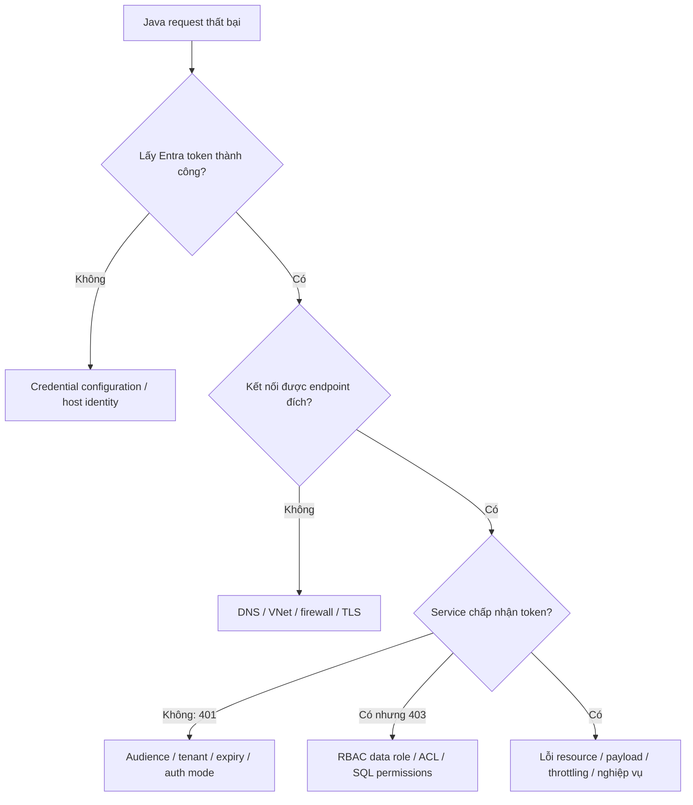

### Ma trận lỗi

| Triệu chứng | Nguyên nhân thường gặp | Kiểm tra và xử lý |
|---|---|---|
| `ManagedIdentityCredential authentication unavailable` trên laptop | Không có Azure host identity endpoint | Dùng `DefaultAzureCredential` và `az login` cho local dev |
| Credential unavailable trên App Service | Identity chưa bật hoặc app chạy sai host | `az webapp identity show`, app configuration, instance logs |
| Java chọn identity sai | `AZURE_CLIENT_ID` sai hoặc credential chain ưu tiên cấu hình khác | Xác minh actual client/principal ID và remove environment secrets cũ |
| User-assigned identity không được tìm thấy | Identity resource tạo nhưng chưa gắn vào host | Kiểm tra resource ID attachment và client ID |
| Lấy token được nhưng Key Vault `403` | Thiếu `Key Vault Secrets User`, vault dùng access policy, scope sai | Xác minh vault permission model, principal, RBAC/access policy |
| Key Vault `404` | Secret/vault name sai hoặc path sai | Xem tên secret, version và vault endpoint từ môi trường đúng |
| Blob upload trả `403` | Có Azure management Contributor nhưng thiếu Storage Blob Data Contributor | Gán đúng data-plane role ở scope phù hợp |
| Service Bus send `403` | Có Receiver nhưng thiếu Sender hoặc role sai namespace/queue | Kiểm tra `Azure Service Bus Data Sender` |
| Azure SQL login failed | Identity chưa có database user/permissions | Kiểm tra `CREATE USER FROM EXTERNAL PROVIDER`, SQL grants, token |
| HTTP `401` | Token sai audience/tenant hoặc auth policy không chấp nhận token | Xác minh SDK endpoint, scope, service authentication setting |
| Timeout tới private Key Vault | VNet integration/DNS/route/firewall/PE sai | Test DNS và network path từ **host thật** |
| App Service public DNS trả private IP ngoài ý muốn | Private DNS link/forwarder sai scope | Kiểm tra DNS từ vùng mạng đang chạy app |
| App Service có identity nhưng Functions trigger không hoạt động | Binding/runtime connection vẫn dùng connection string thiếu hoặc cấu hình identity riêng | Xem host storage/extension connection settings |
| Java pod AKS không lấy token | OIDC issuer/FIC/ServiceAccount/label thiếu hoặc sai | Kiểm tra issuer/subject/audience và projected token configuration |
| Workload Identity lấy token nhưng vault `403` | Role gán cho AKS kubelet/control plane thay vì workload principal | Gán role cho **identity linked với ServiceAccount** |
| Sau deploy slot mới, mọi request `403` | Slot/new resource có identity mới chưa được gán quyền | So principal IDs và role assignments theo slot |
| Mọi requests thành công local, thất bại production | Local developer có quyền nhưng runtime MI chưa được cấp | Test bằng production identity trong staging |
| Chỉ một số instances bị lỗi | Scale/revision/image/config drift hoặc propagation | So actual identity/config/region trên từng instance |
| Sau khi revoke quyền vẫn truy cập một thời gian | Token/authorization cache và propagation | Ghi thời điểm thay đổi, xem cache/TTL và policy revocation |
| `429`/`503` liên tục | Destination throttling, retry amplification, capacity | Backoff/jitter, giảm concurrency, xem service metrics |
| Thông tin token bị lộ trong logs | DEBUG HTTP logging hoặc code in token | Ngưng log, hạn chế truy cập, thực hiện incident response |
| Service Bus TCP connection không mở | AMQP transport/egress firewall | Kiểm tra ports và WebSockets khi được hỗ trợ |
| App Service không vào private endpoint dù token đúng | Outbound VNet integration chưa cấu hình | Kiểm tra outbound route, không nhầm inbound PE |
| JDBC lỗi sau vài giờ | Token tự cache sai/connection pool cấu hình lỗi | Dùng driver managed identity auth phù hợp, test long-lived pools |

### Nguyên tắc điều tra tuần tự

1. **Đúng ứng dụng/môi trường?** Resource group, subscription, App Service/Function/Container App/pod.
2. **Identity nào đã gắn?** System vs user-assigned, client ID, principal ID, tenant.
3. **SDK dùng credential nào?** `DefaultAzureCredential` hay `ManagedIdentityCredential`, không in token.
4. **Target có đúng?** Vault URL, Blob endpoint, Service Bus namespace, SQL database.
5. **Network?** DNS, private endpoint approval, VNet, route/NSG và TLS.
6. **Authorization?** Data-plane RBAC, Key Vault permission model, SQL user/ACL.
7. **Runtime behavior?** Token cache, retries, scaling, cold start, role propagation.
8. **Rollback/incident?** Nếu prod vừa hỏng, phục hồi theo change plan thay vì cấp quyền rộng.

### Thứ tự xử lý lỗi 403

**Không bắt đầu bằng `az role assignment create --role Owner`.** Thực hiện:

```text
403
  |
  +-- Xác định target service và operation
  +-- Xác định principal ID thực tế
  +-- Xác định permission model của target
  +-- Xác định đúng data-plane role/scope (hoặc SQL grants/ACL)
  +-- Xác định network firewall và token audience
  +-- Sửa cấu hình nhỏ nhất, test lại, ghi audit
```

Trong môi trường có **deny assignments**, policy hoặc conditional access/workload identity restrictions, gán thêm một allow role chưa chắc đủ. Xem thông báo dịch vụ và chính sách tổ chức thay vì suy rằng mọi `403` là thiếu role.

## 29. Case study: Java Spring Boot API xử lý đơn hàng không lưu Azure keys

### Yêu cầu

Một API đặt hàng triển khai trên Azure App Service cần:

1. Đọc một **secret của đối tác vận chuyển** từ Key Vault.
2. Ghi một file hóa đơn PDF giả vào Blob Storage.
3. Gửi event `OrderCreated` tới Service Bus.
4. Ghi audit/tracing mà **không log secret/token hoặc PII**.
5. Có thể triển khai Blue/Green bằng user-assigned identity được kiểm soát.

### Kiến trúc đề xuất

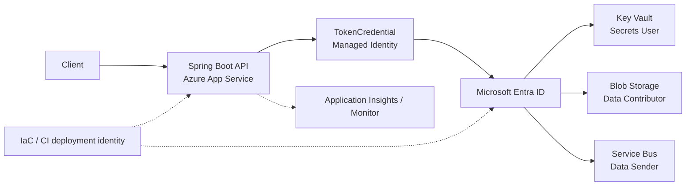

### Lựa chọn identity

Nếu App Service duy nhất và không yêu cầu giữ principal qua việc tạo lại resource, **system-assigned identity** là lựa chọn đơn giản.

Nếu có deployment slots/Blue-Green và cần chuẩn bị role assignments trước, cân nhắc **user-assigned identity `id-orders-runtime`**, nhưng kiểm tra security boundary: staging và production không nên chia sẻ identity nếu chúng chứa dữ liệu khác độ nhạy cảm.

### Tách quyền theo nghiệp vụ

| Thao tác | Data-plane permission | Không cần |
|---|---|---|
| `getSecret("carrier-token")` | Key Vault Secrets User | Secrets Officer, Owner |
| Upload `invoices/...` | Storage Blob Data Contributor ở container được phép | Storage account key |
| Send `OrderCreated` | Service Bus Data Sender ở queue/topic thích hợp | Data Owner, Data Receiver |
| Xem application logs | App Insights/Log Analytics roles theo người vận hành | Runtime app có quyền sửa mọi diagnostics |
| Deploy build/version | CI identity có quyền deploy resource đúng scope | Runtime MI có quyền tạo role assignments |

### Quy trình phát hành

1. Tạo App Service/identity bằng IaC được duyệt.
2. Gán role assignments cho **principal ID** đúng.
3. Chuẩn bị Key Vault secret nguồn bên thứ ba theo quy trình secret management.
4. Đặt `AZURE_KEY_VAULT_URL`, Blob endpoint/container, Service Bus namespace/queue; **không đặt account keys/SAS**.
5. Java app khởi tạo một `TokenCredential` chung và clients dùng lại.
6. Test stage: đọc secret, ghi một Blob **lab**, gửi một Service Bus message **lab**, xác nhận status/trace.
7. Kiểm tra Private Endpoint/DNS nếu target không cho public access.
8. Đo p95 latency và số `401/403` ở khởi động và sau thời gian dài (token refresh).
9. Cutover traffic; theo dõi incidents và rollback nếu phát hiện identity/role mismatch.
10. Sau rollback window, thu hồi quyền của identity không còn sử dụng.

### Kiểm chứng negative tests

Một thiết kế an toàn phải **thất bại đúng cách** khi:

- Java thử **xóa Blob** trong khi identity chỉ được cấp Reader (nếu app không cần write).
- Java thử đọc secret ngoài vault được phép.
- Java thử gửi message tới namespace ngoài phạm vi cho phép.
- App bị trỏ nhầm sang Storage account production trong lúc chạy staging.
- Java cấu hình user-assigned client ID chưa gắn với host.

Negative tests phải chạy trên **môi trường lab có tài nguyên giả** và không làm thay đổi production. Việc app bị từ chối đúng khi không có quyền là **kết quả mong muốn**, không phải bug cần “fix” bằng Owner.

### Sự cố sau deploy

Nếu app mới trả `403` khi gọi Key Vault nhưng Blob vẫn hoạt động, điều đó cho biết:

- Managed identity token acquisition ít nhất hoạt động cho một Azure resource.
- Lỗi có thể là Key Vault role/scope, vault permission model, policy/network hoặc token audience.
- Không cần khôi phục client secret của ứng dụng trong code.

Quy trình hợp lý là xác minh đúng `principalId` của revision/slot mới, vault authorization mode và access log/request ID, rồi sửa **một chỗ** có bằng chứng. Không tắt toàn bộ bảo mật để app hoạt động tạm.

## 30. Bài tập và câu hỏi tự kiểm tra

### Bài tập A. Chọn loại identity

Một App Service chạy duy nhất trong môi trường staging cần đọc một Key Vault; app có thể bị xóa/tạo lại mà không cần giữ identity. Nên bắt đầu từ loại nào?

*Gợi ý:* **System-assigned managed identity** thường đơn giản, vòng đời gắn với App Service. Phải cập nhật role assignments nếu resource bị tạo lại với principal mới.

### Bài tập B. Phân biệt Client ID và Principal ID

Khi gán role bằng `--assignee-object-id`, nên truyền `clientId` hay `principalId` của user-assigned identity?

*Gợi ý:* **Principal ID/object ID**. Dùng **client ID** để chọn identity trong `ManagedIdentityCredentialBuilder.clientId(...)`.

### Bài tập C. Lỗi 403 sau khi token thành công

Java `DefaultAzureCredential` lấy được token, nhưng `BlobClient.upload()` trả `403`; principal chỉ có Contributor trên Storage account management plane. Thiếu gì?

*Gợi ý:* **Storage Blob Data Contributor** ở scope phù hợp; kiểm tra network/policy nếu vẫn lỗi.

### Bài tập D. Wrong credential trong production

Một container production có `AZURE_CLIENT_ID`, `AZURE_TENANT_ID` và `AZURE_CLIENT_SECRET` do cấu hình cũ, dù đã bật managed identity. Vì sao `DefaultAzureCredential` có thể chọn danh tính không mong muốn?

*Gợi ý:* Credential chain có thể dùng environment credential trước/khác MI; loại cấu hình cũ hoặc chọn `ManagedIdentityCredential` tường minh theo runtime.

### Bài tập E. Local development

Java chạy trên laptop với `ManagedIdentityCredentialBuilder().build()` trả credential unavailable, nhưng `az login` đã thành công. Vì sao?

*Gợi ý:* Laptop không có Azure managed identity endpoint. Dùng `DefaultAzureCredential` cho dev; kiểm tra CLI identity có data roles trên dev resources.

### Bài tập F. AKS Workload ID

Pod AKS có ServiceAccount annotation trỏ client ID đúng, nhưng FIC subject là `system:serviceaccount:default:orders-api` trong khi pod ở namespace `apps`. Token exchange có hoạt động không?

*Gợi ý:* Không, subject mismatch. FIC cần `system:serviceaccount:apps:orders-api` và đúng issuer/audience.

### Bài tập G. Key Vault network

App Service có Secrets User role nhưng Key Vault đang private-only, app không có outbound VNet integration. Nên làm gì?

*Gợi ý:* Thiết kế outbound VNet integration, private endpoint, DNS/route trước. Không cấp Owner hay mở public access toàn Internet.

### Bài tập H. Azure SQL

JDBC driver đã xác thực managed identity thành công nhưng database báo thiếu quyền đọc bảng `dbo.Orders`. Cấp thêm Owner trên Azure SQL server có phải giải pháp đúng?

*Gợi ý:* Không. Kiểm tra contained database user và `GRANT SELECT`/database roles phù hợp.

### Bài tập I. Token caching

Một app tự giữ access token trong biến static và sau một giờ mọi request thất bại `401`. Đề xuất sửa?

*Gợi ý:* Đưa `TokenCredential` vào Azure SDK clients để chúng quản lý token lifecycle, hoặc xây refresh theo `expiresAt` nếu gọi REST thủ công.

### Bài tập J. Identity và CI/CD

Pipeline CI chạy bên ngoài Azure cần deploy App Service có MI. Pipeline có tự lấy token của App Service MI không?

*Gợi ý:* Không. Pipeline cần identity/deployment credentials riêng, có thể dùng OIDC federation; runtime MI chỉ dành cho app chạy trong Azure host hỗ trợ.

### Bài tập K. Role sharing

Ba microservices thuộc nhóm khác nhau dùng chung user-assigned identity có quyền đọc toàn bộ Storage account. Rủi ro?

*Gợi ý:* Blast radius lớn, khó audit theo service. Tách identities/scopes theo trust boundary hoặc domain nghiệp vụ.

## 31. Lab end-to-end: Java → Key Vault → Blob Storage

**Mục tiêu:** Một ứng dụng Java chạy trên App Service **staging** lấy secret giả từ Key Vault và ghi một file demo lên Blob Storage, **không dùng account key, SAS hoặc service principal secret**. Toàn bộ thao tác diễn ra trên subscription/resource group được phê duyệt và chỉ dùng tài nguyên lab.

### 31.1. Chuẩn bị các tài nguyên

| Tài nguyên | Tên minh họa | Điều kiện |
|---|---|---|
| Resource group | `rg-java-lab` | Bạn có quyền triển khai lab |
| App Service | `java-orders-api` | Runtime Java supported |
| Key Vault | `kv-orders-lab` | Dùng RBAC authorization model hoặc access policy được cấu hình |
| Secret test | `external-api-token` | Giá trị giả, không dùng token đối tác thật |
| Storage account | `storderslab01` | Blob service được hỗ trợ |
| Blob container | `reports-lab` | Đã provision |
| Managed identity | System-assigned hoặc user-assigned | Được gắn vào App Service |

Trước lab, kiểm tra **network**: App Service có đường HTTPS tới Key Vault/Blob. Với tài nguyên private-only, cần cấu hình outbound VNet integration và Private DNS theo quy trình quản trị được duyệt.

### 31.2. Bật system-assigned identity

```bash
az login
az account set --subscription "<lab-subscription-id>"

az webapp identity assign \
  --resource-group "rg-java-lab" \
  --name "java-orders-api"

az webapp identity show \
  --resource-group "rg-java-lab" \
  --name "java-orders-api" \
  --query "{principalId:principalId,tenantId:tenantId}" \
  --output json
```

Ghi lại principal ID theo quyền truy cập của đội. Nếu lệnh không tìm thấy App Service hoặc bạn không có quyền, **dừng để kiểm tra lab resource**, không tự tạo App Service trong môi trường khác.

### 31.3. Cấp quyền tối thiểu

Qua portal hoặc CLI đã được phê duyệt:

1. Cho principal của App Service quyền **Key Vault Secrets User** trên lab Key Vault (khi vault dùng RBAC).
2. Cho cùng principal quyền **Storage Blob Data Contributor** tại scope của lab container/Storage account.
3. Không cấp `Owner`, `Key Vault Administrator` hoặc `Storage Account Contributor` nếu không cần.
4. Không bật public access rộng để “đảm bảo demo chạy”.

Kiểm tra principal ID ở kết quả role assignment đúng với identity của App Service, không phải người đang chạy `az login`.

### 31.4. Deploy ứng dụng Java

Dùng class `KeyVaultReadExample` và `BlobManagedIdentityExample` đã nêu, hoặc tích hợp hai thao tác vào một Spring Boot handler staging được bảo vệ.

Application settings:

```text
APP_RUNTIME=azure-managed-identity
AZURE_KEY_VAULT_URL=https://kv-orders-lab.vault.azure.net/
AZURE_STORAGE_BLOB_ENDPOINT=https://storderslab01.blob.core.windows.net
AZURE_STORAGE_CONTAINER=reports-lab
```

Với system-assigned managed identity, app có thể dùng `new ManagedIdentityCredentialBuilder().build()`. Nếu giữ `DefaultAzureCredential`, kiểm tra không có environment credential chứa client secret không mong muốn. **Không đưa secret value vào response của test handler.**

### 31.5. Xác minh happy path

1. Đọc secret demo và chỉ log `Key Vault read succeeded`.
2. Upload một file tên duy nhất như `reports/lab-order-001.txt`.
3. Xem Blob metadata/file tồn tại với principal test được phép.
4. Ghi HTTP status, request ID, endpoint, latency của cả hai operations.
5. Tại Azure portal, đối chiếu logs/diagnostics với resource thực.

Không kiểm thử bằng dữ liệu khách hàng thật; một file chứa `lab-order-001` là đủ.

### 31.6. Negative tests

Trên **tài nguyên lab riêng**, và chỉ khi được phê duyệt:

- Bỏ quyền Secrets User của app identity rồi thử gọi secret: kỳ vọng bị từ chối sau propagation thích hợp.
- Giữ Key Vault role nhưng bỏ Blob Contributor: kỳ vọng getSecret còn hoạt động trong khi upload bị từ chối.
- Với user-assigned identity, thử `AZURE_CLIENT_ID` không gắn: kỳ vọng credential error.
- Thử truy cập một Blob container khác mà principal không được cấp quyền: kỳ vọng bị từ chối nếu scope thực sự đã giới hạn.
- Nếu có private-only lab, thử xác minh DNS/routing từ App Service và policy chặn public.

**Không cố tình tắt quyền vào tài nguyên dùng chung hay gây outage.** Sau negative test, dùng IaC/role assignments đã ghi để phục hồi lab state; kiểm tra thay đổi có hiệu lực trước khi kết luận.

### 31.7. Báo cáo lab mẫu

```text
Test run: mi-java-lab-001
Host: App Service staging
Identity type: system-assigned
Principal ID: [record securely / internal only]
Key Vault getSecret: PASS (no value logged)
Blob upload: PASS
Expected negative test 403: PASS
Private network DNS: VERIFIED / NOT APPLICABLE
Azure SDK versions: [approved versions]
Secrets in source/build artifacts: NONE
Unresolved issues: NONE
```

Đây là **khuôn báo cáo**, không phải kết quả lab thực tế đã được chạy. Bạn chỉ ghi PASS khi đã quan sát đúng kết quả trong môi trường được phép. Thu dọn các file demo/tài nguyên **do chính lab tạo** theo quy trình, không xóa resources dùng chung.

## 32. Checklist triển khai managed identity cho Java production

### Danh tính và quyền

- [ ] Xác định system-assigned hay user-assigned theo vòng đời và trust boundary.
- [ ] Ghi lại đúng `clientId`, `principalId`, `tenantId`, `resourceId` khi cần.
- [ ] Không dùng một identity chung cho những apps có mức độ nhạy cảm khác nhau nếu không có lý do và kiểm soát.
- [ ] Role assignments ở scope nhỏ nhất; tránh Owner/Contributor toàn subscription.
- [ ] Xác minh data-plane roles cho Key Vault, Storage, Messaging, Search, Cosmos DB hoặc SQL grants.
- [ ] Không nhầm management plane RBAC với data plane permissions.
- [ ] Managed identity thật được gắn đúng host/slot/revision/VMSS và có thể lấy token.

### Java SDK

- [ ] Sử dụng `TokenCredential`, SDK versions được hỗ trợ và endpoint chính xác.
- [ ] `DefaultAzureCredential` dùng có chủ đích; production không vô tình lấy environment secret cũ.
- [ ] User-assigned identity được chọn bằng **client ID**, không phải principal ID.
- [ ] Với AKS Workload ID, FIC/ServiceAccount/OIDC và `WorkloadIdentityCredential` chính xác.
- [ ] Không hard-code connection strings chứa keys, SAS, secrets hoặc JWT trong source/config.
- [ ] Client/credential được tái sử dụng, token refresh được SDK quản lý.
- [ ] Retry có giới hạn; không retry vô tận `403` hoặc credential configuration errors.
- [ ] Service Bus/messaging writes có idempotency và retry strategy.
- [ ] JDBC/SQL driver tương thích Entra authentication và connection pool được kiểm thử.

### Networking và bảo mật

- [ ] App có outbound route/VNet integration phù hợp, không nhầm inbound Private Endpoint.
- [ ] Private DNS, firewall, NSG, TLS và ports đến từng Azure service đã được kiểm tra.
- [ ] Key Vault/Storage/Service Bus có network rules theo chính sách tổ chức.
- [ ] Không mở public network toàn Internet để bỏ qua lỗi cấu hình.
- [ ] Không log token, secret values, SAS, keys hoặc dữ liệu cá nhân.
- [ ] Có phòng vệ SSRF/RCE và kiểm soát outbound network.
- [ ] Có quy trình xoay vòng secret của bên thứ ba và thu hồi quyền identity.

### CI/CD và vận hành

- [ ] Deployment identity tách khỏi runtime identity.
- [ ] Identity/role assignments được mô tả bằng IaC hoặc change-managed workflow.
- [ ] App Service slot/new resource và blue/green cutover có kế hoạch identity migration.
- [ ] Có integration tests trên Azure host thật, không chỉ unit tests dùng local Azure CLI.
- [ ] Có negative tests quyền, wrong tenant/client ID, private networking và token lifecycle.
- [ ] Có alerts cho `401/403`, dependency failures, role changes, throttling và token errors.
- [ ] Có audit để xác định principal thực tế, target service và correlation ID.
- [ ] Có rollback plan nếu gán role sai, đổi identity, deploy slot hoặc thay network.
- [ ] Review quyền định kỳ và xóa role assignments của identities không còn dùng.
- [ ] Đã rà soát chi phí/độ trễ của Key Vault calls, token acquisition, retry và phụ thuộc mạng.

## 33. Kết luận

**Dùng managed identity từ ứng dụng Java trên Azure** giúp ứng dụng gọi các dịch vụ hỗ trợ **Microsoft Entra ID** mà không cần tự lưu **client secret hoặc account key để xác thực workload**. Cách làm đúng bắt đầu từ việc chọn **system-assigned hoặc user-assigned identity**, xác định chính xác **client ID và principal ID**, sau đó dùng **Azure Identity SDK (`DefaultAzureCredential` / `ManagedIdentityCredential`)** và cấp **data-plane permissions** đúng tài nguyên. Trên **App Service, Functions, VMs và Container Apps**, Azure host cung cấp identity cho workload; trên **AKS**, cần phân biệt với **Microsoft Entra Workload ID** sử dụng Kubernetes ServiceAccount và OIDC federation.

Managed identity chỉ là một lớp trong kiến trúc tin cậy: **token có thể hợp lệ nhưng vẫn thiếu RBAC, SQL grants hoặc đường mạng private**. Vì vậy ứng dụng Java production phải có **scope quyền tối thiểu, networking được xác minh, token lifecycle do SDK quản lý, không log secrets, test trên host thật, giám sát và runbook phục hồi**. Kết quả mong muốn không chỉ là bỏ một connection string khỏi cấu hình, mà là một hệ thống **dễ triển khai, có thể xoay vòng danh tính, quan sát được quyền truy cập và giảm đáng kể rủi ro lộ thông tin xác thực**.
