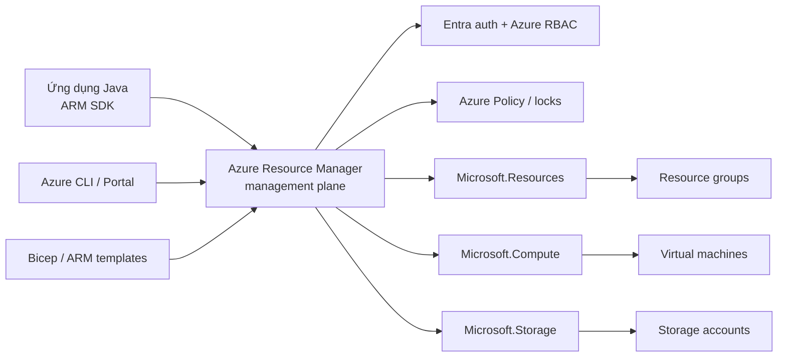
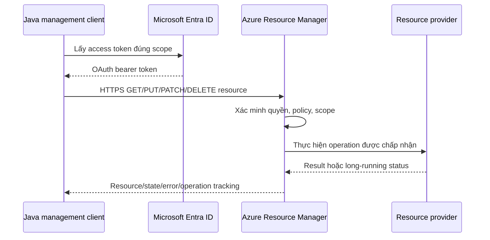
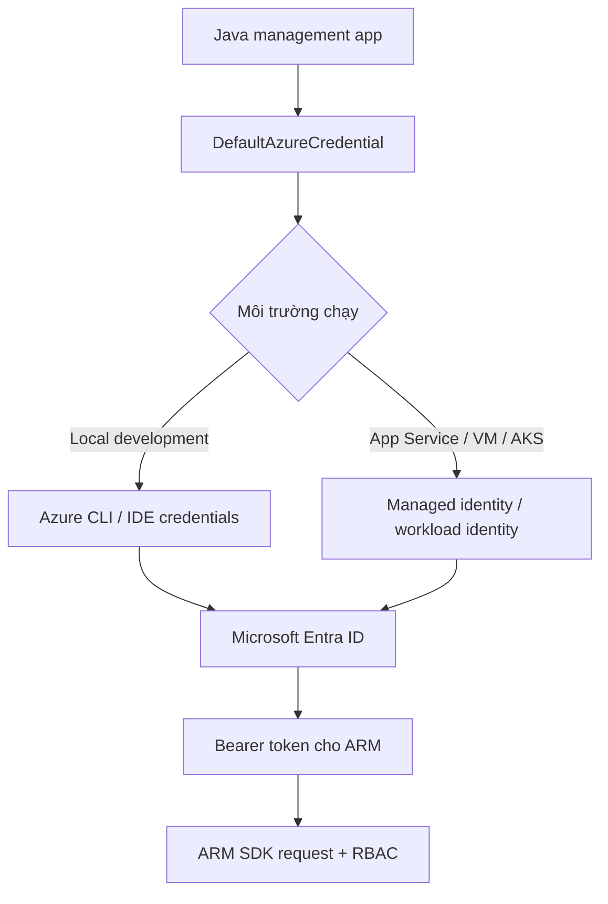
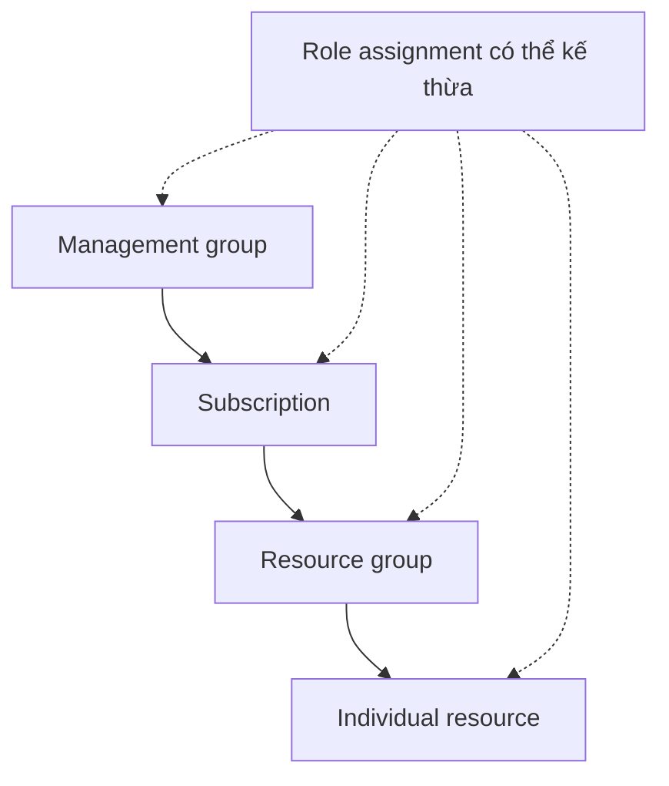
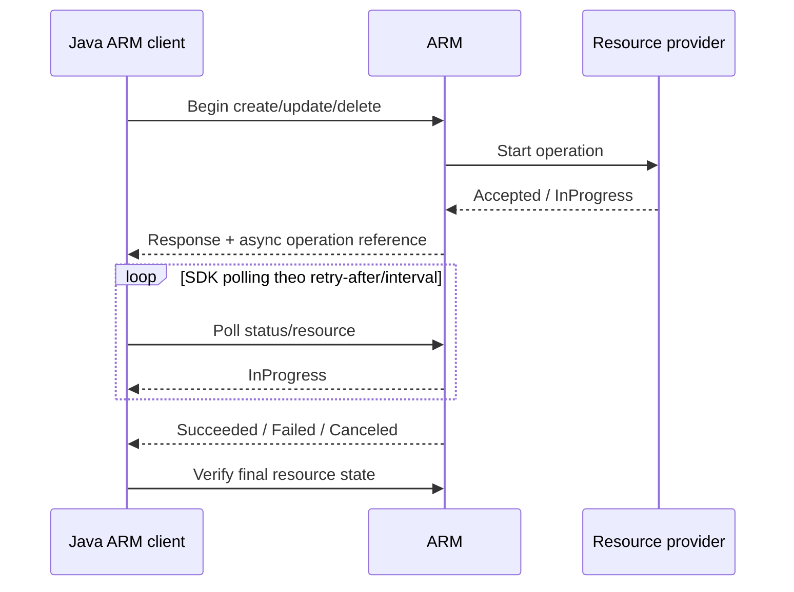
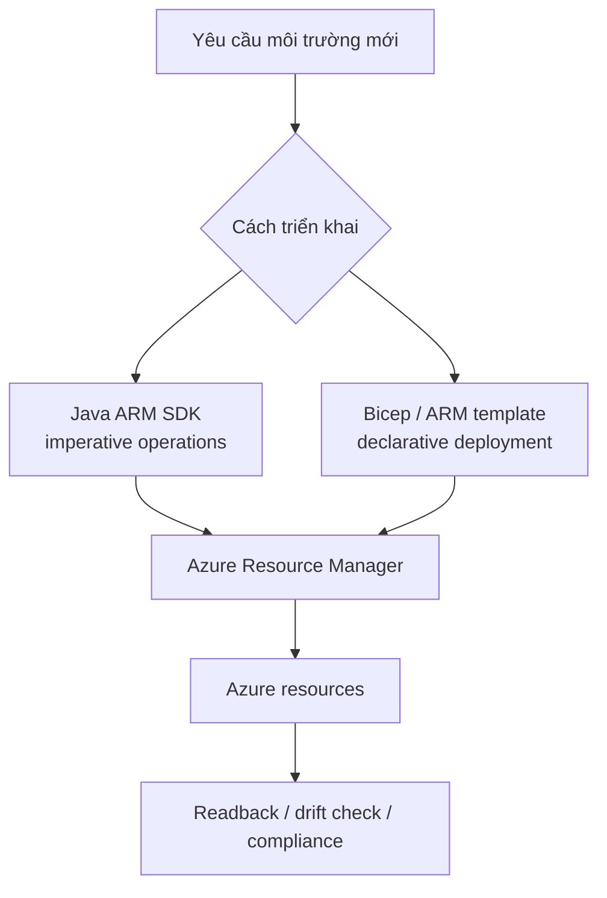
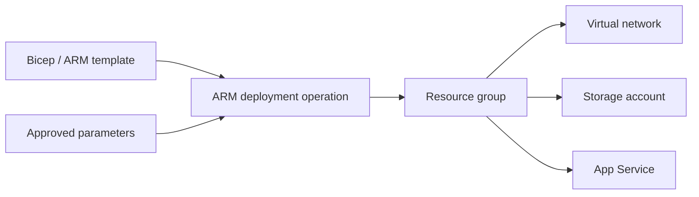
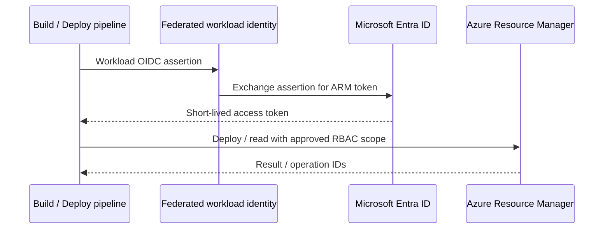
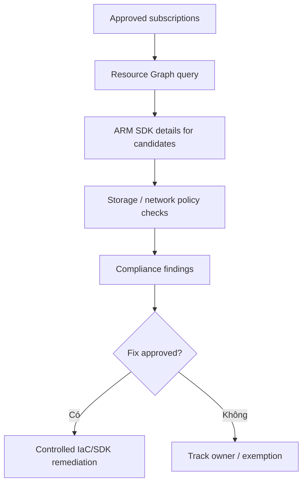

# Quản lý hạ tầng bằng Azure Resource Manager SDK

Một công ty đang triển khai ứng dụng Java trên **Azure App Service** và lưu dữ liệu trong **Azure Storage**. Khi lập môi trường kiểm thử cho mỗi nhánh phát triển, đội kỹ thuật phải tạo resource group, kiểm tra cấu hình storage/network, gắn tags, áp chính sách bảo mật và xóa tài nguyên thử nghiệm khi kết thúc. Nếu chỉ thao tác thủ công trên Azure Portal, các môi trường có thể lệch nhau, khó audit và mất thời gian. Một chương trình Java có thể tương tác trực tiếp với **Azure Resource Manager (ARM)** để thực hiện các thao tác quản lý tài nguyên có kiểm soát.

**Azure Resource Manager SDK for Java** là nhóm thư viện giúp chương trình Java làm việc với **management plane** của Azure: đọc, tạo, cập nhật, liệt kê hoặc xóa các tài nguyên như resource group, virtual machine, storage account và các dịch vụ được thư viện hỗ trợ. Nó khác với SDK **data plane** dùng để đọc blob, gửi message, truy vấn SQL hoặc thao tác dữ liệu trong tài nguyên.

Bài học thuộc chương **Azure SDK cho Java** của module **CLOUD_PROVIDERS_AZURE**. Module hướng tới khám phá hệ sinh thái Microsoft Azure từ subscription, resource group và Microsoft Entra ID đến mạng ảo, compute, storage, dữ liệu; đồng thời triển khai, giám sát, bảo vệ và kiểm soát chi phí kiến trúc ứng dụng. Vì vậy bài này không chỉ giới thiệu API Java mà còn giải thích **quyền hạn, an toàn khi thay đổi hạ tầng, retry, kiểm toán, giới hạn API và quản trị vòng đời tài nguyên**.

**Sau bài học, bạn có thể:**

- Phân biệt **ARM management plane** với **storage/database/message data plane**.
- Sử dụng **`DefaultAzureCredential`, `AzureProfile` và `AzureResourceManager`** để khởi tạo client an toàn.
- Tìm hiểu cấu trúc **subscription → resource group → resource provider → resource ID**.
- Liệt kê, truy vấn và tạo resource group với **fluent management SDK** trong một ví dụ lab được bảo vệ.
- Hiểu khi nào dùng **AzureResourceManager aggregate client**, thư viện `azure-resourcemanager-*` cho một dịch vụ, hoặc ARM REST/management client cấp thấp.
- Xử lý **long-running operations (LRO)**, pagination, eventual consistency, retries và ARM throttling.
- Áp dụng Azure RBAC, managed identity, Azure Policy, resource locks, tags, naming conventions và audit.
- So sánh việc gọi SDK trực tiếp với **ARM/Bicep/Terraform** và lựa chọn quy trình CI/CD phù hợp.
- Thiết kế chương trình có **dry-run, idempotency, approval, timeout, logging, rollback và kiểm soát chi phí**.

## 1. Azure Resource Manager đóng vai trò gì?

ARM là lớp quản lý tài nguyên chung của Azure. Khi gọi Azure Portal, Azure CLI, Bicep deployment hoặc một management SDK, nhiều thao tác cuối cùng được thực thi thông qua **Azure Resource Manager** và các **resource providers**.



Sơ đồ mô tả các lớp chức năng, không nhất thiết là thứ tự xử lý tuần tự hay đường truyền nội bộ chính xác của mọi API.

### 1.1. Management plane và data plane

| Tác vụ | Loại plane | SDK/thao tác thường gặp |
|---|---|---|
| Tạo resource group | **Management** | ARM SDK/`Microsoft.Resources` |
| Tạo storage account hoặc thay cấu hình replication | **Management** | Storage management client |
| Tạo virtual machine, VNet, NSG | **Management** | Compute/Network management clients |
| Cấu hình tags, properties, diagnostic settings | **Management** | Management SDK theo resource provider |
| Upload/download blob | **Data** | `BlobServiceClient` / Storage Blob SDK |
| Đọc bảng trong Azure SQL | **Data** | JDBC / SQL driver / database client |
| Đọc message từ Azure Service Bus | **Data** | Service Bus client |
| Gọi model inference | **Data** | SDK/API tương ứng với model endpoint |

**Quan trọng:** role Azure `Contributor` ở resource group có thể cho phép quản lý một storage account nhưng **không tự động có quyền đọc từng blob** nếu data-plane yêu cầu `Storage Blob Data Reader`/`Contributor` hoặc ACL phù hợp. Ngược lại, principal có quyền ghi blob không nhất thiết được tạo/xóa storage account.

### 1.2. Một yêu cầu ARM đi qua những bước nào?



Một số API có **asynchronous provisioning**: server trả phản hồi chấp nhận thao tác trước khi tài nguyên hoàn tất. SDK có thể che giấu phần polling bằng phương thức sync hoặc cung cấp **poller/async API**. Vì vậy **HTTP request được chấp nhận không đồng nghĩa tài nguyên đã sẵn sàng sử dụng**.

## 2. Phân cấp Azure và định danh tài nguyên

Trước khi viết SDK, cần nắm phạm vi quản lý:

```text
Microsoft Entra tenant
  └─ Management groups (nếu dùng)
       └─ Subscription
            └─ Resource group
                 ├─ Storage account
                 ├─ Virtual network
                 └─ Virtual machine
```

- **Tenant**: nơi quản trị identities và directory policies.
- **Management group**: giúp áp quản trị/policy/RBAC cho nhiều subscriptions.
- **Subscription**: ranh giới quản lý/billing/quota quan trọng.
- **Resource group**: nhóm các resource dùng chung vòng đời/quản lý.
- **Resource provider**: namespace và API quản lý loại resource, ví dụ `Microsoft.Storage`.
- **Resource**: đối tượng cụ thể có **ARM resource ID**.

### 2.1. ARM resource ID

Một resource ID thường có dạng:

```text
/subscriptions/<subscription-id>
/resourceGroups/<resource-group>
/providers/<resource-provider>/<resource-type>/<resource-name>
```

Ví dụ viết trên một dòng:

```text
/subscriptions/00000000-0000-0000-0000-000000000000/resourceGroups/rg-shop-dev/providers/Microsoft.Storage/storageAccounts/stshopdev001
```

Đường dẫn có thể phức tạp hơn với nested/extension resources; ví dụ một virtual machine extension chứa thêm các đoạn resource type/name. Khi so sánh hoặc xây resource ID, nên **dùng ID do SDK/ARM trả về** thay vì tự nối chuỗi và giả định mọi loại tài nguyên có cùng số cấp.

### 2.2. Region của resource group và region của resource

Resource group có `location` cho **metadata quản lý**, nhưng từng resource trong group có thể nằm ở region khác theo khả năng dịch vụ. Không giả định mọi storage/VM trong `rg-app-prod` đều ở region của resource group.

### 2.3. Một subscription không đồng nghĩa một môi trường

Có thể tách dev/test/prod bằng subscriptions hoặc resource groups theo yêu cầu governance; phương án đúng phụ thuộc chi phí, quyền, policy và blast radius. **Client SDK phải nhận subscription ID có chủ đích**, tránh thao tác nhầm subscription mặc định từ Azure CLI.

## 3. Chọn thư viện Azure SDK for Java

Hệ sinh thái Java có các nhóm thư viện:

| Nhóm | Vai trò | Ví dụ |
|---|---|---|
| **`azure-identity`** | Cung cấp credential để lấy token từ Entra | `DefaultAzureCredential` |
| **`azure-core`** | HTTP pipeline, exceptions, retry, paging, logging, async primitives | `HttpResponseException`, `PagedIterable` |
| **`azure-core-management`** | Các kiểu dùng chung cho quản lý Azure | `AzureProfile`, `AzureEnvironment` |
| **`azure-resourcemanager`** | Aggregate/fluent client quản lý nhiều loại tài nguyên | `AzureResourceManager` |
| **`azure-resourcemanager-resources`** | Management client cho resource groups/deployments theo khả năng SDK | Resource management API |
| **`azure-resourcemanager-compute`** | Quản lý Compute/VM theo API được hỗ trợ | VM management |
| **`azure-resourcemanager-network`** | Quản lý Network resources | VNet, subnet, NSG |
| **`azure-resourcemanager-storage`** | Quản lý Storage account settings | Account management |
| **`azure-storage-blob`** | **Data plane** thao tác blob, không phải tạo storage account | `BlobServiceClient` |

**Chú ý vòng đời phiên bản:** các phiên bản, artifact transitive dependencies, Java baseline, API versions và overloads có thể thay đổi. Không suy ra rằng mọi phương thức cũ trong blog vẫn tồn tại trong bản SDK mới nhất. Chọn bộ dependency **được Microsoft hỗ trợ và tương thích**, pin versions trong build, review release notes khi nâng cấp.

### 3.1. Khi nào dùng aggregate SDK?

`AzureResourceManager` thuận tiện khi một ứng dụng cần quản lý resource group, VNet, storage hoặc VM theo **fluent API** đồng nhất:

```text
AzureResourceManager
    .resourceGroups()
    .virtualNetworks()
    .storageAccounts()
    .virtualMachines()
    .genericResources()
```

Không có nghĩa aggregate library bao phủ 100% mọi API/property của mọi Azure service. Các tính năng mới có thể xuất hiện trước ở **service-specific management SDK**, generated REST client hoặc ARM REST API.

### 3.2. Khi nào dùng client chuyên biệt?

Nếu ứng dụng chỉ quản lý networking, có thể chọn thư viện network management phù hợp để giảm dependency footprint và dùng những operations/REST API cụ thể. Cần kiểm tra client manager, model types và API version của chính thư viện đó; không giả định mọi service SDK có cùng fluent chain.

### 3.3. Nếu SDK không hỗ trợ một property mới?

Ưu tiên theo thứ tự hợp lý:

1. Kiểm tra bản management SDK được hỗ trợ mới hơn.
2. Dùng ARM/Bicep deployment cho desired resource configuration nếu thích hợp.
3. Dùng management REST API/low-level client đúng API version với `TokenCredential`.
4. Với API preview, đánh giá ổn định và governance trước khi đưa production.

**Không dùng SDK data-plane để tạo hoặc thay đổi subscription-level resources** chỉ vì tên service giống nhau.

## 4. Thiết lập dự án Java

Đối với Java hiện đại, dùng phiên bản Java LTS được các thư viện Azure đã chọn hỗ trợ, ví dụ Java 17 hoặc 21 nếu phù hợp release matrix.

### 4.1. Maven dependencies (mẫu lựa chọn phiên bản)

```xml
<dependencies>
  <dependency>
    <groupId>com.azure</groupId>
    <artifactId>azure-identity</artifactId>
    <version>${azure.identity.version}</version>
  </dependency>
  <dependency>
    <groupId>com.azure.resourcemanager</groupId>
    <artifactId>azure-resourcemanager</artifactId>
    <version>${azure.resourcemanager.version}</version>
  </dependency>
</dependencies>
```

Trong file `pom.xml` thực tế, định nghĩa `azure.identity.version` và `azure.resourcemanager.version` bằng **những phiên bản phát hành hợp lệ đã được kiểm chứng**, đồng thời pin/lock transitive dependencies theo chính sách. Mẫu trên chưa thể build nguyên vẹn nếu thiếu properties và các phần Maven project còn lại; đây là cấu hình dependency **minh họa**, không phải yêu cầu dùng một số phiên bản cố định.

### 4.2. Gradle (mẫu)

```groovy
dependencies {
    implementation "com.azure:azure-identity:${azureIdentityVersion}"
    implementation "com.azure.resourcemanager:azure-resourcemanager:${azureResourceManagerVersion}"
}
```

Trong Gradle, `azureIdentityVersion` và `azureResourceManagerVersion` cần được khai báo ở version catalog/build configuration. Không thêm cả hai hệ SDK cũ `com.microsoft.azure:*` và hiện đại `com.azure:*` chỉ vì ví dụ trên Internet trộn lẫn packages.

### 4.3. Quản trị dependencies

- Dùng BOM/version catalog nếu các artifact được hỗ trợ trong mô hình quản lý phiên bản lựa chọn.
- Review CVEs, API breaking changes và Java runtime compatibility.
- Không nâng nhiều SDK đồng loạt trên môi trường production mà bỏ qua integration tests.
- Trong build container, loại credentials khỏi image và build logs.

## 5. Xác thực bằng DefaultAzureCredential

**`DefaultAzureCredential`** thử một chuỗi credential providers theo cấu hình/phiên bản: môi trường, workload identity, managed identity và các công cụ phát triển đăng nhập sẵn. Đây là lựa chọn phù hợp để dùng **cùng một luồng code** trên máy lập trình và workload Azure, với cấu hình danh tính thay đổi theo môi trường.

### 5.1. Phân biệt credential và permission

- **Authentication**: Microsoft Entra cấp token cho principal sau khi xác minh credential.
- **Authorization**: Azure RBAC/deny assignments/Policy quyết định token/principal đó có được thao tác ARM hay không.
- **Network**: ứng dụng có đến được endpoint ARM qua TLS/proxy hay không.

Có token thành công không đảm bảo `resourceGroups().list()` được phép gọi.

### 5.2. Sơ đồ nhận token



### 5.3. Không hardcode client secret

Tránh cách này:

```java
// ANTI-PATTERN: chỉ minh họa điều KHÔNG được làm.
// String clientSecret = "copy-secret-here";
// String subscriptionId = "production-subscription-hardcoded";
```

Trong production ưu tiên **system-assigned/user-assigned managed identity**, hoặc **federated workload identity** cho CI/CD nếu nền tảng tích hợp hỗ trợ. Nếu phải dùng service principal secret, lưu tại secret manager, hạn chế quyền và có rotation policy.

### 5.4. AzureProfile chỉ định cloud/tenant/subscription

`AzureProfile` cung cấp bối cảnh Azure environment, tenant và subscription phù hợp khi khởi tạo SDK. Với Azure public cloud dùng `AzureEnvironment.AZURE`; **sovereign clouds** có environment/endpoints khác. Không lấy token public-cloud audience rồi gọi management endpoint của cloud khác.

## 6. Java code: kết nối ARM SDK và liệt kê resource groups

Ví dụ thực hành **read-only** dùng aggregate `AzureResourceManager`:

```java
import com.azure.core.management.AzureEnvironment;
import com.azure.core.management.profile.AzureProfile;
import com.azure.identity.DefaultAzureCredentialBuilder;
import com.azure.resourcemanager.AzureResourceManager;
import com.azure.resourcemanager.resources.models.ResourceGroup;

public final class ListResourceGroups {
    public static void main(String[] args) {
        String tenantId = requireEnv("AZURE_TENANT_ID");
        String subscriptionId = requireEnv("AZURE_SUBSCRIPTION_ID");

        AzureProfile profile = new AzureProfile(
            tenantId,
            subscriptionId,
            AzureEnvironment.AZURE
        );

        AzureResourceManager azure = AzureResourceManager
            .authenticate(new DefaultAzureCredentialBuilder().build(), profile)
            .withSubscription(subscriptionId);

        for (ResourceGroup group : azure.resourceGroups().list()) {
            System.out.printf(
                "name=%s region=%s id=%s%n",
                group.name(), group.regionName(), group.id()
            );
        }
    }

    private static String requireEnv(String name) {
        String value = System.getenv(name);
        if (value == null || value.isBlank()) {
            throw new IllegalArgumentException("Missing environment variable: " + name);
        }
        return value;
    }
}
```

**Điều kiện chạy:**

1. Java và các dependencies đã chọn tương thích.
2. `AZURE_TENANT_ID` và `AZURE_SUBSCRIPTION_ID` là tenant/subscription **được phép kiểm kê**.
3. Người dùng local đã đăng nhập bằng Azure CLI/IDE hoặc ứng dụng Azure có managed identity phù hợp.
4. Principal có quyền đọc resource groups ở subscription.
5. Máy chạy truy cập được ARM endpoint và Entra token endpoint qua TLS.

Code dùng overloads/types phổ biến của thư viện fluent. Khi dùng phiên bản SDK khác, kiểm tra package signatures và cách liệt kê tài nguyên hiện hành. **Không chạy lệnh tạo/xóa trong bước này**, và không trộn kết quả giữa các subscriptions.

### 6.1. Vì sao không dùng `withDefaultSubscription()`?

Lệnh đó có thể tiện trong thử nghiệm, nhưng trên máy có nhiều subscriptions hoặc identity được gán nhiều scope, “default” dễ bị chọn sai. Với automation, **truyền subscription ID từ cấu hình đã phê duyệt** và ghi nó vào log ở mức metadata (không ghi token).

### 6.2. Java quản lý resource từ CI/CD

Nếu chạy trong build pipeline, không dùng Azure CLI token của một kỹ sư cá nhân làm credential dài hạn. Dùng managed identity hoặc OIDC workload federation được hỗ trợ, tạo identity riêng cho môi trường, giới hạn RBAC và đặt approval trước production write.

## 7. Đọc, lọc và kiểm kê tài nguyên

Khi vận hành, ưu tiên các tác vụ **read-only discovery** trước khi viết automation thay đổi hạ tầng.

### 7.1. Lấy resource group theo tên

```java
ResourceGroup group = azure.resourceGroups().getByName("rg-shop-dev");

if (group == null) {
    System.out.println("Resource group does not exist or is not visible.");
} else {
    System.out.println(group.id());
    System.out.println(group.regionName());
    System.out.println(group.tags());
}
```

Ở đây `azure` là client được khởi tạo như mục 6. API có thể trả `null` khi resource không tồn tại theo semantics client; nhưng **403 Forbidden** do thiếu quyền là lỗi authorization, không được coi như “resource group không tồn tại” để tự tạo lại.

### 7.2. Liệt kê tài nguyên trong một resource group

```java
String resourceGroupName = "rg-shop-dev";

azure.genericResources()
    .listByResourceGroup(resourceGroupName)
    .forEach(resource -> {
        System.out.printf(
            "id=%s type=%s location=%s%n",
            resource.id(),
            resource.type(),
            resource.regionName()
        );
    });
```

**Lưu ý:** `genericResources()` mô tả tài nguyên chung ở management plane. Dữ liệu properties chuyên biệt như VNet address space hay storage firewall rules có thể cần SDK riêng. Không in toàn bộ `properties` của mọi resource lên logs vì metadata có thể chứa địa chỉ nội bộ, cấu hình kết nối hoặc tham chiếu nhạy cảm.

### 7.3. Pagination và hiệu năng

Hàm `list()` trong Azure SDK thường trả đối tượng có khả năng **paging/lazy iteration**. Không mặc định mọi tài nguyên được lấy bằng một HTTP response. Với subscription lớn:

- Giới hạn phạm vi bằng resource group/resource type khi có API phù hợp.
- Dùng paging/`PagedIterable` hoặc async stream theo phiên bản SDK.
- Tránh giữ hàng trăm nghìn resource objects trong một `List` nếu chỉ cần một vài fields.
- Chấp nhận API throttling và không gửi hàng nghìn list calls cùng lúc.
- Dùng **Azure Resource Graph** cho truy vấn inventory phức tạp trên nhiều subscriptions nếu phù hợp; đó là dịch vụ/API riêng với semantics/quota riêng.

### 7.4. Snapshot inventory không đồng nghĩa trạng thái nhất quán tức thời

Một resource có thể bị thay đổi trong lúc chương trình đang quét nhiều trang kết quả; kết quả cuối **không phải transaction snapshot toàn Azure**. Nếu yêu cầu compliance chính xác theo thời điểm, cần xác định thời gian scan, resource IDs, change logs/Resource Graph và cách xử lý sai lệch do eventual consistency.

## 8. Tạo resource group với guardrails

Tạo resource group là một thao tác **ghi vào ARM**. Trong lab, có thể dùng fluent SDK:

```java
import com.azure.core.management.Region;
import com.azure.resourcemanager.resources.models.ResourceGroup;

String subscriptionId = requireEnv("AZURE_SUBSCRIPTION_ID");
String rgName = requireEnv("LAB_RESOURCE_GROUP_NAME");
String expectedPrefix = "rg-java-sdk-lab-";

if (!rgName.startsWith(expectedPrefix)) {
    throw new IllegalArgumentException("Not an approved lab RG name");
}
if (!"true".equalsIgnoreCase(System.getenv("ALLOW_ARM_WRITE"))) {
    throw new IllegalStateException(
        "Write disabled. Set ALLOW_ARM_WRITE=true only in approved lab."
    );
}

ResourceGroup existing = azure.resourceGroups().getByName(rgName);
if (existing != null) {
    System.out.println("Already exists: " + existing.id());
} else {
    ResourceGroup created = azure.resourceGroups()
        .define(rgName)
        .withRegion(Region.fromName("southeastasia"))
        .withTag("environment", "lab")
        .withTag("owner", "java-sdk-training")
        .create();

    System.out.println("Created: " + created.id());
}
```

**Phạm vi ví dụ:** đoạn code là **fragment** nằm trong cùng class/context đã tạo `azure` và `requireEnv`. Muốn biên dịch độc lập cần đưa vào class/method, bảo đảm imports và Java/SDK signatures phù hợp.

**An toàn:**

- Chỉ thực hiện với subscription/resource group **lab được phê duyệt**.
- Tên resource group và region ở đây là **giả định minh họa**, không phải naming policy chung.
- Tag `owner` là metadata dễ nhìn, không thay thế Azure RBAC hoặc ownership approval.
- Một resource group tự nó thường không phải nguồn phí chính, nhưng **tài nguyên được tạo trong nhóm có thể tính phí**.
- Kiểm tra Azure Policy, quota, locks và naming standards trước khi gọi create.
- Thao tác **check-then-create không nguyên tử**: hai tiến trình có thể cùng thấy chưa tồn tại; xử lý `409 Conflict`/recheck trong production.

### 8.1. Idempotency không chỉ là `if (missing) create`

Giả sử RG đã tồn tại nhưng thiếu tag `costCenter` hoặc sai region do tạo thủ công. Chương trình chỉ thấy “đã tồn tại” rồi bỏ qua có thể **bỏ lọt drift**. Một automation tốt cần:

1. Kiểm tra resource identity/scope.
2. So sánh cấu hình hiện có với **desired state**.
3. Chỉ thay đổi những fields được phép.
4. Xử lý 409/412 do concurrency.
5. Verify result sau operation.

Không tự động overwrite mọi tag của resource khi chỉ định sửa một tag; hành vi **merge/replace** khác theo API và SDK method.

### 8.2. Tạo resource khác có chi phí

Việc tạo VM, Azure SQL, public IP, disk hoặc managed services có thể tạo chi phí ngay khi operation thành công. Bài này **không thực thi lệnh tạo VM/storage account thực tế**. Với automation production, cần một approved plan/Bicep what-if, resource SKU/region allowlist, budget và approval trước khi cấp tài nguyên tốn phí.

## 9. Azure resource provider và API version

ARM resource type có namespace, ví dụ:

```text
Microsoft.Resources/resourceGroups
Microsoft.Storage/storageAccounts
Microsoft.Compute/virtualMachines
Microsoft.Network/virtualNetworks
Microsoft.Web/sites
```

Resource providers đăng ký các resource types và API versions hỗ trợ. Khi viết Java:

- **Fluent SDK** thường chọn hoặc đóng gói API versions nội bộ.
- **Low-level management SDK** có thể cung cấp generated clients/models với version/tính năng cụ thể.
- **ARM REST** yêu cầu `api-version` trong URL theo endpoint.
- Các API versions mới có thể thêm fields hoặc thay behavior.

Ví dụ URI REST ở mức sơ đồ:

```text
GET https://management.azure.com/subscriptions/{subId}/resourceGroups/{rgName}
    ?api-version={supported-api-version}
```

Đây là minh họa **tài nguyên/resource group REST route**, không phải URL sẵn chạy khi chưa thay parameters. Luôn chọn API version **được resource provider và cloud hỗ trợ**; không mặc định phiên bản mới nhất cho mọi service.

### 9.1. Registration của resource provider

Một subscription mới có thể chưa đăng ký provider cần dùng. Khi tạo một loại resource, ARM có thể trả lỗi provider not registered. **Đăng ký provider** là thay đổi subscription-level có tác động quản trị; chỉ thực hiện theo approval/policy. Không tự động đăng ký mọi provider từ một chương trình ứng dụng bình thường.

### 9.2. Preview API và production

API preview giúp thử tính năng mới nhưng có thể thay đổi schema và điều kiện hỗ trợ. Nếu một SDK version dùng preview cho resource quan trọng, cần quản trị rủi ro, test compatibility và có kế hoạch rollback.

## 10. Azure SDK fluent API và management clients cấp thấp

**Fluent API** thường biểu diễn thao tác tạo/update thành chuỗi phương thức:

```text
azure.resourceGroups()
     .define("rg-java-sdk-lab-demo")
     .withRegion(...)
     .withTag(...)
     .create()
```

**Management client cấp thấp** thường phơi bày các tham số GET/PUT/PATCH, request/response models, pollers và API-version-specific fields gần với ARM REST hơn.

| Tiêu chí | Fluent `AzureResourceManager` | Service-specific/low-level ARM client |
|---|---|---|
| Học nhanh / CRUD cơ bản | Thường thuận tiện | Có thể nhiều request models |
| Thao tác đa dịch vụ | Dễ tổ chức từ một aggregate root | Cần nhiều clients |
| Property mới chuyên biệt | Có thể chưa hỗ trợ | Có thể hỗ trợ sớm tùy SDK/API version |
| Retry/pipeline | Theo Azure SDK conventions | Có thể cấu hình chi tiết qua client builder |
| Cần debug raw REST | Có abstractions | Gần REST hơn, dễ map API fields |
| Độ ổn định signatures | Phụ thuộc SDK version | Cũng phụ thuộc generated API version |

**Không trộn hai clients trên cùng một operation có side effect nếu không xác định ownership**. Ví dụ một SDK sửa tags trong khi ARM/Bicep deployment khác cũng cập nhật tags có thể tạo drift hoặc lost updates.

## 11. Mô hình tạo, cập nhật và xóa tài nguyên

Trên ARM, cần phân biệt:

| HTTP/operation | Ý nghĩa phổ biến | Cạm bẫy |
|---|---|---|
| `GET` | Đọc một resource | 404 có thể do không tồn tại; 403 do thiếu quyền |
| `LIST` | Liệt kê resources | Pagination/throttling, scope rộng |
| `PUT` | Tạo/cập nhật theo contract của provider | Có thể thay nhiều fields, long-running |
| `PATCH` | Cập nhật một tập fields theo API hỗ trợ | Không phải mọi type đều hỗ trợ mọi patch |
| `DELETE` | Xóa resource hoặc bắt đầu deletion | Có thể không đảo ngược; dependent resources |

**Không suy ra rằng mọi PUT luôn idempotent theo nghĩa nghiệp vụ.** Request PUT cùng resource ID có thể được retry tương đối an toàn theo hợp đồng provider, nhưng khi request thay đổi keys, rotated secrets, external side effects hoặc có operation conflict, hành vi phải được đánh giá riêng.

### 11.1. Resource tags

Tags giúp tổ chức chi phí/quản lý, ví dụ:

```json
{
  "environment": "dev",
  "ownerTeam": "payments-platform",
  "costCenter": "cc-420",
  "managedBy": "infrastructure-automation",
  "expiresOn": "2026-12-15"
}
```

Tags **không phải secrets**, không dùng để chứa passwords, tokens, PII hoặc thông tin nhạy cảm. Một tag `expiresOn` chỉ là metadata; nó **không tự xóa tài nguyên** nếu không có automation/policy được định nghĩa.

### 11.2. Resource locks

Azure cung cấp locks như:

- **CanNotDelete**: ngăn xóa trong phạm vi áp dụng.
- **ReadOnly**: hạn chế thay đổi control-plane, có thể ảnh hưởng các hành vi ngoài dự tính.

Một principal có quyền Contributor vẫn có thể không xóa được resource do lock. Không tự gỡ lock để khắc phục lỗi xóa nếu không có approval của owner.

### 11.3. Azure Policy

Policy có thể **deny** tạo resource ở region không được phép, yêu cầu tag, đánh giá SKU hoặc áp hiệu ứng quản trị. Nhận `RequestDisallowedByPolicy` không phải “lỗi SDK”. Kiểm tra policy assignment/initiative, exemption có căn cứ và yêu cầu compliance; **đừng thử đổi resource ID/tên để vượt qua chính sách**.

## 12. Azure RBAC và nguyên tắc least privilege

### 12.1. Ai đang gọi ARM?

Với `DefaultAzureCredential`:

- Local: có thể là tài khoản developer đăng nhập CLI/IDE.
- CI/CD: có thể là workload identity/service principal.
- App Service/VM/Azure Functions: có thể là managed identity.
- AKS: có thể là workload identity liên kết với Kubernetes service account.

**Điểm quan trọng:** identity được SDK chọn không luôn là identity developer nghĩ đang chạy. Trước khi một automation ghi/xóa tài nguyên, cần xác nhận principal, tenant và subscription.

### 12.2. RBAC scope



Một role assignment ở scope subscription có thể áp cho mọi resource groups bên dưới, trừ khi có cơ chế deny/điều kiện khác. Nếu service chỉ tạo tài nguyên trong `rg-java-sdk-lab-*`, nên thiết kế scope quản lý **cụ thể và nhỏ nhất khả thi**, không gán Owner toàn subscription theo mặc định.

### 12.3. Role mẫu

| Role | Ý nghĩa khái quát | Có phù hợp automation? |
|---|---|---|
| **Reader** | Đọc management metadata | Phù hợp inventory/audit |
| **Contributor** | Quản lý nhiều resources, không tự cấp Azure RBAC | Rộng; chỉ khi cần và scope nhỏ |
| **Owner** | Quyền rộng kể cả cấp quyền | Không dùng cho app CRUD thông thường |
| **User Access Administrator** / vai trò quản trị RBAC được hỗ trợ | Quản lý role assignments | Chỉ dành quy trình cấp quyền được kiểm soát |
| **Custom role** | Tập management actions cụ thể | Tốt khi phạm vi nghiệp vụ rõ và có governance |

Nếu chương trình chỉ liệt kê resource groups, quyền Reader thường đủ ở scope phù hợp. Nếu cần tạo RG trong subscription, quyền quản trị resource group cần ở scope có thể tạo RG; không thể chỉ gán role trên một RG **chưa tồn tại** rồi kỳ vọng dùng nó để tạo RG mới.

### 12.4. Identity không thay Azure Policy

Một principal có RBAC ghi vẫn có thể bị deny bởi Policy/deny assignment/lock. Ngược lại, resource thỏa Policy không chứng minh caller có quyền thay đổi. Cần kiểm tra tất cả lớp.

## 13. Xử lý lỗi ARM trong Java

Các lỗi phổ biến:

| Tín hiệu | Nguyên nhân cần xem | Cách xử lý |
|---|---|---|
| `401 Unauthorized` | Token/scope/tenant không hợp lệ hoặc hết hạn | Kiểm tra credential và token audience |
| `403 Forbidden` | RBAC deny, policy/restriction theo service | Kiểm tra principal, role/scope/deny, không retry vô hạn |
| `404 Not Found` | Sai resource ID/name/subscription hoặc chưa xuất hiện | Recheck scope, provisioning state, eventual consistency |
| `409 Conflict` | Resource đang bị thao tác, tên trùng hoặc trạng thái xung đột | Refresh state, backoff khi phù hợp |
| `412 Precondition Failed` | ETag/If-Match không còn phù hợp | Đọc lại và tính toán update mới |
| `429 Too Many Requests` | ARM throttling/budget vượt giới hạn | Tôn trọng Retry-After, giảm concurrency |
| `500/502/503/504` | Service/provider transient issue hoặc timeout | Bounded retry nếu operation idempotent và còn deadline |
| `RequestDisallowedByPolicy` | Policy deny | Xem policy assignment, sửa cấu hình/hồ sơ ngoại lệ |
| `AuthorizationFailed` | Thiếu action ở scope | Sửa role/identity, không mở quyền vô hạn |
| `MissingSubscriptionRegistration` | Provider chưa đăng ký | Quy trình đăng ký provider theo approval |

Lỗi Azure management có thể được bọc trong `HttpResponseException` hoặc các exception chuyên biệt của `azure-core`/SDK version. Quan sát **HTTP status + service error code + request IDs + scope** thay vì chỉ lấy exception message.

### 13.1. Ví dụ đọc an toàn với phân loại status

```java
import com.azure.core.exception.HttpResponseException;
import com.azure.resourcemanager.resources.models.ResourceGroup;

try {
    ResourceGroup group = azure.resourceGroups().getByName("rg-shop-dev");
    System.out.println(group == null ? "Not found" : group.id());
} catch (HttpResponseException ex) {
    int status = ex.getResponse().getStatusCode();
    if (status == 403) {
        System.err.println("Forbidden: check RBAC and scope");
    } else if (status == 429) {
        System.err.println("ARM throttled: reduce request rate");
    } else {
        System.err.println("ARM request failed with HTTP " + status);
    }
    throw ex;
}
```

Đây là **fragment** dùng client `azure` đã tạo ở mục 6. Không log access token, `Authorization` header, raw request body chứa secrets hoặc ARM response properties nhạy cảm.

### 13.2. Exception message không phải contract ổn định

Phân loại lỗi dựa trên **HTTP status và structured service error code** khi có; không xử lý bằng cách tìm chuỗi tiếng Anh `"Forbidden"` trong message vì wording/version/localization có thể thay đổi.

## 14. Retry, backoff, timeouts và throttling

SDK Azure thường có retry behavior qua HTTP pipeline, nhưng số retries và chính sách khác theo client/operation/version. Nếu ứng dụng còn tự retry cả method create bên ngoài, tổng attempts có thể tăng nhiều lần.

### 14.1. Các nguyên tắc

1. **Dùng retry policy được SDK hỗ trợ**, đánh giá default trước khi thêm wrapper.
2. Retry chủ yếu với **429/503/network transient**, tùy idempotency của operation.
3. Tôn trọng `Retry-After` hoặc service retry hint khi có.
4. Áp **exponential backoff + jitter**, tổng deadline và max attempts.
5. Giới hạn số calls đồng thời khi quét nhiều subscriptions/resource groups.
6. Không retry y nguyên một lỗi `403` do thiếu RBAC hay `RequestDisallowedByPolicy`.
7. Ghi correlation ID, attempts và latency để phân biệt lỗi service với bão retry của client.

### 14.2. Công thức backoff

\[
d_n = \min(d_{\max}, d_0\,2^n),\quad
d_n^{\mathrm{jitter}}\sim U(0,d_n)
\]

Ví dụ ứng dụng chọn base delay 1 giây, max 16 giây; jitter phân tán thời điểm thử lại giữa các worker. **Đây không phải quy định bắt buộc của ARM**: service retry header/SDK policies có thể ưu tiên thời gian chờ khác.

### 14.3. Cần có tổng timeout của workflow

Một ARM operation có thể mất vài phút, trong khi mỗi HTTP request có timeout riêng. Ba ngân sách thời gian cần phân biệt:

| Timeout | Áp vào | Không bảo đảm |
|---|---|---|
| **HTTP/connect/read timeout** | Một round trip trong client pipeline | Resource operation đã bị hủy ở server |
| **Polling timeout** | Thời gian theo dõi LRO | Rollback tài nguyên khi dừng poll |
| **Business/workflow deadline** | Tổng thời gian automation có thể chờ | Azure resource tự phục hồi/clean up |

Nếu client mất kết nối trong lúc PUT tạo VM đang thực thi, **không lập tức gửi thêm một request tạo VM khác tên**. Trước tiên truy vấn resource ID/provisioning state và operation result để reconcile.

## 15. Long-running operations (LRO)

Tạo VM, triển khai network, đổi cấu hình một số services hoặc xóa các resources có thể chạy bất đồng bộ. ARM/provider có thể trả **202 Accepted** hoặc trạng thái operation đang xử lý, rồi cập nhật `provisioningState` đến `Succeeded/Failed/Canceled` theo contract.



### 15.1. Sync và async SDK

Ở nhiều **fluent API**, phương thức như `create()` chờ hoặc xử lý completion theo abstraction. **Async methods** hoặc generated ARM clients có thể trả `Mono`, `PollerFlux`, `SyncPoller` hay một result type khác. Chữ ký phụ thuộc SDK version:

```text
Fluent synchronous:
  define(...) -> configure(...) -> create()

Fluent asynchronous (nếu operation hỗ trợ):
  define(...) -> configure(...) -> createAsync()

Low-level generated management client:
  beginCreateOrUpdate(...) / beginDelete(...) -> poller
```

Đây là **pseudocode minh họa các pattern**, không phải đảm bảo một method có đúng tên ở mọi resource provider.

### 15.2. Polling với kỷ luật

- Tôn trọng khoảng chờ do service/client cung cấp.
- Giới hạn tổng thời gian và tránh block vô hạn.
- Phân biệt **operation result** và **resource provisioningState**.
- Sau successful LRO, verify cấu hình resource, endpoint, network và các dependencies.
- Nếu app restart, cần lưu operation/resource ID để **resume/reconcile**, không chạy lại mù quáng.
- Dùng correlation/request IDs để đối soát Activity Log.

### 15.3. Canceled không phải always rolled back

Một LRO bị canceled/timed out không đồng nghĩa mọi tác động đã được rollback; tài nguyên có thể tồn tại ở trạng thái partial. Runbook cần kiểm tra tài nguyên, dependencies, cost và lựa chọn sửa/cleanup hợp lệ.

## 16. Concurrency, ETag và lost updates

Một resource có thể bị cập nhật cùng lúc bởi:

- Pipeline IaC.
- Chương trình Java ARM SDK.
- Operator trên Azure Portal.
- Policy/remediation automation.
- Dịch vụ Azure tự quản lý một phần properties.

Nếu cả hai tiến trình cùng đọc phiên bản cũ rồi ghi cấu hình mới, một tiến trình có thể **ghi đè thay đổi của tiến trình còn lại**.

### 16.1. Optimistic concurrency

Một số management APIs cung cấp **ETag** và hỗ trợ conditional request headers như `If-Match` hoặc `If-None-Match` theo contract.

```text
T0: Client A GET resource -> ETag "v12"
T1: Client B GET resource -> ETag "v12"
T2: Client A PUT/PATCH If-Match "v12" -> success; ETag "v13"
T3: Client B PUT/PATCH If-Match "v12" -> 412 Precondition Failed
```

Client B nên **đọc lại, so sánh desired state và tính update mới**, không đơn giản retry với ETag cũ vô hạn.

### 16.2. Không giả định mọi fluent method hỗ trợ If-Match

ETag/conditional headers không phải một tính năng có sẵn và giống nhau trong mọi Azure resource type. Nếu yêu cầu tránh lost updates nghiêm ngặt:

1. Kiểm tra ARM provider/API version có hỗ trợ conditional update không.
2. Dùng low-level client hoặc REST pipeline để truyền ETag theo contract.
3. Nếu provider không hỗ trợ, cân nhắc serialize operations hoặc một **deployment owner duy nhất**.
4. Audit mọi writers có thể chỉnh cùng resource.

**Không coi một distributed lock Redis là cơ chế bảo đảm resource provider không bị update bởi operator khác.** Lock chỉ bảo vệ những clients tham gia lock đó.

## 17. Desired state, drift và sự khác biệt với IaC

Có hai cách nhìn việc quản lý hạ tầng:

1. **Imperative**: chương trình gọi từng bước `create/update/delete`.
2. **Declarative**: định nghĩa trạng thái mong muốn trong template/code IaC, rồi engine lập kế hoạch áp dụng.



### 17.1. Khi nào nên dùng SDK trực tiếp?

- Xây dựng **internal platform service** nhận yêu cầu từ người dùng rồi provision theo workflow.
- Viết tác vụ **inventory, audit, báo cáo** hoặc policy reconciliation có logic Java phức tạp.
- Tích hợp vòng đời hạ tầng với approval, billing, quota và hệ thống nội bộ.
- Quản lý một số resources thay đổi động theo trạng thái ứng dụng mà đã có owner rõ.
- Viết Java tool cho onboarding dự án hoặc môi trường lab với guardrails.

### 17.2. Khi nào nên dùng Bicep/ARM templates/Terraform?

- Cần review một định nghĩa hạ tầng trong Git.
- Mục tiêu là **reproducible environments** từ dev/test/prod.
- Muốn có **plan/what-if** và dependency graph rõ.
- Phân phối nhiều tài nguyên với deployment boundaries và lifecycle tương đối ổn định.
- Tổ chức đã chuẩn hóa một công cụ IaC cho drift detection/change approval.

### 17.3. SDK và IaC có thể phối hợp

Một Java service có thể:

```text
API request from project owner
   -> validate user/tenant/project quota
   -> select approved Bicep template + parameters
   -> request approval
   -> trigger deployment orchestration
   -> observe ARM result / Activity Log
   -> write internal inventory
```

Trong mô hình này, Java làm **orchestrator**, còn Bicep là **nguồn định nghĩa desired state**. Không bắt buộc mọi tài nguyên phải được định nghĩa bằng Java fluent calls chỉ vì hệ thống chính viết bằng Java.

### 17.4. Drift detection cần biết owner của resource

Một VM size đổi từ Standard_D2s sang Standard_D4s có thể là:

- Thay đổi thủ công không được phép.
- Auto-tuning được phê duyệt.
- Thay đổi do IaC pipeline khác.
- Sửa chữa khẩn cấp trong incident.

Trước khi tự động “sửa drift”, kiểm tra **owner, version, maintenance window và change approval**. Không overwrite cấu hình production chỉ vì khác một file mẫu cũ.

## 18. ARM template deployment và what-if

Nếu dùng SDK quản lý **ARM deployment**, tư duy chung là gửi template/parameters tới resource group/subscription scope, theo dõi long-running deployment, đọc validation/what-if và kiểm tra resource states. API cụ thể phụ thuộc version của `azure-resourcemanager-resources` hoặc ARM REST.

### 18.1. Deployment không chỉ là một REST PUT bất kỳ

Một deployment có thể tham chiếu nhiều resources:



Với cùng template, phải phân biệt:

- **Scope:** resource group, subscription, management group hoặc tenant theo loại deployment.
- **Parameters:** region, names, SKU, network, tags.
- **Deployment mode/stack semantics:** có thể tác động resources không còn khai báo trong template, tùy phương pháp.
- **What-if:** đánh giá thay đổi dự kiến, không phải chứng nhận không thể có tác động bất ngờ.
- **Provisioning result:** theo dõi từng resource và dependency.

### 18.2. Example: plan trong CI thay vì tự ý create

```text
Pull request
  -> syntax/contract validation
  -> template/build unit tests
  -> Azure what-if (approved scope)
  -> security/policy/cost review
  -> human approval for production
  -> apply deployment
  -> verify resources and app readiness
```

Trong trường hợp ARM SDK Java gọi API create trực tiếp, **không có một universal what-if cho mọi imperative call**. Muốn kiểm duyệt trước khi ghi, chương trình phải tự tạo **planned changes** hoặc điều phối IaC deployment/what-if.

### 18.3. Deployments và rollback

ARM deployment thất bại có thể để lại một số resources đã được tạo/cập nhật. Không mặc định có transaction rollback toàn bộ Azure. Cần thiết kế compensation/cleanup theo tài nguyên, restore data và policy; với stateful resources, xóa resource để “rollback” có thể nguy hiểm hơn để nguyên và sửa.

## 19. Preflight và dry-run trong chương trình Java

Một provisioner production nên tách hai pha:

1. **Plan/read-only:** xác nhận caller, scope, resource names, current state, policy/quotas và chi phí dự kiến.
2. **Apply/writes:** chỉ thực hiện sau khi kế hoạch được phê duyệt, với version/approval ID.

### 19.1. Mẫu dữ liệu cho một change plan

```json
{
  "planId": "plan-rg-lab-0007",
  "subscriptionAlias": "sandbox",
  "resourceGroup": "rg-java-sdk-lab-007",
  "operation": "CREATE_IF_ABSENT",
  "region": "southeastasia",
  "tags": {
    "environment": "lab",
    "ownerTeam": "java-learning",
    "expiresOn": "2026-12-15"
  },
  "estimatedCost": "review-required-for-child-resources",
  "approvalState": "pending"
}
```

Đây là schema **do ứng dụng tự định nghĩa**, không phải payload ARM. Approval phải gắn với **exact plan/scope/version**, không chỉ một boolean do user truyền tự do trong request.

### 19.2. Read-only drift detector bằng Java

```java
import java.util.Map;
import com.azure.resourcemanager.resources.models.ResourceGroup;

ResourceGroup group = azure.resourceGroups().getByName("rg-shop-dev");
if (group == null) {
    System.out.println("PLAN: resource group missing");
} else {
    Map<String, String> tags =
        group.tags() == null ? Map.of() : group.tags();
    if (!"dev".equals(tags.get("environment"))) {
        System.out.println("PLAN: environment tag drift");
    }
    if (tags.get("costCenter") == null) {
        System.out.println("PLAN: costCenter tag missing");
    }
}

// Không thực thi update/delete. Xuất planned changes cho reviewer.
```

Đây là fragment dùng client `azure` đã khởi tạo. Cần kiểm tra tag case-sensitivity và policy ở môi trường thực, cùng semantics tags inherited hoặc được áp bởi policy. **Tag trong ARM không tự động truyền xuống mọi tài nguyên con**.

### 19.3. Guardrails để chặn nhầm production

- Cấu hình **subscription allowlist**, không chỉ nhận ID tùy ý từ web request.
- Tách identity production và non-production.
- Ràng buộc resource type/region/SKU/naming convention.
- Hạn chế thay đổi vào maintenance window.
- Yêu cầu mã approval cho thao tác ghi/xóa hoặc SKU tốn phí.
- Có `dryRun=true` **mặc định** ở những workflow mới.
- Đặt max resource count/total estimated cost cho mỗi request.
- Ghi action/resource ID/result và correlation ID vào audit store.
- Không tạo resource nếu Azure Policy/role check chưa thỏa.

## 20. Tags, ownership, Azure Policy và governance

Azure governance không nên phụ thuộc vào một ứng dụng Java duy nhất.

### 20.1. Quy ước tag

```text
environment = dev | test | prod
ownerTeam   = <team-code>
application = <service-code>
costCenter  = <approved-code>
managedBy   = bicep | terraform | java-platform
dataClass   = public | internal | confidential
expiresOn   = YYYY-MM-DD  (chỉ cho tài nguyên lab/ephemeral)
```

Các values là convention minh họa. `dataClass` có thể là metadata nhạy cảm tùy chính sách; không đưa PII vào tags. Định nghĩa tag allowlist, naming restrictions và validation theo cấp quản trị.

### 20.2. Quản lý chi phí từ đầu

Một request provisioning nên kiểm tra:

1. Subscription/billing scope có còn budget cho workload không?
2. Region/SKU có được policy cho phép không?
3. Resource provider quota có đủ không?
4. Có tài nguyên tương đương đã tồn tại để reuse không?
5. Khi nào resource có thể bị dừng hoặc decommission?
6. Owner nào chịu trách nhiệm review spend và hạ tầng bỏ quên?

### 20.3. Locks và thao tác delete

Nếu cần xóa tài nguyên, chương trình phải xác định:

- Resource có **CanNotDelete/ReadOnly lock** ở scope cha/con không?
- Có dữ liệu thật hoặc backup/retention legal hold không?
- Child resources và dependencies bị tác động ra sao?
- Managed identity/service principal có quyền xóa không?
- Có kế hoạch rollback nếu xóa sai không?

**Không thực thi delete production như một bước “cleanup sau test” khi subscription hoặc resource ID không được xác minh tuyệt đối.** 

## 21. Tổ chức multi-subscription và multi-tenant

Khi ứng dụng quản lý nhiều subscriptions, **đừng tạo một singleton client rồi ngầm chuyển subscription bằng một global mutable variable**.

Một mô hình an toàn:

```text
Incoming request
  -> Authenticate caller
  -> Resolve approved tenant/subscription mapping
  -> Authorize operation and scope
  -> Construct/reuse client bound to exact subscription
  -> Execute read or approved write
  -> Audit resource ID and result
```

### 21.1. Subscription rõ ràng trong API nội bộ

Với một internal platform service:

```json
{
  "project": "shop-checkout",
  "environment": "dev",
  "requestedResourceGroup": "rg-shop-checkout-dev"
}
```

Backend tự ánh xạ `project + environment` sang subscription được cho phép. **Không tin một subscriptionId bất kỳ do caller đưa vào** nếu không có authorization theo subscription tương ứng.

### 21.2. Managed identity không tự có quyền ở mọi subscription

Một user-assigned managed identity có thể được cấp RBAC ở nhiều subscriptions nhưng mỗi scope phải được cấu hình riêng. Nếu chương trình gọi ARM trên subscription B trong khi chỉ có Reader ở A, thao tác có thể 403; **không có lý do tăng global permission**. Điều chỉnh chính xác role assignment ở B nếu yêu cầu được phê duyệt.

### 21.3. Tenant boundary

Nếu cần điều khiển resources ở tenant khác, yêu cầu danh tính/ủy quyền và cơ chế cross-tenant phù hợp. `DefaultAzureCredential` không tự có năng lực vượt tenant. Không tái sử dụng một token của tenant A để gọi mọi resources của tenant B chỉ vì resource IDs đã biết.

## 22. CI/CD với workload identity

Trong production, ứng dụng Java ARM SDK có thể chạy trong GitHub Actions, Azure DevOps hoặc pipeline riêng. **Tránh lưu service principal client secret lâu dài trong CI environment** nếu nền tảng hỗ trợ OpenID Connect federation hoặc managed identity.



### 22.1. Phân tách pipeline validation và pipeline apply

| Giai đoạn | Danh tính/quyền | Mục tiêu |
|---|---|---|
| PR/unit test | Không cần Azure write; có thể mock SDK | Kiểm tra logic |
| Integration test sandbox | Reader hoặc custom role rất hẹp | Kiểm tra ARM read và lab operations |
| What-if/plan | Quyền đọc/validate theo deployment type | Xuất kế hoạch |
| Production apply | Identity riêng, role tối thiểu, approval | Thực thi có kiểm soát |
| Audit/verify | Reader/diagnostic access thích hợp | Xác minh và ghi audit |

**Không chạy mọi PR từ contributor chưa tin cậy với credential có quyền Contributor ở production.** Quản lý fork PR, workflow permission, secrets exposure và environment approvals.

### 22.2. Idempotency trong deploy lại

CI có thể bị chạy lại do job timeout/cancel hoặc người vận hành ấn rerun. Provisioning workflow nên dùng **resource IDs/names ổn định**, đối soát hiện trạng và logic no-op khi đã đạt desired state. Không tạo `rg-dev-<random>` mới ở mỗi retry khi lệnh cũ có thể đã hoàn tất.

## 23. Logging và observability

Khi SDK trả lỗi hoặc ứng dụng bị chậm, cần phân biệt:

- Thời gian lấy token Entra.
- Thời gian chờ network/TLS tới ARM.
- ARM/RP throttling hoặc timeouts.
- Thời gian LRO polling.
- Thao tác cụ thể trên resource nào.
- Thời gian chờ policy/approval nội bộ.

### 23.1. Structured log

```json
{
  "correlationId": "prov-request-2741",
  "operation": "CREATE_RESOURCE_GROUP",
  "mode": "dry-run",
  "subscriptionAlias": "sandbox",
  "resourceType": "Microsoft.Resources/resourceGroups",
  "resourceName": "rg-java-sdk-lab-007",
  "principalType": "managed-identity",
  "httpStatus": 200,
  "durationMs": 940,
  "result": "plan-only"
}
```

Đây là **schema application log tự định nghĩa**; không phải response ARM mặc định. `httpStatus` 200 trong ví dụ chỉ minh họa request kiểm kê thành công, **không** có ý nghĩa một create đã thực hiện vì `mode=dry-run`.

### 23.2. Activity Log

Azure Activity Log giúp kiểm toán các operations management plane theo scope và thời gian, nhưng:

- Không nhất thiết lưu mọi chi tiết business workflow của Java service.
- Không thay thế các logs approvals, run IDs hoặc plan hash.
- Data-plane logs và diagnostic logs có nguồn khác.
- Retention/export phải được cấu hình theo yêu cầu tổ chức.

Khi xử lý incident, đối soát **caller identity, resource ID, operation, request/correlation ID, Activity Log và SDK application logs**.

### 23.3. SDK HTTP logging

Không bật `BODY_AND_HEADERS` hoặc verbose logging tùy tiện trên production. Request/response có thể chứa metadata, cấu hình nhạy cảm hoặc tokens nếu custom logging filter không đúng. Prefer logs đã redact, allowlist headers và structured telemetry. Không gửi `Authorization` bearer token lên Application Insights.

### 23.4. OpenTelemetry / Application Insights

Có thể tích hợp distributed tracing ở Java service theo thư viện/agent được hỗ trợ để theo dõi:

```text
User/API request -> Policy approval -> ARM call -> LRO polling -> verification
```

Đặt span attributes có ích như operation category/resource type/scope alias, tránh dùng full payload hoặc PII làm span name. Việc Azure SDK tự phát instrumentation đến mức nào phụ thuộc version và cấu hình; không assume mọi call tự có tracing đầy đủ.

## 24. ARM throttling và tối ưu số request

ARM và resource providers áp **throttling/rate limits** ở nhiều scope theo cơ chế dịch vụ. Việc quét rất nhiều resources hoặc dùng hàng trăm threads gọi đồng thời có thể tạo 429.

### 24.1. Vì sao rate limiting quan trọng?

Giả sử hệ có 20 workers; mỗi worker quét 100 resource groups, mỗi group gọi ba APIs:

```text
20 workers × 100 groups × 3 API calls = 6.000 calls
```

Nếu toàn bộ phát đi ngay trong vài giây, có thể chạm throttle dù tổng số resource không quá lớn. Đây là **ví dụ tải**, không phải quota thực tế do Azure công bố.

### 24.2. Phương pháp giảm tải

1. Chọn đúng scope: chỉ list resource group/type cần thiết.
2. Cache inventory metadata ngắn hạn theo freshness SLO.
3. Dùng **Azure Resource Graph** cho cross-subscription inventory/query khi phù hợp.
4. Không dùng `GET` sau mỗi `GET` nếu data không thay đổi và SDK đã có object.
5. Chỉ poll LRO theo interval phù hợp.
6. Giới hạn worker pool/concurrency, thêm jitter.
7. Tôn trọng Retry-After và quan sát response rate-limit headers khi có.
8. Dùng event/change tracking hoặc scheduled reconciliation thay vì quét toàn subscription mỗi phút.

### 24.3. Cached state khác authoritative state

Cache inventory 5 phút để giảm ARM load có thể hợp lý cho dashboard, nhưng **không đủ tin cậy** để quyết định xóa tài nguyên production trong đúng thời điểm. Những thao tác nguy hiểm phải xác minh lại resource ID, ETag/lock và policy ngay trước khi thực thi.

## 25. Chi phí và tài nguyên có thời hạn

**Bản thân API quản lý** và SDK không đồng nghĩa mọi call bị tính cùng một khoản phí; chi phí chủ yếu liên quan **tài nguyên đã provision**, data transfer, các tính năng dịch vụ, monitoring và những service phụ trợ. Một automation có thể tạo tài nguyên thành công rồi để quên, làm chi phí tăng mỗi ngày.

### 25.1. Ví dụ resource cost checklist

| Loại | Rủi ro chi phí | Hành động kiểm soát |
|---|---|---|
| VM | Compute, disk, public IP, network egress | SKU allowlist, shutdown/deallocate, cleanup |
| Storage | Capacity, transaction, replication, data egress | Tier/replication, lifecycle policy |
| Azure SQL | Compute, storage, backup | SKU/auto pause theo khả năng, budget |
| App Service | App Service plan capacity | Reuse/tối ưu plan, tách prod |
| Managed Redis | Fixed capacity và transfer/network | Chọn đúng SKU, theo dõi utilization |
| Monitor/Log Analytics | Data ingestion/retention | Sampling, retention, redact |
| Private Endpoint | Endpoint và traffic theo pricing | Kiểm soát số lượng và cần thiết |

### 25.2. TTL cho môi trường lab không phải auto-delete

Tag:

```text
expiresOn = 2026-12-15
```

không tự dừng VM hoặc xóa resource. Cần scheduled cleanup job với:

1. Scope allowlist chỉ môi trường lab.
2. Danh sách resources được phép xóa.
3. Check lock, owner, dependency và lưu trữ dữ liệu.
4. Dry-run report → approval (nếu cần) → apply.
5. Audit và hậu kiểm không còn tài nguyên tính phí.

**Không thiết kế cleanup bằng cách xóa toàn bộ resource group chỉ vì tên chứa `dev`**. Các nhóm dev đôi khi giữ dữ liệu và dependencies quan trọng.

## 26. Bảo mật phần mềm quản lý hạ tầng

Một Java management service có quyền tạo/xóa Azure resources là mục tiêu tấn công có giá trị cao. Thiết kế phải xét cả **application security** và **cloud governance**.

### 26.1. Threat model

| Mối nguy | Ví dụ | Kiểm soát |
|---|---|---|
| Credential theft | Lộ service principal secret trong logs | Managed identity/OIDC, Key Vault, log redaction |
| Confused deputy | User đổi `subscriptionId` để yêu cầu xóa resource của team khác | Server-side authorization + scope mapping |
| Resource name injection | User đưa resource ID tùy ý vào API delete | Allowlist resource types/IDs, ownership check |
| Privilege escalation | Platform app tự cấp role Owner | Tách provisioning identity khỏi RBAC admin |
| Cost abuse | Tạo hàng trăm GPU VMs | SKU/region/quota/rate/budget gates |
| Drift/race | Portal thay policy trong lúc Java deploy | ETag/approval/owner, serialized writes |
| Secret exposure | SDK HTTP logging ghi request headers | Redaction, secure logging |
| Destructive cleanup | Delete production RG do bug filter | Dry-run default, dual approval, locks |
| Supply-chain compromise | Dependency hoặc CI workflow bị xâm nhập | SCA/signing, least-privileged CI identities |

### 26.2. Tách identity read-only và write

Một hệ thống audit chạy hằng giờ có thể dùng `Reader`; provisioning writer có thể dùng custom role và chỉ được kích hoạt sau approval. Đừng để website dashboard chỉ đọc sở hữu identity có `Contributor` toàn subscription “để tiện nâng cấp sau này”.

### 26.3. Không trả raw exceptions cho client

ARM errors đôi khi chứa resource IDs, internal resource names hoặc policy configuration. API của bạn nên trả **error code/correlation ID đã sanitize**; chi tiết ARM response chỉ cho operator được quyền xem.

## 27. Testing với Azure SDK

### 27.1. Unit tests

Tách logic nghiệp vụ khỏi SDK client:

```text
ResourcePlanService:
  validate request, naming, region, SKU
  calculate desired tags, owner
  authorize scope and decide create/update/no-op

ArmGateway:
  get/list/create/update/delete actual ARM resources
```

Unit test `ResourcePlanService` bằng **fake gateway** hoặc interface; không cần Azure token. Kiểm tra:

- Subscription allowlist.
- Tên resource group không hợp lệ.
- Tag thiếu `ownerTeam`.
- Business policy deny một SKU.
- Create-existing/no-op vs update drift.
- Không thực thi write khi `dryRun=true`.
- Approvals bị thiếu/hết hạn.

### 27.2. Integration tests

Chạy trên **subscription sandbox** có quota/budget rõ và naming prefix:

1. Authenticate với principal sandbox.
2. List/get một RG lab.
3. Test tạo RG mới nếu approved và an toàn.
4. Kiểm tra tags/location/readback.
5. Test 403 bằng principal Reader, đảm bảo không tự nâng quyền.
6. Test 409 do concurrent create hoặc phiên bản property không phù hợp.
7. Test LRO timeout/reconcile ở resource có operation dài **nếu ngân sách cho phép**.
8. Cleanup resources test qua approval/runbook, không xóa nhóm không thuộc test.

Không dùng production subscription để “unit test code tạo và xóa” chỉ vì đội có quyền Contributor.

### 27.3. Mock HTTP pipeline

Một số Azure SDK clients có khả năng truyền custom `HttpClient`/`HttpPipeline` phục vụ test, hoặc công cụ record/playback. Khi mô phỏng:

- Trả status 429 và `Retry-After` để kiểm tra rate control.
- Trả 403/404/409/412 để kiểm tra phân loại lỗi.
- Giả lập paging với next links.
- Giả lập LRO poll transitions: InProgress → Succeeded/Failed.
- Không ghi token thật vào fixtures.

**Không giả định aggregate fluent SDK luôn cho inject mock HTTP client qua đúng một constructor**; kiểm tra builder/API ở phiên bản dùng, hoặc mock lớp gateway thay vì SDK internals.

### 27.4. Contract và policy tests

Với IaC/ARM policies, integration tests cần xác nhận:

- Resource tạo đúng region.
- Không public network access ngoài policy.
- Mandatory tags và diagnostic settings được áp.
- RBAC permissions của writer/readers đúng.
- Resources không tạo ngoài quota/budget.
- Retry/rollback không để resources chưa được kiểm kê.

## 28. Case study A: self-service provisioning môi trường Java

**Bối cảnh:** một đội Java phát triển 40 microservices; mỗi feature cần môi trường sandbox trong 48 giờ để thử API và integration.

### 28.1. Kiến trúc

```mermaid
flowchart LR
    DEV["Developer portal"] --> API["Java platform API"]
    API --> AUTH["Entra auth + project RBAC"]
    AUTH --> PLAN["Plan + cost + policy validation"]
    PLAN --> APPROVAL["Approval / guardrail"]
    APPROVAL --> ARM["ARM SDK / IaC deployment"]
    ARM --> RES["Resource group + resources"]
    RES --> INV["Inventory + TTL + audit"]
    INV --> CLEAN["Approved cleanup workflow"]
```



### 28.2. Workflow

1. Developer đăng nhập và chọn project/environment.
2. Backend ánh xạ project sang **sandbox subscription**, không cho nhập subscription tùy ý.
3. Xác nhận tên, tags, SKU/region allowlist và estimated cost.
4. Xuất plan/dry-run và yêu cầu approval nếu vượt ngưỡng.
5. Java provisioner thực hiện ARM deployment/SDK operations bằng identity đã scope.
6. Theo dõi LRO, ghi resource IDs và trạng thái.
7. Sau apply, kiểm tra network, RBAC, tags, policy và ứng dụng đã sẵn sàng.
8. Khi hết TTL, cleanup job **đề xuất** xóa, thực hiện theo policy rồi hậu kiểm.

### 28.3. Kịch bản lỗi

- API bị retry sau timeout: không tạo thêm một RG khác.
- Policy deny public IP: không âm thầm bỏ policy.
- Resource đã tồn tại với owner khác: dừng, không chiếm ownership.
- Một resource create thành công, resource kế tiếp fail: ghi partial state và compensation plan.
- Azure 429: giảm concurrency, retry hợp lệ; không vượt quota.
- Cleanup chạm lock: báo owner, không tự gỡ lock.

**Kết quả cần đo:** thời gian tạo môi trường, số resource bị bỏ quên, chi phí/sandbox, số lần drift, số trường hợp áp nhầm subscription.

## 29. Case study B: kiểm toán cấu hình storage qua nhiều subscriptions

**Bối cảnh:** doanh nghiệp có hàng trăm storage accounts trong nhiều subscriptions, cần tìm tài nguyên có public network access hoặc thiếu tags.

### 29.1. Cách tiếp cận

- Identity audit được cấp **Reader** và quyền metadata cần thiết.
- Dùng Azure Resource Graph cho truy vấn cross-subscription khi phù hợp, kết hợp ARM SDK để lấy fields sâu hơn.
- Không tự quét hàng triệu resources bằng một vòng `for` đa luồng không có throttling.
- Lưu snapshot timestamp, resource ID, tags và các configuration fields cần thiết.
- Phân loại noncompliant resources và gửi **plan đề xuất** trước khi sửa.

### 29.2. Sơ đồ



### 29.3. Những bẫy

- Storage management `publicNetworkAccess` và **actual effective network access** có thể cần kiểm tra nhiều settings, không chỉ một field.
- Resource tồn tại ở region khác Resource Group.
- Deny policy/lock có thể khiến remediation fail dù Reader thấy tài nguyên.
- Một shared storage account có dependencies không thể tắt public access tức thì.
- Audit tool không nên sở hữu `Owner` chỉ để tạo báo cáo.

**Tiêu chí:** báo cáo chính xác resource IDs, compliance reason, owner, evidence và thay đổi được đề xuất, không sửa trước khi phê duyệt.

## 30. Case study C: chuyển từ script imperatives sang Bicep

**Bối cảnh:** đội vận hành viết Java tạo VNet, Storage và App Service theo nhiều calls. Sau sáu tháng, các môi trường khác nhau vì thay đổi một phần rồi timeout, không có plan trước khi apply.

### 30.1. Phân tích nguyên nhân

1. Không có desired state lưu trong Git.
2. LRO timeout dẫn tới **retry tạo resources** khi đã tồn tại.
3. Tags được update bằng phương thức overwrite thay vì merge có chủ đích.
4. Nhiều teams cùng sửa một resource.
5. Không có what-if hoặc change review.
6. Resource IDs và partial operations không được persist.

### 30.2. Kiến trúc cải tiến

```text
Java API:
  - validate project, region, SKU, tenancy
  - authorize and audit
  - select versioned Bicep template
  - inject approved parameters
  - request plan/what-if and approval
  - invoke deployment + monitor LRO

Bicep / deployment:
  - define VNet, Storage, App Service
  - declare dependencies
  - provision repeatably
```

### 30.3. Vai trò ARM SDK còn lại

SDK vẫn hữu ích để:

- Đọc resource state/provisioning status.
- Quản lý dynamic operations ngoài vòng đời template khi được cho phép.
- Audit và reconcile kết quả deployment.
- Tạo metadata và fleet inventory.
- Xử lý application workflow, approvals và orchestration.

**Không có nguyên tắc rằng SDK hoặc Bicep luôn tốt hơn.** Quan trọng là **một owner cho mỗi tập resources**, có review trước khi thay đổi và có hậu kiểm đúng đắn.

## 31. Runbook: ARM SDK báo lỗi hoặc tạo resource dang dở

### 31.1. Bước 1 — Xác minh phạm vi

1. Ghi subscription ID alias, tenant, resource group, resource type và resource ID.
2. Xác nhận **principal thực sự** được `DefaultAzureCredential` chọn.
3. Kiểm tra role/scope, Azure Policy, locks và provider registration.
4. Đối chiếu request ID/correlation ID với Azure Activity Log.
5. Xác nhận operation có đang chờ LRO hay đã failed.

### 31.2. Bước 2 — Phân loại HTTP/code

| Lỗi | Làm gì | Tránh |
|---|---|---|
| 401 | Kiểm tra tenant/cloud/token/credential | Hardcode secret mới vào code |
| 403 | Kiểm tra RBAC/deny/Policy/scope | Gán Owner toàn subscription |
| 404 | Đối chiếu đúng subscription/resource ID, retry read có giới hạn nếu eventual | Tạo resource tên mới mù quáng |
| 409 | Xem concurrent operation/name conflicts | Spam create nhiều luồng |
| 412 | Đọc lại ETag/desired state | Ghi đè không điều kiện |
| 429 | Giảm concurrency, tôn trọng Retry-After | Retry liên tục không jitter |
| 5xx/timeout | Kiểm tra resource tồn tại, LRO state rồi retry phù hợp | Giả định operation thất bại hoàn toàn |
| Policy deny | Chỉnh desired configuration hoặc xin exemption hợp lệ | Cố tình lách compliance |

### 31.3. Bước 3 — Ổn định

- Tạm ngưng **write workers** nếu xảy ra drift/race.
- Giới hạn API concurrency nếu bị throttle.
- Xác định resources tạo dở và dependencies liên quan.
- Đánh giá hậu quả chi phí và bảo mật của resources ở trạng thái partial.
- Nếu có xóa nhầm/cấu hình nguy hiểm, kích hoạt change/incident process.
- Không chạy cleanup `delete resource group` khi chưa đối soát dữ liệu.

### 31.4. Bước 4 — Phục hồi

1. Re-read resource state và operation result.
2. Tạo **new desired-state plan** dựa trên thực tế hiện tại.
3. Thực thi phần còn thiếu hoặc rollback có approval.
4. Verify properties, tags, endpoint/network, RBAC và readiness.
5. Ghi audit/resource IDs, tổng duration/attempts và cost impact.
6. Cập nhật retry policy, timeouts, LRO tracking, CI checks và runbook.

## 32. Lab: từ inventory tới resource group có kiểm soát

### 32.1. Mục tiêu

Trong một Azure subscription **sandbox**, viết chương trình Java:

1. Xác thực bằng `DefaultAzureCredential`.
2. Liệt kê resource groups.
3. Kiểm tra tags của một RG mẫu.
4. Tạo **một RG lab** nếu đã được phê duyệt.
5. Đọc lại RG để xác minh location/tags.
6. Ghi plan/result/correlation ID an toàn.

### 32.2. Chuẩn bị

- JDK/LTS và Maven hoặc Gradle.
- `azure-identity` và `azure-resourcemanager` versions tương thích.
- Azure subscription và tenant IDs được phép dùng.
- Local developer identity có `Reader` để làm read-only exercise.
- Với bước create, identity được cấp quyền đủ hẹp trong sandbox và có approval.
- Region được phép theo Policy; tên RG theo lab prefix.

### 32.3. Biến môi trường

```text
AZURE_TENANT_ID=<approved-tenant-id>
AZURE_SUBSCRIPTION_ID=<approved-sandbox-subscription-id>
LAB_RESOURCE_GROUP_NAME=rg-java-sdk-lab-007
ALLOW_ARM_WRITE=false
```

**Đây là placeholder**, không phải credentials. Không chuyển `ALLOW_ARM_WRITE` sang `true` ngoài môi trường lab đã duyệt.

### 32.4. Các bước

1. Chạy code read-only mục 6, xác nhận đúng subscription/resources.
2. Chạy drift check mục 19, ghi planned changes.
3. Kiểm tra RBAC và Azure Policy của sandbox.
4. Nếu muốn thực hành create, sử dụng code guardrailed mục 8 và xin approval.
5. Re-run `getByName`, kiểm tra RG tồn tại và tags phù hợp.
6. Chạy lại một lần để xem **no-op** khi RG đã có.
7. Mô phỏng thiếu quyền (identity Reader) và quan sát 403 đúng.
8. Ghi lại Activity Log/correlation IDs trong lab.
9. Cleanup RG theo quy trình đã duyệt; **không có lệnh delete tự động trong bài**.

### 32.5. Tiêu chí đánh giá

- Không có secrets hardcoded.
- Không thao tác nhầm subscription.
- Reader mode không thực thi create.
- Create lab có guardrails/tags, không phát sinh tài nguyên tốn phí ngoài dự kiến.
- HTTP 403, 409, 429 được phân loại đúng; không blind retries.
- Sau create, readback trả về trạng thái thực và có audit.
- Có thể giải thích vì sao SDK management khác `BlobServiceClient`.

## 33. Những sai lầm thường gặp

| Hiểu nhầm | Hệ quả | Cách hiểu đúng |
|---|---|---|
| “ARM SDK dùng đọc nội dung blob” | Gọi sai API và roles | ARM quản lý account; Storage Blob SDK đọc/ghi blob |
| “`DefaultAzureCredential` luôn chọn một identity cố định” | Dev/prod khác permissions | Xác định principal theo runtime, cấu hình chain |
| “Có token là đủ quyền tạo resource” | 403/Policy deny | Phân biệt auth, RBAC, network, Policy |
| “Subscription mặc định luôn đúng” | Tạo nhầm resource | Truyền subscription ID đã duyệt |
| “`create()` thành công tức ứng dụng đã ready” | Dependency chưa sẵn sàng | Theo dõi LRO và readiness checks |
| “PUT timeout nghĩa resource chưa tạo” | Tạo trùng và chi phí tăng | Reconcile resource ID/operation status |
| “Retry mọi 403/400” | Tăng tải và không giải quyết lỗi | Sửa quyền/schema/policy trước |
| “Không cần xem ETag khi update” | Lost updates | Conditional update/one owner |
| “Tag `expiresOn` tự dọn tài nguyên” | Lab resources bị bỏ quên | Có cleanup automation riêng |
| “Bật HTTP BODY logging để debug” | Lộ token/metadata/secrets | Redacted structured logging |
| “Java SDK trực tiếp luôn có what-if” | Ghi resource không được review | Tự plan hoặc dùng ARM/Bicep what-if |
| “Resource group region = mọi child resource region” | Kiểm toán residency sai | Kiểm tra location từng resource |
| “Reader role đủ tạo RG” | `AuthorizationFailed` | Đúng management action/scope |
| “Owner là role mặc định của automation” | Blast radius lớn | Custom role/least privilege |
| “Một SDK bao phủ mọi property mới của Azure” | Missing field/unsupported API | Check service SDK/API version |
| “Cleanup là delete RG bất kỳ có tên dev” | Mất dữ liệu nghiêm trọng | Scope allowlist, approval, locks, inventory |
| “Activity Log là toàn bộ business audit” | Mất tracking của plan/approval | Kết hợp application audit |

## 34. Checklist thiết kế production

- [ ] Đã xác định đúng thao tác **management plane** thay vì data plane.
- [ ] Chọn SDK `com.azure` versions hợp lệ, pin/lock dependencies và test Java runtime.
- [ ] AzureProfile có tenant/subscription/cloud **được xác định rõ**.
- [ ] Workload dùng managed identity/OIDC khi hỗ trợ, không hardcode secrets.
- [ ] Backend kiểm tra principal và authorize resource scope theo caller.
- [ ] Không để client tự chọn subscription/resource ID ngoài allowlist.
- [ ] Azure RBAC role/deny assignment/Policy/locks được kiểm tra trước writes.
- [ ] Có naming, region, SKU, resource type và tag policy.
- [ ] Tách dry-run/plan và apply, có approval/plan hash khi cần.
- [ ] Không tự gán Owner toàn subscription cho provisioning app.
- [ ] Dùng resource IDs ổn định; không tạo resource mới ở mỗi retry.
- [ ] Create/update có idempotency/reconciliation theo provider contract.
- [ ] ETag/concurrent writers được quản lý khi cần.
- [ ] LRO có polling, bounded timeout, recovery và final readback.
- [ ] SDK retries được kiểm soát, không chồng nhiều tầng hoặc retry 403 vô hạn.
- [ ] Có giới hạn API concurrency và xử lý ARM 429/Retry-After.
- [ ] Resource provider registration/API version được quản trị.
- [ ] Có owner duy nhất giữa SDK, IaC và operator cho từng resource set.
- [ ] Resource data/cost impact được review trước thao tác destructive.
- [ ] Logs có correlation ID và không lộ tokens, secrets hay PII.
- [ ] Azure Activity Log/diagnostics được kết hợp với audit ứng dụng.
- [ ] CI/CD tách PR validation, staging và approved production apply.
- [ ] Có integration tests sandbox cho RBAC, Policy, drift, retry và partial operation.
- [ ] Có cost budgets, tags, expiry process và cleanup approval.
- [ ] Có runbook/rollback/compensation và người chịu trách nhiệm.

## 35. Câu hỏi tự kiểm tra

1. Azure Resource Manager khác Azure Storage Blob data plane như thế nào?
2. Azure SDK Java `AzureResourceManager` giúp quản lý những nhóm tài nguyên nào?
3. Khi nào dùng aggregate fluent SDK thay vì service-specific management SDK?
4. `DefaultAzureCredential` hoạt động khác nhau thế nào ở local và App Service?
5. Vì sao chương trình nên nhận `AZURE_SUBSCRIPTION_ID` từ cấu hình được phê duyệt?
6. `AzureProfile` cần nắm những loại bối cảnh nào?
7. Một ARM resource ID chứa những thành phần nào?
8. Resource group location có quyết định location của mọi resource trong group không?
9. Vì sao `Reader` có thể đủ cho inventory nhưng không đủ tạo RG mới?
10. Vì sao Azure `Contributor` không bảo đảm đọc được nội dung blob?
11. Khi nào Azure Policy có thể chặn thao tác dù RBAC hợp lệ?
12. Việc đọc resource group trước rồi mới create có đảm bảo không bị race không?
13. Idempotency khác với chỉ kiểm tra `resource != null` như thế nào?
14. Vì sao LRO trả Accepted chưa đồng nghĩa resource ready?
15. Khi HTTP request tạo VM timeout, bước tiếp theo nên là gì?
16. ETag/If-Match bảo vệ khỏi loại race condition nào?
17. Khi nào ARM/Bicep phù hợp hơn chuỗi fluent create/update calls?
18. Java platform service có thể phối hợp Bicep what-if và deployment ra sao?
19. Vì sao generic resource metadata không đủ kiểm tra mọi storage firewall setting?
20. `PagedIterable` và pagination giúp gì khi subscription có 100.000 resources?
21. ARM API throttling 429 nên xử lý thế nào?
22. Vì sao tăng concurrency có thể làm automation chậm hơn?
23. Scope của một managed identity có thể trải nhiều subscriptions không? Cần điều kiện gì?
24. Tại sao tag `expiresOn` không tự xóa resources?
25. Vì sao delete resource group phải có approval và inventory?
26. Java management SDK có tự cung cấp rollback transaction cho mọi Azure resources không?
27. Khi nào cần OpenTelemetry và Azure Activity Log?
28. Hãy thiết kế một Java self-service API chỉ cho tạo resource group trong sandbox mà không cho caller chọn subscription production.
29. Hãy thiết kế test 403/429/409/LRO timeout mà không sử dụng Azure production.
30. Vì sao kiểm toán hạ tầng quy mô lớn nên cân nhắc Azure Resource Graph?

## Kết luận

**Azure Resource Manager SDK cho Java** giúp ứng dụng giao tiếp với **management plane** của Azure để kiểm kê, tạo, cập nhật và quản lý vòng đời tài nguyên. Những khối kiến thức quan trọng là **`DefaultAzureCredential` và `AzureProfile`** để chọn đúng danh tính/subscription, **`AzureResourceManager` hoặc service-specific management clients** để thực hiện API, **resource IDs/RBAC/Policy/locks** để giữ đúng ranh giới quyền, và **LRO/pagination/retry/ETag** để xử lý tính bất đồng bộ, throttling và concurrency. Trong môi trường thực tế, một câu lệnh `create()` chưa đủ để có hạ tầng an toàn: cần **desired-state plan, dry-run, approvals, idempotency, readback, audit, chi phí, observability và runbook**. Khi phối hợp hợp lý Java SDK với Bicep/ARM deployments, managed identity và CI/CD có kiểm soát, doanh nghiệp có thể tự động hóa hạ tầng trên Azure mà vẫn bảo vệ dữ liệu, chi phí, quyền quản trị và khả năng phục hồi.
