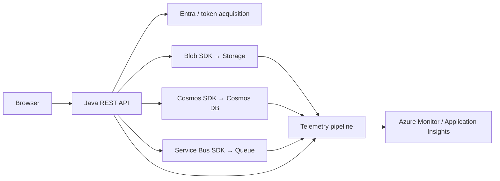
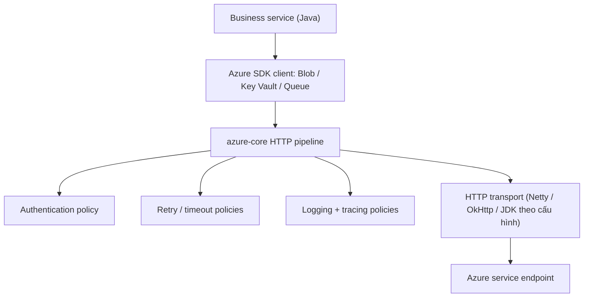
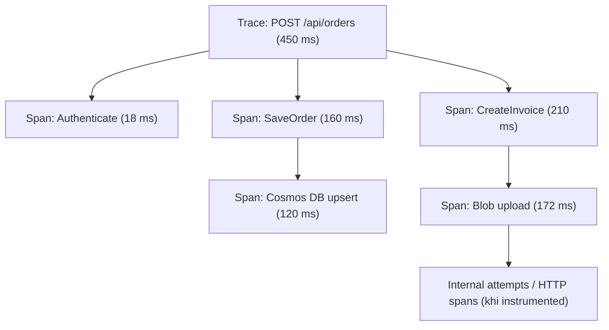
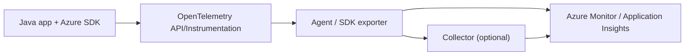
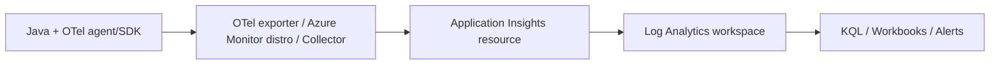
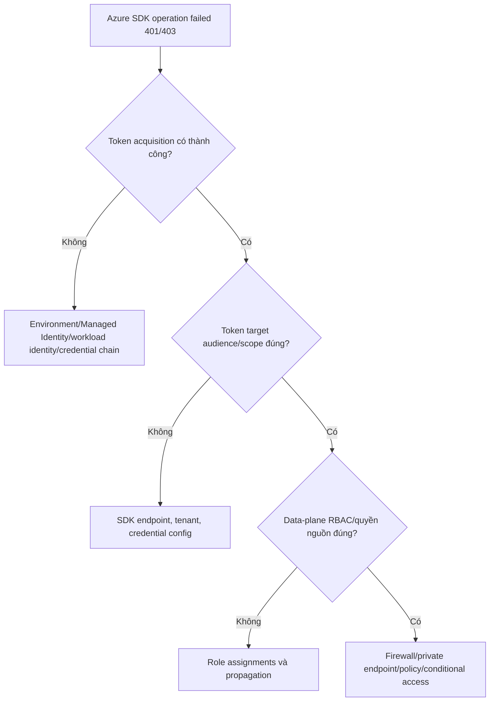
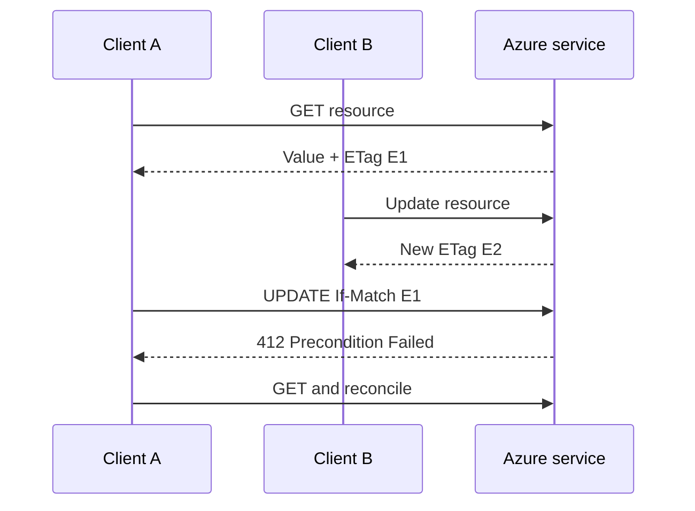
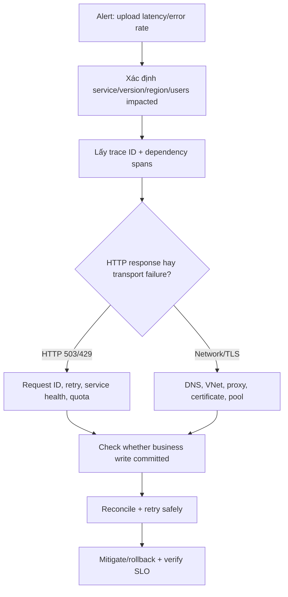
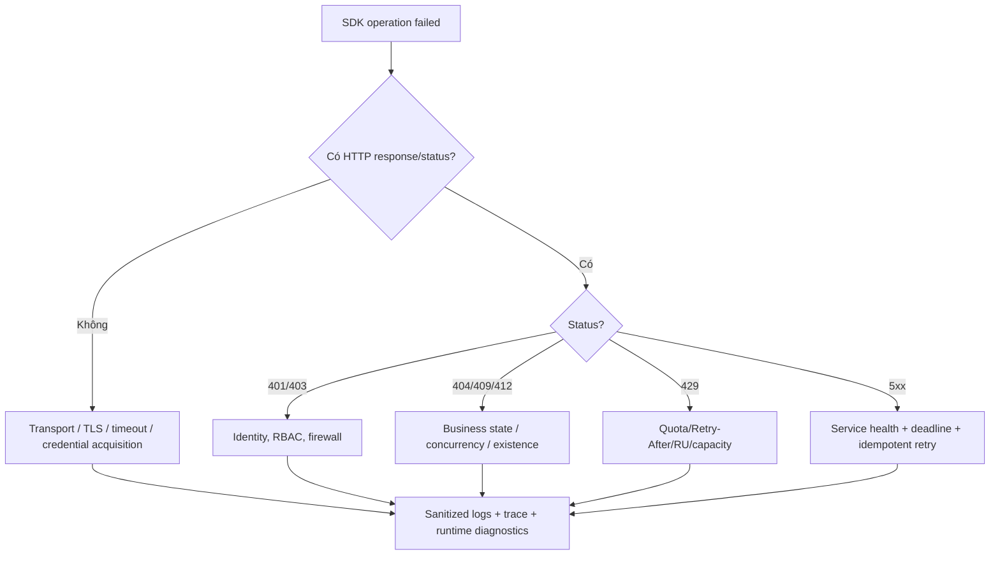
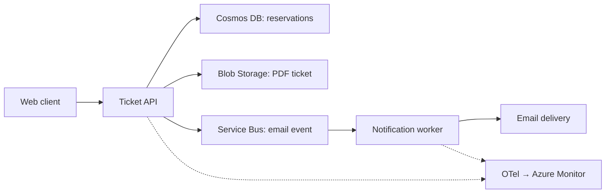

# Tracing, logging và xử lý lỗi Azure SDK

Một ứng dụng Java chạy trên Azure App Service nhận yêu cầu đặt hàng, ghi hóa đơn vào Azure Blob Storage, đọc cấu hình từ Key Vault và cập nhật Azure Cosmos DB. Lúc 09:15, khách hàng báo **“Đơn đã tạo nhưng không thấy hóa đơn”**. Trong Application Insights có nhiều lời gọi HTTP `503`, đôi khi là `429`, một số `403`, nhưng các dòng log lại không chỉ ra **request nào gọi dịch vụ nào, SDK đã retry mấy lần và lỗi nào có thể retry**. Nếu kỹ sư tăng số lần thử lại một cách mù quáng, ứng dụng có thể tạo hóa đơn trùng, quá tải downstream và làm chi phí tăng.

**Tracing, logging và xử lý lỗi** là ba năng lực phải thiết kế cùng nhau để vận hành Azure SDK for Java đáng tin cậy:

- **Logging:** ghi lại sự kiện có cấu trúc, mức độ, bối cảnh và nguyên nhân thất bại.
- **Distributed tracing:** theo dõi một thao tác đi qua HTTP API, business service, Azure SDK, Azure services và workers bằng **trace/span context**.
- **Error handling:** phân loại lỗi, quyết định có retry hay không, đặt timeout/deadline, bảo vệ idempotency và trả kết quả an toàn cho người dùng.

Bài học thuộc chương **Azure SDK cho Java** của module `CLOUD_PROVIDERS_AZURE`. Trong lộ trình tìm hiểu subscription, resource group, Microsoft Entra ID, networking, compute, storage và data trên Azure, bài này tập trung vào **độ quan sát và khả năng phục hồi của ứng dụng Java khi dùng Azure SDK**. Nền tảng giám sát có thể gồm **Azure Monitor, Application Insights, Log Analytics và OpenTelemetry**, nhưng mã Java vẫn phải chủ động thiết kế log, lỗi và hành vi nghiệp vụ.

> **Giới hạn phiên bản:** Azure SDK for Java gồm nhiều thư viện `azure-core`, `azure-identity`, Storage, Cosmos DB, Key Vault, Service Bus… với các cấu hình tracing/retry/diagnostics khác nhau. Ví dụ trong bài mô tả API Java phổ biến, cần pin BOM/dependency và kiểm tra Java/SDK/agent version thực tế trước production. Không giả định cùng một constructor, exception type hay mức tự động instrumentation hoạt động y hệt cho tất cả dịch vụ. Không bật log HTTP body/secret trong hệ thống thật để “debug nhanh”.

## Mục tiêu học tập

Sau bài này bạn có thể:

1. Phân biệt **log, metric và distributed trace** cùng vị trí của chúng trong observability.
2. Hiểu `azure-core` HTTP pipeline, `ClientLogger`, `HttpLogOptions`, `HttpLogDetailLevel` và logger facade **SLF4J**.
3. Thiết kế **structured logging** có operation ID, trace ID, span ID, service/resource và error category nhưng không lộ dữ liệu nhạy cảm.
4. Bật mức HTTP logging phù hợp, hiểu **allowlist/redaction** và nguyên nhân không bật `BODY_AND_HEADERS` mặc định.
5. Theo dõi requests bằng **W3C Trace Context**, OpenTelemetry spans, correlation identifiers và server request IDs khi Azure service cung cấp.
6. Phân biệt **HTTP SDK diagnostics**, OpenTelemetry instrumentation và ứng dụng tự tạo **business spans**.
7. Phân loại các lỗi thường gặp: `401`, `403`, `404`, `409`, `412`, `408`, `429`, `5xx`, network, TLS, timeout và authentication.
8. Tạo **retry policy có giới hạn**, exponential backoff/jitter, tôn trọng Retry-After và tránh retry những yêu cầu không idempotent.
9. Sử dụng Azure SDK **sync và async** đúng cách, tránh block Reactor event loop và làm mất trace context.
10. Viết ứng dụng Java mẫu dùng `DefaultAzureCredential` và Azure Blob Storage, xử lý exception có phân loại, log an toàn và đánh dấu span lỗi.
11. Kết nối telemetry với Application Insights/Azure Monitor theo cấu hình và authorization phù hợp.
12. Xây runbook chẩn đoán và checklist production cho một ứng dụng Java nhiều Azure dependencies.

## 1. Một request cloud đi qua nhiều lớp

Sơ đồ một lời gọi nghiệp vụ:



Nếu người dùng nhận HTTP `500`, ta cần trả lời:

- Request đến API nào, lúc nào và với **correlation ID** nào?
- SDK đã gọi Storage endpoint hay thất bại ngay khi lấy token?
- Storage trả status `403`, `429` hay Java không thiết lập được TLS?
- Có `x-ms-request-id`/`activityId` để đối chiếu Azure service logs không?
- SDK đã **retry tự động** bao nhiêu lần và tổng thời gian là bao lâu?
- Backend đã ghi database thành công trước khi timeout chưa?
- Có duplicate business effect nếu client/worker thực hiện retry?
- Lỗi ảnh hưởng một device/user/tenant hay toàn bộ region?

Chỉ biết “`BlobStorageException: failed`” là chưa đủ; cần mô hình quan sát xuyên ứng dụng và dịch vụ.

## 2. Ba trụ cột observability: logs, metrics và traces

| Loại dữ liệu | Câu hỏi chính | Ví dụ |
|---|---|---|
| **Log** | Chuyện gì đã xảy ra, với thông tin nào? | `invoice.upload_failed, status=503` |
| **Metric** | Tần suất/độ lớn/độ trễ của vấn đề? | `azure_sdk_requests_total{service=blob,status=503}` |
| **Trace** | Một request đi qua những bước nào? | `POST /orders → CreateInvoice → Blob PUT` |

**Logs** thuận tiện điều tra chi tiết, **metrics** phù hợp dashboards/alerts/SLI, **traces** cho biết phân bố thời gian giữa các hops. Chúng bổ sung nhau: một trace có thể liên kết tới logs thông qua `traceId`, và một metric spike dẫn kỹ sư tới những traces có lỗi.

### Phân biệt thêm: events và audit

- **Business event:** `OrderPlaced`, `InvoiceUploaded` là sự kiện nghiệp vụ, có thể cần lưu bền vững.
- **Operational log:** `blob.upload.retryable_failure` phục vụ debug.
- **Security audit:** ai thay Key Vault role/Storage firewall, lúc nào, theo quyền nào.

Không thay thế event nghiệp vụ bằng log stdout. Log có thể bị sampling, retention ngắn, không bảo đảm truyền đúng một lần và không phù hợp làm sổ cái giao dịch.

### Một bộ tín hiệu tối thiểu

```text
HTTP request:
  route, method, status, duration, traceId
Azure dependency:
  service name, operation, status/errorCode, duration, retryCount
Identity:
  credential type (không ghi token), token acquisition result
Business:
  sanitized order identifier, outcome, idempotency key reference
System:
  JVM memory, thread/connection pool, event-loop lag
```

Đừng thu thập “tất cả mọi thứ”: telemetry có chi phí, chứa dữ liệu nhạy cảm và có thể ảnh hưởng hiệu năng khi logging quá chi tiết.

## 3. Tầng SDK: client, azure-core và HTTP pipeline

Các client Azure SDK for Java thường được tạo qua **builder**, sử dụng `azure-core` để định nghĩa policies, HTTP transport, logging/tracing hooks và lỗi chung.



Sơ đồ là mô hình khái niệm, **không phải thứ tự policy thực tế của mọi SDK**. Mỗi thư viện có thể cấu hình pipeline, transport, retries và diagnostics khác nhau.

### Những lớp thường gặp

| Thành phần | Vai trò |
|---|---|
| `azure-core` | Abstractions, HTTP pipeline, core exceptions, ClientLogger |
| `azure-identity` | `TokenCredential` và các credential cho Microsoft Entra ID |
| Service SDK | `BlobServiceClient`, `SecretClient`, `ServiceBusClientBuilder`... |
| `HttpLogOptions` | Tùy chọn mức HTTP logging cho các builders hỗ trợ |
| SLF4J + provider | Định tuyến log SDK/app tới Logback hoặc logging backend |
| OpenTelemetry API/SDK/agent | Tracer, spans, context propagation và export |
| Application Insights/Azure Monitor | Thu thập, lưu và phân tích telemetry khi tích hợp đúng |

### Service SDK có thể có retry riêng

Azure Blob Storage SDK, Cosmos DB SDK và Service Bus SDK **không nhất thiết dùng cùng retry options và exception hierarchy**. Ví dụ Cosmos DB dùng request diagnostics/`CosmosException` riêng, Service Bus thường có `ServiceBusException` và lý do lỗi message-oriented; cần đọc contract của SDK đang dùng.

Vì vậy, **không viết một hàm retry mọi `RuntimeException` của tất cả Azure clients**.

## 4. Logging chuẩn trong Java: SLF4J, Logback và ClientLogger

Trong ứng dụng Java, logging thường có ba lớp:

1. Ứng dụng gọi **SLF4J API** (`LoggerFactory`, `Logger`) để ghi sự kiện.
2. **Provider/backend** như Logback quyết định format, level, destination.
3. Azure SDK phát logs thông qua cơ chế logging của từng thư viện, thường gồm `ClientLogger`/SLF4J hoặc các tích hợp theo phiên bản.

### Các mức log thường dùng

| Level | Dùng cho | Ví dụ |
|---|---|---|
| **ERROR** | Request/operation thật sự thất bại và cần hành động | Invoice không thể lưu sau retry policy |
| **WARN** | Tình huống bất thường nhưng có thể phục hồi | Retryable `429`; cấu hình sắp hết hạn |
| **INFO** | Thay đổi trạng thái có ý nghĩa vận hành | Worker bắt đầu, batch completed, deployment config |
| **DEBUG** | Thông tin điều tra chi tiết, thường chỉ bật ngắn hạn | Client choice, branch, sanitized resource |
| **TRACE** | Chi tiết rất cao, cần rất cẩn thận | Internal transitions khi điều tra có kiểm soát |

**Không tự ghi ERROR ở mọi retry attempt nếu SDK đã tự retry và thao tác cuối cùng thành công**; điều đó gây báo động giả. Thường có thể ghi một summary WARN khi retry đáng kể và một ERROR khi outcome cuối cùng thất bại.

### Java logging có tham số

```java
import org.slf4j.Logger;
import org.slf4j.LoggerFactory;

public final class InvoiceService {
    private static final Logger LOG =
        LoggerFactory.getLogger(InvoiceService.class);

    public void recordSuccess(String invoiceId, long elapsedMs) {
        // invoiceId ở đây giả định đã được phân loại không nhạy cảm.
        LOG.info("invoice.upload_succeeded invoiceId={} latencyMs={}",
            invoiceId, elapsedMs);
    }
}
```

Ghi tham số qua `{}` thay vì cộng chuỗi giúp tránh tạo chuỗi khi level không bật và giữ cấu trúc rõ hơn. **Đừng log toàn bộ `Exception.toString()` khi message/URI có khả năng chứa SAS query parameters**; phải xem xét thư viện và cấu hình redaction.

## 5. Structured logs: một sự kiện cần có các trường nào?

Trong production, mỗi log nên có một schema nhất quán thay vì vài câu tiếng Anh/Vietnamese tùy tiện.

Ví dụ **JSON log tự thiết kế**:

```json
{
  "timestamp": "2026-11-20T09:15:07Z",
  "level": "ERROR",
  "service": "orders-api",
  "environment": "production",
  "operation": "UploadInvoice",
  "dependency": "azure-blob",
  "traceId": "4bf92f3577b34da6a3ce929d0e0e4736",
  "spanId": "00f067aa0ba902b7",
  "correlationId": "req-8f21a4",
  "resourceAlias": "invoices-container",
  "outcome": "failed",
  "httpStatus": 503,
  "errorCategory": "transient_server",
  "retryable": true,
  "elapsedMs": 4291,
  "attemptsObserved": 3
}
```

Log trên là ví dụ schema **do ứng dụng định nghĩa**, không phải JSON mặc định của Azure SDK. `attemptsObserved` chỉ được ghi nếu code/SDK thực sự cung cấp số lần thử lại; **không tự suy con số này từ một exception cuối cùng**.

### Các trường nên cân nhắc

- Thời điểm UTC, timezone/clock policy.
- Service/build/environment/region.
- Business operation name và dependency type.
- Trace ID/span ID/correlation ID nếu context hợp lệ.
- HTTP status hoặc service error code (nếu có).
- Resource **alias** thay vì full URL có token.
- Elapsed duration, retryability, final outcome.
- Sanitized business ID hoặc internal reference được cho phép.
- Runbook/incident ID khi phù hợp.

### Những trường không nên ghi

- `Authorization` header và bearer access token.
- SAS token (`sig` trong URL), account key, client secret.
- Connection string cho Storage, Service Bus, IoT Hub.
- Password, X.509 private key, Key Vault secret value.
- Raw body chứa thông tin cá nhân, payment card, dữ liệu y tế.
- Full URL query có token, callback code, signed download URL.
- Exception detail có thể vô tình in credentials nếu được truyền từ ứng dụng.

## 6. Log correlation: request ID, trace ID và operation ID

Một hệ thống có thể có nhiều loại identifier:

| Identifier | Ai tạo | Dùng cho |
|---|---|---|
| **Trace ID** | OpenTelemetry/W3C Trace Context trong request flow | Liên kết spans của cùng distributed trace |
| **Span ID** | Mỗi span | Phân biệt từng bước trong trace |
| **Application correlation ID** | API gateway/app/worker | Điều tra nghiệp vụ; có thể trùng trace hoặc riêng |
| **Azure service request ID** | Azure Storage/Key Vault/other service theo response | Tra cứu logs sự cố của một service request |
| **Client request ID** | Azure SDK/client, khi service hỗ trợ | Đối chiếu request từ phía ứng dụng |
| **Cosmos activity ID** | Cosmos DB service/SDK | Điều tra request Cosmos DB |
| **Business event ID** | Application/outbox | Deduplicate và audit business events |

**Không dùng một request ID của Storage làm trace ID W3C**. Chúng có lifecycle và format khác nhau. Một end-to-end trace có thể bao gồm nhiều Azure service request IDs vì SDK đã retry hoặc gọi nhiều dependencies.

### W3C Trace Context

HTTP distributed tracing thường truyền:

```text
traceparent: 00-4bf92f3577b34da6a3ce929d0e0e4736-00f067aa0ba902b7-01
tracestate: <vendor-defined values when present>
```

Đây là **ví dụ định dạng**, không phải một token xác thực. `traceparent` mang trace ID, parent span ID, trace flags; ứng dụng cần dùng công cụ instrumentation phù hợp để propagate, không tự bịa cùng một span ID cho mọi request.

### Azure service headers

Với Storage, response có thể chứa `x-ms-request-id`; có SDK/service hỗ trợ `x-ms-client-request-id`. Những header có sẵn **thay đổi theo dịch vụ và request**. Không log mọi header chỉ để lấy request ID; chỉ extract các header cần thiết và đã duyệt.

## 7. MDC trong SLF4J: gắn bối cảnh vào log

**Mapped Diagnostic Context (MDC)** giúp gắn các trường như correlationId trong thread-local logging context theo backend hỗ trợ.

```java
import org.slf4j.MDC;
import org.slf4j.Logger;
import org.slf4j.LoggerFactory;

public final class RequestLoggingExample {
    private static final Logger LOG =
        LoggerFactory.getLogger(RequestLoggingExample.class);

    public static void handle(String correlationId) {
        String oldId = MDC.get("correlationId");
        try {
            MDC.put("correlationId", correlationId);
            LOG.info("orders.request_started");
            // Business operations...
            LOG.info("orders.request_finished");
        } finally {
            if (oldId == null) {
                MDC.remove("correlationId");
            } else {
                MDC.put("correlationId", oldId);
            }
        }
    }
}
```

### Tại sao `finally` quan trọng?

Web server sử dụng thread pool. Nếu không xóa/khôi phục MDC, request sau có thể nhận nhầm correlationId của khách hàng trước. **Không đưa user email, access token hoặc tenant private data vào MDC** chỉ để tiện tra log.

### MDC với async/Reactor

MDC thường gắn **ThreadLocal**. Trong Reactor/async, execution có thể chuyển thread, vì vậy:

- MDC không tự động đi theo `Mono`/`Flux` trong mọi cấu hình.
- `contextWrite(...)` dùng Reactor Context cho dữ liệu theo subscription.
- OpenTelemetry Context có cơ chế propagation riêng.
- Cần bridge/instrumentation hỗ trợ để logger lấy trace context đúng.
- Không xem `MDC.get("traceId") == null` là bằng chứng tracing không chạy.

**Bài sẽ phân tích sâu việc mất context khi dùng `subscribe()`, `block()` và thread pool ở phần async.**

## 8. Cấu hình Logback: mức log phù hợp

Một ứng dụng Spring Boot/Java có thể dùng `logback-spring.xml` (khi Logback là provider) để cấu hình. Ví dụ rút gọn:

```xml
<configuration>
    <appender name="CONSOLE" class="ch.qos.logback.core.ConsoleAppender">
        <encoder>
            <pattern>%d{yyyy-MM-dd'T'HH:mm:ss.SSSX} %-5level [%thread] trace=%X{traceId} corr=%X{correlationId} %logger{36} - %msg%n</pattern>
        </encoder>
    </appender>

    <logger name="com.azure" level="WARN"/>
    <logger name="com.example.orders" level="INFO"/>

    <root level="INFO">
        <appender-ref ref="CONSOLE"/>
    </root>
</configuration>
```

**Mẫu pattern** không phải JSON structured logging hoàn chỉnh; có thể dùng JSON encoder/provider được phê duyệt để tạo JSON logs. Trường `traceId` chỉ có nếu middleware/instrumentation thực sự đưa giá trị vào MDC. Đừng bật `com.azure=TRACE` trên production kéo dài.

### Mục tiêu khi chọn level

- Bật đủ logs của business operation, lỗi cuối cùng và latency.
- Giữ dependency logs ở WARN/INFO theo môi trường; tăng DEBUG có thời hạn khi điều tra.
- Không cho mọi HTTP request/response body lọt vào console mặc định.
- Dùng sampling/retention policy để không làm log ingestion costs tăng không kiểm soát.

## 9. HttpLogOptions và HttpLogDetailLevel

Nhiều Azure SDK HTTP clients cho Java hỗ trợ `HttpLogOptions` từ `azure-core`.

Ví dụ với Azure Blob Storage:

```java
import com.azure.core.http.policy.HttpLogDetailLevel;
import com.azure.core.http.policy.HttpLogOptions;
import com.azure.identity.DefaultAzureCredentialBuilder;
import com.azure.storage.blob.BlobServiceClient;
import com.azure.storage.blob.BlobServiceClientBuilder;

public final class BlobClientConfiguration {
    public static BlobServiceClient create(String endpoint) {
        HttpLogOptions logOptions = new HttpLogOptions()
            .setLogLevel(HttpLogDetailLevel.BASIC);

        return new BlobServiceClientBuilder()
            .endpoint(endpoint)
            .credential(new DefaultAzureCredentialBuilder().build())
            .httpLogOptions(logOptions)
            .buildClient();
    }
}
```

Endpoint mẫu là `https://<storage-account>.blob.core.windows.net`. Production nên cấu hình endpoint ngoài source code, dùng managed identity hoặc credential chain đã kiểm soát. **Không nhúng account key/SAS vào class Java**.

### Các mức HTTP logging

| Level | Thông tin khái quát | Nguy cơ |
|---|---|---|
| `NONE` | Không phát HTTP request/response logs qua policy này | Khó điều tra giao thức nếu thiếu traces |
| `BASIC` | Thông tin cơ bản về request/response/status, theo SDK policy | Cần tránh URL/query chứa secrets trong custom logs |
| `HEADERS` | Bao gồm headers được phép ghi | Header nhạy cảm nếu cấu hình allowlist sai |
| `BODY` | Có thể ghi body theo policy | PII, secrets, nội dung doanh nghiệp |
| `BODY_AND_HEADERS` | Chi tiết cả hai | Nguy cơ lộ dữ liệu và chi phí log cao |

Không tất cả SDK/phiên bản dùng level đồng nhất. **Với production, `BASIC` hoặc logging metadata tùy kiểm soát thường là điểm bắt đầu an toàn hơn mức body**; chỉ tăng chi tiết trong test/sandbox với dữ liệu giả và thời hạn rõ.

### Bật `BODY_AND_HEADERS` không giúp giải quyết mọi lỗi

Nếu lỗi là TLS handshake hoặc DNS timeout, có thể **không có HTTP response body** để ghi. Nếu lỗi là `429` do quota, body có thể không hữu ích bằng `status`, `Retry-After`, request duration và SDK retry diagnostics. Bật body logging mọi request để debug là lựa chọn vừa nguy hiểm vừa tốn kém.

## 10. Redaction và allowlist: bảo vệ HTTP headers/query

Với các bản `azure-core` hỗ trợ, `HttpLogOptions` có thể cấu hình **tên HTTP headers/query parameters được phép log**, thay vì in tất cả. Nhưng **an toàn mặc định và danh sách tự động redacted phụ thuộc SDK/phiên bản**; tuyệt đối không tự tin rằng mọi custom header nhạy cảm đều được che.

### Một cấu hình minh họa

```java
import com.azure.core.http.policy.HttpLogDetailLevel;
import com.azure.core.http.policy.HttpLogOptions;

HttpLogOptions options = new HttpLogOptions()
    .setLogLevel(HttpLogDetailLevel.HEADERS);

// Chỉ cân nhắc bật danh sách headers thật sự cần cho sandbox.
// Khi production, kiểm tra các API allowedHeaderNames/allowedQueryParamNames
// ở phiên bản azure-core đã pin và chỉ cho phép metadata an toàn.
```

Vì API allowlist có thể thay đổi theo release và môi trường, đoạn code **không cố mở rộng mặc định danh sách headers**. Nếu cần log `x-ms-request-id`, `content-type` hoặc `retry-after`, hãy kiểm tra policy và bổ sung đúng tên theo contract, không tạo allowlist `Authorization` hoặc mọi query parameter.

### Những nguồn lộ bí mật thường bị bỏ sót

| Nơi | Ví dụ | Cách bảo vệ |
|---|---|---|
| Query URL | `?sv=...&sig=...` của SAS URL | Redact `sig`/toàn bộ signed query |
| HTTP Authorization | `Bearer eyJ...` | Không log header/token |
| Storage connection string | `AccountKey=...` | Không ghi log configuration |
| Copy source header | URL chứa SAS tới source Blob | Che signed URL, không in raw headers |
| Exception message | URI/token có thể xuất hiện trong stack/wrapper | Sanitize business logging |
| Body | JSON có PII/payment/Key Vault secret | Không bật body logging trong prod |
| Debug dump | `clientBuilder.toString()`/configuration object | Kiểm tra trước, không dump toàn bộ |

### Bài học cốt lõi

**Tracing có thể phát hiện chậm/lỗi mà không cần log payload của khách hàng.** Phần lớn sự cố SDK được chẩn đoán từ endpoint alias, status, error code, request ID, duration, retry count và networking/identity diagnostics.

## 11. Distributed tracing: trace, span và propagation

Một **trace** biểu diễn đường đi logic của một request qua nhiều components. Mỗi **span** mô tả một bước có thời gian bắt đầu/kết thúc, attributes, status và events.



### Một span có thể chứa

```text
traceId: 4bf92f3577b34da6a3ce929d0e0e4736
spanId: 00f067aa0ba902b7
parentSpanId: <parent when present>
name: InvoiceService.upload
start/end: <timestamps>
duration: 210 ms
attributes:
  business.operation: UploadInvoice
  dependency.name: azure-blob
status: ERROR
events:
  exception (sanitized)
```

**Span không tự động thu thập mọi bước bên dưới chỉ vì bạn gọi `tracer.spanBuilder(...)`.** Cần instrumentation của Azure SDK/HTTP client hoặc tạo spans tương ứng. Nếu chỉ có manual span bao quanh business code, bạn thấy “Blob upload mất 172 ms” nhưng có thể không thấy chi tiết DNS, TLS, token acquisition hoặc internal retries.

### Span parent-child

Nếu HTTP request span là parent và Blob dependency span là child, chúng có cùng trace ID, khác span ID và quan hệ parent rõ. Khi làm async, cần propagate context; nếu mất context, dependency span có thể xuất hiện như **root trace mới**.

### Trace sampling

Không phải tất cả traces luôn được lưu. Head/tail sampling và collector policy có thể bỏ bớt dữ liệu để giảm chi phí. Nếu ghi `traceId` vào logs nhưng trace không xuất hiện trong Application Insights, nguyên nhân có thể là sampling, export/config sai hoặc ingestion delay, không nhất thiết span ID được tính sai.

## 12. OpenTelemetry trong Java: một ngôn ngữ chung cho traces

**OpenTelemetry (OTel)** định nghĩa APIs, SDKs, semantic conventions và exporters để phát telemetry từ ứng dụng. Java có:

- **OpenTelemetry API:** `Tracer`, `Span`, `Context`, `Scope`.
- **OpenTelemetry SDK:** sampling, processors, exporter configuration.
- **OpenTelemetry Java agent:** tự động instrument nhiều thư viện/framework được hỗ trợ.
- **Instrumentation libraries:** tích hợp sâu với HTTP/JDBC/Reactor/SDKs tương thích.
- **Collector:** nhận, xử lý và gửi telemetry tới backend khác.

### OTel và Azure Monitor khác nhau

OTel **tạo và chuyển** telemetry theo tiêu chuẩn; Azure Monitor/Application Insights **nhận, lưu, truy vấn và hiển thị** telemetry qua phương thức ingestion được hỗ trợ. Chúng không loại trừ nhau:



**Không coi tên OpenTelemetry span exporter là Azure SDK HTTP logging.** Logs, metrics và traces có pipeline/retention/sampling khác nhau dù cùng kết thúc ở Azure Monitor.

### Ba cách phổ biến để instrument Java

| Cách | Mạnh ở đâu | Cần chú ý |
|---|---|---|
| **Java agent** | Bắt inbound/outbound HTTP, JDBC/framework được hỗ trợ mà ít sửa code | Pin version và kiểm tra SDK-specific instrumentation/duplicated spans |
| **Manual OTel API spans** | Đánh dấu bước nghiệp vụ và context quan trọng | Không tự tạo child spans cho mọi SDK request |
| **Azure SDK tracing integration** | Span diagnostics/attributes do SDK hỗ trợ phát | Kiểm tra `azure-core`/tracing module, builder và agent compatibility |

Với nhiều ứng dụng Spring Boot đã có OTel agent, **bắt đầu từ việc kiểm tra tracing được tạo thực tế** trước khi thêm SDK-specific tracing options. Nếu bật đồng thời hai instrumentation pipelines khác nhau, có thể sinh duplicated spans hoặc attributes không nhất quán.

## 13. Tạo manual business span bằng OpenTelemetry API

Trong một module Java đã cấu hình OTel API/SDK hoặc agent, ta có thể tạo span bao quanh hoạt động nghiệp vụ:

```java
import io.opentelemetry.api.GlobalOpenTelemetry;
import io.opentelemetry.api.trace.Span;
import io.opentelemetry.api.trace.StatusCode;
import io.opentelemetry.api.trace.Tracer;
import io.opentelemetry.context.Scope;

public final class InvoiceTracing {
    private static final Tracer TRACER =
        GlobalOpenTelemetry.getTracer("com.example.orders");

    public void uploadInvoice(Runnable uploadAction) {
        Span span = TRACER.spanBuilder("InvoiceService.upload")
            .setAttribute("app.operation", "UploadInvoice")
            .setAttribute("app.dependency", "azure-blob")
            .startSpan();

        try (Scope ignored = span.makeCurrent()) {
            uploadAction.run();
            span.setAttribute("app.outcome", "success");
        } catch (RuntimeException error) {
            span.recordException(error);
            span.setStatus(StatusCode.ERROR, "Invoice upload failed");
            span.setAttribute("app.outcome", "failed");
            throw error; // Không nuốt lỗi nghiệp vụ.
        } finally {
            span.end();
        }
    }
}
```

### Vì sao `finally span.end()`?

Không kết thúc span sẽ khiến thời lượng/telemetry sai hoặc span không được export theo processor. Cần đảm bảo `Scope` được đóng ngay cả khi SDK ném exception.

### Không tự tạo một root trace mới trong mỗi helper

`span.makeCurrent()` tạo context cho công việc bên trong thread; khi có parent span hiện hành, span mới được liên kết với parent theo OTel API mặc định. **Nếu bất kỳ asynchronous callback nào chạy ở thread khác sau khi `Scope` đã đóng, context cần được propagate riêng**.

### Ghi exception có an toàn tuyệt đối không?

Không. `span.recordException(error)` có thể chứa exception type/message/stack, mà một số SDK hoặc ứng dụng có thể đưa URI/query có token vào message. Cần kiểm tra telemetry processors/attribute filtering và cách tạo exception từ input. Với dữ liệu cực nhạy cảm, chỉ ghi **sanitized error category/code** thay vì nguyên exception detail.

### Không có OTel SDK thì sao?

`GlobalOpenTelemetry.getTracer(...)` vẫn có thể trả API tracer nhưng không nhất thiết tạo/export telemetry nếu SDK/agent chưa được cấu hình. **Mã compile/chạy không đủ chứng minh trace xuất hiện**; phải kiểm tra exporter, resource attributes, sampling và backend ingestion.

## 14. Dùng Trace ID trong log mà không làm lộ secret

Khi đã có context OTel hợp lệ:

```java
import io.opentelemetry.api.trace.Span;
import io.opentelemetry.api.trace.SpanContext;
import org.slf4j.Logger;
import org.slf4j.LoggerFactory;

public final class TraceAwareLogging {
    private static final Logger LOG =
        LoggerFactory.getLogger(TraceAwareLogging.class);

    public static void logDependencyResult(String outcome, long millis) {
        SpanContext context = Span.current().getSpanContext();
        String traceId = context.isValid()
            ? context.getTraceId()
            : "unavailable";

        LOG.info(
            "azure.dependency_completed traceId={} outcome={} elapsedMs={}",
            traceId, outcome, millis
        );
    }
}
```

Một trace ID không nên chứa thông tin cá nhân, nhưng **vẫn có thể liên kết nhiều hoạt động của một người dùng**. Cần áp dụng chính sách retention/telemetry access tương ứng.

### Trace ID và MDC

Có thể dùng OpenTelemetry log context integration để tự thêm trace/span IDs vào structured logs theo framework. Tránh gọi `MDC.put(...)` trong mọi helper, đặc biệt nếu có Reactor async, vì dễ tạo trạng thái sai. Nếu phải dùng MDC thủ công, cần khôi phục giá trị trong `finally` và đảm bảo không leak giữa requests.

## 15. Azure SDK native tracing và HTTP tracing

Một số Azure SDK for Java sử dụng **core tracing abstractions** và tích hợp với OpenTelemetry/tracing modules hoặc Java agent để tạo spans cho Azure dependency operations. Các capability cụ thể phụ thuộc:

- `azure-core` và service SDK version;
- việc cấu hình tracing adapter/agent có tương thích không;
- transport (Netty/OkHttp/JDK) được instrument thế nào;
- service SDK có phát spans/attributes cho operation ấy không;
- OpenTelemetry SDK/exporter đã khởi tạo chưa;
- sampling, suppression và context propagation.

**Không giả định mỗi retry HTTP đều là một child span.** Có SDK chỉ tạo span ở logical operation, trong khi retry attempt details nằm ở diagnostics/logging. Một số HTTP instrumentations tạo spans riêng cho từng network request.

### Nên đặt tên span thế nào?

Ưu tiên **tên có cardinality thấp**:

```text
Good:
  InvoiceService.upload
  BlobClient.upload
  CosmosContainer.upsertItem

Bad:
  UploadInvoiceForCustomer_email_user@example.test
  BlobClient.upload/very-long-sensitive-sas-url
```

`span.name` và metrics labels có thể bị index/query trên hệ thống telemetry. Không đưa account keys, URLs có SAS, customer emails hoặc raw payload vào tên/attributes.

### Nếu chỉ thấy HTTP spans mà không thấy business span

Java agent có thể instrument outbound HTTP nhưng không biết thao tác gọi Blob là một nghiệp vụ “UploadInvoice”. Bổ sung manual span ở business boundary giúp phân biệt:

```text
POST /orders
  -> ValidateOrder
  -> CreateOrder
  -> InvoiceService.upload
       -> HTTP PUT storage endpoint
  -> SendConfirmation
```

Đừng cố tạo một span cho từng dòng Java; giữ số spans có ý nghĩa với hiệu năng và quy trình điều tra.

## 16. Tích hợp Azure Monitor/Application Insights

Một luồng phổ biến là:



### Hai khái niệm cấu hình dễ nhầm

- **Application Insights connection string:** giá trị cấu hình để telemetry exporter xác định tài nguyên đích; không phải Azure Storage account connection string.
- **Azure authentication for SDK calls:** `DefaultAzureCredential`/Managed Identity và RBAC của ứng dụng khi gọi Storage, Cosmos DB, Key Vault…

**Connection string telemetry và SDK service credentials phục vụ những mục đích khác nhau.** Không dùng một cái thay cho cái kia.

### Cấu hình theo môi trường

Ứng dụng cần kiểm tra:

1. Tracing/logging SDK/agent version được tổ chức chấp thuận.
2. Service name/environment/version (OTel `service.name`, `deployment.environment` hoặc resource attributes tương ứng).
3. Exporter/endpoint/ingestion credentials theo Azure Monitor product version.
4. Sampling policy có giữ traces lỗi quan trọng.
5. Resource/region và retention phục vụ quyền riêng tư.
6. Java runtime/network có thể gửi telemetry tới ingestion endpoint.
7. Role hạn chế ai được truy vấn logs/traces.
8. SDK dependency spans có hiển thị đúng tên/service target.

### Không dùng Application Insights để lưu payload dữ liệu khách hàng

Application Insights được thiết kế quan sát vận hành, không làm data lake chứa secrets, file invoice, PII hay bản ghi giao dịch. **Sampling và retention có thể khiến dữ liệu không đầy đủ** và lưu telemetry có chi phí.

## 17. Quan sát dependency latency theo nhiều lớp

Giả sử một API mất 2,4 giây:

```text
Total request duration:          2400 ms
  Authentication/token lookup:    100 ms
  Cosmos DB operation:            200 ms
  Blob upload operation:         1750 ms
  Application post-processing:    150 ms
  Other/unattributed:             200 ms
```

Một span Blob upload **1.750 ms** có thể gồm:

- tạo request/serialize payload;
- TLS/connection pool wait;
- request transfer;
- service processing;
- response handling;
- **SDK automatic retries/backoff**.

Không kết luận Storage service mất 1.750 ms **chỉ dựa trên total client span**. Cần HTTP attempt metrics, server-side request metrics và network diagnostics để tách thời gian.

### SLI nên dùng

| SLI | Ý nghĩa |
|---|---|
| `api_request_duration_p95` | Độ trễ API user cảm nhận |
| `azure_dependency_duration_p95` | Độ trễ dependency theo service/operation |
| `dependency_failure_rate` | Tỷ lệ lỗi cuối cùng |
| `retry_attempts_per_operation` | SDK/app retry pressure khi có dữ liệu |
| `429_rate` | Throttling/quota/resource contention |
| `identity_auth_failure_rate` | Lỗi token/RBAC/credentials |
| `timeout_rate` | Deadline/network/downstream latency |
| `telemetry_export_failure_rate` | Độ tin cậy hệ thống observability |

Không gắn `orderId`/`userId` riêng từng bản ghi vào metric labels: cardinality cao gây tăng chi phí và khó quản trị. Dùng logs/traces có kiểm soát để tra cứu ID khi cần.

## 18. OpenTelemetry với Spring Boot và servlet filters

Một ứng dụng Spring Boot có thể dựa vào Java agent để capture inbound HTTP và outbound dependencies, rồi thêm một span nghiệp vụ trong service.

### Mô hình

```text
Incoming HTTP request span
  → Spring controller
      → OrderService.create
          → Cosmos SDK operation
          → InvoiceService.upload (manual business span)
              → Blob HTTP request (nếu instrumented)
```

### Nên tránh

- Tự tạo root span trong mỗi controller khi đã có Java agent inbound instrumentation, gây duplicate root.
- Đặt `traceId` thành header tự chế không tuân W3C mà quên propagation.
- Gắn access token hoặc payload/headers nhạy cảm thành span attributes.
- Log exception ở tất cả layers và ném lại, tạo một lỗi thành hàng chục stacktraces.
- Dựa vào `log.level=TRACE` như phương thức duy nhất để theo dõi cross-service flow.

### Dùng API error response ổn định

Trong REST API có thể trả:

```json
{
  "error": {
    "code": "DEPENDENCY_UNAVAILABLE",
    "message": "Dịch vụ tạm thời không sẵn sàng.",
    "correlationId": "req-8f21a4"
  }
}
```

Không trả nguyên SDK exception stack, connection string hay `x-ms-request-id` kèm metadata nhạy cảm cho client công khai. Correlation ID có thể dùng để liên hệ hỗ trợ; backend lưu liên kết tới trace/request ID theo retention phù hợp.

## 19. Logging trong async/reactive Java

Azure SDK có **sync clients** và **async clients** tùy dịch vụ. Async SDK có thể trả Reactor `Mono`/`Flux`, không phải Java `CompletableFuture` ở mọi SDK.

### Một thao tác async đúng nguyên tắc

```java
// Ví dụ mẫu Reactor pipeline; publisher phải là Mono từ async SDK
// hoặc do business code cung cấp. Không giả định API nào cũng trả Mono.
Mono<String> result = fetchInvoiceFromAzure()
    .doOnSubscribe(subscription ->
        logger.debug("invoice.fetch_started"))
    .doOnSuccess(value ->
        logger.info("invoice.fetch_succeeded"))
    .doOnError(error ->
        logger.warn("invoice.fetch_failed category={}",
            classify(error)))
    .onErrorMap(error ->
        new InvoiceUnavailableException("Invoice dependency failed", error));
```

Ở đây `fetchInvoiceFromAzure()`, `classify(...)` và `InvoiceUnavailableException` là các hàm/type nghiệp vụ **do dự án cung cấp**, không phải SDK classes. Mục tiêu là minh họa vị trí `doOnError`/`onErrorMap` để không **nuốt lỗi**.

### Tránh `subscribe()` trong service rồi trả thành công sớm

```java
// Anti-pattern:
asyncUpload().subscribe();
return "Upload complete"; // Thao tác có thể chưa hoàn tất!
```

Nếu một REST endpoint phải đợi kết quả, hãy kết hợp publisher trong reactive chain/adapter được framework hỗ trợ. Nếu là **fire-and-forget** có chủ ý, cần durable outbox/queue và trách nhiệm theo dõi thất bại, không chỉ gọi `subscribe()` rồi bỏ qua error callback.

### Tránh `block()` trên event loop

`mono.block()` chặn thread. Trong WebFlux/Reactor event loop, việc block có thể làm giảm throughput hoặc tạo deadlock/starvation tùy scheduler. Chọn:

- **Sync stack** với blocking client và thread model phù hợp.
- **Reactive stack** kết hợp `flatMap`/`zip` và propagate context.
- Bridge sang bounded scheduler khi cần gọi blocking API trong reactive app.

### Trace context qua async boundary

`Span.current()` dựa vào active context. Nếu callback chạy trên thread khác mà không được context propagation bridge, current span có thể **invalid**. Với Reactor, dùng OTel instrumentation/Reactor context integration phù hợp phiên bản. Không sao chép `ThreadLocal/MDC` thủ công qua mọi callback như một giải pháp toàn cục.

## 20. Một lỗi có thể sinh ra nhiều bản ghi log

Khi SDK call thất bại, telemetry có thể xuất hiện ở:

1. Azure SDK HTTP policy logger (status/error).
2. Azure SDK exception/warning.
3. Application service catch block.
4. Controller exception handler.
5. Gateway/API request logs.
6. OTel span exception event.

Nếu mọi layer đều ghi `ERROR + stacktrace`, một lỗi tạo 6 stacktraces và dễ gây phí/log noise.

### Quy ước được khuyến nghị

- **Boundary layer:** ghi một lỗi cuối cùng có business context và correlation ID.
- **Lower layers:** chỉ ghi thông tin bổ sung khi thật sự có ích; thường rethrow typed exception.
- **Tracing:** ghi span status và exception theo chính sách privacy.
- **Retry middleware:** có thể ghi một event summary; không spam mọi attempt mức ERROR.
- **API:** trả error code ổn định không lộ thông tin nội bộ.

Ví dụ hai dòng log có thể đủ:

```text
WARN  azure.blob.retry_summary operation=UploadInvoice attempts=3 finalStatus=503
ERROR invoice.upload_failed traceId=... errorCategory=transient_server latencyMs=4291
```

Không ghi `attempts=3` nếu SDK không cung cấp hoặc app không thu thập được số này.

## 21. Exception taxonomy trong Azure SDK for Java

**Azure SDK không dùng một loại exception duy nhất cho mọi lỗi.** Phân biệt ít nhất bốn nhóm:

| Nhóm lỗi | Ví dụ | Cách phản ứng |
|---|---|---|
| **Service HTTP response** | HTTP `404`, `409`, `429`, `503` | Đọc status, error code, retry hints và business semantics |
| **Authentication/authorization** | Entra credential unavailable, token failure, HTTP `401/403` | Kiểm tra identity, scope, RBAC, firewall; không retry bừa |
| **Transport/network** | DNS lookup, TLS handshake, proxy, socket timeout | Phân tích route, certificates, connection pool/deadline |
| **Client/configuration** | Invalid endpoint, missing env var, serialization issue | Sửa config/schema/code; thường không transient |

### Những lớp thường gặp

- `com.azure.core.exception.HttpResponseException`: response từ dịch vụ có status/headers và thông tin lỗi, theo API đã sử dụng.
- `com.azure.storage.blob.models.BlobStorageException`: lỗi riêng của Blob Storage, có **storage error code** khi service trả.
- `com.azure.cosmos.CosmosException`: lỗi Cosmos SDK, có status/substatus/activity ID/diagnostics theo phiên bản.
- `com.azure.messaging.servicebus.ServiceBusException`: lỗi Service Bus với reason và semantics riêng.
- `com.azure.core.exception.ClientAuthenticationException` và `com.azure.identity.CredentialUnavailableException`: lỗi liên quan credential discovery/token acquisition trong credential chain tương ứng.
- Exceptions do transport/SDK ném hoặc wrap: `IOException`, timeout, TLS, invalid configuration… không phải lỗi nào cũng có HTTP response.

**Không coi một `RuntimeException` bất kỳ là Azure service failure.** Nếu `NullPointerException` xuất hiện do bug business code, retry HTTP 10 lần không sửa được.

### HTTP response exception có thể không phải network failure

Nếu client nhận được HTTP `403`, tức là có một service/gateway đã trả response. Nguyên nhân có thể là RBAC, firewall/IP rule hoặc policy, không nhất thiết cổng TCP bị chặn. Ngược lại **TLS handshake failed** có thể không tạo HTTP response và không có status code.

### Một service error code có thể quan trọng hơn status

Trong Azure Blob Storage, cùng HTTP `404` có thể liên quan container hoặc blob khác nhau. Trong Cosmos DB, `429` có nghĩa throughput throttling và SDK có diagnostic/retry behavior khác Storage. Do đó hãy ghi **status + service error code/substatus** khi khả dụng, không suy mọi nguyên nhân từ status đơn lẻ.

## 22. Bảng HTTP status: retry hay không?

| Status | Diễn giải phổ biến | Có tự retry? | Phải làm gì trước |
|---|---|---|---|
| **400 Bad Request** | Request syntax/parameter không hợp lệ | Thường **không** | Sửa schema, endpoint, parameter |
| **401 Unauthorized** | Credential/token thiếu/sai/hết hạn | Thường **không retry tùy tiện** | Kiểm tra credential chain, tenant, token audience |
| **403 Forbidden** | Thiếu quyền, firewall hoặc chính sách truy cập | Thường **không** | Kiểm tra RBAC data-plane, network restrictions |
| **404 Not Found** | Resource hoặc object không tồn tại/scope sai | Theo nghiệp vụ | Phân biệt expected absence với lỗi config |
| **408 Request Timeout** | Timeout phía service/gateway | Có điều kiện | Deadline còn không? request có idempotent? |
| **409 Conflict** | Trùng tài nguyên, trạng thái xung đột, concurrency | Theo nghiệp vụ | So sánh idempotency/business precondition |
| **412 Precondition Failed** | ETag/conditional write không khớp | **Không retry y nguyên** | Đọc lại, merge/version rồi quyết định |
| **429 Too Many Requests** | Quota/throttling, Cosmos RU pressure… | Có giới hạn | Tôn trọng retry hints, backoff; giảm tải/hot key |
| **500 Internal Server Error** | Lỗi phía dịch vụ | Có điều kiện | Idempotency, retry budget, incident |
| **502 Bad Gateway** | Gateway/upstream failure | Có điều kiện | Network/dependency diagnostics |
| **503 Service Unavailable** | Dịch vụ tạm không sẵn sàng | Có điều kiện | Retry-After, region/capacity, deadline |
| **504 Gateway Timeout** | Timeout qua gateway | Có điều kiện | Trạng thái operation có thể không rõ |

Đây là **hướng dẫn xử lý tổng quát**, không phải contract Azure SDK bảo đảm retry chính xác tất cả các status trên. Mỗi dịch vụ/operation có quy tắc riêng: một số SDK đã tự retry `429`; một số request có thể không an toàn nếu SDK/app gửi lại.

### 404 không phải lúc nào là lỗi

Trong ứng dụng đọc Blob tùy chọn:

```text
GET invoice.pdf → 404
```

Có thể đây là **kết quả nghiệp vụ bình thường**: hóa đơn chưa được tạo. Nếu code trả `Optional.empty()` và log DEBUG/INFO đúng ngữ cảnh thì không nhất thiết ERROR/alert. Nhưng nếu `invoice.pdf` chắc chắn phải tồn tại sau một transaction đã commit, `404` là dấu hiệu sai lệch workflow cần điều tra.

## 23. 401/403: identity, authentication và network policy

Để điều tra auth failure khi dùng `DefaultAzureCredential`:



### Azure RBAC control plane không luôn bằng data plane

Ví dụ người chạy ứng dụng có `Contributor` trên resource group:

- Có thể quản lý một số Azure resources qua ARM.
- **Không chắc** được đọc Blob data; Storage cần role như `Storage Blob Data Reader`/`Storage Blob Data Contributor` theo scope.
- Không tự được đọc Cosmos DB for NoSQL items; có data-plane role assignment riêng.
- Không tự có quyền đọc Key Vault secret value nếu vault dùng RBAC/access policies tách biệt.

**401 thường liên quan xác thực**, **403 thường liên quan quyền/policy**, nhưng phải kiểm tra response subcode và môi trường, không chốt nguyên nhân chỉ qua hai chữ số.

### Credential chain không phải “dùng đại credential nào cũng được”

`DefaultAzureCredential` có thể thử nhiều nguồn như environment, workload identity, managed identity, developer tools theo phiên bản/thời điểm. Trong local dev, Azure CLI credential có thể hoạt động; lên App Service/AKS, ứng dụng có thể dùng managed/workload identity.

Nếu production không kiểm soát nguồn credential, bạn có thể vô tình chạy bằng identity ngoài dự kiến. Cần:

1. Xác định identity thực tế đang chạy.
2. Gán quyền data-plane tối thiểu.
3. Đọc SDK identity diagnostics đã redacted.
4. Kiểm tra tenant, audience, endpoint, deployment environment.
5. Tránh log token hoặc credential chain details nhạy cảm.

## 24. Phân biệt timeout của ứng dụng và lỗi Azure service

Các loại thời gian:

```text
User HTTP deadline
  ├─ Request queue time
  ├─ Credential acquisition
  ├─ DNS + TCP + TLS
  ├─ SDK HTTP send/receive
  ├─ Service processing
  ├─ SDK retry + backoff
  └─ Business serialization / response
```

Một request API có deadline 2 giây nhưng SDK mặc định retry/timeout lâu hơn 2 giây thì có thể xảy ra:

1. API gateway hết hạn và trả `504` cho client.
2. Java worker **vẫn đang upload** Blob ở backend.
3. Client retry POST.
4. Backend ghi trùng hoặc gặp `409` vì upload trước đã thành công.

### Timeout không chứng minh transaction thất bại

Đặc biệt với `PUT/POST`, **connection lost after sending bytes** tạo trạng thái không chắc chắn: service có thể đã commit nhưng response không đến client. Cần **idempotency key, conditional request hoặc read-after-failure reconciliation** thay vì retry một operation không idempotent vô hạn.

### Thiết kế deadline theo cấp

Một ngân sách ví dụ:

```text
API end-to-end deadline:             5.0 s
Business validation/auth:            0.5 s
Storage upload + retry budget:       3.0 s
DB update:                           1.0 s
Reserve/serialization:               0.5 s
```

Đây là **budget minh họa**, không phải khuyến nghị chung cho mọi network/region. Nếu Storage file lớn, upload có thể cần asynchronous job để không giữ HTTP request vài chục giây.

### Cancel không luôn đồng nghĩa rollback

Khi async publisher bị cancel hoặc request thread bị interrupt, network operation có thể đã tới service. Không cam kết cancellation tự động undo Blob upload, Service Bus send hoặc Cosmos write. Logic phục hồi cần dựa trên state thật từ backend.

## 25. Retry: chính sách kỹ thuật phải theo semantics nghiệp vụ

Một retry policy nên trả lời:

- **Operation có idempotent hay không?**
- Những lỗi nào **transient** được retry?
- Tổng số attempts/budget là bao nhiêu?
- Có `Retry-After`/throttling hints không?
- Có **exponential backoff + jitter** để tránh đồng loạt retry?
- Có deadline không vượt quá user/job SLO?
- SDK đã tự retry chưa, có bị **double retry** không?
- Sau khi hết budget, app phải báo lỗi và phục hồi thế nào?

### Những phương pháp backoff

Với lần thử lại thứ \(n\):

\[
d_n=\min(d_{\max},d_0\cdot 2^n)+J
\]

Trong đó \(d_0\) là delay cơ bản, \(d_{\max}\) là giới hạn, \(J\) là jitter ngẫu nhiên nhỏ. Giá trị thực cần thích ứng với Retry-After từ service, quota và latency budget.

### Vì sao jitter?

Nếu 10.000 instances đều bị `429` lúc 09:00 và đều retry sau đúng 1 giây, service có thể lại nhận 10.000 requests cùng lúc. Jitter làm các retries phân tán hơn. **Không dùng jitter để biện minh cho retry vô hạn**.

### SDK retry và application retry

Giả sử:

```text
Azure SDK max attempts: 4
App-level retry max attempts: 3
```

Một business operation có thể tạo tới \(4\times3=12\) network attempts nếu mỗi tầng retry độc lập. Số này chỉ minh họa cấu trúc nhân tầng; trong thực tế còn phụ thuộc lỗi, cancel/deadline và SDK policy.

**Ưu tiên SDK retry policies cho transient transport/service failures trong phạm vi SDK hỗ trợ; chỉ thêm application retry khi business semantics đòi hỏi và đã tính tổng budget**.

## 26. Retry-After: tín hiệu tránh làm nghẽn dịch vụ

Trong HTTP, service có thể trả:

```text
HTTP/1.1 429 Too Many Requests
Retry-After: 2
```

Header `Retry-After` theo HTTP có thể là số giây hoặc ngày giờ; một số Azure services có **headers riêng** tính bằng milliseconds (ví dụ Cosmos DB có retry-after-ms theo API). **Không tự parse mọi header là milliseconds** và không dùng cùng parser cho mọi service.

### Vì sao cần tôn trọng hint?

- Giảm request gây throttling thêm.
- Cho SDK/service cơ hội phục hồi.
- Hạn chế duplicate retries và log spam.
- Giúp cost/latency ổn định hơn trong peak.

Nếu server yêu cầu delay dài hơn request deadline còn lại, **nên dừng và báo quá tải/có kế hoạch xử lý async**, không ngủ khiến API kéo dài vượt SLO mà người dùng không còn chờ.

## 27. Idempotency: nền móng của retry an toàn

**Idempotent** nghĩa là thực hiện cùng một hành động hợp lệ nhiều lần cho ra cùng trạng thái mong muốn, không nhân đôi business effect.

| Hành động | An toàn retry? | Cần thiết kế |
|---|---|---|
| **GET object** | Thường có | Xét consistency và timeout budget |
| **Tạo Blob với tên ổn định, chỉ nếu chưa tồn tại** | Có điều kiện | `If-None-Match`/overwrite false và đối chiếu checksum |
| **Overwrite Blob theo ETag** | Có điều kiện | Conditional write/version check |
| **Cosmos upsert document với ID cố định** | Không tự đủ | Có thể ghi đè state mới; ETag/partition key cần kiểm soát |
| **POST tạo đơn hàng** | Không mặc định | Idempotency key + unique constraint/outbox |
| **Service Bus send event** | Có thể gửi trùng | Stable messageId, duplicate detection khi được hỗ trợ, idempotent consumer |
| **Thêm tiền vào ví** | Rất nguy hiểm khi retry mù | Ledger transaction, unique business operation ID |

### Ví dụ upload hóa đơn

Đừng đặt Blob name theo `UUID.randomUUID()` trong mỗi retry:

```text
Attempt 1: invoice-abc-UUID1.pdf → response lost, Blob created
Attempt 2: invoice-abc-UUID2.pdf → second Blob created
```

Nên dùng tên ổn định:

```text
invoices/order-501/invoice-v1.pdf
```

Nếu upload response bị mất, đọc lại object metadata/checksum theo quyền và policy phù hợp. **Đừng tự coi `409 BlobAlreadyExists` là success nếu nội dung đã có không khớp hóa đơn cần tạo**.

## 28. Optimistic concurrency: ETag và status 412

Azure Storage và Cosmos DB có những operation hỗ trợ **ETag-based conditional requests** để tránh ghi đè những thay đổi xảy ra đồng thời.



### Vì sao retry cùng ETag không giải quyết?

Khi `E1` không còn hợp lệ, gửi lại `If-Match: E1` nhiều lần vẫn không đúng precondition. Cần đọc state mới, quyết định **merge, reject hoặc retry với business permission**. Với dữ liệu tài chính/đơn hàng, tự động overwrite sau `412` có thể gây mất cập nhật.

### 409 và 412 không giống nhau

- `409 Conflict` thường liên quan tạo trùng hoặc xung đột trạng thái tài nguyên.
- `412 Precondition Failed` thể hiện điều kiện cập nhật như `If-Match` không còn đúng.

Tuy nhiên service-specific error code và operation semantics mới xác định **kết luận cuối cùng**. Một HTTP status không đủ làm quy tắc xử lý cho mọi Azure SDK.

## 29. Circuit breaker, bulkhead và retry budget

Retry là một công cụ nhưng không thay thế thiết kế phục hồi toàn hệ thống.

### Circuit breaker

Khi dependency liên tục lỗi, circuit breaker có thể **ngừng gửi requests mới tạm thời** và mở lại theo chính sách. Điều này bảo vệ threads/connection pool và giảm tải. Phải phân biệt:

- outage toàn service;
- lỗi quyền `403` chỉ ở một identity;
- một tenant đang bị `429` do quota;
- hỏng một region/subresource.

Không mở circuit breaker toàn hệ thống chỉ vì một user thiếu quyền đọc Blob riêng của họ.

### Bulkhead

Giới hạn concurrency theo dependency/tenant, ví dụ:

```text
Storage upload workers: max 40 concurrent
Cosmos writes:          max 100 concurrent
Key Vault config reads: cached / rate limited
```

Các con số là **ví dụ**, không phải cấu hình mặc định. Nếu Storage chậm, giới hạn worker upload giúp API khác vẫn hoạt động.

### Retry budget

Thay vì retry mọi request 5 lần, có thể giới hạn tổng tỷ lệ/số retries trong thời gian ngắn và ưu tiên công việc quan trọng. Không để retry storm từ SDK **và** gateway **và** message consumer cùng nhân tải lên dependency.

### Graceful degradation

Nếu Key Vault hoặc một dependency phụ trợ tạm unavailable:

- Có thể dùng cache cấu hình đã xác thực còn hiệu lực khi policy cho phép.
- Không dùng cache credential hết hạn vô hạn hoặc bỏ qua secret rotation.
- Nếu hóa đơn bắt buộc phải được tạo trước thanh toán, API cần báo thất bại rõ.
- Nếu notification không thiết yếu, có thể commit order và retry notification qua outbox.

**Graceful degradation phải được xác nhận theo nghiệp vụ, không phải luôn bỏ qua lỗi để trả HTTP 200.**

## 30. Các lỗi SDK đặc thù theo dịch vụ

| Dịch vụ | Lỗi/diagnostics đáng chú ý | Quy tắc cần nhớ |
|---|---|---|
| **Azure Blob Storage** | `BlobStorageException`, HTTP status, storage error code, `x-ms-request-id` | `404`/`409` khác nhau theo container/blob/operation |
| **Azure Cosmos DB** | `CosmosException`, `429`, RU charge, activity ID, substatus, diagnostics | Không tăng retry mãi; đo hot partition/RU/latency |
| **Azure Key Vault** | Auth `401/403`, secret not found, vault firewall/RBAC | Không log secret value; phân biệt control-plane và data-plane |
| **Azure Service Bus** | `ServiceBusException`, failure reason, lock/session/transport errors | Message lock lost/re-delivery cần idempotent consumer |
| **Azure Queue Storage** | Visibility timeout, queue message lifecycle | Retry worker có thể xử lý trùng, cần idempotency |
| **Azure Event Hubs** | Partition/checkpoint/batch/producer errors | Producer send success ≠ consumer processed; replay theo retention |
| **Azure Identity** | Credential unavailable vs token acquisition failed | Xác minh credential chain và principal đang dùng |
| **Azure AI/Search và SDK khác** | Service-specific exceptions/quotas/throttling | Không tái sử dụng mapping lỗi một cách mù quáng |

### Cosmos DB và lỗi `429`

Cosmos DB tính **Request Units (RU)** và có thể throttle requests. SDK có khả năng tự xử lý một số `429` theo retry policy và cung cấp diagnostics. Một thao tác chậm có thể do **retry-after**, hot partition hoặc query RU quá cao, không nhất thiết do network. Quan sát:

```text
operation
status / substatus
activityId
requestChargeRU (nếu được cung cấp)
diagnostics / retry-related metrics (nếu hỗ trợ)
partition key pattern (đã ẩn dữ liệu nhạy cảm)
```

Không log partition key chứa PII, document JSON hoặc endpoint credential chỉ để truy `429`.

### Service Bus và message lock

Worker nhận message theo Peek-Lock có thể bị **message lock lost** nếu xử lý quá lâu hoặc không renew đúng; message có thể được redeliver. Cần:

- thiết kế handler idempotent;
- xem delivery count và dead-letter policy;
- theo dõi lock renewal/processing duration;
- không giả định `complete()` thành công nếu đã mất lock.

### Key Vault credential failure

Nếu secret read trả `403`, kiểm tra identity, vault access mode (RBAC hoặc access policy), quyền secret `get` và firewall/private endpoint. Không copy secret value vào logging để chứng minh quyền đã cấp.

## 31. Mẫu Java: phân loại Blob Storage exception an toàn

Một service nên **bọc lỗi dependency thành business-facing error ổn định**, đồng thời giữ exception gốc làm cause để kỹ sư có thể điều tra trong môi trường được cấp quyền.

### Phân loại status

```java
public enum DependencyFailureKind {
    NOT_FOUND,
    CONFLICT,
    PRECONDITION_FAILED,
    AUTHENTICATION_OR_ACCESS,
    THROTTLED,
    TRANSIENT_SERVER,
    CLIENT_REQUEST,
    NETWORK_OR_UNKNOWN
}

public final class DependencyFailureClassifier {
    private DependencyFailureClassifier() { }

    public static DependencyFailureKind fromHttpStatus(int status) {
        return switch (status) {
            case 401, 403 -> DependencyFailureKind.AUTHENTICATION_OR_ACCESS;
            case 404 -> DependencyFailureKind.NOT_FOUND;
            case 409 -> DependencyFailureKind.CONFLICT;
            case 412 -> DependencyFailureKind.PRECONDITION_FAILED;
            case 429 -> DependencyFailureKind.THROTTLED;
            case 408, 500, 502, 503, 504 ->
                DependencyFailureKind.TRANSIENT_SERVER;
            case 400, 405, 413, 415, 422 ->
                DependencyFailureKind.CLIENT_REQUEST;
            default -> DependencyFailureKind.NETWORK_OR_UNKNOWN;
        };
    }
}
```

Đây là **classifier tổng quát nhằm phục vụ observability**, không phải quy tắc tự động retry. `status=-1` từ lỗi không có HTTP response cũng được phân vào `NETWORK_OR_UNKNOWN` để điều tra, không tự coi có thể retry.

### Exception của ứng dụng

```java
public final class InvoiceStorageException extends RuntimeException {
    private final String publicErrorCode;

    public InvoiceStorageException(
        String publicErrorCode,
        Throwable cause
    ) {
        super("Invoice storage operation failed", cause);
        this.publicErrorCode = publicErrorCode;
    }

    public String publicErrorCode() {
        return publicErrorCode;
    }
}
```

**Không copy `exception.getMessage()` vào response JSON công khai**. Thông tin mạng/endpoint/query trong message có thể hỗ trợ attacker hoặc vô tình chứa SAS. Trả một error code nội bộ có kiểm soát cho client và log telemetry đã sanitize.

## 32. Lab thực hành — Java + Blob Storage + OpenTelemetry

### Mục tiêu

Xây dựng một ứng dụng Java nhỏ có:

- Azure Blob client dùng `DefaultAzureCredential`;
- HTTP logging mức `BASIC`;
- một manual OpenTelemetry span cho nghiệp vụ;
- structured log event names và traceId;
- phân loại `BlobStorageException`;
- elapsed duration đo bằng `System.nanoTime()`;
- không ghi account key/SAS trong source hoặc log;
- thử các tình huống success, missing permission, conflict và missing object.

**Lab không cần chạy trong workflow viết bài này.** Người học thực hành trong workspace Java sandbox độc lập, sau khi có quyền Azure resources và chọn dependency versions tương thích.

### Điều kiện

| Yêu cầu | Nội dung |
|---|---|
| Java | JDK 17+ phù hợp bản SDK đã chọn |
| Maven/Gradle | Có thể tải dependencies từ repo được tổ chức cho phép |
| Storage | Một Storage account và container `invoice-lab` chỉ dùng lab |
| Identity | Local Azure CLI developer identity hoặc managed identity, được cấp data-plane role |
| Quyền | Đọc/ghi Blob trong container lab, không cần subscription Owner |
| Env var | `AZURE_STORAGE_BLOB_ENDPOINT` dạng URL không chứa SAS |
| Tracing | OpenTelemetry SDK/Java agent/exporter nếu muốn spans được xuất |
| Cost | Storage transactions/log ingestion/compute nhỏ nhưng vẫn cần budget |

### Mã endpoint và credentials

```text
AZURE_STORAGE_BLOB_ENDPOINT=https://<storage-account>.blob.core.windows.net
```

**Endpoint trên không phải secret**, nhưng không đặt SAS URL ở biến này. Code dùng Entra identity; thông tin Azure CLI login/managed identity và network phải có sẵn.

### Dependencies cần chọn

Với Maven, các tọa độ quan trọng:

```xml
<!-- Chọn phiên bản thực sự tương thích và được phê duyệt.
     Tham số phiên bản chỉ là placeholders, chưa chạy build được. -->
<dependencyManagement>
  <dependencies>
    <dependency>
      <groupId>com.azure</groupId>
      <artifactId>azure-sdk-bom</artifactId>
      <version>REPLACE_WITH_APPROVED_AZURE_SDK_BOM_VERSION</version>
      <type>pom</type>
      <scope>import</scope>
    </dependency>
  </dependencies>
</dependencyManagement>

<dependencies>
  <dependency>
    <groupId>com.azure</groupId>
    <artifactId>azure-storage-blob</artifactId>
  </dependency>
  <dependency>
    <groupId>com.azure</groupId>
    <artifactId>azure-identity</artifactId>
  </dependency>
  <dependency>
    <groupId>io.opentelemetry</groupId>
    <artifactId>opentelemetry-api</artifactId>
    <version>REPLACE_WITH_APPROVED_OTEL_VERSION</version>
  </dependency>
  <dependency>
    <groupId>org.slf4j</groupId>
    <artifactId>slf4j-api</artifactId>
    <version>REPLACE_WITH_APPROVED_SLF4J_VERSION</version>
  </dependency>
  <dependency>
    <groupId>ch.qos.logback</groupId>
    <artifactId>logback-classic</artifactId>
    <version>REPLACE_WITH_COMPATIBLE_LOGBACK_VERSION</version>
  </dependency>
</dependencies>
```

Nếu dùng Spring Boot, hãy để **Spring dependency management** kiểm soát SLF4J/Logback tương thích thay vì import nhiều logging providers cạnh tranh. Nếu sử dụng OTel Java agent, cấu hình collector/exporter phải đúng phiên bản; chỉ thêm `opentelemetry-api` không có nghĩa ứng dụng đã xuất traces.

### Mã Java đầy đủ theo mô hình

```java
import com.azure.core.http.policy.HttpLogDetailLevel;
import com.azure.core.http.policy.HttpLogOptions;
import com.azure.identity.DefaultAzureCredentialBuilder;
import com.azure.storage.blob.BlobClient;
import com.azure.storage.blob.BlobContainerClient;
import com.azure.storage.blob.BlobServiceClient;
import com.azure.storage.blob.BlobServiceClientBuilder;
import com.azure.storage.blob.models.BlobStorageException;
import io.opentelemetry.api.GlobalOpenTelemetry;
import io.opentelemetry.api.trace.Span;
import io.opentelemetry.api.trace.StatusCode;
import io.opentelemetry.api.trace.Tracer;
import io.opentelemetry.context.Scope;
import org.slf4j.Logger;
import org.slf4j.LoggerFactory;

import java.io.ByteArrayInputStream;
import java.nio.charset.StandardCharsets;
import java.util.concurrent.TimeUnit;

public final class InvoiceBlobLab {
    private static final Logger LOG =
        LoggerFactory.getLogger(InvoiceBlobLab.class);
    private static final Tracer TRACER =
        GlobalOpenTelemetry.getTracer("lab.invoice-storage");

    public static void main(String[] args) {
        String endpoint = System.getenv("AZURE_STORAGE_BLOB_ENDPOINT");
        if (endpoint == null || endpoint.isBlank()) {
            throw new IllegalArgumentException(
                "AZURE_STORAGE_BLOB_ENDPOINT is required");
        }

        // Không tạo container ở đây: chuẩn bị container lab qua Portal.
        BlobServiceClient service = new BlobServiceClientBuilder()
            .endpoint(endpoint)
            .credential(new DefaultAzureCredentialBuilder().build())
            .httpLogOptions(
                new HttpLogOptions().setLogLevel(HttpLogDetailLevel.BASIC))
            .buildClient();
        BlobContainerClient container =
            service.getBlobContainerClient("invoice-lab");

        byte[] invoice = "invoice-example-no-pii"
            .getBytes(StandardCharsets.UTF_8);
        uploadOnce(container, "lab-invoice-001.txt", invoice);
    }

    static void uploadOnce(
        BlobContainerClient container,
        String blobName,
        byte[] content
    ) {
        Span span = TRACER.spanBuilder("InvoiceBlobLab.upload")
            .setAttribute("app.operation", "UploadInvoice")
            .setAttribute("app.dependency", "azure-blob")
            .startSpan();
        long start = System.nanoTime();

        try (Scope ignored = span.makeCurrent()) {
            BlobClient blob = container.getBlobClient(blobName);
            blob.upload(
                new ByteArrayInputStream(content),
                content.length,
                false // không overwrite file đã tồn tại
            );

            LOG.info(
                "invoice.upload_succeeded blobAlias={} elapsedMs={}",
                "lab-invoice", elapsedMillis(start)
            );
        } catch (BlobStorageException error) {
            int status = error.getResponse() == null
                ? -1
                : error.getResponse().getStatusCode();
            String serviceCode = error.getErrorCode() == null
                ? "unknown"
                : error.getErrorCode().toString();
            String category = classify(status);

            // Không ghi error.getMessage(), raw URL, body hoặc token.
            LOG.warn(
                "invoice.upload_failed status={} serviceCode={} category={} elapsedMs={}",
                status, serviceCode, category, elapsedMillis(start)
            );
            span.setAttribute("app.error_category", category);
            span.setAttribute("app.http_status", status);
            span.setStatus(StatusCode.ERROR, "Blob upload failed");
            throw new InvoiceUploadFailure(category, error);
        } catch (RuntimeException error) {
            LOG.error(
                "invoice.upload_failed_non_http exceptionType={} elapsedMs={}",
                error.getClass().getSimpleName(), elapsedMillis(start)
            );
            span.setAttribute("app.error_category", "client_or_transport");
            span.setStatus(StatusCode.ERROR, "Client or transport failed");
            throw new InvoiceUploadFailure("CLIENT_OR_TRANSPORT", error);
        } finally {
            span.end();
        }
    }

    private static long elapsedMillis(long start) {
        return TimeUnit.NANOSECONDS.toMillis(
            System.nanoTime() - start);
    }

    private static String classify(int status) {
        return switch (status) {
            case 401, 403 -> "AUTH_OR_ACCESS";
            case 404 -> "NOT_FOUND";
            case 409 -> "CONFLICT";
            case 412 -> "PRECONDITION";
            case 429 -> "THROTTLED";
            case 408, 500, 502, 503, 504 -> "TRANSIENT_SERVER";
            default -> "UNKNOWN_OR_CLIENT";
        };
    }

    static final class InvoiceUploadFailure extends RuntimeException {
        InvoiceUploadFailure(String category, Throwable cause) {
            super("Invoice upload failed: " + category, cause);
        }
    }
}
```

### Giới hạn của ví dụ

- Đoạn `uploadOnce` minh họa exception mapping, **không tự triển khai application retries**; SDK service client có retry policy mặc định của nó.
- `false` giúp tránh overwrite, nhưng nếu request đầu thành công và response bị mất, retry có thể gặp conflict. Hãy đối chiếu Blob content/hash theo policy trước khi coi `409` là success.
- `Span.recordException(...)` không được gọi trong mẫu để tránh đưa raw exception message có thể chứa URI vào telemetry; code chỉ ghi **sanitized categories/status**. Nếu hệ thống đã có exception sanitization, có thể bổ sung exception event theo policy.
- Nếu tracing chưa được cấu hình, `GlobalOpenTelemetry` có thể không export span. Phải verify agent/exporter.
- Class `InvoiceUploadFailure` giữ cause để exception handler nội bộ điều tra, nhưng không được tự serialize raw cause ra HTTP response.
- Một số chi tiết builder/SDK method có thể khác theo SDK BOM; khi thực hành pin versions và biên dịch/kiểm chứng riêng.

### Chạy lại sau lần đầu

Lần đầu, Blob mới có thể upload thành công. Lần thứ hai, vì `overwrite=false`, operation có thể thất bại **`409 BlobAlreadyExists`** theo service semantics. Đây là một lỗi **dự kiến trong lab**, không có nghĩa Azure Storage đang outage.

Trong production, dùng business ID và checksum/ETag khi quyết định liệu một Blob đã tồn tại là duplicate hợp lệ hay xung đột dữ liệu.

## 33. Tách lỗi dự kiến và lỗi hệ thống trong API

Một service API thường cần mapping ổn định:

| Kết quả SDK | Business context | API response gợi ý |
|---|---|---|
| Blob not found `404` | Người dùng yêu cầu hóa đơn chưa tạo | HTTP `404`/domain `INVOICE_NOT_READY` |
| Blob exists `409` | Retry upload cùng invoice ID, checksum khớp | Có thể coi nghiệp vụ đã hoàn tất sau reconcile |
| Blob exists `409` | Nội dung khác checksum | HTTP `409`/domain `INVOICE_CONFLICT` |
| Storage `403` | App thiếu Blob Data Contributor | Backend `503/500` phù hợp, alert ops, không đổ lỗi user |
| User không có quyền xem invoice | Application authorization failed | HTTP `403` do app, **không gọi Blob** |
| Storage `429/503` | Throttling/outage sau retry budget | HTTP `503` với public code ổn định hoặc async job |
| ETag `412` | Đồng thời cập nhật cùng object | Re-read/reconcile hoặc báo conflict |
| TLS/DNS error | Client không reach Azure | Dependency unavailable, alert infra |

**Không máy móc trả HTTP 403 cho người dùng chỉ vì Azure Storage SDK trả 403**. Storage `403` thường là **lỗi quyền của workload backend**, còn user có thể đã được app cho phép tải hóa đơn. API status phải dựa trên contract với client và threat model.

## 34. Lab kiểm tra lỗi authentication/authorization

Chỉ thực hiện trong sandbox và **không sửa quyền production**.

### Test A — Local chưa đăng nhập

Nếu `DefaultAzureCredential` không tìm được credential hợp lệ, client có thể thất bại khi lấy token. Quan sát:

- Loại exception có phải credential unavailable/authentication failure không?
- Có HTTP request tới Blob endpoint chưa?
- Log có chứa access token hoặc account key không? **Phải không.**
- Nếu dùng Azure CLI local, account/tenant hiện hành có đúng subscription/lab không?

### Test B — Có token nhưng thiếu Storage data-plane role

Dùng một test identity đã đăng nhập nhưng không được cấp `Storage Blob Data Contributor` trong container/account lab:

- Token acquisition có thể thành công.
- Storage request có thể trả `403`.
- Fix là cấp quyền **đúng scope** khi được phép và đợi propagation, không retry vô hạn.

### Test C — Private endpoint hoặc firewall

Từ mạng không có đường truy cập, SDK có thể gặp timeout/DNS/TLS/HTTP `403` tùy policy. Phân biệt:

- Hostname phân giải về IP gì từ runtime?
- VNet integration và private DNS có đúng không?
- Firewall/storage network rules có cho phép không?
- Credential vẫn hợp lệ không?

**Không tắt firewall hoặc TLS validation để xác nhận một giả thuyết** nếu vi phạm policy.

## 35. Lab OpenTelemetry: xác nhận parent-child và sampling

### Điều kiện

1. Ứng dụng có manual span `InvoiceBlobLab.upload`.
2. OpenTelemetry SDK/agent được cấu hình theo phiên bản tương thích.
3. Exporter/collector gửi được tới Azure Monitor/Application Insights hoặc backend lab được phép.
4. Sampling tạm cấu hình đủ để giữ traces test (không thay production policy bừa).

### Trình tự

1. Mở trace viewer với service name của ứng dụng.
2. Tạo một request nghiệp vụ vào ứng dụng (nếu lab chỉ là console app, chạy `main`).
3. Xác minh business span có đúng tên, duration và attributes an toàn.
4. Kiểm tra có child HTTP/Azure SDK spans thật không.
5. Nếu không có child spans, xác nhận instrumentation/agent adapter hỗ trợ SDK/transport đang dùng.
6. Gây một lỗi `409` bằng lần upload thứ hai.
7. Kiểm tra span status=ERROR và log cùng trace ID nếu correlation được cấu hình.
8. Không đưa error message/URL chứa SAS hoặc customer payload vào span.

### Bảng kết quả

```text
App service.name:
Tracing initialization: PASS/FAIL
Business span observed: PASS/FAIL
SDK dependency span observed: PASS/FAIL/NOT_SUPPORTED
Parent-child linkage: PASS/FAIL
traceId in log: PASS/FAIL
HTTP 409 correctly classified: PASS/FAIL
Token/header/body redaction: PASS/FAIL
Exporter ingestion/sampling settings: <record>
```

Nếu logs có trace ID mà trace viewer không thấy, kiểm tra sampling, ingestion delay, export configuration, agent startup và resource naming. Không vội tăng Logback TRACE toàn hệ thống.

## 36. Lab về Reactor: lỗi và context

Giả sử dùng async Blob client từ một reactive service:

```java
// Mã minh họa theo Reactor; giả định blobAsyncClient và LOG có sẵn.
Mono<byte[]> content = blobAsyncClient
    .downloadContent()
    .map(binaryData -> binaryData.toBytes())
    .doOnSuccess(bytes ->
        LOG.info("invoice.download_succeeded bytes={}", bytes.length))
    .doOnError(error ->
        LOG.warn("invoice.download_failed exceptionType={}",
            error.getClass().getSimpleName()));

// Một WebFlux controller nên trả Mono<byte[]> hoặc compose
// vào HTTP response reactive; không block() bên trong event loop.
```

**Lưu ý:** `BlobAsyncClient.downloadContent()` và conversion của `BinaryData` cần kiểm tra SDK/transport/BOM phiên bản; ví dụ chỉ nhấn mạnh propagation/errors, không phải bản thiết kế download file lớn trong bộ nhớ. Với file lớn, chọn streaming API và backpressure theo khả năng SDK.

### Kiểm tra

- Lỗi `404` có đi qua `doOnError` không?
- Khi `onErrorResume`, có vô tình biến lỗi 403 thành empty content và trả success không?
- Parent OTel span có còn hợp lệ trong callback không?
- MDC traceId có đúng khi callback chuyển scheduler không?
- Có chỗ nào gọi `subscribe()` rồi mất error callback?
- Có chỗ nào `block()` trên Netty event loop không?

**Không dùng `onErrorResume(error -> Mono.empty())` cho mọi exception**; điều đó có thể biến lỗi quyền hoặc outage thành “không có dữ liệu” và che sự cố.

## 37. Diagnostic request IDs và thông tin hỗ trợ Azure

Khi cần tạo support case, Azure service request ID có thể giúp xác định sự cố cụ thể. Tuy nhiên phải biết **ID nào đến từ đâu**.

### Với Blob Storage

Khi nhận `BlobStorageException` có response, có thể xem response headers được SDK cung cấp:

```java
import com.azure.storage.blob.models.BlobStorageException;

public final class BlobRequestIdExample {
    public static String safeRequestId(BlobStorageException error) {
        if (error.getResponse() == null) {
            return "unavailable";
        }
        String value = error.getResponse()
            .getHeaders()
            .getValue("x-ms-request-id");

        return value == null ? "unavailable" : value;
    }
}
```

Không phải mọi exception có `getResponse()`. Với lỗi DNS/TLS, request có thể chưa tới service nên không có `x-ms-request-id`. Đừng log cả `getHeaders()`; chỉ lấy trường đã kiểm soát.

### Với Cosmos DB

Một `CosmosException` có thể mang `activityId`, status, substatus và request diagnostics. Ghi:

```text
dependency: cosmos-db
operation: UpsertItem
httpStatus: 429
activityId: <opaque ID>
subStatus: <when available>
retryReason: throttling (if diagnostics support)
latencyMs: <measured>
```

Đừng thay `activityId` bằng một GUID tự sinh từ app rồi báo cho Azure support như service ID thật.

### Khi liên hệ hỗ trợ

Nên có:

- Azure resource name/type/region (tên resource theo chính sách tổ chức).
- Thời điểm UTC và khoảng thời gian ảnh hưởng.
- SDK package/BOM version, Java runtime và HTTP transport.
- Operation name, HTTP status, error code/substatus.
- Azure service request ID/activityId nếu có.
- Correlation ID/trace ID phía ứng dụng.
- Tần suất, phạm vi ảnh hưởng, retries/latency và thay đổi hạ tầng gần đây.

Không gửi credentials, SAS URL, private payload, customer documents hoặc full HTTP headers cho một bên chưa được cấp quyền.

## 38. KQL/Workbooks: từ metric spike đến trace cụ thể

Trong Azure Monitor/Application Insights với workspace-based telemetry, có thể dùng Kusto Query Language (KQL) để kiểm tra dependency failures. **Tên bảng, schema và correlation fields tùy trải nghiệm ingestion**; ví dụ dưới đây dùng bảng kiểu Application Insights workspace-based, không áp dụng nguyên xi cho mọi Log Analytics workspace.

### Đếm dependency failures theo dịch vụ

```kusto
AppDependencies
| where TimeGenerated > ago(1h)
| summarize
    Failures = countif(Success == false),
    Total = count()
    by Target
| extend FailureRate = todouble(Failures) / iif(Total == 0, 1, Total)
| order by Failures desc
```

### Kiểm tra p95 latency

```kusto
AppDependencies
| where TimeGenerated > ago(24h)
| summarize
    Requests = count(),
    P95Ms = percentile(DurationMs, 95)
    by Target, Name
| order by P95Ms desc
```

**Lưu ý:** Cột duration có thể là `DurationMs` hoặc định dạng khác tùy bảng/ingestion. Nếu câu truy vấn không chạy, xem schema thật trong Logs explorer trước; không kết luận telemetry chưa được thu thập chỉ vì copy query sai bảng.

### Tìm log theo operation/correlation ID

```kusto
AppTraces
| where TimeGenerated > ago(2h)
| where Message has "invoice.upload_failed"
| project TimeGenerated, SeverityLevel, Message,
          OperationId, Properties
| order by TimeGenerated desc
```

Nếu bạn dùng OTel exporter sang bảng khác như `OTelTraces` hoặc một collector tùy chỉnh, field names có thể khác. **Không dùng phép truy vấn substring trên secret data để tìm sự cố**.

### Từ dependency sang end-to-end trace

Trong Application Insights UI có thể tìm transaction/end-to-end dependency correlation theo **operation ID/trace** khi instrumentation đã đưa trace context đúng. Nếu request log và dependency log có operation IDs khác nhau, phải kiểm tra propagation trước khi kết luận hai lỗi độc lập.

## 39. SLI, SLO và cảnh báo không gây nhiễu

Một công ty có thể chọn mục tiêu:

```text
Orders API availability:              99.9% / tháng
Orders API p95 latency:               < 800 ms
Blob upload final failure rate:       < 0.1% (không kể expected 409)
Cosmos request 429 pressure:          theo baseline RU & retry budget
Auth token acquisition failures:      < 0.01% ngoài deployment windows
Telemetry export failure:             near zero, có alert khi kéo dài
```

Đây là **SLO nội bộ minh họa**, không phải Azure SLA của bất kỳ dịch vụ nào.

### Phân biệt failure rate kỹ thuật và nghiệp vụ

Trong workflow upload hóa đơn:

- `Blob 409 already exists` có thể là expected duplicate trong idempotent path.
- `Blob 404` khi đọc một optional file có thể là expected absence.
- `Storage 503` sau retry budget là dependency failure.
- `Azure SDK call success` nhưng database order record fail là business workflow failure.

Nếu mọi status không phải 2xx đều tính là “outage”, metrics sẽ sai. Cần phân nhóm **expected business outcomes** và **unexpected dependency failures**.

### Alerts hữu ích

| Điều kiện | Lợi ích | Tránh |
|---|---|---|
| Tỷ lệ `5xx` dependency tăng liên tục | Nhận diện outage | Báo từng request đơn lẻ |
| `429` tăng cùng retry latency | Phát hiện throttling | Tăng retry mặc định mà không đo tải |
| `403` tập trung sau deployment | Phát hiện RBAC/firewall regression | Tưởng lỗi khách hàng thiếu quyền |
| p95/p99 latency tăng | Phát hiện tail latency | Chỉ nhìn average |
| Trace export không hoạt động | Quan sát bị mù | Cho rằng không có lỗi vì không có logs |
| Retry budget vượt ngưỡng | Chống retry storm | Đếm mỗi retry như business request mới |
| Error rate theo region/service | Khoanh vùng phạm vi ảnh hưởng | Mở circuit breaker cho tất cả regions |
| Secret/PII trong telemetry | Phát hiện policy violation | Log tiếp raw payload để điều tra |

### Sampling có thể che những lỗi ít gặp

Nếu sample 10% traces, các lỗi hiếm có thể không hiện đủ trong phân tích. Thiết kế metrics đếm request/error từ nguồn phù hợp với yêu cầu SLO và cân nhắc sampling policy cho exception/error events; **không chỉ đếm sampled traces như toàn bộ traffic** trừ khi phép ngoại suy có căn cứ.

## 40. Chi phí telemetry: logs, traces và metric labels

Observability tăng khả năng phục hồi nhưng cũng có phí. Một ứng dụng tạo 3.000 requests/giây, mỗi request phát 10 logs và 5 spans sẽ sinh:

\[
3\,000\times10=30\,000\ \text{log events/giây}
\]

và

\[
3\,000\times5=15\,000\ \text{span records/giây}.
\]

Đây là **số lượng sự kiện lý thuyết**, không phải dữ liệu chắc chắn được ingest; sampling/filtering/aggregation có thể giảm số bản ghi.

### Các nguồn chi phí

| Thành phần | Yếu tố ảnh hưởng |
|---|---|
| **Log Analytics** | Ingestion volume, retention, loại bảng/plan |
| **Application Insights** | Telemetry ingestion/retention và cấu hình sampling |
| **OTel Collector** | Compute, memory, network/egress nếu tự vận hành |
| **Tracing SDK/agent** | CPU/memory overhead của instrumentation |
| **Blob diagnostics** | HTTP logs và dịch vụ gửi diagnostic logs |
| **Metric labels** | Cardinality gây tăng số time series/chi phí/backend pressure |
| **Alerting/Workbooks** | Quota, truy vấn và workflow downstream có thể phát sinh chi phí |

### Tối ưu mà không làm mù ứng dụng

1. Chọn log level phù hợp; không bật HTTP bodies ở production.
2. Dùng structured logs có field rõ; đừng lặp cùng stacktrace ở 5 layers.
3. Chọn sampling có mục tiêu, vẫn giữ metrics/error signal cần thiết.
4. Dùng aliases có cardinality thấp cho operation/service.
5. Không đưa raw `orderId`/`userId` vào metric labels.
6. Đặt retention theo loại dữ liệu và nghĩa vụ pháp lý.
7. Giới hạn log DEBUG theo thời gian, resource và incident scope.
8. Thiết lập Azure Cost Management/Log Analytics usage alerts.

**Không mặc định telemetry phải giữ vô hạn**. Dữ liệu vận hành có thể chứa identifiers, nên có retention và least-privilege access tương ứng.

## 41. Incident runbook: Upload hóa đơn chậm và xuất hiện `503`

### Bối cảnh

Sau khi release phiên bản mới, p95 `InvoiceService.upload` tăng từ 300 ms lên 3 giây; khách báo hóa đơn bị thiếu và một số requests nhận 504.

### Trình tự điều tra



### Bước A — Xác định phạm vi

- Chỉ Blob Storage hay cả Cosmos/Key Vault?
- Chỉ một region, instance, pod hay toàn fleet?
- Lỗi bắt đầu ngay sau deployment, secret rotation, firewall change hay traffic spike?
- Error rate là failure **sau SDK retries** hay gồm các HTTP attempts nội bộ?
- API users có đang retry từ frontend/gateway làm tăng tải?

### Bước B — Thu bằng chứng

- Operation/trace ID trong Application Insights.
- Dependency latency/status/error category.
- Azure request ID ở lỗi có HTTP response.
- SDK/BOM/Java version, HTTP client transport.
- Tổng retry count/Retry-After nếu instrumented.
- Network test/DNS từ chính runtime có lỗi.
- Request deadline, connection pool, CPU/memory.

### Bước C — Chống duplicate

Nếu upload trả timeout:

1. Tra source-of-truth business state.
2. Kiểm tra Blob có tồn tại với **tên ổn định** không.
3. So sánh metadata/hash/version theo policy.
4. Nếu đúng nội dung đã được tạo, đánh dấu workflow tương ứng mà **không upload một bản khác**.
5. Nếu chưa có hoặc không trùng, thực hiện retry phù hợp idempotency guard.

### Bước D — Giảm tác động

- Giảm concurrency/rate limit cho upload không khẩn cấp.
- Tạm ngừng double retry phía gateway/app nếu đang nhân tải.
- Chuyển batch công việc sang durable queue khi phù hợp.
- Rollback release nếu lỗi xuất hiện do HTTP transport/SDK config mới.
- Kiểm tra Azure Service Health và thông tin vận hành từ nguồn đáng tin.
- Không sửa role/firewall rộng khi nguyên nhân chưa xác định.

### Bước E — Phục hồi và học lại

- Xác minh p95/p99, failure rate, retry pressure trở lại baseline.
- Chạy reconciliation để phát hiện hóa đơn thiếu/trùng.
- Ghi postmortem: nguyên nhân, đường trace, lỗ hổng observability, mitigation.
- Cập nhật SLO, alerts, SDK tests và runbook.

## 42. Troubleshooting: bảng triệu chứng – lớp lỗi

| Triệu chứng | Lớp cần nghi ngờ | Kiểm tra đầu tiên |
|---|---|---|
| Không có request span của Blob | Tracing config/instrumentation | Agent/module/SDK compatibility, sampling |
| Có span nhưng không có log | Logging/export pipeline | SLF4J provider, logger level, log sink |
| Log thiếu traceId trên Reactor thread | Context propagation | Reactor/OTel bridge, MDC ThreadLocal |
| 401 lấy token | Identity | Credential chain, tenant, audience, expiry |
| 403 Storage nhưng Portal đọc được | Data-plane RBAC/principal khác | Identity thực tế của app, Storage role và firewall |
| 403 Key Vault | Vault RBAC/access policy/network | Secret permissions, firewall/private endpoint |
| DNS timeout | Network | DNS resolver, VNet integration, private DNS |
| TLS handshake failed | Certificate/proxy/time | Trust store, root CA, hostname, JVM TLS |
| 404 Blob | Object state/path | Container/blob name, expected absence |
| 409 upload | Conflict/idempotency | Existing Blob content/hash, overwrite flag |
| 412 update | Optimistic concurrency | ETag, re-read/version merge |
| 429 Cosmos | RU/hot partition | RU metrics, request diagnostics, query pattern |
| 429 Storage | Throttling/load | Retry hints, partition traffic, aggregate concurrency |
| 503 storage | Availability/deadline | Service health, request IDs, retry budget |
| HTTP 504 API nhưng Blob đã có | Lost response/deadline mismatch | Reconciliation, idempotent naming |
| Retry attempts tăng cao | Retry storm/double retry | SDK + app + gateway budgets |
| Service Bus message xử lý lại | Lock/checkpoint/at-least-once | Idempotency, delivery count, handler time |
| Traces không thấy ở Azure Monitor | Export/sampling/network | Exporter config, resource name, ingestion health |
| Chi phí logs tăng | DEBUG/BODY logging/sampling | Logger levels, payload size, retention |
| Throughput giảm sau bật tracing | Instrumentation overhead | CPU allocation, collector/exporter blocking |
| Trace graph có duplicate HTTP spans | Double instrumentation | Agent + SDK adapter overlap |

### Lưu đồ tối giản



**Đừng nhầm “không có HTTP response” với “thao tác chắc chắn chưa đến dịch vụ”.** Network timeout sau khi gửi body vẫn có thể khiến service đã commit và response bị mất.

## 43. Security review cho telemetry pipeline

### Những dữ liệu có thể rò rỉ

- Azure endpoint URL có signed SAS query.
- OAuth bearer token hoặc credentials từ `DefaultAzureCredential` diagnostics tùy logging.
- Key Vault secret value khi code debug response.
- Storage Blob names là thông tin cá nhân hoặc business-sensitive.
- Cosmos document payload chứa user profile.
- HTTP headers có `Authorization` hoặc custom token.
- Request/response body từ Azure SDK HTTP logging.
- Exception messages, stacktraces và upstream request logs.

### Quy trình review

1. Xác định loại dữ liệu app/SDK gọi (PII, tài chính, y tế, secret).
2. Kiểm tra cấu hình `HttpLogOptions` và logger provider.
3. Dò regex/structured fields có nguy cơ lộ secret trong **log samples của môi trường giả lập**.
4. Kiểm tra OTel span attributes/exception events, không chỉ console logs.
5. Kiểm tra exporter/collector có filter/redaction cần thiết.
6. Hạn chế ai được truy vấn Azure Monitor/Log Analytics.
7. Chọn retention theo data classification và policy.
8. Có runbook xử lý khi phát hiện secret trong telemetry: revoke/rotate, access audit, xóa theo cơ chế hợp lệ.

### Sử dụng pseudonymous identifiers

Nếu business debugging cần liên kết một request tới order, có thể log **mã nội bộ không nhạy cảm** hoặc correlation ID, nhưng điều này không tự biến dữ liệu thành anonymous. Một mã có thể được join với database để xác định người dùng; vẫn áp dụng quyền/retention thích hợp.

## 44. Review checklist trước production

### Logging

- [ ] Có SLF4J provider duy nhất, logger levels đúng môi trường.
- [ ] Business logs có operation, outcome, duration và correlation.
- [ ] HTTP logging của SDK không in body/Authorization/SAS.
- [ ] Không lặp stacktrace ở nhiều layers.
- [ ] Không dùng `userId`/`orderId` làm metric labels có cardinality cao.
- [ ] PII/secrets filtering được kiểm tra trên logs và spans.

### Tracing

- [ ] OpenTelemetry SDK/agent/exporter thực sự khởi tạo và ingest.
- [ ] Có inbound request span, business spans có ý nghĩa và dependency spans khi hỗ trợ.
- [ ] W3C context propagation qua HTTP/gRPC/message headers theo framework.
- [ ] Reactor/async context không bị mất sau scheduler/thread changes.
- [ ] Không có duplicated spans do bật instrumentation trùng nhau.
- [ ] Sampling và retention phù hợp SLO/privacy/cost.

### Error handling

- [ ] Phân biệt lỗi HTTP, identity, network, serialization và business conflict.
- [ ] Có typed error mapping; không nuốt `RuntimeException` hoặc trả success giả.
- [ ] 404/409/412 được xử lý theo business semantics.
- [ ] Retry status set/Retry-After/backoff và max attempts được kiểm soát.
- [ ] Không tạo double retries giữa SDK, gateway và app.
- [ ] Deadline/timeout được thiết kế cho whole business workflow.
- [ ] Idempotency key/ETag/reconciliation bảo vệ non-idempotent actions.
- [ ] Consumer Service Bus/Event Hubs có duplicate handling khi cần.
- [ ] API error response không lộ service internals hoặc credentials.

### Operations

- [ ] p95/p99 latency và dependency failure rates có dashboard/alerts.
- [ ] Azure service request ID/activityId được giữ an toàn khi có.
- [ ] Có runbook cho 401/403, TLS, 429/5xx, timeout và missing traces.
- [ ] Có SLO và plan xử lý vượt error budget.
- [ ] Observability overhead/ingestion cost nằm trong budget.
- [ ] SDK BOM/JDK/HTTP client và telemetry agent được pin/versioned/upgrade tests.
- [ ] Integration tests bao gồm 404, 409, 412, 429, 503 và mất mạng.
- [ ] Circuit breaker/bulkhead có scope phù hợp để không ảnh hưởng tenants vô tội.

## 45. Những hiểu nhầm thường gặp

**“Bật `DEBUG` của `com.azure` là đã có distributed tracing.”** Sai. Debug logs không thay trace/span parent-child và context propagation.

**“Application Insights tự tìm ra tất cả business operations.”** Không. Auto-instrumentation chỉ biết những frameworks/libraries được hỗ trợ; manual business spans và domain error codes vẫn cần thiết.

**“Mọi Azure SDK for Java dùng cùng retry options.”** Không. Storage, Cosmos DB và messaging SDKs có retry/diagnostics riêng; phải kiểm tra phiên bản và operation.

**“HTTP logging BODY an toàn vì `Authorization` có thể được redact.”** Không. Payload có thể chứa PII hoặc secret, chưa kể custom headers/query.

**“Có `x-ms-request-id` nghĩa đó là trace ID.”** Không. Đây thường là Azure service request identifier; trace ID W3C là hệ thống khác.

**“Một request luôn có một Azure service request ID.”** Không. Một business request có thể gọi nhiều services và SDK retry nhiều network requests.

**“SDK exception luôn có HTTP response.”** Không. DNS, TLS, config và một số credential errors xảy ra trước response.

**“HTTP 403 chắc chắn do Azure RBAC thiếu Contributor.”** Không. Có thể do data-plane role, firewall, service policy, credential scope hoặc network configuration.

**“`DefaultAzureCredential` chạy local bằng Azure CLI thì production cũng dùng đúng identity đó.”** Không. Credential chain thay theo môi trường và phiên bản; cần xác minh principal.

**“`404` luôn là sự cố nghiêm trọng.”** Không. Một object tùy chọn chưa tồn tại có thể là kết quả nghiệp vụ bình thường.

**“`409` upload Blob nên luôn retry.”** Không. Có thể object đã tồn tại; phải kiểm tra identity/content/idempotency.

**“`412` là lỗi mạng tạm thời.”** Không. Đây thường là concurrency/precondition mismatch; cần re-read/reconcile.

**“Tất cả `5xx` có thể retry vô hạn.”** Không. Có deadline, retry budget, server hints và rủi ro duplicate.

**“`429` nghĩa Azure SDK bị lỗi.”** Không. Thường có throttling/quota/throughput pressure; cần xem service diagnostics.

**“App retry ba lần và SDK retry bốn lần nghĩa chỉ bốn lần network attempts.”** Không. Layered retries có thể nhân số attempts.

**“Có `Retry-After` là luôn phải chờ, kể cả quá user deadline.”** Không. Cần tôn trọng deadline và có phương án async/fail-safe.

**“Timeout nghĩa request chắc chắn không commit.”** Sai. Response có thể bị mất sau khi service đã ghi thành công.

**“`upload(..., false)` thành công ở lần đầu thì lần sau `409` là outage.”** Không. Nó có thể bảo vệ không overwrite Blob đã tồn tại.

**“SDK retry tự động đảm bảo exactly-once business operation.”** Không. Idempotency/outbox/conditional writes là trách nhiệm kiến trúc nghiệp vụ.

**“MDC luôn tự theo `Mono` khi Reactor đổi thread.”** Không. MDC thường ThreadLocal, cần context propagation bridge phù hợp.

**“Gọi `subscribe()` trong service là đủ đợi upload xong.”** Không. Đây là async subscription và code tiếp theo có thể chạy trước khi hoàn tất.

**“`block()` trên WebFlux event loop không có rủi ro.”** Không. Blocking có thể gây throughput collapse/starvation.

**“`span.recordException(error)` không thể làm lộ dữ liệu.”** Không. Exception message/stack có thể chứa URI, tokens hoặc payload.

**“Manual span tự có child spans cho mọi HTTP retry.”** Không. Cần instrumentation của SDK/transport thực tế.

**“Không thấy trace trong Azure Monitor nghĩa request không xảy ra.”** Không. Có thể do sampling/exporter/network/ingestion delay.

**“Chỉ xem average latency đủ để biết SLO.”** Không. Tail latency p95/p99 và failure rate quan trọng.

**“Error code của SDK có thể trả thẳng tới người dùng kèm stacktrace.”** Không. API cần business-facing code ổn định, không lộ internals.

**“Log mọi retry ở mức ERROR giúp alert nhạy hơn.”** Không. Tạo noise và tăng cost; phân biệt attempt và final failure.

**“Gắn orderId vào metric labels giúp tìm lỗi nhanh mà không mất gì.”** Không. High cardinality có thể tăng số series/chi phí và rủi ro privacy.

**“Trace export đã bật nên không cần audit.”** Sai. Sampled telemetry không thay audit log có retention/enforcement phù hợp.

**“App có Azure RBAC Owner thì chắc chắn Key Vault/Blob data-plane hoạt động.”** Không. Quyền data-plane và network policy có thể độc lập.

## 46. Câu hỏi tự kiểm tra

**Câu 1.** Logging, metrics và tracing khác nhau như thế nào?

**Đáp án:** Logs ghi chi tiết từng sự kiện; metrics đo định lượng/tần suất; traces biểu diễn đường đi và thời gian của một request qua các spans.

**Câu 2.** `azure-core` hỗ trợ Azure SDK for Java ở những khía cạnh nào?

**Đáp án:** HTTP pipeline abstractions, policies, core exceptions, logging/tracing hooks và các tiện ích chung theo service SDK.

**Câu 3.** `ClientLogger` và SLF4J có phải Azure Monitor không?

**Đáp án:** Không. Chúng là cơ chế phát logs/abstraction trong Java; phải có provider/sink/exporter phù hợp mới gửi được lên Azure Monitor.

**Câu 4.** Vì sao `HttpLogDetailLevel.BODY_AND_HEADERS` không nên bật mặc định trên production?

**Đáp án:** Có thể lộ PII/secret/Authorization/SAS query hoặc nội dung doanh nghiệp và làm chi phí ingestion tăng mạnh.

**Câu 5.** `traceId` và `spanId` khác nhau ra sao?

**Đáp án:** Trace ID xác định luồng end-to-end; span ID định danh một bước riêng trong trace.

**Câu 6.** `x-ms-request-id` có phải trace ID W3C không?

**Đáp án:** Không. Nó thường là service request identifier do Azure resource trả; cần ghi riêng với trace ID của ứng dụng.

**Câu 7.** Manual business span giúp ích gì khi đã bật Java agent?

**Đáp án:** Đánh dấu tên và outcome của nghiệp vụ không được auto-instrumentation nhận biết, ví dụ UploadInvoice.

**Câu 8.** Vì sao một OpenTelemetry span có thể không xuất hiện ở Application Insights?

**Đáp án:** Chưa cấu hình SDK/agent/exporter, sampling bỏ trace, ingestion delay, network/export failures hoặc resource mapping sai.

**Câu 9.** MDC có vấn đề gì trong Reactor?

**Đáp án:** MDC thường ThreadLocal; async callbacks có thể đổi thread, cần integration/context propagation đúng.

**Câu 10.** Khi bắt `BlobStorageException` cần xem những gì?

**Đáp án:** Response HTTP status khi có, Storage error code, request ID, operation semantics và trace context; không log body/secrets.

**Câu 11.** Vì sao lỗi DNS/TLS có thể không có HTTP status?

**Đáp án:** Lỗi xảy ra trước khi một HTTP response được nhận; không thể suy status hay service request ID.

**Câu 12.** Khi SDK nhận `403` đọc Blob, vì sao không tự tăng số retries?

**Đáp án:** Thường liên quan data-plane RBAC, identity, network policy hoặc firewall; retries sẽ không sửa permission.

**Câu 13.** Khi đọc một optional Blob trả `404`, nên ghi ERROR mọi lần không?

**Đáp án:** Không. Nếu absence hợp lệ theo nghiệp vụ thì trả Optional/404 có kiểm soát và log phù hợp.

**Câu 14.** Khi upload Blob với `overwrite=false` và nhận `409`, điều cần kiểm tra là gì?

**Đáp án:** Object có thực sự tồn tại từ attempt trước không, checksum/metadata có đúng nội dung mong đợi không, có conflict không.

**Câu 15.** Tại sao retry y nguyên sau `412` thường không hợp lý?

**Đáp án:** ETag/precondition đã sai, cần đọc state mới và merge/abort theo nghiệp vụ.

**Câu 16.** Khi Cosmos DB trả `429`, ba yếu tố cần điều tra là gì?

**Đáp án:** RU/throughput và hot partition, query/operation cost, retry-after/SDK diagnostics cùng capacity planning.

**Câu 17.** `Retry-After: 2` trong HTTP thông thường có nghĩa gì?

**Đáp án:** Gợi ý chờ khoảng hai giây theo semantics HTTP; không tự hiểu là hai milliseconds.

**Câu 18.** Vì sao phải có retry budget và jitter?

**Đáp án:** Giới hạn tải và tránh đồng loạt retry/retry storm, giữ deadline và giảm lỗi dây chuyền.

**Câu 19.** SDK retry 4 attempts và app retry 3 attempts có thể tạo tối đa bao nhiêu network attempts trong ví dụ không có cancel?

**Đáp án:** Tối đa 12 attempts khi mỗi layer retry hết số lần; thực tế phụ thuộc chính sách SDK và trạng thái operation.

**Câu 20.** Timeout trên client có chứng minh Blob không được upload không?

**Đáp án:** Không. Upload có thể đã hoàn tất nhưng response bị mất; phải reconcile state và dùng idempotent naming/conditions.

**Câu 21.** Vì sao không nên retry một POST tạo đơn hàng với random ID mới mỗi lần?

**Đáp án:** Có thể tạo nhiều đơn cho một thao tác người dùng; dùng stable idempotency key/unique constraint.

**Câu 22.** Khi trả lỗi SDK cho REST client, có nên trả raw exception stack và request headers?

**Đáp án:** Không. Dùng public error code/correlation ID đã kiểm soát, giữ details nội bộ theo policy.

**Câu 23.** Cách debug `DefaultAzureCredential` fail khác HTTP `403` thế nào?

**Đáp án:** Lỗi credential chain/token acquisition kiểm tra credential config; HTTP 403 sau token thành công kiểm tra data-plane authorization/network.

**Câu 24.** Tại sao `subscribe()` fire-and-forget có thể nguy hiểm?

**Đáp án:** Business code có thể trả success trước khi operation hoàn tất; lỗi về sau không được xử lý hoặc retry bền vững.

**Câu 25.** `Span.current()` trong callback async bị invalid có thể do đâu?

**Đáp án:** OTel context chưa được propagate qua thread/scheduler, scope đã đóng hoặc instrumentation chưa cấu hình.

**Câu 26.** Vì sao `recordException` cũng phải chịu quy tắc redaction?

**Đáp án:** Exception message/stack có thể chứa URLs, query credentials, dữ liệu nhạy cảm.

**Câu 27.** `ServiceBusException` với message lock lost nên xử lý ra sao?

**Đáp án:** Kiểm tra lock renewal/handler duration/delivery count, để consumer idempotent và không giả định complete thành công.

**Câu 28.** Có thể lấy mọi request span đã sampled để tính chính xác tỷ lệ lỗi toàn hệ thống không?

**Đáp án:** Không trực tiếp. Cần metrics đếm đầy đủ hoặc lấy mẫu/ngoại suy phù hợp có hiểu sampling.

**Câu 29.** Vì sao không dùng orderId làm dimension metric?

**Đáp án:** Mỗi orderId gần như duy nhất gây high cardinality, tăng số time series/cost và rủi ro riêng tư.

**Câu 30.** Những mục nào cần có trong một incident report Azure SDK?

**Đáp án:** Thời gian UTC, operation, dependency, region, SDK/JDK versions, trace ID, service request ID nếu có, sanitized error code, duration/retries, phạm vi ảnh hưởng, remediation và xác minh kết quả.

## 47. Bài tập thiết kế tổng hợp

**Tình huống:** Một ứng dụng Java/Spring Boot bán vé có đường đi:



Sau deployment, người dùng đôi khi nhận hai email nhưng chỉ có một vé; thỉnh thoảng API trả `504` và ticket PDF đã được upload. Application Insights ghi Storage `503`, Cosmos `429` và Service Bus worker có message redelivery.

### Yêu cầu thiết kế

1. Đặt tên ít nhất 5 business/dependency spans phù hợp.
2. Xác định những trace context cần propagate giữa HTTP API và Service Bus worker.
3. Đề xuất structured log schema không chứa PII/SAS/tokens.
4. Chỉ ra cách phân biệt Cosmos `429` và Storage `503`.
5. Xác định operation có thể retry an toàn và operation cần idempotency.
6. Thiết kế một **idempotency key** cho `POST /tickets`.
7. Thiết kế Blob filename ổn định và conditional write.
8. Giải thích lý do ticket PDF tồn tại mặc dù API trả 504.
9. Chọn cách xử lý email gửi trùng từ Service Bus redelivery.
10. Thiết kế retry budget giữa gateway, SDK và application.
11. Đề xuất SLI/alert để phát hiện timeout, duplicate email và retry pressure.
12. Mô tả runbook chẩn đoán có thể thực hiện không lộ dữ liệu khách hàng.

### Một phương án tham khảo

| Vấn đề | Thiết kế |
|---|---|
| **Trace** | `POST /tickets` → `CreateReservation` → `CosmosUpsert` → `GeneratePdf` → `BlobUpload` → `PublishEmailEvent` |
| **Async trace propagation** | Truyền W3C trace context qua message application properties/carrier được framework/SDK hỗ trợ; xử lý parent/link theo mô hình consume |
| **Logs** | operation, traceId, sanitized ticket alias, dependency, status, error category, duration, final outcome |
| **Cosmos 429** | RU/hot partition, SDK diagnostics, backoff/queries/throughput |
| **Storage 503** | Retry hints/deadline, network/service diagnostics, stable Blob key |
| **Ticket idempotency** | Client request key ràng buộc user/operation; unique business constraint |
| **Blob idempotency** | `tickets/<stable-ticket-id>/ticket-v1.pdf` và conditional create/ETag/checksum |
| **API timeout** | Reconcile ticket state và Blob existence sau timeout; không tạo ticket mới khi retry |
| **Duplicate email** | Stable event ID/messageId, inbox/idempotent notification worker và delivery status |
| **Retry policy** | Phân tầng SDK/app, bounded attempts và retry budget không vượt deadline |
| **Alerts** | p95 API/dependency latency, final failure rate, `429/503`, retries, DLQ/duplicates |
| **Security** | Entra managed identity cho backend, không log SAS/PDF/PII, least-privilege telemetry access |

### Một event contract minh họa

```json
{
  "eventId": "ticket-notification-501-v1",
  "eventType": "TicketReady",
  "ticketId": "ticket-501",
  "version": 1,
  "blobAlias": "ticket-pdf",
  "occurredAtUtc": "2026-11-20T09:20:00Z",
  "correlationId": "req-8f21a4"
}
```

**Email provider có thể nhận send request nhưng chưa giao thư cho người dùng.** Muốn tránh email thực gửi hai lần tuyệt đối phải đánh giá provider delivery semantics, idempotency/outbox và trạng thái không chắc chắn khi response bị mất; không tự khẳng định `messageId` duy nhất đã giải quyết mọi failure window.

## Tổng kết

**Tracing, logging và xử lý lỗi trong Azure SDK for Java** phải được thiết kế như một hệ thống. **SLF4J/Logback/ClientLogger và `HttpLogOptions`** giúp ghi sự kiện kỹ thuật; **OpenTelemetry spans, W3C Trace Context và Azure Monitor/Application Insights** liên kết các thao tác từ API tới SDK và downstream; **service exception types, HTTP status, request IDs và diagnostics** giúp phân biệt lỗi auth/network, concurrency, throttling và outage.

Một ứng dụng đáng tin không chỉ “retry khi lỗi”: nó phải có **deadline, bounded retry budget, Retry-After/backoff, idempotency, ETag/conditional writes, reconciliation khi outcome không chắc chắn** và error mapping phù hợp nghiệp vụ. Ở Java async/Reactor cần cẩn thận **context propagation, tránh block event loop và không nuốt errors**. Trong observability pipeline, **không log access tokens, SAS, account keys, secrets hay raw customer payloads**, và phải đo được SLO, sampling/telemetry health và chi phí.

Hãy bắt đầu với **logs có cấu trúc, một trace end-to-end hoạt động thật, SDK diagnostics an toàn, tests cho 401/403/404/409/412/429/5xx và runbooks cụ thể**. Khi đó nhóm phát triển có thể xác định nhanh lỗi đến từ ứng dụng, identity, mạng, Azure service hay business concurrency — đồng thời phục hồi mà không tạo dữ liệu trùng, làm lộ thông tin nhạy cảm hoặc tăng tải cho hệ thống đang gặp sự cố.
