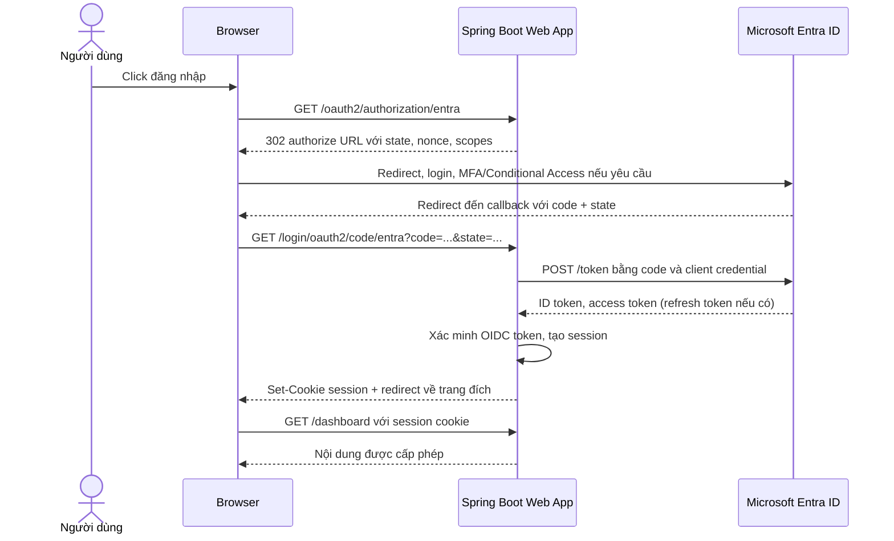
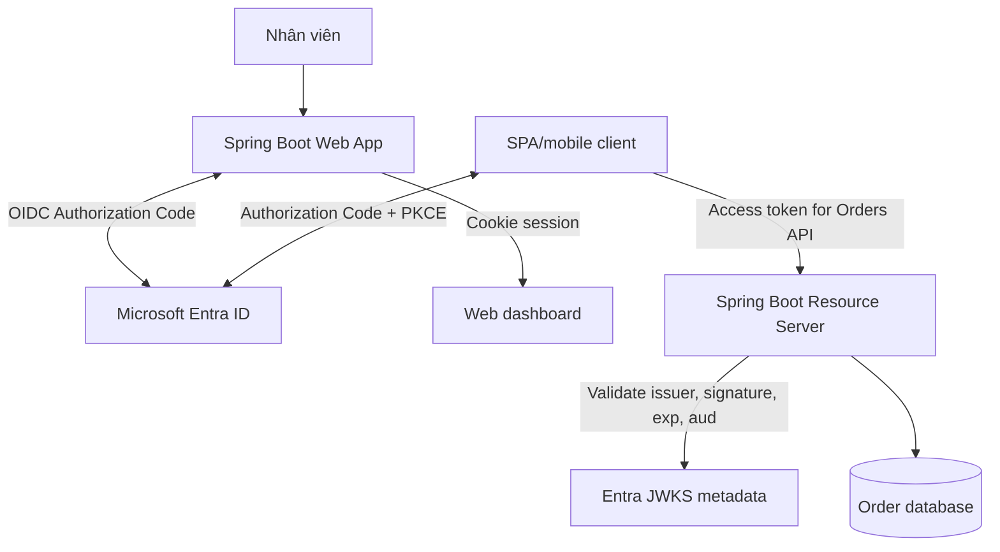
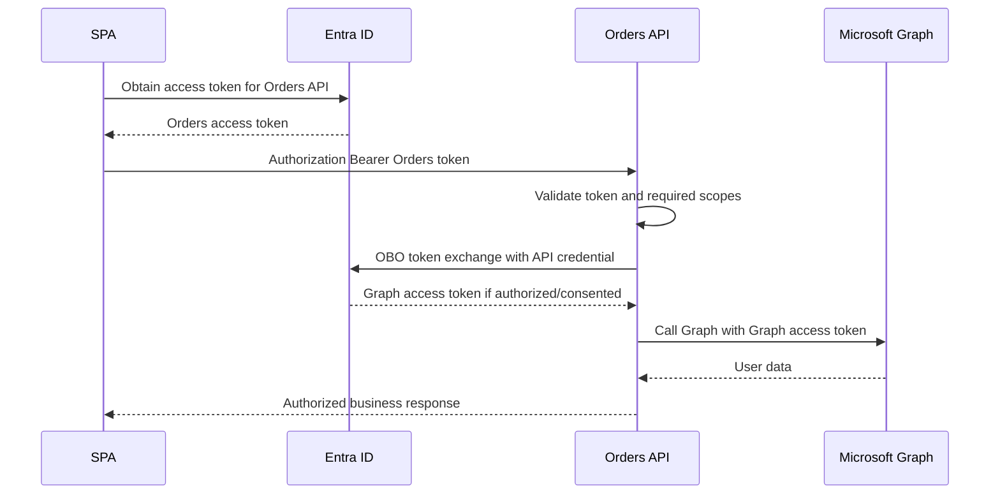
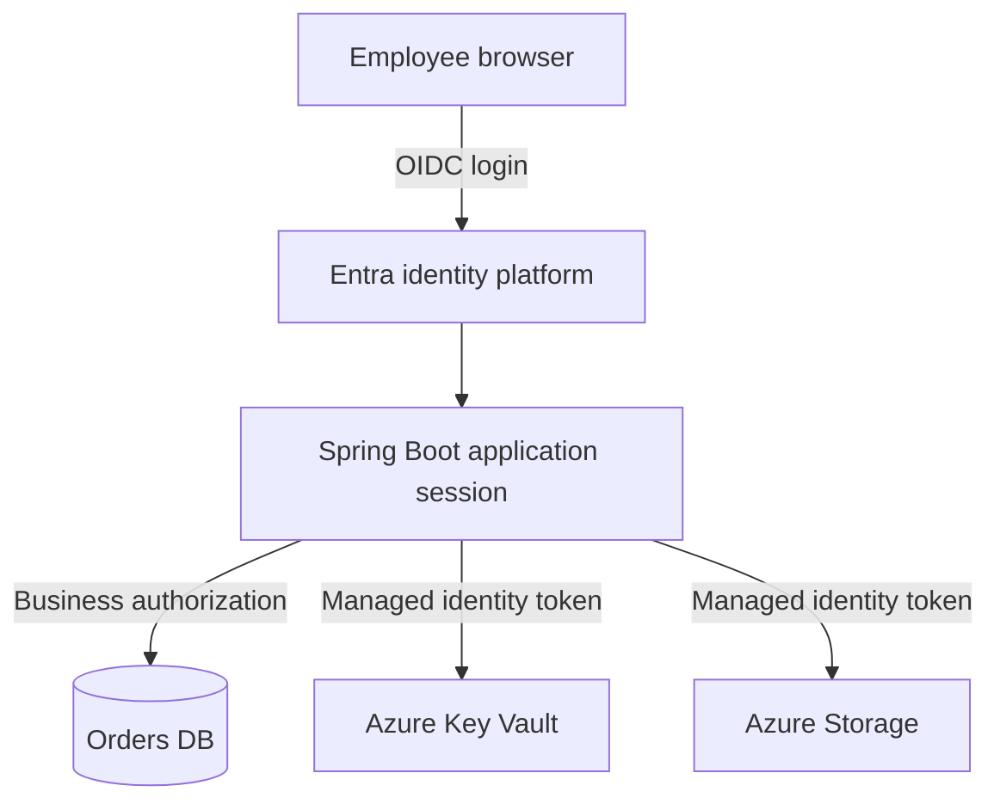
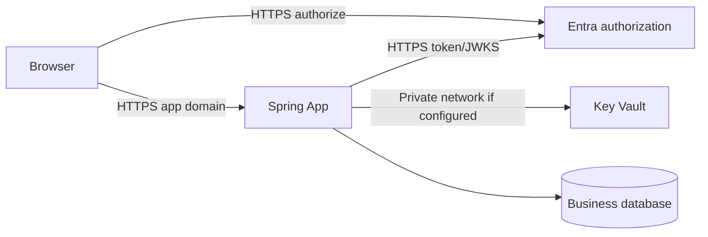
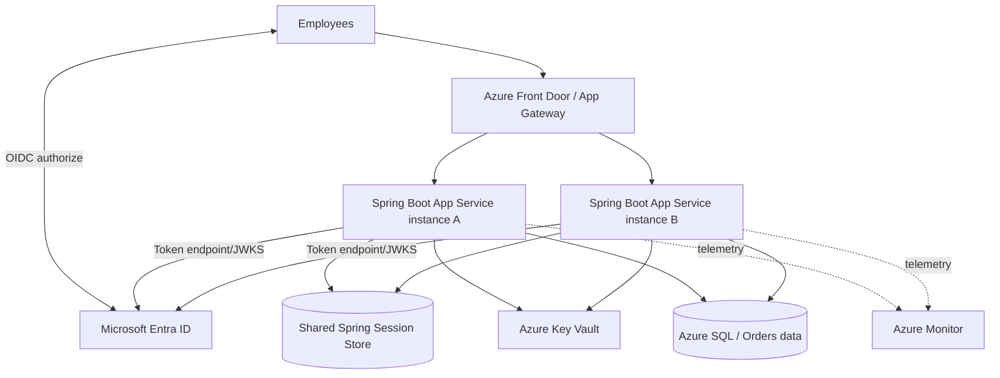

# Đăng nhập Microsoft Entra ID bằng Spring Security

Một công ty triển khai cổng quản lý đơn hàng **Java Spring Boot** trên Azure App Service. Nhân viên phải đăng nhập bằng tài khoản tổ chức, tuân thủ chính sách Microsoft Entra ID về đa yếu tố xác thực (MFA), có quyền riêng cho nghiệp vụ kế toán và quản trị, đồng thời không để ứng dụng tự lưu mật khẩu Microsoft của họ. Công ty cũng có một REST API dùng bearer access token và muốn biết cách tích hợp đúng mà không đánh đồng hai loại xác thực.

**Microsoft Entra ID** là hệ thống danh tính và truy cập của Microsoft; **Spring Security** là lớp bảo vệ ứng dụng Java. Trong ứng dụng web server-side, ta dùng **OAuth 2.0 Authorization Code** kết hợp **OpenID Connect (OIDC)**: trình duyệt được chuyển tới Entra ID, người dùng hoàn thành đăng nhập/MFA theo chính sách, Entra chuyển một authorization code về callback, Spring Security đổi code lấy tokens, xác minh ID token và tạo phiên ứng dụng. Người dùng có thể truy cập web qua cookie phiên thay vì ứng dụng phải tự kiểm tra password.

Bài học thuộc chương **Spring Boot trên Azure** của module **CLOUD_PROVIDERS_AZURE**, kết nối Entra ID với subscription/resource group, App Service, Azure Key Vault, networking, giám sát và kiểm soát chi phí của hệ thống chạy trên Microsoft Azure. Trọng tâm là **“Đăng nhập Microsoft Entra ID bằng Spring Security”**.

> **Phạm vi:** Ví dụ chính dùng **Spring Boot 3.x, Spring Security 6.x**, Java 17+ và một **web application single-tenant**; cấu hình/version cụ thể cần điều chỉnh theo project. Phần REST API được trình bày như một **resource server tách riêng**, tránh nhầm session login với bearer-token authentication. API của Microsoft Entra, Spring Security và Portal có thể thay đổi; không có subscription, app registration hoặc secret thật nào bị tạo hay chỉnh sửa trong bài. Đây là STEP 4 authoring, chưa phải QA chuyên môn/triển khai thực tế.

## Mục tiêu học tập

Sau bài học, bạn có thể:

1. Phân biệt authentication/authorization, Entra tenant, app registration, service principal và app roles.
2. Hiểu quan hệ giữa OAuth 2.0, OIDC, ID token, access token, session cookie và refresh token.
3. Vẽ luồng Authorization Code gồm `state`, `nonce`, redirect URI và trao đổi token back-channel.
4. Tạo app registration single-tenant và cấu hình URI callback chính xác cho Spring Boot.
5. Sử dụng `spring-boot-starter-oauth2-client`, `issuer-uri` và `oauth2Login`.
6. Xác minh principal bằng `OidcUser`, dùng `tid + oid` thay vì email làm khóa bất biến.
7. Ánh xạ Entra app roles thành `GrantedAuthority` và bảo vệ route/service methods.
8. Giữ CSRF, session/cookie, logout và reverse-proxy HTTPS an toàn.
9. Phân biệt web login với JWT resource server có **audience validation**.
10. Hiểu khi nào dùng Microsoft Graph delegated access, OBO flow hoặc managed identity.
11. Thiết kế secret rotation, App Service/AKS configuration, multi-instance sessions và network policies.
12. Giám sát sự cố 401/403/redirect mismatch, audit và kiểm soát chi phí.
13. Thực hành hoàn chỉnh một ứng dụng web có login, profile và admin-only route.

## 1. Authentication khác authorization

**Authentication (AuthN):** chứng minh ai đang đăng nhập. **Authorization (AuthZ):** kiểm tra người đó được phép làm gì trên một tài nguyên cụ thể.

| Lớp | Ví dụ | Điều nó không chứng minh |
|---|---|---|
| Entra sign-in | Người dùng hoàn tất đăng nhập/MFA | Được xem mọi hóa đơn |
| OIDC ID token | Principal được xác thực cho web client | Có quyền gọi mọi REST API |
| Spring web session | Browser đã login vào ứng dụng | User được truy cập order bất kỳ |
| Entra app role | `Admin` hoặc `FinanceReviewer` theo assignment | Quyền Azure subscription Owner |
| OAuth access token | Scope/role dành cho một API cụ thể | Quyền vào mọi API khác |
| Azure RBAC | Contributor trên resource group | Vai trò Admin bên Spring Boot |
| Business authorization | Tenant, ownership, trạng thái order | Không được bỏ chỉ vì có app role |

Một tài khoản có Azure subscription Owner không mặc nhiên là administrator của ứng dụng. Ngược lại, `APPROLE_Admin` chỉ nên cấp quyền trong ứng dụng đã thiết kế, không tự cho phép quản lý Key Vault hoặc Azure Resource Manager.

## 2. Microsoft Entra tenant và app registration

Các khái niệm:

- **Tenant:** một directory của tổ chức, định danh bằng tenant ID.
- **User:** người dùng trong tenant hoặc guest theo B2B policy.
- **App registration:** mô tả client/application ID, supported accounts, redirect URIs và API permissions.
- **Enterprise application/service principal:** thể hiện app trong tenant; có thể quản lý user/group assignments và Conditional Access theo cấu hình.
- **Client ID:** định danh ứng dụng, không phải mật khẩu.
- **Client secret/certificate:** credential của confidential web client phía server.
- **Redirect URI:** endpoint ứng dụng được phép nhận authorization response.
- **App role:** permission value của ứng dụng, ví dụ `Admin`, được gán qua Entra.
- **Issuer:** IdP phát token; **audience:** bên nhận token.
- **User object ID (`oid`):** định danh object user trong tenant theo claim được phát.

Ví dụ cấu hình:

```text
Tenant ID:          <TENANT_GUID>
Application ID:     <WEB_CLIENT_GUID>
Authentication:     Web platform
Account types:      Single tenant
Local callback:     http://localhost:8080/login/oauth2/code/entra
Production callback:https://orders.example.com/login/oauth2/code/entra
Spring registration:entra
```

Đây là placeholders. Không tự tạo URI/secret hoặc đổi chính sách tenant production khi chưa được cho phép.

## 3. OAuth 2.0 và OIDC không đồng nghĩa

**OAuth 2.0** chủ yếu cung cấp cơ chế **ủy quyền truy cập API** qua access token. **OIDC** là lớp xác thực danh tính trên OAuth, thường có ID token.

| Giá trị | Mục đích | Không nên làm |
|---|---|---|
| **Authorization code** | App đổi lấy token ở back-channel token endpoint | Dùng code như password hoặc cache lâu dài |
| **ID token** | Xác thực login cho client có audience tương ứng | Gửi như bearer access token tới API khác |
| **Access token** | Gọi API có audience/permissions tương ứng | Coi mọi access token đều hợp lệ cho app mình |
| **Refresh token** | Lấy token mới theo policy/scope | Đưa vào browser localStorage hoặc log |
| **Session cookie** | Truy cập web server-side đã đăng nhập | Coi cookie là token có thể dùng cho Microsoft Graph |
| **App role** | Authorization bên app/resource | Coi display name của group là role đáng tin |

Một **Microsoft Graph access token** là token cho Graph; API tự xây phải **từ chối** nó nếu audience không dành cho API ấy. Một **ID token** dành cho web client cũng không thể thay access token của Orders API.

## 4. Luồng Authorization Code và OpenID Connect



### Trình tự bảo vệ

- `state` liên kết response với request và chống login CSRF/mix-up.
- `nonce` giúp chống replay của OIDC ID token theo flow.
- `redirect_uri` phải khớp redirect đã đăng ký.
- Authorization code ngắn hạn, chỉ dùng một lần theo protocol.
- OIDC framework xác minh signature, issuer, audience, expiry và các điều kiện protocol.
- Client secret là bí mật **server-side**, không được chuyển về browser.
- **PKCE** bảo vệ authorization code; bắt buộc quan trọng với SPA/native public clients và có thể dùng với confidential clients theo hỗ trợ.

**Không tự viết bộ kiểm tra chữ ký JWT bằng cách decode payload rồi tin claims.** Dùng Spring Security/OIDC metadata và validation của thư viện tương thích.

## 5. Một browser không cần giữ ID token trong localStorage

Trong server-side app, browser giữ session cookie, còn Spring Boot giữ SecurityContext/OAuth2 authorized-client state theo cách cấu hình.

```text
Browser:      session cookie (Secure, HttpOnly)
Spring Boot:  authentication principal/session
Entra:        identity provider login/SSO state
Database:     business entitlements, audit, order ownership
```

Mẫu này thường được gọi là **server-rendered/BFF-like** khi backend quản lý session/token thay cho JavaScript frontend. Không mặc định mọi Spring Boot app dùng phương án này; một SPA thuần dùng **MSAL + Authorization Code with PKCE** sẽ có mô hình token khác.

### Cookies cần cấu hình

- `Secure` ở HTTPS production.
- `HttpOnly` hạn chế JavaScript đọc cookie phiên.
- `SameSite` phù hợp OIDC redirect và cross-site requirements.
- Session timeout phù hợp rủi ro và trải nghiệm.
- CSRF protection cho state-changing requests dùng cookie.
- Session fixation protection và session invalidation khi logout.

## 6. Single-tenant hay multi-tenant?

Bài dùng **single-tenant**:

```text
https://login.microsoftonline.com/<TENANT_ID>/v2.0
```

| Chế độ | Phù hợp | Việc cần kiểm soát |
|---|---|---|
| Single-tenant | Ứng dụng nội bộ một tổ chức | Fixed issuer, tenant/role policy |
| Multi-tenant organizations | SaaS cho nhiều Entra directories | Trusted issuer validation, tenant allowlist, onboarding, role isolation |
| Có Microsoft personal accounts | App consumer/business hỗn hợp | Issuer/account-type và auth policy riêng |

### Cạm bẫy `common`/`organizations`

Không thay `<TENANT_ID>` bằng `common` rồi tắt issuer validation để “hỗ trợ mọi tenant”. Với multi-tenant, issuer token có thể khác nhau theo tenant, và app cần **validate từng issuer được phép**, thực hiện onboarding/consent đúng, cách ly dữ liệu và policy quyền. Với khách mời B2B, object ID trong resource tenant có thể khác home tenant; dùng principal identity theo **issuer/tenant đang thực sự xác minh**.

## 7. Đăng ký một Web app ở Microsoft Entra

Trong Microsoft Entra admin center, thực hiện trong **tenant lab** được phép:

1. Mở **App registrations** → **New registration**.
2. Đặt tên, ví dụ `orders-spring-web-lab`.
3. Chọn **Accounts in this organizational directory only**.
4. Chọn platform **Web** và redirect `http://localhost:8080/login/oauth2/code/entra`.
5. Ghi lại **Application (client) ID** và **Directory (tenant) ID**.
6. Tạo client secret có thời hạn phù hợp **chỉ nếu dùng confidential client với secret**; lưu ngay trong secret manager/Key Vault.
7. Xem lại OIDC scopes `openid`, `profile`, `email` và policies/consent.
8. Nếu phân quyền bằng app roles, khai báo roles rồi gán đúng users/groups trong Enterprise application.
9. Khi deploy, thêm **redirect URI HTTPS production** với hostname thật.
10. Xác minh app assignment/Conditional Access của tổ chức.

### Những URI khác nhau

```text
Đăng ký:
http://localhost:8080/login/oauth2/code/entra

Khác với:
http://localhost:8081/login/oauth2/code/entra
http://127.0.0.1:8080/login/oauth2/code/entra
https://orders.example.com/login/oauth2/code/entra
https://orders.example.com/login/oauth2/code/azure
```

Host, port, scheme và path cần **đúng** theo app registration. Không mở wildcard redirect rộng hoặc redirect sang domain không được kiểm soát chỉ để né lỗi.

## 8. Maven dependencies cho Spring Boot 3.x

Một web app dùng Maven parent/BOM Spring Boot phù hợp:

```xml
<dependencies>
    <dependency>
        <groupId>org.springframework.boot</groupId>
        <artifactId>spring-boot-starter-web</artifactId>
    </dependency>
    <dependency>
        <groupId>org.springframework.boot</groupId>
        <artifactId>spring-boot-starter-security</artifactId>
    </dependency>
    <dependency>
        <groupId>org.springframework.boot</groupId>
        <artifactId>spring-boot-starter-oauth2-client</artifactId>
    </dependency>
</dependencies>
```

Nếu là **REST API Resource Server** riêng, cần thêm:

```xml
<dependency>
    <groupId>org.springframework.boot</groupId>
    <artifactId>spring-boot-starter-oauth2-resource-server</artifactId>
</dependency>
```

Các đoạn trên thuộc một `pom.xml` có dependency management và JDK phù hợp; không tự chọn phiên bản Spring Security lệch Spring Boot BOM.

**Không bắt buộc cài Spring Cloud Azure** để làm OIDC Login cơ bản. Spring Security hỗ trợ chuẩn OAuth2/OIDC. Spring Cloud Azure có thể bổ sung integrations nhưng phải kiểm tra version compatibility và tránh hai cấu hình security chain chồng nhau.

## 9. application.yml: cấu hình OIDC issuer

Ví dụ dùng environment placeholders (được chuyển thành Spring property syntax khi ghi file):

```yaml
server:
  port: 8080

spring:
  security:
    oauth2:
      client:
        registration:
          entra:
            provider: entra
            client-id: ${ENTRA_CLIENT_ID}
            client-secret: ${ENTRA_CLIENT_SECRET}
            authorization-grant-type: authorization_code
            redirect-uri: "{baseUrl}/login/oauth2/code/{registrationId}"
            scope:
              - openid
              - profile
              - email
        provider:
          entra:
            issuer-uri: https://login.microsoftonline.com/${ENTRA_TENANT_ID}/v2.0
```

Trong file kết quả, các placeholders là Spring environment expressions bắt đầu bằng dấu đô-la và ngoặc nhọn, ví dụ biến `ENTRA_CLIENT_ID` được đọc từ environment. Đừng hardcode secret trong YAML.

### Tại sao `registrationId` là `entra`?

- Start login URL: `/oauth2/authorization/entra`.
- Callback mặc định: `/login/oauth2/code/entra`.

Thay tên `entra` thành `azure` mà không đổi app registration redirect sẽ tạo mismatch.

### OIDC metadata

`issuer-uri` giúp Spring Security đọc discovery metadata của provider (authorization/token/JWKS endpoints). **Issuer phải thuộc tenant đang cho phép**, không lấy bất kỳ URL metadata nào từ request của client.

### Môi trường local

```bash
# Chỉ minh họa tên biến; không commit real values.
export ENTRA_TENANT_ID="<TENANT_GUID>"
export ENTRA_CLIENT_ID="<APP_CLIENT_GUID>"
export ENTRA_CLIENT_SECRET="<VALUE_FROM_SECRET_STORE>"
```

Trên Windows PowerShell, cú pháp set environment khác Bash; không paste keys trực tiếp vào nơi ghi shell history. Trên Azure App Service, dùng App Settings/Key Vault reference/secret store được phê duyệt.

## 10. SecurityFilterChain: oauth2Login và deny-by-default

```java
package vn.example.orders.security;

import org.springframework.context.annotation.Bean;
import org.springframework.context.annotation.Configuration;
import org.springframework.security.config.Customizer;
import org.springframework.security.config.annotation.web.builders.HttpSecurity;
import org.springframework.security.web.SecurityFilterChain;

@Configuration
public class WebSecurityConfiguration {

    @Bean
    SecurityFilterChain webSecurityFilterChain(HttpSecurity http)
            throws Exception {

        return http
            .authorizeHttpRequests(auth -> auth
                .requestMatchers("/", "/public/**", "/error")
                    .permitAll()
                .requestMatchers("/admin/**")
                    .hasAuthority("APPROLE_Admin")
                .anyRequest().authenticated()
            )
            .oauth2Login(Customizer.withDefaults())
            .logout(logout -> logout
                .logoutSuccessUrl("/")
                .invalidateHttpSession(true)
                .deleteCookies("JSESSIONID")
            )
            // CSRF is enabled by default for session-based web apps.
            .build();
    }
}
```

### Các điểm cần chú ý

- `permitAll` cho routes thật sự public; routes còn lại cần authenticated principal.
- `APPROLE_Admin` là convention của ứng dụng **sau bước role mapping**.
- Nếu role không được map hoặc không được cấp, `/admin/**` phải trả **403**.
- `logout` ở mẫu này hủy session Spring; Entra SSO session có thể vẫn tồn tại.
- Giữ CSRF protection của Spring Security cho các POST/PUT/PATCH/DELETE dùng cookie.
- Protect `/actuator/**`/debug/logging routes; không vô tình công khai config.

## 11. Lấy OidcUser trong controller

```java
package vn.example.orders.web;

import java.util.Map;
import org.springframework.security.core.annotation.AuthenticationPrincipal;
import org.springframework.security.oauth2.core.oidc.user.OidcUser;
import org.springframework.web.bind.annotation.GetMapping;
import org.springframework.web.bind.annotation.RestController;

@RestController
public class ProfileController {

    @GetMapping("/api/me")
    public Map<String, String> me(
            @AuthenticationPrincipal OidcUser user) {

        String tenantId = user.getClaimAsString("tid");
        String objectId = user.getClaimAsString("oid");
        String name = user.getClaimAsString("name");

        if (tenantId == null || objectId == null) {
            throw new IllegalStateException(
                "Missing verified tenant/object ID claims");
        }

        return Map.of(
            "tenantId", tenantId,
            "objectId", objectId,
            "displayName", name == null ? "" : name
        );
    }
}
```

Sau khi `oauth2Login` hoàn tất, principal được lấy từ Spring Security context, không phải `X-User-Id` header mà client tự gửi.

### Các claims nên hiểu

| Claim | Ý nghĩa | Cảnh báo |
|---|---|---|
| `iss` | Identity provider phát token | Validate issuer |
| `aud` | Client/token recipient | ID token aud phải là web client |
| `sub` | OIDC subject | Semantics phụ thuộc issuer/client |
| `tid` | Tenant ID khi Entra cung cấp | Cần tenant policy |
| `oid` | Object ID user trong tenant | Thường kết hợp `tid` làm khóa |
| `name` | Tên hiển thị | Có thể thiếu hoặc thay đổi |
| `preferred_username` | Gợi ý tên đăng nhập | Không mặc nhiên unique/immutable |
| `email` | Email khi được phát hành | Không luôn có hoặc là định danh vĩnh viễn |
| `roles` | App role values khi token phù hợp | Cần mapper trong Spring |
| `groups` | Group identifiers khi được phát hành | Có thể bị group overage |

### Không dùng email làm authorization key

Một người đổi email hoặc khách mời thuộc nhiều tenants vẫn có thể là cùng một người ngoài đời nhưng các **object IDs** và security contexts khác nhau. Một khóa ứng dụng như `tenantId + objectId` phù hợp cho nhiều kịch bản single-tenant hơn `email`.

## 12. Entra app roles và Enterprise application assignment

Ví dụ định nghĩa:

```text
App role value: OrderReader
Description: Read assigned orders

App role value: FinanceReviewer
Description: Review finance documents

App role value: Admin
Description: Manage application settings
```

Trong app registration, khai báo role values/allowed member types phù hợp. Sau đó vào **Enterprise application** để gán users/groups đúng policy.

### Các trường hợp thường gặp

- User đăng nhập thành công **nhưng không có role**: login authentication không đồng nghĩa role assignment.
- User ở group nhưng ID token không có `roles`: cần kiểm tra role đã gán theo cơ chế được hỗ trợ.
- `groups` quá nhiều: token có thể không chứa danh sách đầy đủ; cân nhắc **app roles** thay vì lấy group list không giới hạn.
- Entra directory roles như Global Administrator không tự được áp làm app Admin.
- Claim role là value, không phải display label.

**App role chỉ cấp chức năng**, không thay kiểm tra owner/tenant của `OrderId`.

## 13. Ánh xạ app roles vào Spring Security authorities

Spring Security không tự bảo đảm claim `roles` trở thành `APPROLE_Admin`. Ta định nghĩa `GrantedAuthoritiesMapper`:

```java
package vn.example.orders.security;

import java.util.HashSet;
import java.util.Set;
import java.util.stream.Stream;

import org.springframework.context.annotation.Bean;
import org.springframework.context.annotation.Configuration;
import org.springframework.security.core.GrantedAuthority;
import org.springframework.security.core.authority.SimpleGrantedAuthority;
import org.springframework.security.core.authority.mapping.GrantedAuthoritiesMapper;
import org.springframework.security.oauth2.core.oidc.user.OidcUserAuthority;

@Configuration
public class EntraRoleMappingConfiguration {

    @Bean
    GrantedAuthoritiesMapper userAuthoritiesMapper() {
        return input -> {
            Set<GrantedAuthority> result = new HashSet<>(input);

            input.stream()
                .filter(OidcUserAuthority.class::isInstance)
                .map(OidcUserAuthority.class::cast)
                .flatMap(authority -> {
                    var roles = authority.getIdToken()
                        .getClaimAsStringList("roles");

                    return roles == null
                        ? Stream.<String>empty()
                        : roles.stream();
                })
                .filter(role -> role != null && !role.isBlank())
                .forEach(role -> result.add(
                    new SimpleGrantedAuthority("APPROLE_" + role)
                ));

            return result;
        };
    }
}
```

### Điều kiện

- `roles` thực sự được phát trong **ID token** sau app role assignment tương ứng.
- Spring Security version đang dùng tích hợp mapper bean vào OAuth2 Login như cấu hình này; xác minh bằng integration test.
- Prefix `APPROLE_` do **ứng dụng** quy ước.
- Cho quyền nhạy cảm, nên kiểm tra role value nằm trong allowlist, thay vì chuyển mọi claim string thành quyền rộng.
- Nếu có custom authority source ngoài ID token, phải xác thực nguồn đó rõ ràng.

### Kiểm thử

Với user không có role Admin, `GET /admin/dashboard` phải trả **403** dù Entra login thành công. Với user role Admin, route được xử lý; business authorization vẫn có thể kiểm tra thêm.

## 14. Method Security và business object authorization

Bật method authorization:

```java
package vn.example.orders.security;

import org.springframework.context.annotation.Configuration;
import org.springframework.security.config.annotation.method.configuration.EnableMethodSecurity;

@Configuration
@EnableMethodSecurity
public class MethodSecurityConfiguration {
}
```

Sử dụng ở service:

```java
package vn.example.orders.service;

import org.springframework.security.access.prepost.PreAuthorize;
import org.springframework.stereotype.Service;

@Service
public class AdminService {

    @PreAuthorize("hasAuthority('APPROLE_Admin')")
    public void updateConfiguration(String configId) {
        // Validate change, persist audit and enforce invariants.
    }
}
```

### Route-level security không đủ

Một nhân viên có `APPROLE_OrderReader` vẫn không được đọc mọi order:

```text
GET /orders/ORD-1001
 -> Authenticate (tid, oid)
 -> Check functional permission
 -> Check order belongs to same tenant / assigned user
 -> Check object status and field-level permissions
 -> Record audit and return only allowed data
```

Nếu thêm GraphQL endpoint, background job hoặc controller mới, **business service** vẫn phải giữ quyền tài nguyên. Đây là cách giảm lỗi IDOR/BOLA.

## 15. Session cookies, CSRF và request lifecycle

Trong web app server-side, browser thường gửi cookie session với request. Bảo mật cần:

- Cookie `Secure` trên HTTPS, `HttpOnly`, `SameSite` phù hợp.
- Session idle/absolute timeout theo yêu cầu.
- Spring session fixation protection.
- CSRF token cho request thay đổi trạng thái.
- Không render ID/access/refresh tokens vào HTML hoặc logs.
- Không lấy query parameter `isAdmin=true` thay role mapping.
- Kiểm soát cache của trang nhạy cảm và đăng xuất trên shared devices.

### Vì sao giữ CSRF?

Một website độc hại có thể khiến browser của user đã đăng nhập tự gửi POST có cookie tới ứng dụng. **CSRF protection** kiểm tra token/origin policy tương ứng để chống tác động.

```html
<form method="post" action="/logout">
  <input type="hidden" name="_csrf"
         th:value="${_csrf.token}" />
  <button type="submit">Đăng xuất</button>
</form>
```

Đây là ví dụ form dùng Thymeleaf, giá trị `th:value` cần render theo syntax của template engine; trong file hoàn chỉnh, placeholder sử dụng biểu thức Thymeleaf bắt đầu bằng dấu đô-la/ngoặc nhọn. Một số tích hợp tự thêm hidden CSRF input khi dùng Spring MVC/Thymeleaf; kiểm tra phiên bản thực tế.

**CORS không phải authorization**, và `SameSite` không phải cơ chế thay thế mọi CSRF check. Đừng tắt CSRF toàn web app chỉ để POST thử nghiệm chạy.

## 16. Logout trong Spring và Single Sign-On của Entra

**Local logout** ở Spring Boot hủy application session; **Entra SSO session** có thể tiếp tục hợp lệ. Sau local logout, người dùng nhấn Login lại có thể được Entra đăng nhập tự động theo chính sách.

### Có thể dùng OIDC RP-Initiated Logout

Spring Security có `OidcClientInitiatedLogoutSuccessHandler` (nếu provider hỗ trợ end-session metadata). Trong `SecurityFilterChain` có thể cấu hình một `LogoutSuccessHandler` phù hợp:

```java
import org.springframework.security.oauth2.client.registration.ClientRegistrationRepository;
import org.springframework.security.oauth2.client.oidc.web.logout.OidcClientInitiatedLogoutSuccessHandler;

// Add to a @Configuration class; inject the registrations repository.
static OidcClientInitiatedLogoutSuccessHandler oidcLogoutHandler(
        ClientRegistrationRepository registrations) {

    var handler =
        new OidcClientInitiatedLogoutSuccessHandler(registrations);
    handler.setPostLogoutRedirectUri("{baseUrl}/");
    return handler;
}
```

Sau đó gọi `logout(logout -> logout.logoutSuccessHandler(oidcLogoutHandler(registrations)))` trong web security chain được cấu hình qua dependency injection. **Post-logout redirect** phải được provider/app registration cho phép theo policy.

### Không hiểu sai logout

- Logout app A không chắc logout toàn bộ apps trong tenant.
- Disabled account không tự làm mọi session đã cấp mất ngay lập tức nếu app chưa có cơ chế revalidation/revocation.
- Session của Spring Boot vẫn cần timeout/revocation khi user bị thu hồi.
- Không dùng `GET /logout` làm thao tác mutate mặc định cho web có CSRF.
- Với kiosk, xóa application UI state và không để trang nhạy cảm cache công khai.

## 17. App Service HTTPS, reverse proxy và redirect URI

Production URL:

```text
https://orders.example.com/login/oauth2/code/entra
```

Nếu Java runtime phía sau App Service/Front Door/Application Gateway nhận request nội bộ qua HTTP, application có thể suy sai `{baseUrl}` và tạo redirect URI HTTP. Kết quả là mismatch hoặc loop.

Cấu hình gợi ý:

```yaml
server:
  forward-headers-strategy: framework
  servlet:
    session:
      cookie:
        secure: true
        http-only: true
        same-site: lax
```

### Điều kiện

- Proxy đặt/sanitizes `Forwarded`/`X-Forwarded-*` headers đúng; chỉ tin **proxy được kiểm soát**.
- Entra app registration có redirect URI chính xác dùng **HTTPS public hostname**.
- Không cho client tùy tiện ghi đè Host/Proto forwarded headers, tránh open redirects.
- Bật HTTPS-only trên App Service/gateway và TLS certificate hợp lệ.
- Health probes chỉ được xem minimal health status, không chứa secrets.
- Không log nguyên `code`, `state` và token ở callback/HTTP query.

### Local và production khác nhau

Để login qua localhost HTTP có thể dùng cookie Secure false ở **local profile**; không copy thiết lập đó vào production. Trên môi trường nhiều domains, cần kiểm tra SameSite/CORS và cookie domain/path theo kiến trúc thực.

## 18. Multi-instance và Spring Session

Nếu có App Service/AKS nhiều instances, user login ở instance A, request sau được route tới B. Nếu session chỉ giữ trong RAM của A, B có thể không tìm thấy SecurityContext.

| Lựa chọn | Ưu điểm | Hạn chế |
|---|---|---|
| Sticky session | Dễ cho một số deployments | Failover/scale-in mất session |
| Spring Session + Redis-compatible store | Chia sẻ session giữa instances | Cần network, security, TTL, availability và chi phí |
| Database-backed session | Durability tùy cấu hình | Latency/cleanup/schema |
| SPA với bearer tokens | Không cần server web session giống vậy | Token storage, PKCE, refresh, XSS/CSRF trade-offs |

**Bảo vệ session store** tương đương credential store vì dữ liệu phiên gắn với principal và có thể chứa authorized-client state. Phân quyền Redis/network, TLS, retention, encryption phù hợp. Đăng xuất phải invalidate session chung, không chỉ xóa biến cục bộ trong một pod.

## 19. Web login và REST API JWT Resource Server: hai vai trò

Một ứng dụng web có người dùng đăng nhập qua Entra thường là **OAuth2/OIDC client**. Một REST API nhận bearer access token là **OAuth2 resource server**.



### Phân biệt token

- **ID token** thường có `aud` bằng client ID của ứng dụng web; dành cho OIDC login.
- **Orders API access token** có audience dành cho **Orders API**, chứa permissions/scopes phù hợp.
- **Microsoft Graph access token** có audience dành cho Graph; Orders API phải từ chối.
- **Session cookie** đại diện đăng nhập web app, không phải bearer token cho REST API bên ngoài.
- **Managed identity token** được workload Azure dùng gọi một Azure resource, không phải chứng cứ user đã login vào web.

### Có thể một ứng dụng dùng cả hai?

Có thể, nhưng cần **hai SecurityFilterChain** theo `securityMatcher`/`@Order`, request matcher và entry point đúng. Nếu không kiểm thử đủ, API có thể redirect HTML login thay vì trả 401, hoặc web routes nhận bearer token không đúng cách. Ví dụ dưới đây dùng **API triển khai riêng** để minh họa rõ.

## 20. Spring Security Resource Server: xác minh JWT đúng audience

Đối với API riêng, thêm `spring-boot-starter-oauth2-resource-server`. Cấu hình issuer tenant dành cho access tokens phiên bản tương ứng:

```yaml
spring:
  security:
    oauth2:
      resourceserver:
        jwt:
          issuer-uri: https://login.microsoftonline.com/${ENTRA_TENANT_ID}/v2.0

orders:
  api:
    audience: ${ORDERS_API_AUDIENCE}
```

Spring Security dùng issuer discovery/JWKS và tự xác minh nhiều điều kiện của JWT. **Không chỉ dựa vào chữ ký và issuer**: API còn phải kiểm tra `aud` là audience của chính nó.

### Bean kiểm tra issuer + expiry + audience

```java
package vn.example.orders.api;

import org.springframework.beans.factory.annotation.Value;
import org.springframework.context.annotation.Bean;
import org.springframework.context.annotation.Configuration;
import org.springframework.security.oauth2.core.DelegatingOAuth2TokenValidator;
import org.springframework.security.oauth2.core.OAuth2Error;
import org.springframework.security.oauth2.core.OAuth2TokenValidator;
import org.springframework.security.oauth2.core.OAuth2TokenValidatorResult;
import org.springframework.security.oauth2.jwt.Jwt;
import org.springframework.security.oauth2.jwt.JwtDecoder;
import org.springframework.security.oauth2.jwt.JwtDecoders;
import org.springframework.security.oauth2.jwt.JwtValidators;
import org.springframework.security.oauth2.jwt.NimbusJwtDecoder;

@Configuration
public class OrdersJwtValidationConfiguration {

    @Bean
    JwtDecoder jwtDecoder(
            @Value("${spring.security.oauth2.resourceserver.jwt.issuer-uri}")
            String issuer,
            @Value("${orders.api.audience}")
            String expectedAudience) {

        JwtDecoder discovered = JwtDecoders.fromIssuerLocation(issuer);

        if (!(discovered instanceof NimbusJwtDecoder decoder)) {
            throw new IllegalStateException(
                "Expected a configurable NimbusJwtDecoder");
        }

        OAuth2TokenValidator<Jwt> defaults =
            JwtValidators.createDefaultWithIssuer(issuer);

        OAuth2TokenValidator<Jwt> audienceValidator = token -> {
            if (token.getAudience().contains(expectedAudience)) {
                return OAuth2TokenValidatorResult.success();
            }
            return OAuth2TokenValidatorResult.failure(
                new OAuth2Error(
                    "invalid_token",
                    "Token has unexpected audience",
                    null));
        };

        decoder.setJwtValidator(
            new DelegatingOAuth2TokenValidator<>(
                defaults, audienceValidator));

        return decoder;
    }
}
```

### Điều kiện của ví dụ

- `ENTRA_TENANT_ID`, API access-token version và issuer thực phải tương thích. Một access token Entra v1/v2 có thể khác issuer; cần cấu hình API app registration/token-version theo chính sách.
- `ORDERS_API_AUDIENCE` phải khớp **chính xác** `aud` của access token phát cho API. Không đoán nó là URI hay GUID nếu chưa xác minh token metadata có kiểm soát.
- Ví dụ dùng decoder từ issuer discovery. Sau thay đổi phiên bản, cần kiểm tra loại decoder, API và bean tạo đúng.
- Không tắt issuer/audience validator để chữa lỗi 401.
- Để tránh nhầm ID token với access token, nên **tách app registrations web client/API**, yêu cầu scopes/app roles phù hợp và kiểm tra token claims/permissions cho từng endpoint.
- Không log raw JWT trong quá trình test.

## 21. REST API stateless: SecurityFilterChain và scopes

Với một API chỉ dùng bearer token và không có browser session, cấu hình riêng:

```java
package vn.example.orders.api;

import org.springframework.context.annotation.Bean;
import org.springframework.context.annotation.Configuration;
import org.springframework.security.config.Customizer;
import org.springframework.security.config.annotation.web.builders.HttpSecurity;
import org.springframework.security.config.http.SessionCreationPolicy;
import org.springframework.security.web.SecurityFilterChain;

@Configuration
public class OrdersApiSecurityConfiguration {

    @Bean
    SecurityFilterChain apiSecurityFilterChain(HttpSecurity http)
            throws Exception {
        return http
            .authorizeHttpRequests(auth -> auth
                .requestMatchers("/health/live").permitAll()
                .requestMatchers(
                    org.springframework.http.HttpMethod.GET,
                    "/api/orders/**")
                    .hasAuthority("SCOPE_Orders.Read")
                .requestMatchers(
                    org.springframework.http.HttpMethod.POST,
                    "/api/orders/**")
                    .hasAuthority("SCOPE_Orders.Write")
                .anyRequest().denyAll()
            )
            .sessionManagement(session -> session
                .sessionCreationPolicy(SessionCreationPolicy.STATELESS))
            .oauth2ResourceServer(oauth ->
                oauth.jwt(Customizer.withDefaults()))
            .build();
    }
}
```

### Những điều cần kiểm tra

- API app registration phải **Expose an API** với scopes đã khai báo và consent/assignment đúng.
- Entra delegated access tokens thường dùng claim `scp` cho scopes; Spring Resource Server converter mặc định thường ánh xạ thành `SCOPE_...`, cần integration test.
- Client credentials/application permission flows thường dùng `roles` chứ không có `scp`; cần authorization converter/policy riêng.
- Dù có `SCOPE_Orders.Read`, service vẫn phải kiểm tra **owner/tenant của order**.
- `anyRequest().denyAll()` ngăn endpoints chưa lập policy vô tình được mở.
- Lược đồ này cho API **bearer-only, không dùng cookie session**. Quyết định CSRF khi API nằm cùng origin với cookie-based app phải dựa trên trust boundary, không tự copy policy tắt CSRF toàn ứng dụng.

### Phân biệt kết quả 401 và 403

**401 Unauthorized** thường là chưa có credential hợp lệ hoặc token bị từ chối (chữ ký, issuer, audience, expiry). **403 Forbidden** thường là đã xác thực nhưng thiếu quyền để dùng resource, chẳng hạn không có `Orders.Write`. Các policy/cấu hình entry point có thể ảnh hưởng chi tiết HTTP response; cần ghi logs/trace an toàn để kết luận.

## 22. SPA: đừng đưa client secret vào trình duyệt

Một SPA React/Angular/Vue thuần có thể dùng MSAL và **Authorization Code with PKCE** để lấy **access token cho API**. Nhưng SPA là **public client**, không được giữ client secret trong JavaScript hoặc localStorage.

### Hai mô hình

| Mô hình | Token/session ở đâu? | Phù hợp |
|---|---|---|
| **Spring Boot server-side OAuth2 Login** | Tokens/authorized client state phía server; browser gửi session cookie | Server-rendered UI, BFF |
| **SPA + MSAL + API JWT** | SPA dùng PKCE và access token, API xác minh JWT | Frontend tách riêng, mobile-like |
| **SPA qua BFF Spring** | Browser chỉ có HttpOnly session cookie, BFF giữ token | Muốn giảm token exposure phía JS |

Không trộn ba luồng tùy tiện. Ví dụ, frontend dùng MSAL lấy ID token rồi gửi thẳng tới `/api/orders` không phải cách gọi Orders API đúng; cần **access token cho đúng resource**.

### CORS và cookies

CORS quyết định browser origin nào được phép đọc response theo policy, không thay authentication. BFF dùng cookie cần CSRF/SameSite/secure headers; SPA dùng bearer token cần bảo vệ XSS, token storage và token refresh. Chọn một kiến trúc và kiểm thử.

## 23. Microsoft Graph và delegated permissions

Sau đăng nhập, ứng dụng muốn hiển thị ảnh đại diện, phòng ban hoặc thông tin nhóm của user. **Microsoft Graph** là API riêng và cần **access token dành cho Graph** với permission tương ứng, không thể dùng ID token lấy profile mọi lúc.

### Một số quyền phổ biến

- `User.Read` (delegated): đọc thông tin user trong phạm vi được cấp.
- Những scopes khác tùy chức năng và consent policies.
- Directory/Group permissions nhạy cảm có thể cần **admin consent** và data-minimization review.

### Mô hình đúng

```text
User logs into Spring Web App
   -> OIDC principal established
   -> App requests Graph delegated scope as needed
   -> OAuth2 authorized client obtains Graph access token
   -> App calls Microsoft Graph /me
   -> App maps only necessary claims to its profile
```

Nếu cần refresh tokens, scope như `offline_access`/provider policies và authorized-client persistence phải được cấu hình đúng; không giả định luôn được phát refresh token. Giữ Graph tokens trong trusted server storage khi dùng BFF/server-side app.

### Hai câu hỏi phải đặt

1. Có cần gọi Graph thật không? Nếu ID token đã đủ `name`, `tid`, `oid` thì có thể không cần Graph.
2. User đã đồng ý/admin đã cấp đúng delegated permission chưa? Không tự tăng quyền Graph chỉ để sửa lỗi 403 ở app.

**Graph `User.Read` không phải quyền đọc Orders API.** Không đưa Graph tokens vào API do mình sở hữu với hy vọng xác minh signature là đủ.

## 24. On-Behalf-Of: API muốn gọi Graph thay mặt user

Một tình huống khác: SPA gửi **Orders API access token** tới Spring REST API, sau đó API muốn gọi Graph thay mặt người dùng. Khi đó cần cân nhắc **OAuth 2.0 On-Behalf-Of (OBO) flow** theo hỗ trợ Entra/client library.



### Những điều OBO không tự làm

- Không tự cho ứng dụng quyền Graph nếu chưa được consent/admin approval.
- Không bỏ qua user authorization và tenant isolation.
- Không dùng raw ID token thay user assertion khi flow yêu cầu API access token.
- Không thể chỉ chuyển tiếp cùng một Orders API access token đến Graph vì audience sai.
- Không nên tự viết token exchange insecure; dùng thư viện/luồng được hỗ trợ và kiểm tra credential/claims đúng.

Nếu chỉ cần dữ liệu từ database công ty, có thể **không cần Graph hoặc OBO**. Giảm scopes nghĩa là giảm rủi ro.

## 25. User login khác managed identity cho workload Azure

Một ứng dụng Spring Boot trên App Service/AKS thường có hai lớp danh tính:



- **User identity:** Entra OIDC principal của người dùng, phục vụ login và business authorization.
- **Workload identity/managed identity:** danh tính của App Service/AKS/VM, dùng truy cập Key Vault, Storage hoặc những Azure resources theo RBAC/data-plane policy.
- **App registration client credential:** dùng cho confidential web client khi đổi authorization code, có thể là secret/certificate/credential method được provider hỗ trợ.

### Sai lầm phổ biến

Bật managed identity cho App Service **không tự làm** Spring OAuth2 Login không cần client credential hoặc tự động thay đổi cơ chế `client_secret`. Các lựa chọn dùng certificates/federated assertions để xác thực OAuth client cần được thư viện và Entra app registration hỗ trợ theo thiết kế riêng.

### Ví dụ Azure SDK cho quyền workload

```java
import com.azure.identity.DefaultAzureCredentialBuilder;

var credential = new DefaultAzureCredentialBuilder().build();
```

Đây là credential chain của **Azure SDK**, không phải user login principal. Khi chạy trên App Service có managed identity hợp lệ, credential có thể cấp token cho resource được phép; vẫn phải gán role đúng scope và đảm bảo network.

## 26. Key Vault, secret rotation và ứng dụng Java

Nếu một confidential web client dùng client secret:

- Lưu secret trong **Azure Key Vault** hoặc secret manager được phê duyệt, không trong Git/CI log.
- App Service dùng **Key Vault reference** hoặc ứng dụng đọc qua SDK khi support và permission đúng.
- Quyền workload đọc secret phải theo least privilege, chẳng hạn role data-plane chỉ đọc secrets ở scope phù hợp.
- Không in `ENTRA_CLIENT_SECRET` khi startup/config debug.
- Không gửi secret qua browser hay HTML forms.

### Kế hoạch rotation

1. Inventory app registrations và secret expiration.
2. Tạo **credential mới** khi secret cũ còn hợp lệ; lưu trong Key Vault.
3. Thử một instance/staging deployment dùng credential mới.
4. Cập nhật App Settings/Key Vault references và rolling restart/redeploy theo service.
5. Quan sát **authorization code exchanges** có thành công ở tất cả instances không.
6. Chờ xác nhận rollback readiness.
7. Thu hồi credential cũ đúng change window, tránh để hai secrets tồn tại quá lâu ngoài policy.
8. Audit và điều chỉnh alert hết hạn.

### Nếu secret hết hạn

Người dùng có thể đăng nhập ở Entra thành công nhưng Spring Boot **không đổi code lấy token** được. Đây là lỗi **client authentication tới token endpoint**, không phải lỗi password user.

### Certificate-based confidential client

Có thể đánh giá certificate/credential nâng cao nếu library/provider hiện hành hỗ trợ, nhưng không tự chuyển sang certificate chỉ vì muốn “bỏ secret” mà chưa xây cấu hình token exchange, HSM/Key Vault, rotation và security tests.

## 27. Triển khai Spring Boot trên Azure App Service

Một quy trình phù hợp:

1. Tạo build artifact JAR theo pipeline được phép.
2. Chọn App Service Java runtime/JDK/SKU phù hợp và resource group.
3. Bật HTTPS-only, cấu hình custom domain và TLS.
4. Cấp managed identity cho workload nếu dùng Key Vault/Storage.
5. Gán Key Vault/Storage roles tối thiểu cho identity.
6. Đặt `ENTRA_TENANT_ID`, `ENTRA_CLIENT_ID`, `ENTRA_CLIENT_SECRET` (Key Vault reference) qua App Settings.
7. Đăng ký redirect URI production chính xác trong Entra.
8. Kiểm tra proxy forwarded headers, session cookie Secure và login URL.
9. Cấu hình Application Insights/Azure Monitor với token/header redaction.
10. Kiểm tra từng role, cookie/session, logout, scale-out và failed login trước khi phát hành.

### Azure App Service có tính năng Authentication/Authorization riêng

App Service có thể có **built-in Authentication (“Easy Auth”)**. Nó khác việc Spring Security trực tiếp điều khiển OAuth2 Login.

- Nếu dùng **Spring Security oauth2Login**, ứng dụng xử lý callback, token validation và session.
- Nếu dùng **Easy Auth**, platform xử lý một số bước danh tính và chuyển identity metadata vào ứng dụng theo cấu hình.
- Nếu **bật cả hai** không có thiết kế rõ ràng, có thể gây redirect loops, login hai lần hoặc trust header sai.

**Bài này chọn Spring Security login**. Không giả định chỉ bật Easy Auth là mã Spring tự được cấu hình đúng.

## 28. Triển khai trên AKS/Containers: session và secret

Khi Spring Boot chạy trong Kubernetes/AKS, cần thêm:

- Kubernetes Secret hoặc Azure Key Vault CSI/Workload Identity theo mô hình được hỗ trợ để cấp credential.
- Pod replicas nhiều hơn một → cân nhắc Spring Session/Redis shared store.
- Ingress Controller/App Gateway/Front Door preserve external `https://` scheme và host qua trusted forwarded headers.
- Cấu hình readiness/liveness không lộ thông tin và không phụ thuộc việc user login.
- Network egress tới Entra authorization/token/JWKS endpoints qua DNS/TLS.
- Network policy và secret access chỉ tới các workloads cần thiết.
- Không ghi raw secrets trong Helm values, ConfigMaps hoặc container image.
- Thời hạn và rotation của app registration credential được theo dõi qua pipeline/owners.
- Log/trace được redacted, container stdout không chứa access tokens.

### Restart pods giữa lúc người dùng login

OIDC authorization request thường gắn với session/state. Nếu browser bắt đầu login khi request tới Pod A, callback quay lại Pod B mà session trước đó không được chia sẻ, Spring có thể báo **invalid state/authorization request not found**. Shared sessions hoặc routing strategy đúng là rất quan trọng, không chỉ sau khi đăng nhập.

## 29. Networking: một web private vẫn cần liên hệ Entra ID

Một App Service hoặc AKS workload có thể nằm sau Private Endpoint hoặc network restrictions, nhưng OIDC login vẫn có các luồng:

1. Browser → website login start và callback.
2. Browser → Entra authorization endpoint.
3. Spring backend → Entra token endpoint.
4. Spring backend → OIDC discovery/JWKS endpoint (theo caching/lifecycle).
5. Ứng dụng → Key Vault/Graph/Storage nếu có.



### Những lỗi thường gặp

- Outbound firewall chỉ cho website domain mà không cho token/JWKS endpoints.
- Private DNS/proxy làm backend resolve host sai.
- OAuth redirect từ Entra về hostname mà browser bên ngoài **không truy cập được**.
- TLS inspection/proxy làm certificate validation thất bại.
- App chỉ chạy HTTP nội bộ mà không tin đúng forwarded scheme.
- Server time skew khiến token được xem là chưa hợp lệ/hết hạn.
- Key Vault Private Endpoint có mà App Service VNet Integration hoặc DNS thiếu.

**Private Endpoint cho App Service không đồng nghĩa Entra token endpoint tự có private route**. Hãy thiết kế network paths của từng dependency theo khả năng Azure hiện hành.

## 30. Token validation: issuer, audience, expiry và permissions

Khi thiết kế xác thực, hãy xác minh một token **được dành cho ai và để làm gì**.

| Kiểm tra | ID token dùng cho login | API access token |
|---|---|---|
| Chữ ký/JWKS | Bắt buộc qua OIDC validation | Bắt buộc qua Resource Server |
| `iss` | Issuer Entra được cho phép | Issuer tenant hợp lệ |
| `aud` | Web client ID | Audience của API |
| `exp`, `nbf`, `iat` | Check thời gian theo rules | Check thời gian theo rules |
| `nonce` | Quan trọng cho OIDC authentication request | Không là same login check |
| `scp`/`roles` | Không giả định mọi scope API có trong ID token | Kiểm tra quyền API được cấp |
| User identity | Tạo principal/session | Dùng claims/context theo policy |
| Business object auth | Vẫn cần | Vẫn cần |

### Mã decode Base64 payload không phải validation

Một JWT có dạng `header.payload.signature`; ai cũng có thể base64-decode payload. **Phải xác minh chữ ký, issuer, audience, thời hạn, key rotation và permissions**. Không lấy `alg`, `kid` hoặc `iss` từ token chưa xác minh để tùy ý chuyển trust sang một issuer khác.

### JWK rotation

Microsoft có thể rotate signing keys. Dùng library để cache/refresh JWKS từ issuer metadata, có network/availability plan, không hardcode một public key vĩnh viễn rồi bỏ qua rotation. Không chấp nhận token khi key validation thất bại chỉ vì JWKS endpoint đang lỗi.

## 31. Lỗi AADSTS và OAuth callback: đọc đúng vấn đề

Một số lỗi Entra thường gặp trong quá trình tích hợp (mã và thông điệp cụ thể tùy policy/version):

| Triệu chứng | Nguyên nhân có thể | Kiểm tra |
|---|---|---|
| **AADSTS50011** / redirect mismatch | Callback URI không khớp | Scheme, hostname, port, path, proxy forwarded headers |
| **Invalid client secret** / client authentication error | Secret sai/hết hạn hoặc client ID không khớp | Key Vault version, app registration, token endpoint |
| **Application not found** | Client ID/tenant sai, app chưa được consent trong tenant | App registration, supported accounts |
| **Consent required** | Chưa được chấp thuận delegated scopes/API permissions | Consent/tenant policy, không bypass |
| **User assignment required** | Enterprise app yêu cầu assignment | Gán users/groups đúng |
| **Conditional Access/MFA blocked** | Chính sách yêu cầu bước xác thực hoặc chặn sign-in | Entra sign-in logs/IT owner |
| **Invalid state** | Authorization request/session bị mất hoặc bị sửa | Cookies, load balancing, callback path, session store |
| **Invalid nonce/ID token** | OIDC validation/protocol mismatch | Issuer, claims, cookies/time sync |
| **401 on protected API** | Access token sai issuer/audience/expiry/signature | Resource server logs và sanitized claims |
| **403 on admin URL** | Authenticated nhưng không có role/entitlement | App roles, mapping, business policy |

**Không lấy mã AADSTS làm bản án nguyên nhân duy nhất.** Kết hợp Entra **sign-in logs**, request ID/correlation ID, Azure app configuration và Spring logs để xác định tầng phát sinh.

### Không tắt các kiểm tra bảo mật để sửa nhanh

Không bỏ `state`, `nonce`, certificate validation, audience/issuer validation, Conditional Access hoặc CSRF chỉ để demo thành công. Điều tra cấu hình và flows đúng.

## 32. Runbook: redirect mismatch hoặc login loop

Triệu chứng: người dùng được chuyển tới Entra, quay về app rồi lại chuyển đi, hoặc thấy lỗi redirect URI mismatch.

1. Xác định URL trình duyệt thấy (`https://orders.example.com`), tránh ghi `code`/`state` nguyên văn.
2. Xem app registration platform **Web** đã đăng ký callback nào.
3. Kiểm tra `registrationId=entra` và `redirect-uri` của Spring.
4. Kiểm tra App Service/Ingress/Front Door có rewrite host/path/scheme không.
5. Kiểm tra `server.forward-headers-strategy` và chỉ tin đúng trusted proxy.
6. Xem cookies có được lưu/trả về callback không: Secure, SameSite, domain, path.
7. Nếu nhiều instances, xem authorization request/session có chia sẻ được không.
8. Kiểm tra browser có policy block cookies/third-party redirects không.
9. Kiểm tra phiên bản configuration và thời điểm deploy/rotate secret.
10. Dùng một test user thuộc tenant và role đúng để retest; không mở public access rộng.

### Gợi ý quan sát

Ghi **correlation ID** ở app login start/callback, tenant, sanitized redirect host, session presence và exception category. Không ghi authorization code, raw redirect query hoặc token.

## 33. Runbook: ID token hợp lệ nhưng API trả 401/403

### Trường hợp A: web login thành công, REST API 401

- Client gửi **ID token thay cho access token**?
- Token có audience của Graph/web client thay Orders API?
- Token issuer v1/v2 hoặc tenant không khớp API validator?
- Access token hết hạn/chưa có scope, request thiếu `Authorization: Bearer`?
- JWKS/network có vấn đề, server clock drift?
- API đang chạy filter chain sai và trả redirect thay JSON?

### Trường hợp B: API 403 sau khi token xác thực

- App scope `Orders.Read`/`Orders.Write` có được phát trong `scp`?
- App-only client dùng `roles`, nhưng policy chỉ đọc `SCOPE_`?
- User có app role nhưng mapping không được áp?
- Resource thuộc tenant/owner khác?
- Method/path policy đang yêu cầu quyền quá rộng hoặc request HTTP method sai?

### Trường hợp C: browser web 403 khi vào admin

- Entra Enterprise app role assignment đã có chưa?
- `roles` claim có mặt ở **ID token** không?
- `GrantedAuthoritiesMapper` thực sự chạy không?
- Value là `Admin`, mapper tạo `APPROLE_Admin` chưa?
- User đã login trước khi được gán role và session cũ chưa refresh?

**Không đổi `hasAuthority("APPROLE_Admin")` thành `permitAll()` để sửa lỗi quyền.** Đối soát từ identity provider → token → Spring authorities → business policy.

## 34. Runbook: client secret hết hạn và đăng xuất bất thường

Một user hoàn tất MFA nhưng sau callback app báo login error; đồng thời thời hạn client secret vừa qua.

### Phân tích

- Authorization thành công nhưng **token exchange** thất bại do client credential hết hạn.
- Spring Security có thể không tạo phiên, nên browser cứ lặp login.
- Nếu app có nhiều instances giữ **hai phiên bản secret** khác nhau, hành vi có thể lúc được lúc không.
- Nếu key được đọc từ Key Vault reference, app có thể cache version cũ đến lúc refresh/restart theo behavior dịch vụ.

### Xử lý có kiểm soát

1. Tạm dừng deploy/rotation khác.
2. Xác nhận client ID, tenant, secret metadata và expiry (không hiển thị secret).
3. Tạo secret mới nếu admin được phép.
4. Đặt vào Key Vault, cập nhật App Setting/reference/config.
5. Rolling restart/refresh app theo plan, đo token exchange success.
6. Kiểm tra login qua nhiều instances/slots.
7. Thu hồi credential cũ sau xác minh, lưu audit.
8. Bổ sung alert 30/14/7 ngày trước hết hạn phù hợp policy.

### Logout lạ

Nếu user bị logout khi đổi pod, kiểm tra Spring Session store, cookie domains, instance affinity, session idle timeout và Redis failover. Không mặc định Entra token hết hạn làm mọi HTTP session tự mất ngay; đó là những cơ chế khác nhau.

## 35. Monitoring: Entra Sign-in Logs và Spring telemetry

### Những nguồn quan sát

| Nguồn | Nội dung |
|---|---|
| **Entra sign-in logs** | Login attempts, Conditional Access outcomes, tenant/app/user policies |
| **Spring Security events/logs** | OAuth start/success/failure, authenticated principal, access denied |
| **App Service/AKS logs** | Deploy/restart, instance health, outbound network exceptions |
| **Application Insights/OpenTelemetry** | Request/dependency latency, exceptions, login redirect errors |
| **Key Vault diagnostics** | Secret access failures/rotation |
| **Azure Monitor/Log Analytics** | Metrics/alerts, audit pipelines |
| **Business audit** | User performed which action on which order/tenant |

### An toàn khi log

**Không ghi** password, client secret, authorization code, access token, ID token, refresh token, session cookie, `Authorization` header hoặc full callback query string.

Một log an toàn minh họa:

```json
{
  "event": "oidc_login_failed",
  "registrationId": "entra",
  "tenant": "<TENANT_GUID_OR_HASH>",
  "traceId": "trace-8bd1",
  "reasonCategory": "redirect_uri_mismatch",
  "httpStatus": 400,
  "appInstance": "orders-web-02",
  "timestampUtc": "2026-11-20T10:00:00Z"
}
```

Đây là schema do app định nghĩa, không phải JSON mặc định của Entra/Spring.

### KQL ví dụ (khi logs đã xuất tới workspace)

```kusto
AppExceptions
| where TimeGenerated > ago(1h)
| summarize Failures = count() by Type
| order by Failures desc
```

Các bảng/cột phụ thuộc instrumentation/configuration. Nếu không có `AppExceptions`, xác nhận workspace, pipeline, sampling và schema, không mặc định application không lỗi.

### Alert

Có thể cảnh báo khi login failures tăng, Key Vault secret gần hết hạn, callback 5xx, lỗi JWK discovery, API 401/403 bất thường, distributed session failures hoặc login latency vượt SLO. Không dùng 403 đơn lẻ làm dấu hiệu tấn công: user thiếu role có thể là hành vi bình thường.

## 36. Bảo mật nâng cao: CA, MFA, phiên và audit

Entra ID cho phép tổ chức áp policy tùy khả năng/license:

- **MFA** và phishing-resistant authentication theo mức rủi ro.
- **Conditional Access** trên user/app/location/device/compliance khi được cấp phép.
- Quy trình lifecycle và deprovisioning người dùng.
- Chính sách assignment/consent app registrations.
- Kiểm toán admin role changes, secret creation/rotation.
- Risk-based session controls khi sản phẩm hỗ trợ.

### Không ép user MFA bằng query string tự viết

Ứng dụng có thể khai báo/đáp ứng authentication context theo tính năng Entra/OIDC được hỗ trợ, nhưng **quy tắc MFA chủ yếu thuộc identity policy**, không phải một Boolean `mfa=true` trong Spring controller.

### Session revocation

Nếu user bị disable, Spring Boot session hiện hữu có thể **không tự bị hủy ngay** trừ khi ứng dụng có cơ chế kiểm tra lại trạng thái/quyền. Đối với hành động có rủi ro cao, cân nhắc short session lifetime, step-up/re-authentication, revocation events/policy và server-side authorization recheck.

### Consent và least privilege

Chỉ xin scopes cần dùng; không xin quyền Graph Directory.Read.All cho app chỉ cần tên hiển thị. Quản trị tài nguyên Azure qua workload identity/RBAC theo quyền tối thiểu, tách khỏi user session.

## 37. Kiểm soát chi phí và vận hành

Đăng nhập Entra qua OIDC không chỉ là một library miễn phí; hạ tầng/điều kiện vận hành có thể phát sinh phí:

| Thành phần | Chi phí hoặc giới hạn cần đánh giá |
|---|---|
| Entra ID | License/tier cho Conditional Access, identity governance/Premium features nếu cần |
| Azure App Service / AKS | Compute, replicas, deployment slots, network |
| Azure Key Vault | Secret storage/operations, Private Endpoint nếu dùng |
| Spring Session backend | Redis-compatible service/DB compute/storage |
| Azure Front Door/App Gateway | Global routing/WAF/TLS theo SKU |
| Monitoring | Application Insights/Log Analytics ingestion và retention |
| Networking | VNet integration, Firewall, DNS, egress, Private Link |
| Support/operations | Secret/certificate rotation, incident response, security reviews |

### Tối ưu

- Không tạo request Graph trên mọi page load nếu ID token/DB có đủ dữ liệu.
- Cache profile không nhạy cảm theo TTL và invalidation policy, không cache tokens ngoài secret store.
- Giữ session TTL hợp lý; tránh session store phát triển không giới hạn.
- Bật sampling/log redaction; không log mọi raw request headers.
- Xác định login/authorization SLO và dự phòng khi Entra/KV/network gặp sự cố.
- Đặt Azure Cost Management budget/tag/alerts cho compute/network/session.
- So sánh App Service và AKS theo quy mô, vận hành và compliance chứ không chỉ vì “AKS mạnh hơn”.

**Không hứa mọi tính năng Entra đều có trong gói mặc định.** Chính sách MFA/Conditional Access/governance cần kiểm tra entitlement hiện hành.

## 38. Kiến trúc tham chiếu production



### End-to-end checks

- Browser tới public HTTPS hostname.
- Redirect URI đúng path/host/proto qua proxies.
- Entra login/MFA policy thành công hoặc thất bại có thông điệp phù hợp.
- Back-channel đến token/JWKS endpoints không bị firewall chặn.
- Confidential client secret đọc được từ Key Vault, không bị lộ ra frontend.
- Session shared giữa instances.
- App roles được map, object-level authorization chính xác.
- Database và Key Vault dùng workload identity/network policy riêng.
- Logs không chứa tokens/PII không cần thiết.
- Có rollback khi deployment/secret rotation làm login lỗi.

**Không dùng một health check chỉ trả 200 để tuyên bố OIDC login end-to-end đã hoạt động.** Cần synthetic test/kiểm thử định kỳ có kiểm soát mà không lưu mật khẩu hoặc automation lạm dụng MFA.

## 39. Bài thực hành: login Entra vào Spring Boot web

### Mục tiêu

Một web app có:

- Trang public `/`.
- `/dashboard` yêu cầu đăng nhập.
- `/api/me` trả principal identity đã được xác minh.
- `/admin/dashboard` yêu cầu app role `Admin`.
- `POST /logout` hủy session.
- Các tests xác minh callback, role mapping, CSRF, cookies và lỗi cấu hình.

### Điều kiện lab

- Entra tenant có thể đăng ký một **Web app test**.
- Một hoặc hai **test users**, trong đó một user được gán app role Admin.
- Java 17+ và Spring Boot 3.x/Spring Security 6.x phiên bản tương thích.
- Local HTTPS hoặc localhost HTTP test theo Entra platform support.
- Maven project có Spring Web, Security và OAuth2 Client starters.
- Identity/admin có quyền app registration/assignment trong tenant lab.
- Secrets lưu trong environment/secret manager, không trong Git.
- Không thao tác thay đổi app registration production.

### Bước 1 — App registration

Tạo app `orders-spring-web-lab`, single-tenant, redirect URI:

```text
http://localhost:8080/login/oauth2/code/entra
```

Lưu tenant ID/client ID và secret test có thời hạn vào nơi an toàn.

### Bước 2 — Application configuration

Thêm Maven dependencies phần 8 và `application.yml` phần 9. Đảm bảo `ENTRA_TENANT_ID`, `ENTRA_CLIENT_ID`, `ENTRA_CLIENT_SECRET` có giá trị từ môi trường thực sự.

### Bước 3 — Security classes

Thêm `WebSecurityConfiguration` và `EntraRoleMappingConfiguration`. Tạo trang `/dashboard` hiển thị tên và quyền cần thiết mà không hiển thị ID/access tokens.

### Bước 4 — Chạy test local

```bash
./mvnw spring-boot:run
```

Lệnh trên **chỉ có ý nghĩa nếu project đã có Maven Wrapper và cấu trúc đúng**. Không có wrapper thì dùng Maven theo setup được phép. Bài học không chạy lệnh thật.

### Bước 5 — Kiểm tra login

1. `GET http://localhost:8080/` → public page.
2. `GET /dashboard` → chuyển tới login.
3. User đăng nhập tại Entra, hoàn tất MFA theo policy.
4. Browser callback đúng `/login/oauth2/code/entra`.
5. `/api/me` hiển thị tenant/object ID và tên hiển thị.
6. User chưa có Admin role truy cập `/admin/dashboard` → 403.
7. Gán Admin role trong Entra theo lab policy, **login lại/refresh phiên theo thiết kế**, test route được truy cập.

### Bước 6 — Kiểm tra CSRF/logout

- POST thay đổi state thiếu CSRF token → bị từ chối theo cấu hình.
- Logout bằng POST CSRF đúng → session local bị invalidated.
- Người dùng quay lại `/dashboard` cần app authentication; nếu Entra SSO còn active, login có thể tự hoàn tất.
- Kiểm tra browser cookie `HttpOnly` và `Secure` khi triển khai HTTPS.

### Bước 7 — Negative tests

| Kịch bản | Kỳ vọng |
|---|---|
| Redirect port/path sai | Login bị chặn, không vô hiệu hóa redirect validation |
| Client secret sai | Token exchange fail, không ghi secret |
| Tenant sai | Issuer/tenant mismatch bị từ chối |
| User thiếu app role | Web login được nhưng Admin route 403 |
| Authorization response sai state | Spring từ chối callback |
| Session mất giữa hai instances | Login failure, cần shared session/routing fix |
| API nhận Graph access token | Orders API 401 do audience sai |
| API nhận token đúng aud nhưng thiếu scope | Orders API 403 |
| CSRF không có token | State-changing request bị từ chối |
| Không kết nối JWKS/token endpoint | Login/verification fail an toàn, không bỏ kiểm tra |

**Không tạo tài khoản test với quyền admin rộng hoặc tắt MFA/CA trên tenant production để làm bài.**

### Bước 8 — Deployment thử trên App Service

- Publish JAR tới App Service lab.
- Bật HTTPS-only và custom domain nếu có.
- Đặt App Settings/Key Vault reference đúng; không hiển thị values.
- Thêm HTTPS redirect URI vào app registration.
- Test login/callback sau front end; kiểm tra forwarded headers.
- Nếu scale-out, kiểm tra session persistence và logout.
- Bật logging redaction và quan sát lỗi thử nghiệm.

### Bước 9 — Ghi kết quả

| Hạng mục | Bằng chứng |
|---|---|
| Tenant/app | IDs đã mask và registration settings |
| Redirects | Local và HTTPS URIs khớp |
| Framework | Java/Boot/Security versions |
| Auth | Login success/failure, không tiết lộ token |
| Claims | `tid`, `oid`, `roles` có/không theo test user |
| Authorization | Admin 403/200 theo assignment |
| Session/CSRF | Cookie flags, state, logout |
| API bearer | Audience/issuer/scope acceptance/rejection |
| Network | HTTPS, issuer/JWKS/token access |
| Monitoring | Correlation IDs, sanitized errors |
| Cost | App/Key Vault/session/monitoring resources |
| Blockers | Những phần chưa chạy hoặc không có quyền |

### Bước 10 — Dọn dẹp

Thu hồi test credentials sau lab, xóa resources **chỉ khi do lab sở hữu và có approval**. Không xóa app registrations, users, Enterprise applications hoặc Azure resources dùng chung. Không lưu screenshots chứa authorization code/token/cookie.

## 40. Checklist production

- [ ] Chọn rõ web server-side OAuth2 Login, SPA+PKCE hay API Resource Server.
- [ ] Tenant single-/multi-tenant được xác định và issuer validation đúng.
- [ ] App registration đúng platform và redirect URI, không wildcard mở rộng.
- [ ] Không dùng ID token làm access token cho API.
- [ ] Resource server kiểm tra signature, issuer, expiry, audience và permissions.
- [ ] OAuth2 Login giữ `state`/`nonce`; framework thực hiện token validation.
- [ ] Confidential client secret/certificate được bảo vệ, có rotation/expiry alerts.
- [ ] App Service/AKS managed identity chỉ được dùng cho resource phù hợp, không nhầm user login.
- [ ] App roles/assignments đã được cấp đúng và mapper kiểm thử.
- [ ] Business object authorization ở service/database, không chỉ URL.
- [ ] Không dựa email/displayName làm khóa user bất biến.
- [ ] Chỉ cấp Graph delegated scopes nếu có nhu cầu, consent đúng.
- [ ] Logout/session revocation semantics được công bố và kiểm thử.
- [ ] CSRF protection bật cho browser cookie sessions.
- [ ] Cookie Secure/HttpOnly/SameSite, session timeout và fixation protection đúng.
- [ ] Reverse proxy forwarded headers chỉ tin nguồn được phép.
- [ ] HTTPS-only, TLS, external hostname và redirect URI khớp.
- [ ] Multi-instance có session affinity hoặc shared session store phù hợp.
- [ ] Token/secret/cookie/authorization code không xuất hiện trong logs, URL sharing hoặc exception traces.
- [ ] Key Vault/Storage/SQL có RBAC data-plane và network rules tối thiểu.
- [ ] Entra sign-in logs và Spring/telemetry có correlation an toàn.
- [ ] Có cảnh báo secret hết hạn, login failures và role/assignment anomalies.
- [ ] Có runbook 401/403, callback mismatch, session mất và token endpoint unreachable.
- [ ] Có staging/canary, rollback và test trước khi đổi security configuration.
- [ ] Có owner security, IAM, application, cloud operation và incident response.
- [ ] License/price của Entra policies, App Service, Key Vault, session backend, monitoring đã được đánh giá.
- [ ] Không coi login success là bằng chứng toàn bộ quyền nghiệp vụ đã đúng.

## 41. Câu hỏi tự kiểm tra

1. Authentication và authorization khác nhau ở điểm nào?
2. Microsoft Entra ID và Spring Security chịu trách nhiệm gì?
3. App registration khác Enterprise application/service principal thế nào?
4. Tenant ID, client ID và client secret có vai trò gì?
5. OAuth2 khác OIDC thế nào?
6. Vì sao OIDC cần `openid` scope?
7. ID token và access token khác audience và mục đích gì?
8. Vì sao Graph access token không được dùng trực tiếp cho Orders API?
9. Trong Authorization Code flow, browser và Spring Boot trao đổi các bước nào?
10. `state`, `nonce` và PKCE giúp chống những rủi ro nào?
11. Vì sao redirect URI phải trùng host/port/path/scheme?
12. Spring `registrationId=entra` ảnh hưởng login URL và callback ra sao?
13. `issuer-uri` giúp Spring Security tìm những endpoint nào?
14. Vì sao không hardcode client secret trong `application.yml`?
15. `oauth2Login()` khác `oauth2ResourceServer().jwt()` thế nào?
16. Vì sao user đã login thành công vẫn bị Admin route 403?
17. Entra `roles` claim cần được ánh xạ thành Spring authorities ra sao?
18. Vì sao `oid + tid` thường phù hợp hơn email làm user key?
19. `groups` claim có thể có group overage nghĩa là gì?
20. Vì sao `@PreAuthorize` không thay object-level authorization?
21. CSRF tồn tại khi browser có session cookie như thế nào?
22. Logout Spring có tự kết thúc Entra SSO session không?
23. Reverse proxy làm Spring suy sai `http`/`https` thế nào?
24. Vì sao login state có thể mất khi scale từ một lên hai pods?
25. Spring Session/Redis giúp giải quyết điều gì và tạo rủi ro bảo mật gì?
26. Resource Server cần kiểm tra `aud` ngoài `iss` như thế nào?
27. Scopes `scp` và app roles `roles` khác nhau trong API tokens?
28. Khi nào cần On-Behalf-Of để gọi Microsoft Graph?
29. Managed identity có tự thay Spring confidential client secret không?
30. Nếu một secret hết hạn, lỗi xuất hiện ở bước authorize hay token exchange?
31. Azure App Service Easy Auth có tương đương `oauth2Login` không?
32. Private Endpoint của ứng dụng có tự cho outbound tới Entra không?
33. Token chữ ký hợp lệ nhưng audience sai có được chấp nhận không?
34. Những dữ liệu nào tuyệt đối không nên ghi vào authentication logs?
35. Vì sao không sửa 401/403 bằng cách `permitAll`?
36. Negative tests nào cần thực hiện với app roles và redirect mismatch?
37. Khi user bị disable, session ứng dụng có tự hết hiệu lực ngay không?
38. Những chi phí nào ngoài App Service cần tính trong hệ thống OIDC?
39. Làm sao chứng minh một app role được gán đúng và thực sự được mapper?
40. Tại sao login bằng Entra vẫn cần kiểm tra quyền xem từng order?

## Kết luận

**Đăng nhập Microsoft Entra ID bằng Spring Security** cho phép Spring Boot dựa trên một identity provider chuyên dụng để xử lý xác thực, OIDC tokens và các chính sách như MFA/Conditional Access, trong khi ứng dụng giữ quyền kiểm soát session, routes, method-level security và **business authorization**. Với web app server-side, luồng **Authorization Code + OIDC** và `oauth2Login` giúp browser đăng nhập thông qua Entra mà không cần tự quản lý mật khẩu; với REST API độc lập, **Resource Server** phải nhận access token dành cho đúng audience và scope/role.

Một triển khai an toàn cần **redirect URI chính xác, issuer/audience validation, ánh xạ app roles, CSRF/cookie/session bảo mật, HTTPS reverse proxy, Key Vault credential rotation, Azure workload identity tách biệt user identity và observability không lộ token**. Kết quả cuối không chỉ là một nút “Login” hoạt động, mà là một hệ thống Spring Boot có thể kiểm toán, cô lập tenants, quản lý quyền đúng và vận hành tin cậy trên Azure.


