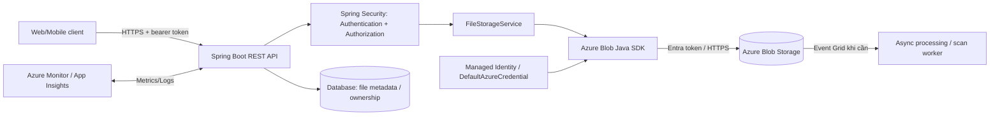
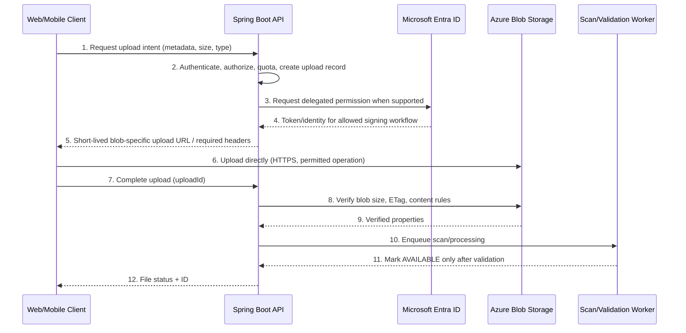
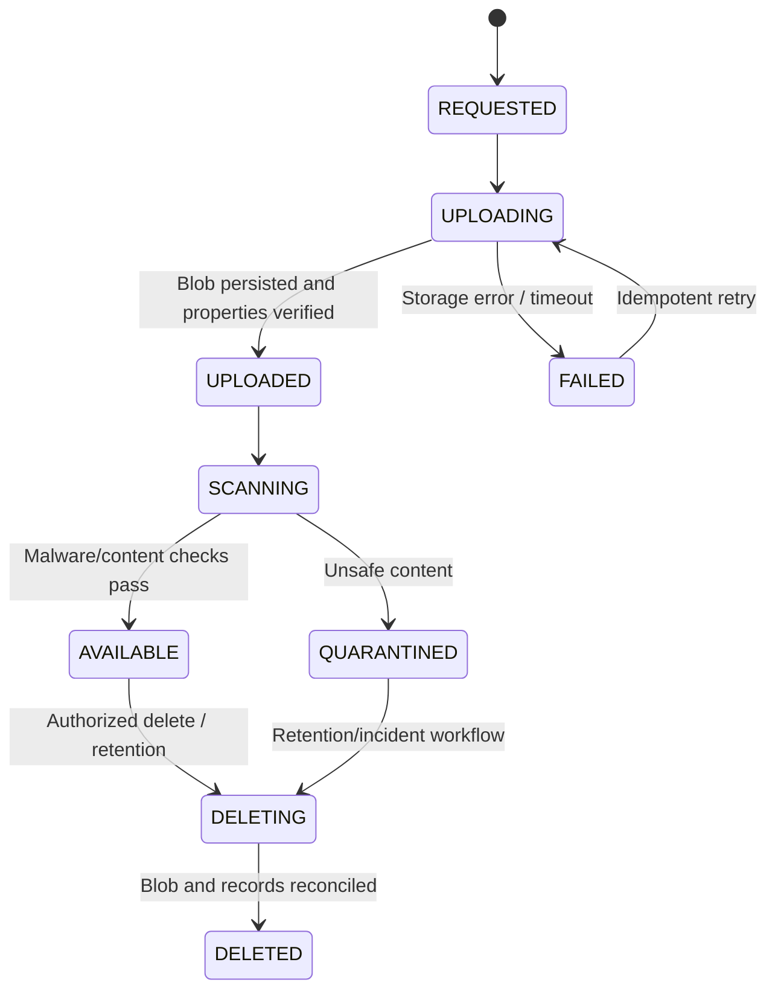
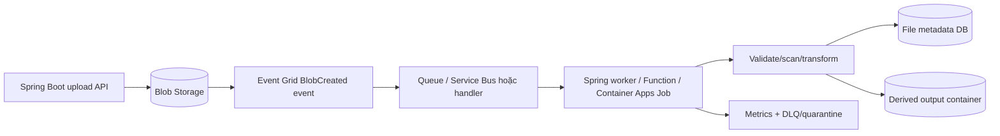
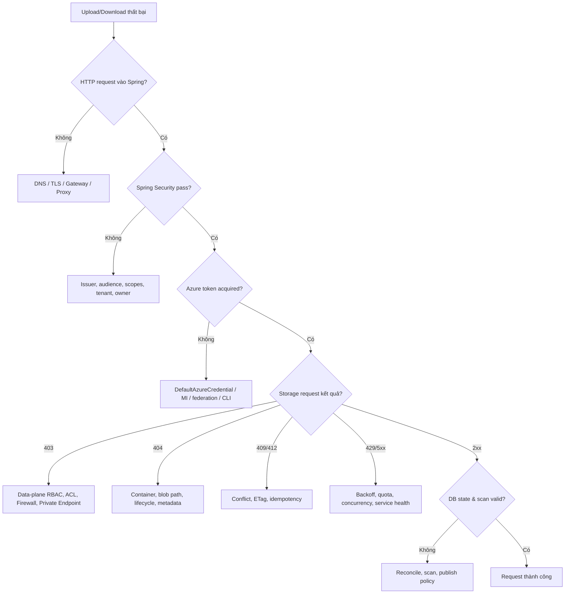

# Tích hợp Blob Storage vào ứng dụng Spring Boot

Một ứng dụng Spring Boot thường cần tiếp nhận tài liệu, ảnh sản phẩm, file báo cáo hoặc tệp người dùng tải lên. Nếu lưu những file này trực tiếp vào thư mục của container chạy ứng dụng, dữ liệu có thể mất khi container bị thay thế hoặc scale-out; nhiều instance không tự chia sẻ cùng filesystem; backup, phân quyền và truy cập từ bên ngoài khó kiểm soát. **Azure Blob Storage** cung cấp object storage được quản lý để ứng dụng Java lưu, đọc và quản lý tệp qua HTTPS, đồng thời tận dụng Microsoft Entra ID, Azure RBAC, vòng đời dữ liệu và các khả năng dự phòng/lưu trữ của Azure.

Mục tiêu bài học là xây dựng **một lớp lưu trữ riêng trong Spring Boot**: nhận yêu cầu từ REST API, xác minh danh tính/quyền, tạo blob name an toàn, dùng **Azure Storage Blob SDK for Java** để upload/download và trả kết quả hợp lý. Bài cũng giải thích lựa chọn **streaming qua ứng dụng** so với **client upload trực tiếp bằng SAS/user delegation** khi tệp lớn hoặc lưu lượng cao.

Bài thuộc chương **Spring Boot trên Azure** trong mô-đun `CLOUD_PROVIDERS_AZURE`. Các kiến thức liên quan bao gồm subscription/resource group, Microsoft Entra ID, mạng ảo, compute (App Service, Container Apps, AKS), dịch vụ lưu trữ, bảo mật, giám sát và kiểm soát chi phí. Bài tập trung vào **kiến trúc và code tích hợp Spring Boot với Blob Storage**, không tự động tạo Azure resources hoặc thay thế những cơ chế quản trị IAM, mạng và backup riêng của từng môi trường.

> **Phạm vi kỹ thuật:** Ví dụ minh họa Spring Boot 3.x, Java 17+ và Azure SDK thế hệ hiện đại. Tên API/overload và phụ thuộc có thể thay đổi theo phiên bản `azure-storage-blob`, `azure-identity`, Spring Security/Boot; cần pin và kiểm thử phiên bản thật. Code được cung cấp để học và điều chỉnh, **không có nghĩa đã chạy trên một subscription thực tế**. Các tên account/container/resource chỉ là giả lập.

## Mục tiêu học tập

Sau bài học, bạn có thể:

1. Giải thích sự khác nhau giữa Blob Storage, filesystem cục bộ và lưu metadata trong database.
2. Phân biệt **storage account, container, blob, blob name, metadata, tags và access tier**.
3. Dùng **Azure SDK for Java** làm Spring Bean với dependency injection; không tạo client cho từng request.
4. Dùng **`DefaultAzureCredential`/managed identity** và cấp Azure data-plane RBAC tối thiểu.
5. Xây REST endpoints upload và download có **giới hạn kích thước, xác thực, phân quyền, tên blob an toàn và streaming**.
6. Hiểu MIME, checksum/ETag, overwrite policy, versioning, soft delete và idempotency.
7. Chọn giữa **proxy upload/download qua backend** và **direct-to-Blob** bằng URL/credential giới hạn quyền.
8. Xử lý lỗi, retries, throttling, sự cố mạng, partial upload và trạng thái giữa Blob và database.
9. Thiết kế isolation giữa tenants/người dùng, bảo vệ file nhạy cảm và tránh path traversal/IDOR.
10. Giám sát latency, dung lượng, operations, lỗi, vòng đời dữ liệu và dự toán chi phí.
11. Kiểm thử bằng unit tests/integration tests, bao gồm các trường hợp truy cập sai quyền.
12. Lập checklist vận hành production trên App Service, Functions, Container Apps hoặc AKS.

## 1. Kiến trúc tổng thể



Hai luồng cần được thiết kế riêng:

**Upload:** Client gửi file → API xác thực và kiểm tra quyền → giới hạn kích thước/loại file → tạo blob ID và path do server kiểm soát → upload stream vào Storage → ghi metadata/trạng thái vào database → trả file ID (không trả account key).

**Download:** Client gửi file ID → API xác thực → kiểm tra ownership/tenant/scope → tìm blob mapping hoặc dựng path từ identity đáng tin → đọc Blob bằng SDK → stream ra response với headers an toàn.

Khi tệp lớn, backend có thể chỉ **cấp quyền upload ngắn hạn** cho client rồi nhận callback/verify trạng thái hoàn tất, thay vì proxy mọi bytes. Điều này giảm tải CPU/băng thông backend nhưng đòi kiểm soát SAS, CORS, content validation và completion workflow.

### 1.1. Ai làm gì?

| Thành phần | Trách nhiệm | Không nên làm |
|---|---|---|
| **Spring Controller** | HTTP contract, authentication, giới hạn input, status codes. | Hard-code storage account keys hoặc tự nối tên file do client cung cấp thành path đáng tin. |
| **Storage Service** | Lưu/đọc/xóa blob, gắn metadata, xử lý SDK errors/retry. | Quyết định quyền người dùng bằng việc blob URL có tồn tại. |
| **Authorization layer** | Xác định user/tenant/ownership/scopes. | Lấy tenant ID từ request body mà không kiểm chứng. |
| **Blob Storage** | Lưu bytes/metadata, kiểm soát Storage data-plane access. | Tự biết tài khoản end user của ứng dụng nếu API dùng một managed identity chung. |
| **Metadata DB** | Lưu file ID, chủ sở hữu, trạng thái scan, nguồn, retention và business links. | Coi một transaction DB luôn commit atomically với upload Blob. |
| **Async worker** | Virus/content scan, thumbnail/OCR, event handling. | Đánh dấu file đã an toàn trước khi kiểm tra hoàn tất. |

### 1.2. Blob không phải thư mục ổ đĩa của container

Azure Blob Storage cung cấp giao diện object storage. Với tài khoản Blob thông thường, `folder` trong blob name như `users/123/avatar.png` phần lớn là **quy ước prefix**; với tài khoản bật hierarchical namespace (ADLS Gen2), đường dẫn còn có ngữ nghĩa filesystem/directory theo API. Không suy từ dấu `/` trong blob name rằng Azure SDK đang quản lý một filesystem POSIX đầy đủ như `/var/app/uploads`.

## 2. Các khái niệm Blob Storage cốt lõi

| Khái niệm | Ý nghĩa | Ví dụ |
|---|---|---|
| **Storage account** | Tài nguyên Azure chứa dịch vụ Storage, có region, redundancy, network, IAM. | `stappfileslab` |
| **Blob service endpoint** | URL đích để gọi API Blob. | `https://stappfileslab.blob.core.windows.net` |
| **Container** | Phạm vi tập hợp blobs và quyền/lifecycle có thể cấu hình. | `attachments` |
| **Blob** | Một object chứa bytes và thuộc tính. | PDF `invoice.pdf` |
| **Blob name** | Định danh blob trong container, có thể chứa prefix như thư mục. | `tenants/t-a/users/u-1/83f...` |
| **Blob type** | Block, append hoặc page blob theo mục đích. | Upload tệp qua SDK thường dùng **block blob**. |
| **Properties/HTTP headers** | Kích thước, ETag, Last-Modified, Content-Type, v.v. | `application/pdf` |
| **Metadata** | Cặp key/value dạng metadata trên blob. | `ownerId`, `uploadRunId` (được gắn bởi server). |
| **Blob index tags** | Tags cho lọc/truy vấn theo khả năng của dịch vụ. | `classification=internal` |
| **ETag** | Validator phiên bản tài nguyên để kiểm soát concurrency. | Token opaque dùng trong `If-Match`. |
| **Blob versioning** | Lưu phiên bản blob khi thao tác thay thế theo tính năng được bật. | Truy xuất version cũ khi phù hợp. |
| **Soft delete** | Hỗ trợ khôi phục blob/version đã xóa theo retention cấu hình. | Không thay thế chiến lược backup/DR. |
| **Access tier** | Lựa chọn phù hợp tần suất truy cập/tính phí. | Hot/Cool/Cold/Archive tùy account/region/feature. |

**Azure Storage account và container không được tạo tự động khi gọi một BlobClient builder.** Tài nguyên nên được provision bằng IaC/Portal/CLI có review, không để mỗi lần Spring Boot khởi động tự tạo container production khi service chính chỉ cần quyền đọc/ghi data.

### 2.1. Blob name không phải tên file của người dùng

Một người dùng có thể upload file `../../hr/salary.csv` hoặc `same-name.pdf`. Nếu backend dùng trực tiếp `MultipartFile.getOriginalFilename()` làm blob name và truy cập theo path đó, có nguy cơ nhầm tenant, ghi đè, lộ tên và sai xử lý URL. **Blob name nên do server tạo**, ví dụ UUID và prefix từ danh tính đã xác thực. Tên gốc nếu thật sự cần chỉ lưu như **display metadata đã làm sạch**, không phải authorization key.

### 2.2. Public container hay private container?

Cho tài liệu nội bộ, hóa đơn, ảnh chứa thông tin cá nhân, mặc định dùng **private container** và tắt anonymous public access khi chính sách yêu cầu. API có managed identity để thao tác storage; người dùng cuối không có quyền trực tiếp mặc định. Nếu dùng download trực tiếp/SAS, cấp quyền **ngắn hạn, phạm vi hẹp và đúng file**, có chính sách thu hồi khi yêu cầu.

Không lưu account key hoặc SAS lâu dài trong JavaScript frontend, mobile bundle, source code, Git hoặc application logs.

## 3. Chọn cách tích hợp trong Spring Boot

Có hai con đường phổ biến.

| Phương án | Ưu điểm | Điểm cần cân nhắc |
|---|---|---|
| **Azure Storage Blob SDK thuần** | Kiểm soát rõ client/streaming/ETag/metadata và SDK APIs. | Tự cấu hình Beans, exception mapping và một phần lifecycle. |
| **Spring Cloud Azure integration/starter** | Tích hợp Spring properties, credential/configuration và abstractions được hỗ trợ theo phiên bản. | Cần kiểm tra starter/version compatibility, auto-config và quyền/thực thi thực tế. |

Bài dùng **Azure SDK thuần trong Spring Boot** để nhìn rõ ranh giới. Một dự án dùng Spring Cloud Azure có thể tận dụng starter nhưng không được chạy **hai cách tạo client/credentials xung đột** rồi không biết Bean nào được inject. Dù dùng cách nào, nguyên tắc identity/authorization, giới hạn input, retries và retention vẫn giống nhau.

### 3.1. Kiến trúc MVC hay WebFlux?

- **Spring MVC + blocking Azure BlobClient:** đơn giản cho request/response, có thể dùng `MultipartFile` và `StreamingResponseBody`. Cần budget số threads/stream concurrency.
- **Spring WebFlux + BlobAsyncClient:** phù hợp reactive streams và backpressure khi kiến trúc end-to-end reactive; tránh gọi blocking SDK trên event loop.
- **Large upload direct-to-Blob:** thường tốt hơn việc buộc mọi bytes đi qua application, đặc biệt với nhiều clients/mobile networks.

**Không kết hợp Servlet `MultipartFile` với WebFlux `Flux<DataBuffer>` rồi suy ngầm chúng tương thích**. Các code tiếp theo minh họa **Spring MVC**.

## 4. Phụ thuộc Maven và quản lý phiên bản

Với Spring Boot 3.x / Java 17+, cần các dependencies tương ứng:

```xml
<!-- Đoạn dependencies, giả định project sử dụng Spring Boot parent/BOM. -->
<dependencyManagement>
  <dependencies>
    <dependency>
      <groupId>com.azure</groupId>
      <artifactId>azure-sdk-bom</artifactId>
      <version>YOUR_TESTED_AZURE_SDK_BOM_VERSION</version>
      <type>pom</type>
      <scope>import</scope>
    </dependency>
  </dependencies>
</dependencyManagement>

<dependencies>
  <dependency>
    <groupId>org.springframework.boot</groupId>
    <artifactId>spring-boot-starter-web</artifactId>
  </dependency>
  <dependency>
    <groupId>org.springframework.boot</groupId>
    <artifactId>spring-boot-starter-security</artifactId>
  </dependency>
  <dependency>
    <groupId>org.springframework.boot</groupId>
    <artifactId>spring-boot-starter-oauth2-resource-server</artifactId>
  </dependency>
  <dependency>
    <groupId>com.azure</groupId>
    <artifactId>azure-identity</artifactId>
  </dependency>
  <dependency>
    <groupId>com.azure</groupId>
    <artifactId>azure-storage-blob</artifactId>
  </dependency>
</dependencies>
```

`YOUR_TESTED_AZURE_SDK_BOM_VERSION` là **placeholder bắt buộc thay** bằng phiên bản BOM có thật, tương thích với Spring Boot/JDK và Azure SDK đang dùng. Đây không phải toàn bộ `pom.xml`. Pin phiên bản và test khi nâng SDK: API upload/options, policies, Azure Identity chain và behavior có thể đổi.

### 4.1. Vì sao thêm Spring Security?

Spring Boot API không thể chỉ bảo vệ dữ liệu bằng UUID khó đoán hoặc bằng quyền của managed identity. Một API chạy bằng **một principal Azure** có thể đọc mọi blob mà principal đó được cấp, nhưng **người dùng A không được phép lấy file của người dùng B**. Spring Security/OAuth2 Resource Server xác minh JWT dành cho API và ứng dụng phải **ủy quyền theo chủ sở hữu/tenant** trước khi gọi Blob.

## 5. Cấu hình ứng dụng và environment

Ví dụ `application.yml`:

```yaml
app:
  blob:
    endpoint: "https://<storage-account>.blob.core.windows.net"
    container: "attachments"

spring:
  servlet:
    multipart:
      max-file-size: 20MB
      max-request-size: 22MB
  security:
    oauth2:
      resourceserver:
        jwt:
          issuer-uri: "https://login.microsoftonline.com/<tenant-id>/v2.0"
```

Trên Azure, đưa endpoint/container/issuer qua **App Service settings, Container Apps configuration, Kubernetes ConfigMap hoặc môi trường deployment** thích hợp. Đừng commit tenant/client secrets nếu không cần. Một `issuer-uri` chỉ là **một phần** xác minh access token; phải kiểm tra thêm **audience của chính API**, scopes/roles và tenant policy, đặc biệt với API đa tenant.

### 5.1. Biến môi trường cho endpoint

Có thể giữ config Spring tách khỏi source:

```yaml
app:
  blob:
    endpoint: "${AZURE_BLOB_ENDPOINT}"
    container: "${AZURE_BLOB_CONTAINER:attachments}"
```

`AZURE_BLOB_ENDPOINT` là tên biến **do ứng dụng quy định**, không phải một nguồn credential mặc định. `DefaultAzureCredential` dùng các nguồn danh tính riêng. `AZURE_CLIENT_ID` trong một số môi trường được dùng để chọn managed/workload identity; đừng nhầm endpoint với identity.

### 5.2. Giới hạn multipart và tổng request

`spring.servlet.multipart.max-file-size` và `max-request-size` là **giới hạn của Spring multipart handling**, nhưng phải còn giới hạn ở **reverse proxy/API gateway/WAF**, timeout và quota/storage policy. Không tin Content-Length/header nếu client có thể nói dối; kiểm tra kích thước thực tế và áp hard cap. Với request body quá lớn, Spring có thể ném exception **trước khi controller được gọi**; cần map thành HTTP 413 và có thông báo phù hợp.

### 5.3. Container nên tồn tại trước khi ứng dụng chạy

Cấu hình IaC nên tạo:

- Resource group, Storage account và container private.
- Managed identity trên compute host.
- Role assignment data plane đúng scope.
- Network rules, Private Endpoints/Private DNS nếu có.
- Soft delete/versioning/retention, logging/monitoring.
- App settings cho endpoints/container, không phải account key.

Ứng dụng **không cần Storage account key và không cần quyền tạo container** chỉ để upload một file vào container đã tồn tại.

## 6. Spring @Configuration: BlobServiceClient và BlobContainerClient

```java
package example.files;

import com.azure.core.credential.TokenCredential;
import com.azure.identity.DefaultAzureCredentialBuilder;
import com.azure.storage.blob.BlobContainerClient;
import com.azure.storage.blob.BlobServiceClient;
import com.azure.storage.blob.BlobServiceClientBuilder;
import org.springframework.beans.factory.annotation.Value;
import org.springframework.context.annotation.Bean;
import org.springframework.context.annotation.Configuration;

@Configuration
public class AzureBlobConfiguration {

    @Bean
    public TokenCredential azureCredential() {
        return new DefaultAzureCredentialBuilder().build();
    }

    @Bean
    public BlobServiceClient blobServiceClient(
        TokenCredential azureCredential,
        @Value("${app.blob.endpoint}") String endpoint) {

        return new BlobServiceClientBuilder()
            .endpoint(endpoint)
            .credential(azureCredential)
            .buildClient();
    }

    @Bean
    public BlobContainerClient fileContainer(
        BlobServiceClient service,
        @Value("${app.blob.container}") String containerName) {

        // Không tạo container hoặc nới public access lúc startup.
        return service.getBlobContainerClient(containerName);
    }
}
```

**Lưu ý:**

- `DefaultAzureCredentialBuilder().build()` có thể chỉ tạo đối tượng, **chưa lấy token thật**. Lỗi danh tính thường xảy ra khi client gọi Storage lần đầu.
- Một `BlobServiceClient`/`BlobContainerClient` Bean được tái sử dụng giữa requests; tránh khởi tạo credential/client mỗi upload.
- Local có thể dùng Azure CLI login; production dùng managed identity/workload identity theo host và SDK configuration.
- Nếu production **chỉ được phép** sử dụng một MI, cân nhắc explicit `ManagedIdentityCredentialBuilder` để tránh chain chọn sai EnvironmentCredential hoặc developer credential.
- Thời gian timeout, retry, telemetry, HTTP client pool có thể được cấu hình trên client builder theo API version đang dùng.
- `BlobContainerClient` không tự đảm bảo rằng container tồn tại hay principal đủ quyền — xác minh bằng một request data-plane có kiểm soát.

## 7. DefaultAzureCredential và cấp quyền Blob

### 7.1. Local development

```bash
az login --tenant "<tenant-id>"
az account set --subscription "<lab-subscription-id>"
az account show -o json
```

Khi local và SDK version có `AzureCliCredential`, Azure Identity có thể dùng phiên đăng nhập này. Tuy nhiên `DefaultAzureCredential` có thể thử EnvironmentCredential/IDE hoặc nguồn khác trước; `az account show` **không tự chứng minh** SDK đã chọn CLI identity. Khi cần kiểm chứng, sử dụng diagnostics an toàn hoặc một explicit `AzureCliCredential` trong local-only profile.

### 7.2. Production Managed Identity

Trên App Service/Functions/Container Apps/AKS/VM được hỗ trợ:

1. Bật/gắn system-assigned hoặc user-assigned managed identity.
2. Lấy đúng **principal/object ID** của identity để gán RBAC; client ID dùng khi chọn user-assigned MI.
3. Gán `Storage Blob Data Contributor` cho **container đích** nếu ứng dụng cần upload, đọc và xóa theo quyền thiết kế. Nếu chỉ download, `Storage Blob Data Reader` có thể đủ.
4. Cấu hình firewall/Private Endpoint/Private DNS và outbound từ compute host.
5. Deploy ứng dụng, kiểm tra từ runtime thật, không dựa vào quyền của developer trên laptop.
6. Không cấp `Owner` của subscription chỉ để giải quyết một lỗi 403.

**Control plane vs data plane:** Role `Reader` hoặc `Contributor` ở resource group không tự có đầy đủ quyền đọc/ghi Blob data plane. Vai trò `Storage Blob Data Contributor` cấp quyền rộng hơn chỉ đọc, cần cân nhắc scope và chức năng. Các rules ACL của ADLS Gen2/deny assignments/policies có thể làm yêu cầu thực tế phức tạp hơn.

### 7.3. Vì sao tài khoản có token vẫn bị từ chối?

`DefaultAzureCredential` **lấy token**, không tự cấp quyền truy cập vào blob. Khi Storage trả HTTP 403, SDK **không tự thử danh tính Azure CLI khác** sau khi đã dùng token. Lúc này phải xem **principal thực tế, Storage RBAC, mạng, container name, path và policy**.

## 8. Định danh file và kiểm soát đường dẫn

Một thiết kế tối thiểu cho ứng dụng **mỗi người dùng sở hữu file riêng**:

```text
container: attachments

blob name:
tenants/<validated-tenant-id>/users/<validated-user-oid>/<server-generated-uuid>
```

Không nhận `tenant-id`, `user-oid` hoặc path đầy đủ từ query/body của người dùng. Server lấy identity từ JWT đã xác thực, xác minh các claims bắt buộc và tự tạo UUID. Để tránh lỗi escaping, chuẩn hóa GUID/token từ nguồn đáng tin và **từ chối** nếu identity thiếu dữ liệu yêu cầu.

**Ứng dụng đa tenant phải xác thực JWT issuer, audience và tenant allowlist**; chỉ kiểm tra claim `tid` và `oid` trong một JWT bất kỳ là không đủ. Azure OAuth2 tokens cũng có sự khác biệt giữa delegated user tokens và app-only tokens; ví dụ này dành cho endpoint người dùng có delegated access và các scopes đã được phê duyệt.

### 8.1. File ID dùng cho API khác Blob name

REST API có thể trả `fileId = UUID`. Blob name thực được xây từ `tenantId/userOid/fileId` hoặc tra từ database. Người dùng **không cần nhìn thấy** account/container/prefix nội bộ. Với tài liệu được chia sẻ cho nhóm, **không thể dùng mỗi owner path** để quyết định tất cả quyền đọc; cần metadata DB + ACL/tenant membership policy được thực thi trước khi trả file.

### 8.2. UUID không phải authorization

Dù UUID khó đoán, **biết file ID không được đồng nghĩa có quyền tải file**. Phải kiểm tra tenant/owner hoặc quyền truy cập trên một bản ghi metadata tin cậy. Đối với file chứa dữ liệu cá nhân hoặc hợp đồng, không nên trả original filename vào `Content-Disposition` nếu chưa sanitize đúng header.
## 9. Spring Security: xác thực JWT và cấp quyền theo endpoint

Trước khi xây upload/download controller, API cần xác minh **access token được phát cho chính API** và quyết định chức năng người dùng có thể gọi. Ví dụ dùng Microsoft Entra ID với một **single-tenant API** và delegated scopes `files.read`, `files.write`; người dùng bên ngoài tenant khác không được nhận mặc định.

```java
package example.files;

import org.springframework.context.annotation.Bean;
import org.springframework.context.annotation.Configuration;
import org.springframework.security.config.Customizer;
import org.springframework.security.config.annotation.method.configuration.EnableMethodSecurity;
import org.springframework.security.config.annotation.web.builders.HttpSecurity;
import org.springframework.security.config.http.SessionCreationPolicy;
import org.springframework.security.oauth2.server.resource.web.BearerTokenAuthenticationFilter;
import org.springframework.security.web.SecurityFilterChain;

@Configuration
@EnableMethodSecurity
public class ApiSecurityConfiguration {

    @Bean
    SecurityFilterChain securityFilterChain(HttpSecurity http)
            throws Exception {
        http
            // Chỉ phù hợp API stateless dùng Bearer Authorization header,
            // không dùng session cookie cho xác thực.
            .csrf(csrf -> csrf.disable())
            .sessionManagement(session ->
                session.sessionCreationPolicy(SessionCreationPolicy.STATELESS))
            .authorizeHttpRequests(auth ->
                auth.anyRequest().authenticated())
            .oauth2ResourceServer(oauth ->
                oauth.jwt(Customizer.withDefaults()));
        return http.build();
    }
}
```

`@EnableMethodSecurity` giúp `@PreAuthorize` thực thi. Nếu không bật method security, annotation phân quyền ở controller có thể **không có tác dụng như mong đợi**. Tắt CSRF chỉ được cân nhắc cho API stateless thực sự **không** dùng browser cookie/session authentication. Nếu ứng dụng còn có giao diện dùng cookie thì phải thiết kế CSRF policy đúng, không sao chép cấu hình này vô điều kiện.

### 9.1. JWT audience bắt buộc phải đúng API

Đọc `issuer-uri` chưa đủ để nói API chỉ chấp nhận token dành cho nó. Cần kiểm tra `aud` là application ID URI hoặc API client ID đã quy định và đúng tenant/issuer. Một ví dụ xác thực audience bằng Spring Security:

```java
package example.files;

import org.springframework.beans.factory.annotation.Value;
import org.springframework.context.annotation.Bean;
import org.springframework.context.annotation.Configuration;
import org.springframework.security.oauth2.core.*;
import org.springframework.security.oauth2.jwt.*;

@Configuration
public class JwtValidationConfiguration {
    @Bean
    JwtDecoder jwtDecoder(
            @Value("${app.security.issuer}") String issuer,
            @Value("${app.security.audience}") String audience) {

        NimbusJwtDecoder decoder =
            NimbusJwtDecoder.withIssuerLocation(issuer).build();

        OAuth2TokenValidator<Jwt> standard =
            JwtValidators.createDefaultWithIssuer(issuer);

        OAuth2TokenValidator<Jwt> correctAudience = jwt ->
            jwt.getAudience().contains(audience)
                ? OAuth2TokenValidatorResult.success()
                : OAuth2TokenValidatorResult.failure(
                    new OAuth2Error("invalid_token",
                        "Access token has incorrect audience", null));

        decoder.setJwtValidator(
            new DelegatingOAuth2TokenValidator<>(standard, correctAudience));
        return decoder;
    }
}
```

Thêm các cấu hình tin cậy từ deployment:

```yaml
app:
  security:
    issuer: "https://login.microsoftonline.com/<tenant-id>/v2.0"
    audience: "api://<registered-api-client-id>"
```

**Kiểm tra audience phải khớp giá trị thực sự được Entra ID phát trong `aud`**, có thể là API client ID hoặc Application ID URI tùy app registration. Đây là **mẫu single-tenant**, không phải triển khai đa tenant hoàn chỉnh; với multi-tenant phải xác minh issuer/tenant allowlist, consent và quyền người dùng theo từng tenant.

Trong ứng dụng dùng **app-only tokens** thay cho delegated user token, claim `oid` có thể chỉ service principal; cần thiết kế authorization riêng, không tự coi đó là một user upload file. Phần ví dụ file của người dùng bên dưới yêu cầu **delegated user token**.

### 9.2. Phân biệt quyền user và quyền managed identity

```text
HTTP request:
  User JWT (audience của Spring API)  -> Spring Security
  Delegated scope files.write        -> @PreAuthorize

Outbound request:
  App managed identity               -> Blob SDK TokenCredential
  Storage Blob Data Contributor      -> Azure Storage data plane
```

Hai token có thể thuộc **hai principals khác nhau** và phục vụ **hai audiences khác nhau**. Đừng dùng token từ HTTP user tùy tiện như credential cho backend Blob SDK; nếu cần on-behalf-of delegation, đó là một kiến trúc riêng phải kiểm chứng end-to-end. Ví dụ này dùng **application managed identity** để gọi Blob.

## 10. Tạo blob path an toàn từ JWT đã xác thực

Một cách tổ chức đơn giản cho **file cá nhân** là dành prefix riêng theo `tid` (tenant ID) và `oid` (user object ID). Cả hai được lấy từ **JWT đã được xác minh chữ ký, issuer và audience**, không lấy từ request body.

```java
package example.files;

import java.util.Locale;
import java.util.UUID;
import org.springframework.security.access.AccessDeniedException;
import org.springframework.security.oauth2.jwt.Jwt;
import org.springframework.stereotype.Component;

@Component
public final class BlobPathPolicy {
    private static final String GUID =
        "[0-9a-fA-F]{8}-[0-9a-fA-F]{4}-[0-9a-fA-F]{4}-"
        + "[0-9a-fA-F]{4}-[0-9a-fA-F]{12}";

    public String personalFilePath(Jwt jwt, UUID fileId) {
        String tenant = jwt.getClaimAsString("tid");
        String owner = jwt.getClaimAsString("oid");

        if (tenant == null || !tenant.matches(GUID)
                || owner == null || !owner.matches(GUID)) {
            // Fail closed; không tin sub/UPN/email thay oid một cách ngầm định.
            throw new AccessDeniedException(
                "Validated tenant and user object IDs required");
        }

        return "tenants/" + tenant.toLowerCase(Locale.ROOT)
            + "/users/" + owner.toLowerCase(Locale.ROOT)
            + "/" + fileId;
    }
}
```

Cơ chế này có những **giới hạn phải nêu rõ**:

- Chỉ phục vụ **file riêng của một user**, không giải quyết chia sẻ nhóm/tổ chức.
- `oid` được lấy từ token delegated user đã được xác minh, có thể không tồn tại trong mọi loại token; khi thiếu thì **từ chối**.
- Với user là guest, liên kết tenant/object ID phải tuân theo identity mapping/authorization policy của ứng dụng.
- Với shared documents, dùng bản ghi metadata trong database (`fileId,tenantId,ownerId,allowedPrincipals,status`) và authorization service trước khi truy cập Blob.
- Storage MI có quyền đọc ở container được giao; **app layer chịu trách nhiệm** không trả blob của user khác.

**Không có tên file gốc hoặc arbitrary path trong API** giúp tránh nhiều lỗi traversal/overwrite, nhưng **không thay thế** kiểm thử phân quyền và xử lý request bất thường.

## 11. FileStorageService: upload với server-generated UUID

Dùng blocking `BlobContainerClient` đã được đăng ký Bean ở phần trước:

```java
package example.files;

import com.azure.storage.blob.BlobClient;
import com.azure.storage.blob.BlobContainerClient;
import java.io.IOException;
import java.io.InputStream;
import java.util.UUID;
import org.springframework.http.HttpStatus;
import org.springframework.security.oauth2.jwt.Jwt;
import org.springframework.stereotype.Service;
import org.springframework.web.multipart.MultipartFile;
import org.springframework.web.server.ResponseStatusException;

@Service
public class FileStorageService {
    private static final long MAX_FILE_BYTES = 20L * 1024 * 1024;

    private final BlobContainerClient container;
    private final BlobPathPolicy pathPolicy;

    public FileStorageService(
            BlobContainerClient container,
            BlobPathPolicy pathPolicy) {
        this.container = container;
        this.pathPolicy = pathPolicy;
    }

    public UUID uploadPersonalFile(Jwt identity, MultipartFile file)
            throws IOException {

        if (file == null || file.isEmpty()) {
            throw new ResponseStatusException(
                HttpStatus.BAD_REQUEST, "File must not be empty");
        }
        if (file.getSize() > MAX_FILE_BYTES) {
            throw new ResponseStatusException(
                HttpStatus.PAYLOAD_TOO_LARGE, "File is too large");
        }

        // Không dùng file.getOriginalFilename() làm Blob key.
        UUID id = UUID.randomUUID();
        String path = pathPolicy.personalFilePath(identity, id);
        BlobClient target = container.getBlobClient(path);

        // false: không overwrite blob đang có cùng path.
        try (InputStream input = file.getInputStream()) {
            target.upload(input, file.getSize(), false);
        }

        return id;
    }

    public BlobClient personalBlob(Jwt identity, UUID fileId) {
        return container.getBlobClient(
            pathPolicy.personalFilePath(identity, fileId));
    }
}
```

### 11.1. Vì sao ví dụ chọn `application/octet-stream` khi trả download?

File upload có thể có `file.getContentType()` hoặc tên `.pdf/.html` nhưng **client tự khai báo** và có thể sai/malicious. Ví dụ bảo vệ mặc định bằng cách trả **download as attachment** và `application/octet-stream`. Với ứng dụng cần preview ảnh/PDF, phải có **allowlist MIME, kiểm tra magic bytes, malware scanning, CSP, content-disposition và chính sách render riêng**, không chỉ tin Content-Type của upload.

### 11.2. Phạm vi kích thước thực tế

`20 MiB` chỉ là **mức lab**. File upload có thể được Servlet multipart resolver buffer ra disk trước khi gọi service; code **không bảo đảm zero-copy hoặc 100% streaming end-to-end từ client**. Cần cấu hình multipart limits, web server/proxy gateway timeout, temp disk/ephemeral storage, concurrency và network. Với file nhiều GB, ưu tiên direct-to-Blob/resumable block upload.

### 11.3. Chưa có antivirus/quarantine trong code

`uploadPersonalFile` minh họa **ghi bytes vào private container**, không chứng nhận file an toàn. Trong sản phẩm thực, có thể:

- Upload vào **quarantine container** mà chỉ scanner/worker truy cập.
- Lưu metadata `status=PENDING_SCAN`.
- Scan malware/file signature/content policy bằng dịch vụ/phần mềm được chấp thuận.
- Chỉ đánh dấu `AVAILABLE` và cho download khi scanner trả kết quả hợp lệ.
- Xử lý timeout, scanner outage, false positives, retention, data deletion policy.

Nếu hệ thống cho download ngay sau upload theo code lab, phải **nêu đây là hạn chế của ví dụ** và không dùng với file không đáng tin mà chưa có cơ chế kiểm tra.

## 12. REST Controller: upload và download qua Spring MVC

```java
package example.files;

import com.azure.storage.blob.BlobClient;
import com.azure.storage.blob.models.BlobProperties;
import java.io.IOException;
import java.util.UUID;
import org.springframework.http.*;
import org.springframework.security.access.prepost.PreAuthorize;
import org.springframework.security.core.annotation.AuthenticationPrincipal;
import org.springframework.security.oauth2.jwt.Jwt;
import org.springframework.web.bind.annotation.*;
import org.springframework.web.multipart.MultipartFile;
import org.springframework.web.servlet.mvc.method.annotation.StreamingResponseBody;

@RestController
@RequestMapping("/api/files")
public class FileController {
    private final FileStorageService storage;

    public FileController(FileStorageService storage) {
        this.storage = storage;
    }

    public record UploadedFile(String fileId) {}

    @PostMapping(
        consumes = MediaType.MULTIPART_FORM_DATA_VALUE,
        produces = MediaType.APPLICATION_JSON_VALUE)
    @PreAuthorize("hasAuthority('SCOPE_files.write')")
    public ResponseEntity<UploadedFile> upload(
            @AuthenticationPrincipal Jwt jwt,
            @RequestPart("file") MultipartFile file) throws IOException {

        UUID id = storage.uploadPersonalFile(jwt, file);
        return ResponseEntity.status(HttpStatus.CREATED)
            .body(new UploadedFile(id.toString()));
    }

    @GetMapping("/{fileId}")
    @PreAuthorize("hasAuthority('SCOPE_files.read')")
    public ResponseEntity<StreamingResponseBody> download(
            @AuthenticationPrincipal Jwt jwt,
            @PathVariable UUID fileId) {

        BlobClient blob = storage.personalBlob(jwt, fileId);
        BlobProperties properties = blob.getProperties();

        StreamingResponseBody body = output ->
            blob.downloadStream(output);

        return ResponseEntity.ok()
            .contentType(MediaType.APPLICATION_OCTET_STREAM)
            .contentLength(properties.getBlobSize())
            .header(HttpHeaders.CONTENT_DISPOSITION,
                    "attachment; filename=\"" + fileId + ".bin\"")
            .header(HttpHeaders.CACHE_CONTROL, "private, no-store")
            .header("X-Content-Type-Options", "nosniff")
            .body(body);
    }
}
```

**Điều kiện tiên quyết của code:**

- Spring Resource Server JWT xác thực issuer/audience, và Spring Method Security đang bật.
- Entra app registration đã phát delegated scopes `files.read`/`files.write`, map thành `SCOPE_...` theo cấu hình Spring Security hiện có.
- Blob container đã tồn tại, runtime có quyền data plane và mạng phù hợp.
- Ví dụ chỉ cho **file cá nhân** theo prefix `tid/oid`. Không hỗ trợ chia sẻ nhóm hoặc upload bằng service principal.
- `Content-Disposition` chỉ chứa UUID server tạo; không dùng tên file do client cung cấp vào header.
- Cần xử lý `BlobStorageException`/`MaxUploadSizeExceededException` và không để SDK error details leak trong production.
- `StreamingResponseBody` chạy công việc I/O trên executor của Spring MVC. **Cần cấu hình `TaskExecutor` phù hợp với tải thực**, tránh mặc định số streams không kiểm soát; response có thể gửi header trước khi backend đọc xong blob.

### 12.1. Streaming download và lỗi giữa chừng

`blob.getProperties()` kiểm tra resource và lấy kích thước trước khi bắt đầu response; nhưng khi `downloadStream(output)` đang gửi bytes mà kết nối Azure bị ngắt, HTTP response có thể đã gửi header và một phần body. Lúc đó **không thể an toàn đổi thành JSON 500**. Client phải biết phát hiện download bị cắt (Content-Length/checksum), thử lại theo policy hoặc dùng range download nếu cần.

Với tệp lớn, hỗ trợ HTTP Range/`206 Partial Content` và streaming có kiểm soát cần triển khai đúng `Range`/`Content-Range` và SDK range download; **ví dụ không hỗ trợ range/resume**. Tránh đặt `Content-Length` không khớp với dữ liệu thực sau khi nén/chỉnh sửa response.

### 12.2. Tránh Insecure Direct Object Reference (IDOR)

Trong flow này, client chỉ gửi `UUID`; ứng dụng dựng prefix từ **JWT đang xác thực**. Nếu biết UUID của user khác, ứng dụng vẫn truy vấn dưới prefix của người hiện tại nên không đọc được file của họ. Tuy nhiên, nếu thêm chức năng “share file”, **không** được bỏ prefix policy rồi gọi `container.getBlobClient(requestedPath)`. Phải có authoritative metadata record + permission check, và negative tests cross-tenant.

### 12.3. Kiểm thử HTTP contract

Một request thử trong lab có OAuth token hợp lệ dành cho Spring API:

```bash
# TOKEN nên được truyền qua môi trường bí mật, không in ra log.
curl -X POST "https://<app-host>/api/files" \
  -H "Authorization: Bearer <access-token-for-the-api>" \
  -F "file=@./sample.txt"

# Sau khi upload trả fileId:
curl "https://<app-host>/api/files/<file-id>" \
  -H "Authorization: Bearer <access-token-for-the-api>" \
  -o downloaded.bin
```

Đây là **cú pháp minh họa**, không chứa token thật hoặc endpoint thực. Đừng copy access token vào lịch sử terminal công khai hoặc CI log. Với PowerShell, `curl` có thể là alias trong một số phiên bản; dùng `curl.exe` hoặc lệnh PowerShell được hỗ trợ tương ứng.

## 13. Mapping lỗi Azure SDK sang HTTP có chủ đích

Một API không nên trả nguyên thông điệp lỗi có storage account name, internal URL, request headers hoặc stack trace cho người dùng cuối.

| Lỗi | Ý nghĩa | Hành vi HTTP từ API |
|---|---|---|
| Multipart thiếu hoặc file rỗng | Request không đúng contract. | `400 Bad Request`. |
| File vượt giới hạn | Request quá lớn. | `413 Payload Too Large`. |
| JWT thiếu/sai audience | Không xác thực hợp lệ. | `401 Unauthorized`. |
| User có token nhưng thiếu scope/owner permission | Không được phép. | `403 Forbidden` hoặc `404` nếu policy che sự tồn tại. |
| Blob không tồn tại trong prefix được phép | Không tìm thấy. | `404 Not Found`. |
| Blob bị trùng ID và overwrite=false | Conflict. | `409 Conflict` (trường hợp rất hiếm với UUID). |
| Storage trả 403 cho app MI | **Lỗi hạ tầng/cấu hình** giữa API và Storage, không phải thiếu scope người dùng. | Thường `502/503` và alert, không đổ lỗi quyền cho user. |
| Storage timeout/503/429 | Hạ tầng/backpressure. | `503 Service Unavailable`/`502`, retry có giới hạn. |
| Upload xong nhưng DB metadata commit thất bại | Trạng thái không nhất quán. | Có runbook reconciliation; không coi upload là transaction DB. |

Một `@RestControllerAdvice` có thể chuyển exception như `MaxUploadSizeExceededException` thành 413, `BlobStorageException` có status code 404 thành 404, còn 403/5xx từ Storage thành lỗi backend có trace nội bộ. **Không map mọi 403 của Storage thành 403 cho user** vì điều này che mất lỗi MI/RBAC của ứng dụng. Đừng để client thấy raw Azure SDK exceptions.

### 13.1. Ví dụ handler cho multipart limit

```java
package example.files;

import org.springframework.http.*;
import org.springframework.web.bind.annotation.*;
import org.springframework.web.multipart.MaxUploadSizeExceededException;

@RestControllerAdvice
public class FileApiErrors {

    @ExceptionHandler(MaxUploadSizeExceededException.class)
    ResponseEntity<ProblemDetail> tooLarge(
            MaxUploadSizeExceededException error) {
        ProblemDetail problem = ProblemDetail.forStatus(
            HttpStatus.PAYLOAD_TOO_LARGE);
        problem.setTitle("File too large");
        problem.setDetail("The uploaded file exceeds the configured limit");
        return ResponseEntity.status(HttpStatus.PAYLOAD_TOO_LARGE)
            .body(problem);
    }
}
```

Trong production cần thêm mapping cho `BlobStorageException`, AccessDenied, request validation và typed errors. Code này chỉ xử lý **một lớp lỗi** để minh họa. Cần nhớ các lỗi trong streaming response có thể xảy ra sau khi headers đã gửi, không còn chuyển response thành `ProblemDetail` bình thường.
## 14. File lớn: direct upload/download bằng quyền giới hạn

Với file vài chục MB, upload qua Spring MVC có thể phù hợp nếu lưu lượng thấp và cần kiểm tra nội dung ngay. Nhưng với **video, backup, hồ sơ nhiều GB hoặc hàng nghìn uploads đồng thời**, proxy toàn bộ bytes qua App Service thường tốn băng thông, threads, temp disk, timeout và tăng số kết nối.

Một kiến trúc thay thế là **client truyền trực tiếp tới Blob Storage**, còn Spring Boot chỉ kiểm tra quyền và cấp một quyền upload **ngắn hạn** có phạm vi cụ thể.



### 14.1. SAS là gì?

**Shared Access Signature (SAS)** là token/URI giới hạn quyền thao tác trên Storage theo thời gian, resource và quyền được ký. Các loại SAS và cách phát hành có điều kiện khác nhau; với Blob và Microsoft Entra ID, khi khả thi nên đánh giá **user delegation SAS**, được ký dựa trên **user delegation key** lấy nhờ danh tính Entra hợp lệ, thay vì phát SAS bằng account key dài hạn.

SAS vẫn là **bearer capability**: người có URL/token có thể sử dụng quyền được ký trong thời gian hiệu lực và điều kiện cho phép. Do đó phải tránh ghi SAS vào logs, analytics, lịch sử trình duyệt/copy URL công khai hoặc gửi sang domain không tin cậy.

### 14.2. Quyền SAS phải hẹp

Một request tạo upload intent có thể trả một object:

```json
{
  "uploadId": "ad9e9c6a-f587-4b55-8b52-5a3865de8b04",
  "blobName": "pending/tenant-demo/user-demo/ad9e9c6a-f587-4b55-8b52-5a3865de8b04",
  "expiresAtUtc": "2026-11-20T10:15:00Z",
  "allowedMethod": "PUT",
  "requiredHeaders": {
    "x-ms-blob-type": "BlockBlob"
  }
}
```

Đây là **hình minh họa metadata**, không phải SAS URL thật. Trong production, response thêm short-lived scoped URI hoặc credential đúng cách; không cấp container-wide `read/write/delete/list` nếu user chỉ được upload **một blob**. Storage/service hỗ trợ phương thức SAS khác nhau, cần dùng SDK/API hợp lệ cho operation `Put Blob` hoặc block upload có nhiều requests.

**Chính sách an toàn:**

- Tạo blob name server-side, không để client chỉ định container/path tùy ý.
- Hạn chế operation (ví dụ create/write) và thời gian hiệu lực ngắn.
- Áp HTTPS-only, start/expiry hợp lý, clock skew tolerance theo khuyến nghị.
- Không để client tự chọn file của tenant khác qua query parameter.
- Dùng user delegation SAS khi kiến trúc hỗ trợ, phân quyền cho **principal ký SAS** tối thiểu và kiểm soát yêu cầu `generateUserDelegationKey`.
- Có cơ chế **completion verify**, chống file đã thay thế/size sai và tránh publish file chưa scan.
- Áp CORS đúng origins/methods/headers cho browser, không dùng `*` tùy tiện với chính sách credentials.
- Có phương án thu hồi/ngắt quyền khi có sự cố; không giả định mọi SAS đã phát có thể thu hồi tức thì bằng một thao tác chung.
- Không ký SAS bằng storage account key trong code chỉ vì đơn giản hơn khi managed identity có thể sử dụng giải pháp khác.

### 14.3. Cần phân biệt JWT của API với SAS của Blob

JWT có audience của Spring API và thường gửi tới backend. SAS là capability được Storage kiểm chứng khi client gọi Blob trực tiếp. Chúng **không thay thế lẫn nhau**:

```text
Browser → Spring API: Authorization: Bearer <API access token>
Browser → Blob:      HTTPS request with scoped SAS URL
Spring API → Blob:   Managed identity TokenCredential
```

Không chuyển cả API JWT thành query parameter trong Blob URL, và không để frontend giữ access token/quyền của managed identity backend.

### 14.4. Download trực tiếp có phù hợp không?

Với file lớn và user đã được xác thực, backend có thể kiểm tra ACL trong metadata DB rồi cấp **read-only SAS giới hạn đúng blob** hoặc dùng proxy/CDN pattern thích hợp. Tuy nhiên:

- Link có thể được chia sẻ trong thời gian còn hiệu lực; đánh giá sensitivity.
- Không tạo SAS quá dài hạn hoặc public cache cho tài liệu riêng tư.
- Nếu cần thu hồi quyền tức thì, download qua authenticated gateway/stream proxy có thể phù hợp hơn.
- Content-Disposition, response header overrides, cache policy và antivirus state vẫn cần kiểm tra.
- Với media streaming/range, phải hỗ trợ byte-range đúng và tránh làm app trở thành nút cổ chai.

### 14.5. Nên chọn proxy hay direct-to-Blob?

| Tiêu chí | Spring Boot proxy | Direct-to-Blob |
|---|---|---|
| Thiết lập ban đầu | Dễ hơn; một API kiểm soát stream. | Thêm upload intent/SAS/CORS/complete flow. |
| Tải trên backend | App giữ connection/bandwidth xuyên suốt. | Giảm tải dữ liệu qua backend. |
| Kiểm tra file trước khi ghi Storage | Có thể validate một phần trong stream; vẫn cần scan phù hợp. | Cần quarantine + kiểm tra sau upload. |
| File lớn/resume | Phải tự thiết kế timeout, chunk/range. | Có thể dùng client block upload/resume theo SDK và quyền. |
| Thu hồi quyền ngay | Backend kiểm tra từng request. | SAS đã phát có thể còn hiệu lực tới expiry theo điều kiện. |
| Bảo vệ URL | Không cần gửi SAS tới browser. | SAS phải coi là secret tạm thời. |
| Chi phí/bottleneck | Tăng app egress/threads/compute. | Nhiều I/O đi trực tiếp tới Storage, vẫn có Storage ops/cost. |

Không mặc định “direct upload luôn rẻ nhất”; còn phụ thuộc file size, traffic, network egress, scan, CDN, private networking và service SLAs.

## 15. ETag, concurrency, overwrite và idempotency

Một lỗi thường gặp là dùng cùng blob name cho nhiều upload rồi ghi đè lẫn nhau. Khi nhiều requests đến đồng thời, thiết kế phải xác định **ai được phép thay thế phiên bản nào**.

### 15.1. Upload không ghi đè

```java
// BlobClient được chọn từ path server-generated.
try (InputStream input = file.getInputStream()) {
    target.upload(input, file.getSize(), false);
}
```

`false` nghĩa là SDK không được cố ý ghi đè blob đã tồn tại ở operation này. Với UUID server tạo, conflict hiếm nhưng vẫn phải map lỗi có chủ đích. Nếu client retry HTTP POST sau khi server upload xong nhưng response bị mất, API có thể sinh **UUID mới** và tạo hai blobs khác nhau. **Non-overwrite không tự làm API idempotent.**

### 15.2. Idempotency-Key ở lớp nghiệp vụ

Ví dụ client gửi `Idempotency-Key` ngẫu nhiên, duy nhất cho một upload intent:

```text
Key: tenant-id + user-id + client-idempotency-key

Server:
  1. Verify identity and input contract.
  2. Atomic create/get upload intent in DB with unique key.
  3. Use stable server-generated blob ID for that intent.
  4. Upload/verify or return existing result if already committed.
  5. Persist status and original request fingerprint.
  6. Reject same key reused with different payload/size.
```

Không lấy mỗi tên file gốc làm idempotency key; hai file `report.pdf` khác nội dung vẫn hợp lệ. Không dùng `UUID.randomUUID()` mới trong mỗi retry rồi mong không tạo duplicates. Có thể dùng checksum/ETag và business record status để reconciliate.

### 15.3. ETag là token opaque

Khi thay nội dung của **blob cùng tên**, có thể dùng HTTP conditional requests như `If-Match` với ETag đã đọc để tránh mất cập nhật:

```text
T1. Client A đọc ETag="vX"  (giá trị minh họa)
T2. Client B thay blob, ETag chuyển sang "vY"
T3. Client A định replace với If-Match: "vX"
T4. Storage từ chối vì ETag không còn khớp (thường 412)
T5. App báo conflict và yêu cầu refresh/retry có logic
```

ETag **không phải số có thể so lớn/nhỏ**. Chọn API/`BlobRequestConditions`/upload options được SDK version hỗ trợ; không thay thế bằng logic `getProperties → unconditional overwrite` vì có race giữa hai requests.

### 15.4. Versioning và soft delete khác nhau

- **Versioning** giúp lưu các phiên bản Blob khi hoạt động thay thế theo tính năng được bật; cần xem tier/account support và chi phí.
- **Soft delete** giữ một số trạng thái xóa để có thể khôi phục trong retention.
- **Snapshots** tạo bản chụp theo cơ chế dịch vụ nếu được sử dụng.
- **Immutable storage/legal hold** giúp ngăn sửa/xóa theo policy và ràng buộc riêng, không tự bật khi chưa hiểu nghĩa vụ giữ dữ liệu.

Những cơ chế này **không tạo transaction atomic giữa Blob và Azure SQL/PostgreSQL**. Và chúng không thay thế cross-region DR/backup hoặc cách xử lý xóa dữ liệu cá nhân theo chính sách.

## 16. Đồng bộ Blob và metadata database

Đa số ứng dụng cần nhiều hơn dữ liệu bytes. Một bảng `uploaded_files` có thể lưu:

| Trường | Ví dụ | Chức năng |
|---|---|---|
| `file_id` | UUID | Public-facing ID của API. |
| `tenant_id` | Tenant Object ID | Partition/authorization. |
| `owner_oid` | Principal object ID | Quyền sở hữu. |
| `blob_container` | `attachments` | Vị trí nội bộ. |
| `blob_name` | `tenants/.../<uuid>` | Không trả thẳng cho user. |
| `original_name_safe` | `invoice-nov.pdf` | Chỉ dùng để hiển thị đã sanitize. |
| `content_type_verified` | `application/pdf` | Kết quả kiểm tra, không chỉ client header. |
| `size_bytes` | 123456 | Quota và verification. |
| `sha256` | hash | Dedup/integrity theo policy. |
| `etag` | Opaque value | Conditional writes/consistency. |
| `scan_status` | `PENDING/AVAILABLE/QUARANTINED` | Quyết định download. |
| `created_at_utc` | timestamp | Lifecycle/audit. |
| `retention_until` | timestamp | Compliance và delete schedule. |

### 16.1. Không có cross-resource transaction mặc định

Giả sử:

```text
1. Upload Blob thành công.
2. Ứng dụng ghi row PostgreSQL.
3. Database timeout hoặc rollback.
Result: Blob tồn tại nhưng DB không biết.
```

Hoặc:

```text
1. DB tạo row status=PENDING.
2. Upload Blob thất bại.
Result: DB có bản ghi nhưng Blob chưa tồn tại.
```

Cả hai đều có thể xảy ra. **Azure Blob upload không tự commit atomically với transaction JDBC/JPA**. Cần state machine, idempotency, retry và reconciliation.

### 16.2. State machine đề xuất



Mỗi transition cần được ghi bền vững và có owner. `AVAILABLE` chỉ khi blob tồn tại, size/checksum hợp lệ, được kiểm tra đúng policy và record đã được commit. **Không coi `201 Created` của upload đồng nghĩa nội dung đã được quét an toàn**.

### 16.3. Reconciliation job

Một job định kỳ có thể:

1. Tìm upload intents `UPLOADING` quá timeout.
2. Đọc `BlobProperties` của đúng blob được phép.
3. So expected size, ETag/checksum và metadata.
4. Nếu blob đủ và an toàn, tiếp tục bước scan.
5. Nếu chưa đủ, retry/resume hoặc mark FAILED theo policy.
6. Xử lý orphaned blobs không có DB record sau grace period.
7. Xử lý DB records chỉ tới blob không tồn tại, có audit.
8. Không xóa file đang có lease/scan hoặc legal hold vô ý.

Không chạy một job “xóa tất cả Blob không có DB record” trên production mà chưa có grace period, owner và dry-run vì có thể xóa dữ liệu được hệ thống khác sở hữu.

### 16.4. Transactional outbox khi phát sự kiện xử lý file

Sau khi upload và commit trạng thái DB, ứng dụng có thể ghi một **outbox event** trong cùng transaction database với record, rồi worker gửi tới Service Bus/Event Grid hoặc enqueue scan. Điều này giảm nguy cơ DB commit thành công nhưng thông điệp quét file bị mất. Tuy nhiên event delivery vẫn có thể **at-least-once**, worker cần idempotency theo `fileId/scanVersion`.

Không có một transaction chung giữa PostgreSQL, Blob Storage và Service Bus. Outbox hỗ trợ **reliable publication/reconciliation**, không bảo đảm exactly-once trên mọi dịch vụ.

## 17. Xóa, retention và phiên bản trong ứng dụng

Thao tác DELETE nên trải qua authorization, policy và trạng thái DB trước khi xóa Blob:

```text
DELETE /api/files/{fileId}
  -> Authenticate + authorize owner/role
  -> Check retention/legal hold and associations
  -> Mark DELETING in DB
  -> Execute Blob delete with approved options/conditions
  -> Mark DELETED, purge cache/derived versions as required
  -> Audit request and outcome
```

**Không chỉ gọi `blobClient.delete()` rồi xóa mọi DB metadata vô điều kiện.** Blob có thể bị soft-delete/versioned, còn các bản ở CDN, thumbnail, index, backup vẫn tồn tại theo policy. Xóa dữ liệu có ràng buộc pháp lý và retention; không cố bỏ qua legal hold/immutability bằng một retry.

### 17.1. Blob metadata không phải business database

Blob metadata/tags hữu ích để truy vết và lọc kỹ thuật, nhưng không thay thế hệ quản trị quyền/file ownership phức tạp hoặc transactional business workflow. Nếu user được chuyển bộ phận hoặc nhóm quyền thay đổi, đừng tiếp tục dùng một `allowed_groups` đã được upload lần đầu mà không có policy đồng bộ/authorization theo nguồn đáng tin.

### 17.2. Access tier và tuổi thọ

| Tier/chiến lược | Phù hợp khi | Cảnh báo |
|---|---|---|
| **Hot** | File truy cập thường xuyên, cần latency thấp. | Giá lưu trữ có thể cao hơn tier ít truy cập. |
| **Cool/Cold** | Dữ liệu ít được đọc, vẫn cần online access theo feature. | Phí truy xuất/early deletion và hạn lưu tối thiểu khác nhau. |
| **Archive** | Dữ liệu hiếm khi đọc, thời gian phục hồi chấp nhận được. | Cần rehydration, không phù hợp API download tức thì. |
| **Lifecycle rules** | Chuyển tier hoặc xóa theo age/prefix/tags được hỗ trợ. | Không thay thế retention compliance, legal hold và bản dữ liệu dẫn xuất. |

Không áp quy tắc đưa mọi file sau 7 ngày vào Archive nếu ứng dụng cam kết user tải lại trong vài giây. Kiểm tra account type, redundancy, region, access tier support và pricing hiện hành trước khi bật.
## 18. Xử lý file bất đồng bộ với Event Grid và worker

Nhiều ứng dụng cần làm thêm sau upload: tạo thumbnail, OCR tài liệu, scan malware, trích xuất metadata hoặc gửi thông báo. Không nên giữ HTTP request upload mở trong nhiều phút để thực hiện các công việc này.

### 18.1. Mô hình event-driven



Khi Blob được tạo/thay đổi, **Azure Event Grid** có thể phát các sự kiện được hỗ trợ (ví dụ BlobCreated) cho subscribers. Event subscriptions, filters và delivery mechanisms cần cấu hình trong Azure. Một event **không có nghĩa file đã vượt qua security scan hoặc DB status đã AVAILABLE**.

### 18.2. Event delivery không phải exactly-once

Có thể gặp:

- Event được gửi lại khi handler trả lỗi/timeout hoặc acknowledgement thất bại.
- Sự kiện bị xử lý **không đúng thứ tự** khi nhiều uploads/versions xảy ra.
- Worker đã tạo thumbnail xong nhưng crash trước khi đánh dấu trạng thái.
- Một blob bị xóa/thay thế trước khi worker đọc.
- Queue/DLQ giữ event lỗi và cần operator xử lý.

Vì thế worker cần dùng **file ID + version/ETag hoặc event identity** để deduplicate, chỉ xử lý trạng thái hợp lệ và kiểm tra blob hiện tại. Thông tin event `subject/url` là dữ liệu bên ngoài pipeline; trước khi tải blob, kiểm tra **account/container/prefix allowlist** và business metadata của file. Không cho event arbitrary URL khiến worker gọi mạng ngoài ý muốn.

### 18.3. Idempotent event worker pseudocode

```text
onBlobCreated(event):
    assert event.account/container are trusted
    fileId = lookupVerifiedFileId(event.subject)
    record = DB.get(fileId)
    if record == null or record.status in [DELETED, QUARANTINED]:
        doNotPublishAsAvailable()
        return

    currentBlob = storage.getProperties(record.blobName)
    if currentBlob.etag != record.expectedEtag:
        reconcileOrScheduleCorrectVersion()
        return

    if record.scanStatus == PASSED for this ETag:
        return  # replay safe

    claimScanJobAtomically(fileId, ETag)
    result = scanContentWithoutLeakingSecrets()
    commitScanResultIfEtagStillMatches(result)
    if result.safe:
        mark AVAILABLE
    else:
        quarantineAndAlert
```

Đây là **pseudocode kiến trúc**, không phải một Azure SDK API cụ thể. Nếu scan worker cần đọc content trước khi app trả cho user, API download phải kiểm tra DB status và từ chối `PENDING_SCAN`. Phần code lab `FileStorageService` trước đó **chưa triển khai** DB/scanning; không được hiểu là một hệ thống an toàn production hoàn chỉnh.

### 18.4. Tránh vòng lặp sự kiện

Nếu worker tạo thumbnail trong cùng container/prefix với tài liệu gốc, Event Grid có thể tiếp tục phát event cho thumbnail. Cần filter theo prefix/blob type/metadata và dùng **container riêng cho derived files** hoặc bảo vệ logic không xử lý output như input.

## 19. Hiệu năng và khả năng mở rộng

### 19.1. Những thành phần có thể nghẽn

| Thành phần | Rủi ro | Cách kiểm soát |
|---|---|---|
| Servlet multipart parser | Temp disk, memory, request body size. | Multipart limits, temp storage quota, rate limits. |
| Spring MVC thread pool | Nhiều uploads/downloads giữ threads. | Bounded concurrency, async executor phù hợp, direct upload. |
| Azure Blob SDK | HTTP connections, timeouts, upload block sizes. | Client reuse, HTTP pool, cấu hình parallel transfer theo SDK. |
| Blob Storage throughput | Hot prefix/workload, account/service limits, 429/503. | Load tests, backoff, scaling theo tài khoản và workload. |
| App Service/Container Apps | CPU, network bandwidth, outbound connections, autoscaling. | Monitoring P95/concurrency, đúng compute SKU. |
| Scanner/OCR workers | Queue backlog, CPU/memory, poison files. | Worker autoscaling, DLQ/quarantine và limits. |
| Metadata database | Index/locks/unique constraints. | Idempotency keys, transactions, connection pooling. |
| Client mạng yếu | Retry, upload dở, timeout. | Chunked/direct uploads với resume và verification. |

### 19.2. Blocking SDK và request thread

`BlobClient` dùng synchronous API, phù hợp Spring MVC nếu lượng request và thread pool được giới hạn. `StreamingResponseBody` giúp giải phóng servlet thread theo cách Spring MVC async processing nhưng **một worker/executor thread vẫn tham gia stream bytes**. Một số framework/server/proxy có buffering; cần đo memory/temp disk thực tế.

Nếu chọn Spring WebFlux, dùng `BlobAsyncClient`/reactive request body/response pipeline tương ứng và backpressure đúng cách; **không gọi blocking BlobClient trên Reactor event-loop** rồi cho rằng đã đạt non-blocking.

### 19.3. Upload song song và chunk size

Azure Storage SDK có thể hỗ trợ **parallel transfer/block upload** với các options về block size/concurrency/threshold tùy version. Tăng concurrency không luôn tốt: có thể tăng memory, outbound sockets, throttling và chi phí. Với Java SDK, phải dùng đúng upload options theo **phiên bản đang triển khai**, đo latency/CPU/cost và giữ giới hạn.

Một file nhỏ vài KB thường không cần lập kế hoạch block concurrency phức tạp. Một file rất lớn có thể cần upload nhiều blocks và commit block list, resume logic; khi có direct client upload, policy SAS phải cho phép đúng các thao tác cần thiết và giới hạn thời hạn hợp lý.

### 19.4. Retry an toàn theo thao tác

Các lỗi transient như 429, 500/502/503, connection reset hoặc timeout có thể cần retry theo SDK policy. Tuy nhiên:

- **403 thiếu quyền** không khắc phục bằng retry vô hạn.
- **409/412 precondition failed** thể hiện conflict, thường cần business logic thay vì retry mù.
- **POST API upload** có thể tạo hai UUID khác nhau nếu client retry sau response timeout; cần idempotency key ở lớp ứng dụng.
- **Delete** có thể cần xem response 404 như đã xóa theo business policy, nhưng phải phân biệt “blob chưa bao giờ tồn tại” và “đã xóa trong request trước”.
- **Download streaming** lỗi sau khi bytes đã gửi: không được tự nối lại vào response theo offset sai.

### 19.5. Đo end-to-end latency

Một pipeline mẫu:

```text
Client gửi request tới Spring API       :   25 ms
AuthN/AuthZ + quota/metadata lookup       :   15 ms
Stream upload tới Azure Blob Storage      : 1500 ms
Read BlobProperties/checksum (nếu có)     :   40 ms
DB status commit                          :   25 ms
Trả JSON response                         :   15 ms
----------------------------------------------------
Tổng                                         1620 ms
```

Các số **chỉ là ví dụ giáo dục**, không phải SLA Azure. Với luồng cần scan file, thời điểm API trả `201/202` và thời điểm file `AVAILABLE` có thể khác nhau vài giây/phút. Phải định nghĩa rõ SLO theo từng trạng thái.

## 20. Kiểm thử Spring Boot + Azure Blob Storage

Nên tách **unit tests**, **emulator/contract tests** và **integration tests trên Azure thật**, vì không lớp nào thay thế hoàn toàn lớp khác.

### 20.1. Unit test không cần Azure

Với một service có `BlobContainerClient` được inject, có thể dùng Mockito kiểm tra upload path và overwrite policy:

```java
package example.files;

import static org.junit.jupiter.api.Assertions.*;
import static org.mockito.ArgumentMatchers.*;
import static org.mockito.Mockito.*;

import com.azure.storage.blob.BlobClient;
import com.azure.storage.blob.BlobContainerClient;
import java.util.UUID;
import org.junit.jupiter.api.Test;
import org.springframework.mock.web.MockMultipartFile;
import org.springframework.security.oauth2.jwt.Jwt;

class FileStorageServiceTest {

    @Test
    void uploadUsesServerGeneratedBlobNameAndNoOverwrite() throws Exception {
        BlobContainerClient container = mock(BlobContainerClient.class);
        BlobClient blob = mock(BlobClient.class);
        when(container.getBlobClient(anyString())).thenReturn(blob);

        FileStorageService service =
            new FileStorageService(container, new BlobPathPolicy());

        String tenant = "11111111-1111-4111-8111-111111111111";
        String user = "22222222-2222-4222-8222-222222222222";
        Jwt jwt = Jwt.withTokenValue("unit-test-not-real-token")
            .header("alg", "none")
            .claim("tid", tenant)
            .claim("oid", user)
            .build();

        MockMultipartFile file = new MockMultipartFile(
            "file", "anything.pdf", "application/pdf",
            new byte[] {1, 2, 3});

        UUID fileId = service.uploadPersonalFile(jwt, file);

        verify(container).getBlobClient(
            "tenants/" + tenant + "/users/" + user + "/" + fileId);
        verify(blob).upload(any(java.io.InputStream.class), eq(3L), eq(false));
    }
}
```

**Đây là unit test**: fake `Jwt` không xác thực token thật, mock Blob SDK không thực hiện kết nối, không kiểm tra permission ở Azure, không test multipart gateway hay streaming response. Dùng `spring-boot-starter-test`/Mockito theo phiên bản phù hợp, và chạy test thật trong dự án để kiểm tra dependencies/overloads.

### 20.2. Spring MockMvc cho API và security

Test các HTTP cases:

- Không có JWT → `401`.
- JWT hợp lệ không có `files.write` → `403` cho POST.
- JWT có `files.read` nhưng không có `files.write` → download có thể hợp lệ, upload bị từ chối.
- JWT hợp lệ nhưng thiếu `tid/oid` → fail closed.
- JWT của user A và file ID của user B → không đọc được file B.
- File rỗng → `400`, file quá lớn → `413`.
- Multipart khác expected field name hoặc content type → lỗi hợp lý.
- Blob backend trả 404/403/503 → API response đúng contract và không lộ internal details.

Cần cấu hình test **JWT decoder/audience/scopes** đúng hoặc dùng Spring Security test helpers. Một test controller chỉ mock `FileStorageService` mà bỏ filters/method security **không chứng minh authorization hoạt động**.

### 20.3. Azurite emulator có ích nhưng có giới hạn

**Azurite** là emulator dùng cho một phần Azure Storage APIs, hữu ích để test upload/download/list/delete và một số HTTP behaviors ở local. Nhưng:

- Không phải mọi tính năng Azure Storage đều được emulator hỗ trợ giống production.
- **Managed identity/Entra RBAC, Private Endpoint, lifecycle, Event Grid, soft delete/versioning và các policy phức tạp** không được thay thế hoàn toàn bởi Azurite.
- Emulator thường dùng connection string/key của môi trường phát triển, trong khi code production nên dùng `DefaultAzureCredential`/managed identity.
- Nếu sử dụng Azurite, cần test configuration **chỉ tồn tại ở local/test profile**, không tự chuyển connection string emulator hoặc account key lên production.

Vì vậy, code production có Bean sử dụng Entra credentials, còn **emulator test profile** có thể thay bằng BlobServiceClient tương thích với Azurite, với boundary rõ ràng. Không coi unit/Azurite test PASS là production RBAC/Private DNS test PASS.

### 20.4. Integration test trên tài nguyên Azure thật

Trong subscription/resource group **lab được phê duyệt**, provision private container và một managed identity riêng:

1. Gán role data plane tối thiểu cho identity lab.
2. Chạy ứng dụng từ Azure hosting environment phù hợp.
3. Upload file giả 1 KiB, đọc lại và kiểm tra bytes/checksum.
4. Upload lại cùng blob ID với overwrite=false để kiểm tra conflict.
5. Thử user/tenant không được phép đọc file của user khác.
6. Thử identity thiếu write role có thể read nhưng không upload.
7. Thử account firewall/Private Endpoint theo mô hình được hỗ trợ.
8. Kiểm tra timeout/retry trên điều kiện tạo lỗi có kiểm soát.
9. Xóa và phục hồi blob trong môi trường lab nếu policy cho phép.
10. Ghi lại principal IDs, SDK versions, resource scopes và outcomes; không lưu raw tokens.

**Không dùng khách hàng production/actual PII và không phá RBAC/network của ứng dụng production** để làm test.

## 21. Giám sát và nhật ký có cấu trúc

Một hệ thống upload chạy ổn không chỉ là HTTP 201. Nó còn phải bảo đảm **file có thể lấy lại, không bị lộ, không bị orphan và không vượt ngân sách**.

### 21.1. Các metrics quan trọng

| Nhóm | Chỉ số | Cách sử dụng |
|---|---|---|
| **HTTP** | Requests/sec, P50/P95/P99 latency, 4xx/5xx, request size. | Đo tải, giới hạn multipart và trải nghiệm. |
| **Blob** | Upload/download duration, success/failure, Storage status/error codes. | Phân loại Storage vs app issues. |
| **Security** | 401/403 theo API, cross-tenant attempts, principal auth failures. | Phát hiện cấu hình sai hoặc tấn công. |
| **Data correctness** | Blob-size mismatch, orphan count, DB vs Blob reconciliation. | Phát hiện trạng thái không nhất quán. |
| **Processing** | PENDING_SCAN backlog, scan error/latency, quarantine count. | Ngăn công bố file chưa an toàn. |
| **Availability** | Endpoint/network failures, 429/503, rate of retries. | Autoscale/backoff/capacity planning. |
| **Cost** | Storage capacity, transactions, egress, App CPU/threads, log ingestion. | Dự báo và tối ưu. |
| **Lifecycle** | Deleted/expired files, retention violations, failed deletion. | Compliance và dọn data. |

Azure Monitor/Storage metrics có thể cung cấp thông tin dịch vụ, còn `orphan_count`/`scan_status` thường là **business/custom metrics** cần tự tạo. Không khẳng định Azure tự phát metric theo tên do ứng dụng đặt.

### 21.2. Structured logs mẫu

```json
{
  "service": "files-api",
  "operation": "upload",
  "correlationId": "req-fake-072",
  "tenantScope": "tenant-demo",
  "fileId": "b88ea89c-3510-4cdd-8f80-55046fc790ca",
  "status": "UPLOADED",
  "sizeBytes": 4096,
  "durationMs": 236,
  "storageStatus": 201
}
```

**Dữ liệu ví dụ, không phải telemetry thật.** Không log bytes, tên gốc nhạy cảm, email, token, SAS URL, connection string, account key hoặc full request headers. File ID đôi khi cũng là thông tin nhạy cảm có thể liên kết người dùng; hạn chế quyền/retention với logs.

### 21.3. Azure Monitor và Application Insights

Spring Boot có thể tích hợp OpenTelemetry/Actuator và Azure Monitor/Application Insights qua agent/exporter hỗ trợ. Chọn theo hệ sinh thái và phiên bản hiện hành; đảm bảo:

- Correlation ID xuyên API → Blob SDK → worker/Service Bus.
- Không vô tình log `Authorization` header hoặc nội dung file.
- Sampling không làm mất **business audit** quan trọng; file state/DB event phải là nguồn bền vững.
- Cảnh báo theo error budget và backlog, không chỉ nếu ứng dụng không có request.
- Phân biệt Storage 403 từ runtime MI với app-level 403 do người dùng thiếu scope.

### 21.4. SLO theo từng trải nghiệm

Một file có thể được upload trong 2 giây nhưng scan mất 30 giây. Nếu ứng dụng hứa “file có thể tải ngay”, phải định nghĩa “ngay” là **sau upload** hay **sau scan**. Có thể đặt:

```text
POST /api/files (nằm trong giới hạn 20 MiB):
  Upload accepted within P95 target as measured.

PENDING_SCAN -> AVAILABLE:
  Freshness SLO đo từ upload commit tới scan complete.

GET /api/files/{id}:
  P95 first byte latency + successful full transfer ratio.
```

Đây là **mẫu SLO cần đo**, không phải SLA Azure đã cam kết. Với Storage Archive, retrieval time có thể không phù hợp API download trực tiếp, phải tách quy trình restore.

## 22. Chi phí và lựa chọn tier theo workload

Chi phí đến từ nhiều dịch vụ, không chỉ dung lượng file:

| Hạng mục | Tác nhân | Gợi ý |
|---|---|---|
| Storage capacity | Dung lượng, redundancy, tier và bản sao/versions. | Retention theo loại dữ liệu; tránh copy vô hạn. |
| Storage operations | Upload blocks, reads, list, metadata, delete, lifecycle. | Batch/limit không cần thiết; tránh list toàn container mỗi request. |
| Data transfer | Network egress, cross-region paths. | Data locality, direct download/CDN khi phù hợp. |
| Compute | App Service/Container Apps/AKS CPU/memory/concurrency. | Direct-to-Blob khi file lớn, autoscale hợp lý. |
| Scan/transform | Malware scanning, thumbnails, OCR jobs. | Trigger theo loại file, queue và idempotency. |
| Metadata DB | Queries/transactions/index/storage. | Lưu business metadata cần thiết và index đúng. |
| Observability | Log ingestion, retention và tracing. | Redaction, sampling có chủ đích. |
| Private networking | Private Endpoint và related network charges khi áp dụng. | Kế hoạch network theo yêu cầu, không đơn giản mở public. |

### 22.1. Ví dụ dự toán dung lượng

Giả sử 3.000 uploads/ngày, file trung bình 4 MiB và giữ trong 30 ngày:

```text
3.000 × 4 MiB ≈ 12.000 MiB ~ 11,7 GiB/ngày
30 ngày ≈ 351,6 GiB dữ liệu mới, chưa tính versioning/replication

Cần cộng:
  metadata, block transactions, download reads,
  redundancy, scan outputs, egress, database, compute, logs.
```

Đây là **số lượng minh họa**, không phải bảng giá. Storage versioning, soft delete và backups có thể tăng dung lượng lưu; chi phí khác theo Azure region, SKU, redundancy và tier. Dùng Azure Pricing Calculator/Cost Management để dự báo và kiểm chứng, đồng thời gắn tags/resource groups theo môi trường/owner.

### 22.2. Vì sao phải tránh list toàn container?

Một endpoint “hiện danh sách file user” không nên gọi `container.listBlobs()` trên mọi request rồi filter trên Java theo prefix tenant trong bộ nhớ. Nó có thể tốn transactions/latency và phơi nhiều metadata cho application. Sử dụng **metadata DB theo user/tenant** hoặc **server-side prefix listing** khi phù hợp; quy mô lớn cần paging và authorization, không trả toàn bộ blobs trong một request.
## 23. Troubleshooting theo triệu chứng

| Triệu chứng | Nguyên nhân có thể | Cách xử lý |
|---|---|---|
| Spring Boot khởi động nhưng upload đầu tiên lỗi auth. | `DefaultAzureCredentialBuilder.build()` chưa gọi lấy token trước; credential source không khả dụng. | Xem logs Azure Identity có redaction, tenant/MI/CLI configuration và môi trường đang chạy. |
| Local chạy, App Service báo 403. | Local CLI user có quyền, app MI chưa được cấp Storage data-plane role. | Xác định principal ID, gán đúng role/scope, kiểm tra propagation. |
| App MI có role nhưng Storage vẫn 403. | Firewall, Private Endpoint, deny policy hoặc ADLS ACL. | Đối chiếu error code, DNS/VNet/routing và permission. |
| Spring API trả 401. | JWT thiếu/sai issuer/audience/chữ ký/hết hạn. | Xem Spring Security resource server config, API app registration và token claims. |
| Spring API trả 403 dù Blob chưa được gọi. | JWT thiếu `files.read`/`files.write` hoặc thiếu `tid/oid`. | Kiểm tra scopes/claims/method security; không cấp Storage Owner để sửa. |
| POST file lỗi 413. | Multipart limit hoặc reverse proxy limit. | Đồng bộ Spring/proxy/gateway limits; chuyển direct-to-Blob cho file lớn. |
| Blob có tên `../../...`. | Backend dùng original filename trực tiếp. | Tạo ID và prefix từ identity server-side, sanitize display name. |
| Hai upload ghi đè nhau. | Dùng cùng blob name và overwrite=true/unconditional replace. | Unique ID, conditional writes, ETag/If-Match khi update. |
| Client retry tạo hai file. | Mỗi request sinh UUID mới, không có idempotency key. | Upload intent + unique business key + replay-safe commit. |
| Download trả sai content type/inline HTML. | Tin header do client upload, inline rendering không kiểm soát. | Trả attachment/octet-stream mặc định; kiểm tra MIME/magic bytes nếu preview. |
| Download bị cắt giữa chừng. | Network reset/timeout, stream error sau response headers. | Kiểm tra Content-Length/checksum, range/resume policy, backend limits. |
| DB có file AVAILABLE nhưng Blob thiếu. | DB commit khác Blob upload, xóa ngoài app. | Reconciliation job, state transitions, alert. |
| Blob tồn tại nhưng không có DB record. | Upload thành công, DB rollback hoặc app crash. | Reconcile orphan after grace period; không xóa mù quáng. |
| File chưa scan vẫn được tải. | Upload endpoint đánh dấu AVAILABLE ngay, download không check status. | Quarantine, scan workflow và authorization trên metadata DB. |
| Event Grid/worker xử lý lặp. | At-least-once delivery, retry hoặc worker crash. | Idempotency theo fileId + ETag, DLQ/quarantine. |
| Blob đã xóa vẫn có phiên bản/backup. | Versioning/soft delete/retention còn hiệu lực. | Kiểm tra lifecycle/restore/compliance policy và derived copies. |
| Latency tăng khi nhiều downloads. | Proxy stream giữ threads, outbound bandwidth, connection pool. | Bounded executor, đo P95, direct download/CDN phù hợp. |
| CORS lỗi khi client upload trực tiếp. | Storage CORS thiếu origin/method/headers; SAS không đủ operation. | Cấu hình CORS policy hẹp, kiểm tra request methods và SAS permissions. |
| SAS URL còn hoạt động sau khi user bị thu hồi quyền. | SAS là bearer capability có expiry, không tự kiểm lại JWT user mỗi request. | Ngắn hạn, policy thu hồi/cấp lại, chọn proxy khi cần revoke tức thời. |
| Azurite PASS nhưng production fail. | Emulator không mô phỏng MI/RBAC/network đầy đủ. | Integration test trên Azure resource thật bằng runtime identity. |

### 23.1. Lưu đồ chẩn đoán từ client tới Storage



**Không tự cấp quyền Azure subscription Owner để giải quyết lỗi 401 của Spring**, và không sửa lỗi thiếu `files.write` bằng cách bật public container. Chẩn đoán phải xác định **chính xác tầng gây lỗi**.

### 23.2. Ví dụ incident: Storage 403 do sai principal

Trong local, developer chạy `az login` và có Storage Blob Data Contributor. Production App Service dùng managed identity khác, chưa có role. Khi lỗi 403 xảy ra:

1. Xác định request correlation ID và resource endpoint.
2. Kiểm tra danh tính thật của runtime, không chỉ `az account show` trên laptop.
3. Đối chiếu App Service system-assigned MI principal ID với role assignment Storage.
4. Kiểm tra scope container và network rules.
5. Chỉ cấp quyền cần thiết, chờ propagation và retry có kiểm soát.
6. Ghi lại nguyên nhân, bằng chứng khắc phục và ngưỡng cảnh báo.

Không tạo một storage account key fallback trong `application.yml` vì điều đó che lỗi IAM và làm tăng rủi ro.

## 24. Thực hành có kiểm soát: Spring Boot upload/download một file

Đây là **hướng dẫn lab cho người học**, không phải tài nguyên hoặc phép chạy đã được thực hiện khi soạn bài. Chỉ thao tác với subscription được phép, dữ liệu giả và ngân sách/quotas đã được duyệt.

### 24.1. Chuẩn bị tài nguyên

Giả định:

```text
Resource group:           rg-files-lab
Storage account:          stappfileslab
Blob container:           attachments (private)
Spring Boot app:          api-files-lab
Entra API registration:   files-api-lab
Scopes:                   files.read, files.write
Runtime identity:         system-assigned managed identity trên App Service
Role assignment:          Storage Blob Data Contributor ở container lab
Data:                     file văn bản giả, không có PII
```

Cần xác minh region, Storage SKU/account capabilities, managed identity và networking. Với lab có môi trường local, developer user có thể được cấp data-plane role trên container lab theo quy trình bảo mật.

### 24.2. Kiểm tra account và container (read-only CLI)

```bash
az login --tenant "<lab-tenant-id>"
az account set --subscription "<lab-subscription-id>"

RG="rg-files-lab"
ACCOUNT="stappfileslab"
CONTAINER="attachments"

az storage account show \
  --resource-group "$RG" \
  --name "$ACCOUNT" \
  --query "{name:name,location:location,allowBlobPublicAccess:allowBlobPublicAccess,isHnsEnabled:isHnsEnabled}" \
  --output json

az storage container list \
  --account-name "$ACCOUNT" \
  --auth-mode login \
  --query "[].name" \
  --output table
```

`az storage container list --auth-mode login` cần quyền data-plane phù hợp và network connectivity. Nếu người dùng chỉ có role Reader management-plane, danh sách containers/data không nhất thiết đọc được. Các lệnh ở đây **không tạo/xóa containers**.

### 24.3. Cấu hình Spring Boot lab

1. Tạo Spring Boot project Java 17+ với dependencies theo phần 4.
2. Đặt endpoint và container trong app settings; không hard-code account key.
3. Cấu hình JWT issuer/audience với Entra app registration lab và scopes.
4. Bật method security, tích hợp `AzureBlobConfiguration`, `BlobPathPolicy`, `FileStorageService` và `FileController`.
5. Cấp đúng data-plane role cho identity local/hosting.
6. Kiểm tra Spring Boot khởi động và nhận request; tạo client Blob Bean **không thay thế** health check network/role thật.

### 24.4. Upload và download file giả

Ví dụ file `sample.txt` chỉ chứa dòng `Hello from lab` và access token được cấp cho Spring API:

```bash
# Ví dụ lệnh; token placeholder không được copy nguyên vào production log.
curl -X POST "https://<app-host>/api/files" \
  -H "Authorization: Bearer <valid-api-access-token>" \
  -F "file=@sample.txt"

# API trả JSON { "fileId": "<server-generated-uuid>" }.
curl "https://<app-host>/api/files/<file-id>" \
  -H "Authorization: Bearer <valid-api-access-token>" \
  -o downloaded.bin
```

Kiểm tra bytes và checksum bằng công cụ phù hợp, không chỉ kiểm tra HTTP 200. Trên Windows PowerShell 5.1, `curl` có thể là alias; có thể dùng `curl.exe` với tham số của curl thật. **Không ghi access token vào shell history trên máy dùng chung.**

### 24.5. Kết quả cần ghi lại

```text
App/JDK/Spring/SDK versions:      <observed>
Resource group/region:          <observed>
Storage container privacy:      <observed>
Local/production principal ID:  <observed>
API auth issuer/audience:       <verified>
Granted scopes/roles:          <verified>
Upload HTTP status:            <observed>
Returned file ID:              <observed>
Downloaded SHA-256:            <observed>
Unauthorized user test:        <PASS/FAIL>
Wrong scope test:              <PASS/FAIL>
Blob read without write role:  <PASS/FAIL>
P95 latency and file size:     <measured>
Total lab cost:                <measured>
```

Các trường `<...>` là **giá trị phải quan sát**, không phải kết quả được bài viết khẳng định đã chạy. Kết thúc lab, ngừng compute và dọn dữ liệu/tài nguyên **đúng owner và retention policy**; không xóa resource group dùng chung.

## 25. Tình huống thiết kế: hệ thống chứng từ nhiều tenant

Một công ty cung cấp dịch vụ quản lý đơn hàng qua web/app. Mỗi khách hàng doanh nghiệp là một tenant; nhân viên trong tenant có thể đính kèm hợp đồng, chứng từ giao nhận và hình ảnh. Yêu cầu:

- Ứng dụng Spring Boot chạy trên Azure App Service, scale-out nhiều instances.
- Không lưu file vào local disk của App Service.
- Người dùng chỉ thấy tài liệu thuộc tenant và quyền của mình.
- Upload phần lớn dưới 20 MiB, nhưng có thể có hợp đồng scan 300 MiB.
- File chưa scan không được phép tải xuống bởi user thông thường.
- Khi app retry hoặc Event Grid retry, không tạo chứng từ trùng.
- Có chính sách lưu giữ và xóa tài liệu theo hợp đồng.
- Có audit để điều tra chứng từ bị thiếu hoặc thất bại khi upload.
- Giám sát được chi phí Storage, scan jobs và App Service.

### 25.1. Thiết kế đề xuất

**File nhỏ:** Spring MVC API upload vào private quarantine container với managed identity, kiểm tra quota và JWT tenant, tạo DB record `PENDING_SCAN`, scanner chuyển tới `AVAILABLE` khi đạt. Phần code ở mục 11 có thể dùng làm **baseline upload SDK** nhưng phải bổ sung metadata DB/scanning trước production.

**File lớn:** POST `/upload-intents` tạo record `PENDING`, cấp quyền upload SAS/user-delegation ngắn hạn tới một Blob path duy nhất. Client upload trực tiếp bằng client SDK, sau đó gọi complete; backend đối chiếu size/ETag/checksum rồi enqueue scan. Không tin thông báo “upload done” của client mà không verify Storage.

**Download:** Khi user gọi GET file, backend kiểm tra tenant/owner/nhóm/`AVAILABLE` trong DB. File nhỏ stream proxy qua Spring nếu cần revoke tức thời; file lớn có thể trả download SAS ngắn hạn nếu compliance cho phép. Không trả raw account key hoặc public container URL.

**Background:** Event Grid/Service Bus/Container Apps Job xử lý scan/thumbnail/OCR với idempotency theo fileId + ETag. Orphan reconciliation tìm DB vs Blob mismatches và có runbook cleanup.

**Bảo mật:** Entra ID API JWT issuer/audience/scopes; App Service managed identity; Storage RBAC trên quarantine/available containers, Private Endpoint/DNS tùy network architecture; Key Vault cho secrets không thể tránh. Tenant isolation dùng authoritative DB permissions, không chỉ UUID.

### 25.2. Ví dụ sự cố upload 300 MiB

```text
T1. API cấp upload intent ID=A.
T2. Browser PUT blocks trực tiếp lên Blob.
T3. Browser đã commit xong nhưng mất kết nối trước khi gọi complete.
T4. Người dùng bấm Retry cùng idempotency key.
T5. API đọc DB upload intent A và xác minh Blob (size/ETag).
T6. Nếu hợp lệ: chỉ enqueue một scan job logical cho A.
T7. Worker có thể chạy lại nhưng scanVersion/ETag dedup an toàn.
T8. File chỉ AVAILABLE khi scan hoàn thành.
```

Nếu mỗi retry tạo một SAS trên **blob ID khác**, người dùng có thể có nhiều bản sao 300 MiB gây chi phí và lệch DB. **Idempotency key, expected checksum và state machine** giải quyết rủi ro này. Nếu tính năng upload có block staging/resumable behavior, cần kiểm tra version/ETag và policy dọn uncommitted blocks theo dịch vụ; không suy mọi upload lỗi đều tự xóa ngay.

### 25.3. Những quyết định phải có người chịu trách nhiệm

- **Product owner:** kích thước file, giới hạn upload/user, thời hạn tải lại.
- **Security/compliance owner:** loại file được chấp nhận, scanning policy, lưu PII, retention/legal deletion.
- **Cloud platform owner:** Storage redundancy, RBAC, Private Endpoints, backups và cost guardrails.
- **Application owner:** metadata DB, idempotency, API authZ, state machine, error contract.
- **Operations owner:** metrics, incidents, orphan reconciliation, DLQ/poison files.

Một ứng dụng “upload thành công” mà không ai chịu trách nhiệm về **xóa file theo yêu cầu hoặc xử lý chứng từ độc hại** chưa đủ điều kiện production.

## 26. Ma trận kiểm thử độ tin cậy và bảo mật

| Kiểm thử | Cách tạo tình huống ở lab | Kết quả mong muốn |
|---|---|---|
| Valid user upload | Token đúng issuer/aud, scope `files.write`, file nhỏ. | 201 + server-generated UUID, Blob thuộc đúng tenant/oid. |
| Missing JWT | POST/GET không có token. | 401; không gọi Blob. |
| Wrong audience JWT | Token dành cho API khác. | 401; không được chấp nhận. |
| Missing write scope | JWT chỉ có `files.read`. | 403 upload; không tạo Blob. |
| Missing tenant/oid claims | JWT được xác thực nhưng thiếu claim cần thiết. | Fail closed, không dựng prefix từ null. |
| Cross-user UUID | User B gửi file ID của user A. | Không đọc nội dung user A. |
| Malicious filename | Tên gốc `../../finance/secret.pdf`. | Không tạo Blob theo path do client điều khiển. |
| File empty | Multipart file rỗng. | 400. |
| File > limit | Gửi file vượt 20 MiB/proxy policy. | 413, không tạo file AVAILABLE. |
| Same file ID overwrite | Hai requests dùng path giống nhau. | Conflict/conditional behavior theo contract, không blind overwrite. |
| Retry after lost response | Client retry cùng idempotency key. | Không tạo hai business file records. |
| Upload + DB failure | Blob ghi xong nhưng DB commit fail. | Reconciliation phát hiện và khôi phục/cleanup an toàn. |
| Event duplicated | Worker nhận cùng event hai lần. | Một logical scan result/thumbnail theo version. |
| Wrong MIME | Client gán `text/html` cho file thực tế khác. | Không render inline nguy hiểm; scan/type validation. |
| Unauthorized download | File PENDING_SCAN hoặc user không được phép. | Không trả bytes. |
| Storage 403 | App MI bị thiếu role trên container lab. | Alert backend config, không gán Owner hay trả token ra client. |
| Private DNS failure | Ngắt đường lab có kiểm soát. | Có error/timeout và retry policy; không mở public toàn account. |
| Blob not found | DB record trỏ tới Blob đã xóa. | 404/appropriate error, reconcile state. |
| Stream disconnect | Ngắt client trong lúc download. | Không coi file tải dở là success; telemetry và retry policy. |
| SAS leaked in log | Test redaction trên URL query string. | Không ghi SAS vào logs/traces. |
| Expired SAS | Client upload sau expiry. | Storage từ chối, API cấp lại sau authorize. |
| Lifecycle archive | Blob chuyển tier không còn tải tức thì. | App có restore workflow/không phát SLO sai. |
| Large concurrency | Nhiều uploads/downloads song song. | Thread/temp disk/Storage quota được đo, bounded limits. |

### 26.1. Tiêu chí nghiệm thu

- **Security PASS:** JWT audience/scopes/tenant được kiểm chứng; file của user B không đọc được bởi A; không public container/secrets.
- **Correctness PASS:** fileId và bytes khớp, checksums/properties được xác minh, upload retry không tạo bản nghiệp vụ trùng.
- **Lifecycle PASS:** trạng thái `AVAILABLE` chỉ sau scan; deletion/retention/versioning có policy và test.
- **Reliability PASS:** timeout/429/503 có retry đúng, không mất record hoặc bỏ qua orphan, worker xử lý event duplicate an toàn.
- **Operations PASS:** có P95 latencies, alert backlog, DB↔Blob reconciliation, error classification và runbook.
- **Cost PASS:** có traffic model, storage tier/versions, operation counts và ngân sách theo môi trường.

Không đánh dấu PASS chỉ vì test upload một file từ laptop với tài khoản Azure CLI có quyền quản trị rộng.

## 27. Checklist triển khai production

- [ ] Đã xác định loại file, giới hạn kích thước, tenant model, retention và quyền tải xuống.
- [ ] Chọn Blob Storage thay vì local container disk; Storage account/container đã được provision bằng IaC/approved flow.
- [ ] Container private, anonymous/public access theo policy và đúng region/redundancy.
- [ ] Spring Boot/Azure SDK/BOM được pin theo versions tương thích, không dùng version trôi nổi.
- [ ] Có `BlobServiceClient`/`BlobContainerClient` Bean tái sử dụng; không tạo client mỗi request.
- [ ] Local `DefaultAzureCredential`/CLI profile và production managed identity/workload identity được xác minh riêng.
- [ ] Runtime principal có **Storage data-plane role tối thiểu** đúng account/container scope.
- [ ] Không hard-code Storage account key, SAS dài hạn hoặc client secret trong code, image hay logs.
- [ ] Spring Security xác minh JWT signature, issuer, audience, scopes/roles và tenant policy.
- [ ] Method security hoạt động; các endpoints upload/download có authorization thực tế.
- [ ] Blob name do server tạo; không tin `MultipartFile.getOriginalFilename()` để làm path hoặc authorization.
- [ ] Có kiểm thử người dùng khác/tenant khác không thể đọc file trái quyền.
- [ ] Multipart/proxy limits, rate limiting, quota, temp disk và timeout đã được cấu hình.
- [ ] Có chính sách loại MIME/magic bytes/scan nội dung; không mặc định render HTML inline.
- [ ] File chưa scan không được download; có `PENDING_SCAN/AVAILABLE/QUARANTINED` workflow.
- [ ] Với file lớn có kế hoạch direct upload, SAS ngắn hạn và xác minh complete trước publish.
- [ ] SAS permissions chỉ đúng blob/operation, HTTPS-only và không log URL token.
- [ ] Upload retry/idempotency key và ETag/conditional operations được thiết kế.
- [ ] DB metadata và Blob được reconcile, không xem upload là một JDBC transaction atomic.
- [ ] Event Grid/queue workers chịu được duplicate/reorder/failure, có quarantine/DLQ.
- [ ] Đã cấu hình versioning, soft delete, lifecycle, backup/DR và legal deletion theo nhu cầu.
- [ ] Không tự xóa blobs/logs/versions còn cần cho compliance hoặc time travel/recovery.
- [ ] Spring MVC streaming có bounded TaskExecutor, metric latency/error và client-disconnect handling.
- [ ] Blob SDK timeouts/retry/backoff hợp lý; không retry 403, 409, 412 mù quáng.
- [ ] Có Private Endpoint/DNS/firewall/outbound path đúng cho app và workers nếu yêu cầu.
- [ ] Error mapping không lộ Storage internal URLs, keys, tokens hoặc stack traces.
- [ ] Logs có correlation ID, fileId/size/status và request timing nhưng không ghi raw file/PII.
- [ ] Monitoring có Storage 403/429/5xx, app P95, scan backlog, orphan count, capacity/cost.
- [ ] Unit/MockMvc tests, Azurite contract tests và Azure integration/negative RBAC tests được phân biệt.
- [ ] Có diễn tập mất kết nối, partial upload, retry, orphan reconcile, quyền thu hồi và lifecycle restore.
- [ ] Có owner chịu trách nhiệm security, cost, retention, incident response và tài liệu vận hành.

## Kết luận

**Tích hợp Blob Storage vào ứng dụng Spring Boot** không chỉ là gọi `BlobClient.upload()` và `downloadStream()`. Thiết kế tốt phải kết hợp **Azure Storage SDK với Spring dependency injection**, xác thực backend bằng **DefaultAzureCredential/managed identity** và **phân quyền người dùng bằng Spring Security**. API nên tạo blob name an toàn từ danh tính đáng tin, giới hạn file size/type, stream có kiểm soát và không lưu secrets. Khi hệ thống phát triển, cần phân biệt **proxy upload với direct-to-Blob**, dùng **SAS có phạm vi và thời hạn hẹp**, kiểm soát **ETag/versioning/idempotency**, quản lý trạng thái giữa Blob và database, xử lý **Event Grid/scan worker** an toàn và có cách khôi phục khi lỗi từng phần. Kết hợp **RBAC, Private Endpoint/DNS, giám sát P95, kiểm thử truy cập trái quyền, retention/soft delete và quản lý chi phí** sẽ giúp ứng dụng Spring Boot trên Azure lưu và phục vụ file một cách có thể giải thích, mở rộng, an toàn và vận hành bền vững.


