# Tích hợp Service Bus và Event Hubs trong ứng dụng Spring

Một hệ thống thương mại điện tử viết bằng **Spring Boot** phải thực hiện hai loại công việc. Khi khách đặt hàng, hệ thống cần gửi lệnh xử lý thanh toán và giao hàng đến các worker để **mỗi đơn được xử lý có kiểm soát**, có retry và hàng đợi lỗi. Đồng thời, website phát hàng triệu sự kiện duyệt sản phẩm để hệ phân tích, chống gian lận và gợi ý sản phẩm **có thể đọc độc lập và phát lại lịch sử**. Nếu dùng một công cụ cho cả hai mục đích mà không hiểu cách delivery, checkpoint và ordering hoạt động, hệ thống dễ mất thông điệp, nhân đôi giao dịch hoặc không mở rộng được consumer.

Trên Microsoft Azure, **Azure Service Bus** phù hợp với **enterprise messaging** gồm queue, topic/subscription, settlement, dead-letter queue và các tính năng điều phối thông điệp; **Azure Event Hubs** là nền tảng **event streaming** cho luồng sự kiện lớn, nhiều partitions, consumer groups và checkpoint. Ứng dụng Spring Boot có thể tích hợp với cả hai bằng **Azure SDK for Java**, **Spring Cloud Azure** hoặc **Spring Cloud Stream binders** tương thích.

Trong module **CLOUD_PROVIDERS_AZURE**, bạn khám phá hệ sinh thái Microsoft Azure từ subscription, resource group và Entra ID đến mạng ảo, compute, storage, dữ liệu; học cách triển khai, giám sát, bảo vệ và kiểm soát chi phí một kiến trúc ứng dụng trên Azure. Bài thuộc chương **Spring Boot trên Azure**, giải quyết trực tiếp chủ đề **“Tích hợp Service Bus và Event Hubs trong ứng dụng Spring”**. Các ví dụ tập trung vào Java/Spring Boot, kiến trúc messaging, vòng đời consumer, authorization, retry, idempotency, monitoring và vận hành an toàn.

> **Lưu ý thực hành:** Ví dụ dùng tài nguyên lab và tên minh họa. Phiên bản Spring Boot, Spring Cloud Azure và Azure SDK phải được kiểm tra tương thích trước khi build; các tính năng Event Hubs/Service Bus còn phụ thuộc tier, region và cấu hình. Không chạy ví dụ gửi/xóa/nhận thông điệp trên namespace production khi chưa được cho phép.

## 1. Mục tiêu học tập

Sau bài học, bạn có thể:

- Phân biệt **command/message broker** với **event streaming** và chọn Service Bus hay Event Hubs từ nhu cầu thực tế.
- Mô tả queue, topic, subscription, lock, settlement, dead-letter queue (DLQ), session, duplicate detection và scheduled message của Service Bus.
- Mô tả event hub, partition, offset, sequence number, retention, consumer group và checkpoint của Event Hubs.
- Tạo các **Spring-managed beans** dùng Azure Identity SDK, gửi message/event và xử lý bất đồng bộ.
- Cấu hình **ServiceBusProcessorClient** với explicit settlement và xử lý lỗi.
- Tạo **EventProcessorClient** với Blob checkpoint store, tránh checkpoint trước khi xử lý bền vững.
- Biết khi nào dùng **Spring Cloud Azure starters** hoặc **Spring Cloud Stream function/binder** thay vì tự quản lý lifecycle SDK.
- Sử dụng **Microsoft Entra managed identity, Azure RBAC, Private Endpoint**, cấu hình retry/timeout và kiểm soát quyền tối thiểu.
- Xây consumer **idempotent**, xử lý duplicate/out-of-order và không tuyên bố exactly-once chỉ vì có queue/checkpoint.
- Tạo metrics/alerts, lập capacity/cost, kiểm thử tích hợp, xử lý sự cố và chuẩn bị runbook production.

## 2. Mô hình khái niệm: gửi lệnh khác phát sự kiện

**Command** yêu cầu một hành động cụ thể: “Xử lý thanh toán cho đơn `order-1001`”. Hệ thống thường cần biết command đã được hoàn tất, thử lại hoặc đưa vào DLQ nếu liên tục thất bại.

**Event** mô tả sự việc đã xảy ra: “Người dùng đã xem sản phẩm A lúc 10:01”. Nhiều hệ thống có thể cần đọc cùng dòng sự kiện, độc lập giữ vị trí tiêu thụ và phát lại trong thời hạn retention.

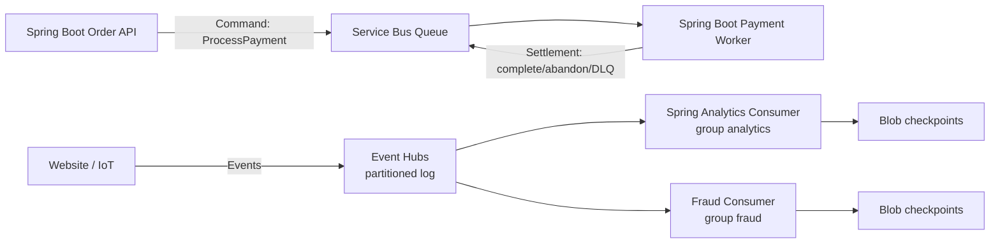

| Khía cạnh | **Azure Service Bus** | **Azure Event Hubs** |
|---|---|---|
| Vai trò chính | Hàng đợi/lệnh và messaging nghiệp vụ đáng tin cậy | Ingestion/streaming khối lượng lớn |
| Đơn vị lưu | Message trong queue hoặc topic subscription | Event trong append-only partitioned log |
| Sau khi xử lý | Message được **settle** (complete, abandon, defer, dead-letter) | Event thường **không bị xóa khi một consumer đọc** |
| Đọc lại | Dựa trên retry/DLQ/deferred messages và thiết kế ứng dụng | Đọc lại từ **offset/sequence/time** trong retention |
| Nhiều nhóm tiêu thụ | Topic có subscriptions độc lập | Consumer groups độc lập |
| Parallelism | Competing receivers, sessions và concurrency | Bị ràng buộc bởi số partitions trong một consumer group |
| Ordering | Theo ranh giới queue/session và semantics receive; cần thiết kế | Thứ tự trong **một partition**, không có global order |
| Chống trùng | Duplicate detection nếu bật/hỗ trợ, cộng idempotency | Consumer idempotency, event IDs/checkpoints |
| Xử lý lỗi | DLQ, delivery count, lock, deferral | Replay/checkpoint, poison-event strategy do app thiết kế |
| Billing/capacity | Tier và operations/messaging units theo cấu hình | Tier/throughput hoặc processing units, ingress/egress và retention |

**Không xem Event Hubs là queue chỉ vì có thể đọc event theo thứ tự.** Nếu một worker đọc Event Hubs xong, event vẫn có thể được consumer khác đọc; không có thao tác `complete()` để xóa event cho cả hệ thống. Ngược lại, Service Bus queue không phải nơi lưu stream lịch sử để nhiều nhóm replay tùy ý.

## 3. Các thành phần của Azure Service Bus

### Queue

Queue có một logical destination và nhiều workers có thể cạnh tranh nhận messages. Một message đã được một receiver khóa để xử lý (Peek-Lock) sẽ không đồng thời được giao cho receiver khác theo cơ chế lock bình thường. Nếu receiver hoàn tất và gọi **`complete()`**, message được loại khỏi active queue.

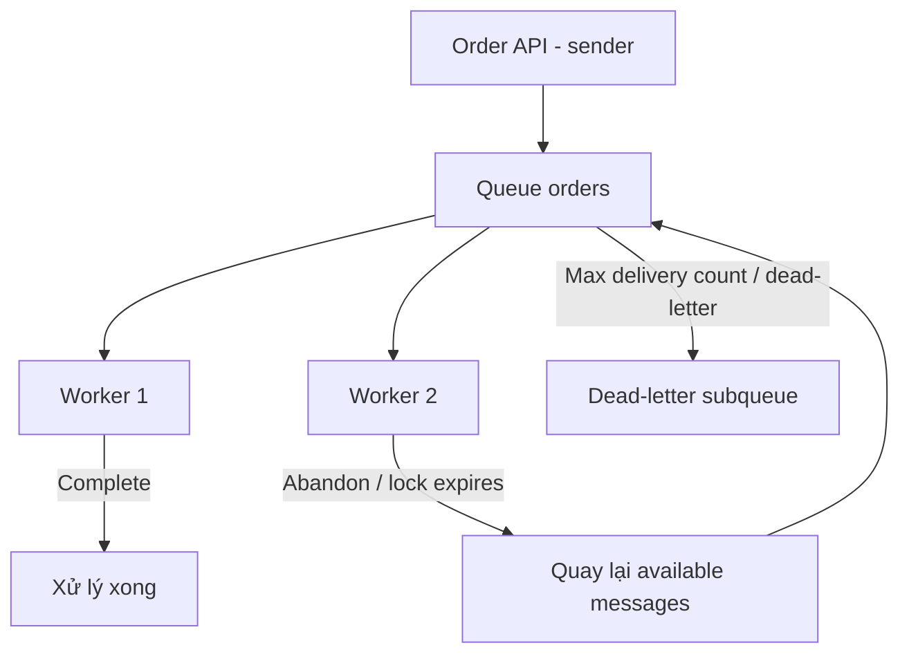

### Topic và subscription

Topic cho phép một message được phân phối tới **nhiều subscriptions** theo rule/filter. Ví dụ sự kiện nghiệp vụ `OrderCreated` được gửi vào topic `order-events`:

```text
Topic: order-events
   |-- Subscription: billing
   |-- Subscription: shipping
   |-- Subscription: notifications
```

Mỗi subscription có luồng nhận và trạng thái delivery riêng. Topic/subscription hữu ích khi mỗi nhóm cần nhận message có semantics broker, retry và DLQ. Tuy nhiên đây vẫn không phải Event Hubs retention-based stream replay.

### Namespace và entity

- **Namespace**: boundary hạ tầng, endpoint, identity/network và capacity.
- **Queue/topic**: entity gửi.
- **Subscription**: entity nhận dưới topic.
- **Rule/filter**: chọn messages được giao vào subscription.
- **DLQ**: subqueue chứa thông điệp không xử lý được theo điều kiện.
- **Session**: nhóm messages cùng session ID để phục vụ xử lý tuần tự có state theo khả năng service/tier.

Không giả định việc tạo namespace tự tạo queue/subscription; ứng dụng Spring phải được cấu hình đúng tên entity đã provision bằng portal/IaC/CLI.

## 4. Các thành phần của Azure Event Hubs

Event Hubs nhận sự kiện từ nhiều producers và lưu chúng trong **partitions**. Một event có **offset** và **sequence number** trong partition; consumer có thể bắt đầu từ checkpoint đã lưu, đầu hoặc cuối stream theo cấu hình.

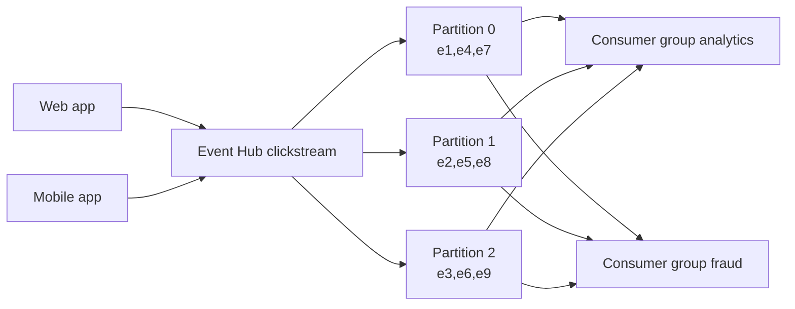

### Bốn khái niệm quan trọng

1. **Partition:** một phần log có thứ tự; sự kiện được lưu theo partition. Không có thứ tự tuyệt đối xuyên tất cả partitions.
2. **Partition key:** giá trị ổn định để các sự kiện liên quan (ví dụ cùng `customerId`) thường được định tuyến vào cùng partition.
3. **Consumer group:** nhóm consumers có vị trí đọc độc lập với nhóm khác.
4. **Checkpoint:** vị trí consumer đã xử lý/ghi nhận thành công, thường lưu ngoài Event Hubs bằng Blob checkpoint store.

### Một consumer group không phải một người đọc

Trong cùng consumer group, một processor hoặc nhiều instances có thể phối hợp **chia partitions** để đọc song song. Nếu event hub có 4 partitions mà bạn scale một consumer group lên 20 processor instances, không có nghĩa cả 20 đều có partitions để xử lý; capacity xử lý song song hữu ích bị giới hạn bởi partitions và phân bố tải.

Nhóm khác sử dụng **consumer group khác** có thể đọc cùng event log mà không làm thay đổi checkpoint của nhóm thứ nhất. Không cho hai ứng dụng độc lập dùng chung group và cùng checkpoint store nếu chúng cần toàn bộ events mỗi bên.

## 5. Đặt cạnh nhau: queue/topic, log và thời điểm xóa dữ liệu

Giả sử API gửi một command `ReserveInventory(orderId=1001)` tới Service Bus, còn frontend gửi sự kiện `ProductViewed(user=42, sku=SKU-A)` vào Event Hubs.

| Thời điểm | Service Bus queue | Event Hubs |
|---|---|---|
| Gửi | Broker nhận message; có thể xác nhận accepted | Event được ghi vào partition |
| Consumer đọc | Message bị lock trong Peek-Lock | Consumer đọc record tại một offset |
| Consumer crash | Lock có thể hết hạn; message được giao lại | Processor mới đọc lại từ checkpoint đã lưu |
| Xử lý thành công | Client gọi complete để settle | Client checkpoint sau durable processing |
| Một nhóm mới muốn đọc lịch sử | Không được thiết kế như log replay tùy ý | Có thể đọc history còn trong retention |
| Xử lý lỗi kéo dài | Retry/delivery count/DLQ | Poison-event policy, quarantine/DLQ ứng dụng, tiến checkpoint theo chiến lược |

**Cả hai đều cần idempotency ở ứng dụng.** Service Bus có thể giao lại khi lock hết hạn sau khi database đã commit; Event Hubs có thể đọc lại events sau khi ghi database nhưng trước khi checkpoint. Đừng coi “gửi thành công” hoặc “checkpoint thành công” là một giao dịch ACID với database đích.

## 6. Chuẩn bị môi trường Spring Boot và Azure

Ví dụ trong bài giả định tài nguyên lab:

| Tài nguyên | Tên minh họa | Vai trò |
|---|---|---|
| Resource group | `rg-spring-msg-lab` | Tập hợp tài nguyên demo |
| Service Bus namespace | `sb-orders-lab.servicebus.windows.net` | Message broker |
| Service Bus queue | `orders-command` | Worker xử lý đơn hàng |
| Service Bus topic/subscription | `order-events` / `billing` | Fan-out nghiệp vụ |
| Event Hubs namespace | `eh-telemetry-lab.servicebus.windows.net` | Streaming endpoint |
| Event hub | `clickstream` | Events từ website |
| Consumer group | `analytics-app` | Group của ứng dụng Spring analytics |
| Storage account | `stspringmsgcheckpoint01` | Blob checkpoint store |
| Blob container | `eh-checkpoints` | Ownership/checkpoint records |
| Application hosting | App Service/Container Apps/AKS | Chạy Spring Boot |
| Identity | Managed identity / AKS Workload ID | Authentication không dùng shared secrets |

### Quyền tối thiểu

| Client | Azure RBAC role cần xem xét |
|---|---|
| Service Bus producer | **Azure Service Bus Data Sender** |
| Service Bus consumer | **Azure Service Bus Data Receiver** |
| Event Hubs producer | **Azure Event Hubs Data Sender** |
| Event Hubs consumer | **Azure Event Hubs Data Receiver** |
| Event processor checkpoint store | **Storage Blob Data Contributor** trên container thích hợp |

Gán role ở đúng namespace/entity/container scope được hỗ trợ, không cấp Owner trên subscription cho ứng dụng. Với App Service/Container Apps có managed identity, dùng **principal ID** của workload; trên AKS Workload ID, dùng principal của user-assigned identity/federated workload, không phải identity control plane.

### Kiểm tra resource bằng Azure CLI

```bash
az login
az account set --subscription "<lab-subscription-id>"

az servicebus namespace show \
  --resource-group "rg-spring-msg-lab" \
  --name "sb-orders-lab" \
  --query "{name:name,location:location,sku:sku.name}" \
  --output json

az eventhubs namespace show \
  --resource-group "rg-spring-msg-lab" \
  --name "eh-telemetry-lab" \
  --query "{name:name,location:location,sku:sku.name}" \
  --output json
```

Hai lệnh `show` là **read-only**. Nếu chưa có queue/event hub/container, yêu cầu nhóm hạ tầng tạo bằng IaC hoặc công cụ quản trị được phép. Một application instance không nên được trao quyền tự tạo/xóa namespace để khởi động bình thường.

## 7. Tích hợp vào Spring: SDK beans hay Spring Cloud Azure?

Có hai lối tiếp cận đều hợp lý:

**A. Azure SDK for Java được quản lý bởi Spring beans**: chủ động điều khiển lifecycle `ServiceBusProcessorClient` và `EventProcessorClient`, settlement/checkpoint, handlers, retry và metrics. Bài sẽ dùng hướng này cho mã có semantics rõ ràng.

**B. Spring Cloud Azure hoặc Spring Cloud Stream binders**: dùng auto-configuration, producer/consumer abstractions, annotations hoặc function binding theo phiên bản. Có thể giảm boilerplate nhưng cần hiểu rõ cách **acknowledgement, error channel, checkpoint, transactions và consumer groups** được binder cụ thể xử lý.

| Tiêu chí | SDK trực tiếp + Spring beans | Spring Cloud Azure / Stream binder |
|---|---|---|
| Code domain | Java SDK clients và Spring services | Spring abstractions/configuration |
| Settlement/checkpoint | Gọi tường minh trong handlers | Có thể dùng binder/container policies |
| Lifecycle | Spring quản lý bean, app quản lý start/stop | Framework thường auto-start theo config |
| Thay đổi framework | Ít phụ thuộc binding conventions | Phụ thuộc Spring Boot ↔ Spring Cloud Azure version matrix |
| Kiểm soát chuyên sâu | Dễ truy cập options SDK chi tiết | Phải kiểm tra binder có hỗ trợ option cần thiết |
| Dùng khi | Delivery semantics phức tạp, cần explicit control | Nhiều apps theo abstraction, team đã chuẩn hóa |

**Chọn một mô hình sở hữu cùng entity/consumer group một cách rõ ràng.** Nếu một binder consumer đã chạy, không vô tình tạo thêm `EventProcessorClient` cùng consumer group/checkpoint store cho cùng workload rồi thắc mắc tại sao partitions bị chia lại.

## 8. Maven dependencies và version compatibility

Trong ví dụ Spring Boot 3.x/JDK 17+ (điều chỉnh theo baseline dự án), dùng **Azure SDK for Java** bên trong Spring để làm rõ API và semantics. Tối thiểu cần:

```xml
<dependencies>
    <dependency>
        <groupId>org.springframework.boot</groupId>
        <artifactId>spring-boot-starter-web</artifactId>
    </dependency>
    <dependency>
        <groupId>org.springframework.boot</groupId>
        <artifactId>spring-boot-starter-actuator</artifactId>
    </dependency>
    <dependency>
        <groupId>com.azure</groupId>
        <artifactId>azure-identity</artifactId>
        <version>REPLACE_WITH_APPROVED_AZURE_SDK_VERSION</version>
    </dependency>
    <dependency>
        <groupId>com.azure</groupId>
        <artifactId>azure-messaging-servicebus</artifactId>
        <version>REPLACE_WITH_APPROVED_AZURE_SDK_VERSION</version>
    </dependency>
    <dependency>
        <groupId>com.azure</groupId>
        <artifactId>azure-messaging-eventhubs</artifactId>
        <version>REPLACE_WITH_APPROVED_AZURE_SDK_VERSION</version>
    </dependency>
    <dependency>
        <groupId>com.azure</groupId>
        <artifactId>azure-messaging-eventhubs-checkpointstore-blob</artifactId>
        <version>REPLACE_WITH_APPROVED_AZURE_SDK_VERSION</version>
    </dependency>
    <dependency>
        <groupId>com.azure</groupId>
        <artifactId>azure-storage-blob</artifactId>
        <version>REPLACE_WITH_APPROVED_AZURE_SDK_VERSION</version>
    </dependency>
</dependencies>
```

Các giá trị `REPLACE_WITH_APPROVED_AZURE_SDK_VERSION` là **placeholders**, không phải phiên bản Maven hợp lệ; thay bằng versions đã kiểm thử hoặc quản lý tập trung qua **Azure SDK BOM**. Không tùy tiện dùng cùng một số version cho mọi artifact nếu chúng không có cùng release line. Với Spring Cloud Azure, cần BOM tương thích với Spring Boot/Spring Cloud release train.

### Nếu dự án dùng Spring Cloud Azure

Những artifacts cần tra cứu theo release đang sử dụng có thể bao gồm:

```text
com.azure.spring:spring-cloud-azure-starter-servicebus
com.azure.spring:spring-cloud-azure-starter-eventhubs
com.azure.spring:spring-cloud-azure-stream-binder-servicebus
com.azure.spring:spring-cloud-azure-stream-binder-eventhubs
```

Đây là **danh sách hướng tích hợp**, không có nghĩa phải cài cả bốn vào một ứng dụng. Starter auto-configuration và Stream binder có thể cung cấp overlapping responsibilities. Chọn một cách tích hợp trên từng flow, đọc bảng tương thích **Spring Boot ↔ Spring Cloud Azure**, rồi cấu hình binder-specific properties đúng phiên bản.

### Có cần spring-boot-starter-amqp không?

**Không.** Service Bus và Event Hubs có giao thức AMQP nhưng không đồng nghĩa chúng là RabbitMQ brokers dùng Spring AMQP `RabbitTemplate` mặc định. Dùng Azure Messaging SDK hoặc Spring Cloud Azure integration được thiết kế cho Azure; đừng nối RabbitMQ client vào Service Bus namespace và kỳ vọng đầy đủ semantics.

## 9. Cấu hình Spring Boot tách hostname khỏi credentials

Đặt tên resource vào `application.properties` hoặc configuration source an toàn:

```properties
app.servicebus.namespace=sb-orders-lab.servicebus.windows.net
app.servicebus.queue=orders-command

app.eventhubs.namespace=eh-telemetry-lab.servicebus.windows.net
app.eventhubs.hub=clickstream
app.eventhubs.consumer-group=analytics-app

app.storage.blob-endpoint=https://stspringmsgcheckpoint01.blob.core.windows.net
app.eventhubs.checkpoint-container=eh-checkpoints

app.messaging.servicebus.max-concurrent-calls=4
```

**Không có** `connectionString`, `SharedAccessKey` hoặc `clientSecret` trong cấu hình trên. `fullyQualifiedNamespace` là hostname, ví dụ `sb-orders-lab.servicebus.windows.net`, không phải chuỗi `Endpoint=sb://...;SharedAccessKey=...`.

### Phân biệt cấu hình ứng dụng và Spring Cloud Azure properties

Những property `app.*` ở đây **do chính code Spring đọc**, không phải các property auto-configuration do Spring Cloud Azure tự hiểu. Nếu chuyển sang starter/binder, phải đổi thành prefix được Spring Cloud Azure version đó hỗ trợ và xác định application name, destination, group, entity type theo tài liệu version. Không đặt `app.servicebus.queue` rồi giả định binder sẽ tự bind consumer.

### Dùng profiles có kiểm soát

```text
application.properties          -> defaults an toàn, không chứa secret
application-local.properties    -> namespace DEV được phép
application-staging.properties  -> namespace STAGING
application-prod.properties     -> namespace PROD theo deployment pipeline
```

Không commit các giá trị nhạy cảm vào Git. Trong production, endpoint/queue names có thể đặt qua App Service settings, Container Apps environment variables hoặc Kubernetes ConfigMap/IaC. Secrets còn bắt buộc cho hệ khác phải nằm trong Key Vault/secret manager, không gắn trực tiếp vào Docker image.

## 10. Dùng DefaultAzureCredential và các Spring beans

Một `TokenCredential` có thể được tái sử dụng cho Service Bus, Event Hubs và Blob checkpoint store. Trên App Service/Container Apps/VM có managed identity, `DefaultAzureCredential` có thể lấy token của workload; trên AKS Workload Identity, cần đảm bảo projected token và federation đúng. Với production yêu cầu chỉ dùng managed identity, có thể thay bằng `ManagedIdentityCredentialBuilder` tường minh.

### Spring configuration tạo clients

```java
package example.messaging;

import com.azure.core.credential.TokenCredential;
import com.azure.identity.DefaultAzureCredentialBuilder;
import com.azure.messaging.eventhubs.EventHubClientBuilder;
import com.azure.messaging.eventhubs.EventHubProducerClient;
import com.azure.messaging.servicebus.ServiceBusClientBuilder;
import com.azure.messaging.servicebus.ServiceBusSenderClient;
import com.azure.storage.blob.BlobContainerAsyncClient;
import com.azure.storage.blob.BlobContainerClientBuilder;
import org.springframework.context.annotation.Bean;
import org.springframework.context.annotation.Configuration;
import org.springframework.core.env.Environment;

@Configuration
public class AzureMessagingConfiguration {
    @Bean
    public TokenCredential tokenCredential() {
        return new DefaultAzureCredentialBuilder().build();
    }

    @Bean(destroyMethod = "close")
    public ServiceBusSenderClient orderSender(
            TokenCredential credential, Environment env) {
        return new ServiceBusClientBuilder()
                .fullyQualifiedNamespace(
                        env.getRequiredProperty("app.servicebus.namespace"))
                .credential(credential)
                .sender()
                .queueName(env.getRequiredProperty("app.servicebus.queue"))
                .buildClient();
    }

    @Bean(destroyMethod = "close")
    public EventHubProducerClient eventHubProducer(
            TokenCredential credential, Environment env) {
        return new EventHubClientBuilder()
                .credential(
                        env.getRequiredProperty("app.eventhubs.namespace"),
                        env.getRequiredProperty("app.eventhubs.hub"),
                        credential)
                .buildProducerClient();
    }

    @Bean
    public BlobContainerAsyncClient checkpointContainer(
            TokenCredential credential, Environment env) {
        return new BlobContainerClientBuilder()
                .endpoint(env.getRequiredProperty(
                        "app.storage.blob-endpoint"))
                .containerName(env.getRequiredProperty(
                        "app.eventhubs.checkpoint-container"))
                .credential(credential)
                .buildAsyncClient();
    }
}
```

**Ý nghĩa:**

- Spring tạo mỗi client một lần theo lifecycle bean mặc định, không tạo mới trên mỗi HTTP request.
- `destroyMethod="close"` giải phóng resources của sender/producer khi Spring ApplicationContext đóng.
- `TokenCredential` của Azure Identity SDK quản lý việc lấy access token; không cần hard-code SAS keys.
- `checkpointContainer` chỉ **tham chiếu** Blob container đã có, không tự tạo container; identity consumer phải có Storage Blob Data Contributor ở scope đúng.

### Khi nào dùng credential khác?

Nếu runtime host chạy user-assigned managed identity có client ID riêng:

```java
// Thay TokenCredential bean khi production chỉ cho managed identity:
TokenCredential credential = new ManagedIdentityCredentialBuilder()
        .clientId(System.getenv("AZURE_CLIENT_ID"))
        .build();
```

Đây là **snippet**, cần import `ManagedIdentityCredentialBuilder` và xác minh `AZURE_CLIENT_ID` được đặt đúng. Trên laptop, `ManagedIdentityCredential` thường không hoạt động; `DefaultAzureCredential` với `az login` phù hợp cho development. Với AKS OIDC Workload Identity, cấu hình `WorkloadIdentityCredential` hoặc `DefaultAzureCredential` tương thích thay vì lạm dụng identity của node.

## 11. Spring Boot producer gửi Service Bus command

Viết một service để publish command `ProcessOrder` vào queue, dùng **message ID ổn định** theo logical command để hỗ trợ deduplication.

```java
package example.messaging;

import com.azure.messaging.servicebus.ServiceBusMessage;
import com.azure.messaging.servicebus.ServiceBusSenderClient;
import com.fasterxml.jackson.core.JsonProcessingException;
import com.fasterxml.jackson.databind.ObjectMapper;
import java.util.Map;
import org.springframework.stereotype.Service;

@Service
public class OrderCommandPublisher {
    private final ServiceBusSenderClient sender;
    private final ObjectMapper objectMapper;

    public OrderCommandPublisher(
            ServiceBusSenderClient sender, ObjectMapper objectMapper) {
        this.sender = sender;
        this.objectMapper = objectMapper;
    }

    public void publishOrder(String orderId, String tenantId) {
        Map<String, String> payload = Map.of(
                "eventType", "ProcessOrder",
                "schemaVersion", "1",
                "orderId", orderId,
                "tenantId", tenantId);
        try {
            String json = objectMapper.writeValueAsString(payload);
            ServiceBusMessage message = new ServiceBusMessage(json);
            message.setMessageId("process-order:" + orderId + ":v1");
            message.setCorrelationId(orderId);
            message.setContentType("application/json");
            message.getApplicationProperties().put("schemaVersion", 1);
            sender.sendMessage(message);
        } catch (JsonProcessingException e) {
            throw new IllegalArgumentException("Invalid command payload", e);
        }
    }
}
```

### Cần hiểu gì trước khi gọi `sendMessage()`?

1. SDK call có thể xác nhận broker đã nhận message, **không xác nhận worker đã xử lý đơn hàng**.
2. Nếu timeout sau khi broker nhận nhưng trước khi producer thấy acknowledgement, producer có thể **gửi lại** và tạo duplicate.
3. `MessageId` ổn định cho cùng logical command giúp broker duplicate detection **nếu tính năng đã bật và thỏa điều kiện**, nhưng **không thay idempotency ở consumer**.
4. `CorrelationId` cho phép ghép request/order với traces; không chứa PII/secret.
5. Payload cần có `schemaVersion` và định danh nghiệp vụ; không tùy tiện gửi toàn bộ thông tin thẻ thanh toán hay credential.

### Không đồng bộ database transaction và queue send bằng niềm tin

Nếu ứng dụng `@Transactional` ghi Order vào Azure SQL rồi gọi `sender.sendMessage()`, **đây không phải một transaction ACID chung**. DB có thể commit còn send thất bại, hoặc message đã được gửi nhưng DB rollback. Với hệ thống nghiệp vụ quan trọng, dùng **transactional outbox**:

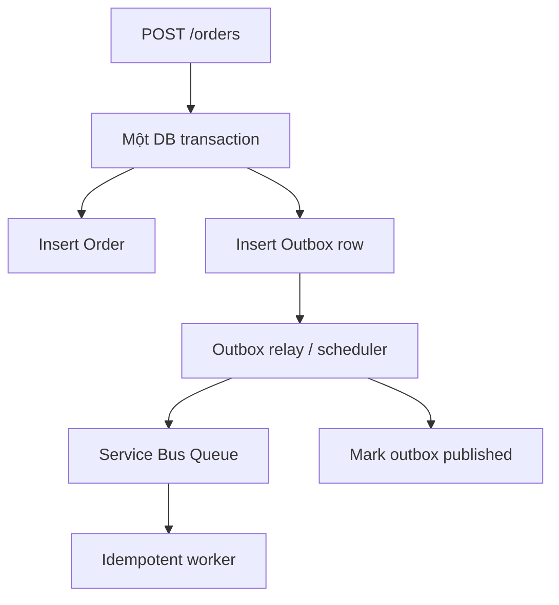

Outbox relay có thể gửi trùng nếu crash sau khi send mà trước khi đánh dấu published, nên consumer vẫn phải idempotent. Chỉ xóa outbox row sau chính sách retention/audit phù hợp.

## 12. Spring REST controller: API publish command trong lab

Ví dụ ngắn này gửi message sau khi validate đầu vào; **không thay thế workflow Order + transactional outbox production**:

```java
package example.messaging;

import java.util.Map;
import org.springframework.http.HttpStatus;
import org.springframework.web.bind.annotation.PathVariable;
import org.springframework.web.bind.annotation.PostMapping;
import org.springframework.web.bind.annotation.RequestMapping;
import org.springframework.web.bind.annotation.RestController;
import org.springframework.web.server.ResponseStatusException;

@RestController
@RequestMapping("/lab/orders")
public class OrderCommandController {
    private final OrderCommandPublisher publisher;

    public OrderCommandController(OrderCommandPublisher publisher) {
        this.publisher = publisher;
    }

    @PostMapping("/{orderId}/process")
    public Map<String, String> publish(@PathVariable String orderId) {
        if (!orderId.matches("[A-Za-z0-9-]{1,64}")) {
            throw new ResponseStatusException(
                    HttpStatus.BAD_REQUEST, "Invalid order ID");
        }
        // Trong production, tenantId lấy từ user identity/DB,
        // không hard-code hay tin tenantId tùy ý do client gửi.
        publisher.publishOrder(orderId, "tenant-lab");
        return Map.of(
                "orderId", orderId,
                "status", "accepted-for-processing");
    }
}
```

Trả `accepted-for-processing` nghĩa là API chấp nhận chuyển command đến messaging layer, **không chứng minh payment/shipping đã hoàn tất**. Với endpoint public, cần OAuth/authz, rate limiting, idempotency request key, input validation và chính sách retry HTTP riêng.

## 13. Spring Service Bus consumer với explicit settlement

Với **Peek-Lock**, receiver nhận message và có một khoảng thời gian giữ lock để xử lý. Các quyết định chính:

- **`complete()`:** xử lý đã thành công, message được loại khỏi active queue/subscription.
- **`abandon()`:** không xử lý được tạm thời, cho phép broker giao lại.
- **`deadLetter()`:** chuyển message lỗi không thể phục hồi sang DLQ theo chính sách.
- **`defer()`:** hoãn xử lý một message có thể truy xuất sau bằng sequence number theo workflow chuyên biệt.

### Tạo consumer dưới dạng Spring bean

```java
package example.messaging;

import com.azure.core.credential.TokenCredential;
import com.azure.messaging.servicebus.ServiceBusClientBuilder;
import com.azure.messaging.servicebus.ServiceBusProcessorClient;
import org.slf4j.Logger;
import org.slf4j.LoggerFactory;
import org.springframework.boot.context.event.ApplicationReadyEvent;
import org.springframework.context.annotation.Bean;
import org.springframework.context.annotation.Configuration;
import org.springframework.context.event.EventListener;
import org.springframework.core.env.Environment;

@Configuration
public class ServiceBusConsumerConfiguration {
    private static final Logger log =
            LoggerFactory.getLogger(ServiceBusConsumerConfiguration.class);

    @Bean(destroyMethod = "close")
    public ServiceBusProcessorClient orderProcessor(
            TokenCredential credential,
            Environment env,
            OrderCommandHandler handler) {
        return new ServiceBusClientBuilder()
                .fullyQualifiedNamespace(env.getRequiredProperty(
                        "app.servicebus.namespace"))
                .credential(credential)
                .processor()
                .queueName(env.getRequiredProperty("app.servicebus.queue"))
                .disableAutoComplete()
                .maxConcurrentCalls(4)
                .processMessage(context -> {
                    try {
                        String body = context.getMessage()
                                .getBody().toString();
                        handler.handle(body);
                        // Chỉ complete sau khi domain-side effect bền vững.
                        context.complete();
                    } catch (InvalidOrderCommandException bad) {
                        log.warn("Permanent command validation error");
                        context.deadLetter();
                    } catch (Exception transientOrUnknown) {
                        log.error("Processing failed; will allow redelivery",
                                transientOrUnknown);
                        context.abandon();
                    }
                })
                .processError(errorContext -> log.error(
                        "Service Bus processor error",
                        errorContext.getException()))
                .buildProcessorClient();
    }

    @EventListener(ApplicationReadyEvent.class)
    public void startConsumer(ApplicationReadyEvent ready) {
        ready.getApplicationContext()
                .getBean(ServiceBusProcessorClient.class)
                .start();
    }
}
```

Ở đây `OrderCommandHandler` và `InvalidOrderCommandException` là **các lớp nghiệp vụ do ứng dụng định nghĩa**, không có sẵn trong Azure SDK. Ví dụ chỉ diễn giải contract của chúng:

```java
package example.messaging;

import org.springframework.stereotype.Service;

@Service
public class OrderCommandHandler {
    public void handle(String json) {
        // 1. Parse/validate JSON schema và tenant.
        // 2. Kiểm tra idempotency key/messageId trong transaction DB.
        // 3. Ghi dữ liệu nghiệp vụ một cách bền vững.
        // 4. Throw InvalidOrderCommandException nếu payload không hợp lệ.
        // Đoạn này là khung, KHÔNG phải domain logic hoàn chỉnh.
        if (json == null || json.isBlank()) {
            throw new InvalidOrderCommandException("Empty message");
        }
    }
}

class InvalidOrderCommandException extends RuntimeException {
    InvalidOrderCommandException(String message) {
        super(message);
    }
}
```

**Không sử dụng handler mẫu này để complete message production**, vì nó mới chỉ kiểm tra chuỗi khác rỗng. Trước khi hoàn tất, handler thực phải parse schema, xác thực thông tin, thực hiện domain operation bền vững và đánh dấu đã xử lý theo transaction/idempotency record.

### Những chi tiết của vòng đời

1. `disableAutoComplete()` giúp ứng dụng quyết định complete/abandon/dead-letter.
2. `maxConcurrentCalls(4)` chỉ là ngưỡng lab; production cần dựa vào database capacity, throughput và concurrency.
3. `processError` nhận lỗi của processor/receive infrastructure, **không phải thay thế** `try/catch` của nghiệp vụ.
4. Spring gọi `close()` khi shutdown bean; consumer cần được **start đúng một lần**.
5. Nếu ứng dụng có nhiều processor beans, ví dụ lấy theo type duy nhất ở `startConsumer()` cần thay bằng **bean name/qualifier** hoặc lifecycle component riêng.
6. Khi shutdown cần thời gian **drain in-flight messages** theo SLA của host, tránh dừng JVM đột ngột.

### Cẩn trọng với lỗi trong settlement

Khi `handler.handle()` đã commit database nhưng `context.complete()` thất bại do **lock lost** hoặc network timeout, message có thể được giao lại. **Không rollback database chỉ vì complete lỗi nếu transaction đã commit**; hãy dùng idempotency để lần giao lại được nhận diện và complete an toàn.

## 14. Service Bus Peek-Lock, lock renewal và delivery count

Giả sử processing một đơn hàng cần 90 giây nhưng message lock là 30 giây. Nếu consumer không tự gia hạn lock hoặc cấu hình auto-lock renewal chưa phù hợp, lock hết hạn khi worker còn chạy. Một worker khác có thể nhận **cùng message**:

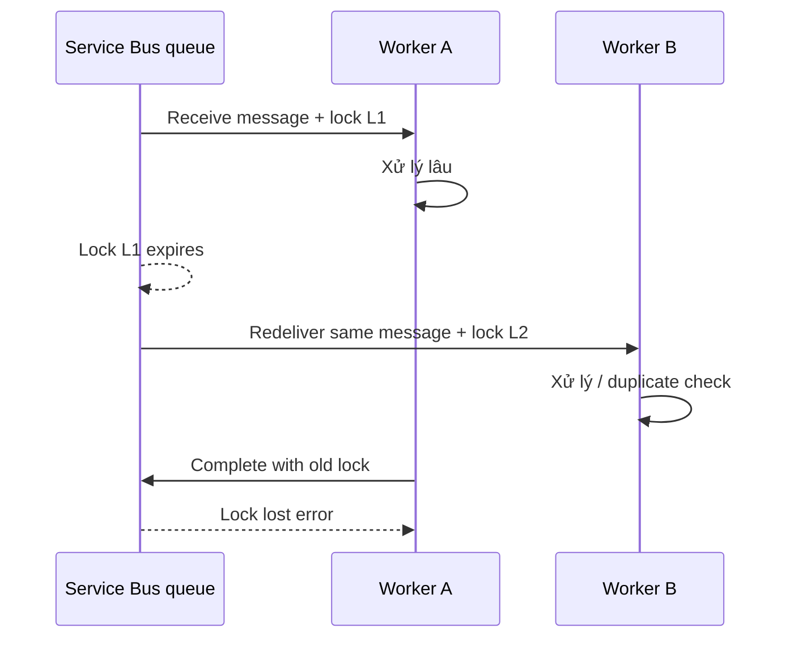

### Cấu hình cần xem xét

- **Lock duration** của queue/subscription trong giới hạn dịch vụ/tier.
- **Max auto lock renewal duration** mà processor SDK hỗ trợ.
- **Handler timeout** và deadline cho database/HTTP dependencies.
- **Prefetch count**: prefetch cao có thể tăng throughput nhưng lock time có thể bị tiêu hao trước khi handler thực sự xử lý.
- **Delivery count** và ngưỡng chuyển DLQ.
- **Concurrency**: nhiều workers cùng tranh downstream capacity.

Không giải quyết một handler mất 15 phút bằng cách tăng lock vô hạn: nên tách thành **short command + durable job state + background workflow**, hoặc thiết kế checkpoint/subtasks để phục hồi nếu container bị restart.

### At-least-once và tính đúng đắn

Service Bus Peek-Lock cho phép **redelivery** nếu message chưa được complete. Do đó ứng dụng xử lý theo semantics **at-least-once** cần:

1. Idempotency key ổn định, thường từ `MessageId` cộng tenant/business operation.
2. Transaction ghi business state và **processed message ID** cùng một ranh giới DB khi khả thi.
3. Kiểm tra message đã xử lý trước khi thực hiện side effect.
4. Nếu đã xử lý: có thể complete message nhận lại mà không lặp side effect.
5. Lưu bằng chứng xử lý để đối soát, không giữ cache RAM duy nhất.

### Delivery count không phải thời gian sống

`DeliveryCount` biểu thị lần giao theo semantics broker, không đo business attempts theo mọi ngoại lệ. Message có TTL và lock/delivery policies khác nhau. Khi vượt max delivery count trong những điều kiện hỗ trợ, message có thể chuyển DLQ; không phải mọi lỗi lập tức thành DLQ.

## 15. Dead-letter queue, poison messages và replay

**Dead-letter queue (DLQ)** lưu những messages không thể được xử lý bình thường hoặc bị broker dead-letter theo chính sách. DLQ **không tự xử lý lại** và không có “Spring @Retry tự động sửa mọi business data”.

### Phân loại lỗi

| Lỗi | Ví dụ | Chiến lược |
|---|---|---|
| **Transient** | SQL timeout, HTTP 503, network gap | Retry bounded/backoff, abandon hoặc dùng delayed retry policy |
| **Permanent payload** | JSON sai schema, thiếu orderId bắt buộc | Dead-letter có reason/audit sau kiểm tra |
| **Business conflict** | Đơn đã hủy/không còn đủ điều kiện | Xác định terminal/recoverable theo domain |
| **Authorization/config** | Worker thiếu data role, queue sai namespace | Alert và sửa hạ tầng, không retry mù mọi message |
| **Idempotent duplicate** | Message ID đã được xử lý | Không lặp side effect; complete an toàn |
| **Unknown failure** | Bug không phân loại | Có giới hạn số lần và telemetry, không infinite-loop |

### DLQ operations

```text
orders-command
  ├── Active messages
  └── $DeadLetterQueue
       ├── Failed validation
       ├── MaxDeliveryCountExceeded
       └── Explicit dead-letter by worker
```

Khi gửi message đến DLQ, nên lưu reason/description **không chứa PII** và ghi message/correlation IDs để audit. Với processor context APIs, tham số reason/description có thể được cung cấp theo option thích hợp; mẫu `context.deadLetter()` ở trên là cách tối giản cho bài học.

### Runbook DLQ

1. Quan sát **DLQ count** và ngưỡng cảnh báo.
2. Dùng principal chỉ có quyền nhận/phân tích DLQ phù hợp để xem metadata/payload trong môi trường bảo mật.
3. Phân loại cùng nguyên nhân: sai schema, worker bug, thiếu quyền hay downstream outage.
4. Fix nguyên nhân và tạo **replay plan**, không tự động gửi lại hàng nghìn poison messages vào active queue.
5. Khi replay, **giữ logical message ID/idempotency key**, ghi số lần replay và tránh nhân đôi thanh toán.
6. Dọn DLQ theo retention/approval và ghi audit.

**Không dùng DLQ như database lưu trữ sự kiện lâu dài.** DLQ phục vụ vận hành lỗi; cần data retention và data warehouse riêng nếu có nhu cầu audit lâu dài.

## 16. Service Bus topic/subscription, sessions và duplicate detection

### Fan-out qua topic

Thay vì gửi cùng một `OrderCreated` tới ba queues riêng, producer có thể gửi một message tới **topic `order-events`**, các subscriptions `billing`, `shipping` và `notifications` nhận thông điệp theo rules.

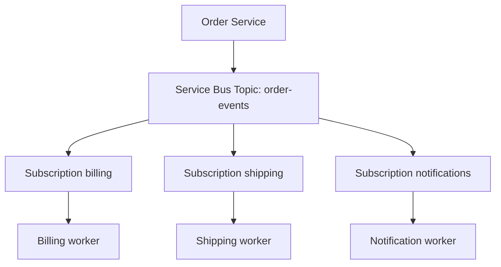

Từng subscription có DLQ/lock/settlement riêng. Nếu billing worker lỗi, shipping worker vẫn có thể complete message của subscription mình; không có transaction xuyên cả ba nghiệp vụ chỉ vì cùng một topic.

### Sender/processor cho topic

```java
// Đoạn cấu hình thay thế QUEUE sender; cần import ServiceBusClientBuilder.
ServiceBusSenderClient topicSender = new ServiceBusClientBuilder()
        .fullyQualifiedNamespace("sb-orders-lab.servicebus.windows.net")
        .credential(credential)
        .sender()
        .topicName("order-events")
        .buildClient();

// Một topic subscription receiver dùng:
ServiceBusProcessorClient billingProcessor =
        new ServiceBusClientBuilder()
                .fullyQualifiedNamespace(
                        "sb-orders-lab.servicebus.windows.net")
                .credential(credential)
                .processor()
                .topicName("order-events")
                .subscriptionName("billing")
                .processMessage(context -> {
                    // Handler thực: validate, idempotency và commit.
                    // Auto-complete nếu không gọi disableAutoComplete().
                })
                .processError(context -> {
                    // Log/cảnh báo lỗi processor.
                })
                .buildProcessorClient();
```

Đây là **snippets minh họa topology**, không phải production handlers. Producer/processor cần được **close** bằng Spring lifecycle, và với topic example trên default auto-complete semantics có thể khác ví dụ queue explicit settlement. Không để empty callback nhận message ở môi trường thật.

### Sessions: xử lý có thứ tự theo nhóm

Service Bus sessions có thể dùng `SessionId=orderId` hoặc `customerId` để duy trì việc xử lý tuần tự theo session trong những kịch bản hỗ trợ. Phải cấu hình **session-enabled queue/subscription từ trước** và sử dụng **session-aware processor/receiver**; gửi SessionId vào một entity không hỗ trợ sessions không tạo ra ordering guarantee mới.

Tính thứ tự theo session hữu ích với các lệnh `Created → Reserved → Cancelled` cho cùng order, nhưng **không bảo đảm business state đúng nếu producer đưa events sai thứ tự**. Dùng sequence/version trong payload để phát hiện out-of-order từ nguồn.

### Duplicate detection

Khi bật duplicate detection trên entity/tier được hỗ trợ, Service Bus có thể dùng `MessageId` để phát hiện lặp trong một **cửa sổ thời gian cấu hình**. Cửa sổ hữu hạn và có điều kiện theo khả năng broker; nếu một message quay lại sau khoảng đó hoặc khác ID, broker không thể thay thế idempotency business.

Khi chọn Service Bus partitioning/sessions, ngữ nghĩa uniqueness có thể còn liên quan `PartitionKey`/`SessionId` theo cấu hình. Hãy thiết kế ID/key phù hợp và kiểm tra tài liệu service/tier thật, không mặc định MessageId là khóa toàn cục vĩnh viễn.

## 17. Event Hubs producer trong Spring: gửi events theo batch

Event Hubs producer ghi events vào một event hub. SDK hỗ trợ **`EventHubProducerClient`**, `EventData` và `EventDataBatch` để tận dụng batching/thông lượng tốt hơn so với việc gửi từng event riêng.

### Spring service publish events

```java
package example.messaging;

import com.azure.messaging.eventhubs.EventData;
import com.azure.messaging.eventhubs.EventDataBatch;
import com.azure.messaging.eventhubs.EventHubProducerClient;
import com.azure.messaging.eventhubs.models.CreateBatchOptions;
import com.fasterxml.jackson.core.JsonProcessingException;
import com.fasterxml.jackson.databind.ObjectMapper;
import java.time.Instant;
import java.util.Map;
import java.util.UUID;
import org.springframework.stereotype.Service;

@Service
public class ClickstreamPublisher {
    private final EventHubProducerClient producer;
    private final ObjectMapper mapper;

    public ClickstreamPublisher(
            EventHubProducerClient producer, ObjectMapper mapper) {
        this.producer = producer;
        this.mapper = mapper;
    }

    public void publishView(
            String customerId, String sku, String tenantId) {
        Map<String, Object> body = Map.of(
                "eventId", UUID.randomUUID().toString(),
                "eventType", "ProductViewed",
                "schemaVersion", 1,
                "customerId", customerId,
                "tenantId", tenantId,
                "sku", sku,
                "occurredAtUtc", Instant.now().toString());
        try {
            EventData data = new EventData(mapper.writeValueAsString(body));
            data.getProperties().put("eventType", "ProductViewed");

            EventDataBatch batch = producer.createBatch(
                    new CreateBatchOptions().setPartitionKey(customerId));
            if (!batch.tryAdd(data)) {
                throw new IllegalArgumentException(
                        "Event exceeds allowed batch size");
            }
            producer.send(batch);
        } catch (JsonProcessingException ex) {
            throw new IllegalArgumentException("Invalid event payload", ex);
        }
    }
}
```

**Những điều cần nhớ:**

- `CreateBatchOptions.setPartitionKey(customerId)` giúp định tuyến các events có cùng key vào cùng partition theo semantics của Event Hubs. **Không đảm bảo global ordering** giữa các customers.
- `EventDataBatch.tryAdd` trả `false` khi event không vừa giới hạn batch; không được bỏ qua để làm mất event.
- Ví dụ tạo **batch một event** nhằm giải thích API. Production throughput lớn thường nên **gộp nhiều events** cùng chiến lược partition key bằng buffering/micro-batching có giới hạn thời gian/bộ nhớ.
- `UUID.randomUUID()` tạo event ID mới mỗi lần gọi. Nếu HTTP request bị retry, hai lần gọi có thể tạo hai IDs khác nhau. Với event nghiệp vụ cần dedup, **ID nên ổn định theo nguồn hoặc idempotency key của request**.
- Một Event Hubs send success xác nhận event được dịch vụ nhận, **không đồng nghĩa mọi consumer groups đã xử lý**.

### Gửi một batch nhiều events

```java
EventDataBatch batch = producer.createBatch(
        new CreateBatchOptions().setPartitionKey("customer-42"));

for (String json : incomingJsonEvents) {
    EventData event = new EventData(json);
    if (!batch.tryAdd(event)) {
        if (batch.getCount() == 0) {
            throw new IllegalArgumentException(
                    "One event exceeds maximum batch size");
        }
        producer.send(batch);
        batch = producer.createBatch(
                new CreateBatchOptions().setPartitionKey("customer-42"));
        if (!batch.tryAdd(event)) {
            throw new IllegalArgumentException(
                    "One event exceeds maximum batch size");
        }
    }
}
if (batch.getCount() > 0) {
    producer.send(batch);
}
```

Đây là **snippet trong method** có `producer` và `incomingJsonEvents` đã được khai báo. Khi batch quá lớn, gửi batch hiện có rồi tạo batch mới; phải **bảo đảm tất cả events trong cùng batch có partition strategy hợp lệ**. Với nhiều customers khác nhau, nhóm theo partition key hoặc dùng cơ chế để service tự chọn partition khi ordering theo customer không cần thiết.

### Chính sách xử lý khi send batch thất bại

Nếu `send(batch)` timeout, một phần ngữ nghĩa “broker đã nhận hay chưa” có thể không rõ từ góc nhìn producer. **Không tự động tạo event IDs mới** trong retry; giữ logical event IDs, dùng outbox hoặc durable buffer và consumer idempotency. Không giữ batch vô hạn trong RAM của một container có thể bị restart.

## 18. Event Hubs consumer group, partition ownership và checkpoint store

Event Hubs consumers đọc theo partition/offset. **`EventProcessorClient`** của Azure SDK giúp một nhóm instances:

1. Khám phá partitions.
2. Phân phối ownership của partitions giữa processors trong **cùng consumer group**.
3. Đọc events theo vị trí/checkpoint.
4. Gọi callback xử lý.
5. Ghi checkpoint thông qua **`CheckpointStore`** được cấu hình.

Một cách phổ biến là dùng **Azure Blob Storage** làm checkpoint store, thông qua thư viện `azure-messaging-eventhubs-checkpointstore-blob`.

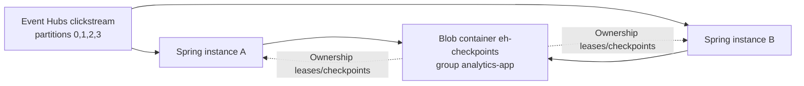

### Vì sao cần Blob checkpoint store dùng chung?

Nếu mỗi Spring instance lưu offset **chỉ trong RAM/local file**, khi scale/restart:

- Instances không thống nhất partition ownership.
- Processor có thể không biết vị trí đã xử lý.
- Events bị đọc lại nhiều hơn dự kiến hoặc bỏ sót khi logic khởi động sai.

Checkpoint store là **trạng thái phối hợp durable**. Tất cả instances của **cùng ứng dụng/consumer group** có thể dùng chung store theo cấu hình để cân bằng partitions; các ứng dụng độc lập nên dùng **consumer group riêng** (và chiến lược checkpoint isolation được kiểm chứng).

### Yêu cầu về Storage permission

App identity cần **Storage Blob Data Contributor** trên Blob container checkpoint hoặc scope phù hợp. Role **Storage Blob Data Reader** thường không đủ vì processor phải **tạo/cập nhật ownership/checkpoint records**. Cùng lúc, identity phải có **Azure Event Hubs Data Receiver** để nhận events.

**Checkpoint không phải DLQ.** Nó chỉ ghi tiến độ đọc, không lưu “những event bị lỗi” để nhóm khác điều tra. Nếu một event không thể parse, cần **quarantine/error topic/blob** do ứng dụng quản lý và quyết định rõ khi nào có thể advance checkpoint.

## 19. Spring EventProcessorClient: tạo processor và xử lý callback

### Spring configuration

```java
package example.messaging;

import com.azure.core.credential.TokenCredential;
import com.azure.messaging.eventhubs.EventHubClientBuilder;
import com.azure.messaging.eventhubs.EventProcessorClient;
import com.azure.messaging.eventhubs.EventProcessorClientBuilder;
import com.azure.messaging.eventhubs.checkpointstore.blob.BlobCheckpointStore;
import com.azure.storage.blob.BlobContainerAsyncClient;
import org.slf4j.Logger;
import org.slf4j.LoggerFactory;
import org.springframework.boot.context.event.ApplicationReadyEvent;
import org.springframework.context.annotation.Bean;
import org.springframework.context.annotation.Configuration;
import org.springframework.context.event.EventListener;
import org.springframework.core.env.Environment;

@Configuration
public class EventHubConsumerConfiguration {
    private static final Logger log =
            LoggerFactory.getLogger(EventHubConsumerConfiguration.class);

    @Bean(destroyMethod = "stop")
    public EventProcessorClient clickstreamProcessor(
            TokenCredential credential,
            Environment env,
            BlobContainerAsyncClient checkpointContainer,
            ClickstreamHandler handler) {
        return new EventProcessorClientBuilder()
                .credential(
                        env.getRequiredProperty("app.eventhubs.namespace"),
                        env.getRequiredProperty("app.eventhubs.hub"),
                        credential)
                .consumerGroup(env.getRequiredProperty(
                        "app.eventhubs.consumer-group"))
                .checkpointStore(
                        new BlobCheckpointStore(checkpointContainer))
                .processEvent(context -> {
                    try {
                        String json = context.getEventData()
                                .getBodyAsString();
                        String partitionId = context.getPartitionContext()
                                .getPartitionId();
                        handler.handle(json, partitionId);
                        // Bản demo: checkpoint mỗi event đã xử lý xong.
                        context.updateCheckpoint();
                    } catch (Exception ex) {
                        log.error("Event failed; do not checkpoint", ex);
                        // Policy production: retry/quarantine/stop theo tính chất lỗi.
                    }
                })
                .processError(errorContext ->
                        log.error("Event Hubs processor error",
                                errorContext.getThrowable()))
                .buildEventProcessorClient();
    }

    @EventListener(ApplicationReadyEvent.class)
    public void startEventProcessor(ApplicationReadyEvent ready) {
        ready.getApplicationContext()
                .getBean(EventProcessorClient.class)
                .start();
    }
}
```

**Lưu ý về SDK:** Kiểm tra overloads/method names của `EventProcessorClientBuilder` và `EventContext.updateCheckpoint()` trên version thật, đặc biệt giữa clients đồng bộ/bất đồng bộ. Ví dụ dùng API đồng bộ phổ biến và **Spring-managed start/stop lifecycle**.

### Handler domain tối giản

```java
package example.messaging;

import org.springframework.stereotype.Service;

@Service
public class ClickstreamHandler {
    public void handle(String json, String partitionId) {
        // Production:
        // - Parse JSON/schemaVersion và validate dữ liệu.
        // - Ghi event ID vào durable dedup store.
        // - Ghi kết quả vào DB/data lake theo semantics mong muốn.
        // - Trả về SAU khi durable write thành công.
        if (json == null || json.isBlank()) {
            throw new IllegalArgumentException(
                    "Empty event on partition " + partitionId);
        }
    }
}
```

**Code `ClickstreamHandler` chỉ là khung, không phải implementation durable.** Không dùng trực tiếp trên production vì nó có thể checkpoint mà chưa ghi dữ liệu vào sink. Ở sản phẩm thật, `handle()` chỉ trả về khi đã có **đảm bảo ghi đủ** hoặc **quarantine thành công** theo chính sách lỗi được duyệt.

### Một nguy cơ trong ví dụ callback

Nếu callback bắt exception, log và **không checkpoint**, processor có thể **tiếp tục nhận events tiếp theo trong cùng runtime** tùy cơ chế SDK; bản thân `catch` không làm event lỗi “tự động retry ngay”. Sau restart/rebalance, processor có thể đọc lại từ checkpoint trước đó. Do vậy policy production phải tường minh: **pause/stop partition processing, retry with bounded backoff, ghi quarantine rồi advance checkpoint, hoặc cảnh báo để can thiệp**. Không để một poison event âm thầm mất dấu rồi cho rằng “không checkpoint tức là đã retry”.

### Checkpoint mỗi event có nên không?

Checkpoint sau từng event dễ hiểu nhưng phát sinh **nhiều Blob writes/operations** khi throughput cao. Production có thể checkpoint theo **số events** hoặc **thời gian** (ví dụ mỗi N events hoặc một khoảng thời gian đã tính toán) khi và chỉ khi tất cả prior events trong partition đã **được xử lý bền vững**. Tần suất thấp hơn giảm operations nhưng tăng số events phải replay khi processor crash.

## 20. Chọn thời điểm checkpoint: xử lý bền vững trước

Giả sử một processor nhận 3 events:

```text
Partition 2:
  seq=101  -> processed and written to DB
  seq=102  -> processed and written to DB
  seq=103  -> received, DB write fails
```

Checkpoint hợp lệ của một processor xử lý tuần tự chỉ nên tiến **đến 102**, không được ghi đến 103 khi chưa có quyết định bền vững cho event 103. Khi crash/restart, seq 103 cần được đọc lại.

### Sai lầm: checkpoint trước database commit

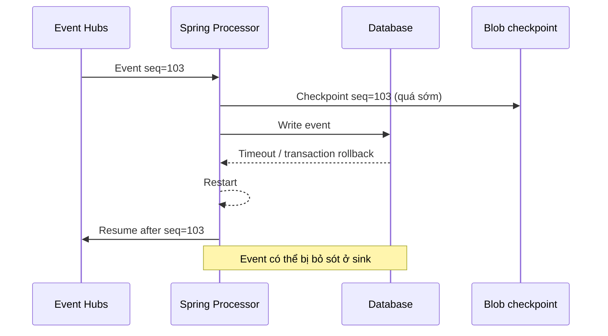

### Tốt hơn: commit rồi checkpoint

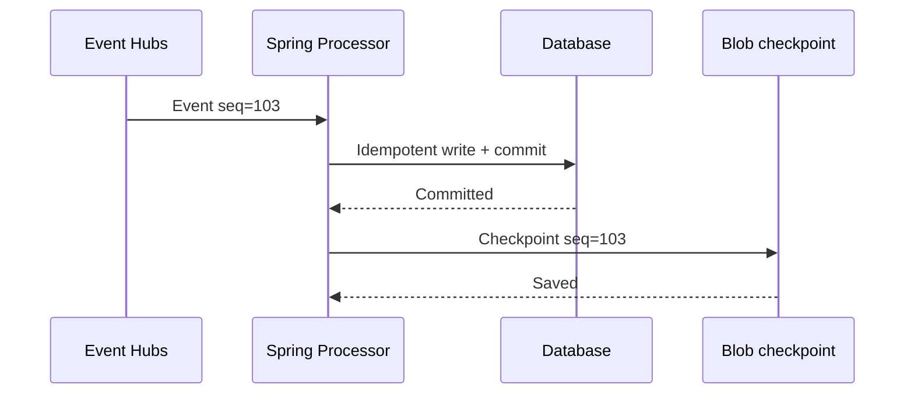

Nếu DB commit thành công nhưng checkpoint fail, event có thể được đọc lại. **Idempotent sink** là cách để replay an toàn; không có transaction phân tán tự động giữa database và Blob checkpoint.

### Sequence number, offset và checkpoint

- **Sequence number:** tăng theo partition, không duy nhất xuyên toàn event hub.
- **Offset:** vị trí tương đối trong partition log theo semantics dịch vụ.
- **Enqueued time:** thời gian event được broker nhận.
- **Checkpoint:** vị trí đã xử lý của **một consumer group/processor**; không quyết định việc event còn trong retention hay không.

Sử dụng cặp **`eventHub + partitionId + sequenceNumber`** để quan sát và đối soát vị trí; đối với business deduplication, nên có **eventId do producer phát ra** để nhận biết cùng logical event ngay cả khi publisher gửi lại thành **hai records có sequence numbers khác nhau**.

## 21. Replay, partition key, consumer group và ordering

### Partition key theo domain

Một application theo dõi hành vi người dùng cần giữ các events của cùng `customerId` theo thứ tự trong phạm vi một partition. Producer có thể dùng `setPartitionKey(customerId)`; nếu key được phân phối tương đối đều, giảm nguy cơ skew.

**Nếu một khách hàng phát lưu lượng cực lớn**, một partition có thể trở thành hotspot. Thay partition key sang random để tăng throughput có thể **mất ordering theo khách**. Cần xác định SLA nào quan trọng hơn và cân nhắc sharding có key nhóm logic cùng version/sequence ở consumer.

### Consumers khác nhiệm vụ

```text
Event Hub: clickstream

Consumer group: analytics-app
  -> consumer A, B, C (phối hợp partitions)

Consumer group: fraud-app
  -> consumer X, Y (phối hợp partitions độc lập)

Consumer group: data-lake-export
  -> independent capture/processing workflow
```

Đừng dùng chung `analytics-app` cho hai hệ thống độc lập nếu cả hai đều phải đọc **mọi event**. Hai processor groups khác nhau có checkpoint độc lập và tiêu thụ cùng event stream trong retention.

### Replay không kéo dài vô hạn

Event Hubs lưu events trong **thời hạn retention** theo tier/configuration; sau đó event không còn sẵn để replay theo offset cũ. Nếu muốn kiểm toán dữ liệu nhiều năm:

- Dùng **Event Hubs Capture** khi tier/feature hỗ trợ hoặc stream processor xuất bền vững sang ADLS Gen2/Blob.
- Có schema/version, partition metadata, event IDs và timestamp.
- Có truy trình replay từ data lake hoặc nguồn lâu dài.
- Không giả định một consumer chậm có thể đọc lại event đã hết retention.

### Khi muốn bắt đầu ở đầu/cuối stream

Việc khởi tạo vị trí đọc phụ thuộc checkpoint có sẵn và **initial partition event position** của client/binder. Nếu đã tồn tại checkpoint, thay “start from earliest” trong code chưa chắc khiến processor bỏ qua checkpoint cũ. **Reset checkpoint/consumer group** là thao tác có thể phát lại khối lượng lớn và tăng chi phí, phải thực hiện theo runbook.

## 22. Spring Cloud Azure và Spring Cloud Stream: cách tích hợp khác

Không phải ứng dụng Spring nào cũng cần tự tạo `ServiceBusProcessorClient`/`EventProcessorClient`. Khi đã chuẩn hóa **Spring Cloud Azure**, các starters và Spring Cloud Stream binders giúp tích hợp với mô hình Spring:

- **Spring Cloud Azure starters** cung cấp auto-configuration cho những Azure service clients và các abstractions được hỗ trợ.
- **Spring Cloud Stream** dùng mô hình function bindings để nhận/gửi messages qua binder.
- **Spring Integration** có các channels/adapters hỗ trợ kịch bản messaging phù hợp.

### Hàm consumer Spring Cloud Stream

```java
package example.messaging;

import java.util.function.Consumer;
import org.springframework.context.annotation.Bean;
import org.springframework.context.annotation.Configuration;
import org.springframework.messaging.Message;

@Configuration
public class FunctionalConsumerConfiguration {
    private final OrderCommandHandler handler;

    public FunctionalConsumerConfiguration(OrderCommandHandler handler) {
        this.handler = handler;
    }

    @Bean
    public Consumer<Message<String>> processOrder() {
        return message -> {
            handler.handle(message.getPayload());
            // Binder quyết định ack/settlement theo cấu hình cụ thể;
            // không tự giả định complete/checkpoint theo Java SDK example.
        };
    }
}
```

Ví dụ **generic Spring Cloud Stream functional programming model**. Phần binding concept:

```properties
spring.cloud.function.definition=processOrder
spring.cloud.stream.bindings.processOrder-in-0.destination=orders-command
```

Đây **chưa phải cấu hình Service Bus binder hoàn chỉnh**: còn cần artifact binder, lựa chọn binder implementation, namespace/credential, entity type (queue/topic), consumer settings và cơ chế settlement theo **Spring Cloud Azure version được chọn**. Trong Event Hubs binder, còn có consumer group/checkpoint store/partition ownership. Không xem đoạn hai dòng config này là ứng dụng chạy production.

### Những câu hỏi bắt buộc trước khi chọn binder

1. **Bản Spring Cloud Azure tương thích Spring Boot đang chạy?** Kiểm tra BOM/version matrix.
2. **Binder nào xử lý Service Bus queue/topic và binder nào xử lý Event Hubs?** Không giả định chung một destination type.
3. **Ai sở hữu acknowledgement?** Auto-ack, manual ack, checkpoint, errors và retry được bind ra sao?
4. **Nếu callback throw exception?** Message được abandon/redeliver, dead-letter, retry container hay dừng partition?
5. **Ai start/stop consumer?** Spring Cloud Stream lifecycle tự quản hay ứng dụng gọi SDK start?
6. **Consumer groups/sessions/partitions được ánh xạ thế nào?** Tên binding có thể khác Azure entity name.
7. **Có cần native feature chưa được binder expose?** Khi cần settlement tùy biến, SDK trực tiếp có thể hợp lý hơn.

### Tránh double-consume

Nếu ứng dụng đã chạy Spring Cloud Stream consumer trên queue `orders-command` và lại có `ServiceBusProcessorClient` tùy chỉnh cùng queue, cả hai trở thành competing consumers. Điều này **có thể hợp lệ khi cố ý scale cùng một loại worker**, nhưng thường là lỗi cấu hình nếu hai handlers thực hiện nghiệp vụ khác nhau. Với Event Hubs, chạy hai kiểu consumers cùng group/checkpoint cũng gây rebalance và phân chia partitions không mong muốn.

### Kiểm thử framework-version thật

Đừng tin một snippet cũ mà bỏ qua breaking changes: package names, property prefixes, Spring Boot minimum JDK, identity auto-configuration và delivery semantics có thể thay đổi giữa các release lines. Viết **integration tests** kiểm tra queue send/receive, DLQ, event checkpoint/restart với phiên bản thực sự deploy.

## 23. Managed identity và RBAC cho Service Bus, Event Hubs và Blob

Trong môi trường Azure, Spring app thường dùng **DefaultAzureCredential** hoặc **ManagedIdentityCredential**. Token được Microsoft Entra ID phát cho dịch vụ đích; broker/Storage vẫn kiểm tra **data-plane roles**.

### Sơ đồ quyền

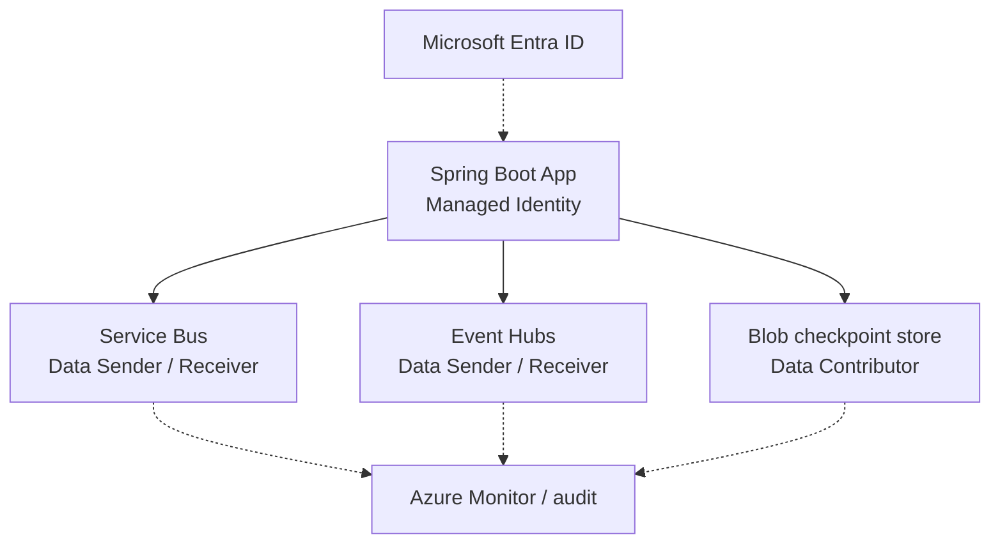

Đối với ứng dụng chỉ gửi commands và clickstream, không nên cấp **Data Owner** hoặc receiver rights nếu không cần. Worker nhận Service Bus và Event Hubs có thể dùng **identity tách riêng** theo nhiệm vụ.

### Ví dụ gán role (lab)

```bash
RG="rg-spring-msg-lab"
PRINCIPAL_ID="<spring-app-managed-identity-principal-id>"

SB_ID=$(az servicebus namespace show \
  --resource-group "$RG" \
  --name "sb-orders-lab" \
  --query id --output tsv)

EH_ID=$(az eventhubs namespace show \
  --resource-group "$RG" \
  --name "eh-telemetry-lab" \
  --query id --output tsv)

ST_ID=$(az storage account show \
  --resource-group "$RG" \
  --name "stspringmsgcheckpoint01" \
  --query id --output tsv)

# Ví dụ cho một ứng dụng cần vừa gửi vừa nhận;
# production nên chia principal theo producer và consumer.
az role assignment create \
  --assignee-object-id "$PRINCIPAL_ID" \
  --assignee-principal-type ServicePrincipal \
  --role "Azure Service Bus Data Sender" \
  --scope "$SB_ID"

az role assignment create \
  --assignee-object-id "$PRINCIPAL_ID" \
  --assignee-principal-type ServicePrincipal \
  --role "Azure Service Bus Data Receiver" \
  --scope "$SB_ID"

az role assignment create \
  --assignee-object-id "$PRINCIPAL_ID" \
  --assignee-principal-type ServicePrincipal \
  --role "Azure Event Hubs Data Sender" \
  --scope "$EH_ID"

az role assignment create \
  --assignee-object-id "$PRINCIPAL_ID" \
  --assignee-principal-type ServicePrincipal \
  --role "Azure Event Hubs Data Receiver" \
  --scope "$EH_ID"

az role assignment create \
  --assignee-object-id "$PRINCIPAL_ID" \
  --assignee-principal-type ServicePrincipal \
  --role "Storage Blob Data Contributor" \
  --scope "$ST_ID"
```

**Các lệnh trên thay đổi quyền**, chỉ chạy khi được phê duyệt. Đây là scope theo namespace/account để minh họa dễ hiểu, **chưa phải least privilege tối ưu**. Với production, cố gắng cấp theo queue/event hub/container scope khi role assignment hỗ trợ, tách producer/consumer identities, kiểm tra quyền kế thừa và nguồn account thực tế.

### Những nhầm lẫn về quyền

| Tình huống | Điều đúng |
|---|---|
| Spring app có `Contributor` ở resource group | Không tự có Data Sender/Receiver cho messaging service bằng Entra token |
| Có Service Bus Data Sender | Không mặc định có quyền gửi Event Hubs |
| Có Event Hubs Data Receiver | Không tự có quyền ghi Blob checkpoint |
| Có Storage Blob Data Reader | Không đủ cho EventProcessorClient cập nhật checkpoints |
| Developer `az login` hoạt động | Runtime managed identity có thể là principal khác |
| Gắn identity cho AKS cluster | Pod Workload ID còn cần FIC/ServiceAccount và role riêng |

Role assignment có thể có **độ trễ có hiệu lực**. Khi gặp `403` ngay sau khi gán role, xác minh identity/principal/scope/token cache/network trước khi cấp quyền rộng hơn.

## 24. Private Link và đường mạng riêng cho messaging

Service Bus và Event Hubs có public endpoints và có thể sử dụng **Private Link** theo tier/khả năng dịch vụ. Một Spring Boot app chạy trong VNet phải có **outbound routing và DNS đúng** để đến namespace.

### Hai endpoint cùng dùng đuôi servicebus.windows.net

```text
Service Bus:
  sb-orders-lab.servicebus.windows.net

Event Hubs:
  eh-telemetry-lab.servicebus.windows.net
```

Private DNS zone phổ biến:

```text
privatelink.servicebus.windows.net
```

Blob checkpoint store dùng endpoint riêng:

```text
stspringmsgcheckpoint01.blob.core.windows.net
privatelink.blob.core.windows.net
```

**Không nhầm Service Bus với Event Hubs chỉ vì cùng hostname suffix.** Chúng vẫn là **namespaces/dịch vụ/tài nguyên/quyền khác nhau**.

### Kiến trúc VNet

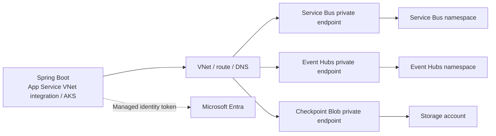

### AMQP TCP và AMQP over WebSockets

Azure messaging SDKs thường dùng **AMQP**. Kết nối có thể cần cổng AMQP TLS **5671** hoặc **AMQP over WebSockets** qua **443** tùy transport option được cấu hình và network policy. Với mạng chỉ cho outbound 443, phải chọn SDK-supported WebSockets transport và kiểm thử thật, không chỉ kiểm tra HTTPS 443 rồi kết luận AMQP TCP sẽ hoạt động.

Khi cấu hình client builder, chọn transport type theo class/enum mà đúng **Service Bus/Event Hubs SDK version** hỗ trợ (không copy enum/import của SDK này sang SDK khác một cách tùy tiện). Tính năng Private Link, firewall rules và IP filtering phụ thuộc tier; xác nhận trước khi chặn public access.

### Kiểm tra DNS và network

```bash
# Chạy từ chính container/VM/App Service console được phép.
nslookup sb-orders-lab.servicebus.windows.net
nslookup eh-telemetry-lab.servicebus.windows.net
nslookup stspringmsgcheckpoint01.blob.core.windows.net

# Khi có netcat:
nc -vz sb-orders-lab.servicebus.windows.net 5671
nc -vz eh-telemetry-lab.servicebus.windows.net 5671
nc -vz stspringmsgcheckpoint01.blob.core.windows.net 443
```

Nếu dùng AMQP over WebSockets, kiểm tra 443 cho messaging và cấu hình transport thực tế. **Kết nối TCP thành công chưa chứng minh RBAC đúng**, và `403` có thể phản ánh authorization hoặc network policies tùy dịch vụ. Hãy xem SDK exception, service logs và request correlation trước khi sửa quyền.

### Trường hợp khó: Event Hubs nhận được nhưng checkpoint fail

Nếu Java app nhận được event nhưng `context.updateCheckpoint()` lỗi:

1. Event Hubs Data Receiver có thể đã đúng.
2. Blob container có thể chưa tồn tại hoặc namespace/account URL sai.
3. Managed identity có thể **thiếu Storage Blob Data Contributor**.
4. Blob private endpoint/DNS có thể không cho app kết nối.
5. Quota/throttling Blob hoặc lỗi version/conflict trong checkpoint store có thể xảy ra.

Không chỉ cấp thêm Event Hubs role vì lỗi đang ở **Blob data plane**.

## 25. Retry, backoff, circuit breaker và message redelivery

**Messaging retry có ít nhất ba tầng** và mỗi tầng có hậu quả khác nhau:

1. **SDK transport retry**: xử lý lỗi kết nối/Service Busy khi gửi/nhận request.
2. **Application dependency retry**: worker gọi database, REST downstream hoặc storage thất bại.
3. **Broker redelivery/replay**: Service Bus giao lại message chưa complete; Event Hubs processor đọc lại từ checkpoint.

Nếu cả ba tầng cùng retry không giới hạn, một sự cố database nhỏ có thể biến thành **retry storm**, tăng độ trễ, throughput/cost và làm ngập DLQ hoặc checkpoint logs.

### Bảng quyết định lỗi

| Nguyên nhân | Service Bus consumer | Event Hubs consumer |
|---|---|---|
| Timeout SQL ngắn, chưa commit | Bounded retry; sau đó abandon để redeliver | Retry bounded; chưa checkpoint, cần quyết định pause/quarantine |
| JSON/schema invalid vĩnh viễn | Dead-letter có reason và alert | Ghi quarantine bền vững rồi mới checkpoint theo policy |
| Thiếu RBAC `403` | Alert và sửa cấu hình; không abandon vô hạn | Dừng/restrict consumer, tránh đọc thêm khi không ghi được sink |
| Đã commit nhưng settlement/checkpoint fail | Redelivery, idempotent no-op rồi complete | Replay, dedup store nhận diện và checkpoint |
| Downstream bị quá tải | Giảm maxConcurrentCalls / backoff | Giảm processing concurrency, không checkpoint dữ liệu chưa ghi |
| Sự kiện business đến sai thứ tự | Session/sequence/version rules | Partition key/sequence validation và xử lý late events |

### Bounded exponential backoff

Ví dụ tính khoảng chờ cho retry nội bộ:

\[
\text{delay}_n \approx \min(\text{maxDelay},\ \text{baseDelay}\times 2^n)+\text{jitter}.
\]

Không nên có vòng lặp retry vô hạn bên trong callback giữ message lock, vì lock có thể hết hạn trong lúc ngủ. Với Service Bus, có thể dùng scheduled retry message / broker redelivery dựa trên kiến trúc, **nhưng không tạo một vòng gửi lại mới không idempotent**. Với Event Hubs, một event lỗi cần poison-event policy để tránh cả partition bị kẹt không giới hạn.

### Circuit breaker

Nếu hệ thống thanh toán downstream trả `503` liên tục, circuit breaker có thể tạm dừng các calls để không tự làm dịch vụ nặng hơn. Tuy nhiên:

- Chưa thể `complete()` message khi chưa thực hiện side effect bắt buộc.
- Không được `updateCheckpoint()` cho event chưa được xử lý hoặc quarantine theo chính sách.
- Phải lưu/quan sát backlog và alert.
- Khi circuit mở, cấu hình concurrency/receive rate cần tránh tích lũy in-memory vô hạn.

### Spring Retry

Có thể dùng **Spring Retry** cho những thao tác ngắn idempotent, nhưng phải xem rõ tương tác với SDK retry và broker settlement. `@Retryable` quanh một method không biến các database writes và queue complete thành một transaction phân tán.

## 26. Idempotency: bảo đảm tính đúng dù bị giao lại

**At-least-once** đồng nghĩa một logical message/event có thể được xử lý nhiều lần. Cách phổ biến là **deduplication ở database/sink**.

### Bảng processed messages

Giả sử Azure SQL có:

```sql
CREATE TABLE dbo.ProcessedMessages (
    ConsumerName nvarchar(100) NOT NULL,
    MessageId nvarchar(200) NOT NULL,
    ProcessedAtUtc datetime2(3) NOT NULL,
    CONSTRAINT PK_ProcessedMessages
        PRIMARY KEY (ConsumerName, MessageId)
);
```

Trong **cùng một SQL transaction**:

1. Thử insert `(consumerName, messageId)`.
2. Nếu duplicate key, xác định đã xử lý rồi và bỏ qua side effect.
3. Nếu chưa có, thực hiện cập nhật business state.
4. Commit transaction.
5. Sau commit, complete Service Bus message hoặc checkpoint Event Hubs event.

**Không chỉ kiểm tra SELECT rồi INSERT ở hai transactions khác nhau**, vì hai workers có thể race. Dùng unique constraint/atomic insert và xử lý duplicate key theo database semantics; việc ghi record đã xử lý cùng business state trong một transaction phù hợp giúp đảm bảo “xử lý effect một lần”.

### Message ID khác event position

| Metadata | Nên dùng cho |
|---|---|
| **Service Bus MessageId** | Dedup cho cùng command theo sender contract |
| **Business operation ID** | Idempotency thanh toán, hoàn tiền, đặt hàng |
| **Event Hubs eventId** | Dedup cùng logical event kể cả khi producer gửi lại |
| **partitionId + sequenceNumber** | Quan sát vị trí đọc, monitoring và replay |
| **CorrelationId / traceparent** | Distributed tracing giữa HTTP và consumers |

Nếu producer retry và gửi cùng logical event vào Event Hubs lần hai, broker có thể tạo **sequence number mới**. Vì vậy không lấy sequence number làm idempotency key cho business operation; dùng eventId do producer cung cấp và ổn định qua retry.

### “Exactly once” có nghĩa gì?

Có thể đạt **exactly-once business effect trong một ranh giới sink cụ thể** nhờ idempotent transaction/unique constraint. Nhưng không nên quảng cáo toàn pipeline “exactly once” khi gồm:

- HTTP input;
- Azure SQL Order write;
- Service Bus send;
- Worker write;
- Event Hubs checkpoint;
- Email gửi bên ngoài.

Mỗi biên giao dịch cần thiết kế outbox, inbox/dedup, saga/compensation hoặc reconciliation tương ứng. **Không có một nút bật trong Spring Boot** biến toàn chuỗi thành distributed ACID.

### Phòng vệ với schema và poison data

Phân biệt **retryable transient** với **permanent validation errors**. Nếu mọi payload invalid đều được retry vô hạn, Service Bus DLQ/queue hoặc một Event Hubs partition sẽ bị quá tải không cần thiết. Ghi lỗi/quarantine có source ID, schemaVersion và reason, nhưng tránh log toàn bộ PII.

## 27. Schema evolution và event contracts

Một ứng dụng Spring hôm nay gửi:

```json
{
  "eventId": "evt-001",
  "eventType": "OrderCreated",
  "schemaVersion": 1,
  "orderId": "order-1001",
  "amount": 150000,
  "currency": "VND",
  "occurredAtUtc": "2026-11-20T10:00:00Z"
}
```

Sau ba tháng, producer bổ sung `promotionCode` và đổi tên `amount` thành `amountMinorUnits`. Một consumer cũ có thể parse lỗi hoặc tính sai doanh thu.

### Quy tắc hợp đồng

1. Mỗi message/event có **eventType** và **schemaVersion**.
2. Event ID ổn định và business key rõ ràng.
3. Timestamps theo UTC ISO 8601; business date/timezone tách riêng.
4. Không tái sử dụng cùng tên event cho ý nghĩa mới không tương thích.
5. Thêm optional fields nếu tương thích; breaking changes cần version mới và migration.
6. Chỉ gửi dữ liệu cần thiết, không nhồi toàn bộ Order aggregate chứa PII.
7. Định nghĩa size limit theo dịch vụ/tier, không gửi file PDF lớn trực tiếp như message.
8. Consumer phải có chính sách xử lý unknown eventType/schemaVersion.

### Event payload vs event pointer

Với tài liệu lớn, lưu nội dung vào Blob Storage và gửi message chỉ chứa:

```json
{
  "eventId": "evt-doc-1001",
  "eventType": "DocumentUploaded",
  "schemaVersion": 1,
  "tenantId": "tenant-42",
  "blobPath": "incoming/2026-11-20/batch-1001.pdf",
  "contentHash": "sha256:...",
  "occurredAtUtc": "2026-11-20T10:00:00Z"
}
```

Consumer sau đó dùng **managed identity + Storage Blob Data Reader** để tải file theo đường dẫn được ủy quyền. Không gửi **long-lived SAS URLs** trong message; hạn chế để dữ liệu bí mật rò vào logs, DLQ hoặc downstream caches.

### Schema registry và contract testing

Khi có nhiều teams, dùng JSON Schema, Avro, Protobuf hoặc schema registry phù hợp nếu được hỗ trợ. Nhưng registry không tự ép mọi Spring consumer kiểm tra schema: cần validation trong producer/consumer, compatibility tests trong CI, và quy trình publish/rollback.

### Ordering và version

Nếu Event Hubs partition key là `customerId`, vẫn có thể có hai producers gửi events ngược thứ tự nghiệp vụ. Đặt `entityVersion` hoặc sequence từ nguồn để consumer biết `OrderUpdated(version=3)` không được ghi đè `OrderUpdated(version=4)` đã xử lý trước.

## 28. Scale và backpressure

Tăng số Spring instances không luôn làm throughput tăng tuyến tính. Phải xem **đặc điểm broker, consumer pattern, entity partitions và bottleneck downstream**.

### Service Bus scale

- Tăng số **competing receivers** thường tăng parallelism khi queue có backlog.
- `maxConcurrentCalls` của processor điều khiển concurrent message callbacks.
- **Sessions** giới hạn cách messages cùng session được xử lý song song; một hot session có thể là bottleneck.
- Lock renewal/prefetch/settlement tạo overhead; không tăng prefetch vô hạn.
- Nếu database chỉ chịu được 200 writes/giây, 2.000 concurrent callbacks có thể làm tình hình tệ hơn.

### Event Hubs scale

- Số **partitions** giới hạn lượng parallelism hữu ích của consumer group.
- Producer batching và partition key ảnh hưởng partition skew.
- EventProcessorClient phối hợp ownership; scale instances có thể gây rebalance, replay và churn.
- Checkpoint quá thường xuyên tăng Blob operations; quá thưa tăng replay workload.
- Event Hubs throughput capacity và service quotas phụ thuộc tier/configuration.

### Ví dụ suy luận

```text
Event Hub: 4 partitions
Consumer group analytics-app:
  2 processors  -> mỗi processor có thể nhận ~2 partitions
  4 processors  -> mỗi processor có thể nhận ~1 partition
  10 processors -> không phải cả 10 đều có partition để xử lý
```

Đây là ví dụ phân phối **đơn giản, không phải cam kết assignment luôn cân bằng tuyệt đối**. Ownership có thể thay đổi theo load balancing, health và network.

### Backpressure trong Spring

Nếu consumer nhận events nhanh hơn database có thể ghi:

1. Giới hạn concurrency, prefetch và kích thước batch hợp lý.
2. Dùng **bounded queue/buffer**, không giữ vô hạn `List<EventData>` trong heap.
3. Đo downstream latency, retry rate và memory pressure.
4. Tách blocking DB calls khỏi non-blocking event loop nếu dùng Reactor/Async SDK; không gọi `Thread.sleep` hoặc blocking JDBC trên event loop.
5. Chỉ checkpoint sau durable write; nếu buffer chưa flush thì chưa được đánh dấu thành công.
6. Cân nhắc scale database/compute/tier hoặc chuyển dữ liệu về queue/data lake phù hợp khi workload bùng nổ.

### Spring MVC và WebFlux

Azure SDK cung cấp **sync clients** và **async/Reactor clients**. Trong Spring MVC, sync client có thể đủ đơn giản; trong Spring WebFlux, nên cân nhắc async clients vì blocking call trong reactive event-loop làm giảm khả năng chịu tải. Không biến sync code thành reactive chỉ bằng cách trả `Mono.just(sender.sendMessage(...))`; lời gọi sync đã được thực hiện trước khi publisher được subscribe.

## 29. Observability, tracing và alerts

Một hệ thống messaging cần theo dõi **API → broker → consumer → database**, không chỉ HTTP 200 ở producer.

### Metrics nên có

| Lớp | Metrics | Câu hỏi |
|---|---|---|
| Spring API | Request rate, p95, accepted commands, failed sends | Lệnh có được broker chấp nhận không? |
| Service Bus | Active messages, dead-letter count, incoming/outgoing, server errors, throttling | Worker có tụt backlog hoặc poison messages? |
| Service Bus consumer | Receive-to-complete latency, deliveryCount distribution, abandon, lock lost | Xử lý có ổn định không? |
| Event Hubs | Incoming/outgoing events/bytes, throttled requests, capacity usage | Stream có chạm giới hạn throughput? |
| Event Hubs processor | Lag theo partition, last checkpoint age, rebalance count | Consumer có theo kịp nguồn không? |
| Blob checkpoint | Write failures, latency, permission errors, operations | Checkpoint store có đang hỏng? |
| Database/sink | Commit latency, duplicate hits, conflicts, errors | Business effect có được lưu không? |
| End-to-end | Event time → business effect latency, DLQ age, lost/duplicate reconciliation | SLA nghiệp vụ có đạt không? |

**Một số metrics chỉ có ở mức ứng dụng**: broker không tự biết `orderId` nào xử lý trùng hay lag từ event timestamp của producer tới doanh thu silver table. Cần thêm application metrics/custom traces.

### Trace context

Một message/event nên mang **correlation ID**, `traceparent` theo OpenTelemetry/W3C khi phù hợp, eventId và schemaVersion. Tránh dùng order/customer ID nhạy cảm trong metric labels có cardinality rất cao; có thể log hashed IDs trong môi trường restricted.

```text
HTTP POST /orders
  traceId = abc123
    -> Service Bus send (commandId=process-order:1001)
       -> Service Bus receive
          -> SQL commit
          -> complete

Web click event
  eventId = evt-xyz
    -> Event Hubs enqueue (partitionId, sequence)
       -> consumer process + sink commit
       -> Blob checkpoint update
```

### Azure Monitor và Application Insights

Xem metrics/diagnostic settings trên **đúng Service Bus/Event Hubs namespace** và Storage checkpoint resource. Azure Monitor Metrics có thể được truy cập bằng portal/CLI. Dùng Application Insights hoặc OpenTelemetry exporter phù hợp để thu service dependency spans, logs và custom business metrics.

```bash
SB_ID=$(az servicebus namespace show \
  --resource-group "rg-spring-msg-lab" \
  --name "sb-orders-lab" --query id --output tsv)

EH_ID=$(az eventhubs namespace show \
  --resource-group "rg-spring-msg-lab" \
  --name "eh-telemetry-lab" --query id --output tsv)

az monitor metrics list-definitions \
  --resource "$SB_ID" \
  --output table

az monitor metrics list-definitions \
  --resource "$EH_ID" \
  --output table
```

Đây là lệnh **đọc metric definitions**, không phải cấu hình alert. Tên metrics/dimensions thay đổi theo tài nguyên/tier. Cần xem danh sách được trả về để chọn các ngưỡng phù hợp; đừng hard-code một metric chỉ có ở Event Hubs vào Service Bus dashboard.

### Structured logs an toàn

Ví dụ một log có cấu trúc:

```text
operation=servicebus.complete
messageId=process-order:1001
deliveryCount=2
durationMs=43
result=success
traceId=...
```

Log nên chứa identifiers/operation/status đã được phép, **không chứa SAS key, raw JWT, payment payload, email, địa chỉ giao hàng hay toàn bộ PII**. Với Event Hubs, có thể log partitionId/sequenceNumber và checkpoint age để điều tra replay; không in toàn bộ `EventData.getBodyAsString()` trong production.

## 30. Bảo mật dữ liệu trong messaging pipeline

Managed identity giúp không phải lưu Service Bus/Event Hubs **Shared Access Keys**, nhưng broker vẫn cần bảo vệ payload, quyền gửi/nhận, đường mạng và lưu trữ downstream.

### Danh sách rủi ro

| Rủi ro | Ví dụ | Kiểm soát |
|---|---|---|
| Identity bị cấp quyền quá rộng | API public có Data Owner toàn namespace | Role Data Sender tại scope cần thiết |
| Lộ secret/SAS trong code | Connection string commit lên Git | Managed identity/Workload ID, Key Vault cho secret bất khả kháng |
| Cross-tenant message | Tenant A gửi `tenantId=B` rồi worker tin luôn | Xác thực tenant ở producer, kiểm tra authorization và owner ở consumer |
| PII trong DLQ/log | Message chứa email/số thẻ | Giảm payload, redact, hạn chế quyền DLQ, retention |
| Malicious payload | JSON quá lớn/deep hoặc deserialization unsafe | Schema validation, size limits, không polymorphic deserialization không tin cậy |
| Replay attack | Re-send command chuyển tiền cũ | Idempotency keys, business state machine, expiry/nonce theo domain |
| Event poisoning | Vô hạn retries một event sai | Bounded retry, quarantine và audit |
| Private endpoint cấu hình sai | App dùng public path ngoài policy | DNS/egress validation từ workload thật |
| Checkpoint tampering | Identity không cần thiết sửa Blob checkpoint | Container scope RBAC và tách groups/apps |

### TLS và network

Đường AMQP over TLS/WebSockets phải dùng **hostname và chứng chỉ hợp lệ**. Không tắt TLS verification để sửa lỗi DNS/private endpoint. Nếu lỗi certificate validation, kiểm tra hostname chuẩn, DNS resolver, proxy và trust store của JVM.

### Data minimization

Chỉ gửi các business fields cần cho consumer. Với payload > broker size limits hoặc chứa file lớn, lưu Blob có quyền và gửi **reference** kèm checksum/eventId/schemaVersion. Consumer lấy file bằng identity được cấp, không phát URL SAS thời hạn dài cho tất cả subscribers.

### Ủy quyền ở cấp ứng dụng

Azure RBAC cho identity quyền **gửi vào queue** không tự xác nhận nội dung `tenantId` trong payload là đúng. Spring backend phải xác thực người gọi, ràng buộc order/tenant trong database, quyết định command type được phép và đánh dấu thông tin đã xác thực. Consumer không nên tin tự do mọi field trong message ngay cả khi chỉ một namespace nội bộ có quyền gửi.

### Dữ liệu nhạy cảm trong Event Hubs

Một event có thể được nhiều consumer groups đọc lại trong retention. Vì vậy gửi PII vào Event Hubs đồng nghĩa **tăng phạm vi phân phối và khả năng lưu giữ tạm thời**. Cân nhắc pseudonymization/field minimization, governance cho từng consumer group và quy trình xóa dữ liệu downstream theo quy định.

## 31. Chi phí và capacity planning

Service Bus và Event Hubs có mô hình capacity/tier khác nhau. **Không so sánh chỉ bằng số messages/ngày**; cần tính kích thước message, retention, số consumer groups, publish/receive operations, duplicate/retry và yêu cầu SLA.

### Các thành phần chính

| Thành phần | Service Bus | Event Hubs |
|---|---|---|
| Capacity | Tier, messaging units hoặc operations theo offering | Throughput/processing units và capacity theo tier |
| Ingress | Số messages và payload size, batching | Events/bytes ingress, producer batching |
| Egress | Consumers, topic subscriptions, redelivery | Mỗi consumer group đọc stream, egress/processing |
| Retention | TTL/queue/topic state và DLQ | Retention duration và capture/export |
| Reliability | Scheduled retry, DLQ, sessions, duplicate detection | Checkpoint/replay, durable sink, retention |
| Auxiliary services | SQL/outbox, diagnostics | Blob checkpoints, Data Lake Capture, analytics compute |
| Security/network | Private Endpoints, DNS, monitoring | Private Endpoints, Blob checkpoint, monitoring |

### Minh họa: một event được đọc bởi ba consumer groups

Giả sử frontend tạo **1 triệu clickstream events/ngày**, có ba groups `analytics`, `fraud` và `recommendations`. Ingress vẫn là 1 triệu events, nhưng **tổng số lần đọc/egress** và tải xử lý có thể lớn hơn vì mỗi group tiêu thụ độc lập. Nếu tất cả groups đều viết vào data lake, có thể phát sinh nhiều bản sao nếu không có chiến lược dữ liệu rõ ràng.

Với Service Bus topic có ba subscriptions, mỗi message phát tới topic có thể tạo ba logical deliveries. Điều này ảnh hưởng throughput/backlog, không giống việc ba workers cạnh tranh nhận **cùng một queue**.

### Checkpoint tốn bao nhiêu thao tác?

Giả sử processor nhận `1000 events/giây`:

- **Checkpoint mỗi event:** có thể tạo số lượng cập nhật checkpoint gần tương ứng mỗi giây tùy SDK/thiết kế.
- **Checkpoint mỗi 500 events:** số lần ghi checkpoint giảm đáng kể, nhưng có thể replay đến vài trăm events khi crash.

Không kết luận giảm 500 lần **chi phí thực tế** nếu còn ownership polling, other operations và retries; dùng Azure Storage metrics/Cost Management để đo workload thật. Chọn checkpoint frequency từ trade-off **replay cost ↔ Blob transactions ↔ RPO của sink**.

### Throttling và capacity

Khi nhận `ServiceBusy` hoặc throttling:

1. Xác định namespace tier, throughput/capacity hiện tại và metrics.
2. Kiểm tra producer batch size/message size, retry rate, consumer concurrency.
3. Xem storage checkpoint và database downstream có bão hòa không.
4. Tránh scale consumers vượt partition count/Event Hubs limits.
5. Lập kế hoạch tier/throughput adjustment nếu đã tối ưu ứng dụng.

Không hứa một giới hạn throughput cụ thể cho mọi subscription/region/tier; kiểm tra quotas và benchmark với payload/transport/consumer count thực tế.

### Ước lượng tổng chi phí kiến trúc

\[
\text{Tổng chi phí}
= \text{Broker capacity/operations}
+ \text{Network}
+ \text{Checkpoint storage}
+ \text{Downstream compute/storage}
+ \text{Monitoring}
\]

Đây là **cấu trúc chi phí**, không phải bảng giá. Dùng Azure Pricing Calculator/Cost Management tại region/tier thực, ghi nhận cả phí private networking và logs. Một hệ thống có ít events nhưng mỗi event gây hàng chục database calls có thể tốn nhiều ở **consumer compute/database** hơn broker.

## 32. Case study: hệ thống đặt hàng và clickstream chạy song song

### Bối cảnh

Một công ty thương mại điện tử dùng ba ứng dụng Spring Boot:

1. **Order API:** nhận đơn hàng HTTP, ghi Azure SQL và gửi command xử lý đơn.
2. **Order Worker:** nhận command từ Service Bus, kiểm tra tồn kho/thanh toán, cập nhật trạng thái.
3. **Analytics Stream Processor:** đọc clickstream từ Event Hubs và ghi dữ liệu chuẩn hóa vào ADLS Gen2 hoặc một analytics sink.

Nhu cầu tăng: thứ Sáu cao điểm có thể gấp 10 lần traffic thường ngày. Mỗi hệ thống phải scale độc lập và không làm duplicate orders, đồng thời dữ liệu clickstream có thể được nhiều nhóm đọc lại.

### Kiến trúc

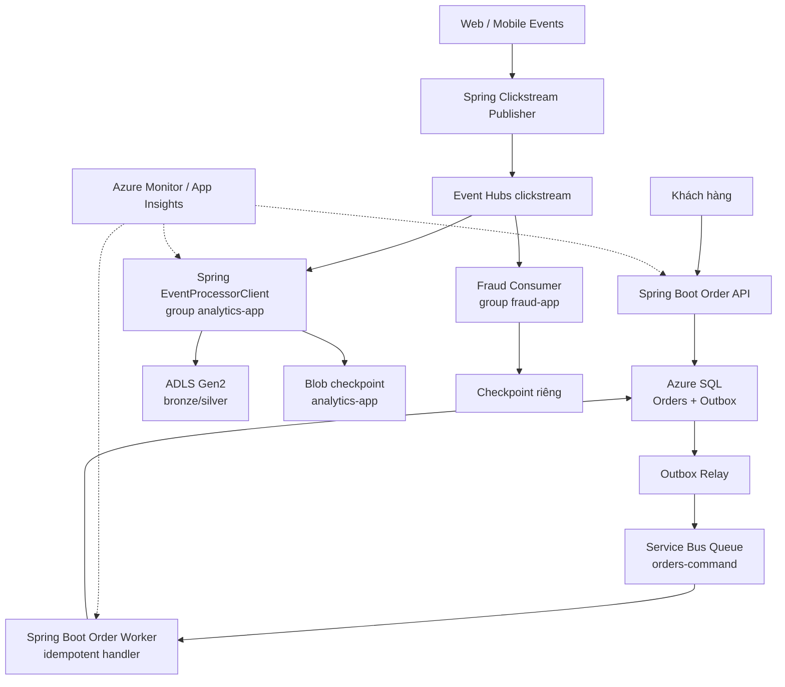

### Flow A — xử lý đơn hàng

1. Khách gửi `POST /orders` có idempotency request key; API xác thực user/tenant.
2. Trong **một transaction Azure SQL**, API lưu Order và outbox record có command ID ổn định.
3. Outbox relay đọc record chưa publish, gửi Service Bus message `ProcessOrder` kèm `MessageId`.
4. Worker nhận Peek-Lock, validate schema và tenant, kiểm tra processed-message ID trong database.
5. Worker thực hiện domain operation; ghi trạng thái và idempotency record cùng DB transaction.
6. Worker **complete** sau khi commit; nếu complete fail, message được giao lại nhưng side effect không lặp.
7. Payload invalid được dead-letter có reason; operational team có thể replay sau khi khắc phục.
8. API/status endpoint đọc Order state từ database, **không suy ra hoàn tất chỉ từ send success**.

### Flow B — clickstream và phân tích

1. Frontend phát `ProductViewed` có eventId và timestamp.
2. Spring publisher gửi Event Hubs với partition key theo user/customer khi cần ordering.
3. Analytics consumer group xử lý partitions, validate schema và ghi micro-batches bền vững vào data lake.
4. Sau commit/manifest của sink, processor cập nhật Blob checkpoint.
5. Khi app crash trước checkpoint, consumer đọc lại; sink nhận diện eventId trùng.
6. Fraud consumer group độc lập đọc cùng event stream và ghi kết quả riêng.
7. Data lake lưu lịch sử dài hạn hơn Event Hubs retention, phục vụ replay/ML.

### Flow C — khi dữ liệu đến muộn hoặc out-of-order

Nếu sự kiện checkout timestamp 10:03 tới consumer trước event `add_to_cart` lúc 10:02 do đường mạng khác nhau, ứng dụng không nên sắp xếp toàn bộ theo **thời gian nhận** rồi kết luận người dùng checkout trước khi thêm hàng.

- Dùng `occurredAtUtc` từ nguồn, `enqueuedTime` của broker và event ID/sequence rõ.
- Nếu cùng partition key và producer ordering được kiểm soát, thứ tự trong partition có thể giúp xử lý; vẫn phải xét nhiều producers, retry và clock skew.
- Watermark/late data policy ở analytics engine giúp xử lý sự kiện đến muộn.
- Không làm mất business events chỉ vì nằm ngoài một window nhỏ mà chưa có chính sách.

### Tách quyền

| Workload | Quyền |
|---|---|
| Order API / Relay | Service Bus Data Sender, SQL quyền phù hợp |
| Order Worker | Service Bus Data Receiver, SQL quyền nghiệp vụ |
| Clickstream Publisher | Event Hubs Data Sender |
| Analytics Consumer | Event Hubs Data Receiver, Blob checkpoint contributor, Data Lake writer |
| Fraud Consumer | Event Hubs Data Receiver, checkpoint store và sink riêng |
| SRE | Monitoring/diagnostics; quyền DLQ/replay theo phê duyệt |

**Không dùng một user-assigned identity chung có quyền trên mọi namespace, database và data lake** nếu các ứng dụng có trust boundary khác nhau. Việc tách identity giúp giảm blast radius và dễ audit.

### SLA/SLO minh họa

| SLO | Cách đo | Phản ứng |
|---|---|---|
| 99,9% commands được nhận bởi broker | Producer success/errors và outbox backlog | Alert gửi thất bại, retry có giới hạn |
| 95% Order commands xử lý trong 30 giây | Accepted-to-committed duration | Scale worker, kiểm tra downstream |
| DLQ không tăng liên tục | DLQ count/age | Điều tra poison messages |
| Clickstream lag dưới 2 phút | Event enqueued time → sink commit, checkpoint age | Kiểm tra partitions/processing capacity |
| Không xuất hiện double charge | Business idempotency/invariant tests | Block release khi có regression |

Các ngưỡng **chỉ là ví dụ**, cần xác nhận theo yêu cầu nghiệp vụ và workload thực. Không biến 99,9% message receive thành cam kết thanh toán không sai nếu thiếu database reconciliation.

### Một sự cố thật dễ gặp

Worker thanh toán commit DB thành công, nhưng container restart trước `complete()`. Broker redeliver command cho một instance khác. Nếu worker chỉ “nhận message rồi gọi cổng thanh toán” mà không có idempotency, khách có thể bị thanh toán hai lần.

Phương án đúng: mỗi payment operation có **business idempotency key**, cổng thanh toán được gọi bằng key nếu hỗ trợ, database lưu trạng thái tiến độ và callback reconciliation; worker khi nhận lại kiểm tra trạng thái và không thực hiện side effect trùng. Azure Service Bus delivery semantics không thể thay thế biện pháp này.

## 33. Runbook xử lý sự cố Service Bus và Event Hubs

### Bảng triệu chứng → nguyên nhân → hành động

| Triệu chứng | Nguyên nhân có thể | Kiểm tra và xử lý |
|---|---|---|
| Service Bus send trả `401` | Token sai audience/tenant, authentication mode | Kiểm tra SDK credential, namespace hostname và token acquisition |
| Service Bus send trả `403` | Thiếu **Data Sender** hoặc network policy từ chối | Kiểm tra identity principal, role scope, firewall/private networking |
| Event Hubs producer trả `403` | Thiếu Event Hubs Data Sender, role gán nhầm namespace | So exact namespace, principal và Azure RBAC |
| Event processor nhận được events nhưng không checkpoint | Blob role thiếu, container không tồn tại, storage network lỗi | Kiểm tra Blob Data Contributor, endpoint và private DNS |
| Queue backlog tăng | Consumers down, thiếu throughput, downstream chậm | Consumer health, processing p95, maxConcurrentCalls, DB |
| Queue active count giảm nhưng DLQ tăng | Handler lỗi schema, max delivery, lock lost | DLQ reason, deliveryCount, error metrics |
| Cùng command bị xử lý nhiều lần | Lock expiry, complete failure hoặc producer retry | Business idempotency record, MessageId, lock renewal |
| `MessageLockLost` thường xuyên | Handler quá lâu, prefetch/renewal thiếu, clock/deadline | Tối ưu handler, auto-renew, timeout, concurrency |
| DLQ replay gây duplicate payment | Replay ID thay đổi, thiếu dedup ở consumer | Giữ operationId, check processed-message table |
| Event Hubs lag tăng một partition | Partition key skew hoặc handler chậm | Per-partition lag, partition ownership, hot key |
| Nhiều EventProcessor instances không nhận events | Partitions ít hơn instances hoặc ownership đang rebalance | Number of partitions/group, checkpoint store |
| Hai apps độc lập không cùng thấy mọi events | Dùng chung consumer group và ownership | Tách consumer groups theo workload |
| Event Hubs events trùng sau restart | Checkpoint chưa lưu hoặc commit rồi crash | Idempotency/durable sink, checkpoint strategy |
| Dữ liệu sink thiếu sau restart | Checkpoint quá sớm trước durable write | Chuyển checkpoint sau commit, backfill khi còn retention |
| Event Hubs consumer đứng ở poison event | Không có error/quarantine strategy | Bounded retry, quarantine bền vững, quyết định advance |
| Java `DefaultAzureCredential` unavailable | Managed identity chưa bật hoặc local chưa login | Kiểm tra host/Workload ID, `az login` cho local |
| DNS trả public IP khi private-only | Thiếu `privatelink.servicebus.windows.net`/Blob zone link | Chẩn đoán DNS từ runtime |
| TCP 443 thành công nhưng AMQP lỗi | Client dùng AMQP TCP 5671, proxy/transport mismatch | Xác minh transport option và egress |
| Không thấy dữ liệu event cũ | Retention hết hạn hoặc checkpoint reset sai | Kiểm tra retention/offset, lấy bản Capture/data lake nếu có |
| Consumer chạy hai lần sau deploy | SDK processor và Spring Cloud Stream binder cùng active | Xem bean lifecycle và bindings |
| Batch gửi Event Hubs lỗi do event lớn | `tryAdd` trả false, payload vượt size | Giảm payload hoặc Blob pointer pattern |
| Cost tăng bất thường | Retry storm, DLQ, quá nhiều checkpoints, consumer groups | Đo broker operations, Blob transactions và downstream |
| App vô tình đọc queue production trong staging | Config profiles/namespace sai | Kiểm tra endpoint, deployment config và identity scope |

### Runbook A — Service Bus backlog tăng

1. Xác nhận namespace/queue/subscription đúng và thời điểm incident UTC.
2. Xem active count, DLQ count, incoming/outgoing rate và throttled/failed requests.
3. Kiểm tra Spring instances healthy, processor đã `start()` chưa, logs của `processError`.
4. So receiver role, private connectivity và TLS/AMQP transport.
5. Xem handler latency/DB pool saturation và số `abandon`/lock lost.
6. Nếu bottleneck ở downstream, **giảm retry/concurrency**; không scale hàng trăm workers vào database đang bão hòa.
7. Chỉ tăng capacity/tier hoặc số worker sau khi xác định nguyên nhân.
8. Sau phục hồi, đo time-to-drain backlog, số duplicate và sai lệch business state.

### Runbook B — Event Hubs lag tăng

1. Xác định consumer group và partitions có lag.
2. Kiểm tra processor ownership, số instances, checkpoint container và các Blob failures.
3. Xem `enqueuedTime` gần nhất vs `last sink committed`/checkpoint.
4. Kiểm tra event partition key skew hoặc một handler bị chậm.
5. Xác minh sink data lake/DB đang có lỗi, throttling hay payload invalid.
6. Đánh giá retention headroom: consumer có thể bị mất history nếu lag vượt retention.
7. Điều chỉnh concurrency/batching và processing capacity, không checkpoint bỏ qua events chưa xử lý.
8. Nếu đã mất history, báo rõ data gap và replay từ nguồn lưu dài hạn khi có.

### Runbook C — Role assignment vừa đổi làm Spring `403`

1. Xem principal ID thực của App Service/Container App/AKS Workload ID.
2. Kiểm tra role **Data Sender/Receiver** của đúng dịch vụ và scope, không nhầm Service Bus role với Event Hubs role.
3. Nếu lỗi checkpoint, kiểm tra Blob Data Contributor riêng.
4. Kiểm tra token cache/role propagation và hostname/namespace.
5. Nếu private-only, kiểm tra DNS, route và approved private endpoint.
6. Áp thay đổi quyền tối thiểu theo change plan và audit.
7. Không dùng account-level Shared Key làm workaround vô hạn.

## 34. Lab tích hợp end-to-end trên Spring Boot

**Mục tiêu:** Chạy một ứng dụng Spring lab gửi Service Bus command, nhận và settle command, gửi Event Hubs event, nhận event và checkpoint qua Blob Storage. Dùng **dữ liệu giả**, không dùng thông tin khách hàng/thanh toán thật.

### 34.1. Chuẩn bị tài nguyên

Chỉ thực hiện khi được cấp quyền với namespace/container riêng:

1. Tạo hoặc xác minh **Service Bus queue** `orders-command`.
2. Tạo hoặc xác minh **Event Hub** `clickstream` và consumer group `analytics-app`.
3. Tạo Blob container `eh-checkpoints`; account được phép truy cập từ Spring runtime.
4. Xác định identities của producer, Service Bus consumer và Event Hubs consumer.
5. Gán data-plane RBAC tối thiểu; với một app lab làm cả ba flow có thể dùng một identity tạm, production nên tách.
6. Kiểm tra network access và đúng fully qualified namespaces.
7. Dùng JDK/Spring Boot/Azure SDK versions được nhóm kỹ thuật phê duyệt.

### 34.2. Khởi động Spring

1. Tạo Spring Boot project với `spring-boot-starter-web`, `actuator` và Azure SDK dependencies của mục 8.
2. Đặt cấu hình `app.*` từ mục 9, không thêm connection strings.
3. Khởi tạo beans theo `AzureMessagingConfiguration`, Service Bus processor và EventProcessorClient.
4. Đảm bảo người chạy local dùng `az login`/developer credential đúng **lab**; nếu chạy Azure host, managed identity được gắn và đã cấp role.
5. Chỉ khi Blob checkpoint container tồn tại và identity có quyền ghi mới start EventProcessor.

### 34.3. Thử Service Bus

- Gửi một HTTP request vào lab endpoint `POST /lab/orders/ORD-001/process`.
- Xem producer log đã gửi `MessageId=process-order:ORD-001:v1`.
- Xem consumer nhận và ghi metadata; khi handler thực đã lưu bền vững, `complete()`.
- Tạm mô phỏng lỗi transient để xem `abandon`/redelivery; tránh tạo retry loop gây bão hòa namespace.
- Gửi một payload invalid có chủ đích trong lab để xem DLQ và cách xử lý.
- Kiểm tra không lặp side effect khi gửi lại cùng logical MessageId.

**Nếu handler hiện chỉ kiểm tra chuỗi không rỗng như ví dụ mục 13, không dùng trạng thái “complete thành công” để kết luận đã lưu Order.** Lab cần bổ sung một sink test (bảng database hoặc durable file) và idempotency record nếu muốn kiểm tra đúng bài toán.

### 34.4. Thử Event Hubs

- Gọi `ClickstreamPublisher.publishView("customer-42", "SKU-A", "tenant-lab")` từ một test/controller lab.
- Gửi một batch nhiều events bằng mã mục 17, kiểm tra `tryAdd`.
- Xem EventProcessor nhận partition ID/event payload, ghi vào durable test sink.
- Chỉ checkpoint sau khi durable write thành công; đọc lại metadata checkpoint trong Blob bằng identity có quyền.
- Restart một instance, xác nhận processor resume từ checkpoint và không ghi trùng business events.
- Thêm một processor instance cho cùng consumer group, xem rebalancing/partition ownership.
- Tạo consumer group khác và xác nhận nó đọc độc lập (trong thời hạn retention).

### 34.5. Fault injection có kiểm soát

| Fault | Điều kỳ vọng |
|---|---|
| Tắt consumer trong lab | Queue backlog/Event Hubs lag tăng, không xóa dữ liệu |
| SQL test sink tạm lỗi | Không complete/checkpoint dữ liệu chưa commit |
| Gửi cùng eventId hai lần | Idempotency không nhân đôi business state |
| Thu hẹp Blob checkpoint role trong lab | Event consumer có thể đọc nhưng checkpoint fail và alert |
| Đổi `AZURE_CLIENT_ID` sai | Credential failure, không fallback sang key/secret ngoài ý muốn |
| Mạng Service Bus bị chặn | Producer/consumer lỗi rõ, retry bounded và alert |
| Event Hub có event vượt retention | Không giả vờ có thể replay; xác minh nguồn archive |

Mọi fault injection chỉ diễn ra trên **lab resource cô lập**. Không xóa consumer group/checkpoint container đang được nhóm khác dùng, không gửi payment command thật và không thay firewall production.

### 34.6. Báo cáo kết quả

```text
Lab: spring-messaging-001
Spring Boot / Java / Azure SDK versions: <record>
Service Bus producer send: <PASS/FAIL>
Service Bus consumer complete after durable write: <PASS/FAIL>
Service Bus poison message -> DLQ: <PASS/FAIL>
Event Hubs producer batch: <PASS/FAIL>
EventProcessor checkpoint after sink commit: <PASS/FAIL>
Replay and business deduplication: <PASS/FAIL>
Identity/RBAC (no shared keys): <PASS/FAIL>
Private network/DNS: <PASS/FAIL/NOT_APPLICABLE>
Backlog, lag, p95 latency, retry, failures: <measurements>
Blockers/next actions: <details>
```

Đây là **mẫu báo cáo**, không phải kết quả thực hành đã chạy. Chỉ đánh dấu PASS sau khi có bằng chứng; thu dọn đúng tài nguyên do lab tạo sau khi đã ghi nhận metrics.

## 35. Câu hỏi tự kiểm tra

### Bài A. Command hay event?

Một ứng dụng muốn giao cho đúng một worker xử lý lệnh `RefundOrder`, retry khi SQL tạm thời lỗi và đưa lệnh sai schema vào DLQ. Nên chọn Service Bus hay Event Hubs?

*Gợi ý:* **Service Bus queue** thường phù hợp nhờ competing consumers, Peek-Lock, settlement và DLQ. Nhưng vẫn cần idempotency tại payment gateway/DB.

### Bài B. Analytics đọc lại 3 ngày

Hai nhóm analytics và fraud muốn đọc độc lập một luồng clickstream, có thể replay theo vị trí trong khoảng retention. Dịch vụ nào phù hợp?

*Gợi ý:* **Event Hubs** với consumer groups độc lập; phải cấu hình retention đủ nhu cầu, checkpoint và durable export cho lịch sử dài.

### Bài C. Gửi thành công có nghĩa xử lý xong?

Spring API gọi `sender.sendMessage()` thành công rồi trả `"paymentComplete"`. Có đúng không?

*Gợi ý:* Không. Chỉ biết broker accepted message. Worker có thể chưa bắt đầu. Trả trạng thái accepted/pending và theo dõi business state qua database/callback.

### Bài D. Crash giữa DB commit và complete

Worker đã commit `Order.status=PAID` nhưng restart trước `complete()`. Message được giao lại. Làm sao tránh thanh toán hai lần?

*Gợi ý:* Business idempotency key, transaction check/processed-messages table, gateway idempotency và complete lại khi biết đã xử lý.

### Bài E. Event Hubs checkpoint quá sớm

Processor nhận event seq=501, checkpoint rồi SQL write thất bại. Điều gì có thể xảy ra sau restart?

*Gợi ý:* Consumer có thể resume sau seq=501, làm mất business event tại sink. Phải commit bền vững trước khi checkpoint.

### Bài F. Event Hubs scale

Event hub có 4 partitions và cùng một consumer group chạy 16 processor instances. Có 16 partitions để mỗi instance nhận một phần không?

*Gợi ý:* Không. Parallelism hữu ích bị giới hạn bởi 4 partitions; thêm instances không tự tăng số partitions/ordering guarantees.

### Bài G. Cùng consumer group

Fraud và analytics là hai dịch vụ độc lập nhưng cùng dùng consumer group `analytics-app` và checkpoint store. Tại sao fraud chỉ thấy một phần events?

*Gợi ý:* Các processors trong cùng group chia partition ownership. Cần **consumer group riêng** cho fraud.

### Bài H. Service Bus role vs Event Hubs role

App có Azure Service Bus Data Receiver trên `sb-orders-lab` nhưng cố tiêu thụ `eh-telemetry-lab` và bị `403`. Role cũ có dùng được không?

*Gợi ý:* Không. Cần **Azure Event Hubs Data Receiver** trên đúng Event Hubs namespace/entity, và đúng principal.

### Bài I. Blob checkpoint store

EventProcessorClient đọc Event Hubs thành công nhưng lưu checkpoint gặp `403`. Nên cấp Event Hubs Data Owner hay sửa đâu?

*Gợi ý:* Kiểm tra **Storage Blob Data Contributor** trên checkpoint container, identity của processor và networking tới Blob.

### Bài J. Poison event

Một event JSON sai schema được callback nhận. Code catch exception rồi không checkpoint, nhưng processor tiếp tục đọc events mới. Hệ thống đã tự retry event lỗi ngay lập tức chưa?

*Gợi ý:* Chưa chắc. Cần policy rõ: pause/stop, retry bounded, durable quarantine rồi checkpoint, hoặc alert/manual intervention.

### Bài K. Spring Cloud Stream vs SDK

Đội dự án đã dùng Spring Cloud Stream binder tiêu thụ queue. Một kỹ sư tạo thêm ServiceBusProcessorClient trên cùng queue để “theo dõi”. Điều gì có thể xảy ra?

*Gợi ý:* Processor thứ hai trở thành competing consumer và có thể **lấy mất command** khỏi handler chính. Dùng metrics/diagnostics hoặc non-destructive APIs thay vì consumer thứ hai.

### Bài L. Ordering và partition key

Mọi sự kiện của cùng customer phải giữ thứ tự trong stream. Nên random partition key cho mỗi event để tối đa throughput không?

*Gợi ý:* Random key có thể đưa events cùng customer vào nhiều partitions, mất ordering theo customer. Dùng partition key ổn định và giải quyết hot-key trade-off bằng thiết kế có version.

### Bài M. Retry/cost

Broker nhận `50.000` commands, backend trả `503` kéo dài, mỗi worker retry nội bộ 10 lần rồi abandon, SDK cũng retry. Rủi ro gì?

*Gợi ý:* Retry amplification, giữ lock quá lâu, consumer saturation, duplicate, tăng chi phí và DLQ. Dùng bounded retry, backoff, circuit breaker và giảm concurrency.

### Bài N. Bảo mật tenant

Một producer được cấp Data Sender gửi payload có `tenantId` do HTTP client chọn. Worker có thể tin payload và chuyển tiền hộ tenant đó không?

*Gợi ý:* Không. Authorization tenant phải được kiểm tra bằng nguồn đáng tin; role của producer ở broker không tự xác thực business claims của payload.

### Bài O. Tự thiết kế hợp đồng

Hãy thiết kế message `ShipmentRequested` và event `ShipmentStatusChanged` sao cho có `schemaVersion`, idempotency key, correlationId, tenantId, occurredAtUtc và policies retry/replay. Nêu vì sao command vào Service Bus nhưng trạng thái lịch sử có thể vào Event Hubs hoặc Service Bus topic tùy yêu cầu.

*Gợi ý:* Bắt đầu từ business semantics, không từ tên dịch vụ. Lệnh shipment cần xử lý/settlement, log trạng thái nhiều người đọc thường có lợi từ streaming/retention hoặc topic/subscriptions có DLQ tùy nhu cầu.

## 36. Checklist đưa Spring messaging lên production

### Chọn kiến trúc

- [ ] Đã xác định **command/message** hay **event stream** theo từng workflow, không dùng một dịch vụ cho mọi mục đích.
- [ ] Service Bus queue hay topic/subscription có owner, naming convention và DLQ policy rõ.
- [ ] Event Hubs partition count, partition key, consumer groups và retention được lựa chọn theo access patterns.
- [ ] Có phân biệt kết quả broker accepted, consumer processed và business state committed.
- [ ] Có thiết kế nguồn dữ liệu bền vững lâu hơn Event Hubs retention khi cần replay.

### Java và Spring Boot

- [ ] Spring Boot/JDK/Azure SDK versions tương thích và đã kiểm thử trên staging.
- [ ] Đã chọn một hình thức integration chủ đạo: SDK-managed beans hoặc Spring Cloud Azure/binder, tránh double consumers.
- [ ] TokenCredential được tái sử dụng, không hard-code connection strings chứa SAS.
- [ ] Clients/processors có lifecycle start/close rõ ràng, shutdown/drain policy.
- [ ] Service Bus explicit settlement hay binder ack semantics được ghi tài liệu.
- [ ] EventProcessor checkpoint store đúng container, consumer group và data role.
- [ ] Processor handlers xử lý dữ liệu bền vững trước complete/checkpoint.
- [ ] Quản lý concurrency/prefetch/batch size phù hợp downstream.

### Delivery và reliability

- [ ] Outbox/inbox/dedup store hoặc phương pháp idempotency đã được triển khai cho business side effects.
- [ ] Message/event IDs ổn định qua retries, schemaVersion và correlation ID rõ ràng.
- [ ] Không tuyên bố exactly-once end-to-end khi chưa chứng minh các transaction boundaries.
- [ ] Lock duration/auto-renewal/delivery count và DLQ policy đã được test.
- [ ] Retry bounded, exponential backoff/jitter và circuit breaker cho transient failures.
- [ ] Có poison-event policy và durable quarantine trước checkpoint nếu cần.
- [ ] Replay/partition rebalance đã được test với sink idempotent.
- [ ] Các thay đổi schema có contract tests và backward compatibility.
- [ ] Topic subscription/session semantics đã được test theo workflow thực.

### Security và IAM

- [ ] Azure RBAC đúng data-plane roles: Service Bus Sender/Receiver, Event Hubs Sender/Receiver, Blob checkpoint Contributor.
- [ ] Role/scope/identity tách theo app và môi trường; không cấp Owner toàn subscription.
- [ ] App Service/Container Apps managed identity hoặc AKS Workload ID đã được xác minh.
- [ ] Private endpoints, DNS, AMQP TCP/WebSockets transport và routing được kiểm tra từ runtime thật.
- [ ] Logs/DLQ/event bodies không chứa secrets, raw payment details hoặc PII ngoài yêu cầu.
- [ ] Producer/consumer validate tenant, schema và quyền nghiệp vụ; không tin metadata tùy ý từ client.
- [ ] Có audit khi role, network, queue/topic hoặc consumer group settings thay đổi.

### Monitoring, performance và chi phí

- [ ] Có dashboard queue active count, DLQ count, lock lost, retries và processing latency.
- [ ] Có dashboard Event Hubs incoming/outgoing, per-partition lag, checkpoints và ownership rebalance.
- [ ] Có cảnh báo stale checkpoints, poison messages, 401/403 và throttling.
- [ ] Có trace IDs/correlation IDs từ HTTP → broker → consumer → sink.
- [ ] Đã benchmark concurrency, event batching, partition skew và consumer group count.
- [ ] Đã dự toán broker tier/capacity, Blob checkpoint operations, compute/network và logging.
- [ ] Có runbook drain/replay/DLQ và thử recovery từ dữ liệu bền vững.
- [ ] Có rollout/rollback plan không làm mất messages hoặc nhân đôi business operations.

## 37. Kết luận

**Tích hợp Service Bus và Event Hubs trong Spring Boot** bắt đầu từ việc hiểu **ngữ nghĩa nghiệp vụ và delivery**, không chỉ thêm dependency vào `pom.xml`. **Azure Service Bus** phù hợp với commands/workflows cần queue, topic/subscription, Peek-Lock, settlement và dead-letter handling. **Azure Event Hubs** phù hợp với sự kiện thông lượng lớn, nhiều consumer groups, partition ordering và replay trong retention. Trong Spring, bạn có thể dùng **Azure SDK for Java** với beans/lifecycle tường minh hoặc chọn **Spring Cloud Azure/Stream binders** khi phù hợp phiên bản và semantics.

Một hệ thống đúng phải **commit dữ liệu bền vững trước khi complete/checkpoint**, nhận diện duplicates bằng idempotency key, giới hạn retries và phân biệt source of truth với broker. **Managed identity, RBAC data-plane, Private Link/DNS, quan sát backlog/lag, DLQ và chi phí** giúp kiến trúc hoạt động an toàn khi scale và phục hồi sau sự cố. Kết quả không chỉ là gửi/nhận messages thành công trong lab, mà là các ứng dụng Spring **xử lý lệnh đáng tin cậy, tiêu thụ sự kiện có thể replay và không làm sai trạng thái nghiệp vụ khi có lỗi**.
