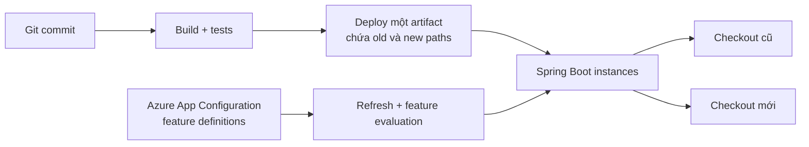
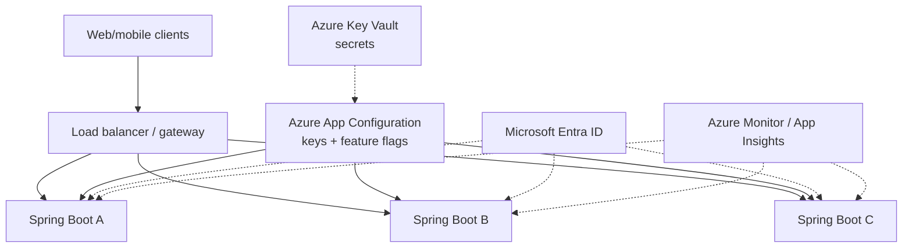
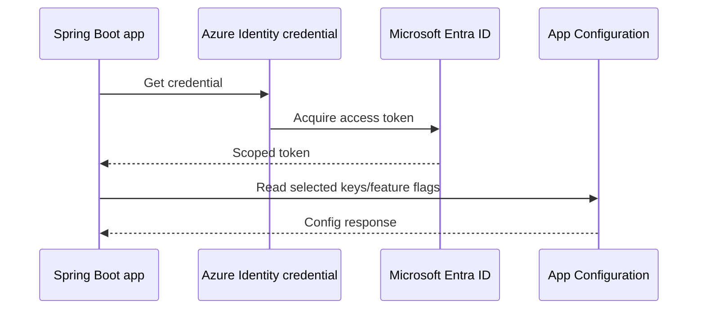
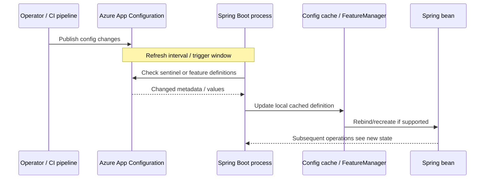
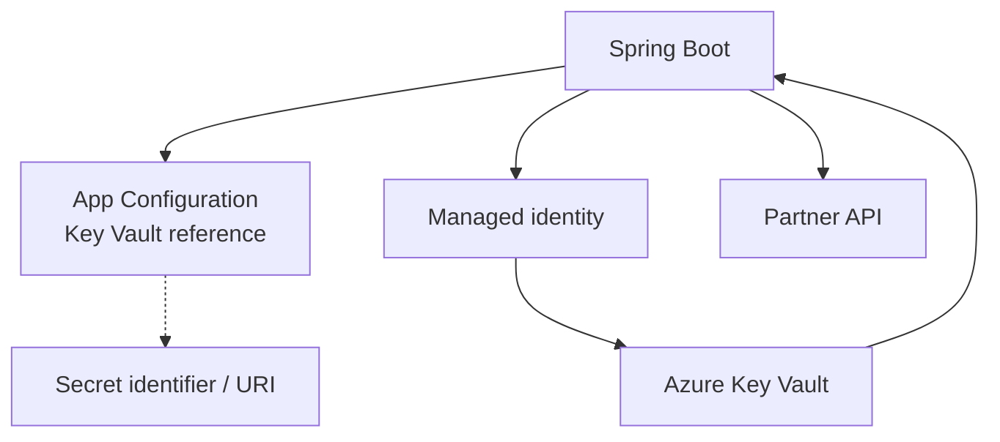
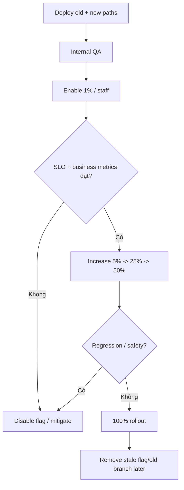
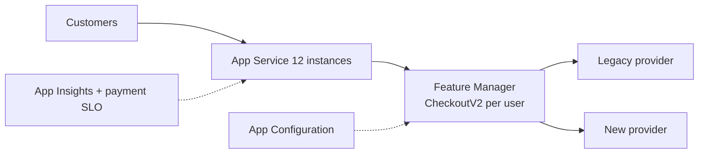
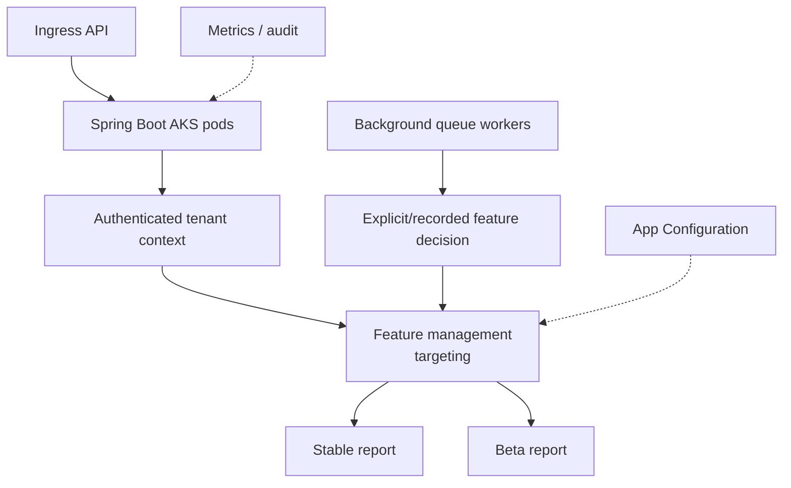

# Feature flag và làm mới cấu hình ứng dụng

Một ứng dụng thương mại điện tử dùng **Spring Boot** chạy trên Azure App Service có hai luồng thanh toán: phiên bản ổn định và phiên bản tối ưu mới. Đội phát triển đã deploy cả hai nhánh mã nhưng muốn mở phiên bản mới cho nhân viên, sau đó 5%, 25% và 100% khách hàng. Trong lúc đó, đội vận hành cần giảm thời gian chờ gọi API đối tác từ 3.000 ms còn 1.500 ms mà không build lại JAR. Khi đối tác lỗi, họ cần tắt nhanh nhánh mới — nhưng hệ thống có tám instances với cache và thời điểm refresh khác nhau.

**Azure App Configuration** cùng thư viện **Spring Cloud Azure** cho phép lưu **key-value configuration** và **feature flags** tập trung, có labels, quyền truy cập và cơ chế refresh. Tuy nhiên, đổi giá trị trên portal **không đồng nghĩa mọi Spring Boot instance lập tức áp dụng cùng một mili giây**. Muốn rollout an toàn cần hiểu **cache, feature evaluation, refresh trigger, bean lifecycle, quyền, quan sát và rollback**.

Bài thuộc chương **Spring Boot trên Azure** của module **CLOUD_PROVIDERS_AZURE**, nằm trong hành trình tìm hiểu hệ sinh thái Azure từ subscription, resource group, Microsoft Entra ID đến mạng ảo, compute, storage và data, cùng cách triển khai, giám sát, bảo vệ và kiểm soát chi phí kiến trúc ứng dụng. Bài kết nối Spring Boot với **App Configuration, Azure Key Vault, managed identity, App Service/AKS, Azure Monitor** và quy trình vận hành production.

**Sau bài học, bạn có thể:**

- Phân biệt **feature flag, configuration property, secret, deployment** và **authorization**.
- Tổ chức App Configuration qua **key, label, content type, prefix, revision** và môi trường.
- Thiết kế boolean, **percentage, targeting, time-window** flags, progressive delivery và kill switch.
- Kết nối Spring Boot với App Configuration bằng **Spring Cloud Azure**, ưu tiên Microsoft Entra/managed identity.
- Đánh giá feature flag bằng abstraction, kiểm soát **default behavior**, nhánh on/off và tenant context.
- Làm mới key-value bằng **sentinel, refresh interval, cache, bean refresh**; phân biệt với feature-flag refresh.
- Xử lý **nhiều instances, eventual consistency, concurrency, configuration snapshot, refresh failure** và sự cố rollout.
- Viết test, audit, monitoring, CI/CD, cost budget và runbook phục hồi.

## 1. Feature flag không phải deployment

**Deployment** thay **phiên bản mã**. **Feature flag** quyết định **nhánh hành vi nào** của mã đã triển khai được sử dụng.



Một flag `CheckoutV2=true` **không tự tạo ra code** ở phiên bản ứng dụng chưa có nhánh CheckoutV2. Ngược lại, deploy code mới có thể để flag mặc định tắt, kiểm thử kỹ trước khi mở cho người dùng thật.

### 1.1. Ba loại thay đổi khác nhau

| Cần thay đổi | Giải pháp thường phù hợp | Ví dụ |
|---|---|---|
| Chọn hành vi theo cohort | **Feature flag** | Bật thanh toán mới cho 10% khách hàng |
| Đổi tham số hoạt động | **Configuration key-value** | Giảm `partner.timeout-ms` |
| Đổi secret/credential | **Key Vault + rotation** | Thay API key đối tác |

Không lưu password vào feature flags hay configuration key-values dạng plaintext. Có thể dùng **Key Vault references**, nhưng vẫn cần cấp quyền Key Vault và kiểm tra rotation/refresh riêng.

### 1.2. Flag không thay thế phân quyền

Không dùng `if (flagEnabled)` làm lớp bảo vệ duy nhất của API quản trị hoặc tài khoản ngân hàng. **Authorization** phải kiểm tra user/tenant/roles/ownership độc lập. Feature flags quản lý **trải nghiệm/hành vi**, không tự trở thành cơ chế IAM.

## 2. Kiến trúc Spring Boot trên Azure



Các mũi tên mô tả phụ thuộc, không hàm ý App Configuration tự push mọi thay đổi tức thời đến mọi JVM. Thư viện có thể **cache** các giá trị rồi kiểm tra refresh theo chu kỳ/trigger. Một instance không có requests hoặc đang mất network có thể áp dụng bản cũ lâu hơn instance khác.

### 2.1. Các thành phần

| Thành phần | Trách nhiệm |
|---|---|
| **App Configuration** | Lưu key-value, feature flags, labels, revisions và endpoint |
| **Spring Cloud Azure App Configuration client** | Nạp config, select labels, cache/refresh theo phiên bản thư viện |
| **Feature management library** | Evaluate flag và feature filters |
| **Spring Environment / ConfigurationProperties** | Bind properties vào beans |
| **Key Vault** | Lưu secrets, certificates, rotation |
| **Managed identity + Entra** | Xác thực workload, RBAC data-plane |
| **Azure Monitor/Application Insights** | Quan sát lỗi, refresh, rollout và business metrics |

## 3. Các nguồn cấu hình và độ ưu tiên

Spring Boot có thể nạp cấu hình từ `application.yml`, profiles, environment variables, command-line arguments, Kubernetes ConfigMaps/Secrets, App Service settings, App Configuration và Key Vault.

**Thứ tự ưu tiên PropertySource** phụ thuộc Spring Boot/Spring Cloud version, bootstrap/config import và cách tích hợp. Nếu cùng key có trong App Configuration và biến môi trường, **phải kiểm tra giá trị cuối cùng ở runtime**, không đoán từ vị trí file.

### 3.1. Tạo contract cho mỗi property

```text
Key:                checkout.partner.timeout-ms
Type:               integer milliseconds
Safe default:       3000
Allowed range:      100..10000
Owner:              payments-platform
Environment:        production
Secret?:            no
Restart required?:  only if dependent bean cannot refresh safely
```

Cần ghi **type, đơn vị, giới hạn, owner, môi trường, fallback, refresh semantics và ảnh hưởng business**. Nếu tên key chứa `timeout` nhưng một team hiểu giây, team khác hiểu milliseconds thì refresh nhanh chỉ làm lỗi xuất hiện nhanh hơn.

## 4. Key-value, label và prefix

Azure App Configuration định danh key-value theo **key + label** (label có thể null). Hai mục cùng key nhưng label khác nhau có thể có values khác nhau.

| Key | Label | Value |
|---|---|---|
| `checkout.partner.timeout-ms` | `dev` | `5000` |
| `checkout.partner.timeout-ms` | `production` | `3000` |
| `checkout.partner.timeout-ms` | *null label* | `4000` |
| `checkout.partner.max-retries` | `production` | `2` |
| `ui.banner-text` | `production` | `Welcome` |

### 4.1. Label không phải ranh giới bảo mật

Một ứng dụng được cấp quyền đọc toàn store có thể đọc nhiều labels tùy quyền và API; **label=dev không thay một RBAC boundary**. Nếu dev và production phải tách mạnh, sử dụng **stores riêng**, identity riêng, data-plane RBAC riêng và network policy tương ứng.

### 4.2. Key prefixes

```text
Store:              appconfig-shop-prod
Key filter:         /shop/checkout/*
Label filter:       production
```

Nếu key trong store là `/shop/checkout/timeout-ms` nhưng Java bind `checkout.partner.timeout-ms`, phải có **trim/mapping** được hỗ trợ. Không mặc định framework tự biến đổi các dấu `/`, `.` hoặc `-` thành cấu trúc Java như mong muốn.

### 4.3. Revision và snapshot

App Configuration lưu revision metadata của key-values và có thể có **snapshot/snapshot reference** tùy tính năng/tier. Revision giúp truy vết thay đổi nhưng **không tự tạo transaction rollback cho toàn ứng dụng**. Nếu cần phát hành đồng bộ nhiều keys, dùng quy trình publish phiên bản, sentinel hoặc snapshot phù hợp, rồi kiểm tra toàn bộ instances.

## 5. Feature flag có cấu trúc riêng

Feature flag thường gồm **ID, enabled state** và **conditions/filters**. JSON **khái niệm**:

```json
{
  "id": "CheckoutV2",
  "enabled": true,
  "conditions": {
    "client_filters": [
      {
        "name": "Microsoft.Percentage",
        "parameters": {
          "Value": 10
        }
      }
    ]
  }
}
```

Đây là ví dụ **definition** phục vụ học, không phải yêu cầu ghi thẳng JSON đó vào một key-value thường. Feature flags trong Azure App Configuration có cách lưu/metadata và key prefix chuyên dụng; nên tạo/chỉnh qua **Feature Manager UI, SDK hoặc API được hỗ trợ**.

### 5.1. Boolean property khác feature definition

Một key-value `checkout.v2.enabled=true` chỉ là boolean property. Feature flag `CheckoutV2` có thể gắn targeting/percentage/time window và được thư viện feature management **evaluate**. Nếu code chỉ dùng `@Value` để đọc một boolean, nó **không tự hiểu** các feature filters.

### 5.2. Tên flag là contract trong code

```text
CheckoutV2
PartnerFallback
ReadOnlyMode
NewRecommendationModel
```

Định nghĩa owner, scope, tạo lúc nào, điều kiện bật/tắt và ngày phải dọn. Không để hàng trăm flags tồn tại vô thời hạn dù rollout đã hoàn tất, vì hai nhánh logic làm tăng test surface và rủi ro bảo trì.

## 6. Boolean flag, kill switch và rollout

```text
CheckoutV2=false -> branch cũ
CheckoutV2=true  -> branch mới
```

Một **kill switch** là cờ được thiết kế để tắt chức năng khi xảy ra sự cố. Nhưng kill switch chỉ hữu ích nếu:

- Nhánh **off** vẫn tương thích với dữ liệu đã ghi và có test.
- Refresh có SLO rõ; instances không phải lúc nào cũng đổi trong cùng một giây.
- Nếu App Configuration không truy cập được, xử lý cached/default value theo chính sách.
- Đã chuẩn bị cơ chế khác nếu cần dừng ngay một đường thanh toán nguy hiểm.

**Không dùng flag là kiểm soát duy nhất để chặn hành vi bất hợp pháp hoặc truy cập trái phép**; cần authorization/network/API controls độc lập.

### 6.1. Progressive delivery

```text
Pilot staff -> 1% users -> 5% -> 25% -> 50% -> 100%
```

Mỗi bước cần **gates**: error rate, latency p95, database load, business conversion, data integrity, complaint volume và security findings. Các tỷ lệ chỉ minh họa; không tăng phần trăm theo lịch khi metrics đã xấu.

## 7. Percentage, time window và targeting

| Filter | Trường hợp sử dụng | Vấn đề cần kiểm tra |
|---|---|---|
| **Boolean on/off** | Bật/tắt cho toàn bộ app | Blast radius lớn |
| **Percentage** | Canary một tỷ lệ requests/users | **Sticky** theo user hay random theo request? |
| **Time window** | Giới hạn thời gian bật | Timezone, UTC, clock, refresh lag |
| **Targeting** | Cohort user/tenant/group | Context phải đến từ **authenticated source** |
| **Variants/experiments** (khi hỗ trợ) | Nhiều phương án response/model | SDK/definition compatibility và metrics |

### 7.1. Tỷ lệ 10% có nghĩa gì?

Một percentage filter có thể quyết định theo random request hoặc stable identity, tùy SDK/filter và input context. **Không suy rằng “10%” luôn là 10% users cố định**. Nếu checkout cần trải nghiệm nhất quán, dùng targeting/sticky assignment theo stable user/tenant ID và kiểm tra logic.

### 7.2. Targeting theo user hoặc tenant

```text
Authenticated principal -> stable user ID
Verified tenant context -> tenant ID
Trusted group membership -> allowed groups
Feature evaluation -> enabled / disabled
```

Đừng đọc `tenantId` hoặc `isPremium` từ JSON do client tự khai rồi coi đó là context tin cậy. Targeting không thay authorization; mọi request có thể bị sửa/cố tình giả mạo.

### 7.3. Time-window flag

Giả sử bật ranking mới từ 14:00 UTC:

- Xác định timezone dùng trong definition.
- Tính refresh/cache propagation.
- Không hứa mọi instances đổi đúng 14:00:00 UTC.
- Nếu luật khuyến mãi yêu cầu mốc giờ tuyệt đối, backend phải kiểm tra business time riêng.

### 7.4. Compatibility của filters

Một filter thấy trong Azure Portal chưa chắc **Spring Java feature management library** đang dùng có bản evaluator phù hợp. Chỉ bật khi đã test đúng phiên bản SDK; với custom filters cần test thread safety, context propagation, performance và failure behavior.

## 8. Đánh giá flag theo request hay process?

| Flag | Phạm vi hợp lý | Vì sao |
|---|---|---|
| `CheckoutV2` | User/tenant | Sticky rollout và backend contract |
| `ReadOnlyMode` | Toàn service | Kill switch có consistency SLO |
| `PartnerFallback` | Request/health/dependency | Kết hợp circuit breaker |
| `NewRankingModel` | User/cohort/experiment | Cần attribution khi so sánh |
| `WorkerConcurrencyV2` | Instance/process | Ảnh hưởng memory, threads và quota |

Một flag bật trên 50% instances **không đồng nghĩa** bật cho 50% users. Load balancer có thể gửi cùng user sang nhiều instances. Cần **stable evaluation context và consistent definitions** nếu yêu cầu sticky experience.

## 9. Thư viện Spring Cloud Azure

Spring Boot hiện đại có hệ thư viện `com.azure.spring`. Tên artifact, cấu hình và compatibility **thay đổi theo Spring Boot/Spring Cloud Azure releases**. Chọn BOM tương thích, pin versions và kiểm tra release notes trước khi đưa ví dụ vào build.

### 9.1. Maven dependencies minh họa

```xml
<dependencies>
  <dependency>
    <groupId>com.azure.spring</groupId>
    <artifactId>spring-cloud-azure-appconfiguration-config-web</artifactId>
  </dependency>
  <dependency>
    <groupId>com.azure.spring</groupId>
    <artifactId>spring-cloud-azure-feature-management-web</artifactId>
  </dependency>
</dependencies>
```

Đây là **fragment**; dự án thực tế cần dependency management (BOM/versions) và các modules Spring Web/validation/reactor phù hợp. Tên artifact `-web`/`non-web` và property paths **không phải cam kết bất biến**; đối chiếu bản phát hành đã chọn. Không thêm mọi web/non-web variant “cho chắc” vì dễ xung đột bean/config lifecycle.

### 9.2. Các vai trò

- **Configuration integration:** nạp key-values vào Spring Environment.
- **Feature management:** evaluate flag/filter theo context.
- **Refresh integration:** kiểm tra lại cache/refresh theo trigger và cách hoạt động của web hoặc worker application.
- **Azure Identity:** lấy access token, chọn managed identity hoặc developer credential.

## 10. Xác thực App Configuration bằng managed identity

Ưu tiên **Microsoft Entra ID + managed identity** khi app chạy trên App Service/AKS. Trong local development dùng developer credential đã đăng nhập với quyền lab.



### 10.1. RBAC đọc dữ liệu

Principal thường cần role **App Configuration Data Reader** trên store/scope được hỗ trợ. Writer/operator có thể cần **App Configuration Data Owner** hoặc role quản trị tương ứng. Azure ARM Reader **không tự động** cho phép đọc dữ liệu App Configuration (data-plane).

### 10.2. App Service và AKS

- **App Service:** bật system-assigned hoặc user-assigned managed identity, cấp role cho đúng principal ID.
- **AKS:** cấu hình Microsoft Entra Workload ID/identity binding theo tích hợp tương thích.
- **Local:** Azure CLI/IDE credential có thể được SDK sử dụng; local chạy được không bảo đảm production identity có quyền.
- **User-assigned:** phân biệt client ID, principal/object ID và resource ID.

### 10.3. Connection string

Có thể dùng connection string khi client/service hỗ trợ, nhưng đây là **secret** cần Key Vault/App Service secret settings, rotation và tránh logs/Git. Với Azure workloads, ưu tiên identity-based auth nếu tích hợp hỗ trợ.

## 11. application.yml với App Configuration

Một cấu hình **minh họa** cho các dòng Spring Cloud Azure App Configuration hỗ trợ `stores`:

```yaml
spring:
  application:
    name: shop-api
  cloud:
    azure:
      appconfiguration:
        stores:
          - endpoint: https://appconfig-shop-prod.azconfig.io
            selects:
              - key-filter: /shop/*
                label-filter: production
            feature-flags:
              enabled: true
```

**Điều kiện sử dụng:**

1. Endpoint là tên giả định, thay bằng store thật được phê duyệt.
2. Selector phải khớp keys/labels thực, và mapping prefix tới Spring properties phải được kiểm tra.
3. Tùy phiên bản, có thể cần **bootstrap/config-data import** hoặc tên properties khác; cấu trúc YAML là mẫu học, không đảm bảo hoạt động với mọi Spring Boot/SDK version.
4. Dependency feature management phải hỗ trợ loại flag/filter đang dùng.
5. Principal cần data-plane role và network/TLS phù hợp tới App Configuration.
6. Chưa cấu hình refresh/Key Vault; sẽ bổ sung ở các mục sau.

### 11.1. Không hardcode môi trường trong artifact dùng chung

Ứng dụng dev/test/prod nên nhận endpoint/label qua **trusted deployment configuration**, không cho request người dùng tùy ý chọn label. Nếu cần data isolation mạnh, dùng stores/identities riêng thay vì chỉ dựa label.

## 12. Bind cấu hình với @ConfigurationProperties

```java
import jakarta.validation.constraints.Max;
import jakarta.validation.constraints.Min;
import org.springframework.boot.context.properties.ConfigurationProperties;
import org.springframework.validation.annotation.Validated;

@Validated
@ConfigurationProperties(prefix = "checkout.partner")
public class CheckoutPartnerProperties {
    @Min(100)
    @Max(10000)
    private int timeoutMs = 3000;

    public int getTimeoutMs() {
        return timeoutMs;
    }

    public void setTimeoutMs(int timeoutMs) {
        this.timeoutMs = timeoutMs;
    }
}
```

Đăng ký class bằng `@ConfigurationPropertiesScan` hoặc `@EnableConfigurationProperties(CheckoutPartnerProperties.class)`. Với Spring Boot 3+, cần Bean Validation dependency (chẳng hạn validation starter) để constraint annotations có hiệu lực.

### 12.1. Value validation

Nếu operator nhập `checkout.partner.timeout-ms=-1` hoặc `99999999`, cấu hình phải bị từ chối/fail validation hoặc giữ **last-known-good** theo runtime contract, thay vì đưa ngay một giá trị gây lỗi vào HTTP client. Với bắt buộc không có fallback, ứng dụng có thể fail startup; với dynamic refresh cần xử lý và báo lỗi phù hợp.

### 12.2. Thay Environment không tự thay mọi object

Nếu `RestClient`, `HikariDataSource` hoặc thread pool được tạo một lần với timeout/pool size cũ, cập nhật Spring Environment **không tự tạo lại object**. Phải dùng refresh-compatible beans, `@RefreshScope` khi hỗ trợ hoặc code reconfigure lifecycle an toàn. Một property **chỉ đọc lúc constructor** không tự refresh dù App Configuration đã thay.

## 13. Đánh giá feature flag trong code Java

Một số phiên bản Spring Cloud Azure Feature Management cung cấp abstraction `FeatureManager` và thao tác bất đồng bộ tương tự `isEnabledAsync`.

```java
import com.azure.spring.cloud.feature.management.FeatureManager;
import org.springframework.stereotype.Service;
import reactor.core.publisher.Mono;

@Service
public class CheckoutRoutingService {
    private final FeatureManager features;

    public CheckoutRoutingService(FeatureManager features) {
        this.features = features;
    }

    public Mono<String> selectCheckoutRoute() {
        return features.isEnabledAsync("CheckoutV2")
            .map(enabled -> enabled
                ? "checkout-v2"
                : "checkout-legacy");
    }
}
```

**Giới hạn và điều kiện:** package/class/methods là mẫu cho những phiên bản feature-management Java có các APIs tương ứng. Kiểm tra **dependency, signatures, evaluation context và filter support** của đúng release. Đoạn code chỉ trả route name, không xử lý thanh toán hay kiểm tra user permissions.

### 13.1. Controller để thử ở lab

```java
import org.springframework.web.bind.annotation.GetMapping;
import org.springframework.web.bind.annotation.RestController;
import reactor.core.publisher.Mono;

@RestController
public class CheckoutRouteController {
    private final CheckoutRoutingService routing;

    public CheckoutRouteController(CheckoutRoutingService routing) {
        this.routing = routing;
    }

    @GetMapping("/lab/checkout-route")
    public Mono<String> route() {
        return routing.selectCheckoutRoute();
    }
}
```

Endpoint này là **lab demo**. Không tự động public debug endpoint để mọi người đọc flags, internal feature names hoặc experiment assignments.

### 13.2. Blocking và non-blocking

Nếu thư viện trả `Mono<Boolean>`, có thể dùng `map`/`flatMap` trong WebFlux thay vì `block()`. **Không gọi `block()` bên trong Netty reactive event loop**. Với Spring MVC synchronous, có thể dùng adapter hoặc đánh giá dựa trên cached state theo API mà thư viện hỗ trợ; đặt timeout rõ và không giữ servlet thread chờ network vô thời hạn.

### 13.3. Không đóng băng quyết định trong biến static

```java
// Sai nếu muốn flag thay đổi khi ứng dụng đang chạy:
private static final boolean CHECKOUT_V2_ENABLED = false;
```

Một biến `static final` được gán lúc build/startup **không thay** chỉ vì App Configuration được sửa. Với flag theo user, đánh giá cần có đúng context của **request hiện tại**, không cache một boolean chung cho mọi users.

## 14. Adapter để giảm phụ thuộc SDK

Thay vì rải import của Azure feature management khắp codebase, tạo interface riêng:

```java
import reactor.core.publisher.Mono;

public interface FeatureDecisions {
    Mono<Boolean> enabled(String featureId);
}
```

Implementation mẫu:

```java
import com.azure.spring.cloud.feature.management.FeatureManager;
import org.springframework.stereotype.Component;
import reactor.core.publisher.Mono;

@Component
public class AzureFeatureDecisions implements FeatureDecisions {
    private final FeatureManager manager;

    public AzureFeatureDecisions(FeatureManager manager) {
        this.manager = manager;
    }

    @Override
    public Mono<Boolean> enabled(String featureId) {
        return manager.isEnabledAsync(featureId);
    }
}
```

Trong unit test:

```java
import reactor.core.publisher.Mono;

FeatureDecisions allOff = featureId -> Mono.just(false);
FeatureDecisions checkoutOn =
    featureId -> Mono.just("CheckoutV2".equals(featureId));
```

**Lợi ích:** test nhánh on/off, thêm audit và fallback, đổi SDK mà không viết lại domain layer. **Không nuốt mọi exception rồi trả true**. Nếu cần fail-safe, quyết định ở application policy với logs/metrics rõ.

### 14.1. Feature evaluation có thể phụ thuộc context

Đoạn code dùng mỗi `featureId` phù hợp để minh họa một flag **không targeting**. Với targeting theo user/tenant, phải truyền **authenticated targeting context** theo API mà filter/library hỗ trợ. Nếu custom filter truy cập HTTP request context qua ThreadLocal, **WebFlux/reactive async/virtual threads có thể làm mất context**; kiểm thử propagation hoặc dùng explicit context parameters.

### 14.2. Consistency trong một business operation

Nếu một request thanh toán kiểm tra `CheckoutV2` ba lần và flag đổi giữa chừng, logic có thể gọi nhánh mới ở bước đầu rồi nhánh cũ ở bước cuối. Nên **evaluate một lần ở ranh giới business transaction**, lưu quyết định vào request/workflow context và dùng xuyên các bước. Khi một saga/job kéo dài qua nhiều workers, lưu **feature decision/version** cùng job metadata khi cần reproducibility.

## 15. Fail-safe defaults và last-known-good

Không có App Configuration, hệ thống cần một chính sách rõ:

| Cấu hình | Ví dụ fallback | Vì sao |
|---|---|---|
| Tính năng mới tùy chọn | Tắt và dùng nhánh cũ | Giữ trải nghiệm ổn định |
| Fraud/risk checks | **Không được mặc định bỏ kiểm tra** | Bảo vệ an toàn/tuân thủ |
| Partner timeout | Giá trị đã validate | Tránh timeout vô hạn |
| Điểm đến thanh toán | Fail closed khi thiếu giá trị hợp lệ | Tránh gửi giao dịch sai địa chỉ |
| Secret bắt buộc | Không dùng secret giả trong production | Bảo vệ authentication |

### 15.1. Mất cấu hình không luôn đồng nghĩa `false`

Nếu flag `FraudChecksEnabled` tự fallback false khi không kết nối store, ứng dụng có thể cho phép giao dịch không kiểm tra gian lận. Với các controls bắt buộc, phải kiểm tra independent authorization/policy hoặc fail closed, không quyết định bảo mật bằng một feature toggle tùy chọn.

### 15.2. Last-known-good có giới hạn

Giữ giá trị cuối cùng đã đọc thành công giúp vượt qua outage tạm thời. Nhưng:

- Một instance mới chưa từng load thành công không có cache cũ.
- Cache chỉ trong RAM mất khi restart.
- Values có thể stale so với kill switch vừa bị tắt.
- Lưu cache ra disk có thể làm lộ configuration/Key Vault references.

Đặt **maximum acceptable staleness** theo từng flag, một degraded-mode policy và có alert khi quá lâu không refresh.

## 16. Làm mới cấu hình: bốn bước cần phân biệt

Một thay đổi động không chỉ có “write rồi read”:

1. **Publish:** operator/API sửa key-value hoặc feature flag trong App Configuration.
2. **Detect:** mỗi application instance biết có thay đổi theo polling/sentinel/event signal.
3. **Fetch:** client tải lại selected keys/definitions, cập nhật cache.
4. **Apply:** Spring Environment/beans/feature evaluator sử dụng giá trị mới.



**Mấu chốt:** detect/fetch/apply có thể xảy ra vào các thời điểm khác nhau; các Spring beans **không mặc định** được rebuild chỉ vì cache của configuration source đổi.

### 16.1. Refresh không phải restart

| Thao tác | Tác động |
|---|---|
| Restart JVM/container | Tạo lại toàn bộ Spring context theo lifecycle; có downtime/rollout cost |
| Refresh Spring Environment | Cập nhật property sources theo cơ chế được hỗ trợ |
| Refresh bean `@RefreshScope` | Tạo lại scoped target object khi access sau refresh |
| Feature management refresh | Thay cached flag definitions/evaluation; có thể không cần rebuild bean |
| Reload Hikari/HTTP client | Cần code lifecycle/refresh semantics riêng nếu dependency được tạo với cấu hình cũ |

Không áp `@RefreshScope` vô điều kiện lên mọi `@Bean`. Reconstruct database pool trong giờ cao điểm có thể làm rớt kết nối, tạo spike hoặc gián đoạn transactions.

## 17. Sentinel key và atomic-looking publish

**Sentinel key** là một key cố định được cấu hình làm **refresh trigger**. Thay vì sửa từng key rồi mong từng instance tự xem mọi key liên tục, operator cập nhật **sentinel sau cùng** để thông báo một batch cấu hình đã sẵn sàng.

Ví dụ:

```text
Checkout parameters (label=production):
  checkout.partner.timeout-ms = 1500
  checkout.partner.max-retries = 1

Sentinel (label=production):
  /shop/config/sentinel = release-2026-11-20.02
```

### 17.1. Publish an toàn

1. Validate config mới và dependencies ở test.
2. Ghi từng key mới ở đúng environment/label.
3. Kiểm tra có đủ keys, type và được phép đọc.
4. **Sau cùng** cập nhật sentinel key.
5. Instances phát hiện sentinel thay đổi theo interval/trigger rồi refresh.
6. Quan sát config version, refresh success và business SLO.

### 17.2. Sentinel không phải distributed transaction

Nếu một instance refresh từ store ngay lúc keys đang được publish (hoặc một key khác bị sửa ngoài quy trình), nó **có thể thấy mixed versions**. Sentinel giảm rủi ro, nhưng không chứng minh atomic snapshot giữa nhiều values/instances trong mọi kịch bản.

Muốn consistency mạnh hơn cho một release:

- Dùng **immutable versioned labels/keys hoặc App Configuration snapshots** khi phiên bản/tier hỗ trợ.
- Publish một **pointer**/config version sau khi snapshot hoàn tất.
- Kiểm tra version của toàn bundle, không chỉ sentinel.
- Thiết kế **backward-compatible schema** trong thời gian các instances chạy khác version.

### 17.3. Quy ước đặt sentinel

Đặt sentinel ở prefix/label được chọn thực sự. Nếu app chỉ query key-filter `/shop/checkout/*` mà sentinel nằm ở `/shop/config/sentinel`, phải đảm bảo client monitor vẫn đọc sentinel độc lập hoặc thay key filter. Nếu không, operator đổi sentinel nhưng app không thấy gì.

## 18. Cấu hình refresh trong Spring Cloud Azure

Một số dòng thư viện App Configuration Spring hỗ trợ cấu hình `monitoring`, `refresh-interval` và `triggers` cho key-value refresh; đồng thời feature flags có cơ chế refresh/interval riêng theo version.

Mẫu **minh họa**:

```yaml
spring:
  cloud:
    azure:
      appconfiguration:
        stores:
          - endpoint: https://appconfig-shop-prod.azconfig.io
            selects:
              - key-filter: /shop/*
                label-filter: production
            monitoring:
              enabled: true
              refresh-interval: 30s
              triggers:
                - key: /shop/config/sentinel
                  label: production
            feature-flags:
              enabled: true
              refresh-interval: 30s
```

**Cảnh báo phiên bản:** các property names/nesting, defaults, refresh interval units, sentinel label handling và việc feature flag refresh **khác theo release**. Đây là mẫu để hiểu *ý tưởng cấu hình*, không cam kết copy-paste chạy được với mọi Spring Cloud Azure. Kiểm tra sample/configuration metadata của version đã pin; verify bằng integration test thay đổi sentinel thực sự tới JVM.

### 18.1. Monitoring enabled chưa đủ

Một cấu hình refresh có thể không hoạt động nếu:

- App chưa bật đúng starter/web integration.
- Sentinel key không được tạo hoặc label sai.
- Một version yêu cầu `bootstrap` hoặc config-data import khác.
- Refresh interval chưa hết.
- Không có HTTP traffic trong cơ chế request-driven refresh.
- Managed identity không đọc được store hoặc DNS timeout.
- Config cache được refresh nhưng bean cần thiết không bind lại.

### 18.2. Đừng poll quá nhanh

Interval 1 giây trên hàng trăm replicas có thể tạo chi phí request/App Configuration throttling và network overhead, trong khi không cải thiện đáng kể safety nếu bean apply còn chậm. Chọn interval theo **SLO refresh**, số instances, request pattern và service quotas. Đo `p95 effective refresh lag` thay vì chỉ nhìn giá trị cấu hình.

## 19. Web refresh, non-web refresh và actuator

### 19.1. Web-driven refresh

Một số integration web kiểm tra điều kiện refresh khi ứng dụng **nhận HTTP requests**, có caching/interval để tránh mỗi request tạo một vòng network read. Lợi ích: tích hợp đơn giản trong Spring MVC. Hạn chế:

- Instance không có request trong thời gian dài có thể **không thực hiện refresh ngay**.
- Khi traffic đột ngột, nhiều instances có thể check cùng lúc nếu interval trùng.
- Không nên buộc refresh network call nằm trên đường xử lý latency-sensitive mà chưa có timeout/cache policy.

### 19.2. Background/non-web refresh

Queue worker, scheduled job hoặc IoT consumer không có incoming HTTP request có thể cần **explicit refresh task/scheduler** hoặc integration non-web được SDK hỗ trợ. Đặt interval, jitter, retry, distributed load control và cancellation đúng cách.

**Không dùng cách “gọi localhost health endpoint liên tục chỉ để trigger refresh”** như giải pháp duy nhất cho worker không có web; nó che giấu dependency và tạo operational complexity.

### 19.3. Spring Cloud Actuator `/actuator/refresh`

Spring Cloud Context/Actuator ở một số cấu hình cung cấp cơ chế refresh application context/properties. Nhưng:

- Không mặc định endpoint tồn tại/được expose trong mọi Spring Boot starter.
- Không đánh đồng Spring `/actuator/refresh` với **App Configuration feature-flag refresh API** trong tất cả phiên bản.
- Nếu expose một endpoint refresh, phải có authentication/authorization/network restrictions và audit; không public nó ra Internet.
- Refresh bean có side effects (recreate pools/reconnect), vì vậy cần thử nghiệm trước khi vận hành.

## 20. @RefreshScope, immutable beans và lifecycle

Spring Cloud Context có cơ chế `@RefreshScope` để tạo lại scoped bean khi được refresh. Ví dụ **minh họa sử dụng khi có dependency/config hỗ trợ**:

```java
import org.springframework.cloud.context.config.annotation.RefreshScope;
import org.springframework.context.annotation.Bean;
import org.springframework.context.annotation.Configuration;

@Configuration
public class PartnerClientConfiguration {
    @Bean
    @RefreshScope
    public PartnerTimeoutPolicy partnerTimeoutPolicy(
            CheckoutPartnerProperties properties) {
        return new PartnerTimeoutPolicy(properties.getTimeoutMs());
    }
}
```

Với record class:

```java
public record PartnerTimeoutPolicy(int timeoutMs) {
    public PartnerTimeoutPolicy {
        if (timeoutMs < 100 || timeoutMs > 10000) {
            throw new IllegalArgumentException("Invalid timeoutMs");
        }
    }
}
```

**Giới hạn:** code trên minh họa một immutable policy object. Nó không bảo đảm `CheckoutPartnerProperties` được rebind trên mọi phiên bản config refresh, và không tự làm mới HTTP client thật. Cần test đủ đường **App Configuration → Environment → Properties → scoped bean → request mới**.

### 20.1. Recreate bean có thể làm mất in-flight state

Đối với connection pools, WebClient/HTTP clients hoặc consumers, một bean refresh có thể tạo client mới trong khi requests cũ còn chạy. Cần thiết kế **graceful close, draining, backpressure, thread safety** và test trong lúc có traffic. Nếu tính năng không hỗ trợ refresh an toàn, **rolling restart/rollout** là lựa chọn phù hợp hơn.

### 20.2. ConfigurationProperties và refresh scope

Không tự tin rằng mọi Spring version đều hỗ trợ rebinding `@ConfigurationProperties` + `@RefreshScope` theo cùng thứ tự. Tùy starter, Spring Cloud Context, immutable record binding và refresh event, có sự khác biệt. Hãy viết integration test đo **giá trị được dùng trong business call**, không chỉ đọc Environment snapshot.

## 21. Refresh feature flags khác refresh key-values

Khi operator cập nhật:

```text
Key-value:  checkout.partner.timeout-ms = 1500
Flag:       CheckoutV2 = true (targeting 5% users)
```

Hai nhóm dữ liệu có thể có **different refresh triggers, poll intervals và caches**. Một sentinel key để refresh general configuration **không mặc định bảo đảm** toàn bộ feature flags được reload ngay ở mọi library/version.

### 21.1. Kiểm thử riêng

1. Đổi key-value và sentinel; chứng minh Spring bean sử dụng giá trị mới.
2. Chỉ đổi feature flag; chứng minh evaluator nhận định nghĩa mới sau interval hỗ trợ.
3. Khi App Configuration 429/network outage, chứng minh fallback/staleness policy.
4. Khi một instance idle, đo thời gian nó nhận thay đổi.
5. Khi requests đang xử lý, đảm bảo quyết định feature nhất quán trong workflow.

### 21.2. Có nên dùng sentinel cho cả flag?

Điều này phụ thuộc thư viện. Nếu phiên bản hỗ trợ flag refresh riêng, cần cấu hình đúng phần đó. **Không tạo giả định một sentinel luôn kiểm soát cả flags và config**; kết quả đúng phải được xác minh bằng request-level telemetry.

## 22. Nhiều instances và eventual consistency

Giả sử operator bật flag lúc 10:00:

```text
10:00:00  App Configuration flag changes
10:00:03  Instance A refreshes
10:00:18  Instance C refreshes
10:00:31  Instance B refreshes
10:00:45  Instance D refreshes after request arrives
```

Các thời điểm **giả định** để minh họa eventual consistency. Trong khoảng 45 giây, những requests giống nhau có thể đi theo code paths khác nhau nếu load balancer chuyển instance.

### 22.1. Nên đo version đã áp dụng

Mỗi instance nên có telemetry như:

```json
{
  "instance": "checkout-api-03",
  "configurationVersion": "release-2026-11-20.02",
  "lastRefreshSuccessUtc": "2026-11-20T10:00:31Z",
  "featureDefinitionVersion": "flags-109",
  "activeCodeVersion": "build-17f2",
  "refreshStatus": "succeeded"
}
```

Đây là **schema log tự thiết kế**, không phải response mặc định Spring Cloud Azure. Không log raw secrets hoặc toàn bộ config payload. Với user targeting, tránh ghi user ID dạng plaintext vào metrics labels có cardinality cao.

### 22.2. Mức consistency theo business

| Use case | Consistency cần đạt |
|---|---|
| UI banner mới | Eventual consistency vài chục giây có thể chấp nhận |
| Chọn recommendation model | Sticky assignment trong một request/session |
| Thanh toán | Một workflow phải giữ quyết định và schema nhất quán |
| Cấm truy cập/thu hồi quyền | Không dựa vào refresh flag; enforcement ngay ở auth layer |
| Thay đổi giới hạn an toàn | Có enforcement central và phương án rollback độc lập |

## 23. Targeting trong hệ đa tenant và async processing

Một SaaS có nhiều tổ chức có thể bật `CheckoutV2` cho một nhóm tenants. Hãy phân biệt:

- **Who is authenticated?** danh tính user/daemon đã được xác thực.
- **Which tenant owns the resource?** lấy từ authorization database/verified claims.
- **What flag decision applies?** targeting filter dựa trên trusted context.
- **Can this user perform the operation?** kiểm tra authorization riêng.

### 23.1. ThreadLocal và Reactor context

Trong servlet MVC, targeting context có thể được lấy từ request scope/thread-local theo adapter. Nhưng khi dùng **WebFlux, async executor, scheduled tasks hoặc messaging consumers**, thread boundary có thể thay đổi. Nếu filter ngầm đọc request context:

- Test behavior qua thread/context switches.
- Dùng explicit arguments hoặc Reactor Context theo SDK hỗ trợ.
- Tránh cache decision `enabled=true` ở singleton khi nó phụ thuộc tenant.

### 23.2. Queue job dài hạn

Ví dụ khi user bắt đầu tạo báo cáo lúc 09:00, job được chạy lúc 09:30. Nếu flag thay đổi ở 09:15, có hai lựa chọn:

1. **Freeze assignment:** job lưu feature decision/version lúc nhận; mọi bước dùng cùng semantics.
2. **Evaluate at execution:** job dùng flag hiện tại khi bắt đầu; phải bảo đảm dữ liệu/contract tương thích.

Không để mỗi retry của một job chọn code path khác nhau mà không có versioning và idempotency.

## 24. Tự động hóa refresh qua Event Grid hay polling?

App Configuration có thể tích hợp sự kiện thay đổi key-value với Event Grid/automation theo khả năng dịch vụ; một ứng dụng cũng có thể dùng **polling-based refresh**.

| Cách | Ưu điểm | Giới hạn |
|---|---|---|
| **Polling theo interval** | Đơn giản, tự kiểm tra được khi lỡ tín hiệu | Phụ thuộc interval, nhân số calls theo replicas |
| **Sentinel-triggered polling** | Giảm kiểm tra mọi key, publish batch rõ | Vẫn có detection lag và non-atomic windows |
| **Event-driven notification** | Thông báo nhanh khi có thay đổi | Delivery có thể duplicate/out-of-order/missing; vẫn cần fetch/verify |
| **Rolling restart/redeploy** | Áp trạng thái mới tương đối dễ dự đoán | Tốn thời gian và có thể gián đoạn |
| **Immutable snapshot + pointer** | Nhất quán hơn cho config bundle theo version | Cần workflow publish/rollback và SDK support |

**Một event notification không tự cập nhật Java object**. Nó chỉ là tín hiệu; instance vẫn cần authenticate, fetch, validate và apply. Thiết kế **periodic reconciliation** ngay cả khi có event để sửa trạng thái missed events.

### 24.1. Không nhầm webhook và config API

Nếu một WebHook/Event Grid event được gửi tới gateway:

- Xác thực nguồn event theo cơ chế được hỗ trợ.
- Không tin raw JSON event để chọn endpoint/config secret.
- Không trả HTTP 200 khi chưa durable-accept mà lại mong chắc chắn đã refresh.
- Chống duplicate notifications và request flooding.
- Không public refresh actuator cho mọi Internet clients.

## 25. Key Vault references và làm mới secrets

**Azure Key Vault reference** trong App Configuration cho phép ứng dụng biết **URI/metadata tham chiếu** đến secret trong Key Vault thay vì lưu secret plaintext trực tiếp trong App Configuration.



Đường đi là sơ đồ logic. Cơ chế resolver/library có thể chủ động đọc Key Vault bằng credential đã cấu hình; App Configuration **không tự giữ** plaintext secret theo reference. Muốn dùng Key Vault reference trong Spring Boot, phải cấu hình **Key Vault integration/secret resolver và identity** đúng version.

### 25.1. Hai nhóm quyền độc lập

| Nguồn | Quyền cần thiết | Dùng làm gì |
|---|---|---|
| **App Configuration** | App Configuration Data Reader phù hợp | Đọc key-value/feature definitions và Key Vault reference |
| **Key Vault** | Key Vault Secrets User hoặc quyền `get` secret theo access model được hỗ trợ | Lấy giá trị secret theo reference |

Có quyền đọc App Configuration **không tự động** cho phép lấy secret từ Key Vault; có quyền Key Vault cũng không tự nạp flag từ App Configuration. Nếu Key Vault dùng Private Endpoint, ứng dụng cần DNS/route tới cả hai endpoints.

### 25.2. Versioned vs unversioned secret reference

Nếu reference trỏ tới một **phiên bản cụ thể**, rotate secret bằng cách tạo version mới **không nhất thiết thay giá trị app đọc** cho đến khi reference được cập nhật. Nếu reference không pin version, thư viện/cache có thể chọn version mới sau refresh — nhưng cần test semantics/TTL và biết khi nào secret thực sự được reload vào client.

### 25.3. Rotation an toàn

1. Tạo secret mới ở Key Vault (không xóa ngay secret cũ).
2. Bảo đảm đối tác/backend chấp nhận song song secret cũ/mới trong giai đoạn cutover nếu có thể.
3. Cập nhật reference hoặc policy load đúng version mới.
4. Refresh/restart những beans thực sự **sử dụng secret**.
5. Canary và xác minh tỷ lệ authentication success.
6. Thu hồi secret cũ sau khi không còn consumers phụ thuộc.
7. Audit và kiểm tra không lộ secret qua Actuator, logs, metrics hoặc exceptions.

**Đừng gắn “secret rotation thành công” chỉ vì giá trị App Configuration reference đã đổi.** HTTP client có thể vẫn giữ header/token/connection từ credential cũ.

## 26. Mạng và bảo mật ứng dụng Spring Boot

### 26.1. Private Endpoint

Nếu tổ chức yêu cầu truy cập App Configuration/Key Vault qua mạng riêng:

- Kiểm tra **Private Link support** của resource/tier.
- Tạo private endpoints và private DNS zones phù hợp.
- Đảm bảo App Service VNet integration hoặc AKS networking đưa outbound traffic tới private IP.
- Kiểm tra DNS **trong container/instance thực sự chạy**, không chỉ trong Azure Portal.
- Bảo vệ TLS hostnames; không thay FQDN bằng IP rồi tắt certificate validation.
- Kiểm tra public network access policy, Azure Firewall/NSG/UDR, proxy.

Khi client nhận timeout, kiểm tra DNS/network trước; khi nhận 403, kiểm tra **data-plane role, principal, deny/policy và network restrictions** theo status code cụ thể. **Không cấp Owner subscription chỉ vì config refresh bị lỗi**.

### 26.2. RBAC cho operator và application

- Application runtime: **read-only** ở App Configuration/Key Vault phù hợp.
- Configuration publisher/CI: quyền ghi **có approval** ở store đúng môi trường.
- Auditor: quyền đọc lịch sử/diagnostic metadata theo scope.
- Admin/RBAC manager: phân quyền riêng; tránh dùng credential của app cho quản trị.

### 26.3. Config injection và bảo mật đầu vào

Không cho API client chọn:

```text
appConfigurationEndpoint = arbitrary URL
label = arbitrary tenant name
keyPrefix = ../../secrets
```

Endpoint, label, prefix phải đến từ cấu hình deployment/trusted mapping. Nếu App Configuration lưu URLs/SQL templates từ bên thứ ba, vẫn phải validate theo allowlist và business constraints; **cấu hình không tự biến input thành an toàn**.

## 27. Observability: theo dõi config version và rollout

Một hệ thống production cần quan sát:

- **Refresh check attempts** và **refresh success/failure rate**.
- **Time since last successful refresh** trên từng instance.
- **Config version/sentinel value** mà instance đã áp dụng.
- **Flag evaluation counts** theo branch/on/off.
- **Percent rollout effective** trên traffic thực, không chỉ definition.
- **Error rate, p95/p99 latency, saturation, DB contention** của từng branch.
- **Business metrics**: conversion, abandoned checkout, payment failures.
- **App Configuration request volume/429** và Key Vault latency/auth failures.
- **Noisy neighbor** nếu nhiều services chia một store.

### 27.1. Log có cấu trúc

```json
{
  "traceId": "trace-ec4e",
  "instanceId": "shop-api-07",
  "environment": "production",
  "configVersion": "release-2026-11-20.02",
  "featureId": "CheckoutV2",
  "decision": "enabled",
  "rolloutCohort": "canary",
  "branch": "checkout-v2",
  "refreshAgeSeconds": 16,
  "result": "success",
  "latencyMs": 238
}
```

Đây là **telemetry schema do ứng dụng thiết kế**, không phải JSON mặc định của Azure App Configuration. Không ghi raw JWT, API keys, plaintext secret, user email/PII hoặc mọi config values vào logs.

### 27.2. Cardinality và quyền riêng tư

Không dùng `userId`/`sessionId` làm metric dimensions vô hạn trên Azure Monitor; điều này có thể gây chi phí cao và lộ privacy. Dùng **aggregate cohorts/tenant tiers**, sampling và correlation IDs đã được kiểm soát.

### 27.3. Khi một request được xử lý bởi hai versions

Với rolling deployment, cùng lúc có thể tồn tại:

```text
App build A + config release 17
App build A + config release 18
App build B + config release 18
```

Cần log **application build version + config version + branch decision** để phân biệt lỗi do code với lỗi do refresh; không chỉ ghi “CheckoutV2 enabled”.

## 28. Kiểm soát chi phí và throughput

Việc dùng App Configuration tập trung có thể phát sinh **phí service/tier, số requests, dữ liệu/retention**, network và Key Vault/monitoring theo pricing hiện hành. Không đưa một giá USD cố định vì tier, region và bảng giá thay đổi.

### 28.1. Ước lượng tải polling

Giả sử:

```text
Số instances:                   100
Refresh check interval:          30 giây
Thời gian 1 giờ:               3600 giây
```

Số lượt kiểm tra cơ bản (nếu mỗi instance đều active và đúng một check mỗi interval):

\[
N \approx 100\times\frac{3600}{30}=12.000\ \text{checks/giờ}
\]

Đây là phép tính **mang tính minh họa**, không phải số Azure App Configuration HTTP calls chắc chắn: SDK có caching, conditional requests, multiple selectors, retry, request-driven refresh và implementation khác nhau.

### 28.2. Tối ưu

- Chọn refresh interval theo **business SLO**, không mặc định nhỏ nhất.
- Dùng sentinel để giảm kiểm tra mọi key-value nếu thư viện hỗ trợ.
- Dùng caching và read-only operations phù hợp; tránh mỗi business request fetch lại toàn bộ store.
- Tránh hàng nghìn key-values/flags không dùng nhưng bị selected tải về.
- Không đưa các secret thường xuyên thay vào config store rồi refresh toàn bộ application vô hạn.
- Theo dõi 429/throttling và cost của Application Insights/Log Analytics.
- Với workload lớn, cân nhắc **store partitioning** theo application/environment và giới hạn quyền.

### 28.3. Không tối ưu bằng cách bỏ giám sát

Tiết kiệm vài network checks không có ý nghĩa nếu một stale kill switch gây thất bại thanh toán kéo dài. Cần đánh đổi giữa **refresh latency, store cost, network availability và mức độ quan trọng** của từng flag.

## 29. Progressive rollout và rollback theo bước

### 29.1. Kế hoạch mở tính năng



### 29.2. Các kiểm tra trước rollout

1. **New branch** đã được deploy trên những instances có thể nhận traffic.
2. Database schema và event contracts hỗ trợ **cả nhánh cũ và mới** trong thời gian chuyển tiếp.
3. Phần trăm rollout được tính theo đúng user/cohort và có sticky behavior nếu cần.
4. Có thresholds cho error rate, latency, conversion, downstream queue load.
5. Có owner/on-call và lệnh giảm rollout/disable rõ.
6. Có time budget đo **effective refresh lag** của fleet.
7. Có mitigation độc lập nếu flag refresh không đến.

### 29.3. Rollback bằng flag không hoàn nguyên dữ liệu

Nếu nhánh mới đã ghi schema dữ liệu không được nhánh cũ hiểu, tắt flag có thể gây lỗi nặng hơn. Dùng patterns **expand–migrate–contract**, versioned events và dual-read compatibility. Một lần rollout cần kế hoạch **data rollback/forward fix** riêng, không chỉ toggle.

## 30. CI/CD và quản trị quyền thay đổi cấu hình

Với môi trường production, đổi một key-value có thể tác động tương đương deploy code. Nên đưa config vào quy trình có **owner, review, diff, validation và audit**.

```text
Pull request / change request
  -> validate keys, types, labels, owners
  -> run automated unit/integration tests
  -> produce approved config change plan
  -> publish new keys/flag conditions
  -> update sentinel or snapshot pointer last
  -> observe rollout and instance version
  -> rollback/change again if SLO fails
```

### 30.1. Tách data-plane reader và publisher

Ứng dụng runtime chỉ đọc. CI publisher dùng **managed identity/OIDC workload federation** theo hỗ trợ, được cấp quyền ghi đúng store/label workflow, chỉ apply từ branch/env có approval. Không để mọi pull request không tin cậy sử dụng credentials ghi production.

### 30.2. Sửa config trong Portal có cần audit?

Có. Portal thay đổi thường dễ nhưng dễ bỏ qua code review:

- Xác minh principal, timestamp, scope, key/label và giá trị cũ/mới theo chính sách.
- Lưu change ticket, rationale và rollout/rollback plan.
- Dùng access reviews/roles hạn chế số người được sửa production.
- Với thay đổi khẩn cấp, có break-glass quy trình và post-incident review.

### 30.3. Labels, stores và môi trường

```text
dev  -> appconfig-shop-dev -> mi-shop-dev
test -> appconfig-shop-test -> mi-shop-test
prod -> appconfig-shop-prod -> mi-shop-prod
```

Một artifact có thể chạy ở cả ba, nhưng **endpoint/label/identity do deployment config quyết định**. Tách store giúp giảm rủi ro developer thay nhầm flag production và dễ áp network policy khác nhau.

## 31. Unit tests và integration tests

### 31.1. Unit test nhánh on/off

Sử dụng adapter `FeatureDecisions` từ mục 14:

```java
import reactor.core.publisher.Mono;

FeatureDecisions off = id -> Mono.just(false);
FeatureDecisions on = id -> Mono.just(true);

// Unit tests (pseudocode):
// - off -> old checkout branch
// - on  -> new checkout branch
// - invalid/missing flag -> explicitly chosen safe behavior
// - same request retains the same decision across multiple steps
```

Với logic business, mock external payments thay vì gọi cổng thanh toán thật. Test cả:

- Nhánh cũ với dữ liệu do nhánh mới từng ghi.
- Flag update trong lúc transaction đang chạy.
- Fallback khi evaluator exception.
- Targeting context sai/không hợp lệ.
- Feature disabled nhưng API unauthorized vẫn bị từ chối.

### 31.2. Integration test App Configuration

Trong store **dev/test được cấp quyền**:

1. Load `checkout.partner.timeout-ms` và kiểm tra binding đúng.
2. Thay key-value nhưng **chưa cập nhật sentinel**, quan sát refresh theo cấu hình.
3. Cập nhật sentinel, đo thời gian tới khi giá trị service thật đổi.
4. Bật/tắt `CheckoutV2`, kiểm tra **feature definition refresh** riêng.
5. Test percentage/targeting cho user IDs cố định.
6. Simulate App Configuration 403/429/timeout và verify last-known-good/fail closed.
7. Test restart instance khi store đang inaccessible.
8. Test Key Vault reference/secret rotation và client recreation khi cần.
9. Chạy nhiều instances, đo phân phối thời điểm áp dụng config.
10. Kiểm tra logging không lộ secrets hoặc PII.

### 31.3. Load test không chỉ đo application throughput

Đánh giá:

- Request latency p95 khi refresh trùng thời điểm cao tải.
- App Configuration request rate theo số instances.
- Memory/GC khi refresh nhiều keys/flags.
- Time to propagate feature change đến 95%/100% instances.
- DB/network pool churn do `@RefreshScope`.
- Correctness khi rollout thay đổi trong lúc user thao tác.

## 32. Case study A: canary checkout trên App Service

**Bối cảnh:** ứng dụng thanh toán có 12 instances trên App Service, cần mở checkout mới theo user và tắt khi failure rate tăng.



### 32.1. Thiết kế

1. Deploy cả hai code paths và giữ backward-compatible payment records.
2. Tạo `CheckoutV2` disabled theo mặc định.
3. Bật cho QA/staff trước, test sandbox provider.
4. Tạo targeting theo **verified stable user ID**; kiểm chứng sticky behavior.
5. Bật 1% rồi 5%, đo payment failures, latency, abandon rate và refunds.
6. Đảm bảo mỗi payment attempt sử dụng một **fixed decision**.
7. Khi lỗi, giảm rollout hoặc disable flag; đồng thời có circuit breaker/backend mitigation.
8. Chỉ dọn nhánh legacy khi toàn bộ data/consumers đã tương thích và có approval.

**Đánh giá:** 12 instances có thể không áp flag cùng giây; số liệu quan trọng là tỷ lệ **traffic thực sự** đi qua nhánh mới, không chỉ flag definition.

## 33. Case study B: đổi timeout mà không restart

**Bối cảnh:** Spring Boot gọi một service của nhà vận chuyển. Khi mạng chậm, operator muốn giảm timeout và max retries, nhưng không muốn restart các instances.

### 33.1. Thiết kế cấu hình

```text
shipping.partner.timeout-ms=3000
shipping.partner.max-retries=2
shipping.config-version=release-17
```

Operator cập nhật:

```text
shipping.partner.timeout-ms=1500
shipping.partner.max-retries=1
shipping.config-version=release-18
```

Khi publish, sentinel hoặc version pointer được cập nhật cuối. Backend cần:

1. Nạp/rebind properties từ App Configuration.
2. **Reconfigure client timeout/retry policy** đang sử dụng; không chỉ đổi Environment.
3. Kiểm tra giá trị nằm trong giới hạn an toàn.
4. Đảm bảo requests đã gửi không đột ngột bị đóng sai.
5. Kiểm tra retry storms và p95 latency sau thay đổi.

### 33.2. Bẫy

Nếu đối tượng HTTP client được tạo một lần trong singleton constructor, sau refresh nó **vẫn có timeout cũ**. Nếu tạo client mới liên tục theo từng request, lại có nguy cơ connection churn và latency. Giải pháp tốt là một **controlled client lifecycle** hoặc giữ policy động được đọc ở ranh giới request nếu thư viện cho phép.

## 34. Case study C: cấu hình multi-tenant trên AKS

**Bối cảnh:** SaaS có 80 tenants, mỗi tenant được phép bật một tính năng báo cáo beta khác nhau. Spring Boot chạy trên AKS với nhiều replicas và hỗ trợ background jobs.

### 34.1. Kiến trúc



### 34.2. Các quyết định

- Mỗi tenant có **verified tenant ID**, không nhận `tenantId` chỉ từ request body.
- Feature flag chỉ chọn report engine, còn API vẫn kiểm tra tenant authorization.
- Background job lưu decision/version khi được enqueue nếu cần reproducibility.
- Pods refresh theo interval/sentinel; queue workers có refresh strategy riêng.
- Khi deployment rolling update, logs ghi app build + config version.
- Tenant dữ liệu nhạy cảm có isolation/retention khác phải được kiểm soát ngoài feature flag.

**Tiêu chí:** không cross-tenant data leakage, stable branch trong một job, không để pod idle dùng definition quá cũ khi cần refresh nghiêm ngặt.

## 35. Runbook: flag thay đổi nhưng ứng dụng không đổi hành vi

### Giai đoạn 1 — Xác minh cấu hình nguồn

1. Xác định **App Configuration store, key/flag ID, label, environment và endpoint**.
2. Kiểm tra giá trị đã publish, revision/time và người thay đổi.
3. Đảm bảo **code branch** tồn tại trong app build đang chạy.
4. Kiểm tra filter/targeting definition hợp lệ với version SDK.
5. Kiểm tra đã cập nhật sentinel (nếu dùng) **sau cùng**.

### Giai đoạn 2 — Xác minh ứng dụng có đọc đúng không

1. Kiểm tra managed identity/token principal, role **App Configuration Data Reader**.
2. Kiểm tra DNS/TLS/private endpoint/network route từ chính pod/instance.
3. Kiểm tra key selectors, label, prefix mapping và property precedence.
4. Xem **last refresh success**, cache timestamp, refresh interval và instance ID.
5. Kiểm tra web-driven instance có nhận HTTP request hay worker có scheduler.
6. Phân biệt **feature flag refresh** và **general key-value refresh**.
7. Kiểm tra bean có được rebind/recreated hoặc chỉ Environment đổi.

### Giai đoạn 3 — Phân loại lỗi

| Triệu chứng | Khả năng thường gặp | Hành động |
|---|---|---|
| 401/403 khi load config | Sai identity/role hoặc policy | Kiểm tra principal và quyền data plane |
| DNS/timeout | Private DNS, VNet, firewall, proxy | Kiểm tra từ app runtime network |
| Một instance thay, instance khác không | Refresh lag, cache hoặc idle instance | Đo last refresh, check trigger |
| Environment đã đổi, HTTP client chưa đổi | Bean giữ cấu hình từ constructor | Recreate/reconfigure an toàn |
| Percentage cho cùng user không ổn định | Filter context không sticky | Test user ID/context/evaluator |
| Flag thấy trong portal nhưng Java không hiểu | SDK/filter version mismatch | Đổi filter hoặc nâng SDK có kiểm thử |
| Stale khi outage | Last-known-good giữ quá lâu | Áp maximum staleness/degraded policy |
| Error rate tăng sau bật | Bug/data incompatibility | Giảm rollout, rollback và RCA |
| Key Vault reference đổi nhưng secret cũ | Secret/client cache, version-pinned ref | Rotation/refresh/lifecycle check |
| Store bị 429 | Polling quá dày, burst từ replicas | Tăng interval/jitter, giảm calls |

### Giai đoạn 4 — Phục hồi

1. Giảm rollout hoặc disable flag ở đúng store/label.
2. Xác minh có cơ chế refresh tới mọi instances; dùng controlled restart nếu cần.
3. Nếu dữ liệu đã thay đổi không tương thích, thực hiện data recovery/forward fix.
4. Kiểm tra branch decisions/refresh versions và metrics trở về SLO.
5. Đối soát cohorts/tenants chịu ảnh hưởng.
6. Ghi incident timeline, change ID, root cause, stale instances và prevention actions.

**Tránh:** public `/actuator/refresh`, cấp Owner subscription để chữa 403, tắt TLS verification, log secrets hoặc assume flag off tự rollback data.

## 36. Những nhầm lẫn thường gặp

| Nhầm lẫn | Thực tế |
|---|---|
| “Feature flag là deployment” | Code phải đã deploy; flag chỉ chọn nhánh |
| “Flag thay đổi ngay trên tất cả instances” | Cache, refresh interval và traffic tạo lag |
| “Boolean property cũng hiểu percentage filter” | Cần feature management evaluator |
| “Label dev/prod tự chặn đọc chéo môi trường” | Label không thay RBAC và store boundary |
| “Flag false luôn an toàn khi mất mạng” | Fraud/security checks có thể cần fail closed |
| “Targeting theo tenant là authorization” | Backend vẫn phải kiểm tra quyền và ownership |
| “10% là 10% người dùng sticky trong mọi SDK” | Tùy filter/evaluation context |
| “Refresh Environment là mọi bean đổi” | Constructor-cached clients cần reconfigure/recreate |
| “@RefreshScope nên đặt mọi bean” | Có thể gây churn, mất kết nối và latency |
| “Sentinel là atomic transaction” | Nó chỉ là trigger/coordination pattern |
| “Đổi sentinel cũng reload mọi flag” | Feature flags có thể có refresh riêng |
| “Actuator refresh là API public vô hại” | Đây là operation nhạy cảm, cần auth/network |
| “Đổi Key Vault reference xong là rotate hoàn tất” | Client/secret cache có thể vẫn dùng version cũ |
| “Không có requests vẫn web-refresh tự chạy ngay” | Một số web integrations refresh theo request |
| “Không cần đo rollout thực tế” | Mỗi instance/cohort có thể áp khác nhau |
| “Flag off tự undo dữ liệu mới” | Phải có compatibility/rollback plan |
| “Để flags mãi để linh hoạt” | Stale flags tăng complexity và technical debt |

## 37. Checklist production

- [ ] Tính năng/flag có **owner**, mục tiêu, ngày review và tiêu chí xóa.
- [ ] New/legacy branches đều được test trước khi bật flag.
- [ ] Flag **không thay thế authentication/authorization**.
- [ ] App Configuration stores/labels được phân chia theo đúng trust boundary.
- [ ] Workload dùng managed identity và chỉ role App Configuration Data Reader cần thiết.
- [ ] Key Vault references/secret permissions/rotation được thiết kế riêng.
- [ ] Không hardcode connection strings/keys vào code/Git/container image.
- [ ] Key selectors, prefix transforms và property precedence đã test.
- [ ] Spring Boot/Spring Cloud Azure dependencies được pin đúng compatibility matrix.
- [ ] Feature filters được Java SDK hiện tại hỗ trợ và test với targeting thật.
- [ ] Targeting context được xác thực, không tin tenant/user input tùy ý.
- [ ] Feature decision nhất quán trong một business transaction/job.
- [ ] Có safe defaults/last-known-good và max acceptable staleness cho keys quan trọng.
- [ ] Có quy trình publish keys rồi sentinel sau cùng, hoặc immutable snapshot/version.
- [ ] Refresh interval cân bằng SLO/chi phí/throttling theo số instances.
- [ ] Kiểm tra riêng **feature-flag refresh** và **key-value refresh**.
- [ ] Non-web workers có refresh strategy riêng.
- [ ] Spring bean có rebind/recreate semantics rõ; HTTP/DB pools không bị churn.
- [ ] Có kiểm thử rotation Key Vault và client credentials.
- [ ] Private endpoint/DNS/TLS được kiểm tra từ môi trường app thực.
- [ ] Rollout theo stages và thresholds error/latency/business metrics.
- [ ] Có rollback/forward fix và phương án độc lập nếu flag propagation lỗi.
- [ ] Log app build/config version/feature decision, không ghi secrets hoặc PII.
- [ ] Metrics có refresh success/age, feature evaluation, lag và cost.
- [ ] CI publisher có approval, runtime reader không có quyền ghi flags.
- [ ] Có test 401/403/429/outage, stale instance, concurrent refresh và idle worker.
- [ ] Có on-call/runbook và quy trình dọn flags đã hoàn tất.

## 38. Câu hỏi tự kiểm tra

1. Feature flag khác deployment và config property như thế nào?
2. Vì sao App Configuration label không tự là ranh giới RBAC?
3. Khi nào dùng Azure Key Vault thay vì plain key-value?
4. Nếu flag không tồn tại trong code đang deploy, bật flag ở portal có tác dụng không?
5. Vì sao một percentage flag có thể không sticky theo user?
6. Targeting tenant cần lấy thông tin từ nguồn nào để tránh bypass?
7. Vì sao feature flag không được dùng làm điều kiện duy nhất của một API admin?
8. Khi App Configuration outage, tại sao fallback false có thể gây rủi ro cho fraud check?
9. Một request nên evaluate flag bao nhiêu lần trong một payment transaction, vì sao?
10. Spring `@ConfigurationProperties` khác `FeatureManager` ở nhiệm vụ gì?
11. Vì sao đổi một property trong Environment có thể không đổi timeout của HTTP client đã tạo?
12. `@RefreshScope` có hạn chế gì khi áp cho datasource/connection pool?
13. Sentinel được thay trước hay sau khi publish các key khác? Vì sao?
14. Sentinel có bảo đảm atomic snapshot cho mọi JVM không?
15. Vì sao refresh feature flags có thể khác refresh key-values?
16. Web-driven refresh có thể không chạy trên một instance idle không?
17. Spring `/actuator/refresh` có nên public Internet không? Vì sao?
18. Key Vault secret được rotate nhưng app vẫn dùng credential cũ: kiểm tra gì?
19. Tính gần đúng số refresh checks/giờ với 100 instances, interval 30 giây.
20. Khi 12 instances chạy hai config versions, cần log metadata nào để debug?
21. Có thể dùng event notification thay thế hoàn toàn periodic reconciliation không?
22. Vì sao bật cờ cho 50% instances khác với 50% users?
23. Khi rollout 5% gây lỗi trên một số tenants, cần hành động nào trước khi tăng lên 25%?
24. Vì sao tắt flag không tự hoàn tác thay đổi database đã được nhánh mới ghi?
25. Làm sao phân biệt lỗi managed identity/403 và lỗi Private Endpoint DNS?
26. Một background job được enqueue trước khi flag thay đổi: có những chính sách evaluation nào?
27. Bằng cách nào dọn stale flags mà vẫn bảo đảm rollback và không phá clients cũ?
28. Hãy thiết kế kế hoạch canary checkout trên App Service và đo effective rollout.
29. Hãy thiết kế test refresh timeout cho một HTTP client Spring Boot.
30. Hãy mô tả runbook khi giá trị trên App Configuration đã đổi nhưng một AKS pod vẫn dùng bản cũ.

## Kết luận

**Feature flags và làm mới cấu hình** giúp Spring Boot trên Azure **tách deploy mã khỏi bật chức năng**, đổi tham số vận hành có kiểm soát và triển khai gradual rollout mà không cần rebuild JAR cho từng thay đổi. **Azure App Configuration** cung cấp key-values, labels và feature definitions; **Spring Cloud Azure** nạp và refresh theo cơ chế thư viện; **Microsoft Entra/managed identity** bảo vệ quyền đọc, còn **Key Vault** giữ secrets. Vận hành an toàn yêu cầu hiểu rõ **sentinel/refresh interval, cache, bean rebinding, nhiều instances và eventual consistency**, đồng thời đo phiên bản cấu hình thực sự đã áp dụng, hiệu quả business và chi phí. Một flag **không thay authorization**, refresh **không bảo đảm transaction atomic**, và rollback **không tự hoàn tác dữ liệu**. Kết hợp compatibility tests, staged rollout, auditing, idempotent business workflows, telemetry và runbook sẽ biến App Configuration từ một kho giá trị thành một phần đáng tin cậy trong chiến lược vận hành Spring Boot production.
