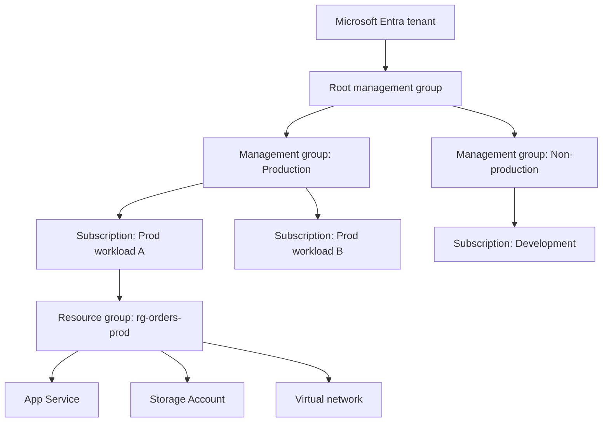

# Phân cấp tenant, management group, subscription và resource group

Khi xây dựng hệ thống trên Microsoft Azure, việc tổ chức tài nguyên ngay từ đầu ảnh hưởng trực tiếp đến cách nhóm vận hành quản lý danh tính, phân quyền, áp dụng chính sách, theo dõi chi phí và tách biệt môi trường. Azure cung cấp một hệ thống phân cấp gồm **tenant Microsoft Entra ID, management group, subscription và resource group**. Mỗi cấp có mục đích và phạm vi quản trị riêng.

Bài học thuộc chương **Tổ chức và quản trị tài nguyên** của module **CLOUD_PROVIDERS_AZURE**. Module giúp bạn khám phá hệ sinh thái Azure từ subscription, resource group và Entra ID đến mạng ảo, dịch vụ tính toán, lưu trữ và dữ liệu; đồng thời học cách triển khai, giám sát, bảo vệ và kiểm soát chi phí cho một kiến trúc ứng dụng.

Sau bài học, bạn có thể:

- Mô tả quan hệ giữa tenant, management group, subscription, resource group và resource.
- Phân biệt ranh giới danh tính với ranh giới quản lý tài nguyên và chi phí.
- Giải thích cách Azure RBAC và Azure Policy kế thừa theo cây phân cấp.
- Chọn cấp phù hợp để tách môi trường, workload, quyền quản trị và chi phí.
- Xây dựng một cấu trúc subscription và resource group dễ vận hành, kiểm soát và mở rộng.

## 1. Bức tranh tổng thể về phân cấp tài nguyên

Trong Azure, tài nguyên được đặt trong resource group; resource group thuộc một subscription; subscription được liên kết với một Microsoft Entra tenant và được tổ chức bên dưới một management group. Các management group có thể lồng nhau để tạo cấu trúc quản trị cho nhiều subscription.



Sơ đồ thể hiện một nhánh ví dụ. Trong thực tế, một tenant có thể có nhiều management group, subscription và resource group. Một resource group có thể chứa nhiều tài nguyên thuộc các loại khác nhau; một subscription có thể chứa nhiều resource group.

| Cấp | Vai trò chính | Ví dụ câu hỏi quản trị |
|---|---|---|
| Microsoft Entra tenant | Ranh giới thư mục và danh tính | Người dùng, nhóm và ứng dụng thuộc tổ chức nào? |
| Management group | Gom subscription để quản trị ở quy mô lớn | Chính sách bảo mật nào áp dụng cho toàn bộ production? |
| Subscription | Phạm vi quản lý Azure, quota và theo dõi chi phí | Workload hoặc môi trường này sử dụng ngân sách và quota nào? |
| Resource group | Nhóm tài nguyên theo vòng đời và mục đích vận hành | Những tài nguyên nào được triển khai, cập nhật hoặc xóa cùng nhau? |
| Resource | Đối tượng Azure cụ thể | Cấu hình, dữ liệu và trạng thái của dịch vụ này là gì? |

Các cấp trên có quan hệ phân cấp, nhưng không thể thay thế nhau. Ví dụ, tạo thêm resource group không tạo ra một ranh giới danh tính mới; tạo thêm tenant cũng không tự động tạo subscription hay tài nguyên.

## 2. Microsoft Entra tenant: ranh giới danh tính

**Tenant** là một phiên bản Microsoft Entra ID dành cho một tổ chức hoặc phạm vi quản trị danh tính. Tenant chứa các đối tượng như:

- User và group.
- Application registration và service principal.
- Managed identity được sử dụng bởi workload Azure.
- Cấu hình xác thực, danh tính và các chính sách truy cập liên quan.

Tenant có một tenant ID duy nhất. Khi người dùng hoặc ứng dụng xác thực với Microsoft Entra ID, tenant cung cấp danh tính và token để dịch vụ Azure hoặc ứng dụng kiểm tra quyền truy cập.

### 2.1. Tenant và subscription liên kết với nhau như thế nào?

Một subscription được liên kết với một Microsoft Entra tenant tại một thời điểm để cung cấp phạm vi danh tính cho việc quản lý và truy cập tài nguyên. Người dùng trong tenant có thể được cấp quyền Azure RBAC trên subscription hoặc các tài nguyên bên dưới.

Một tổ chức có thể có nhiều subscription cùng liên kết với một tenant. Cách làm này thường phù hợp khi tổ chức muốn dùng chung hệ thống danh tính, nhóm và quy trình đăng nhập nhưng vẫn tách môi trường, workload, ngân sách hoặc quota ở cấp subscription.

Một tenant cũng có thể có nhiều subscription thuộc các workload khác nhau. Vì vậy, không nên hiểu tenant là một subscription lớn, hoặc cho rằng mỗi subscription bắt buộc phải có tenant riêng.

Người dùng từ tenant khác vẫn có thể được mời vào tổ chức dưới dạng guest bằng Microsoft Entra B2B và được cấp quyền phù hợp. Điều này không làm thay đổi tenant liên kết của subscription; guest vẫn là một danh tính được biểu diễn trong tenant tài nguyên.

### 2.2. Khi nào cần nhiều tenant?

Nhiều tenant có thể phù hợp khi cần ranh giới danh tính và quản trị độc lập, ví dụ:

- Các tổ chức pháp nhân có yêu cầu quản trị danh tính tách biệt.
- Môi trường cần cô lập danh tính mạnh vì yêu cầu bảo mật hoặc tuân thủ.
- Tổ chức có cấu trúc mua bán, sáp nhập hoặc vận hành nhiều đơn vị độc lập.
- Một môi trường thử nghiệm cần tách hẳn khỏi tenant production để kiểm soát danh tính và cấu hình.

Tuy nhiên, nhiều tenant làm tăng công việc quản trị người dùng, ứng dụng, đồng bộ danh tính, truy cập liên tổ chức và giám sát. Nếu chỉ cần tách quyền, chi phí hoặc vòng đời tài nguyên, trước tiên hãy cân nhắc management group, subscription và resource group trong cùng tenant.

## 3. Management group: quản trị nhiều subscription

**Management group** là cấp tổ chức subscription. Nó cho phép doanh nghiệp gom nhiều subscription theo cấu trúc quản trị và áp dụng các cơ chế quản trị chung ở cấp cao hơn subscription.

Mỗi tenant có một **root management group** (còn gọi là tenant root group) ở đỉnh cây management group. Các management group khác có thể được tạo bên dưới root group và có thể lồng nhau thành nhiều tầng. Subscription được đặt làm phần tử con của một management group trong cây tại một thời điểm.

Ví dụ, doanh nghiệp có thể tổ chức như sau:

```text
Tenant Contoso
└── Root management group
    ├── Platform
    │   ├── Identity
    │   │   └── Subscription: sub-identity-prod
    │   └── Connectivity
    │       └── Subscription: sub-network-prod
    ├── Landing Zones
    │   ├── Corp
    │   │   └── Subscription: sub-erp-prod
    │   └── Online
    │       └── Subscription: sub-commerce-prod
    └── Sandbox
        └── Subscription: sub-lab
```

Tên và cấu trúc trên chỉ là ví dụ. Tổ chức có thể chọn cách phân nhóm theo môi trường, đơn vị kinh doanh, mức độ quan trọng, khu vực hoặc mô hình landing zone.

### 3.1. Quản trị tập trung bằng Azure Policy

Azure Policy có thể được gán tại management group để đặt ra quy tắc cho các subscription bên dưới. Ví dụ:

- Chỉ cho phép triển khai tài nguyên tại những region được tổ chức phê duyệt.
- Yêu cầu tài nguyên phải có tag `CostCenter` hoặc `Environment`.
- Kiểm soát cấu hình lưu trữ công khai hoặc yêu cầu mã hóa.
- Kiểm tra SKU được phép hoặc cấu hình chẩn đoán theo tiêu chuẩn nội bộ.

Assignment ở cấp management group có thể được kế thừa xuống các scope con. Một nhóm subscription production do đó có thể cùng chịu một bộ quy tắc bảo mật và tuân thủ. Ở scope thấp hơn, tổ chức có thể thêm policy phù hợp với workload. Việc miễn trừ policy cần được quản lý có lý do, phạm vi và thời hạn rõ ràng.

### 3.2. Phân quyền ở management group

Azure RBAC cho phép gán role tại management group. Người hoặc nhóm được cấp quyền ở đây có thể nhận quyền trên các scope con theo cơ chế kế thừa. Điều này hữu ích khi đội quản trị nền tảng cần xem hoặc quản lý nhiều subscription.

Vì phạm vi ảnh hưởng lớn, hãy giới hạn quyền đặc quyền ở root management group. Một thay đổi role hoặc policy ở cấp cao có thể tác động đến nhiều workload. Nên cấp quyền ở management group con phù hợp với phạm vi trách nhiệm của từng nhóm thay vì mặc định cấp quyền rộng ở root.

## 4. Subscription: ranh giới quản lý, quota và chi phí

**Subscription** là một đơn vị quản lý quan trọng trong Azure. Tài nguyên Azure được tạo và quản lý trong phạm vi subscription; subscription cũng là scope phổ biến cho Azure RBAC, Azure Policy, quota và Cost Management.

Một subscription thường gắn với một billing relationship hoặc phạm vi theo dõi chi phí trong hợp đồng Azure của tổ chức. Tuy nhiên, cách tổng hợp hóa đơn thực tế còn phụ thuộc loại thỏa thuận và cấu trúc billing account. Nhiều subscription có thể được tổng hợp vào cùng một hóa đơn hoặc billing scope. Do đó, hãy phân biệt subscription dùng để phân bổ và quản lý chi phí với cấu trúc hóa đơn thương mại của tổ chức.

### 4.1. Những lý do thường tách subscription

- **Cô lập môi trường:** tách production khỏi development/test để giảm nguy cơ thao tác nhầm và quản lý quyền riêng.
- **Phân bổ chi phí:** theo dõi chi phí theo workload, phòng ban, dự án hoặc đơn vị chịu ngân sách.
- **Quota và giới hạn dịch vụ:** một số quota được quản lý theo subscription và region; tách subscription có thể giúp tổ chức quản lý nhu cầu quota riêng, nhưng không phải cách tự động vượt mọi giới hạn của Azure.
- **Phạm vi quản trị và bảo mật:** áp dụng role assignment, policy, locks và quy trình vận hành riêng.
- **Quản lý vòng đời:** một workload lớn hoặc đơn vị kinh doanh có thể cần quyền sở hữu và chu kỳ thay đổi độc lập.

### 4.2. Subscription không phải ranh giới cô lập tuyệt đối

Subscription cung cấp phạm vi quản trị hữu ích, nhưng các subscription cùng tenant vẫn có thể chia sẻ danh tính, chính sách cấp cao, mạng kết nối hoặc dịch vụ nền tảng. Một người có quyền ở management group cha có thể có quyền trên nhiều subscription con. Một workload cũng có thể giao tiếp với workload ở subscription khác nếu mạng, danh tính và quyền cho phép.

Khi cần cô lập, hãy kết hợp phân cấp subscription với thiết kế tenant, RBAC, policy, network, key management và quy trình vận hành. Không nên dựa vào việc đặt hai workload ở hai subscription khác nhau như biện pháp bảo mật duy nhất.

### 4.3. Chọn số lượng subscription phù hợp

Không có một con số subscription tối ưu cho mọi tổ chức. Quá ít subscription có thể khiến nhiều nhóm chia sẻ quota, quyền và phạm vi chi phí; quá nhiều subscription làm tăng số lượng policy, role assignment, quy trình triển khai và công việc giám sát.

Một số câu hỏi hữu ích khi quyết định tách subscription:

1. Workload có cần quyền quản trị hoặc đội sở hữu độc lập không?
2. Có cần theo dõi ngân sách, quota hoặc chi phí riêng không?
3. Yêu cầu bảo mật và tuân thủ có đòi hỏi ranh giới quản lý riêng không?
4. Chu kỳ triển khai và vòng đời của workload có khác biệt đáng kể không?
5. Có thể đáp ứng nhu cầu bằng resource group, management group, RBAC và policy hiện có không?

## 5. Resource group: nhóm tài nguyên theo vòng đời

**Resource group** là một container logic chứa các tài nguyên Azure trong cùng subscription. Đây là đơn vị phổ biến để tổ chức tài nguyên của một ứng dụng, một thành phần kiến trúc hoặc một môi trường triển khai.

Ví dụ, một ứng dụng xử lý đơn hàng có thể dùng resource group `rg-orders-prod` chứa App Service, Storage Account, Application Insights và một số tài nguyên liên quan. Nhóm vận hành có thể gán quyền, policy hoặc resource lock ở cấp resource group để quản lý các tài nguyên trong phạm vi ứng dụng.

Các quy tắc quan trọng:

- Một resource group thuộc về đúng một subscription.
- Một resource chỉ thuộc một resource group tại một thời điểm.
- Resource group không chứa resource group khác; các resource group cùng cấp trong một subscription.
- Các tài nguyên trong cùng resource group có thể nằm ở những region khác nhau.
- Region được chọn khi tạo resource group xác định nơi lưu metadata của resource group; nó không buộc mọi tài nguyên bên trong phải được triển khai tại region đó.
- Xóa resource group sẽ khởi tạo việc xóa các tài nguyên bên trong, vì vậy cần kiểm tra kỹ trước khi thực hiện.

### 5.1. Tổ chức resource group theo ứng dụng và vòng đời

Một cách tổ chức thường gặp là gom các tài nguyên có cùng chủ sở hữu, mục đích và vòng đời. Ví dụ:

| Resource group | Nội dung minh họa | Lý do tách |
|---|---|---|
| `rg-orders-prod` | App Service, Storage Account, Application Insights | Thành phần ứng dụng production |
| `rg-orders-data-prod` | Tài nguyên dữ liệu có vòng đời và quyền riêng | Kiểm soát dữ liệu và quyền truy cập chặt hơn |
| `rg-orders-network-prod` | Một số tài nguyên mạng chuyên dụng | Đội nền tảng quản lý độc lập |
| `rg-orders-dev` | Tài nguyên thử nghiệm | Có thể triển khai và xóa thường xuyên |

Đây là cách phân nhóm minh họa; không nhất thiết phải tạo nhiều resource group như bảng trên. Nếu toàn bộ tài nguyên của ứng dụng có cùng vòng đời và quyền sở hữu, một resource group có thể đơn giản hơn. Nếu dữ liệu cần quyền truy cập hoặc vòng đời khác, tách riêng có thể giúp giảm phạm vi ảnh hưởng khi thay đổi hoặc xóa tài nguyên.

### 5.2. Di chuyển tài nguyên giữa resource group

Azure hỗ trợ di chuyển một số tài nguyên giữa resource group hoặc subscription, nhưng không phải mọi loại tài nguyên và mọi tình huống đều được hỗ trợ. Việc di chuyển có thể bị giới hạn bởi resource provider, loại tài nguyên, trạng thái triển khai, dependency, lock hoặc các dịch vụ liên quan.

Trước khi di chuyển, cần:

1. Kiểm tra tài liệu của loại tài nguyên để xác nhận hỗ trợ move và các giới hạn.
2. Xác định dependency với tài nguyên khác, kể cả tài nguyên nằm ngoài resource group.
3. Kiểm tra role assignment, policy, lock, tag và các cấu hình tham chiếu theo resource ID.
4. Lập kế hoạch thời gian, kiểm thử ở môi trường phù hợp và chuẩn bị phương án khôi phục.

Di chuyển resource group không đồng nghĩa với việc đổi region của các tài nguyên. Vị trí triển khai của từng resource được quản lý theo cấu hình và khả năng của dịch vụ tương ứng.

## 6. Cách quyền và chính sách kế thừa theo phân cấp

Một lợi ích quan trọng của hệ thống phân cấp là có thể quản trị ở cấp cha và kế thừa xuống cấp con.

### 6.1. Azure RBAC

Azure RBAC kiểm soát ai được phép thực hiện thao tác nào trên scope nào. Role assignment có thể được tạo ở management group, subscription, resource group hoặc resource. Quyền được gán ở scope cha thường được kế thừa bởi các scope con.

Ví dụ:

- Gán `Reader` ở management group `Production` có thể cho phép nhóm kiểm toán xem tài nguyên trong các subscription production bên dưới.
- Gán `Contributor` ở subscription `sub-orders-prod` cho nhóm triển khai cho phép quản lý tài nguyên trong subscription đó theo quyền của role.
- Gán `Storage Blob Data Reader` ở scope lưu trữ phù hợp cho managed identity của API để đọc dữ liệu blob.

Hãy chú ý sự khác nhau giữa quyền quản lý tài nguyên và quyền data plane. Một role `Reader` trên resource group cho phép xem metadata tài nguyên theo phạm vi role, nhưng không tự động cấp quyền đọc nội dung blob hoặc secret.

### 6.2. Azure Policy

Azure Policy đánh giá và kiểm soát cấu hình tài nguyên theo các định nghĩa policy và initiative. Assignment có thể được đặt ở management group, subscription, resource group hoặc resource tùy tình huống. Assignment ở cấp cha có thể áp dụng cho các scope con.

Ví dụ, tổ chức gán policy yêu cầu tag `Environment` ở management group. Mọi subscription và resource group bên dưới đều chịu yêu cầu đó, trừ các trường hợp được miễn trừ hợp lệ. Một workload có thể nhận thêm policy cụ thể ở subscription hoặc resource group.

RBAC và Policy giải quyết hai câu hỏi khác nhau:

| Cơ chế | Câu hỏi chính | Ví dụ |
|---|---|---|
| Azure RBAC | Ai được làm gì? | Nhóm vận hành có thể cập nhật tài nguyên nào? |
| Azure Policy | Cấu hình nào được phép hoặc phải đáp ứng? | Tài nguyên có bắt buộc gắn tag và dùng region được duyệt không? |

Một người có quyền tạo tài nguyên nhờ RBAC vẫn có thể bị policy từ chối nếu cấu hình không đáp ứng quy tắc. Ngược lại, policy cho phép một cấu hình không có nghĩa người dùng tự động có quyền tạo tài nguyên.

## 7. Ví dụ thiết kế phân cấp cho một doanh nghiệp

Giả sử một doanh nghiệp có hệ thống thương mại điện tử, hệ thống ERP và môi trường thử nghiệm. Doanh nghiệp muốn dùng chung tenant để quản lý danh tính, áp dụng chính sách nền tảng thống nhất và phân bổ chi phí theo workload.

Một cấu trúc tham khảo:

```text
Tenant: contoso.onmicrosoft.com
└── Root management group
    ├── Platform
    │   ├── sub-connectivity
    │   │   ├── rg-hub-network
    │   │   └── rg-private-dns
    │   └── sub-management
    │       └── rg-monitoring
    ├── Production
    │   ├── sub-ecommerce-prod
    │   │   ├── rg-ecommerce-app-prod
    │   │   └── rg-ecommerce-data-prod
    │   └── sub-erp-prod
    │       └── rg-erp-prod
    └── Non-production
        ├── sub-ecommerce-dev
        │   └── rg-ecommerce-dev
        └── sub-shared-test
            └── rg-integration-test
```

Tổ chức có thể gán policy bảo mật chung ở root hoặc management group phù hợp, policy production ở nhánh `Production`, và quyền vận hành riêng ở từng subscription. Nhóm nền tảng quản lý kết nối và giám sát; nhóm ứng dụng được cấp quyền trong phạm vi subscription hoặc resource group mà họ sở hữu.

Việc chia subscription theo workload giúp phân bổ chi phí và quota rõ ràng hơn. Việc chia resource group theo ứng dụng hoặc vòng đời giúp triển khai, cập nhật và thu hồi tài nguyên thuận tiện. Các tag như `Application`, `Environment`, `Owner`, `CostCenter` và `DataClassification` bổ sung thông tin để báo cáo và kiểm toán.

## 8. Khám phá cấu trúc bằng Azure CLI

Azure CLI giúp kiểm tra tenant, subscription, management group và resource group đang có quyền truy cập. Các lệnh sau chỉ đọc thông tin hoặc đặt subscription mặc định cho phiên CLI; chúng không tạo hay xóa tài nguyên.

Liệt kê các subscription mà danh tính hiện tại có thể truy cập:

```bash
az account list --output table
```

Xem subscription đang được chọn trong Azure CLI:

```bash
az account show --output json
```

Liệt kê management group mà danh tính có quyền xem:

```bash
az account management-group list --output table
```

Xem chi tiết một management group và các cấp con:

```bash
az account management-group show \
  --name <management-group-id> \
  --expand \
  --recurse \
  --output json
```

Liệt kê resource group trong subscription hiện tại:

```bash
az group list --output table
```

Xem một resource group cụ thể:

```bash
az group show \
  --name rg-ecommerce-app-prod \
  --output json
```

Nếu cần chuyển context CLI sang subscription khác, hãy chỉ định subscription rõ ràng:

```bash
az account set --subscription <subscription-id>
```

Lệnh này thay đổi subscription mặc định của phiên CLI hiện tại. Trước khi chạy lệnh triển khai, hãy kiểm tra lại `az account show` để tránh tạo tài nguyên nhầm môi trường.

## 9. Nguyên tắc thiết kế và lỗi tổ chức thường gặp

- **Thiết kế tenant theo ranh giới danh tính.** Chỉ tạo tenant riêng khi cần quản trị danh tính độc lập hoặc có yêu cầu cô lập rõ ràng.
- **Dùng management group cho quản trị quy mô lớn.** Gom subscription theo mô hình quản trị, áp dụng policy và quyền chung tại cấp phù hợp.
- **Tách subscription theo nhu cầu thực tế.** Cân nhắc môi trường, workload, quota, ngân sách, quyền sở hữu và yêu cầu tuân thủ.
- **Nhóm resource group theo vòng đời.** Những tài nguyên thường được triển khai, cập nhật và thu hồi cùng nhau có thể nằm chung một resource group.
- **Giữ quyền ở scope nhỏ nhất phù hợp.** Tránh gán `Owner` hoặc quyền rộng ở root management group nếu công việc chỉ cần một subscription hay resource group.
- **Đặt tên và gắn tag nhất quán.** Dùng quy ước thể hiện ứng dụng, môi trường, chủ sở hữu và trung tâm chi phí.
- **Theo dõi kế thừa và ngoại lệ.** Rà soát role assignment, policy exemption và resource lock ở cả cấp cha lẫn cấp con.
- **Kiểm tra context trước khi triển khai.** Xác nhận tenant và subscription đang được chọn trong Portal, CLI hoặc pipeline.

Một số lỗi phổ biến cần tránh:

1. Tạo quá nhiều tenant chỉ để tách development và production, khiến quản trị danh tính phức tạp không cần thiết.
2. Đặt mọi workload trong một subscription duy nhất dù chúng có chủ sở hữu, ngân sách hoặc yêu cầu bảo mật khác nhau.
3. Tạo resource group theo từng loại dịch vụ mà không xét vòng đời, khiến một ứng dụng bị phân tán và khó quản lý.
4. Gán quyền ở root management group một cách rộng rãi, làm tăng phạm vi ảnh hưởng của lỗi hoặc tài khoản bị xâm nhập.
5. Cho rằng region của resource group quyết định region của mọi tài nguyên bên trong.
6. Xóa resource group mà chưa kiểm tra tài nguyên và dependency bên trong.

## 10. Tự kiểm tra

1. Một tenant có thể chứa nhiều subscription không? Điều gì được chia sẻ giữa các subscription cùng tenant?
2. Vì sao management group hữu ích khi tổ chức có hàng chục hoặc hàng trăm subscription?
3. Khi nào nên tạo subscription mới thay vì resource group mới?
4. Resource group được tạo ở `southeastasia` có bắt buộc mọi tài nguyên bên trong cũng phải ở `southeastasia` không? Giải thích.
5. Nếu gán Azure Policy tại management group, những subscription bên dưới chịu ảnh hưởng như thế nào?
6. Vì sao một subscription riêng không tự động tạo ra ranh giới cô lập danh tính tuyệt đối?
7. Trước khi xóa một resource group, bạn cần xác minh những điều gì?

## Kết luận

Tenant tổ chức danh tính; management group tổ chức subscription và hỗ trợ quản trị tập trung; subscription cung cấp phạm vi quản lý, quota và theo dõi chi phí; resource group gom các tài nguyên theo ứng dụng và vòng đời. Azure RBAC và Azure Policy có thể kế thừa theo cây phân cấp, vì vậy vị trí đặt role assignment và policy ảnh hưởng đến nhiều scope con. Khi thiết kế Azure landing zone, hãy chọn từng cấp theo nhu cầu danh tính, quản trị, bảo mật, ngân sách và vận hành để hệ thống có thể phát triển mà vẫn kiểm soát được.
