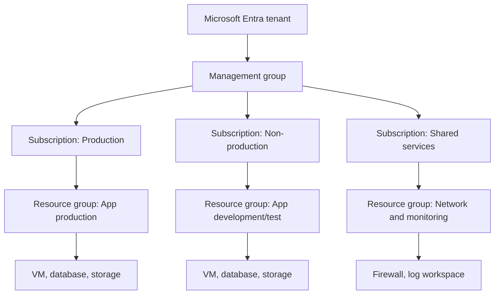
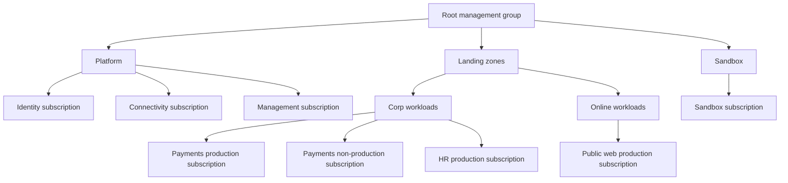
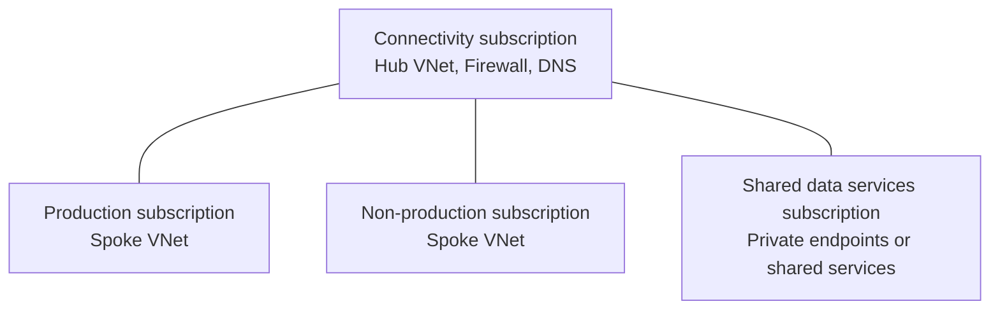

# Thiết kế ranh giới subscription theo môi trường và đội nhóm

Khi một tổ chức bắt đầu triển khai nhiều ứng dụng trên Microsoft Azure, việc đặt tất cả tài nguyên vào một subscription thường khiến quyền truy cập, chính sách, hạn mức và chi phí khó quản lý. Ngược lại, tạo quá nhiều subscription mà không có quy tắc chung sẽ làm tăng công việc vận hành và khiến đội ngũ khó hiểu hệ thống đang được tổ chức như thế nào.

Thiết kế ranh giới subscription là quyết định xác định workload, môi trường và đội nhóm nào được quản lý trong cùng một phạm vi Azure. Ranh giới phù hợp giúp nhóm phát triển có quyền tự chủ, production được bảo vệ, chi phí có thể quy trách nhiệm và nền tảng vẫn áp dụng được các tiêu chuẩn chung.

Trong module `CLOUD_PROVIDERS_AZURE`, bạn tìm hiểu hệ sinh thái Azure từ subscription, resource group và Microsoft Entra ID đến mạng ảo, compute, storage và dữ liệu. Bài học này đặt subscription vào cấu trúc quản trị tổng thể, đồng thời kết nối cách phân chia môi trường và đội nhóm với RBAC, Azure Policy, mạng, quota, giám sát và kiểm soát chi phí.

## Mục tiêu

Sau bài học, bạn có thể:

- Giải thích vị trí của tenant, management group, subscription, resource group và resource trong hệ thống phân cấp Azure.
- Xác định những yêu cầu nên được giải quyết bằng ranh giới subscription.
- Chọn cách phân chia subscription theo môi trường, đội nhóm và workload.
- Thiết kế cấu trúc management group để áp dụng chính sách chung.
- Phân quyền, theo dõi chi phí và quản lý quota theo từng subscription.
- Lập quy trình tạo mới, vận hành và thu hồi subscription nhất quán.

## 1. Subscription nằm ở đâu trong cấu trúc Azure?

Azure tổ chức tài nguyên theo một hệ thống phân cấp. Mỗi lớp giải quyết một phạm vi quản lý khác nhau:

| Thành phần | Vai trò chính |
|---|---|
| Microsoft Entra tenant | Thư mục danh tính chứa người dùng, nhóm, ứng dụng và các danh tính phục vụ xác thực |
| Management group | Nhóm nhiều subscription để tổ chức quản trị và áp dụng Azure Policy hoặc Azure RBAC ở phạm vi rộng |
| Subscription | Phạm vi quản lý tài nguyên, phân quyền, quota và phân tích chi phí ở cấp subscription |
| Resource group | Nhóm các resource có vòng đời hoặc mục đích quản lý liên quan |
| Resource | Tài nguyên Azure cụ thể như VM, VNet, Storage Account hoặc database |

Một cấu trúc minh họa:

Trong thực tế, management group có thể có nhiều cấp con và các subscription có thể nằm trong những nhánh khác nhau. Mỗi subscription thuộc một management group tại một thời điểm trong cùng tenant. Subscription có thể được chuyển sang management group khác khi cấu trúc quản trị thay đổi, nhưng cần đánh giá ảnh hưởng của các quyền và chính sách được kế thừa.

### Phân biệt tenant và subscription

Microsoft Entra tenant là ranh giới thư mục danh tính. Subscription được liên kết với một tenant để sử dụng danh tính trong tenant đó cho việc xác thực và cấp quyền. Một tenant có thể quản lý nhiều subscription.

Tạo subscription riêng cho production và development trong cùng tenant giúp tách quyền, policy, quota và theo dõi chi phí ở cấp subscription. Tuy nhiên, cách này không tạo ra một thư mục danh tính độc lập. Các quản trị viên có quyền cao ở tenant hoặc quyền được cấp ở management group vẫn có thể có phạm vi quản trị rộng trên các subscription con.

Chỉ cân nhắc nhiều tenant khi có yêu cầu rõ ràng về việc tách biệt danh tính, tổ chức, pháp lý hoặc quản trị. Nhiều tenant làm tăng độ phức tạp trong cộng tác, đồng bộ danh tính, giám sát và quản lý nền tảng.

## 2. Vì sao cần thiết kế ranh giới subscription?

Subscription là một trong những ranh giới quản trị quan trọng của Azure. Việc phân chia hợp lý tác động trực tiếp đến các hoạt động sau:

- **Quyền truy cập:** Azure RBAC có thể được cấp ở cấp subscription và được kế thừa xuống resource group, resource. Việc tách subscription giúp giới hạn phạm vi quyền của đội nhóm.
- **Chính sách quản trị:** Azure Policy có thể được gán tại management group hoặc subscription. Subscription riêng cho phép áp dụng cấu hình riêng cho production, non-production hoặc workload có yêu cầu đặc thù.
- **Hạn mức:** nhiều quota được tính theo subscription, region, resource provider hoặc SKU. Tách workload có thể giúp theo dõi nhu cầu và xử lý yêu cầu tăng quota rõ ràng hơn.
- **Chi phí:** Cost Management có thể phân tích chi phí theo subscription. Subscription riêng giúp xác định chi phí của môi trường hoặc nhóm sở hữu dễ hơn, dù hóa đơn vẫn có thể được tổng hợp ở phạm vi billing account hoặc billing profile tùy thỏa thuận.
- **Vòng đời:** subscription có thể được cấp phát, bàn giao, quản lý và thu hồi theo vòng đời của một sản phẩm hoặc nhóm workload.
- **Phạm vi ảnh hưởng:** giới hạn quyền và chính sách ở cấp subscription giúp giảm nguy cơ một thao tác quản trị nhầm tác động đến nhiều workload không liên quan.

Subscription không tự động tạo ranh giới mạng hay bảo đảm cách ly vật lý. Các workload ở những subscription khác nhau vẫn có thể giao tiếp nếu mạng và quyền được cấu hình cho phép. Muốn kiểm soát luồng mạng, bạn vẫn cần thiết kế VNet, subnet, route, firewall, private endpoint và các quy tắc kết nối phù hợp.

## 3. Chọn tiêu chí phân chia subscription

Không có một công thức duy nhất như “mỗi đội một subscription” hoặc “mỗi môi trường một subscription” phù hợp với mọi tổ chức. Hãy đánh giá các tiêu chí sau trước khi tạo ranh giới.

### Môi trường triển khai

Production thường cần quyền truy cập chặt chẽ, thay đổi có phê duyệt, chính sách bảo mật nghiêm ngặt và ngân sách vận hành riêng. Development và test thường cần tốc độ thử nghiệm cao hơn, có thể sử dụng SKU khác và có vòng đời tài nguyên ngắn hơn.

Vì vậy, một điểm khởi đầu phổ biến là tách production khỏi non-production. Nếu dev và test có yêu cầu quyền, quota, chi phí hoặc chính sách khác nhau đáng kể, có thể tách tiếp thành các subscription riêng. Với sandbox, nên có subscription và chính sách riêng để giới hạn tài nguyên, chi phí và thời gian tồn tại.

### Đội nhóm và quyền sở hữu workload

Một đội nhóm có thể cần subscription riêng khi họ chịu trách nhiệm vận hành độc lập, có owner rõ ràng, cần quyền triển khai chủ động và cần theo dõi chi phí riêng. Nếu nhiều đội cùng phát triển một sản phẩm với chung vòng đời và cùng người chịu trách nhiệm, việc dùng chung subscription nhưng phân chia resource group và RBAC có thể đơn giản hơn.

Không nên tạo subscription cho từng cá nhân hoặc từng nhánh tính năng nhỏ nếu không có nhu cầu quản trị tương ứng. Mỗi subscription mới cần được cấp quyền, gắn policy, thiết lập giám sát, theo dõi chi phí, quản lý quota và đưa vào inventory.

### Mức độ quan trọng và yêu cầu tuân thủ

Workload xử lý dữ liệu nhạy cảm, chịu yêu cầu kiểm toán hoặc có mức độ sẵn sàng cao có thể cần subscription riêng để áp dụng policy, quyền truy cập, quy trình thay đổi và theo dõi chi phí riêng. Việc tách subscription hỗ trợ quản trị, nhưng không tự chứng minh rằng workload đã đáp ứng yêu cầu pháp lý. Kiểm soát dữ liệu, mã hóa, lưu trữ log, vị trí dữ liệu và quy trình vận hành vẫn phải được thiết kế và kiểm tra.

### Nhu cầu quota và chi phí

Nếu một workload có mức tiêu thụ lớn hoặc thường xuyên cần tăng quota, subscription riêng giúp nhìn rõ nhu cầu và trách nhiệm sử dụng. Với workload nhỏ có cùng owner và chính sách, tách riêng chỉ để có một dòng chi phí có thể tạo thêm công việc mà không đem lại giá trị tương xứng.

### Bảng gợi ý quyết định

| Tình huống | Hướng thiết kế nên xem xét | Lý do |
|---|---|---|
| Production và development có yêu cầu bảo vệ khác nhau | Tách production và non-production | Giảm phạm vi quyền và áp dụng policy phù hợp từng môi trường |
| Hai đội sở hữu workload, vận hành và ngân sách độc lập | Cân nhắc subscription riêng cho mỗi workload hoặc nhóm workload | Tách trách nhiệm, quota và chi phí |
| Nhiều đội cùng vận hành một nền tảng dùng chung | Subscription dùng chung cho platform, phân quyền theo nhóm | Tránh nhân bản các dịch vụ nền tảng và tập trung quản trị |
| Thử nghiệm ngắn hạn, không ổn định về tài nguyên | Sandbox subscription với policy và budget giới hạn | Kiểm soát rủi ro và dọn dẹp tài nguyên thử nghiệm |
| Workload có yêu cầu tuân thủ hoặc kiểm soát đặc biệt | Subscription riêng cùng policy và quy trình bổ sung | Dễ xác định phạm vi kiểm soát và thu thập bằng chứng |
| Nhiều ứng dụng nhỏ có cùng owner, cùng chính sách | Có thể dùng chung subscription và tách resource group | Giảm chi phí vận hành subscription |

Hãy ghi lại lý do cho từng ranh giới. Nếu không thể giải thích subscription đó đang bảo vệ quyền, chính sách, chi phí, quota hay vòng đời nào, có thể cấu trúc đang bị chia quá nhỏ.

## 4. Mô hình tham khảo cho tổ chức có nhiều đội nhóm

Một mô hình thường dùng là kết hợp management group cho quản trị chung với subscription cho workload và môi trường. Cấu trúc sau chỉ là ví dụ để điều chỉnh theo quy mô và yêu cầu của tổ chức:

Ý nghĩa các nhóm:

- **Platform:** chứa dịch vụ nền tảng dùng chung như danh tính phục vụ workload, kết nối mạng trung tâm, firewall, DNS, giám sát hoặc vận hành. Có thể tách identity, connectivity và management thành các subscription riêng khi quyền sở hữu, vòng đời hoặc yêu cầu bảo vệ khác nhau.
- **Landing zones:** chứa subscription dành cho ứng dụng và workload của các đội sản phẩm. Có thể chia nhánh theo loại workload hoặc yêu cầu kết nối, ví dụ workload nội bộ và workload hướng Internet.
- **Sandbox:** dành cho thử nghiệm có kiểm soát, thường có policy giới hạn region/SKU, budget cảnh báo và quy trình hết hạn.

Các tên `Corp`, `Online`, `Platform` hoặc `Sandbox` là cách tổ chức tham khảo. Hãy dùng tên và cấu trúc phản ánh mô hình vận hành thực tế của tổ chức. Không cần tạo tất cả nhánh nếu chưa có workload tương ứng.

### Tách theo môi trường hay theo đội nhóm?

Hai chiều này có thể kết hợp. Ví dụ, đội Payments sở hữu hai subscription `payments-prod` và `payments-nonprod`; đội HR sở hữu `hr-prod` và `hr-nonprod`. Các subscription workload đều nằm dưới management group có baseline chung, còn production có thể nằm dưới nhánh policy chặt hơn.

Mô hình này tạo ranh giới theo workload và môi trường. Nó giúp đội sở hữu workload chịu trách nhiệm rõ ràng, trong khi nhóm platform vẫn áp dụng được tiêu chuẩn bảo mật và vận hành từ cấp management group.

## 5. Thiết kế quyền truy cập theo ranh giới

Azure RBAC cho phép gán role ở nhiều scope: management group, subscription, resource group và resource. Role assignment ở scope cha có thể được kế thừa xuống scope con. Vì vậy, cần thiết kế quyền đồng bộ với cấu trúc subscription.

Một số nguyên tắc thực hành:

1. Tạo nhóm trong Microsoft Entra ID theo vai trò công việc, ví dụ `Payments-Developers`, `Payments-Operators` và `Cloud-Platform-Admins`.
2. Cấp quyền cho nhóm thay vì gán trực tiếp cho từng người khi có thể, để việc thay đổi nhân sự được quản lý tập trung.
3. Cấp quyền developer ở subscription non-production hoặc resource group phù hợp; giới hạn quyền production cho nhóm vận hành được chỉ định.
4. Dùng role có phạm vi và quyền nhỏ nhất đáp ứng công việc. Chỉ cấp Owner hoặc User Access Administrator khi thực sự cần quản lý quyền hoặc cấu hình toàn bộ phạm vi.
5. Dùng Privileged Identity Management (PIM) và quyền kích hoạt theo thời hạn cho các vai trò đặc quyền nếu tổ chức có cấu hình phù hợp.
6. Rà soát role assignment được kế thừa từ management group để tránh vô tình cấp quyền quá rộng.

Ví dụ, nhóm Payments Developers có quyền triển khai vào subscription `payments-nonprod`. Nhóm Payments Operators có quyền vận hành production theo vai trò đã phê duyệt. Nhóm Cloud Platform quản lý network và policy nền tảng ở phạm vi tương ứng. Danh tính ứng dụng nên dùng managed identity hoặc service principal được giới hạn quyền cần thiết, thay vì dùng tài khoản cá nhân trong pipeline.

Hãy nhớ rằng subscription riêng không loại bỏ quyền quản trị cấp cao. Nếu một nhóm có quyền Owner tại management group cha, quyền đó có thể ảnh hưởng đến các subscription bên dưới. Bởi vậy, quản trị management group và các tài khoản đặc quyền cần được bảo vệ nghiêm ngặt.

## 6. Áp dụng Azure Policy theo môi trường

Azure Policy giúp tổ chức áp dụng tiêu chuẩn cấu hình trên tài nguyên. Bạn có thể gán policy hoặc initiative tại management group để tạo baseline chung, sau đó gán thêm policy ở nhánh hoặc subscription dành cho môi trường cụ thể.

Ví dụ về các lớp chính sách:

| Phạm vi | Chính sách có thể áp dụng |
|---|---|
| Management group gốc hoặc nhánh platform | Yêu cầu cấu hình chẩn đoán, kiểm soát loại tài nguyên bị cấm, chuẩn bảo mật nền tảng |
| Landing zones | Giới hạn region được phép, yêu cầu tag owner và cost center, kiểm soát cấu hình mạng công khai |
| Production subscriptions | Yêu cầu cấu hình bảo vệ dữ liệu, giám sát, backup hoặc SKU đã được phê duyệt |
| Sandbox subscriptions | Giới hạn SKU/region, yêu cầu thời hạn sử dụng và hạn chế tài nguyên có chi phí cao |

Policy được gán ở management group có thể được kế thừa bởi các subscription và resource bên dưới. Hãy kiểm tra tác động trước khi dùng effect `Deny` trên phạm vi rộng, bởi một policy không phù hợp có thể chặn cả deployment hợp lệ. Với ngoại lệ cần thiết, dùng cơ chế exemption có lý do, owner và thời hạn xem xét theo quy trình tổ chức.

Tag như `environment`, `owner`, `costCenter`, `application` giúp phân loại tài nguyên. Tuy nhiên, tag trên subscription không tự động được sao chép xuống mọi resource. Nếu cần kế thừa tag, hãy cấu hình Azure Policy phù hợp và kiểm tra các resource đã tồn tại.

## 7. Kết nối mạng giữa các subscription

Tổ chức thường có các dịch vụ mạng dùng chung như hub VNet, Azure Firewall, VPN Gateway, ExpressRoute, DNS và kết nối đến hệ thống tại chỗ. Có thể đặt các dịch vụ này trong connectivity subscription rồi kết nối với workload subscription theo mô hình hub-and-spoke.

Mô hình này cho phép nhóm platform quản lý kết nối trung tâm trong phạm vi riêng, còn các đội ứng dụng quản lý mạng workload theo quyền được cấp. VNet peering, route, firewall rule và DNS cần được cấu hình rõ ràng. Việc đặt hai VNet ở hai subscription khác nhau không tự tạo kết nối, cũng không tự chặn kết nối.

Nếu production và non-production cần cách ly mạng, hãy thiết kế subnet, route, firewall và chính sách kết nối tương ứng. Không dựa duy nhất vào tên subscription để suy ra mức độ cách ly mạng.

## 8. Phân bổ và kiểm soát chi phí

Subscription riêng giúp Cost Management phân tích chi phí theo môi trường hoặc owner dễ hơn. Tuy nhiên, hóa đơn thanh toán có thể được tổng hợp ở cấp billing account, billing profile hoặc invoice section tùy loại thỏa thuận và cấu hình thanh toán của tổ chức.

Để có dữ liệu chi phí hữu ích:

- Gán subscription cho đúng owner, workload, môi trường và cost center trong inventory của tổ chức.
- Dùng Cost Analysis để xem xu hướng chi phí theo subscription và các chiều phân tích có sẵn.
- Thiết lập budget và alert cho từng subscription hoặc phạm vi chi phí phù hợp.
- Dùng tag nhất quán cho application, environment, owner và cost center; kết hợp Azure Policy nếu cần yêu cầu hoặc kế thừa tag.
- Theo dõi chi phí dịch vụ dùng chung như firewall, log ingestion, DNS và network egress; xác định quy tắc phân bổ cho các đội sử dụng.
- Rà soát tài nguyên không còn sử dụng và chi phí tăng bất thường.

Budget trong Azure Cost Management chủ yếu cung cấp theo dõi và cảnh báo. Budget không phải cơ chế tự động dừng mọi tài nguyên khi chi phí chạm ngưỡng. Muốn hạn chế chi phí, cần kết hợp quota, Azure Policy, quyền tạo tài nguyên, quy trình phê duyệt và hoạt động dọn dẹp.

## 9. Quota và giới hạn khi chia subscription

Nhiều quota Azure được tính theo subscription và region, nhưng phạm vi cụ thể phụ thuộc vào dịch vụ và metric. Khi tách workload ra nhiều subscription, không được giả định rằng mọi quota sẽ tự động tăng hoặc được chia sẻ giữa các subscription.

Trước một đợt triển khai lớn, hãy:

1. Kiểm tra quota của đúng subscription và region.
2. Kiểm tra quota liên quan đến resource provider, SKU hoặc VM family.
3. Kiểm tra các giới hạn riêng của dịch vụ và khả năng cung cấp capacity.
4. Ước tính tổng nhu cầu cho từng subscription và workload.
5. Gửi yêu cầu tăng quota cho đúng subscription nếu cần, đồng thời theo dõi kết quả trước ngày triển khai.

Nếu một nền tảng dùng chung phục vụ nhiều subscription, cần lập kế hoạch quota ở cả subscription chứa dịch vụ dùng chung lẫn các subscription workload. Tách subscription giúp xác định owner và phạm vi sử dụng rõ hơn, nhưng không thay thế việc kiểm tra quota thực tế.

## 10. Quy trình cấp phát và quản lý vòng đời subscription

Để tránh mỗi đội tự tạo subscription với cấu hình khác nhau, tổ chức nên xây dựng quy trình cấp phát subscription (subscription vending). Quy trình có thể được tự động hóa bằng Infrastructure as Code và pipeline nội bộ.

### Khi tạo subscription mới

1. **Tiếp nhận yêu cầu:** ghi nhận workload, môi trường, đội sở hữu, owner kỹ thuật, cost center, region và yêu cầu tuân thủ.
2. **Đánh giá ranh giới:** xác định có cần subscription riêng hay có thể dùng resource group trong subscription hiện tại.
3. **Chọn vị trí quản trị:** đưa subscription vào đúng management group để nhận baseline policy và quyền phù hợp.
4. **Thiết lập quyền:** tạo role assignment cho nhóm Entra ID, xác định owner và quy trình truy cập đặc quyền.
5. **Cấu hình nền tảng:** thiết lập kết nối mạng, DNS, logging, monitoring và các dịch vụ dùng chung cần thiết.
6. **Thiết lập chi phí:** gắn thông tin owner/cost center trong inventory, cấu hình budget và alert.
7. **Kiểm tra quota:** xác nhận hạn mức cần thiết cho region và SKU dự kiến.
8. **Bàn giao:** ghi lại mục đích, owner, policy, quyền, kết nối, quota, budget và kênh hỗ trợ.

### Trong quá trình vận hành

- Rà soát owner, nhóm được cấp quyền và quyền đặc quyền định kỳ.
- Theo dõi policy compliance, bảo mật, chi phí và quota.
- Đánh giá lại cấu trúc khi workload chuyển môi trường, đổi đội sở hữu hoặc có yêu cầu tuân thủ mới.
- Ghi nhận ngoại lệ policy, thay đổi management group và quyết định tăng quota.

### Khi ngừng sử dụng

Trước khi thu hồi subscription, cần xác nhận dữ liệu đã được lưu trữ hoặc chuyển đi, các dependency đã được tháo gỡ, log cần giữ đã được bảo toàn, billing đã được đối soát và owner đã phê duyệt. Sau đó thực hiện quy trình hủy hoặc đóng subscription theo loại thỏa thuận và chính sách tổ chức. Có thể chuyển subscription vào management group dành cho tài nguyên ngừng hoạt động để áp dụng kiểm soát phù hợp trong giai đoạn chờ xử lý, nếu mô hình quản trị có sử dụng nhánh này.

## 11. Ví dụ thiết kế cho một công ty có ba đội sản phẩm

Giả sử công ty có ba đội Payments, HR và Web. Mỗi đội sở hữu ứng dụng riêng; nhóm Cloud Platform quản lý kết nối, giám sát và baseline bảo mật. Production cần kiểm soát chặt hơn non-production.

Một thiết kế có thể là:

| Subscription | Owner | Mục đích |
|---|---|---|
| `sub-platform-connectivity` | Cloud Platform | Hub VNet, firewall, VPN/ExpressRoute và DNS dùng chung |
| `sub-platform-management` | Cloud Platform | Log workspace, giám sát và dịch vụ quản trị dùng chung |
| `sub-payments-prod` | Payments | Workload production của Payments |
| `sub-payments-nonprod` | Payments | Development và test của Payments |
| `sub-hr-prod` | HR | Workload production của HR |
| `sub-hr-nonprod` | HR | Development và test của HR |
| `sub-web-prod` | Web | Workload production của Web |
| `sub-web-nonprod` | Web | Development và test của Web |
| `sub-sandbox` | Cloud Platform và các đội được phép | Thử nghiệm ngắn hạn theo policy riêng |

Các subscription workload được đặt dưới nhánh management group thích hợp. Nhánh production áp dụng policy chặt hơn về quyền, logging, backup và cấu hình mạng. Nhánh non-production cho phép một số SKU thử nghiệm đã được phê duyệt nhưng vẫn giới hạn region và chi phí. Nhóm Cloud Platform quản lý dịch vụ dùng chung và cấp quyền truy cập theo nhu cầu.

Nếu công ty còn nhỏ, một số subscription non-production có thể được hợp nhất khi các đội có cùng chính sách, owner và yêu cầu quota. Nếu một ứng dụng tăng trưởng lớn hoặc có yêu cầu kiểm soát riêng, có thể tách workload đó thành subscription riêng. Cấu trúc nên phát triển theo nhu cầu quản trị thực tế.

## 12. Các sai lầm thường gặp

| Sai lầm | Hệ quả | Cách cải thiện |
|---|---|---|
| Tất cả môi trường dùng chung một subscription | Quyền, quota, policy và chi phí khó tách biệt | Tách production khỏi non-production khi có yêu cầu vận hành khác nhau |
| Mỗi tính năng hoặc cá nhân có một subscription | Tăng gánh nặng inventory, policy, quyền và giám sát | Tạo subscription theo owner và ranh giới quản trị có ý nghĩa |
| Dùng subscription thay cho ranh giới mạng | Luồng kết nối có thể vẫn mở nếu mạng cho phép | Thiết kế VNet, firewall, route và private endpoint riêng |
| Gán Owner rộng ở management group | Quyền đặc quyền có thể lan xuống nhiều subscription | Dùng nhóm Entra ID, least privilege, PIM và rà soát kế thừa |
| Chỉ dựa vào tag để quản lý chi phí | Tag thiếu hoặc không đồng nhất làm báo cáo sai lệch | Kết hợp policy, inventory, Cost Management và owner rõ ràng |
| Tưởng budget sẽ tự dừng tài nguyên | Chi phí vẫn có thể tiếp tục tăng sau cảnh báo | Kết hợp alert với policy, quota và quy trình xử lý |
| Tạo subscription mà không có owner | Không rõ ai xử lý sự cố, chi phí hoặc yêu cầu quota | Bắt buộc khai báo owner và quy trình bàn giao |

## 13. Checklist thiết kế ranh giới subscription

- [ ] Đã xác định tenant và cấu trúc management group.
- [ ] Đã ghi rõ workload, môi trường, owner và đội chịu trách nhiệm.
- [ ] Đã đánh giá nhu cầu tách quyền, policy, quota, chi phí và vòng đời.
- [ ] Đã quyết định subscription nào dùng riêng và subscription nào có thể dùng chung.
- [ ] Đã tách production khỏi non-production khi yêu cầu kiểm soát khác nhau.
- [ ] Đã đặt subscription vào đúng management group và kiểm tra policy kế thừa.
- [ ] Đã thiết kế RBAC theo nhóm Entra ID và nguyên tắc least privilege.
- [ ] Đã xác định network topology và các luồng kết nối giữa subscription.
- [ ] Đã thiết lập logging, monitoring, budget, alert và thông tin cost center.
- [ ] Đã kiểm tra quota và giới hạn cho các region/SKU dự kiến.
- [ ] Đã có quy trình cấp phát, thay đổi owner và thu hồi subscription.
- [ ] Đã ghi lại lý do thiết kế để có thể rà soát khi tổ chức phát triển.

## Kết luận

Ranh giới subscription cần phản ánh cách tổ chức phân chia trách nhiệm, môi trường và workload. Hãy dùng management group để áp dụng quản trị chung, subscription để phân chia phạm vi quyền, quota và theo dõi chi phí, resource group để quản lý vòng đời các nhóm tài nguyên, còn tenant để quản lý danh tính. Kết hợp cấu trúc này với RBAC, Azure Policy, thiết kế mạng, giám sát và quy trình cấp phát sẽ giúp Azure phát triển có kiểm soát khi số lượng ứng dụng và đội nhóm tăng lên.
