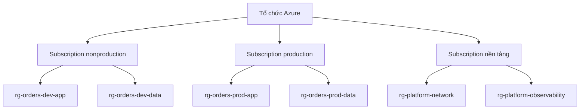

# Thiết kế resource group theo vòng đời ứng dụng

Trong chương **Tổ chức và quản trị tài nguyên** của module **CLOUD_PROVIDERS_AZURE**, bài này trình bày cách chia resource group để triển khai, vận hành và kết thúc một ứng dụng Azure. Thiết kế cần gắn với quyền quản trị qua Microsoft Entra ID, phụ thuộc mạng, dịch vụ tính toán, dữ liệu, giám sát và chi phí.

Một ứng dụng đặt hàng có thể được thay thế phần chạy nhiều lần, trong khi đơn hàng phải tồn tại lâu hơn mỗi lần triển khai. Mạng dùng chung còn phục vụ các ứng dụng khác. Nếu đưa tất cả vào một resource group và coi “xóa môi trường ứng dụng” là “xóa cả nhóm”, thao tác dọn dẹp có thể vượt quá phạm vi dự kiến.

Câu hỏi thiết kế cốt lõi là: **những tài nguyên nào có thể được quản lý và kết thúc vòng đời cùng nhau?**

Sau bài học, bạn có thể:

- Xác định vòng đời của từng nhóm tài nguyên trước khi tạo resource group.
- Tách tài nguyên ứng dụng, dữ liệu lâu dài và hạ tầng dùng chung khi có lý do cụ thể.
- Thiết kế scope phân quyền, triển khai và dọn dẹp phù hợp với cách chia nhóm.
- Giải thích được tác động của phụ thuộc chéo, tag, lock, chi phí và việc di chuyển tài nguyên.

## 1. Resource group là đơn vị quản lý những tài nguyên liên quan

Resource group là một container logic chứa các tài nguyên Azure cần được quản lý cùng nhau. Microsoft khuyến nghị nhóm các tài nguyên chia sẻ vòng đời để thuận tiện triển khai, cập nhật và xóa. Location của resource group xác định nơi lưu metadata của nhóm; các tài nguyên bên trong có thể nằm ở những region khác nhau. [Nguồn: Quản lý resource group](https://learn.microsoft.com/en-us/azure/azure-resource-manager/management/manage-resource-groups-portal).

Với các tài nguyên được triển khai ở scope resource group, mỗi tài nguyên thuộc một nhóm tại một thời điểm. Một tài nguyên có thể kết nối đến tài nguyên trong nhóm khác. Azure cũng có những loại tài nguyên được quản lý ở scope subscription, management group hoặc tenant; không phải mọi đối tượng Azure đều phải nằm trong một resource group. [Nguồn: Azure Resource Manager](https://learn.microsoft.com/en-us/azure/azure-resource-manager/management/overview).

Ví dụ, web app thuộc nhóm ứng dụng vẫn có thể kết nối đến cơ sở dữ liệu thuộc nhóm dữ liệu, nếu cấu hình mạng, danh tính và quyền truy cập cho phép.

| Khía cạnh | Resource group giúp tổ chức điều gì? | Việc vẫn phải thiết kế riêng |
| --- | --- | --- |
| Vòng đời | Tập hợp tài nguyên có cùng trách nhiệm quản lý | Giữ dữ liệu, phục hồi và kết thúc dịch vụ |
| Phân quyền | Cung cấp scope cho quyền quản lý | Quyền dữ liệu và nguồn quyền kế thừa |
| Triển khai | Cung cấp đích cho deployment | Thứ tự triển khai và phụ thuộc ngoài nhóm |
| Vận hành | Gom tài nguyên để kiểm kê và quan sát | Đường mạng, khả năng sẵn sàng và cảnh báo |
| Chi phí | Tạo phạm vi để xem chi phí theo nhóm | Phân bổ tài nguyên dùng chung và xử lý vượt ngân sách |

Việc đặt hai tài nguyên cùng nhóm không tự tạo kết nối mạng giữa chúng. Tách chúng sang hai nhóm cũng không tự ngăn kết nối. Tương tự, tạo thêm resource group không làm ứng dụng tự có khả năng chịu lỗi theo region.

## 2. Hiểu đúng “vòng đời ứng dụng”

Vòng đời tài nguyên gồm nhiều giai đoạn, không chỉ thời điểm tạo:

| Giai đoạn | Quyết định cần làm rõ | Ví dụ trong ứng dụng đặt hàng |
| --- | --- | --- |
| Khởi tạo | Tài nguyên nào được tạo cho môi trường? | Web app và kế hoạch tính toán riêng cho development |
| Thay đổi | Ai thay đổi, thay đổi theo quy trình nào? | Nhóm ứng dụng phát hành cấu hình chạy |
| Thay thế | Có thể tạo lại mà giữ được trạng thái cần thiết không? | Tạo lại phần chạy nhưng kết nối lại dữ liệu cũ |
| Duy trì | Có nghĩa vụ giữ dữ liệu hoặc log sau khi ngừng phục vụ không? | Giữ đơn hàng theo yêu cầu nghiệp vụ |
| Kết thúc | Khi nào có thể xóa, ai quyết định và tài nguyên nào phải còn? | Xóa môi trường thử nghiệm nhưng giữ báo cáo cần thiết |

**Chu kỳ phát hành mã nguồn và tuổi thọ tài nguyên không luôn giống nhau.** Phát hành web app mỗi ngày không đồng nghĩa phải tạo resource group mới mỗi ngày. Cơ sở dữ liệu có thể nhận thay đổi schema thường xuyên nhưng vẫn cần tồn tại liên tục qua các phiên bản ứng dụng.

Vì vậy, khi phân nhóm hãy xem cả cách cập nhật, khả năng thay thế và điều kiện xóa. Hai tài nguyên được tạo cùng ngày vẫn có thể có vòng đời khác nhau.

Ví dụ:

- Web app development và một tài nguyên tính toán chỉ dành cho web app đó có thể được tạo lại cùng nhau.
- Storage Account lưu tệp khách hàng cần kế hoạch giữ dữ liệu và phục hồi riêng.
- Log Analytics workspace dùng cho nhiều ứng dụng có thể tồn tại lâu hơn từng ứng dụng.
- Môi trường xem trước cho một thay đổi có thể được tạo và xóa trọn bộ nếu chỉ dùng dữ liệu tổng hợp có thể tái tạo.

Đây là các lựa chọn thiết kế cho tình huống minh họa. Một dịch vụ cụ thể có thể có ràng buộc khiến một số tài nguyên phải đi cùng nhau.

## 3. Quy trình quyết định tài nguyên nào nên ở cùng nhóm

### 3.1. Lập danh mục theo trách nhiệm

Trước khi đặt tên nhóm, ghi lại ít nhất sáu thuộc tính cho từng tài nguyên hoặc cụm tài nguyên:

| Thuộc tính | Câu hỏi thiết kế |
| --- | --- |
| Chủ sở hữu | Nhóm nào chịu trách nhiệm thay đổi và xử lý sự cố? |
| Môi trường | Development, test, production hay dịch vụ nền tảng? |
| Khả năng tái tạo | Có thể tạo lại từ IaC và nguồn dữ liệu nào? |
| Điều kiện giữ lại | Dữ liệu, log, khóa hoặc cấu hình nào phải tồn tại lâu hơn? |
| Phụ thuộc | Ai dùng tài nguyên này, trong và ngoài ứng dụng? |
| Điều kiện xóa | Khi nào việc xóa tài nguyên này được xem là hoàn tất nghiệp vụ? |

Không cần một hệ thống quản lý phức tạp để bắt đầu. Một bảng mô tả rõ chủ sở hữu, phụ thuộc và điều kiện xóa thường hữu ích hơn danh sách nhóm được tạo theo cảm tính.

### 3.2. Gom theo khả năng thay đổi và kết thúc cùng nhau

Giả sử hai tài nguyên đều thuộc development, cùng một nhóm sở hữu, chỉ phục vụ một ứng dụng và có thể xóa cùng lúc mà không mất trạng thái cần giữ. Chúng là ứng viên phù hợp để đặt cùng resource group.

Ngược lại, một cơ sở dữ liệu vẫn cần giữ sau khi thay thế toàn bộ phần chạy có lý do để thuộc nhóm khác. Tách nhóm làm phạm vi quản lý phù hợp hơn với điều kiện giữ lại, nhưng vẫn cần cơ chế bảo vệ và phục hồi dữ liệu.

Một quy tắc thực hành là thử mô tả thao tác kết thúc nhóm bằng một câu:

> Khi môi trường thử nghiệm của ứng dụng Orders kết thúc, nhóm này có thể được xóa sau khi đã xuất các kết quả cần giữ; không ứng dụng khác phụ thuộc vào tài nguyên của nhóm.

Nếu câu mô tả phải thêm nhiều ngoại lệ như “giữ database”, “giữ mạng của nhóm khác” hoặc “giữ workspace dùng chung”, cần xem lại cách phân nhóm.

### 3.3. Tránh chia quá nhỏ

Tách mỗi tài nguyên thành một resource group riêng có thể làm tăng số scope, assignment và đầu mối triển khai mà không tạo thêm lợi ích rõ ràng. Ngược lại, gom toàn bộ hệ thống của một phòng ban vào một nhóm làm quyền và phạm vi dọn dẹp quá rộng.

Mức chia phù hợp là mức có thể giải thích bằng **vòng đời, chủ sở hữu, môi trường hoặc yêu cầu quản trị thực tế**. Không có một số lượng resource group cố định phù hợp với mọi ứng dụng.

## 4. Ví dụ: ứng dụng Orders có dữ liệu và hạ tầng dùng chung

Giả sử hệ thống có các đặc điểm sau:

- Mỗi môi trường có web app và App Service Plan riêng.
- Dữ liệu đơn hàng và tệp đính kèm phải tồn tại qua các lần tạo lại web app.
- Nhóm nền tảng quản lý mạng hub và giám sát dùng chung.
- Production và nonproduction có yêu cầu quản trị khác nhau.
- Các cơ sở dữ liệu trong ví dụ có logical server riêng theo môi trường.

Có thể đề xuất cách chia:

| Resource group | Thành phần minh họa | Chủ sở hữu | Điều kiện vòng đời |
| --- | --- | --- | --- |
| `rg-orders-dev-app` | Web app, App Service Plan riêng của development | Nhóm Orders | Có thể tạo lại phần chạy development |
| `rg-orders-dev-data` | SQL logical server/database, Storage Account của development | Nhóm Orders phụ trách dữ liệu | Chỉ xóa khi dữ liệu development không còn cần |
| `rg-orders-prod-app` | Phần chạy production | Nhóm vận hành Orders | Theo quy trình thay đổi production |
| `rg-orders-prod-data` | Dữ liệu production | Chủ sở hữu dữ liệu Orders | Có yêu cầu giữ lại và phục hồi riêng |
| `rg-platform-network` | Mạng hub và các thành phần mạng dùng chung | Nhóm nền tảng mạng | Không kết thúc cùng một ứng dụng |
| `rg-platform-observability` | Workspace giám sát dùng chung | Nhóm vận hành nền tảng | Theo vòng đời giám sát của tổ chức |

Sơ đồ dưới đây chỉ mô tả **quan hệ chứa tài nguyên**, không mô tả kết nối mạng:



Việc dùng subscription riêng trong ví dụ là lựa chọn quản trị, không phải điều kiện bắt buộc để tạo resource group. Khi cần tách rõ giới hạn, chi phí và quyền quản lý giữa các môi trường hoặc nền tảng, subscription là một mức ranh giới cần xem xét. [Nguồn: Subscription considerations](https://learn.microsoft.com/en-us/azure/cloud-adoption-framework/ready/landing-zone/design-area/resource-org-subscriptions).

### 4.1. Khi nào một nhóm ứng dụng là đủ?

Với môi trường lab gồm web app, dữ liệu mẫu có thể tái tạo và tài nguyên tính toán dùng riêng, một nhóm như `rg-orders-lab-001` có thể đơn giản hơn. Toàn bộ nhóm có cùng điều kiện xóa; tách thêm nhóm dữ liệu chỉ để giống production có thể chưa mang lại lợi ích.

Ngược lại, khi dữ liệu lab đã trở thành dữ liệu tham chiếu dùng cho nhiều đợt thử nghiệm, giả định “tất cả đều có thể xóa” không còn đúng. Cách chia cần được điều chỉnh theo vòng đời mới.

### 4.2. Một dịch vụ dùng chung cần được coi là dùng chung thực sự

Không đặt App Service Plan phục vụ ba ứng dụng vào nhóm chỉ được pipeline của một ứng dụng quản lý, rồi cho pipeline đó quyền dọn dẹp cả nhóm. Tên tài nguyên có chữ “shared” không ngăn việc xóa.

Tài nguyên dùng chung cần chủ sở hữu, danh sách bên sử dụng và quy trình thay đổi riêng. Cũng cần làm rõ chi phí do ai chịu và điều kiện nào cho phép kết thúc tài nguyên khi ứng dụng cuối cùng rời đi.

## 5. Quản lý phụ thuộc giữa các resource group

Tách nhóm không loại bỏ phụ thuộc. Nó chuyển yêu cầu phối hợp từ “quản lý chung một nhóm” sang “quản lý hợp đồng giữa các nhóm”.

Trong ví dụ Orders:

```text
Phần chạy Orders
  -> cần endpoint của database
  -> cần danh tính được cấp quyền dữ liệu
  -> cần đường mạng đến database và Storage
  -> gửi telemetry đến workspace được chỉ định

Nhóm dữ liệu
  -> cần biết ứng dụng nào đang sử dụng
  -> cần bảo đảm giữ lại và phục hồi theo yêu cầu

Nhóm nền tảng
  -> cung cấp mạng/giám sát theo phạm vi hỗ trợ đã thống nhất
```

Một bảng hợp đồng phụ thuộc có thể gồm:

| Bên cung cấp | Thông tin hoặc khả năng cung cấp | Bên sử dụng cần quản lý |
| --- | --- | --- |
| Nhóm dữ liệu | Resource ID, endpoint và cách xin quyền | Cấu hình kết nối, danh tính và tương thích schema |
| Nhóm mạng | Subnet hoặc đường kết nối được phê duyệt | Cấu hình tích hợp mạng của ứng dụng |
| Nhóm giám sát | Workspace và quy tắc thu thập | Cấu hình gửi telemetry, cảnh báo của workload |

Endpoint và resource ID có thể là đầu ra triển khai; secret cần được phân phối bằng cơ chế quản lý bí mật phù hợp. Không dùng bảng phụ thuộc hoặc tag làm nơi chứa mật khẩu.

Trong Bicep, có thể tham chiếu tài nguyên `existing` ở scope khác; khi triển khai tài nguyên tới nhiều scope, dùng module và cấp quyền phù hợp tại những scope đó. Một ứng dụng không cần nằm cùng resource group với mọi phụ thuộc chỉ để có thể triển khai bằng IaC. [Nguồn: Bicep deployment scopes](https://learn.microsoft.com/en-us/azure/azure-resource-manager/bicep/deploy-to-resource-group).

Một ràng buộc cần giữ trong thiết kế là quan hệ parent/child của dịch vụ. Không tùy ý tách một child resource khỏi parent để đạt sơ đồ nhóm mong muốn. Ví dụ, cần đánh giá vòng đời của logical server cùng các database con thay vì giả định từng database có thể được đặt ở resource group độc lập với server.

## 6. Phân quyền và quản trị phải khớp với cách chia nhóm

### 6.1. Scope quyền quản lý

Role assignment ở resource group được kế thừa xuống tài nguyên bên trong. Khi đánh giá quyền, cũng phải xét assignment từ subscription hoặc management group. Thêm một role hẹp ở nhóm ứng dụng không tự thu hồi quyền rộng đã nhận từ scope cha. [Nguồn: Scope trong Azure RBAC](https://learn.microsoft.com/en-us/azure/role-based-access-control/scope-overview).

Áp dụng vào ví dụ:

| Chủ thể | Phạm vi trách nhiệm đề xuất |
| --- | --- |
| Pipeline phần chạy development | Quản lý tài nguyên cần thiết trong `rg-orders-dev-app` |
| Pipeline dữ liệu | Thay đổi hạ tầng dữ liệu theo quy trình riêng |
| Nhóm nền tảng | Quản lý nhóm mạng và giám sát dùng chung |
| Nhân sự hỗ trợ | Quyền quan sát theo công việc được giao |
| Nhóm quản trị truy cập | Quản lý assignment tại scope đã thống nhất |

Bảng này mô tả trách nhiệm, chưa phải danh sách role hoàn chỉnh. Cần chọn role theo các thao tác thực sự cần và cấp quyền dữ liệu riêng cho danh tính ứng dụng.

Tách nhóm dữ liệu khỏi nhóm ứng dụng giúp thu hẹp quyền quản lý hạ tầng. Tuy nhiên, người có quyền thay thế mã chạy dưới danh tính đã truy cập dữ liệu vẫn có thể tác động tới dữ liệu qua ứng dụng. Cần đánh giá cả đường triển khai, danh tính chạy và cơ chế cấp quyền.

### 6.2. Policy áp dụng từ nhiều mức

Resource group là một scope có thể nhận Azure Policy assignment. Policy từ các mức cha cũng có thể bao phủ nhóm, theo scope, exclusion và exemption áp dụng. Tạo nhóm mới không tự tránh được quy tắc của subscription. [Nguồn: Scope trong Azure Policy](https://learn.microsoft.com/en-us/azure/governance/policy/concepts/scope).

Ví dụ, pipeline có đủ quyền tạo tài nguyên trong `rg-orders-dev-app` vẫn có thể bị từ chối nếu region hoặc cấu hình không đáp ứng policy. Thiết kế nhóm cần đi cùng danh sách chuẩn triển khai mà chủ sở hữu nhóm phải tuân theo.

## 7. Tổ chức triển khai theo vòng đời đã chọn

### 7.1. Tách đích triển khai và bước phối hợp

Với cách chia của ví dụ, một luồng triển khai ban đầu có thể là:

1. Nhóm nền tảng cung cấp hoặc xác nhận phụ thuộc mạng và giám sát.
2. Pipeline dữ liệu tạo tài nguyên dữ liệu, cấu hình giữ lại và kiểm tra khả năng phục hồi.
3. Pipeline ứng dụng tạo phần chạy, nhận endpoint và cấu hình kết nối.
4. Quy trình cấp quyền gắn đúng danh tính ứng dụng với tài nguyên dữ liệu.
5. Kiểm tra ứng dụng dưới danh tính chạy thực tế rồi mới đưa vào sử dụng.

Một lần cập nhật giao diện không cần triển khai lại mạng hub. Một thay đổi schema có thể cần được phối hợp với phiên bản ứng dụng dù database và web app nằm ở hai nhóm khác nhau.

Tách resource group giúp biểu diễn trách nhiệm và phạm vi thao tác; nó không bảo đảm các thành phần tự tương thích. Với migration dữ liệu, cần thiết kế thứ tự thay đổi và cách xử lý khi chỉ một bước triển khai thành công.

### 7.2. Phân biệt resource group với tập tài nguyên do một deployment quản lý

Resource group chứa tài nguyên; một lần deployment có thể chỉ quản lý một phần trong số đó. Không nên mặc định “mọi tài nguyên trong nhóm đều thuộc pipeline này”.

Trong chế độ incremental của ARM, tài nguyên đang tồn tại nhưng không được khai báo trong template không tự bị xóa. Tuy nhiên, các thuộc tính của tài nguyên được khai báo sẽ được áp dụng lại; không nên suy luận incremental là chỉ sửa từng thuộc tính được bổ sung. Microsoft khuyến nghị dùng deployment stacks khi cần quản lý việc xóa qua ARM/Bicep thay vì dựa vào complete mode. [Nguồn: Deployment modes](https://learn.microsoft.com/en-us/azure/azure-resource-manager/templates/deployment-modes).

Deployment stack có thể quản lý một tập tài nguyên; khi tài nguyên không còn được quản lý, hành vi detach hoặc delete phụ thuộc cấu hình `actionOnUnmanage`. Thiết kế stack và resource group cần cùng phản ánh điều kiện giữ lại dữ liệu. [Nguồn: Deployment stacks](https://learn.microsoft.com/en-us/azure/azure-resource-manager/bicep/deployment-stacks).

Ví dụ, nếu phần chạy và dữ liệu thuộc hai nhóm nhưng cùng một quy trình dọn dẹp có quyền xóa cả hai, sự phân tách nhóm không đủ ngăn xóa dữ liệu. Cần tách rõ tập tài nguyên được phép kết thúc trong từng bước tự động hóa.

### 7.3. Xem trước thay đổi nhưng vẫn kiểm tra tác động nghiệp vụ

What-if của ARM/Bicep dự đoán các thay đổi tài nguyên mà không thực hiện thay đổi đó. Kết quả có giới hạn phân tích; cần đọc cả các phần không được đánh giá hoặc không xác định được. [Nguồn: Bicep what-if](https://learn.microsoft.com/en-us/azure/azure-resource-manager/bicep/deploy-what-if).

Trong ví dụ Orders, bên cạnh thay đổi tài nguyên, người triển khai còn phải kiểm tra tác động tới kết nối, danh tính và khả năng đọc dữ liệu cũ. Một kế hoạch không xóa database chưa chứng minh migration sẽ tương thích với ứng dụng đang phục vụ.

## 8. Tên, tag và chi phí hỗ trợ vận hành vòng đời

### 8.1. Chọn tên thể hiện đặc điểm ổn định

Một mẫu tên có thể dùng cho resource group là:

```text
rg-<workload>-<environment>-<purpose>[-<instance>]

rg-orders-dev-app
rg-orders-dev-data
rg-orders-prod-app
rg-platform-network
rg-orders-preview-pr123
```

Đây là quy ước minh họa, không phải mẫu bắt buộc của Azure. Nên chọn thành phần ổn định trong tên và dùng metadata cho thông tin dễ thay đổi. Mỗi loại tài nguyên có quy tắc đặt tên riêng; không áp dụng nguyên xi mẫu tên resource group cho Storage Account hoặc mọi dịch vụ khác. [Nguồn: Naming convention](https://learn.microsoft.com/en-us/azure/cloud-adoption-framework/ready/azure-best-practices/resource-naming).

Nếu ứng dụng triển khai nhiều region, chỉ thêm mã region vào tên nhóm khi nhóm thực sự được quản lý theo region. Việc location của resource group là `southeastasia` không có nghĩa mọi tài nguyên trong nhóm đều phải nằm ở đó.

### 8.2. Tag phải có ý nghĩa và người duy trì

Một bộ tag minh họa:

| Tag | Giá trị ví dụ | Mục đích |
| --- | --- | --- |
| `Application` | `orders` | Liên kết các nhóm của cùng workload |
| `Environment` | `dev` | Phân biệt môi trường |
| `Owner` | `orders-team` | Chỉ đầu mối chịu trách nhiệm |
| `CostCenter` | `cc-orders` | Hỗ trợ phân bổ chi phí |
| `Lifecycle` | `recreatable` hoặc `retained` | Mô tả điều kiện quản lý |
| `ExpiresOn` | Ngày hết hạn của môi trường tạm | Đầu vào cho quy trình dọn dẹp |

Tag trên resource group không tự được tài nguyên bên trong kế thừa. Nếu cần tag ở cấp tài nguyên, phải triển khai hoặc áp dụng cơ chế policy phù hợp. Tag là metadata dạng văn bản, không nên chứa secret hoặc dữ liệu nhạy cảm. [Nguồn: Azure resource tags](https://learn.microsoft.com/en-us/azure/azure-resource-manager/management/tag-resources).

`Lifecycle=retained` không ngăn xóa tài nguyên. `ExpiresOn` cũng không tự tạo cơ chế hết hạn. Trong thiết kế này, tag chỉ cung cấp thông tin; pipeline hoặc quy trình vận hành phải đọc, kiểm tra và thực hiện hành động theo quy tắc đã thống nhất.

### 8.3. Chi phí ứng dụng có thể nằm ở nhiều nhóm

Với Orders, chi phí trực tiếp có thể nằm ở cả nhóm app và data. Một phần chi phí mạng, giám sát hoặc dịch vụ dùng chung còn nằm ở nhóm nền tảng.

Có thể dùng mô hình phân bổ:

```text
Chi phí quy cho Orders
  = chi phí trực tiếp của các tài nguyên Orders
  + phần chi phí dùng chung được phân bổ theo quy tắc đã thống nhất
```

Không nên đổi cấu trúc resource group chỉ để mọi khoản chi xuất hiện trong một màn hình nếu điều đó làm mất ranh giới vòng đời. Có thể dùng tag, phạm vi báo cáo và quy tắc phân bổ để kết nối góc nhìn chi phí.

Budget trong Cost Management hỗ trợ theo dõi và cảnh báo theo ngưỡng; nó không tự dừng tiêu thụ hay tự tắt tài nguyên. Nếu thiết kế phản ứng tự động khi vượt ngưỡng, cần một quy trình hành động riêng phù hợp với môi trường. [Nguồn: Cost Management budgets](https://learn.microsoft.com/en-us/azure/cost-management-billing/costs/tutorial-acm-create-budgets).

## 9. Thực hành: tạo hai nhóm development có vòng đời khác nhau

Các lệnh sau dùng **PowerShell với Azure CLI**. Đây là ví dụ để người học thực hành trong subscription sandbox; bài học không thực hiện triển khai lên tài khoản Azure.

Mục tiêu là tạo hai resource group mới cho phần chạy và dữ liệu, rồi kiểm tra cách chúng xuất hiện ở control plane. Ví dụ chỉ tạo container quản lý và tag, chưa tạo web app, database hoặc Storage Account.

### 9.1. Chọn subscription và kiểm tra tên đích

Thay subscription ID và chọn location được tổ chức cho phép:

```powershell
$subscriptionId = "<sandbox-subscription-id>"
$metadataLocation = "southeastasia"
$appGroupName = "rg-orders-dev-app-lab"
$dataGroupName = "rg-orders-dev-data-lab"

az login
az account set --subscription $subscriptionId
if ($LASTEXITCODE -ne 0) { throw "Khong chon duoc subscription." }

az account show --query "{subscription:id,name:name,tenant:tenantId}" --output json
az group exists --name $appGroupName
az group exists --name $dataGroupName
```

Hai lệnh `exists` cần trả về `false` cho bài thực hành tạo nhóm mới. Nếu tên đã tồn tại, kiểm tra chủ sở hữu và dùng tên khác để tránh sửa tag hoặc thay đổi một nhóm đang được sử dụng.

Location trong biến là nơi lưu metadata của nhóm. Khi triển khai tài nguyên sau đó, vẫn phải chỉ định hoặc thiết kế location phù hợp cho từng dịch vụ.

### 9.2. Tạo nhóm và ghi rõ mục đích vòng đời

```powershell
az group create --name $appGroupName --location $metadataLocation --tags Application=orders Environment=dev Owner=orders-team Lifecycle=recreatable
if ($LASTEXITCODE -ne 0) { throw "Tao nhom app that bai." }

az group create --name $dataGroupName --location $metadataLocation --tags Application=orders Environment=dev Owner=orders-team Lifecycle=retained
if ($LASTEXITCODE -ne 0) { throw "Tao nhom data that bai." }

az group show --name $appGroupName --query "{id:id,location:location,tags:tags}" --output json
az group show --name $dataGroupName --query "{id:id,location:location,tags:tags}" --output json
```

`az group create` và `az group show` tương ứng với tạo và xem resource group. Tài khoản chạy cần quyền thích hợp và phải đáp ứng policy của subscription. [Nguồn: Azure CLI az group](https://learn.microsoft.com/en-us/cli/azure/group?view=azure-cli-latest).

Kết quả cần thể hiện hai resource ID khác nhau:

```text
/subscriptions/<sandbox-subscription-id>/resourceGroups/rg-orders-dev-app-lab
/subscriptions/<sandbox-subscription-id>/resourceGroups/rg-orders-dev-data-lab
```

### 9.3. Kiểm kê tài nguyên trong từng nhóm

```powershell
az resource list --resource-group $appGroupName --query "[].{Name:name,Type:type,Location:location}" --output table

az resource list --resource-group $dataGroupName --query "[].{Name:name,Type:type,Location:location}" --output table
```

`az resource list` hỗ trợ liệt kê tài nguyên theo resource group. Với hai nhóm vừa tạo và chưa có dịch vụ nào được triển khai, danh sách tài nguyên dự kiến trống. [Nguồn: Azure CLI az resource](https://learn.microsoft.com/en-us/cli/azure/resource?view=azure-cli-latest).

Việc liệt kê này không thay thế kiểm kê dữ liệu bên trong dịch vụ hoặc tìm mọi ứng dụng bên ngoài đang phụ thuộc. Khi có tài nguyên thực tế, bổ sung danh sách phụ thuộc và chủ sở hữu vào hồ sơ vòng đời.

Kết quả thực hành cần xác nhận:

- Hai nhóm nằm đúng subscription sandbox.
- Tên và tag phản ánh hai mục đích quản lý khác nhau.
- Chưa có dịch vụ dữ liệu hoặc tính toán bị tạo ngoài dự kiến.
- Cách chia nhóm đã có lý do trước khi triển khai tài nguyên vào bên trong.

## 10. Bảo vệ tài nguyên và kết thúc vòng đời

### 10.1. Lock hỗ trợ kiểm soát thao tác quản lý

`CanNotDelete` ngăn xóa tài nguyên được bảo vệ; `ReadOnly` hạn chế cả cập nhật quản lý. Lock ở scope cha được kế thừa xuống dưới và có thể ảnh hưởng các thao tác vận hành. Management lock áp dụng cho control plane, không tự ngăn xóa dữ liệu qua data plane. [Nguồn: Resource locks](https://learn.microsoft.com/en-us/azure/azure-resource-manager/management/lock-resources).

Trong thiết kế Orders, nhóm dữ liệu có thể cần bảo vệ khỏi xóa nhầm, đồng thời vẫn phải cập nhật cấu hình. Việc chọn lock cần xét các thao tác pipeline thực hiện, nhất là khi một thay đổi cần thay thế hoặc xóa tài nguyên.

Lock không thay thế backup, phục hồi và quyền dữ liệu. Một database còn tồn tại không có nghĩa các bản ghi bên trong chưa bị thay đổi hoặc xóa.

### 10.2. Xóa nhóm là một quyết định vòng đời

Xóa resource group yêu cầu xóa các tài nguyên trong nhóm và không có cơ chế khôi phục nguyên cả nhóm đã xóa. Một số dịch vụ có cơ chế phục hồi riêng, tùy cấu hình và điều kiện. Quyền xóa cả resource group cũng cần được đánh giá riêng, thay vì chỉ xem quyền xóa từng tài nguyên. [Nguồn: Resource group deletion](https://learn.microsoft.com/en-us/azure/azure-resource-manager/management/delete-resource-group).

Với ví dụ này, hồ sơ kết thúc môi trường nên có:

| Bước | Bằng chứng cần có |
| --- | --- |
| Xác nhận phạm vi | Subscription, tên nhóm, danh sách tài nguyên và người chịu trách nhiệm |
| Kiểm tra bên sử dụng | Không còn ứng dụng hoặc quy trình cần các tài nguyên sắp xóa |
| Xử lý trạng thái cần giữ | Dữ liệu cần giữ đã được chuyển hoặc bảo vệ bằng phương án phục hồi đã kiểm chứng |
| Rà soát quyền và bảo vệ | Biết lock, policy hoặc cơ chế quản lý nào ảnh hưởng thao tác |
| Thực hiện theo kế hoạch | Chỉ kết thúc các nhóm và tài nguyên thuộc phạm vi đã xác định |
| Đối chiếu sau thao tác | Kiểm kê trạng thái còn lại, phụ thuộc và chi phí còn phát sinh |

Nếu kết thúc `rg-orders-dev-app`, nhóm dữ liệu vẫn tồn tại theo kế hoạch. Nhưng cũng cần kiểm tra danh tính ứng dụng: khi tạo lại phần chạy, danh tính có thể thay đổi và quyền truy cập dữ liệu cần được đối chiếu lại.

Tài nguyên ở nhóm khác không tự biến mất chỉ vì ứng dụng đã được xóa. Dọn dẹp cần kiểm tra các cấu hình kết nối, cảnh báo, assignment hoặc tài nguyên phụ trợ do ứng dụng quản lý mà nằm ngoài nhóm app. Với thành phần dùng chung, xử lý theo quyền sở hữu thay vì mặc định xóa.

Khi thao tác thất bại hoặc bị chặn, đọc nguyên nhân và kiểm kê trạng thái thực tế. Không tự động gỡ mọi lock rồi thử xóa lại vì có thể đang đụng vào tài nguyên cần giữ.

## 11. Điều chỉnh thiết kế khi tài nguyên đã tồn tại

Có thể phát hiện một Storage Account lâu dài đang nằm trong nhóm development thường xuyên bị tạo lại. Cần sửa cách tổ chức, nhưng không nên coi move là một thao tác chỉ đổi nhãn.

Khả năng di chuyển phụ thuộc loại tài nguyên và ràng buộc dịch vụ; parent/child và các tài nguyên phụ thuộc có thể phải xử lý cùng nhau. Kiểm tra khả năng hỗ trợ trước khi lập kế hoạch. [Nguồn: Move support for resources](https://learn.microsoft.com/en-us/azure/azure-resource-manager/management/move-support-resources).

Khi move sang resource group khác, resource ID thay đổi, location vật lý không tự đổi. Cần cập nhật các nơi tham chiếu ID và đánh giá lại quyền truy cập; role assignment gắn trực tiếp vào tài nguyên không tự chuyển theo như một giả định an toàn. [Nguồn: Move resources](https://learn.microsoft.com/en-us/azure/azure-resource-manager/management/move-resource-group-and-subscription).

Một kế hoạch điều chỉnh cho tình huống này gồm:

1. Xác định trạng thái cần giữ và người đang sử dụng Storage Account.
2. Chọn nhóm đích cùng chủ sở hữu và quy tắc quản trị.
3. Kiểm tra hỗ trợ move, phụ thuộc và phương án phục hồi nếu có vấn đề.
4. Chuẩn bị cập nhật IaC, resource ID, assignment và cấu hình liên quan.
5. Kiểm tra đọc/ghi dữ liệu bằng danh tính ứng dụng sau thay đổi.
6. Chỉ đưa nhóm cũ vào quy trình dọn dẹp khi phạm vi còn lại đã được xác nhận.

Nếu dịch vụ không hỗ trợ move theo phương án cần thiết, có thể phải tạo tài nguyên mới và thực hiện migration dữ liệu. Đó là một thay đổi kiến trúc có kế hoạch riêng.

## 12. Những lựa chọn dễ gây khó vận hành

| Lựa chọn | Vấn đề phát sinh | Hướng điều chỉnh |
| --- | --- | --- |
| Một nhóm cho mọi ứng dụng của phòng ban | Quyền và dọn dẹp vượt phạm vi từng ứng dụng | Chia theo vòng đời và trách nhiệm |
| Mọi tài nguyên cùng loại nằm chung | Database hoặc web app không liên quan bị ràng buộc khi quản lý | Chỉ gom theo loại khi thực sự có vòng đời dùng chung |
| Một nhóm cho mỗi phiên bản mã nguồn | Tăng số nhóm và dễ để lại tài nguyên không còn dùng | Tách phiên bản phát hành khỏi tuổi thọ hạ tầng |
| Một nhóm riêng cho từng tài nguyên theo mặc định | Tăng công sức quản lý scope và phụ thuộc | Gom những tài nguyên có thể quản lý cùng nhau |
| Nhóm app chứa dữ liệu cần giữ lâu | Tạo lại phần chạy có thể tác động tới dữ liệu | Đánh giá tách dữ liệu và quy trình giữ lại |
| Dịch vụ dùng chung nằm trong nhóm của một ứng dụng | Pipeline một ứng dụng có thể ảnh hưởng ứng dụng khác | Xác lập chủ sở hữu và vòng đời nền tảng |
| Chỉ đặt tag giữ lại hoặc hết hạn | Không có hành động hoặc bảo vệ thực tế | Kết nối metadata với quy trình vận hành |
| Tách nhóm nhưng vẫn cấp quyền rộng cho mọi pipeline | Ranh giới quản lý không phản ánh quyền thực tế | Thu hẹp quyền theo scope và thao tác cần thiết |

Thiết kế hoàn chỉnh cần trả lời được: nhóm chứa gì, ai sở hữu, ai được thay đổi, phụ thuộc vào đâu, dữ liệu nào phải giữ và khi nào được xóa. Có thể bắt đầu với ít nhóm rồi tách khi vòng đời hoặc trách nhiệm khác nhau; mỗi lần tách cần tính thêm cách phối hợp triển khai và vận hành.

Với Orders, kết quả mong muốn là có thể phát hành hoặc tạo lại phần chạy mà vẫn giữ đúng dữ liệu cần thiết, quản lý phụ thuộc nền tảng rõ ràng và truy nguyên được chi phí. Resource group phát huy giá trị khi ranh giới của nó khớp với các quyết định vòng đời thực tế.
