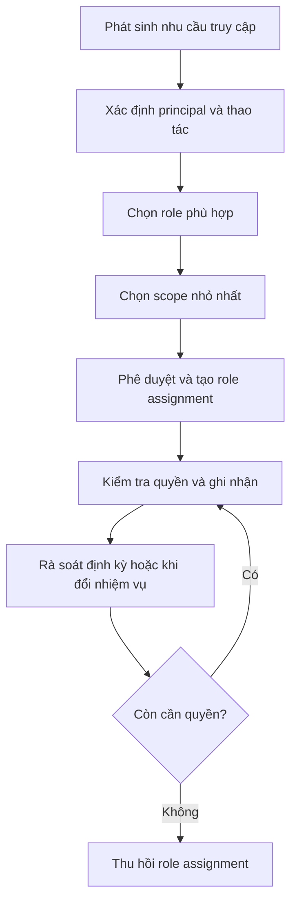

# Quản lý tài nguyên bằng Azure RBAC

Azure role-based access control (Azure RBAC) là cơ chế phân quyền để kiểm soát ai có thể thực hiện hành động nào trên tài nguyên Azure và trong phạm vi nào. Thay vì cấp quyền quản trị rộng cho mọi người dùng, bạn có thể gán vai trò phù hợp cho người dùng, nhóm hoặc danh tính ứng dụng tại subscription, resource group hay từng tài nguyên. Cách tổ chức này giúp áp dụng nguyên tắc quyền tối thiểu, phân chia trách nhiệm và quản lý quyền truy cập nhất quán khi hệ thống mở rộng.

Trong hệ sinh thái Microsoft Azure, tài nguyên được tổ chức theo management group, subscription, resource group và resource. Các subscription và tài nguyên có thể được liên kết với danh tính do Microsoft Entra ID quản lý. Azure RBAC kết nối danh tính đó với vai trò và phạm vi tài nguyên để quyết định thao tác nào được phép thực hiện.

## Mục tiêu học tập

Sau bài học, bạn có thể:

- Giải thích mục đích của Azure RBAC và phân biệt Azure RBAC với vai trò quản trị Microsoft Entra ID.
- Nhận biết ba thành phần của một role assignment: security principal, role definition và scope.
- Mô tả thứ bậc phạm vi và cách quyền được kế thừa.
- Chọn vai trò tích hợp phù hợp cho các tình huống đọc, quản lý tài nguyên và quản lý quyền.
- Gán, kiểm tra và thu hồi quyền bằng Azure Portal hoặc Azure CLI.
- Hiểu khi nào cần tạo custom role, dùng điều kiện trong role assignment hoặc quản lý quyền đặc biệt bằng Microsoft Entra Privileged Identity Management (PIM).

## 1. Azure RBAC giải quyết vấn đề gì?

Một hệ thống Azure thường có nhiều nhóm cùng tham gia vận hành: nhóm phát triển triển khai ứng dụng, nhóm vận hành theo dõi máy ảo, nhóm dữ liệu quản lý dữ liệu và nhóm bảo mật kiểm soát quyền. Nếu tất cả đều được cấp quyền Owner trên toàn bộ subscription, một thao tác nhầm có thể ảnh hưởng đến nhiều dịch vụ và việc kiểm soát trách nhiệm trở nên khó khăn.

Azure RBAC cho phép giới hạn quyền theo công việc và phạm vi. Ví dụ:

- Nhóm kiểm toán được cấp **Reader** trên subscription để xem cấu hình và trạng thái tài nguyên.
- Nhóm phát triển được cấp **Contributor** trên resource group của môi trường development để triển khai và cập nhật tài nguyên trong phạm vi đó.
- Một kỹ sư vận hành được cấp quyền khởi động máy ảo ở một tài nguyên cụ thể nếu vai trò phù hợp được cấu hình.
- Nhóm quản trị danh tính được giao quyền quản lý role assignment theo quy trình riêng, thay vì mọi người triển khai đều có thể tự cấp quyền cho người khác.

Quyết định truy cập của Azure RBAC dựa trên danh tính, vai trò, phạm vi và, trong các trường hợp được hỗ trợ, điều kiện của role assignment. Khi người dùng hoặc workload gửi yêu cầu tới Azure Resource Manager, Azure kiểm tra các quyền liên quan để quyết định yêu cầu có được phép hay không.

## 2. Phân biệt Azure RBAC với vai trò Microsoft Entra ID

Microsoft Entra ID quản lý danh tính và quyền trên các dịch vụ danh tính, chẳng hạn quản lý người dùng, nhóm, ứng dụng và thiết lập tenant. Azure RBAC quản lý quyền truy cập vào tài nguyên Azure như máy ảo, mạng ảo, storage account và resource group.

| Nội dung | Azure RBAC | Vai trò Microsoft Entra ID |
|---|---|---|
| Phạm vi chính | Tài nguyên Azure và các phạm vi quản trị tài nguyên | Tenant và các dịch vụ danh tính Microsoft Entra |
| Ví dụ vai trò | Reader, Contributor, Owner, Virtual Machine Contributor | Global Administrator, User Administrator, Groups Administrator |
| Ví dụ quyền | Đọc cấu hình máy ảo, tạo resource group, quản lý role assignment | Tạo người dùng, quản lý nhóm, thay đổi cấu hình tenant |
| Nơi thường kiểm tra | Access control (IAM) trên subscription, resource group hoặc tài nguyên | Microsoft Entra admin center và các trang quản trị vai trò của tenant |

Một người có thể là Global Administrator trong Microsoft Entra ID nhưng điều đó không có nghĩa mọi thao tác trên mọi subscription Azure đều được cấp theo một role assignment Azure RBAC thông thường. Có cơ chế đặc biệt cho phép Global Administrator nâng quyền truy cập tài nguyên Azure trong một số tình huống, nhưng đây là thao tác đặc quyền cần được kiểm soát và kiểm toán. Trong quản trị hằng ngày, hãy cấp đúng loại vai trò ở đúng hệ thống và phạm vi.

## 3. Ba thành phần của một role assignment

Một **role assignment** liên kết ba thành phần:

1. **Security principal**: danh tính nhận quyền.
2. **Role definition**: tập hợp quyền mô tả các hành động được phép hoặc bị loại trừ.
3. **Scope**: phạm vi Azure mà quyền có hiệu lực.

### Security principal: ai nhận quyền?

Azure RBAC có thể gán quyền cho các loại danh tính sau:

- **User**: tài khoản người dùng trong Microsoft Entra ID.
- **Group**: nhóm bảo mật Microsoft Entra ID. Gán quyền cho nhóm giúp quản lý thành viên tập trung.
- **Service principal**: danh tính đại diện cho ứng dụng hoặc workload cần truy cập Azure.
- **Managed identity**: danh tính được Azure quản lý vòng đời thông tin xác thực, thường dùng để một dịch vụ Azure truy cập dịch vụ Azure khác.

Với nhóm người dùng, nên cân nhắc gán vai trò cho nhóm bảo mật thay vì tạo nhiều role assignment riêng lẻ. Khi một nhân viên chuyển nhóm hoặc rời dự án, việc thay đổi thành viên nhóm thường dễ kiểm soát hơn việc tìm và thu hồi từng assignment. Với ứng dụng chạy trên Azure, ưu tiên managed identity khi dịch vụ đích hỗ trợ để tránh phải tự lưu và luân chuyển secret.

### Role definition: được phép làm gì?

Role definition mô tả các quyền mà vai trò cung cấp. Một định nghĩa vai trò có thể chứa:

- **Actions**: các thao tác trên control plane, ví dụ đọc hoặc cập nhật cấu hình tài nguyên qua Azure Resource Manager.
- **NotActions**: các thao tác bị loại khỏi tập Actions của chính role definition đó.
- **DataActions**: các thao tác trên dữ liệu bên trong một số dịch vụ hỗ trợ mô hình data-plane authorization, ví dụ đọc hoặc ghi blob.
- **NotDataActions**: các thao tác dữ liệu bị loại khỏi tập DataActions của role definition đó.
- **AssignableScopes**: các phạm vi mà tại đó có thể sử dụng role definition để tạo role assignment.

`NotActions` và `NotDataActions` không phải quy tắc từ chối tuyệt đối. Chúng chỉ loại trừ thao tác khỏi quyền do role definition đó cung cấp. Nếu một role assignment khác cấp cùng quyền qua một vai trò khác, quyền đó vẫn có thể được cấp. Vì vậy, không nên dùng NotActions như một cơ chế deny độc lập.

Control plane và data plane cần được phân biệt. Ví dụ, quyền quản lý cấu hình storage account không nhất thiết đồng nghĩa với quyền đọc nội dung blob. Để truy cập dữ liệu, danh tính có thể cần một vai trò dữ liệu như **Storage Blob Data Reader** hoặc **Storage Blob Data Contributor**, tùy thao tác. Một số dịch vụ có cơ chế xác thực và phân quyền riêng; hãy kiểm tra mô hình bảo mật của dịch vụ trước khi kết luận một vai trò Azure RBAC đã đủ.

### Scope: quyền có hiệu lực ở đâu?

Azure RBAC hỗ trợ phân quyền theo thứ bậc phạm vi:

```text
Management group
└── Subscription
    └── Resource group
        └── Resource
```

Một role assignment ở phạm vi cha thường được kế thừa xuống các phạm vi con. Ví dụ, Reader được gán ở subscription có hiệu lực đọc trên các resource group và tài nguyên nằm trong subscription đó, trong giới hạn quyền của role và các cơ chế kiểm soát liên quan. Một role assignment chỉ gán ở một resource group sẽ không tự động có hiệu lực trên resource group khác.

| Scope | Phạm vi ảnh hưởng | Ví dụ sử dụng |
|---|---|---|
| Management group | Các subscription nằm trong management group và phạm vi con | Nhóm quản trị nền tảng cần quyền đọc trên nhiều subscription |
| Subscription | Resource group và tài nguyên trong subscription | Nhóm kiểm toán cần Reader cho toàn môi trường |
| Resource group | Các tài nguyên thuộc resource group | Nhóm phát triển quản lý môi trường development |
| Resource | Một tài nguyên cụ thể | Danh tính chỉ cần quản lý một storage account hoặc máy ảo |

Phạm vi càng rộng thì tác động của quyền càng lớn. Hãy bắt đầu từ scope nhỏ nhất đáp ứng công việc. Chỉ gán ở management group hoặc subscription khi nhiệm vụ thực sự cần bao phủ nhiều phạm vi con.

## 4. Chọn vai trò tích hợp phù hợp

Azure cung cấp nhiều built-in role cho các tình huống phổ biến. Một số vai trò tổng quát thường gặp:

| Vai trò | Quyền khái quát | Tình huống phù hợp |
|---|---|---|
| **Owner** | Quản lý tài nguyên và quản lý quyền truy cập trong phạm vi được gán | Quản trị viên chịu trách nhiệm đầy đủ cho một phạm vi cụ thể |
| **Contributor** | Tạo, cập nhật và xóa tài nguyên; không có quyền cấp role assignment theo vai trò này | Nhóm triển khai và vận hành tài nguyên nhưng không quản lý quyền người khác |
| **Reader** | Xem tài nguyên và cấu hình, không thay đổi tài nguyên | Kiểm toán, giám sát hoặc hỗ trợ chỉ cần đọc |
| **User Access Administrator** | Quản lý quyền truy cập người dùng vào tài nguyên trong phạm vi | Nhân sự được giao nhiệm vụ quản lý role assignment |
| **Role Based Access Control Administrator** | Quản lý role assignment theo phạm vi và quyền được định nghĩa | Quản trị viên RBAC chuyên trách |

Tên vai trò không thay thế việc kiểm tra chi tiết role definition. Các built-in role chuyên biệt thường phù hợp hơn vai trò tổng quát. Ví dụ, **Virtual Machine Contributor** tập trung vào quản lý máy ảo; **Storage Blob Data Reader** cấp quyền đọc dữ liệu blob; **Network Contributor** phục vụ một số tác vụ quản lý tài nguyên mạng. Hãy kiểm tra quyền cụ thể và phạm vi hỗ trợ trước khi gán.

Một vài nguyên tắc lựa chọn:

- Chỉ cần xem thông tin thì ưu tiên Reader hoặc vai trò đọc chuyên biệt.
- Chỉ cần vận hành một loại tài nguyên thì tìm built-in role chuyên biệt cho loại tài nguyên đó.
- Chỉ cấp Owner khi công việc thật sự cần cả quyền quản lý tài nguyên lẫn quyền cấp quyền truy cập.
- Không cấp Contributor với giả định rằng vai trò này bao gồm mọi quyền; Contributor không tự động có quyền tạo role assignment.
- Nếu nhiệm vụ chỉ yêu cầu quản lý role assignment, cân nhắc Role Based Access Control Administrator hoặc vai trò quản lý quyền phù hợp, thay vì cấp Owner.

## 5. Gán quyền bằng Azure Portal

Ví dụ: cấp Reader cho một nhóm bảo mật tại một resource group.

1. Đăng nhập [Azure Portal](https://portal.azure.com) bằng tài khoản được cấp quyền thực hiện role assignment.
2. Mở **Resource groups** và chọn resource group cần phân quyền.
3. Chọn **Access control (IAM)**.
4. Mở tab **Role assignments** để xem các quyền đã được gán và các quyền kế thừa mà giao diện hiển thị.
5. Chọn **Add** rồi **Add role assignment**.
6. Trong phần Role, tìm và chọn **Reader**.
7. Trong phần Members, chọn loại danh tính phù hợp, tìm nhóm bảo mật cần cấp quyền và xác nhận lựa chọn.
8. Kiểm tra lại role, member và scope trước khi chọn **Review + assign**.
9. Sau khi hoàn tất, quay lại Role assignments để xác minh assignment xuất hiện ở phạm vi dự kiến.

Tên hoặc cách bố trí các tab có thể thay đổi theo phiên bản Portal. Nếu không thấy tùy chọn thêm role assignment, hãy kiểm tra quyền quản lý role assignment của chính tài khoản đang đăng nhập và phạm vi IAM đang mở.

Người tạo role assignment cần có quyền `Microsoft.Authorization/roleAssignments/write` tại scope liên quan, thường thông qua một vai trò quản lý quyền phù hợp như Owner, User Access Administrator hoặc Role Based Access Control Administrator. Việc có Contributor trên resource group không đủ để tự cấp quyền cho người khác.

## 6. Gán và kiểm tra quyền bằng Azure CLI

Azure CLI giúp kiểm tra và lặp lại thao tác phân quyền. Các ví dụ dưới đây dùng placeholder; thay chúng bằng ID và tên thực tế trong môi trường đã được xác nhận. Không dùng các giá trị ví dụ trên production.

### Xác định scope

Một resource group có scope dạng:

```text
/subscriptions/<SUBSCRIPTION_ID>/resourceGroups/<RESOURCE_GROUP_NAME>
```

Ví dụ, để xem subscription hiện tại:

```bash
az account show --output table
```

Đảm bảo subscription đúng trước khi tiếp tục. Bạn cũng có thể lấy scope của resource group bằng lệnh:

```bash
az group show \
  --name "<RESOURCE_GROUP_NAME>" \
  --query id \
  --output tsv
```

### Xem role assignment

Liệt kê role assignment tại một scope và bao gồm quyền được kế thừa:

```bash
az role assignment list \
  --scope "/subscriptions/<SUBSCRIPTION_ID>/resourceGroups/<RESOURCE_GROUP_NAME>" \
  --include-inherited \
  --all \
  --output table
```

Để lọc theo một principal, có thể dùng:

```bash
az role assignment list \
  --assignee "<PRINCIPAL_OBJECT_ID>" \
  --scope "/subscriptions/<SUBSCRIPTION_ID>/resourceGroups/<RESOURCE_GROUP_NAME>" \
  --include-inherited \
  --all \
  --output table
```

`PRINCIPAL_OBJECT_ID` là object ID của user, group hoặc service principal trong Microsoft Entra ID, không phải display name. Kết quả liệt kê giúp kiểm tra role assignment ở phạm vi truy vấn; quyền hiệu lực thực tế còn có thể chịu ảnh hưởng bởi điều kiện, deny assignment và cơ chế phân quyền riêng của dịch vụ.

### Tạo role assignment

Ví dụ cấp Reader cho một nhóm bảo mật tại resource group:

```bash
az role assignment create \
  --assignee-object-id "<GROUP_OBJECT_ID>" \
  --assignee-principal-type Group \
  --role Reader \
  --scope "/subscriptions/<SUBSCRIPTION_ID>/resourceGroups/<RESOURCE_GROUP_NAME>"
```

Trong lệnh trên:

- `--assignee-object-id` xác định principal nhận quyền.
- `--assignee-principal-type Group` khai báo principal là nhóm bảo mật.
- `--role Reader` chọn built-in role.
- `--scope` xác định phạm vi quyền có hiệu lực.

Với user, principal type là `User`; với service principal hoặc managed identity, principal type thường là `ServicePrincipal`. Hãy dùng đúng object ID của danh tính cần cấp quyền. Sau khi lệnh thành công, chạy lại lệnh liệt kê role assignment để xác minh.

### Thu hồi role assignment

Khi người dùng không còn cần quyền, hãy thu hồi assignment tương ứng. Ví dụ:

```bash
az role assignment delete \
  --assignee "<GROUP_OBJECT_ID>" \
  --role Reader \
  --scope "/subscriptions/<SUBSCRIPTION_ID>/resourceGroups/<RESOURCE_GROUP_NAME>"
```

Lệnh xóa role assignment cụ thể. Nó không xóa nhóm bảo mật, tài khoản người dùng hoặc tài nguyên Azure. Trước khi xóa, xác nhận đúng principal, role và scope; nếu cùng principal có assignment khác ở scope cha hoặc scope khác, những quyền đó có thể vẫn còn hiệu lực.

## 7. Kế thừa quyền và cách điều tra quyền hiệu lực

Role assignment ở scope cha được kế thừa xuống scope con. Điều này giúp quản lý tập trung, nhưng cũng có thể khiến một người dùng nhận quyền từ nhiều nơi. Ví dụ, một kỹ sư có Reader ở subscription và Contributor ở một resource group. Tại resource group đó, người này có thể có quyền cập nhật tài nguyên nhờ Contributor; ở resource group khác, chỉ có quyền đọc nhờ Reader.

Khi điều tra một người dùng có thể hoặc không thể thực hiện thao tác, hãy kiểm tra theo thứ tự:

1. Xác nhận đúng tenant và subscription mà người dùng hoặc workload đang truy cập.
2. Xác định principal thực tế của yêu cầu: user, nhóm, service principal hay managed identity.
3. Xác định resource ID và scope nơi thao tác được thực hiện.
4. Kiểm tra role assignment trực tiếp và assignment được kế thừa từ scope cha.
5. Kiểm tra role definition để biết thao tác cần thiết có nằm trong Actions hoặc DataActions hay không.
6. Kiểm tra điều kiện role assignment, deny assignment và cơ chế xác thực/phân quyền riêng của dịch vụ nếu thao tác vẫn thất bại.

Không nên kết luận rằng một principal có toàn quyền chỉ vì nhìn thấy một role assignment. Cũng không nên kết luận principal không có quyền chỉ vì không có assignment trực tiếp tại resource group: quyền có thể được kế thừa từ subscription hoặc management group.

## 8. Khi nào cần custom role?

Built-in role thường đáp ứng các nhu cầu phổ biến. Tuy nhiên, một nhiệm vụ có thể cần một tập quyền nhỏ hơn hoặc khác với những vai trò có sẵn. Khi đó, tổ chức có thể định nghĩa **custom role**.

Ví dụ, một nhóm vận hành chỉ cần đọc thông tin máy ảo và khởi động hoặc dừng máy ảo, nhưng không cần tạo, xóa máy ảo hay thay đổi cấu hình mạng. Một custom role có thể mô tả đúng các thao tác cần thiết. Việc thiết kế custom role đòi hỏi xác định chính xác operation của resource provider; không nên tự đoán tên quyền.

Một role definition tùy chỉnh có cấu trúc minh họa như sau:

```json
{
  "Name": "Virtual Machine Start Stop Operator",
  "IsCustom": true,
  "Description": "Read virtual machines and start or stop them.",
  "Actions": [
    "Microsoft.Compute/virtualMachines/read",
    "Microsoft.Compute/virtualMachines/start/action",
    "Microsoft.Compute/virtualMachines/deallocate/action"
  ],
  "NotActions": [],
  "DataActions": [],
  "NotDataActions": [],
  "AssignableScopes": [
    "/subscriptions/<SUBSCRIPTION_ID>"
  ]
}
```

Đây là ví dụ cấu trúc để học cách đọc một custom role. Trước khi sử dụng, cần xác minh các operation thực sự tồn tại và đáp ứng đúng quy trình vận hành của tổ chức. Một số thao tác phụ trợ có thể cần thêm quyền đọc hoặc quyền trên tài nguyên liên quan.

Lưu nội dung đã kiểm tra vào `custom-role.json`, sau đó tạo role definition bằng Azure CLI:

```bash
az role definition create --role-definition @custom-role.json
```

Có thể xem lại định nghĩa:

```bash
az role definition list \
  --name "Virtual Machine Start Stop Operator" \
  --output jsonc
```

Sau khi tạo, gán custom role tại scope phù hợp bằng `az role assignment create`, tương tự ví dụ gán Reader. `AssignableScopes` xác định nơi role definition có thể được sử dụng; scope trong role assignment xác định nơi principal thực sự nhận quyền. Hai khái niệm này có liên quan nhưng không giống nhau.

Custom role cần được quản lý như mã cấu hình: có chủ sở hữu, mô tả rõ mục đích, được rà soát khi operation thay đổi và được kiểm tra trước khi triển khai trên phạm vi rộng. Tránh tạo nhiều role gần giống nhau khiến việc kiểm toán và bảo trì trở nên khó khăn.

## 9. Giảm rủi ro với quyền đặc biệt và điều kiện truy cập

### Nguyên tắc quyền tối thiểu

Nguyên tắc quyền tối thiểu yêu cầu mỗi principal chỉ nhận những quyền cần thiết để hoàn thành nhiệm vụ. Có thể áp dụng bằng cách:

- Chọn vai trò chuyên biệt thay vì Owner hoặc Contributor nếu vai trò chuyên biệt đã đủ.
- Gán ở resource group hoặc resource thay vì subscription nếu công việc chỉ diễn ra tại đó.
- Gán quyền cho nhóm hoặc managed identity có vòng đời rõ ràng.
- Rà soát định kỳ assignment không còn cần thiết và loại bỏ quyền dư thừa.
- Tách người triển khai tài nguyên khỏi người phê duyệt hoặc quản lý quyền khi quy trình yêu cầu phân chia trách nhiệm.

### Dùng Privileged Identity Management

Với quyền có mức ảnh hưởng lớn, tổ chức có thể sử dụng Microsoft Entra Privileged Identity Management (PIM) cho Azure resources để quản lý quyền đặc quyền theo cơ chế just-in-time. Thay vì giữ một role assignment đặc quyền thường trực, người dùng đủ điều kiện có thể kích hoạt quyền trong khoảng thời gian giới hạn theo chính sách, kèm yêu cầu như xác thực bổ sung, lý do hoặc phê duyệt.

PIM cần được cấu hình và cấp phép phù hợp trong tenant. Nếu tổ chức sử dụng PIM, hãy làm theo quy trình kích hoạt, thời hạn và phê duyệt đã thiết lập. Không tự tạo một assignment thường trực để bỏ qua quy trình kích hoạt quyền đặc quyền.

### Điều kiện trong role assignment

Với một số vai trò và dịch vụ hỗ trợ, Azure RBAC cho phép thêm **role assignment condition** để giới hạn quyền dựa trên thuộc tính của yêu cầu hoặc tài nguyên. Cơ chế này thường được dùng trong các tình huống truy cập dữ liệu được hỗ trợ, chẳng hạn giới hạn thao tác blob theo thuộc tính hoặc phạm vi dữ liệu. Điều kiện không áp dụng cho mọi role và mọi operation. Trước khi triển khai, cần kiểm tra dịch vụ, role, operation và thuộc tính được hỗ trợ; sau đó thử nghiệm với principal có phạm vi giới hạn.

## 10. Azure RBAC phối hợp với các cơ chế quản trị khác

Azure RBAC trả lời câu hỏi **ai được phép thực hiện thao tác nào**. Một số cơ chế Azure khác giải quyết câu hỏi khác:

| Cơ chế | Vai trò trong quản trị |
|---|---|
| Azure Policy | Đánh giá hoặc áp dụng quy tắc về cấu hình tài nguyên, ví dụ yêu cầu tag hoặc giới hạn vùng triển khai |
| Resource locks | Giảm nguy cơ xóa hoặc sửa đổi tài nguyên ngoài ý muốn bằng khóa ReadOnly hoặc CanNotDelete ở phạm vi hỗ trợ |
| Microsoft Entra ID | Quản lý danh tính, nhóm, ứng dụng và xác thực |
| Microsoft Entra PIM | Quản lý và kích hoạt quyền đặc quyền theo thời gian, khi được cấu hình |
| Activity log | Ghi lại các sự kiện quản trị trên Azure để theo dõi và điều tra |

Các cơ chế này bổ trợ cho nhau. Ví dụ, một người có Contributor có thể được phép gửi yêu cầu triển khai, nhưng Azure Policy có thể từ chối cấu hình không tuân thủ chính sách. Resource lock có thể ngăn xóa một tài nguyên dù người dùng có quyền quản lý tài nguyên ở mức RBAC. Khi điều tra sự cố, cần xem cả quyền, chính sách, khóa và log liên quan.

## 11. Quy trình quản lý vòng đời quyền truy cập

Một quy trình phân quyền có kiểm soát có thể gồm các bước:

1. **Xác định nhu cầu**: người hoặc workload cần thực hiện hành động gì, trên tài nguyên nào và trong bao lâu?
2. **Chọn principal**: ưu tiên nhóm bảo mật cho người dùng và managed identity cho workload phù hợp.
3. **Chọn role**: tìm built-in role nhỏ nhất đáp ứng yêu cầu; chỉ tạo custom role khi vai trò có sẵn không phù hợp.
4. **Chọn scope**: gán ở phạm vi nhỏ nhất có thể đáp ứng công việc.
5. **Phê duyệt và gán quyền**: thực hiện theo quy trình quản trị, kiểm tra lại principal, role và scope trước khi xác nhận.
6. **Xác minh**: kiểm tra role assignment và thử thao tác cần thiết trong phạm vi được phép.
7. **Rà soát và thu hồi**: đánh giá lại khi thay đổi vai trò công việc, kết thúc dự án hoặc hết thời hạn truy cập.

Sơ đồ sau mô tả vòng đời ở mức khái quát:



Nên lưu lại lý do cấp quyền, người phê duyệt, thời điểm cấp, scope và thời điểm rà soát. Với môi trường quan trọng, hãy đưa cấu hình role assignment vào quy trình thay đổi được kiểm soát và theo dõi bằng Activity log.

## 12. Các lỗi thường gặp khi quản lý Azure RBAC

| Hiện tượng | Nguyên nhân có thể | Cách xử lý |
|---|---|---|
| Không thể thêm role assignment | Principal hiện tại thiếu `Microsoft.Authorization/roleAssignments/write` tại scope | Kiểm tra vai trò quản lý quyền của tài khoản hiện tại và yêu cầu người có thẩm quyền thực hiện |
| Người dùng không thấy tài nguyên | Sai tenant/subscription, thiếu quyền đọc, hoặc bộ lọc Portal chưa đúng | Xác nhận directory, subscription, scope và role assignment trực tiếp/kế thừa |
| Có Contributor nhưng không thể cấp quyền cho đồng nghiệp | Contributor không bao gồm quyền quản lý role assignment | Dùng quy trình cấp quyền và principal được giao vai trò quản lý truy cập phù hợp |
| Có quyền quản lý storage account nhưng không đọc được blob | Quyền control plane không tự động cấp quyền data plane | Kiểm tra mô hình xác thực dữ liệu và vai trò Storage Blob Data phù hợp |
| Đã gán role nhưng thao tác vẫn bị từ chối | Sai scope, điều kiện không thỏa mãn, deny assignment, policy hoặc cơ chế riêng của dịch vụ | Đọc chi tiết lỗi, kiểm tra scope, role definition, condition và chính sách liên quan |
| Vẫn còn quyền sau khi xóa assignment ở resource group | Principal có thể nhận quyền kế thừa từ scope cha hoặc assignment khác | Kiểm tra role assignment ở subscription và management group cùng các scope liên quan |
| Vừa gán quyền nhưng thao tác chưa thành công | Thay đổi quyền có thể cần thời gian để lan truyền hoặc phiên truy cập còn thông tin cũ | Đợi một khoảng ngắn, làm mới phiên hoặc lấy token mới theo quy trình rồi thử lại |

Không khắc phục lỗi phân quyền bằng cách cấp Owner rộng hơn một cách tùy tiện. Hãy xác định thao tác cụ thể đang bị từ chối, rồi bổ sung đúng quyền và scope còn thiếu.

## 13. Thực hành tổng hợp

Giả sử nhóm phát triển cần xem và triển khai tài nguyên trong resource group `rg-app-dev`, nhưng không được phép tự cấp quyền cho người khác.

1. Xác nhận subscription development và resource group `rg-app-dev`.
2. Xác định object ID của nhóm bảo mật phát triển trong Microsoft Entra ID.
3. Kiểm tra built-in role phù hợp. Nếu nhóm cần quản lý nhiều loại tài nguyên trong resource group, Contributor có thể phù hợp; nếu chỉ vận hành một dịch vụ, hãy cân nhắc role chuyên biệt.
4. Một người có quyền quản lý role assignment tạo assignment cho nhóm tại scope của `rg-app-dev`.
5. Kiểm tra assignment trong Access control (IAM) hoặc bằng Azure CLI.
6. Thành viên nhóm đăng nhập và thử một thao tác thuộc phạm vi công việc đã được cấp.
7. Xác minh thành viên nhóm không thể tự tạo role assignment nếu không được cấp quyền quản lý truy cập riêng.
8. Khi dự án kết thúc, người quản lý thu hồi role assignment hoặc loại bỏ thành viên khỏi nhóm theo quy trình của tổ chức.

Bài thực hành này giúp thấy rõ việc tách quyền quản lý tài nguyên khỏi quyền quản lý truy cập. Nhóm phát triển có thể làm việc với tài nguyên theo vai trò của mình, còn quyền cấp thêm người dùng được kiểm soát bởi người hoặc nhóm quản trị riêng.

## 14. Tự kiểm tra kiến thức

1. Ba thành phần bắt buộc của một role assignment là gì?
2. Vì sao Reader ở subscription có thể có hiệu lực tại một resource group nằm bên trong subscription đó?
3. Contributor khác Owner ở điểm nào liên quan đến việc cấp role assignment?
4. Vì sao quyền quản lý cấu hình storage account không đồng nghĩa với quyền đọc nội dung blob?
5. `NotActions` trong một custom role có phải là quy tắc deny tuyệt đối đối với mọi role assignment khác không? Giải thích.
6. Khi nào nên cân nhắc custom role hoặc PIM?
7. Nếu đã xóa assignment tại resource group nhưng người dùng vẫn truy cập được tài nguyên, cần kiểm tra những scope nào?

## Kết luận

Azure RBAC quản lý quyền truy cập tài nguyên bằng cách kết hợp principal, role definition và scope. Việc chọn vai trò đúng, gán ở phạm vi nhỏ nhất, hiểu quyền kế thừa và rà soát assignment định kỳ giúp tổ chức giảm quyền dư thừa mà vẫn hỗ trợ nhóm phát triển và vận hành làm việc hiệu quả. Hãy phối hợp Azure RBAC với Microsoft Entra ID, PIM, Azure Policy, resource locks và Activity log để xây dựng quy trình quản trị có thể kiểm soát và kiểm toán.
