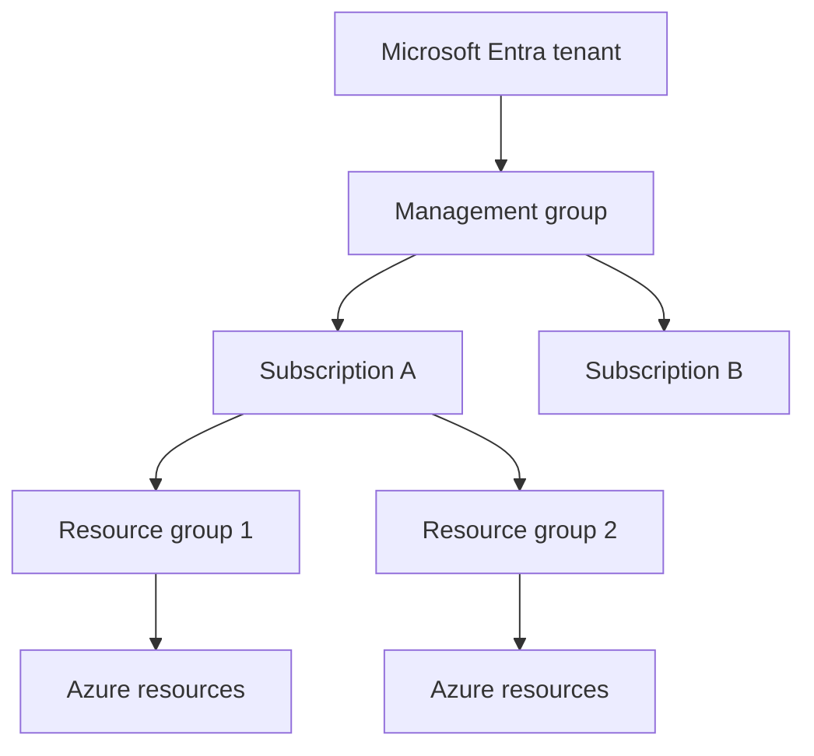
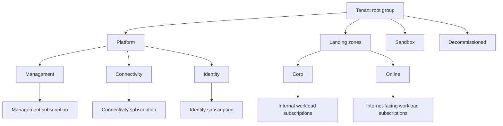
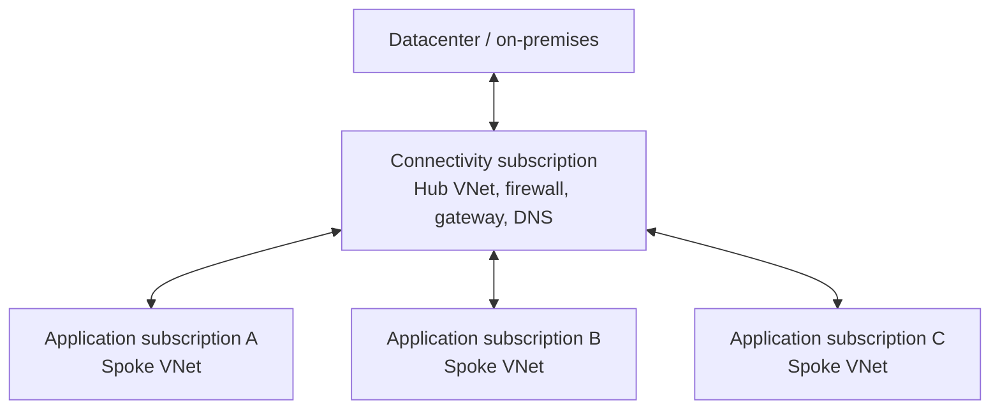
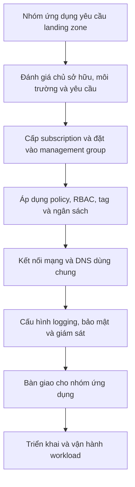

# Tổ chức landing zone và các subscription nền tảng

Khi một tổ chức bắt đầu sử dụng Microsoft Azure, việc tạo vài máy ảo hoặc tài khoản lưu trữ thường khá đơn giản. Khó khăn xuất hiện khi nhiều nhóm cùng triển khai ứng dụng, nhiều môi trường cùng tồn tại và hệ thống phải đáp ứng yêu cầu về bảo mật, mạng, vận hành, tuân thủ và chi phí. Nếu mỗi nhóm tự tạo tài nguyên theo cách riêng, tổ chức sẽ nhanh chóng gặp tình trạng cấu hình không nhất quán, quyền truy cập khó kiểm soát, log phân tán và chi phí khó phân bổ.

Azure landing zone là nền tảng kiến trúc và quản trị giúp tổ chức chuẩn bị môi trường Azure để triển khai, vận hành và mở rộng workload một cách nhất quán. Landing zone bao gồm cấu trúc quản lý, danh tính, mạng, bảo mật, giám sát, chính sách và quy trình tạo subscription. Trong kiến trúc Azure Landing Zone, các subscription nền tảng cung cấp những dịch vụ dùng chung như quản lý và giám sát, kết nối mạng và các thành phần danh tính cần thiết.

Bài học này giải thích cách tổ chức landing zone theo quy mô doanh nghiệp, phân biệt platform landing zone với application landing zone, thiết kế management group và subscription, xác định vai trò của các subscription nền tảng, đồng thời xây dựng quy trình cấp phát subscription cho workload.

Sau bài học, bạn có thể:

- Giải thích mục đích và các thành phần chính của Azure landing zone.
- Thiết kế cây management group để áp dụng chính sách và phân quyền theo phạm vi.
- Phân biệt subscription nền tảng với subscription dành cho ứng dụng.
- Xác định trách nhiệm của các subscription Management, Connectivity và Identity.
- Lựa chọn cách chia subscription theo chủ sở hữu, môi trường, mức độ quan trọng và yêu cầu tuân thủ.
- Mô tả quy trình subscription vending và các kiểm tra cần hoàn tất trước khi bàn giao subscription.

## 1. Azure landing zone là gì?

Landing zone là môi trường Azure đã được chuẩn bị để workload có thể triển khai theo các tiêu chuẩn chung của tổ chức. Nó kết hợp cả kiến trúc kỹ thuật và mô hình vận hành. Một landing zone tốt giúp nhóm ứng dụng tập trung vào việc xây dựng sản phẩm, trong khi các yêu cầu nền tảng như danh tính, mạng, logging, bảo mật và quản trị đã có cách triển khai rõ ràng.

Landing zone không phải là một tài nguyên Azure đơn lẻ hay một resource group đặc biệt. Nó là tập hợp cấu trúc và năng lực phối hợp với nhau, có thể bao gồm:

- **Tổ chức tài nguyên:** tenant Microsoft Entra ID, management group, subscription, resource group và quy ước đặt tên.
- **Danh tính và truy cập:** xác thực, Azure RBAC, nhóm quản trị, quyền đặc biệt và quy trình cấp quyền.
- **Mạng:** kết nối giữa workload, mạng on-premises, Internet và các dịch vụ Azure dùng chung.
- **Bảo mật và quản trị:** Azure Policy, Microsoft Defender for Cloud, tiêu chuẩn cấu hình và kiểm soát thay đổi.
- **Quản lý và giám sát:** Activity Log, Azure Monitor, Log Analytics, cảnh báo, chẩn đoán và quy trình phản ứng.
- **Tự động hóa và triển khai:** Infrastructure as Code (IaC), pipeline, mẫu triển khai và quy trình cấp phát subscription.
- **Quản lý chi phí:** ngân sách, phân loại chi phí, thẻ tài nguyên và trách nhiệm sở hữu.

Azure landing zone thường được thiết kế dựa trên các vùng thiết kế của Cloud Adoption Framework (CAF), chẳng hạn tổ chức tài nguyên, danh tính, mạng, bảo mật, quản lý, quản trị và tự động hóa nền tảng. Mức độ triển khai từng vùng phụ thuộc vào quy mô và yêu cầu của tổ chức. Một nhóm nhỏ có thể bắt đầu với cấu trúc đơn giản; một doanh nghiệp lớn có thể cần nhiều management group, subscription và vùng mạng riêng.

### Landing zone giải quyết vấn đề nào?

Giả sử một doanh nghiệp có ba nhóm: nhóm nhân sự quản lý hệ thống nội bộ, nhóm thương mại điện tử vận hành website công khai và nhóm dữ liệu xây dựng nền tảng phân tích. Nếu mỗi nhóm tự tạo subscription và cấu hình riêng, các vấn đề thường xuất hiện:

- Nhóm này cho phép triển khai ở vùng Azure không được phê duyệt, trong khi nhóm khác bị giới hạn vùng.
- Mỗi nhóm lưu log ở một nơi khác nhau, khiến đội vận hành khó điều tra sự cố xuyên hệ thống.
- Các workload tự tạo VPN, firewall hoặc DNS theo cách riêng, làm tăng chi phí và độ phức tạp.
- Quyền Owner được cấp quá rộng hoặc tài khoản cá nhân được dùng cho tự động hóa.
- Không có quy ước tag và ngân sách thống nhất nên khó biết ứng dụng nào tạo ra chi phí.

Landing zone giải quyết các vấn đề này bằng cách thiết lập một bộ tiêu chuẩn và dịch vụ dùng chung, đồng thời vẫn giữ quyền tự chủ phù hợp cho nhóm sở hữu workload.

## 2. Hai miền chính: platform landing zone và application landing zone

Kiến trúc Azure Landing Zone thường được tổ chức thành hai miền có trách nhiệm khác nhau.

| Miền | Mục đích | Ví dụ thành phần |
|---|---|---|
| Platform landing zone | Cung cấp nền tảng dùng chung cho toàn tổ chức hoặc nhiều workload | Kết nối mạng trung tâm, giám sát tập trung, dịch vụ danh tính cần thiết, chính sách và công cụ vận hành |
| Application landing zone | Chứa workload và tài nguyên phục vụ một ứng dụng, sản phẩm hoặc nhóm nghiệp vụ | Web app, API, máy ảo, database, storage, tài nguyên tích hợp và các thành phần riêng của ứng dụng |

Platform team thường chịu trách nhiệm thiết kế và vận hành platform landing zone. Application team sở hữu ứng dụng, dữ liệu và cấu hình workload trong phạm vi được cấp. Hai nhóm phối hợp qua các giao diện được xác định trước, chẳng hạn yêu cầu kết nối mạng, quy trình cấp quyền, tiêu chuẩn logging và quy trình hỗ trợ.

Application landing zone thường được triển khai trong một hoặc nhiều subscription dành cho workload. Subscription có thể được cấp riêng cho một ứng dụng, một nhóm ứng dụng liên quan hoặc một môi trường, tùy theo ranh giới bảo mật, vòng đời và trách nhiệm quản lý.

Không nên xem platform landing zone là một subscription duy nhất. Trong kiến trúc phổ biến, nó gồm nhiều subscription nền tảng, mỗi subscription có trách nhiệm và phạm vi thay đổi riêng. Việc tách như vậy giúp giới hạn ảnh hưởng khi có sự cố, quản lý quyền và phân bổ chi phí rõ ràng hơn.

## 3. Các lớp tổ chức tài nguyên của Azure

Để hiểu landing zone, trước hết cần phân biệt các lớp tổ chức trong Azure:

| Lớp | Chức năng | Quan hệ |
|---|---|---|
| Microsoft Entra tenant | Ranh giới danh tính, ứng dụng và nhóm người dùng | Một tenant có thể quản lý nhiều subscription |
| Management group | Nhóm subscription để áp dụng Azure Policy và Azure RBAC ở phạm vi rộng | Có thể chứa management group con và subscription |
| Subscription | Ranh giới quản lý tài nguyên, quyền, quota và theo dõi chi phí | Thuộc một management group tại một thời điểm; chứa resource group |
| Resource group | Nhóm logic các tài nguyên có liên quan về quản lý hoặc vòng đời | Nằm trong một subscription |
| Resource | Tài nguyên Azure cụ thể | Nằm trong một resource group hoặc phạm vi tài nguyên tương ứng của dịch vụ |

Quan hệ khái quát:

Management group không chứa trực tiếp máy ảo hay storage account. Nó tổ chức subscription và cung cấp phạm vi để áp dụng chính sách hoặc phân quyền. Subscription không phải tenant và cũng không phải resource group. Một subscription được liên kết với một Microsoft Entra tenant tại một thời điểm; các subscription trong cùng landing zone thường được quản lý trong tenant doanh nghiệp đã chọn.

Các lớp này có tác động khác nhau:

- Thay đổi policy ở management group có thể ảnh hưởng đến nhiều subscription con.
- Thay đổi RBAC ở subscription có thể cấp quyền xuống resource group và tài nguyên con.
- Resource group giúp quản lý vòng đời và quyền ở phạm vi nhỏ hơn, nhưng không thay thế subscription như một ranh giới quản trị.
- Việc tách subscription có thể giúp cô lập quota, quyền, chi phí và ảnh hưởng vận hành.

## 4. Thiết kế cây management group

Management group giúp tổ chức subscription theo mục đích và áp dụng guardrail thống nhất. Một cấu trúc thường gặp trong Azure Landing Zone có thể được minh họa như sau:

Đây là cấu trúc tham khảo. Tổ chức có thể bổ sung nhánh cho dữ liệu, môi trường thử nghiệm, workload có yêu cầu tuân thủ đặc biệt hoặc các nhóm nghiệp vụ. Không cần tạo mọi nhánh ngay từ đầu nếu chưa có nhu cầu và mô hình vận hành tương ứng.

### Tenant root group

Tenant root group là gốc của cây management group. Đây là phạm vi có ảnh hưởng rất rộng. Chỉ nên đặt ở đây những policy và quyền thực sự cần áp dụng cho toàn tenant. Giới hạn số người có quyền quản trị ở phạm vi này, dùng quy trình phê duyệt và theo dõi mọi thay đổi.

### Platform

Nhánh Platform chứa các subscription vận hành dịch vụ nền tảng. Các nhánh con thường gồm Management, Connectivity và Identity. Cách tách này giúp policy và quyền quản lý của từng miền được thiết kế phù hợp với trách nhiệm của đội nền tảng.

### Landing zones

Nhánh Landing zones chứa các subscription triển khai ứng dụng. Có thể chia thành:

- **Corp:** workload nội bộ hoặc workload cần kết nối với mạng doanh nghiệp/on-premises theo kiến trúc được phê duyệt.
- **Online:** workload có bề mặt truy cập Internet hoặc được thiết kế để phục vụ người dùng bên ngoài.

Corp và Online là cách phân loại theo mô hình kết nối và kiểm soát. Không nên dùng tên nhánh để thay thế việc đánh giá rủi ro thực tế của từng ứng dụng. Một workload công khai vẫn có thể cần kết nối riêng đến hệ thống nội bộ; khi đó phải thiết kế đường kết nối và policy theo yêu cầu cụ thể.

### Sandbox và Decommissioned

Sandbox có thể dành cho thử nghiệm có kiểm soát, với quota, ngân sách và policy phù hợp. Không nên coi sandbox là khu vực không có quản trị. Decommissioned có thể chứa subscription đang trong quy trình ngừng hoạt động, với quyền và policy hạn chế để tránh phát sinh tài nguyên mới trong thời gian lưu giữ hoặc bàn giao dữ liệu.

### Nguyên tắc thiết kế cây

1. Tổ chức theo mục đích quản trị và mô hình vận hành, không chỉ theo sơ đồ phòng ban hiện tại.
2. Tạo nhánh khi có policy, quyền hoặc trách nhiệm khác biệt cần áp dụng ổn định.
3. Giữ cây đủ nông để dễ hiểu, dễ kiểm tra và dễ thay đổi.
4. Tránh gán quyền rộng ở tenant root group nếu có thể cấp quyền ở nhánh thấp hơn.
5. Đặt subscription vào đúng management group ngay từ quy trình cấp phát.
6. Kiểm thử policy ở môi trường phù hợp trước khi áp dụng ở phạm vi có nhiều workload.

## 5. Các subscription nền tảng

Trong mô hình tham chiếu phổ biến, platform landing zone có ba subscription cốt lõi: Management, Connectivity và Identity. Tên subscription có thể khác theo quy ước của tổ chức, nhưng trách nhiệm cần được xác định rõ.

### 5.1. Management subscription

Management subscription chứa các thành phần phục vụ quản lý và giám sát tập trung. Tùy thiết kế, nó có thể chứa:

- Log Analytics workspace để tập trung log từ các workload và dịch vụ nền tảng.
- Thành phần Azure Monitor, cấu hình cảnh báo và dashboard dùng chung.
- Tài nguyên phục vụ quản lý máy chủ, Azure Arc hoặc tự động hóa vận hành khi tổ chức có nhu cầu.
- Công cụ và tài nguyên hỗ trợ vận hành, kiểm kê hoặc điều phối tác vụ nền tảng.

Không phải mọi tài nguyên giám sát đều bắt buộc nằm trong một subscription duy nhất. Một số cấu hình Azure Monitor, diagnostic setting, data collection rule hoặc dịch vụ bảo mật được quản lý ở phạm vi khác nhau. Điều quan trọng là xác định nơi lưu dữ liệu, ai được đọc, thời gian lưu giữ, chi phí ingest và cách phân quyền giữa đội vận hành với đội ứng dụng.

Ví dụ, các subscription workload có thể cấu hình diagnostic settings để gửi Activity Log hoặc log tài nguyên đến đích tập trung theo chuẩn của tổ chức. Nhóm vận hành dùng dữ liệu đó để theo dõi tình trạng hệ thống và điều tra sự cố. Cần bảo đảm dữ liệu nhạy cảm không bị thu thập quá mức và quyền truy cập workspace được giới hạn phù hợp.

### 5.2. Connectivity subscription

Connectivity subscription chứa hạ tầng mạng dùng chung và các điểm kết nối giữa Azure với mạng bên ngoài. Tùy kiến trúc, tài nguyên có thể gồm:

- Hub virtual network hoặc Azure Virtual WAN hub.
- Azure Firewall hoặc thiết bị mạng được phê duyệt.
- VPN Gateway và ExpressRoute Gateway để kết nối on-premises.
- DNS Private Resolver hoặc các thành phần DNS dùng chung.
- Network Watcher và tài nguyên hỗ trợ chẩn đoán mạng.
- Dịch vụ bảo vệ mạng và định tuyến dùng chung theo thiết kế.

Mô hình hub-and-spoke thường có một hoặc nhiều hub trung tâm trong Connectivity subscription. Mỗi application landing zone triển khai spoke network riêng và kết nối về hub theo quy tắc. Hub cung cấp đường đi có kiểm soát đến on-premises, Internet hoặc dịch vụ dùng chung; spoke cô lập mạng của workload.

Hub-and-spoke là một lựa chọn phổ biến, không phải lựa chọn duy nhất. Azure Virtual WAN có thể phù hợp với mạng phân tán nhiều chi nhánh hoặc nhiều vùng. Kiến trúc cần xem xét lưu lượng east-west và north-south, định tuyến, DNS, kiểm tra lưu lượng, khả năng mở rộng, độ sẵn sàng và chi phí truyền dữ liệu.

Tách Connectivity subscription giúp nhóm mạng quản lý hạ tầng dùng chung và giới hạn quyền thay đổi cấu hình mạng. Nhóm ứng dụng thường chỉ được phép quản lý phần mạng thuộc workload của mình theo thiết kế, không tự ý thay đổi firewall trung tâm, gateway hoặc route dùng chung.

### 5.3. Identity subscription

Identity subscription dành cho các thành phần hạ tầng danh tính mà tổ chức cần vận hành trong Azure. Ví dụ có thể gồm:

- Domain controller chạy Active Directory Domain Services (AD DS) trên máy ảo, nếu ứng dụng hoặc hệ thống cũ còn phụ thuộc domain truyền thống.
- Thành phần đồng bộ hoặc tích hợp danh tính theo kiến trúc được phê duyệt.
- Dịch vụ hỗ trợ xác thực và quản lý danh tính cần được đặt trong phạm vi vận hành riêng.

Microsoft Entra ID là nền tảng danh tính đám mây của Azure và không phải một máy chủ phải triển khai trong Identity subscription. Identity subscription không có nghĩa là phải dựng domain controller cho mọi tổ chức. Nếu workload có thể dùng xác thực hiện đại với Microsoft Entra ID, managed identity và các cơ chế cloud-native, hãy ưu tiên kiến trúc đó. Chỉ triển khai AD DS hoặc thành phần tương thích khi có yêu cầu cụ thể, chẳng hạn ứng dụng cũ cần domain join, LDAP hoặc Group Policy.

Các máy chủ danh tính thường có mức độ quan trọng cao. Cần bảo vệ mạng, quản lý bản vá, sao lưu, giám sát, quyền quản trị và kế hoạch phục hồi nghiêm ngặt. Không đặt các máy chủ nhạy cảm này trong subscription ứng dụng thông thường nếu tổ chức cần một ranh giới vận hành riêng.

### Có cần subscription nền tảng thứ tư không?

Một số tổ chức có thể tạo thêm subscription cho shared services, security operations, image building, automation hoặc các dịch vụ nền tảng chuyên biệt. Việc tách thêm chỉ nên thực hiện khi có khác biệt rõ ràng về chủ sở hữu, quyền, vòng đời, yêu cầu bảo mật, quota hoặc chi phí. Không nên tạo subscription chỉ để phản ánh một tên nhóm nếu không có lợi ích quản trị tương ứng.

## 6. Application landing zone và cách chia subscription workload

Subscription dành cho workload là nơi nhóm ứng dụng triển khai tài nguyên của mình. Một subscription có thể chứa nhiều resource group và nhiều dịch vụ, nhưng cần có ranh giới sở hữu rõ ràng.

Một số cách chia thường gặp:

| Cách chia | Khi phù hợp | Điểm cần cân nhắc |
|---|---|---|
| Một subscription cho mỗi ứng dụng | Ứng dụng có chủ sở hữu, vòng đời, rủi ro hoặc chi phí riêng | Dễ cô lập quyền và chi phí nhưng tăng số subscription cần quản lý |
| Một subscription cho một nhóm ứng dụng liên quan | Các ứng dụng dùng chung đội vận hành và yêu cầu bảo mật tương tự | Cần quy ước resource group, RBAC và tag rõ ràng |
| Subscription tách theo môi trường dev/test/prod | Môi trường có yêu cầu bảo vệ, quyền hoặc thay đổi khác nhau | Tăng khả năng cô lập nhưng cần tự động hóa cấp phát và quản lý nhiều subscription |
| Subscription riêng cho workload đặc thù | Có yêu cầu tuân thủ, vùng, kết nối, quota hoặc bảo mật khác biệt | Cần chứng minh lý do tách và tránh tạo ngoại lệ khó vận hành |

Không có một số lượng subscription tối ưu cho mọi tổ chức. Hãy chọn dựa trên các câu hỏi:

- Ai sở hữu workload và chịu trách nhiệm khi có sự cố?
- Nhóm nào được phép triển khai, thay đổi hoặc xóa tài nguyên?
- Môi trường có cần cô lập dữ liệu và quyền truy cập không?
- Có yêu cầu riêng về vùng Azure, kết nối mạng hoặc tiêu chuẩn bảo mật không?
- Cần phân bổ chi phí và quota đến mức nào?
- Vòng đời của workload có độc lập với các ứng dụng khác không?

Tránh chia quá nhỏ khiến mỗi thay đổi phải đi qua nhiều thủ tục, nhưng cũng tránh gom các workload có mức độ tin cậy hoặc quyền hạn rất khác nhau vào cùng một subscription. Resource group hữu ích để nhóm tài nguyên, song không phải ranh giới bảo mật mạnh tương đương việc tách subscription.

## 7. Áp dụng governance bằng Azure Policy và Azure RBAC

Management group và subscription tạo ra các phạm vi để áp dụng governance. Hai cơ chế quan trọng là Azure Policy và Azure RBAC, nhưng chúng giải quyết hai bài toán khác nhau.

### Azure Policy: kiểm soát cấu hình tài nguyên

Azure Policy đánh giá trạng thái tài nguyên so với quy tắc của tổ chức. Policy có thể được gán ở management group, subscription, resource group hoặc phạm vi tài nguyên phù hợp; các assignment ở phạm vi cha có thể áp dụng xuống phạm vi con.

Ví dụ về guardrail:

- Chỉ cho phép triển khai tài nguyên ở các vùng Azure được phê duyệt.
- Yêu cầu tag như `environment`, `owner` hoặc `costCenter`.
- Kiểm tra hoặc từ chối cấu hình mạng, lưu trữ và bảo mật không đáp ứng chuẩn.
- Bật cấu hình chẩn đoán hoặc triển khai thành phần hỗ trợ theo chính sách.
- Đánh giá tuân thủ và xác định tài nguyên cần khắc phục.

Các effect thường gặp gồm `Audit`, `Deny`, `Modify` và `DeployIfNotExists`. `Audit` ghi nhận vi phạm; `Deny` chặn yêu cầu tạo hoặc cập nhật không phù hợp; `Modify` có thể sửa một số thuộc tính được hỗ trợ; `DeployIfNotExists` có thể triển khai tài nguyên liên quan khi điều kiện được đáp ứng. Một số policy cần managed identity và quyền phù hợp để thực hiện remediation. Cần kiểm thử tác động trước khi chuyển từ Audit sang Deny.

Policy không thay thế quyền truy cập. Một người dùng có thể có quyền Contributor nhưng vẫn bị policy từ chối tạo tài nguyên ở vùng không được phép. Ngược lại, policy cho phép một cấu hình không có nghĩa người dùng tự động được cấp quyền triển khai.

### Azure RBAC: kiểm soát ai được làm gì

Azure RBAC cấp vai trò cho user, group, service principal hoặc managed identity ở một phạm vi. Vai trò có thể được kế thừa xuống phạm vi con. Ví dụ:

- Platform team có quyền quản lý hạ tầng ở management group hoặc các subscription nền tảng theo trách nhiệm.
- Network team có quyền quản lý Connectivity subscription.
- Application team có quyền triển khai trong subscription workload của mình.
- Security team có quyền đọc dữ liệu bảo mật hoặc thực hiện các tác vụ điều tra theo quy trình.

Hãy ưu tiên cấp quyền thông qua nhóm Microsoft Entra thay vì gán trực tiếp cho từng cá nhân. Dùng vai trò có quyền tối thiểu cần thiết; quyền quản trị đặc quyền nên được kiểm soát bằng quy trình phê duyệt và cơ chế như Privileged Identity Management (PIM) khi phù hợp.

### Phân tầng policy

Một cách thiết kế dễ quản lý là:

1. Ở tenant root group, đặt một số quy tắc nền tảng thực sự áp dụng cho toàn tổ chức.
2. Ở Platform, áp dụng tiêu chuẩn cho subscription vận hành dịch vụ nền tảng.
3. Ở Landing zones, áp dụng baseline chung cho workload.
4. Ở Corp, Online hoặc nhánh chuyên biệt, bổ sung policy phù hợp với mô hình workload.
5. Ở subscription, tạo ngoại lệ có lý do và thời hạn rõ ràng khi thực sự cần.

Ngoại lệ policy cần có chủ sở hữu, lý do, phạm vi và ngày xem xét lại. Ngoại lệ không nên trở thành cách xử lý mặc định cho mọi workload không tuân thủ.

## 8. Kết nối giữa platform và application landing zone

Một landing zone cần xác định rõ cách workload sử dụng dịch vụ nền tảng. Ví dụ, application subscription có thể cần:

- Kết nối spoke về hub hoặc Virtual WAN theo mô hình mạng được chọn.
- Sử dụng DNS nội bộ và phân giải tên private endpoint.
- Gửi log đến workspace hoặc đích giám sát tập trung.
- Dùng managed identity để truy cập Key Vault, Storage hoặc dịch vụ dữ liệu.
- Áp dụng policy bảo mật, vùng triển khai và tag do tổ chức quy định.
- Nhận cảnh báo và hỗ trợ từ đội vận hành theo mức dịch vụ đã thống nhất.

Các tích hợp này nên được tự động hóa và tài liệu hóa. Không nên yêu cầu nhóm ứng dụng tự tìm người quản trị mạng hoặc tự đoán workspace cần gửi log. Một giao diện dịch vụ nền tảng tốt cần công bố đầu vào, đầu ra, quyền yêu cầu, thời gian cung cấp và đầu mối hỗ trợ.

Ví dụ luồng triển khai workload:

## 9. Subscription vending: quy trình cấp phát subscription

Subscription vending là quy trình chuẩn hóa việc yêu cầu, tạo, cấu hình và bàn giao subscription. Quy trình có thể được thực hiện bằng portal nội bộ, pipeline, IaC hoặc kết hợp nhiều cơ chế. Mục tiêu là để subscription mới có cấu hình quản trị tối thiểu ngay từ đầu.

Một quy trình tham khảo gồm các bước:

### Bước 1: Thu thập yêu cầu

Ghi nhận tên workload, chủ sở hữu kỹ thuật và nghiệp vụ, môi trường, phân loại dữ liệu, mức độ quan trọng, vùng cần dùng, mô hình kết nối, yêu cầu tuân thủ và dự báo chi phí. Xác định subscription mới là workload Corp, Online hay một loại landing zone chuyên biệt.

### Bước 2: Chọn billing scope và tạo subscription

Tạo subscription dưới billing arrangement phù hợp với tổ chức. Phân biệt billing account hoặc billing profile với management group: billing scope phục vụ quan hệ thương mại và hóa đơn, còn management group phục vụ tổ chức và quản trị tài nguyên. Hai cấu trúc liên quan nhưng không đồng nhất.

### Bước 3: Đặt subscription vào management group

Đưa subscription vào nhánh tương ứng ngay sau khi tạo. Việc này giúp subscription nhận đúng policy và mô hình quản trị được kế thừa. Không để subscription mới hoạt động lâu trong một vị trí tạm thời không được kiểm soát.

### Bước 4: Thiết lập danh tính và quyền

Gán nhóm Entra cho vai trò cần thiết ở phạm vi phù hợp. Xác định người chịu trách nhiệm, nhóm vận hành, nhóm bảo mật và danh tính tự động hóa. Tránh cấp quyền Owner cho toàn bộ thành viên nhóm ứng dụng nếu họ chỉ cần triển khai workload.

### Bước 5: Áp dụng guardrail và cấu hình mặc định

Áp dụng policy, initiative, tag, vùng được phép, cấu hình bảo mật và quy ước đặt tên. Đăng ký resource provider cần thiết theo yêu cầu workload và chính sách tổ chức. Cấu hình diagnostic settings, Activity Log export hoặc các điểm tích hợp logging theo baseline.

### Bước 6: Thiết lập mạng và dịch vụ dùng chung

Kết nối subscription với hub hoặc Virtual WAN nếu cần. Thiết lập DNS, private endpoint, route, firewall và các phụ thuộc mạng theo thiết kế. Xác nhận đường đi từ workload đến dịch vụ dùng chung và hệ thống on-premises.

### Bước 7: Thiết lập chi phí và vận hành

Gắn tag, tạo budget hoặc cảnh báo chi phí theo trách nhiệm, thiết lập dashboard và cảnh báo vận hành, xác định thời gian lưu giữ log và đầu mối hỗ trợ. Budget giúp cảnh báo khi chi tiêu đạt ngưỡng; nó không tự động là giới hạn cứng ngăn mọi chi phí phát sinh.

### Bước 8: Kiểm tra và bàn giao

Kiểm tra policy compliance, RBAC, kết nối mạng, logging, ngân sách và tài liệu. Bàn giao thông tin subscription ID, management group, nhóm sở hữu, quy tắc triển khai, đầu mối hỗ trợ và quy trình yêu cầu thay đổi.

## 10. Tự động hóa cấu trúc landing zone

Tạo management group, subscription, policy và mạng bằng thao tác thủ công có thể phù hợp với thử nghiệm nhỏ, nhưng dễ gây sai lệch khi số lượng workload tăng. Nên mô tả cấu hình nền tảng bằng Infrastructure as Code và quản lý thay đổi qua source control.

Các lựa chọn triển khai có thể gồm:

- **Bicep/ARM:** mô tả tài nguyên Azure và một số cấu hình quản trị theo dạng khai báo.
- **Terraform:** quản lý hạ tầng đa dịch vụ và duy trì trạng thái triển khai theo quy trình của nhóm.
- **Pipeline:** kiểm tra mã, chạy plan hoặc what-if, yêu cầu phê duyệt và triển khai theo môi trường.
- **Azure Landing Zone Accelerator:** có thể dùng làm điểm khởi đầu triển khai kiến trúc tham chiếu, sau đó điều chỉnh theo yêu cầu và mô hình vận hành thực tế.

Không nên sao chép một cấu hình mẫu vào production mà chưa hiểu các policy, role assignment, network route và tài nguyên sẽ được tạo. Cần kiểm tra module, phiên bản, nguồn mã, quyền pipeline và cơ chế lưu state hoặc bí mật.

Một số tác vụ thường được tự động hóa:

1. Tạo hoặc chọn management group đích.
2. Tạo subscription theo yêu cầu đã phê duyệt.
3. Di chuyển subscription vào management group phù hợp.
4. Gán policy initiative và role assignment.
5. Tạo budget, tag và cấu hình diagnostic settings.
6. Kết nối mạng, DNS và workspace tập trung.
7. Chạy kiểm tra tuân thủ rồi phát hành thông tin bàn giao.

Pipeline cần có log kiểm toán, kiểm tra đầu vào, xử lý lỗi và khả năng chạy lại an toàn. Nếu một bước thất bại giữa chừng, quy trình phải xác định được trạng thái hiện tại và tiếp tục hoặc khôi phục mà không tạo thêm tài nguyên trùng lặp.

## 11. Bảo mật và vận hành subscription nền tảng

Subscription nền tảng thường chứa tài nguyên có ảnh hưởng đến nhiều ứng dụng. Vì vậy, việc quản trị chúng cần chặt chẽ hơn subscription thử nghiệm thông thường.

- **Phân tách trách nhiệm:** xác định rõ đội sở hữu Management, Connectivity và Identity; quy định ai được phê duyệt và ai được thực thi thay đổi.
- **Quyền tối thiểu:** chỉ cấp quyền cần thiết ở phạm vi phù hợp; dùng nhóm Entra và PIM cho quyền đặc biệt khi có thể.
- **Bảo vệ danh tính tự động hóa:** ưu tiên managed identity hoặc workload identity federation; quản lý chứng chỉ và bí mật theo quy trình.
- **Theo dõi thay đổi:** thu thập Activity Log, log tài nguyên và sự kiện bảo mật; kiểm tra cảnh báo và quy trình phản ứng.
- **Khả năng phục hồi:** sao lưu và kiểm tra khôi phục đối với dữ liệu/cấu hình cần thiết; lập kế hoạch cho sự cố mạng, danh tính và workspace giám sát.
- **Kiểm soát thay đổi:** thay đổi firewall, DNS, policy gốc và dịch vụ danh tính cần review, kiểm thử và kế hoạch rollback.
- **Quản lý vòng đời:** rà soát subscription không còn chủ sở hữu, tài nguyên mồ côi, quyền không còn cần thiết và ngoại lệ policy quá hạn.

Không nên để một nhóm duy nhất vừa tự phê duyệt vừa thực hiện mọi thay đổi có ảnh hưởng rộng mà không có kiểm soát phù hợp. Với các dịch vụ nền tảng quan trọng, hãy xác định mục tiêu sẵn sàng, phương án dự phòng, phụ thuộc và người chịu trách nhiệm trong sự cố.

## 12. Kiểm soát chi phí và trách nhiệm sở hữu

Tách subscription có thể giúp báo cáo chi phí và phân bổ trách nhiệm, nhưng chỉ hiệu quả khi có quy ước nhất quán. Mỗi subscription nên có thông tin chủ sở hữu và mục đích sử dụng rõ ràng.

Các thực hành nên áp dụng:

- Dùng tag như `application`, `environment`, `owner`, `costCenter` và `dataClassification` theo chuẩn của tổ chức.
- Đặt budget và cảnh báo cho subscription hoặc phạm vi chi phí phù hợp.
- Theo dõi chi phí của dịch vụ dùng chung và xác định cách phân bổ cho các nhóm sử dụng.
- Rà soát tài nguyên không sử dụng, SKU quá lớn, dung lượng lưu trữ và lưu lượng truyền dữ liệu.
- Đặt thời hạn xem xét cho subscription thử nghiệm và subscription tạm thời.
- Thông báo rõ budget là cơ chế theo dõi/cảnh báo; việc giới hạn chi tiêu cần kết hợp quy trình vận hành và kiểm soát triển khai.

Ví dụ: Connectivity subscription có thể phát sinh chi phí firewall, gateway và truyền dữ liệu cho nhiều workload. Nếu không có mô hình phân bổ, nhóm nền tảng sẽ khó giải thích mức tăng chi phí. Tổ chức có thể phân bổ theo mức sử dụng đo được, theo tỷ lệ đã thống nhất hoặc ghi nhận thành chi phí nền tảng chung. Phương pháp cần minh bạch và nhất quán.

## 13. Những lỗi thiết kế thường gặp

| Lỗi | Hệ quả | Cách cải thiện |
|---|---|---|
| Đặt tất cả tài nguyên vào một subscription | Khó cô lập quyền, quota, chi phí và ảnh hưởng sự cố | Tách platform và workload; chia subscription theo ranh giới sở hữu và rủi ro |
| Tạo quá nhiều management group | Cây phức tạp, policy khó theo dõi, ngoại lệ khó quản lý | Chỉ tạo nhánh khi có khác biệt quản trị thực sự |
| Cấp Owner ở tenant root group | Phạm vi quyền quá rộng, tăng rủi ro thay đổi ngoài ý muốn | Dùng nhóm quản trị giới hạn và cấp quyền ở nhánh thấp nhất phù hợp |
| Coi Identity subscription là nơi chứa Microsoft Entra ID | Hiểu sai mô hình dịch vụ danh tính đám mây | Phân biệt Entra ID với hạ tầng AD DS hoặc thành phần danh tính tự quản lý |
| Mỗi workload tự xây firewall, DNS và logging | Tốn kém, cấu hình không nhất quán, khó vận hành | Cung cấp dịch vụ nền tảng dùng chung với giao diện rõ ràng |
| Tạo subscription nhưng chưa gán policy và quyền | Workload có thể triển khai trước khi có guardrail | Tích hợp governance vào subscription vending và kiểm tra trước bàn giao |
| Dùng budget như giới hạn chi tiêu cứng | Có thể phát sinh chi phí dù đã vượt ngưỡng | Kết hợp cảnh báo, quy trình phản ứng và kiểm soát triển khai |
| Dùng ngoại lệ policy vô thời hạn | Baseline dần mất hiệu lực | Gắn owner, lý do, phạm vi và ngày xem xét cho mỗi ngoại lệ |

## 14. Ví dụ thiết kế cho một doanh nghiệp

Giả sử doanh nghiệp Example có các nhu cầu:

- Một nhóm nền tảng quản lý mạng, giám sát và dịch vụ dùng chung.
- Một hệ thống ERP nội bộ cần kết nối đến datacenter.
- Một website thương mại điện tử phục vụ người dùng Internet.
- Một môi trường phát triển dữ liệu cần quyền và dữ liệu thử nghiệm riêng.

Một thiết kế khởi đầu có thể gồm:

| Management group | Subscription | Mục đích |
|---|---|---|
| Platform / Management | `sub-platform-management` | Log tập trung, cảnh báo và công cụ quản lý |
| Platform / Connectivity | `sub-platform-connectivity` | Hub network, firewall, VPN/ExpressRoute và DNS |
| Platform / Identity | `sub-platform-identity` | AD DS trên Azure nếu ERP còn yêu cầu; các thành phần danh tính tự quản lý cần thiết |
| Landing zones / Corp | `sub-erp-prod` | Workload ERP nội bộ, kết nối theo chính sách Corp |
| Landing zones / Online | `sub-commerce-prod` | Website và API công khai, bảo vệ theo baseline Online |
| Landing zones / Corp hoặc nhánh dữ liệu riêng | `sub-data-dev` | Môi trường phát triển dữ liệu, quyền và dữ liệu thử nghiệm riêng |

ERP và website thương mại điện tử dùng dịch vụ mạng và giám sát nền tảng, nhưng quyền triển khai workload được giới hạn trong subscription của từng ứng dụng. Nếu môi trường phát triển dữ liệu có yêu cầu tuân thủ hoặc quản trị khác biệt rõ rệt, tổ chức có thể tạo management group riêng thay vì đặt vào Corp theo mặc định.

Thiết kế này chỉ là điểm khởi đầu. Trước khi triển khai, doanh nghiệp cần xác nhận vùng Azure, phân loại dữ liệu, yêu cầu khôi phục, kết nối, quyền, chi phí và chủ sở hữu của từng subscription. Không nên coi tên `Corp` hoặc `Online` là bằng chứng duy nhất cho mức độ bảo mật của workload.

## 15. Checklist đánh giá landing zone

Trước khi đưa workload đầu tiên vào vận hành, hãy xác nhận:

- [ ] Tenant và billing arrangement đã được xác định; người chịu trách nhiệm quản trị đã rõ.
- [ ] Cây management group phản ánh mô hình quản trị và không có nhánh thừa.
- [ ] Các subscription nền tảng có chủ sở hữu, phạm vi và mục đích được tài liệu hóa.
- [ ] Subscription workload được đặt đúng management group.
- [ ] Azure Policy baseline đã được kiểm thử và áp dụng ở phạm vi phù hợp.
- [ ] Nhóm Entra, role assignment và quy trình quyền đặc biệt đã được thiết lập.
- [ ] Kết nối mạng, DNS và đường đi đến dịch vụ dùng chung đã được xác minh.
- [ ] Logging, monitoring, cảnh báo và thời gian lưu giữ dữ liệu đã được cấu hình.
- [ ] Baseline bảo mật và quy trình xử lý sự cố đã có người chịu trách nhiệm.
- [ ] Tag, budget và mô hình phân bổ chi phí đã được thống nhất.
- [ ] IaC hoặc quy trình cấp phát có thể kiểm soát phiên bản và chạy lại an toàn.
- [ ] Tài liệu bàn giao có subscription ID, owner, nhóm hỗ trợ và quy trình thay đổi.

Checklist này cần được điều chỉnh theo độ quan trọng và loại workload. Một ứng dụng thử nghiệm có thể không cần cùng mức độ sẵn sàng như hệ thống thanh toán, nhưng vẫn phải tuân thủ các guardrail nền tảng tối thiểu.

## 16. Bài thực hành

Hãy thiết kế landing zone cho một công ty có một ứng dụng nội bộ, một website công khai và một đội nền tảng dùng chung. Không cần tạo tài nguyên Azure thật; mục tiêu là mô hình hóa quyết định kiến trúc.

1. Vẽ cây management group gồm tenant root, Platform, Landing zones và ít nhất hai nhánh workload.
2. Đề xuất ba subscription nền tảng Management, Connectivity và Identity. Với mỗi subscription, liệt kê ít nhất ba loại trách nhiệm hoặc tài nguyên có thể đặt trong đó.
3. Chọn subscription cho ứng dụng nội bộ và website công khai; giải thích vì sao chúng thuộc Corp hoặc Online theo mô hình đã chọn.
4. Xác định nhóm nào cần quyền quản trị Connectivity, nhóm nào được triển khai ứng dụng và nhóm nào có quyền đọc log tập trung.
5. Đề xuất ba Azure Policy baseline, chẳng hạn vùng được phép, tag bắt buộc và cấu hình chẩn đoán.
6. Mô tả các bước subscription vending từ lúc nhận yêu cầu đến khi bàn giao.
7. Nêu cách theo dõi chi phí của dịch vụ nền tảng dùng chung và cách xử lý khi một subscription vượt budget.

Bạn hoàn thành bài tập khi có thể giải thích rõ ranh giới giữa platform và workload, lý do mỗi subscription tồn tại, cách policy và RBAC được kế thừa, cùng các điều kiện phải đạt trước khi nhóm ứng dụng triển khai tài nguyên.

## 17. Ghi nhớ

Azure landing zone là nền tảng kiến trúc và quản trị để tổ chức triển khai workload trên Azure nhất quán, an toàn và có thể mở rộng. Management group tổ chức subscription và là phạm vi quan trọng để áp dụng Azure Policy cùng Azure RBAC. Platform landing zone thường có các subscription Management, Connectivity và Identity để cung cấp năng lực dùng chung; application landing zone chứa subscription của từng workload theo ranh giới sở hữu, môi trường và yêu cầu bảo mật. Quy trình subscription vending giúp mỗi subscription mới được đặt đúng vị trí, có quyền, policy, mạng, logging và kiểm soát chi phí trước khi bàn giao cho nhóm ứng dụng.
