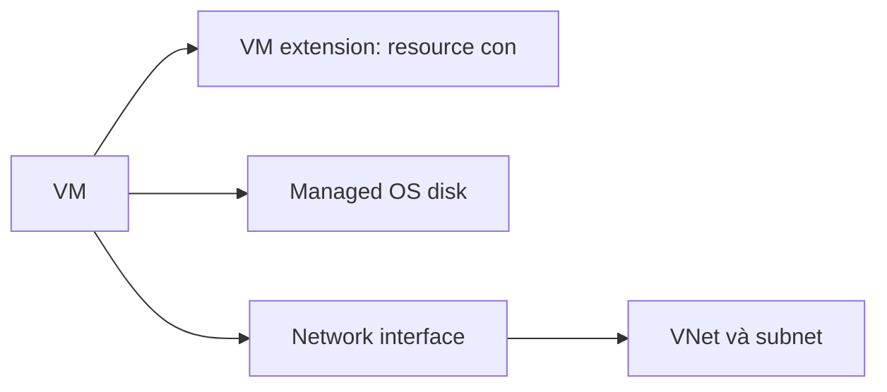

# Di chuyển tài nguyên giữa resource group và subscription

## 1. Mục đích và phạm vi

Khi một ứng dụng Azure chuyển từ giai đoạn thử nghiệm sang vận hành chính thức, cách tổ chức tài nguyên ban đầu có thể không còn phù hợp. Đội phát triển muốn tách môi trường production, chuyển trách nhiệm vận hành sang đội khác hoặc đưa ứng dụng vào subscription được quản trị tập trung.

Trong chương **Tổ chức và quản trị tài nguyên**, di chuyển tài nguyên là thao tác thay đổi phạm vi quản lý của tài nguyên đã tồn tại. Việc này liên quan trực tiếp đến resource group, subscription, Microsoft Entra ID, Azure RBAC, policy, mạng, giám sát và theo dõi chi phí.

Sau bài học này, bạn có thể:

- Xác định khi nào dùng thao tác move của Azure Resource Manager.
- Phân biệt chuyển resource group, chuyển subscription, chuyển region và chuyển tenant.
- Kiểm kê tài nguyên, phụ thuộc và những cấu hình cần cập nhật.
- Kiểm tra hỗ trợ, quyền, quota và điều kiện ở đích.
- Validate một tập tài nguyên trước khi thực hiện move.
- Xác minh cả trạng thái tài nguyên lẫn hoạt động ứng dụng sau khi chuyển.

Bài học trình bày quy trình và lệnh minh họa. Tên tài nguyên, subscription ID và cấu trúc môi trường trong ví dụ đều là giả định; phải thay bằng giá trị đã kiểm kê trước khi sử dụng.

## 2. Hiểu đúng thao tác move

### 2.1. Bốn tình huống khác nhau

| Nhu cầu | Cách tiếp cận cần đánh giá |
| --- | --- |
| Đưa resource sang resource group khác trong cùng subscription | Move giữa resource group nếu loại tài nguyên hỗ trợ |
| Đưa resource sang subscription khác trong cùng tenant | Move giữa subscription và xử lý các phụ thuộc đi kèm |
| Đưa workload sang region khác | Quy trình chuyển vùng, tái triển khai hoặc công cụ của dịch vụ |
| Đưa môi trường sang Microsoft Entra tenant khác | Kế hoạch chuyển tenant hoặc di trú riêng |

Move giữa resource group và subscription không tự thay đổi region vật lý của tài nguyên. Move trực tiếp bằng cơ chế này cũng không hỗ trợ tài nguyên đi sang tenant Microsoft Entra khác. Xem [Azure resource move overview](https://learn.microsoft.com/en-us/azure/azure-resource-manager/management/move-resources-overview).

Ví dụ VM đang ở Southeast Asia được chuyển từ resource group `rg-orders-dev` sang `rg-orders-prod` vẫn ở region đã triển khai. Vị trí khai báo của resource group đích không phải mệnh lệnh di chuyển VM sang một trung tâm dữ liệu khác.

Nếu mục tiêu thực sự là chuyển region, cần chọn quy trình đúng cho dịch vụ; không dùng đổi resource group như một cách thay thế. Tham khảo [lựa chọn công cụ chuyển tài nguyên giữa region](https://learn.microsoft.com/en-us/azure/resource-mover/select-options-to-move-resources).

### 2.2. Không chuyển nguyên đối tượng resource group sang subscription khác

Trong luồng move thông thường, tạo hoặc chọn resource group ở subscription đích rồi chuyển các tài nguyên được hỗ trợ vào đó. Không di chuyển chính đối tượng resource group sang subscription khác.

Các thiết lập của resource group nguồn như role assignments, policy và tags không tự biến thành thiết lập của resource group đích. Xem [hướng dẫn move giữa resource group và subscription](https://learn.microsoft.com/en-us/azure/azure-resource-manager/management/move-resource-group-and-subscription).

Điều này quan trọng khi tên hai resource group giống nhau: cùng tên không có nghĩa là cùng đối tượng, cùng quyền hoặc cùng cấu hình quản trị.

### 2.3. Resource ID thay đổi

Một resource ID thể hiện vị trí tài nguyên trong hệ thống phân cấp Azure:

```text
/subscriptions/{subscriptionId}
/resourceGroups/{resourceGroupName}
/providers/{providerNamespace}/{resourceType}/{resourceName}
```

Ví dụ trước khi chuyển:

```text
/subscriptions/sub-dev/resourceGroups/rg-orders-dev/providers/Microsoft.Compute/virtualMachines/vm-orders-01
```

Sau khi chuyển resource group trong cùng subscription:

```text
/subscriptions/sub-dev/resourceGroups/rg-orders-prod/providers/Microsoft.Compute/virtualMachines/vm-orders-01
```

Sau khi chuyển tiếp sang subscription khác:

```text
/subscriptions/sub-prod/resourceGroups/rg-orders-prod/providers/Microsoft.Compute/virtualMachines/vm-orders-01
```

Các đoạn `sub-dev` và `sub-prod` chỉ minh họa; subscription ID thực tế là GUID. Tên VM trong ví dụ giữ nguyên nhưng đường dẫn quản trị đã khác.

Từ cấu trúc scope này có thể suy ra mọi cấu hình lưu nguyên resource ID cũ đều cần được rà soát. Cấu trúc và quan hệ scope được giải thích tại [Understand scope for Azure RBAC](https://learn.microsoft.com/en-us/azure/role-based-access-control/scope-overview).

## 3. Những gì cần đánh giá trước và sau move

### 3.1. Resource ID và các tham chiếu bên ngoài

Lập bảng ánh xạ ID trước và sau cho từng resource. Những nơi nên tìm tham chiếu gồm:

- Tham số của pipeline triển khai.
- ARM template, Bicep và trạng thái của công cụ quản lý hạ tầng.
- Script vận hành dùng subscription, resource group hoặc ID cố định.
- Dashboard, alert, automation và cấu hình thu thập dữ liệu.
- Tài liệu vận hành, danh mục tài sản và thông tin đội sở hữu.

Không suy ra rằng Azure sẽ tự sửa mọi chuỗi ID nằm trong hệ thống bên ngoài. Ví dụ một pipeline vẫn trỏ vào resource group nguồn có thể tạo tài nguyên mới sai vị trí ở lần triển khai tiếp theo.

Đối với công cụ quản lý hạ tầng, cần dùng quy trình cập nhật cấu hình và trạng thái mà công cụ hỗ trợ. Chỉ sửa tên resource group trong mã mà không xét trạng thái hiện có có thể dẫn đến kế hoạch tạo lại hoặc xóa tài nguyên ngoài ý muốn.

### 3.2. Quyền kế thừa và quyền gán trực tiếp

Cần tách hai loại:

| Nguồn quyền | Ý nghĩa khi thay đổi phạm vi |
| --- | --- |
| Role assignment ở subscription hoặc resource group cha | Xác định lại quyền hiệu lực theo chuỗi scope ở đích |
| Role assignment gán trực tiếp trên resource hoặc resource con | Không giả định assignment được chuyển cùng resource; chuẩn bị tạo lại ở scope mới |

Azure RBAC kế thừa quyền từ scope cha xuống scope con. Vì vậy, một đội chỉ có quyền ở resource group nguồn có thể không còn quản trị được tài nguyên ở đích; đội có quyền ở đích có thể bắt đầu nhìn thấy và thao tác với tài nguyên. Xem [Azure RBAC scope](https://learn.microsoft.com/en-us/azure/role-based-access-control/scope-overview).

Đối với role assignment trực tiếp trên resource được chuyển, Microsoft nêu rõ assignment không được chuyển và có thể trở thành orphaned. Cần lập kế hoạch xử lý assignment cũ và tạo lại quyền cần thiết ở đích. Tham khảo [Troubleshoot Azure RBAC: role assignment isn't moved](https://learn.microsoft.com/en-us/azure/role-based-access-control/troubleshooting#symptom---role-assignment-isnt-moved-after-moving-a-resource).

Quyền thực hiện move và quyền tạo role assignment là hai việc riêng. Người chuyển được resource chưa chắc có quyền khôi phục các assignment. Phân công người có quyền phù hợp trước cửa sổ thay đổi; xem [Steps to assign an Azure role](https://learn.microsoft.com/en-us/azure/role-based-access-control/role-assignments-steps).

### 3.3. Managed identity và quyền truy cập dữ liệu

Ứng dụng dùng managed identity cần được kiểm tra bằng chính luồng truy cập của workload, không chỉ bằng tài khoản quản trị.

Ví dụ sau move, VM vẫn chạy nhưng ứng dụng không đọc được secret trong Key Vault. Một nguyên nhân cần kiểm tra là quyền hiệu lực của identity ở scope mới hoặc của dịch vụ phụ thuộc.

Ghi nhận trước:

```text
Identity của workload:
Principal ID:
Loại identity:
Dịch vụ được truy cập:
Role cần thiết:
Scope của role:
Phép kiểm chứng hoạt động:
```

Không tắt rồi bật system-assigned identity như một thao tác sửa lỗi mặc định. Trước hết đối chiếu identity thực tế, tenant và role assignments. Microsoft có hướng dẫn riêng về [managed identity RBAC drift sau khi move VM](https://learn.microsoft.com/en-us/troubleshoot/azure/virtual-machines/windows/move-resources-managed-identity-rbac-drift).

### 3.4. Policy, tags và chi phí

Ở đích, tài nguyên nằm trong chuỗi quản trị mới. Cần xem các yêu cầu về vị trí được phép, loại tài nguyên, bảo mật, tags và kiểm soát truy cập. Việc chuyển sang mô hình quản trị khác có thể làm thay đổi policy và quyền kế thừa; xem [chuyển môi trường hiện có sang Azure landing zone](https://learn.microsoft.com/en-us/azure/cloud-adoption-framework/ready/enterprise-scale/transition).

Tags của resource group không tự được kế thừa thành tags của resource. Nếu tổ chức dùng policy để áp hoặc kế thừa tags, đánh giá cơ chế đó riêng. Tham khảo [tag resources và nguyên tắc kế thừa](https://learn.microsoft.com/en-us/previous-versions/azure/azure-resource-manager/management/tag-resources).

Với chi phí, rà soát scope của budget, báo cáo phân bổ, tags và các cơ chế ưu đãi đang dùng. Không coi move là thao tác tự động gộp lịch sử báo cáo hoặc bảo đảm mọi cơ chế phân bổ hiện tại vẫn đúng. Kết quả mong muốn nên được thống nhất với người phụ trách chi phí.

## 4. Điều kiện trước khi chuyển

### 4.1. Hỗ trợ phụ thuộc loại resource và kiểu move

Không có quy tắc “mọi resource đều chuyển được”. Tra cứu đúng namespace và resource type, rồi xem riêng các cột hỗ trợ:

- Chuyển resource group.
- Chuyển subscription.
- Chuyển region.

Một loại hỗ trợ đổi resource group chưa chắc hỗ trợ đổi subscription. Ngoài bảng hỗ trợ, phải đọc các điều kiện riêng của dịch vụ và cấu hình đang sử dụng. Nguồn tra cứu là [Azure resource types for move operations](https://learn.microsoft.com/en-us/azure/azure-resource-manager/management/move-support-resources).

Nếu tài nguyên thuộc managed resource group hoặc được một dịch vụ quản lý thay, không di chuyển các thành phần bên trong theo suy đoán. Xác định luồng được dịch vụ hỗ trợ.

### 4.2. Subscription và đích phải sẵn sàng

Các điều kiện cần ghi vào kế hoạch gồm:

1. Subscription nguồn và đích đang hoạt động.
2. Hai subscription cùng Microsoft Entra tenant đối với move trực tiếp.
3. Resource group đích đã tồn tại.
4. Resource provider cần thiết đã được đăng ký ở subscription đích.
5. Quota và các giới hạn ở đích đủ cho tài nguyên dự định chuyển.
6. Danh tính thực hiện có quyền đúng ở nguồn và đích.

Hướng dẫn ARM liệt kê quyền tối thiểu cho move tại nguồn là `Microsoft.Resources/subscriptions/resourceGroups/moveResources/action` và tại đích là `Microsoft.Resources/subscriptions/resourceGroups/write`. Đây không phải toàn bộ quyền cho mọi việc chuẩn bị hoặc khắc phục sau move. Xem [checklist trước khi move](https://learn.microsoft.com/en-us/azure/azure-resource-manager/management/move-resource-group-and-subscription#checklist-before-moving-resources).

Đăng ký provider, tăng quota, thay policy hoặc cấp quyền đều là các thay đổi riêng cần được chuẩn bị. Không trộn chúng vào lần move cuối mà không theo dõi kết quả.

### 4.3. Trạng thái tài nguyên và các tác vụ đang chạy

Với VM và phụ thuộc, kiểm tra provisioning state, backup, bảo trì và các thao tác cập nhật đang diễn ra. Không đồng nhất VM đang bật với trạng thái provisioning đã sẵn sàng để move.

Một tài nguyên hiển thị `Running` vẫn có thể có thao tác quản trị chưa hoàn tất. Tham khảo [Preflight checklist for moving Azure VM resources](https://learn.microsoft.com/en-us/troubleshoot/azure/virtual-machines/windows/move-resources-preflight-checklist).

### 4.4. Hai loại lock khác nhau

**Management lock có sẵn** là cấu hình bảo vệ ở subscription, resource group hoặc resource, chẳng hạn `ReadOnly` và `CanNotDelete`. Lock ở scope cha có thể ảnh hưởng xuống dưới; quyền quản trị cao không tự bỏ qua lock. Xem [Lock Azure resources](https://learn.microsoft.com/en-us/azure/azure-resource-manager/management/lock-resources).

Lock có thể chặn move. Cần xác định lock nào gây chặn, ai sở hữu và kế hoạch khôi phục nếu phải gỡ tạm; không xóa toàn bộ lock theo thói quen. Hướng dẫn VM có [quy trình xử lý lock chặn move](https://learn.microsoft.com/en-us/troubleshoot/azure/virtual-machines/windows/move-resources-resource-locks-blocking-move).

**Lock trong thời gian move** do nền tảng áp dụng để bảo vệ tính nhất quán. Trong thời gian đó, thao tác quản trị như tạo, cập nhật hoặc xóa resource trong cả nhóm nguồn và đích bị hạn chế. Workload hiện hữu thường vẫn chạy, nhưng không nên hứa ứng dụng hoàn toàn không bị ảnh hưởng khi chưa xét phụ thuộc. Xem [resource group lock trong khi move](https://learn.microsoft.com/en-us/troubleshoot/azure/virtual-machines/windows/move-resources-resource-group-lock-duration).

## 5. Lập tập tài nguyên và phụ thuộc

### 5.1. Resource con và tài nguyên phụ thuộc không giống nhau

Một resource con, chẳng hạn VM extension, nằm dưới resource cha theo cấu trúc resource type. Thông thường move resource cha sẽ kéo theo resource con; không đưa resource con vào như một đối tượng move độc lập. Tra cứu ngoại lệ và hỗ trợ tại [move support for resources](https://learn.microsoft.com/en-us/azure/azure-resource-manager/management/move-support-resources).

Ngược lại, managed disk và network interface là các top-level resource riêng dù VM phụ thuộc vào chúng. Chỉ chọn VM trong một số tình huống sẽ không tạo thành tập hợp chuyển hợp lệ.

Sơ đồ đơn giản:



Sơ đồ minh họa quan hệ, không phải danh sách phụ thuộc đầy đủ cho mọi VM.

### 5.2. Chuyển subscription cần xét tập hợp đi cùng

Một yêu cầu move có danh sách resource thuộc cùng resource group nguồn. API cho phép resource group đích nằm ở subscription khác. Tham khảo [Move Resources REST API](https://learn.microsoft.com/en-us/rest/api/resources/resources/move-resources).

Đối với cross-subscription move, cần xác định tài nguyên phụ thuộc phải đi cùng và điều kiện cùng resource group theo dịch vụ. Nếu đang phân tán ở nhiều nhóm, có thể phải lập kế hoạch gom nhóm trước rồi mới chuyển; mỗi bước gom cũng cần kiểm tra hỗ trợ.

Không gom toàn bộ môi trường chỉ để vượt một lỗi validate. Trước hết xác định tài nguyên nào thực sự thuộc ứng dụng và tài nguyên nào dùng chung.

### 5.3. Ví dụ mạng dùng chung

Giả sử `vm-orders-01` nằm trong `rg-orders`, nhưng network interface kết nối vào VNet dùng chung của nhiều ứng dụng.

Nếu kế hoạch chỉ ghi “chuyển VM và disk”, các câu hỏi còn thiếu là:

- Cấu hình mạng này có hỗ trợ kiểu move đang chọn không?
- Resource nào bắt buộc phải đi cùng?
- Nếu chuyển VNet, có ảnh hưởng đến các workload khác không?
- Peering, endpoint riêng, route hoặc cấu hình bảo mật có điều kiện gì?
- Có cần phương án tái triển khai thay cho move trực tiếp không?

Không suy ra rằng lỗi phụ thuộc là lý do hợp lệ để kéo cả mạng dùng chung sang subscription khác. Kết quả kiểm kê và validate phải được đối chiếu với kiến trúc và chủ sở hữu các tài nguyên liên quan.

### 5.4. Bảng kiểm kê thực dụng

| Trường | Nội dung cần ghi |
| --- | --- |
| Resource ID hiện tại | Định danh đầy đủ ở nguồn |
| Resource type | Namespace và loại chính xác |
| Nguồn và đích | Subscription, resource group, tenant |
| Location | Region hiện tại của resource |
| Phụ thuộc bắt buộc | Resource phải cùng chuyển hoặc điều kiện phải đáp ứng |
| Người sở hữu | Người chịu trách nhiệm xác nhận |
| Quyền cần phục hồi | Principal, role và scope |
| Tham chiếu cần cập nhật | Pipeline, giám sát, script và công cụ hạ tầng |
| Kiểm chứng sau move | Phép kiểm tra cụ thể cho resource và workload |

## 6. Quy trình triển khai thay đổi

Một quy trình có thể chia thành bảy giai đoạn:

```text
Xác định mục tiêu và phạm vi
    -> Kiểm kê và phân tích phụ thuộc
    -> Chuẩn bị subscription/resource group đích
    -> Validate đúng tập resource
    -> Điều phối cửa sổ thay đổi và thực hiện move
    -> Khôi phục cấu hình quản trị, cập nhật tham chiếu
    -> Kiểm chứng ứng dụng và bàn giao
```

Trước lần move chính thức, thống nhất:

- Tập resource được chuyển và những thành phần giữ lại.
- Những pipeline hoặc tác vụ quản trị phải tạm ngừng.
- Cách theo dõi trạng thái và mã tương quan của thao tác.
- Tiêu chí thành công ở cả control plane và ứng dụng.
- Người xử lý quyền, mạng, dữ liệu và giám sát.
- Phương án phục hồi nếu kết quả không như dự kiến.

Việc validate chỉ kiểm tra tính khả thi của yêu cầu tại thời điểm đó. Nó không giữ chỗ quota, không bảo đảm cấu hình sẽ đứng yên và không kiểm tra hết nghiệp vụ của ứng dụng.

## 7. Thực hiện bằng Azure portal

Luồng thông dụng:

1. Mở resource group nguồn và kiểm tra subscription đang chọn.
2. Chọn đúng tập resource đã được duyệt.
3. Chọn **Move** rồi chọn đổi resource group hoặc subscription.
4. Chọn subscription và resource group đích.
5. Chờ portal validate và đọc đầy đủ lỗi nếu có.
6. Kiểm tra lại tập tài nguyên cùng các yêu cầu cập nhật sau move.
7. Khi kế hoạch đã sẵn sàng, bắt đầu move.
8. Theo dõi thao tác đến trạng thái kết thúc, rồi kiểm kê ở đích.

Không dùng checkbox “chọn tất cả” để thay thế bước xác định phạm vi. Một resource group có thể chứa tài nguyên thử nghiệm, dữ liệu dùng chung hoặc thành phần chưa hỗ trợ chuyển.

Nếu portal báo thiếu phụ thuộc, đọc resource ID được chỉ ra và quay lại bảng kiểm kê. Nếu portal báo thành công, vẫn tiếp tục các bước xác minh ở phần 9.

## 8. Minh họa bằng Azure PowerShell

Ví dụ dùng module Az đã có và tài khoản đã đăng nhập. Các bước kiểm kê, validate và move được tách riêng để người vận hành dừng đúng chỗ theo kế hoạch.

Môi trường minh họa là một lab VM riêng biệt, có OS disk, NIC và VNet riêng. Nếu môi trường có data disk, public IP, NSG, peering, backup hoặc phụ thuộc khác, phải bổ sung theo kết quả kiểm kê và hướng dẫn dịch vụ. Danh sách dưới đây không bảo đảm đủ cho một VM bất kỳ.

### 8.1. Định nghĩa nguồn và đích

```powershell
$sourceSubscriptionId = '<source-subscription-id>'
$targetSubscriptionId = '<target-subscription-id>'
$sourceGroup = 'rg-orders-lab'
$targetGroup = 'rg-orders-managed'

$sourceSubscription = Get-AzSubscription -SubscriptionId $sourceSubscriptionId
$targetSubscription = Get-AzSubscription -SubscriptionId $targetSubscriptionId

$sourceSubscription | Select-Object Id, Name, TenantId, State
$targetSubscription | Select-Object Id, Name, TenantId, State

if ($sourceSubscription.TenantId -ne $targetSubscription.TenantId) {
    throw 'Move truc tiep yeu cau hai subscription cung tenant.'
}
```

Đối với đổi resource group trong cùng subscription, đặt `$targetSubscriptionId` bằng `$sourceSubscriptionId`. So sánh Tenant ID không thay thế việc kiểm tra mọi điều kiện còn lại.

### 8.2. Kiểm kê nguồn và kiểm tra đích

```powershell
Set-AzContext -SubscriptionId $sourceSubscriptionId | Out-Null

$sourceResourceGroup = Get-AzResourceGroup -Name $sourceGroup -ErrorAction Stop

Get-AzResource -ResourceGroupName $sourceGroup |
    Select-Object Name, ResourceType, Location, ResourceId

Set-AzContext -SubscriptionId $targetSubscriptionId | Out-Null

$targetResourceGroup = Get-AzResourceGroup -Name $targetGroup -ErrorAction Stop

Get-AzResourceProvider -ListAvailable |
    Select-Object ProviderNamespace, RegistrationState -Unique
```

Ở đích, chỉ cần xác định và đăng ký những provider mà tập resource thực sự sử dụng. Kiểm tra quota ở đúng region và đơn vị của dịch vụ; ví dụ VM cần xét cả vCPU tổng vùng và họ VM.

Bước liệt kê resource không tìm được mọi tham chiếu từ pipeline hoặc ứng dụng bên ngoài. Những phụ thuộc đó cần được kiểm kê bổ sung.

### 8.3. Chọn resource bằng danh sách tường minh

```powershell
$sourceGroupId = $sourceResourceGroup.ResourceId
$targetGroupId = $targetResourceGroup.ResourceId

$resourceIds = @(
    "$sourceGroupId/providers/Microsoft.Compute/virtualMachines/vm-orders-01"
    "$sourceGroupId/providers/Microsoft.Compute/disks/disk-orders-os-01"
    "$sourceGroupId/providers/Microsoft.Network/networkInterfaces/nic-orders-01"
    "$sourceGroupId/providers/Microsoft.Network/virtualNetworks/vnet-orders"
)

Set-AzContext -SubscriptionId $sourceSubscriptionId | Out-Null

foreach ($resourceId in $resourceIds) {
    Get-AzResource -ResourceId $resourceId -ErrorAction Stop |
        Select-Object Name, ResourceType, ResourceId
}
```

Dùng ID đúng từ kết quả kiểm kê thực tế. Nếu một resource không tồn tại hoặc nằm ở nhóm khác, dừng và sửa kế hoạch. Không đổi thành “move tất cả resource trong subscription” để tránh lỗi chọn danh sách.

### 8.4. Validate trước khi move

```powershell
$validateParameters = @{
    Action = 'validateMoveResources'
    ResourceId = $sourceGroupId
    ApiVersion = '2021-04-01'
    Parameters = @{
        resources = @($resourceIds)
        targetResourceGroup = $targetGroupId
    }
    ErrorAction = 'Stop'
}

Invoke-AzResourceAction @validateParameters
```

Đây là action validate trên resource group nguồn. Mảng `resources` chứa các ID định chuyển; `targetResourceGroup` chứa ID đầy đủ của nhóm đích. Cú pháp gọi action được mô tả tại [Invoke-AzResourceAction](https://learn.microsoft.com/en-us/powershell/module/az.resources/invoke-azresourceaction).

Không dùng `Move-AzResource -WhatIf` như bằng chứng thay thế cho provider validation. `WhatIf` cho biết thao tác mà cmdlet dự kiến thực hiện; action `validateMoveResources` mới là yêu cầu kiểm tra khả năng move với tập resource và đích cụ thể.

Nếu dùng REST trực tiếp, `202 Accepted` chỉ cho biết yêu cầu được nhận. Cần theo dõi URL `Location` của thao tác dài hạn và tuân thủ `Retry-After`; kết quả validate thành công là `204 No Content`. Đọc error body nếu không thành công. Xem [Validate Move Resources REST API](https://learn.microsoft.com/en-us/rest/api/resources/resources/validate-move-resources).

Sau validate, chỉ chuyển bước khi đã xử lý lỗi, quyền, tham chiếu và kế hoạch kiểm chứng. Tránh để khoảng cách quá dài giữa validate với move trong môi trường đang thay đổi mạnh.

### 8.5. Move trong cửa sổ thay đổi

Lệnh sau thực sự thay đổi vị trí quản trị của resource; chỉ dùng ở giai đoạn thực hiện của kế hoạch:

```powershell
Set-AzContext -SubscriptionId $sourceSubscriptionId | Out-Null

$moveParameters = @{
    ResourceId = $resourceIds
    DestinationResourceGroupName = $targetGroup
    DestinationSubscriptionId = $targetSubscriptionId
    ErrorAction = 'Stop'
}

Move-AzResource @moveParameters
```

`ResourceId` nhận danh sách resource nguồn. `DestinationResourceGroupName` và `DestinationSubscriptionId` xác định đích. Xem [Move-AzResource](https://learn.microsoft.com/en-us/powershell/module/az.resources/move-azresource).

Không tự động gọi move ngay sau validate trong một script dùng chung nếu quy trình còn cần phối hợp đội vận hành, dừng pipeline hoặc chuẩn bị phục hồi quyền.

### 8.6. Kiểm kê lại ở đích

```powershell
Set-AzContext -SubscriptionId $targetSubscriptionId | Out-Null

Get-AzResource -ResourceGroupName $targetGroup |
    Select-Object Name, ResourceType, Location, ResourceId

foreach ($oldResourceId in $resourceIds) {
    $expectedResourceId = $oldResourceId.Replace(
        $sourceGroupId,
        $targetGroupId
    )

    Get-AzResource -ResourceId $expectedResourceId -ErrorAction Stop |
        Select-Object Name, ResourceType, Location, ResourceId
}
```

Việc thay prefix ở ví dụ chỉ dùng để kiểm tra các top-level resource đã chọn, với tên giữ nguyên. Lấy ID thực tế trả về làm dữ liệu bàn giao; không dùng phép thay chuỗi này để sửa hàng loạt mọi cấu hình bên ngoài mà chưa hiểu định dạng của chúng.

## 9. Kiểm chứng sau khi move

### 9.1. Xác minh control plane

Đối chiếu từng resource với bảng kiểm kê:

- Resource xuất hiện tại đúng subscription và resource group.
- Resource ID mới được ghi nhận.
- Location và cấu hình quan trọng đúng kỳ vọng.
- Provisioning state không còn thao tác bất thường.
- Role assignments cần thiết được phục hồi hoặc xác nhận ở scope mới.
- Tags, policy và lock bảo vệ được kiểm tra.
- Pipeline và công cụ quản lý hạ tầng đã cập nhật theo đích mới.

Không xóa resource group nguồn ngay khi một VM xuất hiện ở đích. Cần xác nhận không còn resource, thao tác hoặc thông tin vận hành nào phải giữ lại.

### 9.2. Xác minh ứng dụng và dữ liệu

Ví dụ một ứng dụng xử lý đơn hàng nên có phép kiểm chứng:

```text
1. Endpoint ứng dụng trả kết quả mong đợi.
2. Yêu cầu nghiệp vụ thử được xử lý thành công.
3. Workload đọc được cấu hình hoặc secret bằng đúng identity.
4. Kết nối cơ sở dữ liệu và lưu trữ hoạt động.
5. Log mới đi đến nơi thu thập dự kiến.
6. Alert và automation trỏ vào resource mới.
7. Quy trình backup/khôi phục được kiểm tra theo dịch vụ.
```

Chọn phép thử phù hợp với môi trường để tránh phát sinh dữ liệu nghiệp vụ ngoài ý muốn. Phép kiểm chứng nên chạy qua đường đi của ứng dụng, vì quyền của tài khoản quản trị không chứng minh quyền của workload.

### 9.3. Kiểm tra khả năng quản trị tiếp theo

Một lần move hoàn tất nhưng pipeline lần sau vẫn triển khai vào nguồn là kết quả chưa đầy đủ. Trước bàn giao, xem lại kế hoạch triển khai của công cụ hạ tầng và bảo đảm nó nhận diện tài nguyên đang tồn tại đúng nơi.

Đồng thời xác nhận đội nhận có quyền xem, vận hành và xử lý sự cố. Đây là yêu cầu khác với việc có một tài khoản đủ quyền để thực hiện move ban đầu.

## 10. Đọc lỗi và xử lý theo nguyên nhân

| Dấu hiệu | Kiểm tra đầu tiên | Hướng xử lý |
| --- | --- | --- |
| Loại resource không hỗ trợ move | Resource type, kiểu move và cấu hình dịch vụ | Chọn quy trình di trú hoặc tái triển khai được hỗ trợ |
| Thiếu resource phụ thuộc | ID được nêu trong error details | Bổ sung đúng phụ thuộc hoặc điều chỉnh kiến trúc |
| Subscription đích chưa đăng ký provider | Namespace và registration state ở đích | Đăng ký provider phù hợp rồi kiểm tra lại |
| Quota không đủ | Usage/limit và phạm vi của quota đích | Chuẩn bị hạn mức hoặc thay phạm vi chuyển |
| Lock chặn thao tác | Lock trực tiếp và lock kế thừa | Xử lý lock có chủ đích rồi khôi phục sau thay đổi |
| Tài nguyên chưa ở Succeeded state | Resource và phụ thuộc đang cập nhật/lỗi | Xử lý trạng thái trước khi thử lại |
| Authorization hoặc policy từ chối | Danh tính, scope quyền và policy đích | Sửa đúng điều kiện; không đổi sang quyền rộng theo phản xạ |
| Sau move ứng dụng lỗi truy cập | Identity, role, scope và tham chiếu | Kiểm chứng theo luồng workload và phục hồi cấu hình |

Ví dụ mã lỗi `MoveCannotProceedWithResourcesNotInSucceededState` cần đọc tới resource bị chỉ ra. Nó có thể liên quan đến phụ thuộc, không chỉ VM được chọn. Xem [resource move fails vì trạng thái không phù hợp](https://learn.microsoft.com/en-us/troubleshoot/azure/virtual-machines/windows/move-resources-not-succeeded-state).

Nếu nhận thông báo nhóm đang được cập nhật hoặc `ResourcesBeingMoved`, trước hết kiểm tra thao tác đang chạy và dừng các thay đổi cạnh tranh. Không tạo nhiều yêu cầu move giống nhau. Tham khảo [xung đột khi resource group đang cập nhật](https://learn.microsoft.com/en-us/troubleshoot/azure/virtual-machines/windows/move-resources-resources-moved-resource-group-update).

Luôn lưu mã lỗi, chi tiết lồng bên trong, resource ID, thời điểm và correlation ID nếu có. Thông báo cấp ngoài như “validation failed” chưa đủ để chọn giải pháp.

## 11. Phục hồi và xử lý kết quả không trọn vẹn

Move không nên được coi là một nút undo. Chuyển ngược về nguồn cũng là một thao tác mới, cần còn hỗ trợ, đủ quyền, đáp ứng phụ thuộc và validate lại.

Chuẩn bị ba nhánh xử lý:

### 11.1. Validate thất bại

Chưa chuyển resource. Giữ nguyên kế hoạch hiện tại, đọc lỗi và sửa điều kiện hoặc chọn phương án khác. Sau sửa phải validate lại đúng tập resource.

### 11.2. Thao tác move chưa kết thúc

Theo dõi trạng thái và tránh thay đổi cạnh tranh trong cả nhóm nguồn lẫn đích. Không suy ra thao tác bị treo chỉ vì lâu hơn một lần chạy trước.

Nếu cần hỗ trợ, cung cấp thông tin thao tác đã ghi nhận và tình trạng thực tế. Không cố gỡ lock nội bộ của nền tảng như một management lock do người dùng đặt.

### 11.3. Thao tác báo lỗi hoặc kết quả cần đối chiếu

Kiểm kê lại ở cả nguồn và đích để xác định vị trí thực của từng resource. Không giả định mọi tài nguyên đã về nguồn, cũng không giả định tất cả đã sang đích.

Từ trạng thái quan sát được, xác định tập phụ thuộc hiện tại và bước khôi phục tiếp theo. Nếu cần move tiếp hoặc move ngược, lập yêu cầu mới dựa trên trạng thái đó, thay vì chạy lại nguyên lệnh cũ.

Bản kế hoạch phục hồi nên bao gồm:

- Bảng resource ID trước thay đổi.
- Cấu hình quyền và tham chiếu cần phục hồi.
- Thông tin backup hoặc phương thức phục hồi dữ liệu theo dịch vụ.
- Quyền còn cần tại cả hai subscription.
- Tiêu chí tiếp tục sửa ở đích hoặc chuyển sang phương án thay thế.
- Người quyết định và người thực hiện từng phần.

## 12. Bài thực hành: lập hồ sơ chuyển một workload lab

Mục tiêu là tạo kế hoạch và chạy validate; không bắt buộc thực hiện move.

### Đầu vào

Chọn một workload lab thuộc phạm vi được phép kiểm tra, một resource group đích đã có và kiểu move cụ thể. Nếu chưa được phép kiểm tra môi trường thật, dùng sơ đồ giả định và hoàn thành phần lập kế hoạch.

### Các bước

1. Ghi subscription, tenant và resource group của nguồn, đích.
2. Liệt kê chính xác resource và ID hiện tại.
3. Phân biệt resource con, phụ thuộc đi cùng và tài nguyên dùng chung.
4. Tra hỗ trợ cho từng resource type và điều kiện riêng.
5. Kiểm tra provider, quota, quyền, policy và lock ở đích.
6. Lập bảng ánh xạ ID và danh sách tham chiếu cần cập nhật.
7. Định nghĩa phép kiểm chứng cho identity, dữ liệu và ứng dụng.
8. Nếu môi trường cho phép, gọi action validate với đúng tập resource.
9. Ghi kết quả, lỗi còn lại và quyết định sẵn sàng hay chưa sẵn sàng.

Mẫu hồ sơ:

```text
Mục tiêu chuyển:
Kiểu chuyển:
Subscription nguồn / đích:
Tenant nguồn / đích:
Resource group nguồn / đích:
Tập resource và phụ thuộc:
Điều kiện hỗ trợ:
Điều kiện quản trị ở đích:
Các tham chiếu cần cập nhật:
Quyền cần phục hồi:
Kết quả validate:
Kế hoạch kiểm chứng:
Kế hoạch phục hồi:
Kết luận sẵn sàng / chưa sẵn sàng:
```

Hồ sơ đạt yêu cầu khi người khác có thể xác định đúng tập resource, hiểu lý do chúng phải đi cùng và biết cần kiểm chứng gì sau khi chuyển.

## 13. Những nguyên tắc cần ghi nhớ

- Xác định đúng mục tiêu: đổi phạm vi quản trị, chuyển vùng và chuyển tenant là các bài toán khác nhau.
- Tra hỗ trợ theo đúng resource type và kiểu move.
- Kiểm kê phụ thuộc trước khi chọn danh sách tài nguyên.
- Chuẩn bị subscription và resource group đích, không chỉ quyền của người thực hiện.
- Tách validate khỏi bước thực hiện move.
- Theo dõi đến trạng thái kết thúc rồi đọc lại trạng thái thực tế.
- Khôi phục quyền, cập nhật tham chiếu và kiểm tra chính luồng ứng dụng.
- Chỉ bàn giao khi đội nhận có thể tiếp tục triển khai, giám sát và vận hành tài nguyên tại đích.
