# Azure Key Vault và ranh giới quản lý secret

Một nhóm phát triển triển khai ứng dụng **Java Spring Boot** lên Azure App Service. Ứng dụng cần truy cập dịch vụ thanh toán bên ngoài, đôi khi phải dùng mật khẩu của hệ thống cũ, cần ký một số thông điệp nghiệp vụ và bật HTTPS trên tên miền. Nếu nhóm đặt tất cả giá trị vào `application.yml`, Docker image, CI variables dùng chung hoặc trang cấu hình không được bảo vệ, chỉ một lần lộ repository/log có thể ảnh hưởng toàn bộ hệ thống.

**Azure Key Vault** giúp tập trung quản lý **secrets**, **cryptographic keys** và **certificates** theo danh tính, quyền, phiên bản, audit và chính sách mạng. Tuy nhiên, **có Key Vault không có nghĩa đã giải quyết toàn bộ bài toán secret**: ứng dụng vẫn phải có danh tính để đọc secret; có thể cache giá trị trong RAM; deployment pipeline vẫn có thể vô tình in secret; kẻ đã chiếm quyền một workload có thể sử dụng những secret mà workload được phép đọc.

Bài **“Azure Key Vault và ranh giới quản lý secret”** thuộc chương **Secret, khóa và chứng chỉ** của module **CLOUD_PROVIDERS_AZURE**. Từ kiến thức Azure subscription, resource group và Microsoft Entra ID, bài nối tiếp đến mạng riêng, App Service/AKS, dữ liệu, giám sát, bảo mật và chi phí để xây một kiến trúc ứng dụng trên Azure có ranh giới quản lý credential rõ ràng.

> **Phạm vi:** Trọng tâm là Azure Key Vault dạng **vault**, mô hình secrets/keys/certificates, Azure RBAC data plane, workload identity, truy cập mạng, versioning và rotation. **Azure Managed HSM**, Azure App Configuration, Microsoft Entra, Azure Storage encryption và PKI nội bộ có ranh giới trách nhiệm riêng. Tên roles/SKU, khả năng tính năng, giới hạn vùng, API/SDK và giá có thể thay đổi; xác minh tại resource thực. Mã và lệnh được cung cấp để học/lab được cấp phép, chưa chạy trên Azure hay thay đổi resource production.

## Mục tiêu học tập

Sau khi học, bạn có thể:

1. Giải thích tại sao secret phải được quản lý xuyên suốt vòng đời chứ không chỉ “mã hóa khi lưu”.
2. Phân biệt **secret**, **key** và **certificate** cùng các đối tượng tương ứng trong Key Vault.
3. Nhận biết các ranh giới giữa **control plane**, **data plane**, **người vận hành**, **workload** và **bên cung cấp secret**.
4. So sánh Azure RBAC với legacy vault access policies và chọn least privilege.
5. Phân biệt Microsoft Entra **managed identity**, service principal và credential bootstrap.
6. Mô tả cách ứng dụng Java Spring Boot lấy secret qua SDK hoặc App Service Key Vault reference.
7. Thiết kế phiên bản secret, thời gian hiệu lực, rotation, cache và cách rollback an toàn.
8. Hiểu tại sao Key Vault **key operations** khác với việc tải bí mật về ứng dụng.
9. Giải thích certificate lifecycle, private key export policy, CA và TLS termination.
10. Thiết kế Private Endpoint, DNS, firewall và outbound access đúng trust boundary.
11. Bảo vệ secrets trên Git, CI/CD, Docker/Kubernetes, environment variables và logs.
12. Sử dụng soft delete, purge protection, backup/restore và incident response thích hợp.
13. Giám sát requests, auth failures, latency, expiry và cost mà không ghi lộ secret.
14. Thực hành truy cập Key Vault an toàn từ một workload Java và kiểm chứng quyền bằng negative tests.

## 1. Secret là gì và tại sao đây là vấn đề quản trị?

**Secret** là dữ liệu mà nếu bị tiết lộ có thể cho phép truy cập, giả mạo danh tính hoặc tác động trái phép đến hệ thống:

- API key của nhà cung cấp thanh toán.
- Password/credential của database hoặc SFTP.
- Signing secret/HMAC shared key.
- Service-to-service bearer token hoặc refresh token cần bảo vệ.
- Connection string **có** password/account key/SAS.
- Certificate private-key material trong những mô hình phải xuất được.
- Encryption passphrase hoặc legacy symmetric key khi không dùng dịch vụ cryptographic operation.

**Không phải mọi cấu hình đều là secret**: region, hostname dịch vụ, timeout, port, feature flag, tên database, client ID hay resource group ID thường không cần giữ bí mật giống password. Chúng vẫn có thể là metadata nhạy cảm tùy threat model, nhưng không nên nhét mọi config vào Key Vault rồi bắt ứng dụng gọi Key Vault cho từng request.

### Ba câu hỏi nền tảng

1. **Ai được biết giá trị?** Workload nào cần plaintext secret để gọi bên thứ ba?
2. **Ai chỉ cần dùng khóa mà không cần biết private key?** Có thể gọi Key Vault `Sign/Verify/Encrypt/Decrypt` qua API thay vì xuất key?
3. **Ai được quyền tạo/đổi/thu hồi?** Không nên đồng nhất operator, deployment pipeline, runtime và security admin.

### “Lưu trong Key Vault” chưa đủ

Nếu App Service có quyền đọc 100 secrets nhưng chỉ cần 2, khi App Service bị xâm nhập attacker có thể đọc cả 100. Nếu secret bị in ra stdout, Key Vault không thể xóa bản sao đã xuất hiện trong logs. **Least privilege, identity, network, application design, audit và rotation** đều là một phần của quản lý secret.

## 2. Kiến trúc tham chiếu: secret đi qua những đâu?

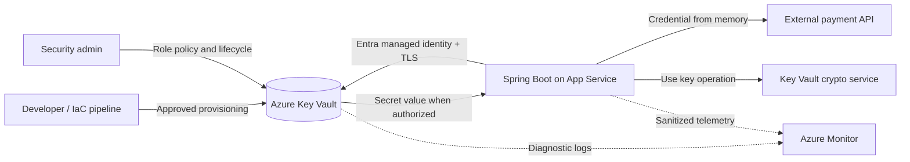

**Trust boundary quan trọng:**

- **Nhà phát hành secret** (ví dụ payment provider) có thể phải thay/cấp API key.
- **Key Vault** bảo vệ giá trị, phiên bản và quyền truy cập đến lúc được phép đọc.
- **Workload** có thể cần plaintext key để gửi tới external API; khi đã đọc, ứng dụng chịu trách nhiệm bảo vệ trong RAM/config/log.
- **Key Vault key operation** có thể giữ private key không thể xuất ra ngoài, khác với secret retrieval.
- **Admin/pipeline** được phép quản lý object lifecycle theo quyền được cấp, không có lý do đọc mọi production secret nếu không cần.
- **Cloud monitoring** nên biết ai gọi operations, không biết giá trị secret.

Không thiết kế solution chỉ bằng việc chọn nơi “cất mật khẩu”; phải xác định **luồng secret lúc chạy** và **nơi plaintext có thể xuất hiện**.

## 3. Ba đối tượng của Azure Key Vault: secrets, keys, certificates

| Đối tượng | Chứa gì / làm gì? | Ví dụ | Cách dùng |
|---|---|---|---|
| **Secret** | Value opaque (chuỗi/bytes theo API và giới hạn), metadata, phiên bản | API token, database password | `getSecret` trả **giá trị** cho ứng dụng có quyền |
| **Key** | Key metadata, public material và phép toán mật mã, private key được service quản lý | RSA/EC signing/encryption key | `CryptographyClient` gọi sign/verify/wrap/unwrap/encrypt/decrypt theo key type |
| **Certificate** | Certificate policy, versions/issuance/lifecycle; thường liên quan key và secret object | TLS certificate cho domain | Quản lý cert, private-key policy và ứng dụng consuming certificate |
| **Managed HSM** | Dịch vụ HSM chuyên dụng riêng, không phải object type của một vault tiêu chuẩn | Root signing key với mức cô lập cao | Mô hình quản lý/rules/price/operations riêng |

### Key và secret không tương đương

- **Secret:** khi được đọc, plaintext rời khỏi Key Vault. Ví dụ payment provider yêu cầu request header `X-API-Key`; ứng dụng có thể cần đọc secret.
- **Key:** ứng dụng có thể gửi hash/payload tới Key Vault để **ký**, không cần nhận private key. Một số key types/operations/tiers giới hạn khác nhau.
- **Certificate:** vừa là chứng thư công khai vừa có thể chứa private-key lifecycle. Một certificate object không tự đảm bảo mọi app có quyền đọc certificate đều đọc được private key; cần hiểu cách liên kết với secret/key và export policy.

### Câu hỏi lựa chọn

**Ứng dụng có phải sở hữu plaintext key để làm việc không?** Nếu không, cân nhắc cryptographic operations với key không xuất được. Nếu external system bắt buộc nhận API key plaintext, dùng Key Vault secret nhưng hạn chế quyền đọc và thời gian lưu trong app.

## 4. Ranh giới của Azure Key Vault so với Entra, App Configuration và HSM

| Thành phần | Trách nhiệm | Không nên nhầm là |
|---|---|---|
| **Microsoft Entra ID** | Cấp/xác thực danh tính và access token, quản lý principals/roles | Kho lưu mọi application secret |
| **Azure Key Vault** | Lưu/quản lý secret, key, certificate và data-plane access | Identity provider cho end users |
| **Azure App Configuration** | Feature flags và application configuration, có thể tham chiếu Key Vault | Nơi lý tưởng để lưu plaintext production passwords |
| **Managed identity** | Danh tính workload trên Azure hỗ trợ lấy token không cần lưu password trong code | Khóa mã hóa dữ liệu hoặc Key Vault object |
| **Azure Managed HSM** | Cryptographic key isolation theo mô hình HSM chuyên dụng | Vault endpoint có secrets/passwords giống Key Vault |
| **Azure Storage encryption/CMK** | Mã hóa dữ liệu khi lưu hoặc dùng customer-managed key theo feature | Kho ứng dụng lấy API key bên thứ ba |
| **CI/CD secret store** | Bảo vệ credentials trong quá trình build/deploy | Tự động thay toàn bộ runtime secret management |
| **OS/TPM/HSM trên thiết bị** | Hardware root of trust/khóa cục bộ khi cần offline | Managed identity của App Service |

### App Configuration + Key Vault reference

Một ứng dụng có thể lưu **nonsecret config/feature flags** trong Azure App Configuration và lưu **secret values** trong Key Vault; App Configuration chứa *reference*, không cần sao chép plaintext. Vẫn phải tính đến **caching, quyền truy cập, thất bại khi refresh và địa chỉ vault**.

### Managed HSM khác Key Vault Premium

Key Vault **Premium** có khả năng sử dụng hardware-protected keys theo sản phẩm. **Managed HSM** là resource khác với isolation, administration, backup, roles và pricing riêng. Không suy từ tên “HSM” rằng nó là nơi lưu `database-password` theo API Key Vault Secret.

## 5. Control plane và data plane: hai ranh giới quyền

**Control plane** là hoạt động quản lý Azure resource qua Azure Resource Manager (ARM), ví dụ tạo vault, cấu hình firewall và RBAC. **Data plane** là hoạt động trên secrets/keys/certificates qua Key Vault endpoint.

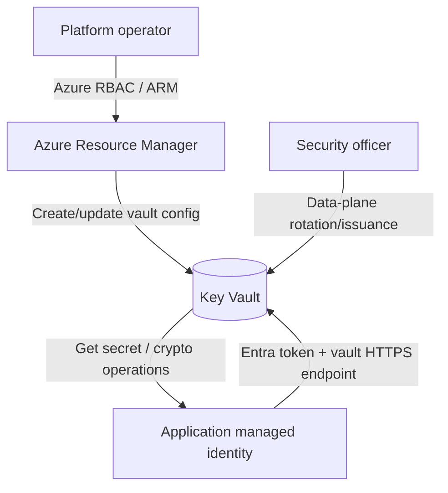

### Phân biệt cụ thể

| Hành động | Plane | Loại quyền |
|---|---|---|
| Tạo vault trong resource group | Control | ARM/Azure RBAC resource permission |
| Thay Public network access | Control | Vault resource config permission |
| Gán Azure role ở scope vault | Control/authorization management | `Microsoft.Authorization/roleAssignments/write` theo quyền |
| Đọc plaintext của `payment-api-key` | Data | Key Vault secret data action |
| Thêm secret version mới | Data | Secret set/write capability |
| Gọi RSA sign qua key | Data | Crypto sign permission |
| Phát hành hoặc renew certificate | Data và PKI workflow | Certificate-management rights |
| Purge deleted secret | Data/management guardrails | Purge permission, purge protection constraints |

**Có Azure Contributor trên resource group không mặc nhiên cho phép đọc plaintext secrets trong vault dùng Azure RBAC data authorization.** Đừng cấp Owner/Key Vault Administrator chỉ để khắc phục `403` của ứng dụng đọc một secret.

## 6. Hai mô hình quyền ở Key Vault: Azure RBAC và legacy access policies

Key Vault hỗ trợ hai mô hình authorization tùy cấu hình:

1. **Azure role-based access control (Azure RBAC)** cho data plane.
2. **Vault access policy** là mô hình legacy: danh sách principals và permissions trên secrets/keys/certificates.

### Azure RBAC được ưu tiên cho thiết kế mới

- Định nghĩa roles theo operations như read secrets, manage secrets, cryptographic operations.
- Gán roles tại scope subscription/resource group/vault và khi sản phẩm hỗ trợ, object scope.
- Kết hợp PIM/JIT và audit theo khả năng Entra governance.
- Tách quyền quản trị vault resource khỏi data access.
- Review định kỳ scope thừa/inherited roles.

### Rủi ro khi dùng access policies

Trong mô hình access policies, principal có quyền quản lý vault access policies có thể **cấp quyền truy cập data plane cho chính mình** theo authorization model và permissions cụ thể. Điều này làm ranh giới giữa quản trị resource và đọc secrets dễ bị phá vỡ. Khi chuyển từ legacy sang Azure RBAC, phải lập kế hoạch migration, gán role cần thiết trước và kiểm tra workloads để tránh outage.

### Không trộn mô hình tùy tiện

Một vault có cấu hình data-plane permission model cụ thể. Không đồng thời giả định “đã thêm access policy” và “đã gán RBAC” đều có hiệu lực như nhau. Xác minh **permission model hiện hành** của đúng vault trước khi điều tra `403`.

## 7. Các Azure Key Vault RBAC roles hay dùng

| Role (tên thường gặp) | Quyền mục đích | Tài khoản phù hợp |
|---|---|---|
| **Key Vault Reader** | Đọc metadata, không đọc secret value | Auditor inventory |
| **Key Vault Secrets User** | Đọc secret values theo scope được gán | Runtime ứng dụng cần secret |
| **Key Vault Secrets Officer** | Quản lý secrets | Security/rotation operator |
| **Key Vault Crypto User** | Thực hiện cryptographic operations được phép | Workload ký/mã hóa qua key |
| **Key Vault Crypto Officer** | Quản lý cryptographic keys | Key lifecycle operator |
| **Key Vault Certificates Officer** | Quản lý certificate objects/lifecycle | PKI automation |
| **Key Vault Administrator** | Quyền rộng trên data plane | Break-glass/authorized admins |
| **Key Vault Contributor** | Quản lý vault resource (control plane) | Platform team, không tự đọc secret contents trong RBAC mode |

Role definitions và scope capabilities cần xác minh trong Azure portal/CLI hiện hành. Một role có từ **Reader** không đồng nghĩa được đọc toàn bộ plaintext. Role **Secrets User** có thể đọc các secrets trong phạm vi đã gán: nếu scope là **cả vault**, ứng dụng có thể đọc nhiều secrets hơn nhu cầu.

### Least privilege theo chức năng

- `orders-web`: chỉ cần **get** secret payment key của nó; gán quyền data-plane tối thiểu ở scope cho phép.
- `billing-worker`: chỉ dùng crypto sign key; không cần read mọi secrets.
- `secret-rotator`: có quyền tạo version secret, nhưng không cần Azure Owner.
- `auditor`: metadata và logs, không nhận quyền truy xuất content mặc định.

**Tách vault theo trust/owner/environment** khi object-scope role assignments hoặc network model không đủ đáp ứng boundary. Không giữ production và development secrets trong một vault dùng chung chỉ vì tiện quản lý.

## 8. Scope, inheritance và nguy cơ lateral movement

Azure RBAC inheritance có thể làm quyền rộng hơn dự kiến.

```text
Management group
  └── Subscription
        └── Resource group
              └── Key Vault A
                    ├── Secret: payment-api-key
                    └── Secret: smtp-credential
```

Một role gán ở **resource group** có thể ảnh hưởng nhiều vaults trong đó; quyền data-plane phụ thuộc role definition và authorization model. Đừng chỉ xem role assignments “trên vault” mà quên **inherited assignments** từ parent scope.

### Tư duy ranh giới

1. Mỗi **environment** (dev/test/prod) có trust boundary.
2. Mỗi **application/team** có owner và trách nhiệm rotation.
3. Mỗi **secret** có sensitivity/consumer khác nhau.
4. Role assignments theo workload identity, không theo “mọi dev đều Secrets Officer”.
5. Cấp quyền đọc rộng tối thiểu và theo thời gian nếu cần.
6. Key Vault logs/audit và PIM/JIT cho privileged roles.
7. Resource locks, deny assignments hoặc governance policies có thể cần khi có risk cao; không giả định lock là biện pháp thay RBAC.

### Ví dụ chống lộ chéo

Nếu một App Service staging bị xâm nhập, nó **không được có quyền đọc secrets của production**. Tách managed identities, vaults, role assignments, network và CI service connections giúp giới hạn blast radius.

## 9. Microsoft Entra identity: ai thực sự gọi Key Vault?

Key Vault data plane xác thực caller qua Microsoft Entra token, nhưng danh tính thực có thể khác nhau:

- **Human developer** chạy Azure CLI ở local.
- **System-assigned managed identity** của App Service/Function/VM.
- **User-assigned managed identity** được gắn cho một hoặc nhiều Azure compute resources.
- **Workload identity federation** trên AKS/GitHub/OIDC-compatible systems theo support.
- **Service principal** với certificate/secret (khi chưa dùng được workload federation).
- **Key Vault service integration identity** được sản phẩm Azure quản lý cho một feature.

### Tránh dùng user credential ở production

Ứng dụng production không nên đăng nhập bằng tài khoản cá nhân qua password/interactive browser. Dùng **managed identity/workload identity** khi platform hỗ trợ; không cần embed client secret chỉ để có quyền đọc Key Vault.

### System-assigned vs user-assigned identity

| Loại | Vòng đời | Điểm cần xem |
|---|---|---|
| System-assigned MI | Tạo/gắn với một resource, xóa resource có thể xóa identity | Dễ ràng buộc workload, thay resource cần cấp lại quyền |
| User-assigned MI | Là Azure resource identity độc lập | Có thể reuse có kiểm soát, tăng nguy cơ quyền chia sẻ quá rộng |
| Service principal | Application identity đăng ký trong Entra | Cần quản lý credential hoặc federation |
| Human principal | User đã xác thực | Phục vụ thao tác quản trị/dev được phép, không làm daemon production |

### Nguyên tắc bootstrap

**Ứng dụng lấy token Entra bằng danh tính Azure của nó, sau đó gọi Key Vault**. Không lưu sẵn Key Vault access token lâu dài trong `application.yml`; token có thời hạn và phải được SDK refresh. Kết nối mạng đến Entra token service và Vault endpoint cần đúng theo hosting model.

## 10. Từ identity đến secret value: chuỗi truy cập đầy đủ

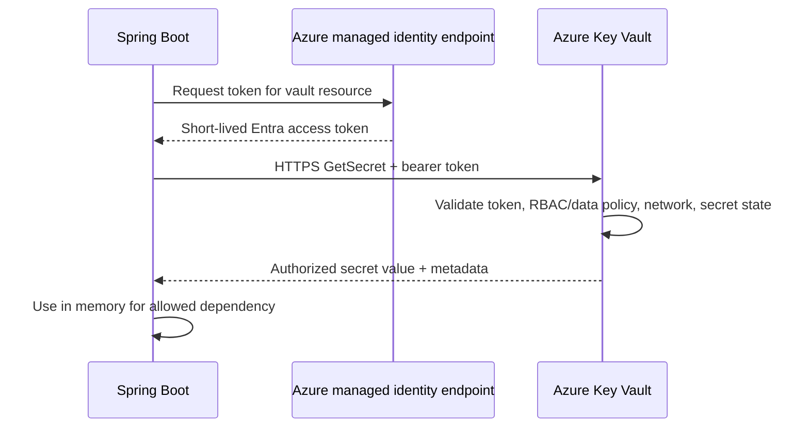

**Các điều kiện độc lập:**

1. Resource hosting app có identity đúng và enabled.
2. Runtime SDK lấy token qua credential chain phù hợp.
3. Identity có role data-plane đủ cho secret ở scope đúng.
4. Key Vault đang dùng permission model được kỳ vọng.
5. DNS/TLS/Private Endpoint/firewall cho đường App → Vault hợp lệ.
6. Tên secret/phiên bản tồn tại, enabled và hợp lệ theo thời gian.
7. App không in secret trong logs hoặc error pages.
8. Downstream provider vẫn chấp nhận credential đó.

**Một identity có quyền không đảm bảo kết nối mạng; mạng thông không tự cấp quyền.** Đây là hai trust boundaries riêng.

## 11. Secret object: tên, value, version và metadata

Một Key Vault secret thường có:

```text
Vault URI:     https://kv-orders-prod.vault.azure.net/
Secret name:   payment-api-key
Version ID:    <OPAQUE_SECRET_VERSION_ID>
Value:         [REDACTED]
Enabled:       true
Not before:    optional
Expires at:    optional
Content type:  optional
Tags:          owner=payments; env=prod; rotation=manual
```

Đây là metadata minh họa. Tên vault phải globally unique theo quy tắc dịch vụ; URI phải lấy từ resource thực.

### Một secret có nhiều versions

```text
payment-api-key
  ├── version V1 (old)
  ├── version V2 (active)
  └── version V3 (new / staged)
```

- Một call **không chỉ định version** thường lấy latest version theo API semantics hiện hành.
- Một **versioned URI** trỏ tới phiên bản cố định.
- Tạo secret version mới **không tự cập nhật các bản sao plaintext** đã cache trong app.
- Xóa một version hoặc disable không làm mọi client đang dùng giá trị cũ mất quyền ở external provider.
- Secret expiry metadata không tự revoke API key ở hệ thống thanh toán; cần phối hợp với chính provider.
- **Rollback** cần thiết kế: pin một known-good version hoặc tạo version mới chứa giá trị hợp lệ theo policy.

### Bảo vệ metadata

Tags, secret names, content types hoặc descriptions cũng có thể tiết lộ tên vendor, tenant, business process. Không đặt user passwords, API keys, email nhạy cảm hoặc số thẻ trong **secret name/tag**.

## 12. Versionless và version-pinned references

| Kiểu | Ví dụ URI | Lợi ích | Rủi ro |
|---|---|---|---|
| **Versionless** | `https://kv-orders-prod.vault.azure.net/secrets/payment-api-key` | Consumer có thể lấy latest khi refresh | Chuyển secret có thể tác động toàn ứng dụng bất ngờ |
| **Version-pinned** | `https://kv-orders-prod.vault.azure.net/secrets/payment-api-key/<VERSION>` | Reproducible deploy, canary/rollback dễ | Không tự dùng version mới, phải rollout config |

### Chọn theo tính chất dependency

- API key của provider có **overlap window**: versionless + controlled refresh có thể thuận tiện.
- Secret mới có nguy cơ phá backward compatibility: dùng pinned version trong canary rồi rollout.
- Signed token/private-key rotation cần kiểm soát verification of old signatures; chỉ đổi reference không tự giải quyết trust.
- Với incident compromise, cần revoke bên provider/disable quyền và ngăn cached credentials tiếp tục hoạt động, không chỉ đặt secret version mới.

### “Latest” không có nghĩa “đã được tất cả pods áp dụng”

Một số app vẫn giữ secret trong RAM hoặc connection pool. Thực hiện rotation cần **verify từng consumer** và đặt deadline thu hồi bản cũ, không dựa vào timestamps từ Vault metadata để kết luận mọi dịch vụ đã chuyển.

## 13. Rotation là một quy trình nhiều hệ thống

Giả sử `payment-api-key` do bên thanh toán phát hành:

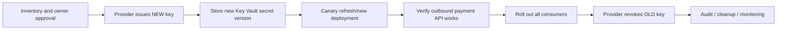

**Ai thu hồi khóa cũ?** Chính nhà phát hành (payment provider) phải vô hiệu hóa API key cũ theo capability của họ. Key Vault chỉ quản lý bản sao mà bạn lưu, không có quyền thu hồi credential tại vendor.

### Preflight

1. Biết mọi ứng dụng sử dụng secret.
2. Biết có bao nhiêu bản sao, clusters, environments và deployment slots.
3. Biết provider có cho chạy **old + new đồng thời** không.
4. Biết secret được nạp lúc startup, định kỳ hay mỗi request.
5. Có health check nghiệp vụ và rollback plan.
6. Có test case lỗi auth/permission từ provider.
7. Có alert và audit trước/sau change.
8. Có emergency path nếu key đã bị compromise.

### Không tự động rotate chỉ vì ngày đổi giá trị

Một Key Vault secret value thường **không tự đổi giá trị credential của external system**. Muốn tự động hóa phải có orchestrator/Function/runbook với quyền phát hành ở provider và ghi new version, sau đó xác minh migration rồi revoke old. Các feature auto-rotation của **keys** không được suy rộng sang mọi **secrets**.

## 14. Key Vault keys: thao tác mật mã và private key boundary

Một **Key Vault key** là đối tượng để làm các phép mật mã theo key type/capability. Ví dụ:

- `Sign`/`Verify` thông điệp hoặc digest được cho phép.
- `Encrypt`/`Decrypt` payload theo thuật toán/key support.
- `WrapKey`/`UnwrapKey` cho data encryption key trong envelope encryption.
- `GetKey` để lấy public/metadata; **không đồng nghĩa xuất private key**.
- `Create`/`Import`/`Rotate`/`Delete` theo quyền quản lý key.

### Khác biệt so với secret

```text
HMAC secret:
  App retrieves secret bytes
    -> App computes signature locally
    -> Plaintext secret resides in process memory

Key Vault asymmetric key:
  App requests Sign(digest)
    -> Key Vault performs permitted operation
    -> App receives signature, NOT private key
```

### Những giới hạn cần biết

- Key Vault key operations có network latency, cost và quota; không dùng dịch vụ cho mọi bytes của một file lớn theo cách không phù hợp.
- `Sign` API có thể nhận digest hoặc raw data tùy SDK/algorithm; phải chọn algorithm và chuẩn hóa canonical representation.
- Với file lớn, thường dùng **envelope encryption**: encrypt data locally bằng data key và dùng Key Vault key để wrap data key theo policy.
- Khả năng keys software/HSM, algorithms và export policies phụ thuộc SKU/product.
- Một key được dùng để ký JWT không tự đồng nghĩa chứng chỉ TLS; có những trách nhiệm riêng về key IDs, public JWK distribution và rotation.

### Khi nào thật sự cần export private key?

Nếu downstream bắt buộc cài private key vào TLS termination hoặc phần mềm ngoài Azure, cần đánh giá certificate/private key export policy và rủi ro truyền tải. Nếu có thể dùng remote signing operation, giữ private key **non-exportable** sẽ giảm bề mặt tấn công.

## 15. Envelope encryption: không chuyển toàn bộ file cho Key Vault

Một ví dụ bảo vệ file 100 MB:

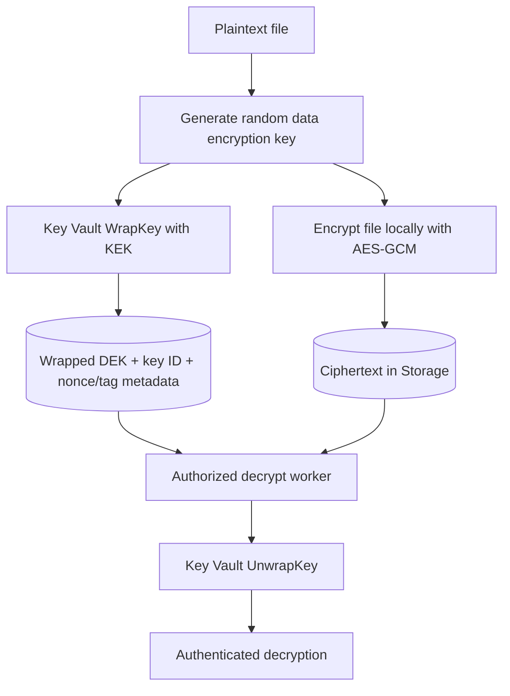

### Ranh giới

- **DEK (data encryption key):** sinh ngẫu nhiên cho một object/batch, dùng encrypt data tại chỗ.
- **KEK (key encryption key):** ở Key Vault; dùng wrap/unwrap DEK.
- **Wrapped DEK:** có thể lưu cùng ciphertext nhưng phải kiểm soát integrity/access.
- **Nonce/IV:** cần duy nhất theo yêu cầu cipher; không tái sử dụng AES-GCM nonce với cùng key.
- **Key version ID:** lưu cùng metadata để biết dùng version nào khi decrypt sau rotation.
- **Audit:** ai đã gọi unwrap/decrypt, theo Azure logging; vẫn cần app-level data access checks.

**Không tự triển khai mật mã nếu có một thư viện/SDK vetted phù hợp.** Ví dụ chỉ minh họa trách nhiệm và key lifecycle. Key Vault không phải hệ thống thay thế hoàn toàn Azure Storage encryption; chọn CMK/managed encryption khi dịch vụ dữ liệu hỗ trợ có thể phù hợp hơn.

## 16. Certificates: public certificate, private key và secret linkage

Key Vault certificate management có thể liên kết:

- **Certificate object:** metadata/policy, issuance/renewal, certificate versions.
- **Key object:** cryptographic key tương ứng theo cấu hình.
- **Secret object:** có thể chứa certificate bundle (ví dụ PFX/PEM) theo policy và exportability.

### Phân biệt quyền

- Đọc certificate metadata/public X.509 **không nhất thiết** cho phép tải private key.
- Đọc **linked certificate secret** có thể làm lộ private key khi policy cho phép export.
- Nếu private key được thiết kế **non-exportable**, không giả định mọi downstream service có thể lấy PFX.
- Quản lý certificates cần role có scope phù hợp, không cấp Secrets User rộng chỉ để xem certificate expiry.
- Certificate issuer/CA integration và renewal behavior phụ thuộc supported issuers và loại certificate.

### TLS termination ở đâu?

Nếu ứng dụng đặt sau **Azure App Service/Front Door/Application Gateway**, TLS certificate có thể được quản lý tại front end/service integration và tham chiếu Key Vault theo hỗ trợ riêng. **Spring Boot app không nhất thiết phải đọc private-key PFX** nếu TLS kết thúc tại platform/gateway.

### Lưu ý PKI

X.509 certificate cần quản lý `NotBefore`/`NotAfter`, SAN/hostname, trust chain, revocation và renewals. Key Vault chỉ là một phần của certificate lifecycle; không tự sửa DNS, CA trust hoặc thay certificate đang được một reverse proxy cache.

## 17. Control plane IaC và ranh giới quản lý secret

Infrastructure as Code như Bicep/Terraform có thể tạo Key Vault, networking, private endpoints, RBAC và references. Tuy nhiên, **đặt plaintext secret vào parameter/state/output có thể làm lộ nó**.

### Nên đưa vào IaC

- Vault name, SKU, region, resource group.
- Public network access/private endpoint/DNS config.
- Role assignments theo principal và scope.
- Diagnostic settings, tags, purge protection, policy.
- App configuration dùng **secret URI/reference**, không raw value.
- Managed identity creation/binding.

### Cần kiểm soát chặt

- Secret value truyền trong deployment parameters.
- Terraform state chứa giá trị nhạy cảm ngay cả khi output bị đánh dấu sensitive.
- ARM deployment histories/logs nếu parameters không được bảo vệ đúng cách.
- CI pipeline step `echo`/debug làm lộ giá trị.
- Temporary files chứa secret xuất hiện trên build agent hoặc artifacts.
- Remote state backend encryption, access và retention.

**Không đồng nghĩa “secret được đánh dấu sensitive” thì nó không xuất hiện ở mọi nơi.** Kiểm tra behavior thực của IaC tool, state store, logs và CI service connections.

## 18. Vòng đời secret: inventory, ownership và expiry

Mỗi secret production nên có hồ sơ:

```text
Name:            payment-api-key
Vault/environment: kv-orders-prod
Owner:           Payments platform team
Source:          Third-party payment provider
Consumers:       orders-web, billing-worker
Access method:   Managed identity + Key Vault Secrets User
Rotation policy: Every 90 days or on security incident
Old/new overlap: Provider allows two active keys
Expiry metadata: 2027-02-01T00:00:00Z (example)
Validation:      Approved sandbox payment API test
Rollback:        Prior valid key, within provider policy
Incident owner:  Security on-call + payment integration owner
```

Không đưa **raw secret value**, PII hay account password vào inventory. Tags có thể chứa owner/team và rotation policy identifier, nhưng cần kiểm tra tính nhạy cảm của metadata.

### Ai chịu trách nhiệm gì?

- **Producer:** tạo/thu hồi credential gốc tại vendor/CA/database.
- **Vault manager:** quản lý versions, access, purge protection, diagnostic settings.
- **Consumer application owner:** refresh cache và xác minh hoạt động.
- **IAM/security team:** roles, conditional access cho operator và incident response.
- **SRE/operations:** monitoring, rollout, rollback, SLA.
- **Auditor:** xem evidence, không mặc nhiên lấy plaintext secrets.

## 19. Soft delete, purge protection và khôi phục

Key Vault có các cơ chế bảo vệ khi secrets/keys/certificates hoặc vault bị xóa theo product behavior:

- **Soft delete:** khi delete, object/vault có thể ở trạng thái recoverable trong retention period.
- **Purge protection:** nếu bật theo policy, ngăn **permanent purge** trước khi hết retention, kể cả người có quyền cao, theo constraints dịch vụ.
- **Recovery:** có thể restore deleted object trong khoảng cho phép nếu có permissions; tên/phiên bản/trạng thái theo rules.
- **Backup/restore:** dùng tính năng được hỗ trợ nhưng có restrictions về subscription/tenant/geography, permissions và lifecycle.
- **Resource locks:** bảo vệ một số thao tác control plane, không thay IAM hoặc purge protection.

### Vì sao cần cả hai?

Nếu attacker có quyền xóa secret đang dùng, ứng dụng có thể outage. Soft delete giúp khôi phục object; purge protection bảo vệ khỏi hành vi xóa vĩnh viễn sớm trong retention. Tuy nhiên **recovery không thu hồi secret đã lộ**, và app/caches có thể vẫn dùng secret cũ.

### Cẩn trọng với purge protection

Cấu hình có thể có những thuộc tính **không thể dễ dàng vô hiệu hóa** sau khi bật; retention và lifecycle constraints phải được xem trước. Không thử purge trên vault dùng chung. Với compliance cao, cân nhắc vault separation và recovery drill.

## 20. Kiến trúc ranh giới secret trong một hệ thống Java

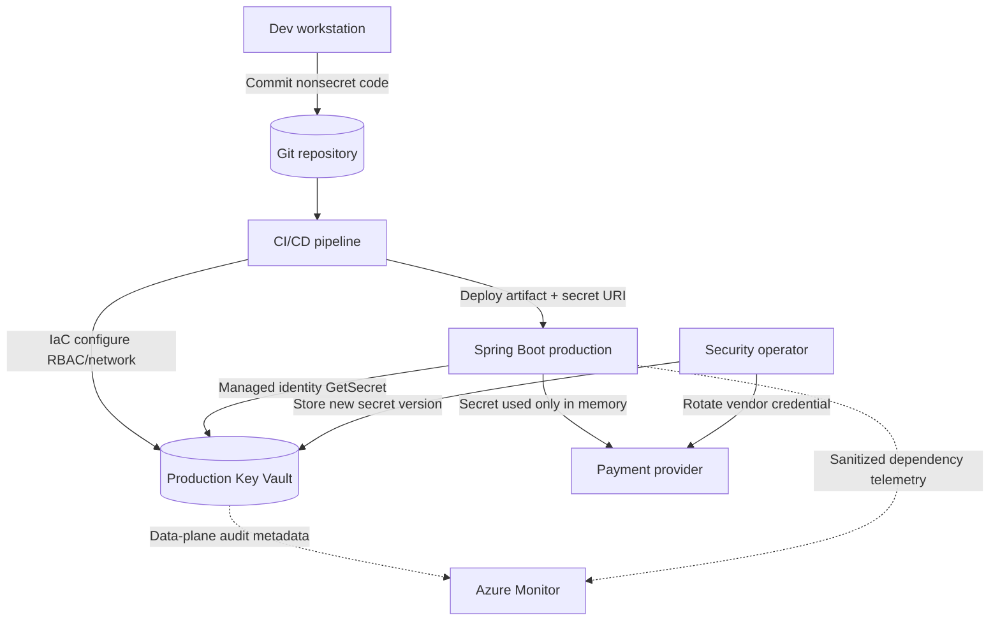

### Ranh giới quan trọng

- **Git:** chỉ chứa code, tên config/secret references, không raw secrets.
- **CI:** build artifacts không cần đọc production values trừ khi quy trình đặc biệt bắt buộc; tránh cấp secrets cho fork/untrusted jobs.
- **App Service:** runtime lấy credential bằng workload identity được cấp phép.
- **Key Vault:** bảo vệ version/value tại rest và kiểm soát data-plane get.
- **External provider:** vẫn có trách nhiệm phát hành và revoke credentials.
- **Audit:** cần biết “ai gọi GetSecret và khi nào”, không ghi “giá trị trả về là gì”.
- **Cache:** mỗi process/instance cần refresh/rollout plan; Key Vault không tự xóa plaintext trong RAM của một process đã bị chiếm quyền.


## 21. Java SDK: lấy secret bằng DefaultAzureCredential

Một ứng dụng Spring Boot cần `payment-api-key` nhưng không được nhúng giá trị vào `application.yml`. Azure SDK for Java có `SecretClient` và `DefaultAzureCredential` để lấy secret qua identity.

### Maven dependencies

```xml
<dependency>
  <groupId>com.azure</groupId>
  <artifactId>azure-security-keyvault-secrets</artifactId>
  <version><!-- PIN_COMPATIBLE_SDK_VERSION --></version>
</dependency>
<dependency>
  <groupId>com.azure</groupId>
  <artifactId>azure-identity</artifactId>
  <version><!-- PIN_COMPATIBLE_SDK_VERSION --></version>
</dependency>
```

Chọn versions tương thích qua Azure SDK BOM/dependency management hiện hành; đây là đoạn `pom.xml` minh họa.

### Java code

```java
package vn.example.orders.security;

import com.azure.identity.DefaultAzureCredentialBuilder;
import com.azure.security.keyvault.secrets.SecretClient;
import com.azure.security.keyvault.secrets.SecretClientBuilder;
import com.azure.security.keyvault.secrets.models.KeyVaultSecret;

public final class PaymentSecretProvider {
    private final SecretClient client;
    private final String name;

    public PaymentSecretProvider() {
        String vaultUrl = required("KEY_VAULT_URL");
        name = required("PAYMENT_SECRET_NAME");
        client = new SecretClientBuilder()
            .vaultUrl(vaultUrl)
            .credential(new DefaultAzureCredentialBuilder().build())
            .buildClient();
    }

    public PaymentCredential load() {
        KeyVaultSecret secret = client.getSecret(name);
        // Never log secret.getValue() or the entire secret object.
        return new PaymentCredential(
            secret.getValue(),
            secret.getProperties().getVersion());
    }

    private static String required(String key) {
        String value = System.getenv(key);
        if (value == null || value.isBlank()) {
            throw new IllegalStateException(
                "Missing configuration: " + key);
        }
        return value;
    }

    public record PaymentCredential(
        String value, String version) {}
}
```

**Điều kiện:** `KEY_VAULT_URL` là URL dạng `https://<VAULT_NAME>.vault.azure.net/`; `PAYMENT_SECRET_NAME` chỉ chứa tên. Runtime có managed identity/workload identity hoặc developer credential được phép, principal có quyền Get Secret theo scope và network/TLS/Private Endpoint hoạt động. Secret còn active và vendor vẫn chấp nhận key.

**Lưu ý:** `getSecret` là network call có latency/quotas/cost, và plaintext sẽ tồn tại trong process memory. Tái sử dụng client, thiết kế bounded cache/refresh, không log value và không tạo endpoint “debug secret”.

## 22. Spring Boot bean và cấu hình không chứa plaintext

```java
package vn.example.orders.config;

import com.azure.identity.DefaultAzureCredentialBuilder;
import com.azure.security.keyvault.secrets.SecretClient;
import com.azure.security.keyvault.secrets.SecretClientBuilder;
import org.springframework.beans.factory.annotation.Value;
import org.springframework.context.annotation.Bean;
import org.springframework.context.annotation.Configuration;

@Configuration
public class KeyVaultConfiguration {

    @Bean
    SecretClient secretClient(
            @Value("${security.key-vault-url}") String vaultUrl) {
        return new SecretClientBuilder()
            .vaultUrl(vaultUrl)
            .credential(new DefaultAzureCredentialBuilder().build())
            .buildClient();
    }
}
```

```yaml
security:
  key-vault-url: ${KEY_VAULT_URL}
```

Các biểu thức `${...}` ở đây là Spring property placeholders, được Spring giải quyết từ cấu hình/môi trường khi chạy; không hardcode password. Ứng dụng phải fail closed nếu một credential bắt buộc bị thiếu hoặc không hợp lệ, thay vì dùng default password. Với Vault outage tạm thời, cache last-known-good chỉ được dùng trong **giới hạn đã phê duyệt** và khi không phải incident compromise.

Tránh công khai `/actuator/env` hoặc các config/debug endpoints, in `System.getenv()` hay log cả đối tượng `KeyVaultSecret`; những endpoint đó phải có authorization và redaction phù hợp.

## 23. App Service Key Vault references

Azure App Service hỗ trợ **Key Vault reference** cho một số app settings:

```text
App Setting name: PAYMENT_API_KEY
App Setting value:
@Microsoft.KeyVault(SecretUri=https://kv-orders-prod.vault.azure.net/secrets/payment-api-key)
```

Đây là URI **versionless**. Một URI version-pinned có thêm `/<VERSION_ID>`.

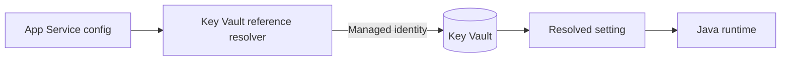

Điều kiện: App Service có đúng identity (system- hoặc user-assigned), identity được cấp Get Secret, Vault network/DNS thông, reference syntax hợp lệ. **Versionless không có nghĩa App Service luôn refresh tức thời**; có caching và cơ chế refresh/config change riêng theo feature. Value được resolve vẫn nằm trong environment/config process, nên không được xuất ra log.

**SDK** phù hợp khi app cần chọn version, xử lý lỗi/refresh hoặc đọc metadata. **Key Vault references** phù hợp khi muốn platform resolve secret setting; **CryptographyClient** lại dành cho key operations, không tương đương secret reference.

## 24. Secret cache và nhiều application instances

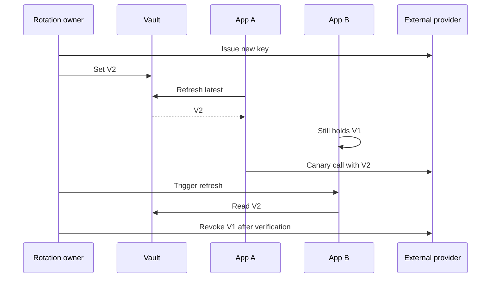

| Pattern | Điểm mạnh | Hạn chế |
|---|---|---|
| Load at startup | Dễ kiểm soát theo release | Cần redeploy/restart |
| TTL polling | Tự cập nhật định kỳ | Stale window, vault requests |
| Event-triggered refresh | Phản ứng theo new-version event | Cần retries, idempotency, reconciliation |
| Version-pinned | Canary/rollback cụ thể | Dễ stale nếu quên cập nhật |
| Versionless latest | Ít đổi config | Có thể nhận version mới đột ngột khi refresh |

Báo cáo **secret version ID** mỗi instance (không value) để kiểm tra rollout. Nếu key cũ đã bị compromise, không tiếp tục dùng cache vì uptime; phối hợp **revoke tại vendor** và incident response.

## 25. AKS: Secrets Store CSI Driver và Workload Identity

AKS có thể dùng **Secrets Store CSI Driver + Azure Key Vault provider** theo feature/version support để mount secrets/certificates vào pod hoặc sync sang Kubernetes Secret.

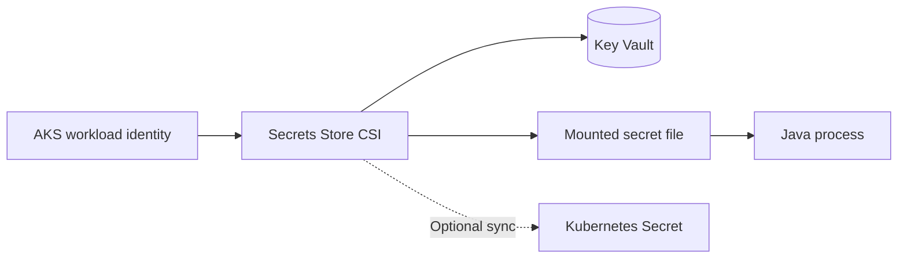

- **Mounted file** vẫn có plaintext trong filesystem view của pod; bảo vệ ACL, host, pod và processes.
- **Kubernetes Secret sync** tạo thêm bản sao ở Kubernetes API/etcd/backups; `base64` chỉ là encoding.
- `SecretProviderClass` nên chứa references, không raw secrets.
- CSI addon/node identity khác workload identity, phải xác định principal thật.
- File rotation không tự làm ứng dụng reload; env var được tạo từ Kubernetes Secret thường cần restart để dùng value mới.
- Không mount toàn vault trong mọi namespaces hoặc cấp Secrets User cho tất cả node identities.
- Kiểm tra Private DNS/firewall từ runtime CSI/pod.

## 26. Git, CI/CD, Docker và IaC: không đưa secret vào artifact

```text
Secret in application.yml
 -> Git history and forks
 -> CI logs and artifacts
 -> Docker build layers and registry
 -> App config dump
```

Biện pháp: secret scanning, protected branches, least-privilege CI connections, OIDC federation cho CI khi hỗ trợ; không dùng Docker `ARG SECRET`/`ENV SECRET` trong build; IaC quản lý Vault/RBAC/network/references chứ không chèn password vào Terraform state/ARM outputs/logs. Cần bảo vệ remote state, pipeline logs/backups và không cấp CI `Secrets User` trên production trừ khi thực sự cần.

**Secret đã commit phải revoke/rotate tại nguồn**. Chỉ xóa commit/file hoặc bật secret scanning sau đó không làm key đã rò rỉ hết hiệu lực.

## 27. Private Endpoint, firewall và Key Vault DNS

Vault có hostname:

```text
kv-orders-prod.vault.azure.net
```

Private Link thường dùng private DNS zone liên quan:

```text
privatelink.vaultcore.azure.net
```

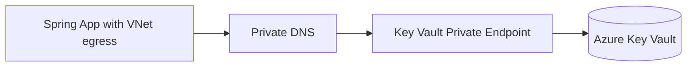

**Authentication, authorization và network là ba điều kiện độc lập.** App có đúng RBAC nhưng bị firewall chặn → fail; route private thành công nhưng thiếu Get Secret → 403.

- Vault Private Endpoint là đường **inbound tới Vault**. App Service cần VNet Integration/egress đến endpoint.
- Inbound Private Endpoint của App Service không tự thay outbound App → Vault.
- SDK vẫn thường dùng vault FQDN đúng và DNS dẫn tới private IP; không hardcode IP hoặc tắt TLS hostname validation.
- Kiểm tra DNS tại chính App Service/AKS runtime, không chỉ laptop.
- Cần endpoint approved, Private DNS zone/VNet links, NSG/UDR/firewall phù hợp.
- Không mở public access toàn Internet chỉ để giải quyết lỗi private DNS.

```bash
nslookup kv-orders-prod.vault.azure.net
```

Lệnh minh họa, không chứng minh topology của resource thật.


## 28. Azure CLI: kiểm tra Vault configuration an toàn

Chỉ dùng tài nguyên **lab** đúng subscription được phép. Kiểm tra thông tin Vault **không yêu cầu in secret values**:

```bash
az account show --output table

RG="<LAB_RESOURCE_GROUP>"
VAULT="<LAB_VAULT_NAME>"

az keyvault show \
  --resource-group "$RG" \
  --name "$VAULT" \
  --query "{name:name,id:id,location:location,rbac:properties.enableRbacAuthorization,publicNetworkAccess:properties.publicNetworkAccess,purgeProtection:properties.enablePurgeProtection}" \
  --output json
```

Các tên fields/CLI version phải được xác minh theo resource. Nếu kết quả query null, không kết luận một feature bị tắt trước khi kiểm tra output/schema thực tế.

### Kiểm tra quyền được cấp

```bash
VAULT_ID=$(az keyvault show \
  --resource-group "$RG" \
  --name "$VAULT" \
  --query id --output tsv)

az role assignment list \
  --scope "$VAULT_ID" \
  --include-inherited \
  --output table
```

Kiểm tra **inherited assignments** từ parent scopes, principal object IDs, role definitions và data-plane permission model. Vault thuộc mô hình **access policy** có đường kiểm tra khác với vault dùng Azure RBAC; không tự đổi mode production khi đang chẩn đoán.

### Đọc metadata secret, không in plaintext

```bash
az keyvault secret list \
  --vault-name "$VAULT" \
  --query "[].{name:name,enabled:attributes.enabled,expires:attributes.expires}" \
  --output table

az keyvault secret list-versions \
  --vault-name "$VAULT" \
  --name "payment-api-key" \
  --query "[].{id:id,enabled:attributes.enabled,expires:attributes.expires}" \
  --output table
```

Commands cần data-plane list permissions thích hợp. **Đừng chạy `az keyvault secret show` rồi chia sẻ toàn JSON**, vì nó có thể chứa secret value. Nếu cần kiểm tra riêng metadata, dùng query chỉ các properties an toàn, theo quyền và chính sách hiện hành.

## 29. CLI: cấp quyền cho managed identity theo phạm vi

Ví dụ minh họa **có thay đổi IAM nếu thực thi**; chỉ chạy trên App Service lab do bạn quản lý và có approval:

```bash
RG="<LAB_RESOURCE_GROUP>"
APP="<LAB_APP_NAME>"
VAULT="<LAB_VAULT_NAME>"

# Enable a system-assigned identity on the lab App Service.
az webapp identity assign \
  --resource-group "$RG" \
  --name "$APP"

PRINCIPAL_ID=$(az webapp identity show \
  --resource-group "$RG" \
  --name "$APP" \
  --query principalId --output tsv)

VAULT_ID=$(az keyvault show \
  --resource-group "$RG" \
  --name "$VAULT" \
  --query id --output tsv)

az role assignment create \
  --assignee-object-id "$PRINCIPAL_ID" \
  --assignee-principal-type ServicePrincipal \
  --role "Key Vault Secrets User" \
  --scope "$VAULT_ID"
```

**Giải thích:**

- Azure IAM role assignment chỉ thực hiện được nếu operator có quyền gán role ở scope tương ứng.
- Ví dụ dành cho vault dùng **Azure RBAC data plane**, không mặc định áp dụng cho legacy access policy mode.
- Role được cấp ở **cả vault** nên có thể rộng hơn quyền cần cho một secret. Khi có thể, giảm scope hoặc tách vault để cô lập ứng dụng.
- Role propagation có thể cần thời gian; không retry tạo thêm assignments vì tưởng service chưa nhận.
- Nếu dùng user-assigned identity, phải chọn đúng principal/client ID và cấu hình App Service/SDK.
- Không gán Key Vault Administrator cho một web app chỉ cần đọc secret.

### Negative test

Dùng một identity không có Secrets User và cố thực hiện `GetSecret` tới secret lab: request phải bị từ chối, dù hostname vẫn resolve và TLS hoạt động. Đây là kiểm thử của **data-plane boundary**.

## 30. Key Vault CryptoClient: ký mà không xuất private key

Khi ứng dụng cần ký một digest, dùng `CryptographyClient` với Key Vault key thay vì tải private key ra process memory.

### Maven dependencies

```xml
<dependency>
  <groupId>com.azure</groupId>
  <artifactId>azure-security-keyvault-keys</artifactId>
  <version><!-- PIN_COMPATIBLE_VERSION --></version>
</dependency>
<dependency>
  <groupId>com.azure</groupId>
  <artifactId>azure-identity</artifactId>
  <version><!-- PIN_COMPATIBLE_VERSION --></version>
</dependency>
```

### Java sign operation

```java
package vn.example.orders.crypto;

import com.azure.identity.DefaultAzureCredentialBuilder;
import com.azure.security.keyvault.keys.cryptography.CryptographyClient;
import com.azure.security.keyvault.keys.cryptography.CryptographyClientBuilder;
import com.azure.security.keyvault.keys.cryptography.models.SignResult;
import com.azure.security.keyvault.keys.cryptography.models.SignatureAlgorithm;

import java.nio.charset.StandardCharsets;
import java.security.MessageDigest;

public final class RemoteSigningExample {

    public static void main(String[] args) throws Exception {
        String keyId = System.getenv("SIGNING_KEY_ID");

        if (keyId == null || keyId.isBlank()) {
            throw new IllegalStateException(
                "SIGNING_KEY_ID must be configured");
        }

        CryptographyClient client = new CryptographyClientBuilder()
            .keyIdentifier(keyId)
            .credential(new DefaultAzureCredentialBuilder().build())
            .buildClient();

        byte[] content =
            "order-id=ORD-1001;amount=120.50"
                .getBytes(StandardCharsets.UTF_8);

        byte[] digest = MessageDigest.getInstance("SHA-256")
            .digest(content);

        SignResult signed = client.sign(
            SignatureAlgorithm.RS256, digest);

        System.out.println(
            "Signature length: " + signed.getSignature().length);
    }
}
```

### Điều kiện và giới hạn

- `SIGNING_KEY_ID` là Key Vault **key ID**, không phải URI của Secret.
- Key có RSA key type, trạng thái/capabilities và `RS256` support tương ứng.
- Managed identity có quyền **Crypto Sign** qua role/data actions phù hợp; Secrets User không đủ.
- Đầu vào ký phải được canonicalized; `RS256` ký **SHA-256 digest** qua Key Vault SDK semantics.
- Mã không tự xây JWT/PKI protocol. Nếu cần chứng minh chữ ký, consumer phải biết public key, `kid`/version và verify algorithm.
- Key Vault sign calls có network latency/quota/cost; không chuyển mọi byte của file lớn tới dịch vụ để “sign file” theo cách tùy tiện.
- Private key vẫn trong phạm vi Key Vault key operations, nhưng **workload có quyền ký** vẫn có thể bị lạm dụng để tạo chữ ký nếu bị compromise. Least privilege và audit vẫn cần thiết.

## 31. Certificate lifecycle và TLS termination

Một certificate trong Key Vault có thể có liên kết giữa certificate object, key object và secret object, tùy policy/khả năng export.

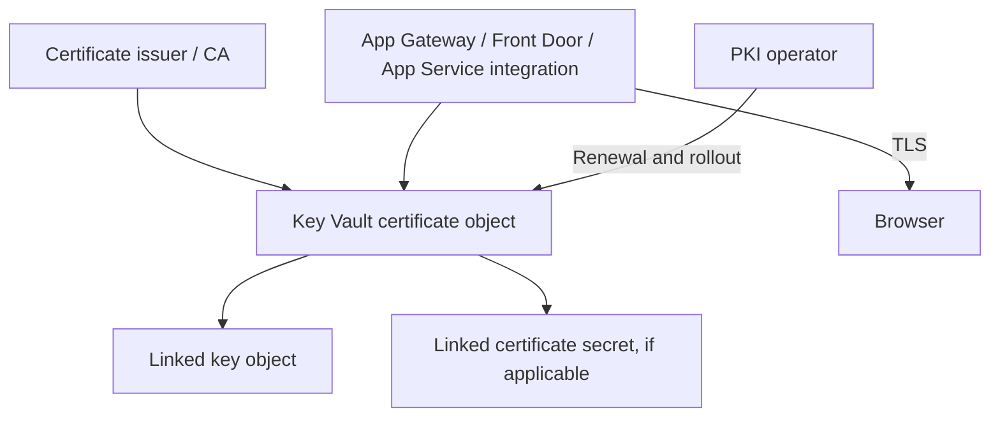

### Vai trò

- **CA/issuer** cấp X.509 certificate cho DNS hostname.
- **Vault** quản lý versions/policy/renewal theo tính năng hỗ trợ.
- **Front-end service** tải hoặc tham chiếu certificate theo integration và quyền riêng.
- **DNS/domain owner** cấu hình hostname/trust route.
- **Ứng dụng Spring Boot** không nhất thiết cầm private-key PFX nếu TLS đã kết thúc ở front end.
- **Operator** kiểm tra expiry, SAN, trust chain, binding, listener refresh và rollover.

### Những điều dễ nhầm

- Đọc certificate public information **không tự cho phép đọc private key**.
- Với certificate có thể export, **linked secret** có thể chứa key material rất nhạy cảm.
- Renew certificate trong Vault không bảo đảm listener của mọi service refresh ngay lập tức.
- Expired certificate không thể xử lý an toàn bằng cách tắt TLS validation.
- Nếu certificate/key không exportable, external system đòi PFX có thể không dùng được; thiết kế trust/termination từ đầu.

## 32. Secret expiry, rotation events và automation

Với mỗi production secret nên theo dõi:

```text
Secret: payment-api-key
Owner: Payments platform team
Source issuer: External payment provider
Consumers: orders-web, billing-worker
Rotation window: every 90 days OR on security incident
Provider overlap: old and new valid concurrently
Canary: authorized sandbox transaction
Status: planned -> issued -> staged -> verified -> old revoked
```

Metadata trong ví dụ là policy nội bộ, không phải schema Key Vault tự tạo. **Expiry metadata của Secret không làm vendor API key hết hiệu lực ở nguồn.**

### Event-driven automation

Key Vault có các **Event Grid lifecycle events** được hỗ trợ (ví dụ gần expiry hoặc có version mới), và có thể kết hợp Azure Functions/Logic Apps/automation:

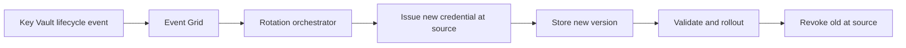

Không coi event là một sự kiện luôn giao đúng một lần hoặc có bảo đảm thứ tự tuyệt đối. Orchestrator cần **idempotency**, correlation IDs, checkpoint/reconciliation, retries, approvals và phân loại incident. Auto-rotation của **Key Vault keys** theo policy không đồng nghĩa Secrets tự được nhà cung cấp khác cấp credential mới.

### Cảnh báo theo thời gian

Có thể alert trước 30/14/7 ngày tùy service và risk. Phải có người nhận, runbook, quyền xử lý và bằng chứng đã áp new version; không chỉ gửi email cảnh báo rồi coi rotation hoàn tất.

## 33. Key Vault logging và Azure Monitor

Nên giám sát cả Vault và ứng dụng:

| Tín hiệu | Ý nghĩa |
|---|---|
| Request count/latency | App gọi Vault bất thường hoặc chậm |
| 401/403 | Authentication/authorization/network deny |
| 429 | Quota/throttling, cache không hiệu quả |
| GetSecret/Sign operations | Data-plane operations theo diagnostic categories |
| Role assignments và Vault config change | IAM, network/purge protection có đổi |
| Secret/key/cert expiry | Vòng đời credentials |
| App secret-version in use | Đã áp V2 trên mọi instances chưa |
| Downstream API auth errors | Key mới được vendor chấp nhận không |
| Key Vault access anomalies | Principal/location/request volume bất thường |

### KQL minh họa

Nếu Log Analytics dùng bảng `AzureDiagnostics` và diagnostic settings đã bật:

```kusto
AzureDiagnostics
| where TimeGenerated > ago(24h)
| where ResourceProvider =~ "MICROSOFT.KEYVAULT"
| summarize Operations = count() by OperationName
| order by Operations desc
```

Có thể dùng resource-specific tables thay `AzureDiagnostics`; tên bảng/cột phải xác minh theo workspace và cấu hình logs thực tế. Không có dòng log **không tự chứng minh không có truy cập** nếu diagnostic settings chưa bật.

### Quy tắc log

Ghi `operation, status, latency, correlationId, principalId`/secret version metadata theo chính sách; **không ghi plaintext value, PFX/private key, bearer token, SAS, connection string hoặc raw Authorization header**. Logs cũng cần RBAC, retention, alerting và dự toán chi phí.

## 34. Đo lường Key Vault trong ứng dụng Spring Boot

Một service có thể instrument:

```text
metric: keyvault_secret_fetch_seconds
dimensions: operation=getSecret; result=success|failure
trace: requestId, dependency time, sanitized vault resource
audit: principal object ID, secret version ID (not value)
health: no critical secret older than approved deadline
```

Đây là tên metrics do ứng dụng tự thiết kế. Không giả định Azure Monitor cung cấp metric tên như vậy sẵn.

### Tránh metric cardinality cao

Đừng dùng raw secret value/user email/token làm metric labels. Secret names đôi khi cũng là metadata nhạy cảm hoặc gây cardinality cao; có thể dùng **logical dependency names** như `payment-provider`.

### Khi alert

- Tỷ lệ GetSecret 403 tăng ngay sau IAM change.
- 429 hoặc latency tăng do app bỏ cache.
- Secret version migration chưa đạt mọi instances sau change window.
- Certificate hết hạn sớm nhưng renewal fail.
- Role assignments mở rộng bất thường hoặc public network bật lại.
- Payment provider trả auth failures khi secret mới được publish.

## 35. Thực tiễn bảo mật: các lỗi “đã có Vault nhưng vẫn lộ”

| Lỗi | Vì sao xảy ra | Cách giảm rủi ro |
|---|---|---|
| App có quyền đọc mọi secret | RBAC gán tại scope quá rộng | Tách vault hoặc role scope tối thiểu |
| Token lấy từ developer login ở prod | Default credential chain chọn nguồn sai | Chốt workload identity và xác minh principal |
| Secret được in vào startup logs | Config debug/Actuator | Redaction và test logs |
| CI bake secret vào Docker layer | Build-time injection | Runtime references/identity |
| Vault Private Endpoint đã bật nhưng app không tới được | Thiếu VNet Integration/Private DNS | Test egress/DNS từ app |
| Secret version mới nhưng app vẫn dùng cũ | Cache/Key Vault reference refresh | Canary/version telemetry/restart |
| Delete secret thay vì revoke vendor key | Hiểu sai boundary | Thu hồi tại issuer/provider |
| Key Vault Contributor được coi là Secrets User | Nhầm ARM/data-plane | Gán role data action đúng |
| Linked certificate secret có PFX | Role Secrets User quá rộng | Key/cert export policy và role isolation |
| KMS signing service bị abuse | Workload bị chiếm quyền sign | Least privilege, rate limit, monitoring |

### Không có một “secret manager” nào sửa được bug dùng secret

Nếu ứng dụng gửi API key sang nhầm host qua HTTP, giá trị bị lộ dù Vault trước đó lưu an toàn. Client cần TLS hostname validation, allowlisted endpoints và phân tách trusted/untrusted input. Nếu một service bị RCE, Key Vault RBAC chỉ giới hạn **những secrets service đó có quyền**, không phủ nhận khả năng lạm dụng chính quyền của service.

## 36. Runbook: GetSecret trả 401, 403, 404 hoặc timeout

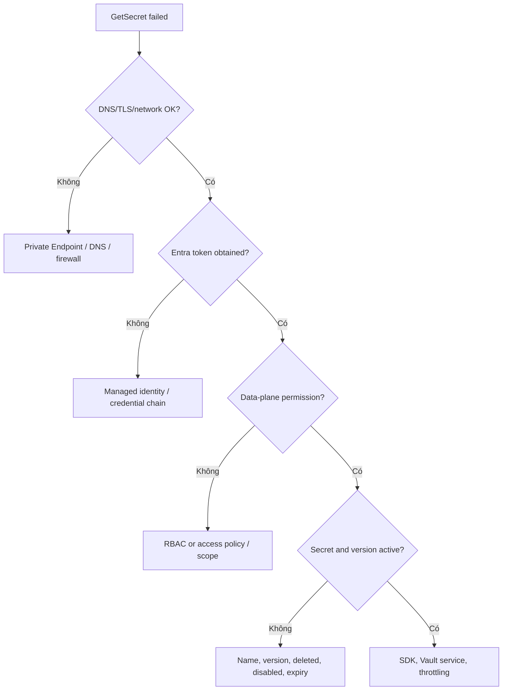

### Thứ tự điều tra

1. Ghi `vault resource ID`, UTC time, app principal ID, operation và correlation ID, **không log secret value/token**.
2. Xác minh Vault URL/secret name/version được truyền đúng.
3. Kiểm tra DNS/TLS/Private Endpoint/VNet Integration **từ chính runtime**.
4. Xác định credential chain dùng system-assigned, user-assigned MI hay developer identity.
5. Kiểm tra token audience/tenant và identity có enabled.
6. Kiểm tra Vault đang dùng **Azure RBAC** hay access policies.
7. Kiểm tra role/data actions và scope, kể cả inherited assignments.
8. Nếu mới gán role, tính đến propagation delay, không tự cấp Administrator.
9. Kiểm tra object disabled, deleted, expired hoặc version sai.
10. Với 429, kiểm tra quá nhiều `GetSecret`/cache miss và bounded backoff.
11. Với 5xx/timeout, tách transient network/service khỏi credential failure.
12. Test lại một secret **lab được phép** và ghi sanitized status/latency.

| Mã/triệu chứng | Hướng điều tra |
|---|---|
| 401 | Authentication/token/challenge |
| 403 | RBAC/data actions, permission model hoặc firewall/network policy |
| 404 | Vault/object/version không tồn tại hay không khả dụng |
| 429 | Quota/throttling; cache/retry pressure |
| 5xx/timeout | Network/service transient, retry budget |
| TLS certificate error | Proxy, CA chain, hostname, DNS |

Không bỏ TLS/issuer validation hoặc mở vault public access toàn Internet để “sửa nhanh” lỗi.

## 37. Runbook: một đợt rotation làm app lỗi

Ví dụ 50% payment requests nhận 401 từ provider sau khi Vault có version V2.

### Checklist

- App Service slots/pods nào đang dùng V1, V2? Chỉ log **version ID**.
- Provider đã activate V2 và có đúng environment/account không?
- V1 đã bị provider revoke hay còn trong overlap window?
- App có version-pinned reference đến V1 hay cache từ startup?
- V2 có trailing newline/encoding/format sai do secret ingestion?
- App instances có cùng identity/vault network config không?
- Có đang deploy song song thay đổi code, RBAC, egress hay không?

### Khắc phục

Tạm dừng rollout/revoke tiếp nếu không phải incident compromise. Thử V2 qua dependency sandbox/canary và lần lượt refresh/restart consumers. **Chỉ rollback V1 nếu V1 chưa bị compromise và provider còn cho phép**; nếu đã lộ hoặc bị revoke, phải forward-fix. Đối soát giao dịch bị retry hoặc duplicate, ghi audit/lessons learned.

## 38. Runbook: nghi ngờ secret bị lộ

Một API key bị in vào CI logs, exception traces hoặc Git history.

1. Kích hoạt security incident response; bảo vệ bằng chứng và giới hạn truy cập logs.
2. Xác định owner, provider, secret/version, thời gian lộ và blast radius.
3. **Revoke/rotate tại credential issuer** (payment vendor/database/Entra service principal).
4. Đặt version hợp lệ mới trong Vault và rollout theo kênh bảo mật.
5. Kiểm tra cache, multiple instances và dependency auth success.
6. Review Key Vault data-plane audit, role assignments, CI artifacts, Git history, Docker layers, backups.
7. Điều tra giao dịch hoặc data access trái phép trong exposure window.
8. Giảm quyền, khóa identities liên quan nếu có dấu hiệu compromise.
9. Redact/làm sạch copies theo security policy, nhưng **không coi xóa Git commit là revoke**.
10. Test secret scanning, log redaction, RBAC negative tests và rotation drill.

### Hai giới hạn quan trọng

- Disable secret trong Key Vault chỉ ảnh hưởng khả năng đọc những lần sau; **không vô hiệu hóa plaintext key đã bị trộm/cached ở vendor**.
- Private key non-exportable giảm rủi ro lấy private key, nhưng workload bị chiếm quyền `Sign` vẫn có thể dùng signing service trái phép trong phạm vi được cấp.

## 39. Khôi phục Vault, disaster recovery và fail-safe

| Sự cố | Phục hồi |
|---|---|
| IAM role bị xóa | Gán lại least privilege theo approval/audit |
| Private DNS/endpoint lỗi | Khôi phục route/DNS, kiểm tra từ runtime |
| Secret bị soft delete | Recover khi trong retention và có quyền |
| Vault bị soft delete | Recovery resource theo khả năng/retention |
| Purge protection enabled | Không thể bypass retention theo policy |
| Secret compromise | Revoke ở provider, tạo key mới; không restore V1 làm giải pháp |
| Key Vault timeout | Bounded retry, circuit breaker, cache policy/fail closed |
| App restart mất cached secret | Startup dependency, health check, fallback policy |
| Region/network disruption | DR/availability plan theo dịch vụ và RTO/RPO |

**Backup/restore Key Vault** có điều kiện về permissions, loại object, subscription/tenant/geography và quy trình hiện hành. Cần test khôi phục trên resource được phép, không hứa bất kỳ backup nào phục hồi tới mọi Vault/region.

### Cache last-known-good: quyết định theo rủi ro

Với outage tạm thời và credential không compromise, ứng dụng có thể tiếp tục từ cache trong thời hạn được chấp thuận. Nếu nghi key bị lộ, **fail closed/revoke** quan trọng hơn uptime. Không để hardcoded emergency password tồn tại lâu dài chỉ vì Vault có lúc không truy cập được.

## 40. Capacity và chi phí của secret management

| Nguồn | Phát sinh chi phí |
|---|---|
| Key Vault | Operations, loại object và tier theo biểu giá |
| HSM/Premium/Managed HSM | Key protection/operations/resource model |
| App Service/AKS | Compute, scale-out và VNet integration |
| Private Link/DNS | Endpoint/network/DNS Resolver/firewall |
| Key rotation workflow | Functions/Event Grid/Logic Apps/automation |
| Monitoring | Azure Monitor/Log Analytics ingestion/retention |
| PKI | Certificate issuer, renewals, HSM, support |
| Operations | IAM review, incident drills, business validation |

### Nguyên tắc tối ưu

- Không đọc secret mỗi HTTP request.
- Dùng SDK client reuse và cache TTL hợp lý.
- Dùng App Configuration cho **nonsecret config**.
- Sử dụng key crypto operation khi cần private key non-exportable.
- Với file lớn, cân nhắc envelope encryption/CMK thay vì chuyển bytes vào Key Vault API.
- Giảm 429 bằng retry/backoff và giảm burst, không bỏ rotation/security để tiết kiệm.
- Có Azure Cost Management budgets/tags/alerts, kiểm chứng giá hiện hành theo region/SKU.
- Không coi budget alert là cost hard cap hay cơ chế revoke secret.

## 41. Lab: Java Spring Boot đọc secret không lộ plaintext

### Điều kiện

- Subscription/resource group và **Key Vault lab** được cấp phép.
- Một ứng dụng Java 17+ (Spring Boot optional) có Azure SDK dependencies.
- Test secret `lab-payment-api-key` với giá trị giả, không chứa production credential.
- Một App Service/AKS/VM test với managed identity hoặc developer identity được phép.
- Operator có quyền cấp role trên **lab scope**.
- Có quyền xem logs/monitoring đã redacted.

### Bước 1 — Ghi ranh giới

Vẽ sơ đồ Git → CI → App Service → Vault → provider. Ghi **ai cấp key**, **ai đọc**, **ai được thay version**, **ai revoke** và plaintext có thể xuất hiện ở đâu.

### Bước 2 — Kiểm tra Vault read-only

```bash
az account show --output table

az keyvault show \
  --resource-group "<LAB_RESOURCE_GROUP>" \
  --name "<LAB_VAULT_NAME>" \
  --output json
```

Xác nhận tenant/subscription, Vault URL, RBAC mode, network setting, soft delete/purge protection. Không chạy `az keyvault secret show` rồi paste JSON chứa plaintext.

### Bước 3 — Gán quyền đúng

Trong resource lab được phê duyệt, gán managed identity **Key Vault Secrets User** (hoặc scope nhỏ hơn có support). Kiểm tra inherited assignments. Không cấp Vault Administrator cho ứng dụng chỉ cần GetSecret.

### Bước 4 — Thử Java SDK

Dùng `PaymentSecretProvider` ở mục 21 với:

```text
KEY_VAULT_URL=https://<LAB_VAULT>.vault.azure.net/
PAYMENT_SECRET_NAME=lab-payment-api-key
```

Application test **không in value**; chỉ assert credential không rỗng, version metadata có mặt và dependency sandbox (nếu có) chấp nhận credential.

### Bước 5 — Negative tests

- Identity không có GetSecret permission → phải bị từ chối.
- Caller có quyền nhưng network bị chặn bởi lab policy → phải không truy cập được.
- Sai secret name/version → lỗi object-not-found.
- Giả lập 429/timeout bằng test stub, không flood Vault thật.
- Test log scanning để chắc chắn không có key/Authorization header.

### Bước 6 — Version rollover

Security/lab owner tạo **V2 giá trị thử**; ứng dụng canary refresh, báo version ID. Nếu instance B vẫn dùng V1, phải xác nhận đó là trạng thái chưa hoàn thành. Chỉ đóng change khi consumers xác nhận V2 và test nghiệp vụ thành công. Không tự purge vault.

### Bước 7 — Xem telemetry

Theo dõi sanitized GetSecret failures, latency, IAM changes và expiry metadata. Không đưa plaintext, bearer token, SAS hoặc PFX vào Azure Monitor.

### Bước 8 — Báo cáo và cleanup

| Hạng mục | Bằng chứng |
|---|---|
| Vault/IAM | Resource ID, RBAC mode, role và scope |
| Identity | Principal object ID (theo policy) |
| Network | DNS/Private Endpoint result |
| Java | SDK/JDK, GetSecret PASS/FAIL |
| Versions | V1 → V2 metadata, rollout state |
| Negative tests | Unauthorized and network denied |
| Logs | Zero raw values/tokens |
| Cost | Operations, runtime, networking, monitoring |
| Blockers | Điều chưa được chạy/không có quyền |

Chỉ dọn tài nguyên **lab do mình sở hữu** với approval, không xóa production Vault hoặc một secret dùng chung.

## 42. Checklist production

- [ ] Inventory có owner, provider/issuer, consumers và rotation policy.
- [ ] Phân biệt secrets, keys, certificates và HSM khi lựa chọn.
- [ ] Không có plaintext trong Git, CI, Docker, Helm values và IaC state.
- [ ] Dev/test/prod được tách identities, RBAC, vaults và network.
- [ ] Managed identity/workload federation được dùng khi platform hỗ trợ.
- [ ] Kiểm tra cả inherited Azure RBAC roles và legacy access policy mode.
- [ ] Workloads chỉ được get/call cryptographic operations thật sự cần.
- [ ] Secrets/certificate names và tags không chứa PII/raw credentials.
- [ ] Có versioning, canary, cache refresh, rollback và provider-side revoke.
- [ ] Có cảnh báo expiry/rotation deadlines, owners và change approval.
- [ ] Khi dùng key sign/encryption, private key không bị tải về nếu không cần.
- [ ] Certificate SAN/CA/expiry/exportability và TLS binding được quản trị.
- [ ] App Service Key Vault reference refresh và access được thử nghiệm.
- [ ] AKS CSI sync/reload và K8s Secret exposure được đánh giá.
- [ ] Private Endpoint/DNS/VNet Integration được kiểm chứng từ runtime.
- [ ] Soft delete/purge protection/recovery có quy trình duyệt và DR drill.
- [ ] CI và source repository có secret scanning và least privilege.
- [ ] App không log value/token/key/PFX và không expose debug config endpoints.
- [ ] Logs/metrics cho auth failures, 403/429, expiry và unusual Sign.
- [ ] Có runbook cho 403, rotation fail, leak, Vault outage và restored objects.
- [ ] Có fail-safe policy cho cached secrets khi compromise/outage.
- [ ] Cost Vault/HSM/Private Link/monitoring được đưa vào budget.
- [ ] Đã test unauthorized GetSecret và network isolation.
- [ ] Không nhầm “Vault có secret V2” với “mọi consumers đã chuyển V2”.
- [ ] Không tự coi STEP 4 authoring là content QA hay production deployment.

## 43. Câu hỏi tự kiểm tra

1. Secret khác nonsecret configuration như thế nào?
2. Key Vault secret, key và certificate phục vụ ba mục đích khác nhau ở đâu?
3. Khi nào nên dùng `Sign` thay vì đọc private key về ứng dụng?
4. Key Vault và Microsoft Entra ID phân chia trách nhiệm gì?
5. Control plane và data plane khác gì? Vì sao Contributor chưa chắc đọc được secret?
6. Azure RBAC với access policies khác gì về mô hình quyền?
7. Role nào cho phép runtime GetSecret mà không cần quản lý vault?
8. Tại sao inherited role ở resource group có thể mở rộng blast radius?
9. Managed identity khác human developer credential thế nào?
10. System-assigned MI và user-assigned MI khác vòng đời ở đâu?
11. Vì sao phải kiểm tra identity thật mà `DefaultAzureCredential` sử dụng?
12. Secret URI có version và không version có trade-off gì?
13. Nếu V2 được tạo, tại sao app A và B vẫn có thể sử dụng hai versions?
14. Key Vault có tự thu hồi payment API key ở bên phát hành không?
15. Soft delete và purge protection giúp xử lý sự cố nào?
16. Recovery có vô hiệu hóa một secret đã leak không?
17. App Service Key Vault reference khác `SecretClient` thế nào?
18. Tại sao App Setting đã resolve vẫn có thể làm lộ plaintext?
19. CSI mounted file và Kubernetes Secret sync có rủi ro gì?
20. Vì sao Kubernetes Secret base64 không phải mã hóa?
21. Private Endpoint bảo vệ network thế nào và có thay RBAC không?
22. Vì sao cần DNS lookup từ App Service/AKS runtime?
23. Nếu `GetSecret` trả 403, cần kiểm tra những tầng nào?
24. Khi 429 tăng, tại sao phải kiểm tra cache và concurrency?
25. Ký digest bằng Key Vault có nghĩa workload không thể bị abuse nữa không?
26. Envelope encryption có vai trò của DEK và KEK ra sao?
27. Certificate private key non-exportable phù hợp tình huống nào?
28. Vì sao certificate renew trong Vault chưa chắc front end đã cập nhật?
29. CI secrets và Terraform state có thể làm lộ gì?
30. Khi secret leak trong Git, bước quan trọng hơn việc xóa commit là gì?
31. Vì sao không nên in raw `az keyvault secret show` output vào ticket?
32. Event Grid expiry/new-version có tự rotate credential của vendor không?
33. Vì sao rotation cần test canary trước khi revoke V1?
34. Khi Vault outage, dựa vào đâu để cho phép cached credential?
35. Logs nên ghi version ID hay secret value khi kiểm tra rollout?
36. Làm sao phân biệt app không có quyền với app không có network route?
37. Backup/restore Key Vault có dùng được ở mọi tenant/region không?
38. Vì sao không hardcode fallback password khi Vault lỗi?
39. Khi nào cần vault riêng cho từng môi trường hoặc ứng dụng?
40. Trong lab, bài kiểm thử nào chứng minh control plane khác data plane?

## Kết luận

**Azure Key Vault** tập trung quản lý **secrets, cryptographic keys và certificates** trong một hệ thống Azure nhưng không thay thế danh tính, quyền nghiệp vụ hay quy trình phát hành credential. Phải phân biệt rõ **control plane với data plane**, **Vault secret retrieval với key operations không xuất private key**, và **mật khẩu do bên thứ ba cấp với phiên bản đang lưu trong Vault**.

Một ứng dụng Java Spring Boot an toàn kết hợp **Microsoft Entra managed identity, Azure RBAC least privilege, Private Endpoint/DNS đúng, Key Vault references hoặc SDK phù hợp, versioning, canary rotation, audit và recovery**. Ranh giới quản lý secret vẫn tiếp tục sau khi Vault trả plaintext: runtime memory, CI/CD, container, Kubernetes, logs, caches và nhà phát hành credential đều phải được bảo vệ. Khi có owner, lifecycle, monitoring, incident response và cost controls, Key Vault giúp ứng dụng Azure giảm blast radius và vận hành có thể kiểm toán thay vì chỉ “cất mật khẩu ở một nơi khác”.


