# Azure Managed HSM và yêu cầu bảo vệ khóa chuyên dụng

Một ngân hàng phát hành ứng dụng thanh toán trên Azure. Dữ liệu giao dịch được mã hóa trước khi lưu vào Azure Storage và Azure SQL; một dịch vụ Java ký các chứng từ điện tử; nhiều nhóm kỹ thuật vận hành hệ thống nhưng **không nhóm nào được phép tự lấy hoặc xuất private key**, kể cả khi sở hữu quyền quản lý subscription. Đơn vị kiểm toán còn yêu cầu bằng chứng về **thiết bị bảo mật phần cứng (HSM)**, phân tách nhiệm vụ, quy trình khôi phục khóa và cách ứng phó khi mất toàn bộ tài nguyên khóa.

Đặt private key trong file PEM của container hoặc chỉ mã hóa bằng một secret trong biến môi trường là không đủ cho mô hình đe dọa này. **Azure Managed HSM** (Managed Hardware Security Module) là lựa chọn cần đánh giá khi tổ chức cần **dịch vụ quản lý khóa bằng HSM chuyên dụng**, có ranh giới tenant, cryptographic keys được bảo vệ trong HSM, quyền truy cập dữ liệu khóa được kiểm soát và quy trình khôi phục **security domain** với cơ chế nhiều người nắm giữ.

Bài thuộc chương **Secret, khóa và chứng chỉ** trong module `CLOUD_PROVIDERS_AZURE`, lộ trình tìm hiểu Microsoft Azure từ subscription, resource group và Microsoft Entra ID đến mạng ảo, tính toán, lưu trữ, dữ liệu, bảo vệ, giám sát và quản lý chi phí. Mục tiêu không phải khẳng định mọi hệ thống đều cần Managed HSM: ta sẽ thiết kế một **quy trình ra quyết định, triển khai và vận hành khóa chuyên dụng trên Azure**, đồng thời nhận diện những trường hợp Azure Key Vault thông thường hoặc Key Vault Premium đã đáp ứng đủ yêu cầu.

> **Lưu ý phiên bản và trách nhiệm tuân thủ:** Các cam kết tiêu chuẩn HSM/FIPS, khu vực triển khai, key types/algorithms, Azure integrations, network features, quotas, local RBAC, backup/restore, mức giá và tên lệnh CLI thay đổi theo phiên bản/tier/khu vực. Trước production phải đối chiếu tài liệu dịch vụ và chứng nhận có hiệu lực với **phạm vi đánh giá** của tổ chức. “HSM được chứng nhận” không đồng nghĩa cả ứng dụng tự động tuân thủ PCI DSS, ISO hay quy định quản lý khóa của mọi ngành. Ví dụ trong bài dùng khóa, endpoint, người dùng và dữ liệu giả; không dùng khóa sản xuất trong lab.

## Mục tiêu học tập

Sau bài này, bạn có thể:

1. Phân biệt **secret**, **certificate**, **cryptographic key**, **key-encryption key (KEK)** và **data-encryption key (DEK)**.
2. So sánh **Azure Key Vault Standard**, **Key Vault Premium** và **Azure Managed HSM** theo ranh giới phần cứng, dịch vụ hỗ trợ, quyền, lifecycle, chi phí và mức quản trị.
3. Giải thích mô hình **HSM pool một tenant**, bảo vệ khóa bằng phần cứng và giới hạn của khái niệm “dedicated”.
4. Thiết kế **separation of duties** giữa Azure control plane, Managed HSM local data-plane RBAC, Microsoft Entra identities và người giữ security domain.
5. Hiểu quy trình **security domain activation, quorum, lưu giữ shares/khóa khôi phục và backup/restore** mà không lẫn với chứng chỉ TLS.
6. Thiết kế vòng đời khóa: **generate/import (BYOK), activate, use, version, rotate, disable, retire, backup/restore và destroy**.
7. Lựa chọn **sign/verify, wrap/unwrap và encrypt/decrypt** đúng giới hạn thuật toán và key types, tránh gửi payload lớn/PII thẳng vào RSA.
8. Xây dựng mẫu **envelope encryption với AES-GCM và HSM-backed KEK**, quản lý key version, AAD và idempotency.
9. Sử dụng **Microsoft Entra ID/managed identity** và Azure SDK for Java để thực hiện thao tác mật mã được cấp quyền.
10. Thiết kế private networking, firewall, DNS, threat model, monitoring, audit và giới hạn chi phí.
11. Chuẩn bị **runbook phục hồi thảm họa**, key compromise, rotate/revoke và diễn tập với security domain.
12. Thực hiện lab an toàn cho quyền, key operations và vận hành, không in secret hay private key ra log.

## 1. Tại sao cần bảo vệ khóa ở mức chuyên dụng?

Khi mã hóa dữ liệu, câu hỏi quan trọng không chỉ là “dùng thuật toán gì?” mà còn là:

- **Ai có thể tạo, sử dụng, thay đổi, xuất hoặc xóa khóa?**
- **Private key hoặc KEK tồn tại ở đâu và có xuất được không?**
- Người quản lý subscription có được mặc nhiên ký chứng từ thay ứng dụng không?
- Một người vận hành có thể vừa cấp quyền, vừa dùng khóa, vừa xóa evidence không?
- Nếu xóa nhầm resource, **có khả năng khôi phục keys không và ai được quyết định?**
- Nếu region hỏng, ứng dụng có RTO/RPO đáp ứng nghĩa vụ không?
- Hệ thống có bằng chứng về **sử dụng khóa, thay đổi role, rotation và thu hồi** không?
- Có thể **chứng minh việc kiểm soát HSM** trong phạm vi kiểm toán yêu cầu không?

**HSM (Hardware Security Module)** là phần cứng chuyên dụng phục vụ quản lý khóa và các phép toán mật mã dưới những ranh giới bảo vệ được thiết kế. Trong dịch vụ managed, Microsoft vận hành phần cứng/hạ tầng; khách hàng vẫn chịu trách nhiệm về identities, policies, key lifecycle, network, việc sử dụng khóa và khôi phục.

### Các mức độ bảo vệ khóa khác nhau

| Mô hình | Khóa thường được giữ ở đâu | Lợi ích | Rủi ro cần cân nhắc |
|---|---|---|---|
| Key trong config/file của app | Filesystem, secret store hoặc RAM của runtime | Dễ triển khai | Compromised app/host có thể làm lộ private key |
| Azure Key Vault secret | Dịch vụ lưu secret có kiểm soát | Quản lý truy cập, version, audit | Đây là **secret**, không thay HSM cryptographic key semantics |
| Key Vault software-protected key | Dịch vụ Key Vault theo key type hỗ trợ | Centralized key operations | Không yêu cầu bảo vệ bởi dedicated HSM như Managed HSM |
| Key Vault Premium HSM-backed key | HSM-backed key trong nền tảng dịch vụ Key Vault | HSM protection và trải nghiệm Key Vault | Mô hình isolation/cấp quyền/DR khác Managed HSM |
| **Azure Managed HSM key** | HSM-backed key trong **Managed HSM pool dành cho tenant** | Isolation, key custody, local RBAC, security domain | Giá và vận hành/quorum/khôi phục phức tạp hơn |
| HSM tự quản on-prem | Phần cứng do doanh nghiệp vận hành | Quyền kiểm soát hạ tầng vật lý cao | CapEx, vận hành, HA, patch, bảo mật và DR riêng |

Hãy chọn dựa trên **threat model và yêu cầu kiểm toán**, không mặc định chọn giải pháp đắt nhất sẽ tự động an toàn nhất.

## 2. Phân biệt secret, certificate và cryptographic key

Ba loại đối tượng thường bị gọi chung là “khóa” nhưng có semantics khác nhau.

### Secret

**Secret** là một giá trị bí mật mà ứng dụng có thể cần **đọc ra**:

```text
api-token
database-password
connection-string
third-party-client-secret
```

Khi cấp quyền `get secret`, giá trị secret có thể đi vào bộ nhớ app. **Managed HSM không phải kho secret/password tổng quát**.

### Certificate

**Certificate** thường là chứng chỉ X.509 kèm public key/subject/issuer/validity và lifecycle TLS/mTLS hoặc signing theo thiết kế. Azure Key Vault có khả năng quản lý certificate objects và integrations tương ứng, nhưng **Managed HSM không cung cấp cùng mô hình certificate management objects như Key Vault**. Có thể dùng **khóa ký trong Managed HSM** và quản lý chứng chỉ/public certificate ở nơi khác theo PKI; không giả định có certificate auto-renew tại Managed HSM.

### Cryptographic key

**Cryptographic key** là đối tượng dùng cho phép toán mật mã như ký/xác minh, bọc/mở khóa, hoặc encrypt/decrypt (theo algorithm/key capability):

```text
key name: payment-signing
key type: RSA-HSM hoặc EC-HSM (nếu hỗ trợ cho use case)
key version: <opaque version>
allowed operations: sign, verify, wrapKey, unwrapKey, ...
activation/expiry: theo policy
```

**Private key material được bảo vệ trong HSM** theo mô hình key type và origin; application gọi API để thực hiện phép toán thay vì nhận private key dạng plaintext. Với public-key cryptography, **public key** có thể được đọc và chia sẻ theo thiết kế để verify hoặc mã hóa dữ liệu tương ứng.

### Một câu hỏi kiểm tra

“Dịch vụ Java cần lấy mật khẩu database để kết nối” → đây là **secret management**, không phải bài toán dùng Managed HSM private signing key.

“Dịch vụ Java cần ký từng chứng từ mà không bao giờ xuất private signing key” → đây là **key management/HSM cryptographic operation**, có thể phù hợp Managed HSM.

## 3. Azure Key Vault và Managed HSM: ranh giới sản phẩm

### Bảng so sánh

| Tiêu chí | Key Vault Standard | Key Vault Premium | Azure Managed HSM |
|---|---|---|---|
| Đối tượng | Secrets, keys, certificates | Secrets, keys, certificates | **Keys và HSM cryptographic operations** |
| Key protection | Phần mềm cho key types tương ứng | Có HSM-backed keys | **HSM-backed keys trong pool chuyên dụng** |
| Mô hình tenant/HSM | Dịch vụ Key Vault đa tenant theo mô hình nền tảng | HSM được quản lý trong dịch vụ Key Vault | **Managed HSM pool single-tenant** |
| Access control | Azure RBAC hoặc access policies tùy vault | Azure RBAC hoặc access policies tùy vault | **Azure control plane + Managed HSM local data-plane RBAC** |
| Quản trị security domain | Không cùng cơ chế Managed HSM | Không cùng cơ chế Managed HSM | **Customer-held security domain/quorum recovery** |
| Secret `get/set` | Có | Có | **Không phải API secret store tương đương** |
| Certificate lifecycle | Có | Có | **Không phải certificate management store tương đương** |
| Key generate/import/crypto | Theo tier/key type | Theo HSM-backed key type | Theo key types/ops hỗ trợ của Managed HSM |
| Chi phí/capacity | Theo service/operations/storage/tier | Premium pricing | **Dedicated pool/capacity + operations theo giá hiện hành** |
| Nhóm sử dụng | Apps phổ thông | Apps cần HSM-backed keys nhưng vẫn cần vault | Workloads có yêu cầu chuyên dụng/custody/quorum |

Đây là bảng **nguyên tắc lựa chọn**, không liệt kê mọi thuật toán, tiêu chuẩn, integration hoặc giá hiện hành. Để triển khai cần xem capability matrix và certification scope cụ thể.

### Câu hỏi quyết định

1. **Cần lưu secrets/certificates như một vault?** → Key Vault thường phù hợp hơn.
2. **Cần HSM-backed key nhưng không cần dedicated pool/security domain?** → Xem Key Vault Premium.
3. **Cần HSM pool riêng cho tenant, chính sách custody, quorum/restore và phân tách quyền rõ?** → Đánh giá Managed HSM.
4. **Dịch vụ Azure tiêu thụ CMK có thực sự hỗ trợ Managed HSM endpoint?** → Kiểm tra integration chính xác trước khi chọn.
5. **Khả năng vận hành recovery/quorum và ngân sách có đáp ứng?** → Phải tính trước khi tạo pool.

**Managed HSM không phải bản nâng cấp “thay tên vault”**. Migrating apps có thể cần đổi client/endpoint, điều kiện permission, integration CMK và quy trình DR.

## 4. HSM pool single-tenant có nghĩa gì?

**Managed HSM pool** là tài nguyên Azure với các HSM được quản lý để phục vụ workload của một tenant theo mô hình isolation của dịch vụ. “Single-tenant” ở đây mô tả **ranh giới dịch vụ HSM**, không đồng nghĩa:

- doanh nghiệp tự sở hữu và chạm vật lý HSM;
- có quyền đăng nhập OS hoặc điều khiển mọi firmware operation;
- không còn bất kỳ trách nhiệm nào thuộc Microsoft về hạ tầng;
- mọi kết nối tới HSM đều riêng vật lý từ đầu đến cuối;
- mọi data encryption key của ứng dụng tự động nằm trong HSM;
- phần mềm client không thể lộ dữ liệu plaintext.

### Phân biệt dedicated HSM và on-prem HSM

Với **Managed HSM**, Microsoft vận hành hạ tầng/HA/service; khách hàng quản lý **key operations, identities, security domain và quy trình sử dụng**. Với HSM tự quản, doanh nghiệp còn phải vận hành phần cứng, firmware, patch, HA và vật lý.

### Đánh giá yêu cầu FIPS/HSM

Các mô tả “validated HSM”, “FIPS level” hay chuẩn PCI có thể phụ thuộc **thiết bị, phiên bản firmware, mode of operation và boundary của chứng nhận**. Hãy yêu cầu Security/Compliance kiểm tra chứng chỉ có hiệu lực và scope phù hợp với use case; không điền một mức FIPS cố định vào tài liệu kiểm toán nếu chưa xác minh ở thời điểm triển khai.

## 5. Kiến trúc tham chiếu cho khóa chuyên dụng

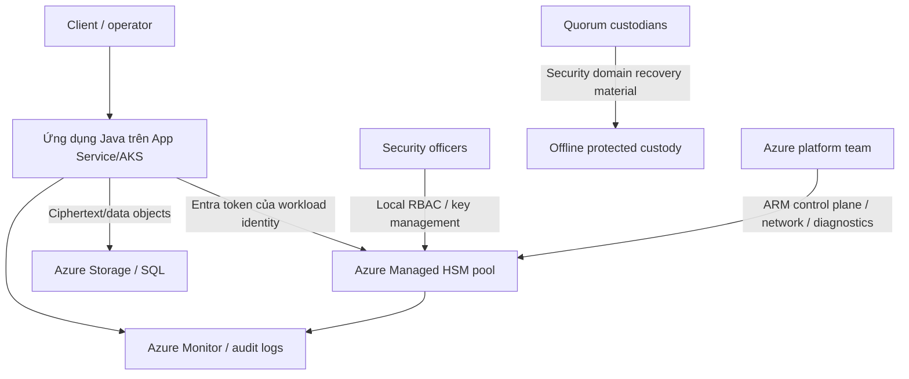

### Các đường dữ liệu độc lập

- **Control plane:** tạo/sửa tài nguyên, location, network và cấu hình Azure được phép.
- **Managed HSM data plane:** tạo/quản lý keys và thực hiện crypto operations được local RBAC cho phép.
- **Application data plane:** dữ liệu plaintext/ciphertext trong Java runtime và Storage/DB.
- **Recovery plane:** security domain backup, encrypted recovery material và người giữ quorum.
- **Observability plane:** audit metadata về key operations và identity, không phải nơi lưu private keys.

Ranh giới này là nền tảng cho nguyên tắc **“một Azure subscription Owner không nên tự động trở thành key signing operator”**.

## 6. Mô hình shared responsibility

| Microsoft vận hành theo contract dịch vụ | Khách hàng phải thiết kế/kiểm soát |
|---|---|
| HSM hardware và hạ tầng được quản lý | Chọn key types/algorithms/use cases phù hợp |
| Service availability/capacity theo SLA/tier | Subscription, identity, resource scope và network |
| Control plane/data plane endpoints | Managed HSM local RBAC/least privilege |
| Hạ tầng bảo vệ key material trong HSM | Key backup/security domain quorum và custody |
| Hệ thống logs/diagnostics khi được cấu hình | Bật logs, bảo vệ logs và xử lý incident |
| Các cơ chế soft-delete/khôi phục được dịch vụ hỗ trợ | Lập kế hoạch restore/DR và diễn tập |

**Không thể giao toàn bộ trách nhiệm bảo vệ khóa cho một dịch vụ managed**. Một operator được gán quyền `sign` quá rộng vẫn có thể dùng HSM để ký sai nội dung dù không xuất được private key.

## 7. Các loại khóa và phép toán

Trong Managed HSM, các loại khóa và thuật toán hỗ trợ cần kiểm tra theo service/version:

| Nhóm | Dùng cho | Điểm cần hiểu |
|---|---|---|
| **RSA-HSM** | Ký/xác minh, wrap/unwrap, một số encrypt/decrypt theo thuật toán hỗ trợ | Giới hạn kích thước plaintext và padding |
| **EC-HSM** | Ký/xác minh ECDSA theo curve hỗ trợ | Không tự thay RSA wrap/unwrap |
| **Symmetric/HMAC/AES-related capabilities** | Phụ thuộc khả năng sản phẩm và API cụ thể | **Không giả định mọi key type/algorithm có sẵn** |

Trong ví dụ ứng dụng dưới đây, ta sử dụng **RSA-HSM cho KEK wrap/unwrap** và **AES-GCM làm local data encryption**. Cách này không yêu cầu gửi toàn bộ file lên HSM để RSA-encrypt.

### Mapping operation và business goal

| Business goal | API/kiểu thao tác | Điều cần xác minh |
|---|---|---|
| Ký một digest/chứng từ | `sign` / `verify` | Algorithm, key type, digest input semantics |
| Giữ bí mật DEK tại rest | `wrapKey` / `unwrapKey` | KeyWrapAlgorithm, key version, role |
| Mã hóa giá trị ngắn | `encrypt` / `decrypt` | Kích thước/padding/algorithm support |
| Encrypt file 500 MB | Envelope encryption AES-GCM + HSM KEK | Không đưa toàn bộ file làm RSA input |
| Server-side CMK cho dịch vụ Azure | CMK key URI + encryption identity | Service phải hỗ trợ Managed HSM endpoint |

Không tự gán phép toán `encrypt` cho một EC signing key hoặc `sign` cho key được hạn chế chỉ `wrapKey`.

## 8. “Không xuất private key” thực sự đảm bảo điều gì?

Với khóa được tạo/phần cứng bảo vệ và sử dụng theo mô hình Managed HSM, ứng dụng **không nhận private key plaintext qua API thông thường**. Tuy vậy:

1. Người có quyền `sign` có thể yêu cầu HSM ký nhiều digest. Không xuất key **không có nghĩa không thể lạm dụng khả năng ký**.
2. Người có quyền `unwrapKey` có thể nhận **DEK plaintext** từ phép unwrap (tùy thuật toán/API), tức dữ liệu ứng dụng sau đó vẫn có thể lộ.
3. Một app compromised có managed identity đúng role có thể gọi crypto operations ngoài ý muốn.
4. Nếu ứng dụng ghi plaintext ra log/disk thì HSM **không thể bảo vệ plaintext đã rời khỏi HSM**.
5. Backup/security domain material cần được giữ theo mô hình bí mật/quorum, không để một operator thu hồi mọi thứ.

HSM giảm nguy cơ **lộ master/private key**, nhưng cần thêm authorization nghiệp vụ, audit, rate limit và an ninh runtime để giới hạn **key misuse**.

## 9. Khóa theo lớp: DEK và KEK

**Data Encryption Key (DEK)** trực tiếp mã hóa dữ liệu; **Key Encryption Key (KEK)** bọc (wrap) DEK để có thể lưu DEK dưới dạng encrypted key material.

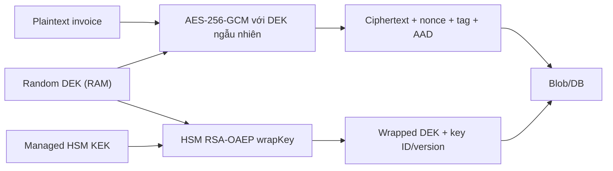

### Lợi ích của envelope encryption

- Dữ liệu lớn được AES-GCM mã hóa hiệu quả tại app hoặc data plane.
- HSM chỉ nhận **DEK nhỏ**, giảm độ trễ/key operations.
- HSM-backed KEK được quản lý vòng đời độc lập với data objects.
- Mỗi object có thể dùng một DEK riêng để giảm blast radius.
- Có thể rewrap DEK khi rotate KEK mà **không nhất thiết re-encrypt tất cả payload**, nếu policy/quy trình cho phép.

### Cảnh báo quan trọng

Nếu ứng dụng tự tạo/unwrap DEK trong JVM heap, **DEK plaintext tồn tại trong RAM của ứng dụng** trong một khoảng thời gian. Đây là **envelope encryption do ứng dụng triển khai**, không phải cam kết “DEK không bao giờ rời HSM”. Nếu yêu cầu DEK cũng không bao giờ xuất khỏi HSM, phải thiết kế lại mô hình cryptography và đối chiếu service/API support.

## 10. Managed HSM và Customer-Managed Keys (CMK)

Nhiều dịch vụ Azure cho phép khách hàng chỉ định khóa **Customer-Managed Key** (CMK) để bảo vệ khóa mã hóa của dịch vụ. Một số integrations có thể hỗ trợ Managed HSM, nhưng **không phải dịch vụ Azure nào chấp nhận mọi key URI và mọi loại HSM**.

### Hai trường hợp khác nhau

1. **Application-managed encryption:** Java tự tạo DEK, gọi Managed HSM wrap/unwrap rồi lưu ciphertext/metadata. App chịu trách nhiệm encryption protocol, AAD, key version và recovery.
2. **Service-managed encryption with CMK:** Azure Storage/SQL/service được hỗ trợ quản lý việc mã hóa dữ liệu theo contract, dùng Managed HSM key URI với một encryption identity được cấp crypto role phù hợp.

### Checklist khi dùng CMK

- Dịch vụ có **chính thức hỗ trợ Managed HSM** trong region/tier hiện tại không?
- Có yêu cầu **RSA key size, wrap/unwrap operations, enabled status, expiry** không?
- Service gọi HSM bằng **managed identity/principal nào**?
- Local RBAC trên Managed HSM có role/scope đúng cho principal đó không?
- Network firewall/private endpoint có cho phép integration cần thiết không?
- Khi rotate key hoặc disable version cũ, dịch vụ có tiếp tục đọc dữ liệu cũ không?
- Mất HSM/key hoặc mất quyền có làm dữ liệu **không truy cập được** không?

**Không tự gán CMK rồi disable/delete khóa cũ chỉ vì version mới đã được tạo.** Phải xác minh service rotation semantics, rewrap/backfill và rollback.

## 11. Managed HSM có hai mặt phẳng phân quyền

Một điểm khác biệt quan trọng của Managed HSM là phải phân biệt **Azure Resource Manager (ARM) control-plane access** và **Managed HSM local data-plane access**.

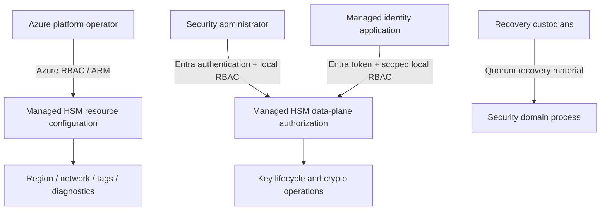

### Control plane

Cho phép các thao tác Azure resource management theo vai trò ARM: tạo tài nguyên, xem cấu hình, lập chính sách mạng/diagnostics, quản lý resource group… tùy quyền cụ thể.

### Data plane

Quản lý keys/crypto operations/permissions trong Managed HSM theo **local RBAC** của dịch vụ, xác thực principal từ Microsoft Entra ID. Các role có scope khác nhau như toàn pool hoặc theo key/scope được hỗ trợ.

### Không nhầm Azure RBAC với local RBAC

Một user có `Owner` ở subscription có thể có quyền rộng trên ARM, nhưng **không được mặc định coi là người có quyền sign/decrypt/unwrap trong Managed HSM**. Ngược lại, app có quyền `wrapKey` trên một key **không nên có quyền xóa pool, thay firewall hoặc cấp data-plane roles**.

### Ví dụ phân chia

| Principal | Azure/ARM responsibility | Managed HSM data-plane responsibility |
|---|---|---|
| Cloud platform engineer | Network, monitoring, resource deployment | Không mặc định có crypto quyền |
| Security key officer | Ít quyền ARM cần thiết | Tạo/rotate/disable keys theo nhiệm vụ |
| Application managed identity | Quyền ARM tối thiểu (có thể không cần) | `wrapKey/unwrapKey` trên key được phép |
| Audit officer | Xem logs và evidence được cấp quyền | Read/audit metadata theo role được phê duyệt |
| Security-domain custodian | Không cần quyền runtime crypto | Giữ recovery key/shares và tham gia quorum |

**Hai người giữ security domain chưa chắc là hai người có quyền đọc production data.** Tách recovery custody và runtime crypto authorization là một phần defense in depth.

## 12. Managed HSM local RBAC: vai trò và least privilege

Các vai trò data plane thường được nhắc đến trong Managed HSM gồm các nhóm như:

- **Managed HSM Administrator:** quản trị data-plane và role assignment theo quyền được hỗ trợ.
- **Managed HSM Crypto Officer:** quản lý một số vòng đời/key operations.
- **Managed HSM Crypto User:** thực hiện crypto operations trên keys theo role.
- **Managed HSM Crypto Auditor:** các quyền đọc/quan sát phục vụ kiểm toán.
- Những role chuyên biệt khác như service encryption user, backup/restore operator nếu được sản phẩm/phiên bản cung cấp.

Đây là mô tả **nhóm trách nhiệm**, không phải danh sách permissions đầy đủ hay đảm bảo role name/built-in role semantics không đổi. Trước khi cấp quyền, xem **role definitions và allowed data actions của Managed HSM** trong tenant thực.

### Nguyên tắc cấp quyền

1. Tạo **role matrix** theo API/operation thay vì theo chức danh chung chung.
2. Ưu tiên **scope một key** cho app chỉ sử dụng một KEK.
3. Tách `create/import/delete/rotate` với `sign/wrap/unwrap` nếu nghiệp vụ cho phép.
4. Không cấp quyền `unwrap` cho hệ thống chỉ cần `wrap`.
5. Nếu workload chỉ **verify public signature**, xem xét verify bằng public key ngoài HSM khi chính sách cho phép; giảm yêu cầu gọi private-key service.
6. Dùng managed/workload identities thay vì long-lived client secrets.
7. Theo dõi role assignment changes, access denials và revalidation sau mỗi deploy.
8. Kiểm soát emergency access và privileged elevation theo tổ chức.

### Blast radius

Nếu một ứng dụng chỉ phục vụ `billing`, identity của nó không nên có quyền sử dụng key `employee-pii-signing`, dù cả hai keys nằm trong cùng Managed HSM pool. **Pool-level quyền rộng** làm tăng hậu quả khi workload identity bị chiếm đoạt.

## 13. Microsoft Entra ID và cách HSM xác thực caller

Managed HSM APIs yêu cầu một principal được xác thực theo phương thức dịch vụ hỗ trợ, thường thông qua **Microsoft Entra ID token** và data-plane local RBAC.

### Trong môi trường Azure

```text
Java API on App Service/AKS/VM
  → DefaultAzureCredential / workload identity
  → Microsoft Entra access token for HSM data plane
  → Managed HSM endpoint
  → Validate token + local RBAC key permissions
  → Execute sign/wrap/unwrap
```

### Trong môi trường local dev

Java có thể dùng developer credential như Azure CLI credential thông qua credential chain được phép. **Không dùng tài khoản cá nhân Global Administrator để test production keys**; lab nên có key và scope riêng.

### Tại sao không gắn JWT vào source code?

Access token có thời hạn và quyền theo audience/identity. Đưa token vào config file hoặc log làm rò rỉ credential. Dùng `DefaultAzureCredential` hoặc cấu hình workload identity được phê duyệt, kiểm tra principal thực tế.

### Những lỗi thường gặp

| Triệu chứng | Khả năng |
|---|---|
| Không lấy được token | Managed identity chưa bật, workload federation sai, local CLI chưa login |
| HTTP `401` | Token invalid, audience/tenant không khớp |
| HTTP `403` | Local RBAC thiếu data actions, scope sai hoặc network/policy chặn |
| ARM view được nhưng crypto `403` | Azure resource role không tương đương Managed HSM local role |
| Quyền vừa cấp nhưng chưa hoạt động | Role assignment propagation/caching hoặc principal/object ID sai |

### Một principal cho hai nhiệm vụ?

Ứng dụng có thể cần `wrap` và `unwrap`, nhưng không nên dùng cùng identity cho **production runtime** và **key administrator**. Tách identity cũng giúp dễ thu hồi runtime quyền mà không mất đường quản trị.

## 14. Security domain: tài sản khôi phục sống còn

Một **security domain** trong Azure Managed HSM là thành phần mật mã/phục hồi đặc thù của pool, được sử dụng để hỗ trợ **backup/restore và recovery continuity** theo mô hình được dịch vụ cung cấp. Trong activation, người quản trị chọn các **public keys của recovery custodians**, cấu hình **quorum** và nhận security-domain material đã được bảo vệ theo quy trình.

### Security domain không phải thứ gì?

- Không phải Microsoft Entra tenant ID.
- Không phải một Azure Storage container.
- Không phải secret string/connection string của app.
- Không phải certificate TLS để trình duyệt truy cập endpoint.
- Không phải master password nên gửi qua email cho DevOps.
- Không phải một **bản sao plaintext các private keys** có thể mở tùy ý.

### Quy trình khái niệm

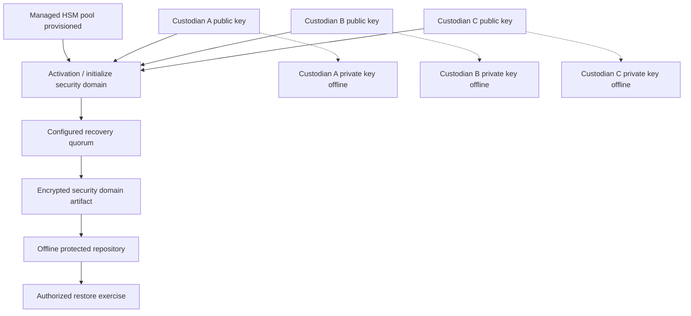

Sơ đồ là mô hình nguyên tắc. **Số lượng RSA public keys được phép, quorum min/max, private key format và quy trình CLI activation** phải theo documentation/portal phiên bản hiện hành; không tự điền số thành viên vào cấu hình sản xuất chỉ dựa trên một bài học.

## 15. Quorum và phân tách trách nhiệm khôi phục

**Quorum** nghĩa là cần một số lượng người nắm giữ recovery key/private material độc lập để phê chuẩn và thực hiện recovery operation. Ví dụ chính sách nội bộ `2-of-3` chỉ mang tính minh họa: trong thực tế, **giới hạn quorum được Managed HSM hỗ trợ và chính sách doanh nghiệp** mới quyết định con số.

### Vì sao cần quorum?

Nếu một người giữ cả encrypted security-domain artifact và tất cả recovery private keys, người đó có thể vượt qua ý nghĩa của kiểm soát nhiều người. Quorum giúp:

- giảm nguy cơ một người lạm dụng khả năng phục hồi;
- có người thay thế khi một custodian vắng mặt;
- tạo chứng cứ cho khâu chấp thuận DR;
- tách bảo quản vật liệu nhạy cảm khỏi tài khoản ứng dụng.

### Không đặt shares cùng chỗ

Ví dụ lưu giữ:

```text
Encrypted security domain artifact:
  approved offline / immutable repository

Recovery private key A:
  custody officer A, hardware-encrypted device

Recovery private key B:
  custody officer B, separate physical location

Recovery private key C:
  custody officer C, separate organization/site
```

Đây là **policy ví dụ**, không phải yêu cầu bắt buộc mọi tổ chức. Mức phân tách vật lý, encrypt-at-rest, escrow và retention phụ thuộc kiểm toán nội bộ.

### Các failure mode cần diễn tập

- Một custodian nghỉ việc hoặc mất recovery private key.
- Security-domain artifact bị xóa nhầm hoặc không đọc được.
- Bản sao được lưu chung một nơi gặp sự cố.
- Quorum không đạt do kỳ nghỉ/mất liên lạc.
- Recovery runbook không xác minh được format/version của artifact.
- Một operator cố khôi phục mà không có chứng cứ phê duyệt.

**Không thể thay security domain bị mất bằng cách chỉ đặt một recovery password mới**. Trách nhiệm lưu trữ an toàn artifact/keys là điều kiện sống còn cho kế hoạch khôi phục.

## 16. Activation và trạng thái Managed HSM

Tạo ARM resource **chưa đồng nghĩa có thể dùng ngay mọi data-plane key operation**. Managed HSM có quá trình **activation/security domain initialization** theo lifecycle dịch vụ.

```text
Resource provisioning
    ↓
HSM pool ready for activation
    ↓
Security domain activation with approved quorum keys
    ↓
Local RBAC and network access configured
    ↓
Generate/import keys
    ↓
Cryptographic operations
    ↓
Backup / restore / rotation / audit
```

### Trước activation

1. Kiểm tra ai có quyền tham gia bước khởi tạo.
2. Chuẩn bị recovery custodians và public keys từ quy trình phê duyệt.
3. Xác nhận quorum đáp ứng cả limits dịch vụ và chính sách.
4. Có nơi lưu security-domain artifact **tách khỏi hệ thống chỉ thuộc một admin**.
5. Chuẩn bị người thử restoration runbook, không chỉ người provision pool.

### Sau activation

- Xác minh security-domain artifact đã được lưu theo policy.
- Không bật một ứng dụng production sử dụng key cho đến khi có **recovery evidence**.
- Xác minh local RBAC cho administrators và crypto callers.
- Ghi identity/resource ID/region/policy version không bí mật vào inventory.

## 17. Backup khóa và security domain: hai tài sản khác nhau

**Security domain artifact** và **backup of Managed HSM keys/pool** phục vụ chức năng liên quan nhưng không nên được hiểu là cùng một file.

| Loại dữ liệu khôi phục | Ý nghĩa |
|---|---|
| **Security domain artifact** | Phục vụ cơ chế recovery/restore context của HSM theo mô hình dịch vụ |
| **Recovery private keys/quorum** | Điều kiện để phục hồi security domain khi yêu cầu |
| **Key backup / full backup artifact** | Bản backup keys/pool state được tạo qua backup operations được hỗ trợ |
| **Application key registry** | Metadata key name/version/owner/dependent services |
| **Encrypted application data** | Ciphertext và wrapped DEKs lưu ở Storage/DB, có backup/retention riêng |
| **RBAC/network/IaC definitions** | Cấu hình cần tái tạo và kiểm tra trong tình huống DR |

**Không có backup ciphertext** thì việc khôi phục HSM keys không giúp bạn tái tạo nội dung đã mất. Ngược lại, còn ciphertext nhưng không thể khôi phục keys/KEK thì dữ liệu có thể **không giải mã được**.

### Backup không phải chứng cứ restore thành công

Một thao tác “backup succeeded” chưa bảo đảm:

- custodian keys/quorum có mặt khi cần;
- artifact còn đọc được trong disaster region;
- quyền truy cập Storage backup hoạt động;
- Managed HSM target tương thích;
- các versions key được khôi phục đúng;
- các dịch vụ CMK sử dụng đúng key URI sau restore;
- ứng dụng có thể giải mã dữ liệu cũ.

Chỉ một **restore drill có kiểm soát** mới cung cấp bằng chứng end-to-end.

## 18. Soft-delete và purge protection

Xóa nhầm khóa/pool có thể khiến dữ liệu đã mã hóa không thể truy cập. Managed HSM có cơ chế bảo vệ liên quan **soft delete, retention và purge protection** theo semantics dịch vụ; cần xác minh trạng thái/giới hạn từng cơ chế ở resource thực.

### Soft-delete

Cho phép khả năng phục hồi tài nguyên/khóa đã xóa trong thời hạn và điều kiện hỗ trợ. Nó **không thay** backup ngoài môi trường ảnh hưởng, security-domain custody hoặc khôi phục khi key material hỏng/mất.

### Purge protection

Giúp chống xóa vĩnh viễn trong thời hạn bảo vệ theo thiết kế sản phẩm. Tuy nhiên:

- Có thể có thời gian chờ/tên bị giữ, ảnh hưởng tạo lại resource.
- Một khi quy trình xóa vĩnh viễn hợp lệ hoàn tất theo lifecycle, có thể **không thể khôi phục**.
- Trong một số mode/tier, purge protection là thuộc tính bắt buộc hoặc không thể đảo ngược.
- Không tắt/thay retention production để làm lab nhanh hơn.

### Thực hành

Trong IaC/operational checklist, phải xác định **delete protection policy, thời hạn, who can delete/restore và cách audit**. Đừng dựa trên tên checkbox của một bản portal cũ.

## 19. Local RBAC và key permission scope

Ví dụ ứng dụng “invoice-signing” chỉ cần `sign` bằng key riêng:

```text
Identity: mi-invoice-signing
Allowed Managed HSM scope: keys/invoice-signing
Allowed operation: sign (và verify nếu cần)
Disallowed: create/import/delete/backup/restore/role assignment
```

Đây là **policy mong muốn**, không phải JSON cấu hình role assignment. Phải ánh xạ sang **built-in/custom role definitions và scopes thực tế** mà Managed HSM hỗ trợ.

### Lỗi quyền thường gặp

- Gán Azure `Key Vault Crypto User` ở ARM theo một mô hình Key Vault nhưng không cấp **Managed HSM local data-plane RBAC**.
- Gán local role ở scope sai (pool/key).
- App dùng **client ID của identity khác** với identity được cấp quyền.
- Role mới gán chưa propagate.
- Key đang disabled/expired hoặc thiếu `key_ops` dù caller có role.
- Network policy không cho app reach endpoint.

### Quyền crypto không tự bao gồm quyền quản lý key

Một application có thể được phép wrap/unwrap bằng KEK đang enabled nhưng không được phép generate new keys, edit policy hoặc destroy KEK. Phân quyền theo *nhiệm vụ*, không theo “app là admin cho tiện”.

## 20. Key lifecycle: generate, use, rotate, retire

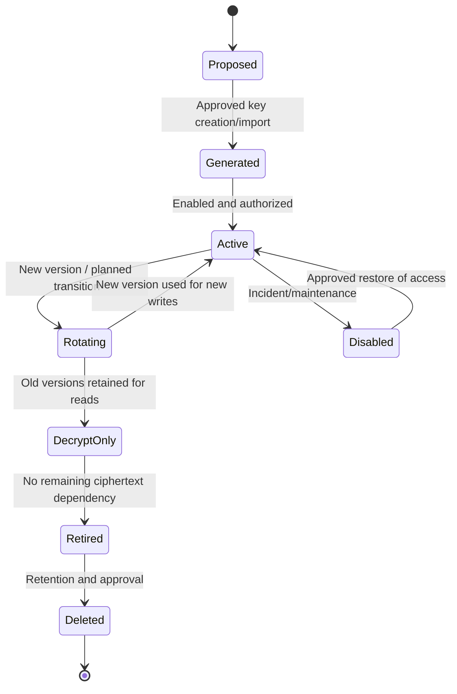

Đây là **state model do doanh nghiệp quy định**. Managed HSM hỗ trợ lifecycle properties/versions theo APIs, không tự có các trạng thái nghiệp vụ `DecryptOnly` hay `Proposed`. Tách old version from new encrypt operations bằng policy/caller logic và key permissions đúng mô hình.

### Key record nên có

```text
Key name: billing-kek
Purpose: Wrap data encryption keys for invoices
Key type: RSA-HSM
Owner: Data Security Team
Custodian: Managed HSM Security Officers
Allowed caller: Managed identity of billing service
Allowed operations: wrapKey, unwrapKey
Key URI/version: exact identifier (không bí mật)
Created/activated: UTC date
Next rotation review: UTC date
Retire gate: no live ciphertext depends on old version
Backup/restore evidence: reference to approved records
```

### Đừng nhầm rotation với data re-encryption

Tạo **new KEK version** không tự khiến tất cả wrapped DEKs cũ được rewrapped. Trong envelope encryption, dữ liệu cũ vẫn trỏ tới **old key version** để unwrap, trừ khi có chiến dịch rewrap/backfill. Trong CMK integrations, service có rotation semantics khác; phải kiểm tra riêng.

## 21. Generate new key hay import BYOK?

### Generate trong HSM

HSM tạo key material bên trong boundary theo dịch vụ hỗ trợ. Đây thường là lựa chọn trực tiếp khi ứng dụng không cần chuyển key hiện có từ hệ thống khác.

### Bring Your Own Key (BYOK)

Tổ chức đã có khóa trong HSM on-prem/khác và muốn chuyển đến Managed HSM. **BYOK không phải upload private key PEM qua HTTP**. Cần quy trình **secure key transfer/import** được dịch vụ hỗ trợ, tương thích source HSM/vendor, key type, wrapping, permissions và target key characteristics.

### Câu hỏi trước khi import

1. Nguồn private key hiện ở HSM hay file?
2. Key có **exportable/transferable** theo policy nguồn không?
3. Managed HSM có hỗ trợ key type/algorithm, wrapping/import format đó không?
4. Imported key có được bảo vệ theo yêu cầu HSM khi vào pool không?
5. Ai phê duyệt key export/transport/import và lưu audit?
6. Có thể xác minh key public fingerprint/signature trước/sau theo cơ chế?
7. Có cần đóng/disable bản key cũ không?
8. DR/recovery có áp dụng cho imported key như expected không?

**Không gửi khóa signing production sang laptop developer** để chuyển thủ công. Nếu quy trình BYOK không hỗ trợ, thiết kế migration/reissue/re-encrypt có kiểm soát, không giảm yêu cầu an toàn.

## 22. Rotation: không làm mất khả năng giải mã dữ liệu cũ

Giả sử:

```text
Version V1 của billing-kek đã wrap 2 triệu DEKs.
Ngày 01: tạo V2; new objects dùng V2.
Old objects vẫn chứa wrapped DEK từ V1.
```

Nếu disable hoặc purge V1 ngay lập tức, những object cũ có thể không unwrap được.

### Quy trình rotate KEK an toàn

1. Lập inventory những ciphertext/wrapped DEKs đang tham chiếu V1.
2. Tạo/verify V2, đúng key ops và role.
3. Chuyển **new writes** sang V2, sử dụng full versioned key URI trong metadata.
4. Giữ V1 để **old reads/unwrap** theo chính sách trong giai đoạn chuyển tiếp.
5. Nếu cần, thực hiện **rewrap**: unwrap DEK bằng V1, wrap bằng V2, ghi metadata atomically.
6. Kiểm thử read dữ liệu cũ và mới trước/sau failover.
7. Monitor error rate, unwrap latencies, key usage và số objects chưa migrate.
8. Chỉ retire V1 sau khi chứng minh **không còn phụ thuộc** và đã duyệt retention/DR.

### Rewrap cũng có rủi ro

Nếu app ghi wrapped DEK mới nhưng không cập nhật key version ID atomically, có thể tạo ciphertext không giải mã được. Dùng transaction/conditional update/ETag hoặc cơ chế rollback; không đổi tất cả records bằng script thiếu checkpoint.

## 23. Thuật toán RSA: ký, mã hóa và wrap không đồng nghĩa

**RSA-HSM** có thể phục vụ những operations được key policy và dịch vụ hỗ trợ, nhưng cần chọn đúng **padding, hash algorithm, key usage và định dạng input**.

### Sign/verify

Một tài liệu dài thường được **hash** bằng thuật toán được phê duyệt; HSM ký digest/đầu vào theo API/algorithm; bên nhận dùng public key để verify.

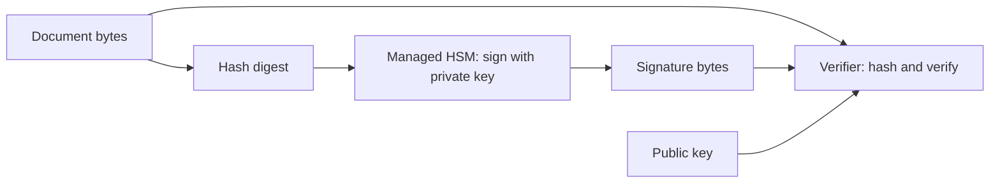

**Đừng tự sign chuỗi `"OK"` rồi coi đó là một chứng từ điện tử hợp lệ.** Signature cần đúng nội dung canonicalized, hash, algorithm, certificate/identity chain, quy trình timestamp và tính hợp lệ pháp lý theo nghiệp vụ.

### Wrap/unwrap

DEK ngẫu nhiên (ví dụ 256 bit) được bọc bằng RSA-HSM KEK với scheme như RSA-OAEP-256 nếu service, key type và SDK hỗ trợ. HSM unwrap trả lại **DEK plaintext cho caller đã được cấp quyền**.

### Encrypt/decrypt

RSA encrypt/decrypt trực tiếp có giới hạn kích thước đầu vào phụ thuộc key modulus/padding. Không gửi cả PDF/Blob nhiều MB vào API `encrypt`. Với payload lớn, dùng symmetric encryption hoặc service-managed encryption theo mô hình thích hợp.

### Phân biệt hash và encryption

- **Hash** một chiều, giúp phát hiện thay đổi/chứng minh integrity khi kết hợp ký số.
- **Encrypt** hai chiều với key để phục hồi plaintext.
- **Sign** dùng private key tạo signature nhằm kiểm chứng nguồn gốc/không sửa đổi theo identity model.
- **Wrap** bảo vệ một key khác, không trực tiếp mã hóa business records lớn.

## 24. AES-GCM: lưu cả nonce, tag và AAD

**AES-GCM** là chế độ authenticated encryption: ngoài ciphertext, nó cung cấp authentication tag để phát hiện thay đổi trái phép nếu sử dụng đúng.

Một record có thể lưu:

```json
{
  "schemaVersion": 1,
  "contentEncryption": "AES-256-GCM",
  "keyWrapAlgorithm": "RSA-OAEP-256",
  "kekKeyId": "https://<hsm>.managedhsm.azure.net/keys/billing-kek/<version>",
  "nonceBase64": "<12-byte random nonce>",
  "ciphertextWithTagBase64": "<encrypted payload plus authentication tag>",
  "wrappedDekBase64": "<wrapped 32-byte AES key>",
  "aadContext": "invoices/v1/order-501"
}
```

Đây là **envelope metadata schema tự định nghĩa**, không phải response mặc định của Managed HSM. Các giá trị trong dấu góc là placeholders, không phải real ciphertext. Trong hệ thống thật, AAD cần được biểu diễn/binary-encode nhất quán, không lấy một trường có thể bị sửa mà không xác minh.

### Nonce/IV uniqueness

Với AES-GCM, **tái sử dụng cùng nonce cho các plaintext khác nhau dưới cùng DEK là lỗi mật mã nghiêm trọng**. Cách học đơn giản: mỗi object tạo một DEK mới, nonce ngẫu nhiên 96-bit từ nguồn ngẫu nhiên mã hóa phù hợp, và lưu nonce cùng ciphertext. Với volume rất lớn/quy trình nhiều lần encrypt cùng DEK cần có chiến lược nonce uniqueness được review.

### Authentication tag

Giải mã GCM thất bại nếu ciphertext/tag/AAD bị chỉnh sửa; Java có thể ném `AEADBadTagException`. **Không bắt lỗi này rồi trả plaintext chưa được xác thực**, không “fallback” sang AES-CBC không authentication vì muốn bỏ qua lỗi.

### AAD ràng buộc bối cảnh

AAD có thể là chuỗi canonical:

```text
tenant-id | object-id | schema-version | content-type
```

Nó cần được xác định từ **ngữ cảnh tin cậy** khi encrypt/decrypt và có quy tắc encoding ổn định. Nếu lấy AAD hoàn toàn từ payload do attacker chỉnh, bảo đảm ràng buộc có thể yếu đi.

## 25. Java SDK cho Managed HSM: authentication và client

Managed HSM cung cấp **key/cryptography endpoints** tương thích các Azure Key Vault Keys SDK operations được hỗ trợ. Một ứng dụng Java có thể dùng:

- `com.azure:azure-identity` cho `DefaultAzureCredential` hoặc identity phù hợp.
- `com.azure:azure-security-keyvault-keys` cho `KeyClient`/`CryptographyClient` (theo service support).
- Azure SDK BOM để quản lý phiên bản thư viện tương thích.

### Maven dependencies — placeholder versions

```xml
<dependencyManagement>
  <dependencies>
    <dependency>
      <groupId>com.azure</groupId>
      <artifactId>azure-sdk-bom</artifactId>
      <version>REPLACE_WITH_APPROVED_AZURE_BOM_VERSION</version>
      <type>pom</type>
      <scope>import</scope>
    </dependency>
  </dependencies>
</dependencyManagement>
<dependencies>
  <dependency>
    <groupId>com.azure</groupId>
    <artifactId>azure-identity</artifactId>
  </dependency>
  <dependency>
    <groupId>com.azure</groupId>
    <artifactId>azure-security-keyvault-keys</artifactId>
  </dependency>
</dependencies>
```

Các versions là **placeholders có chủ đích**: chọn BOM chính thức phù hợp JDK/SDK theo tổ chức rồi build/test ở lab. Đừng lấy phiên bản bất kỳ từ ví dụ cũ. Không cần `azure-security-keyvault-secrets` để thực hiện KEK wrap/unwrap.

### Managed HSM endpoint và key identifier

Ví dụ:

```text
HSM base endpoint:
  https://<hsm-name>.managedhsm.azure.net/

Versioned key ID:
  https://<hsm-name>.managedhsm.azure.net/keys/billing-kek/<key-version>
```

Vì HSM và regular Key Vault dùng hostname khác nhau, **không thay `managedhsm.azure.net` thành `vault.azure.net`**. Key ID phải đúng resource thực, principal có local RBAC và network cho phép.

### Dùng DefaultAzureCredential

```java
import com.azure.core.credential.TokenCredential;
import com.azure.identity.DefaultAzureCredentialBuilder;
import com.azure.security.keyvault.keys.cryptography.CryptographyClient;
import com.azure.security.keyvault.keys.cryptography.CryptographyClientBuilder;

public final class HsmCryptoClientFactory {
    public static CryptographyClient create(String versionedKeyId) {
        TokenCredential credential =
            new DefaultAzureCredentialBuilder().build();

        return new CryptographyClientBuilder()
            .keyIdentifier(versionedKeyId)
            .credential(credential)
            .buildClient();
    }
}
```

Mã trên dùng **versioned key ID** để giảm nguy cơ một operation cũ đột ngột đổi key version khi ứng dụng rotate; trong thực tế, client object/policy cần lifecycle và caching phù hợp. `DefaultAzureCredential` dùng identity khác nhau ở local và cloud, nên xác minh **principal đang gọi** và local RBAC, không suy từ subscription login.

### Chọn sync hay async?

Java SDK thường có client đồng bộ và bất đồng bộ. Nếu ứng dụng Spring WebFlux cần nhiều requests concurrent, cân nhắc `CryptographyAsyncClient` hoặc adapter đúng scheduler; không block Reactor event loop bằng một sync HSM call. Với workflow batch, sync client có thể đơn giản hơn và vẫn đủ khi concurrency được giới hạn.

## 26. Ví dụ Java — wrap/unwrap một AES DEK

Ví dụ dùng **RSA-HSM KEK đã được tạo và cấp quyền** trong Managed HSM; ứng dụng chỉ thực hiện wrap/unwrap, không có quyền tạo hay xóa key.

```java
import com.azure.security.keyvault.keys.cryptography.CryptographyClient;
import com.azure.security.keyvault.keys.cryptography.models.KeyWrapAlgorithm;
import com.azure.security.keyvault.keys.cryptography.models.WrapResult;
import com.azure.security.keyvault.keys.cryptography.models.UnwrapResult;

import java.security.SecureRandom;
import java.util.Arrays;

public final class WrappedDekExample {
    private WrappedDekExample() { }

    public static void run(CryptographyClient cryptoClient) {
        byte[] dek = new byte[32];  // AES-256 key length.
        new SecureRandom().nextBytes(dek);

        try {
            WrapResult wrapped = cryptoClient.wrapKey(
                KeyWrapAlgorithm.RSA_OAEP_256, dek);
            byte[] wrappedDek = wrapped.getEncryptedKey();

            // Trong sản phẩm: lưu wrappedDek + algorithm + full key ID/version.
            // Tuyệt đối không ghi dek hoặc wrappedDek vào logs công khai.

            UnwrapResult unwrapped = cryptoClient.unwrapKey(
                KeyWrapAlgorithm.RSA_OAEP_256, wrappedDek);
            byte[] recovered = unwrapped.getKey();
            try {
                if (!Arrays.equals(dek, recovered)) {
                    throw new IllegalStateException("DEK unwrap mismatch");
                }
                System.out.println("HSM wrap/unwrap check: PASS");
            } finally {
                Arrays.fill(recovered, (byte) 0);
            }
        } finally {
            Arrays.fill(dek, (byte) 0);
        }
    }
}
```

### Điểm cần xác minh khi chạy

1. SDK phiên bản đã pin có hỗ trợ `RSA_OAEP_256` trong Managed HSM và key type tương ứng.
2. Key ops cho phép `wrapKey` và `unwrapKey`.
3. Caller identity có **local RBAC** đúng scope.
4. TLS/network có thể reach HSM endpoint.
5. Key version còn enabled/valid.
6. Không log credentials, access token, DEK hoặc HSM response bodies.

**Một số kết quả SDK có thể mang thêm metadata (key ID, algorithm) và cách retrieve key version thay đổi theo library version**. Ứng dụng production nên lấy key ID theo contract của phiên bản đang dùng và lưu chính xác, không dùng một string đoán từ key name.

### Vì sao xóa byte[] vẫn chưa đủ bảo đảm?

`Arrays.fill(...)` giảm thời gian dữ liệu nằm trong mảng cụ thể, nhưng JVM/GC/SDK/JCE có thể tạo **bản sao trong heap/native memory** không thể xóa toàn bộ từ Java thuần. Đừng tuyên bố “DEK không tồn tại trong RAM” sau khi gọi fill. Với yêu cầu nghiêm ngặt, phải kết hợp runtime hardening, memory dump access control và phương án cryptography phù hợp.

## 27. Java AES-GCM để mã hóa payload trước khi lưu Storage

Mã mẫu Java/JCA không phụ thuộc Azure cho phần AES:

```java
import java.security.SecureRandom;
import java.util.Arrays;
import javax.crypto.Cipher;
import javax.crypto.spec.GCMParameterSpec;
import javax.crypto.spec.SecretKeySpec;

public final class LocalAesGcm {
    public record Encrypted(byte[] nonce, byte[] ciphertextWithTag) { }

    public static Encrypted encrypt(
        byte[] aes256Key,
        byte[] plaintext,
        byte[] aad
    ) throws Exception {
        if (aes256Key.length != 32) {
            throw new IllegalArgumentException("AES-256 requires 32-byte key");
        }
        byte[] nonce = new byte[12];
        new SecureRandom().nextBytes(nonce);

        Cipher cipher = Cipher.getInstance("AES/GCM/NoPadding");
        cipher.init(Cipher.ENCRYPT_MODE,
            new SecretKeySpec(aes256Key, "AES"),
            new GCMParameterSpec(128, nonce));
        cipher.updateAAD(aad);
        return new Encrypted(nonce, cipher.doFinal(plaintext));
    }

    public static byte[] decrypt(
        byte[] aes256Key,
        byte[] nonce,
        byte[] ciphertextWithTag,
        byte[] aad
    ) throws Exception {
        Cipher cipher = Cipher.getInstance("AES/GCM/NoPadding");
        cipher.init(Cipher.DECRYPT_MODE,
            new SecretKeySpec(aes256Key, "AES"),
            new GCMParameterSpec(128, nonce));
        cipher.updateAAD(aad);
        return cipher.doFinal(ciphertextWithTag);
    }
}
```

### Thực hành đúng

- Mỗi encryption phải dùng nonce **duy nhất dưới cùng key**.
- Dùng `SecureRandom` phù hợp môi trường; không dùng `java.util.Random` làm nguồn sinh DEK/nonce.
- Lưu **nonce, ciphertext/tag, wrapped DEK, algorithm, key ID/version và AAD context**.
- AAD cần xác định nhất quán từ record/tenant context đã xác minh.
- Không bỏ qua `AEADBadTagException` hoặc fallback sang unauthenticated mode.
- Không lưu DEK/plaintext trong logs, telemetry, exception message hoặc upload tạm vào Blob public.
- Thực tế cần xử lý content streaming, memory capacity, transactions, key erasure và versioned envelope format; ví dụ mã hóa mảng bytes chỉ phục vụ học.

### Code làm gì và không làm gì?

`LocalAesGcm` mã hóa/giải mã **trong JVM**, không nhờ Managed HSM thực hiện AES-GCM. **HSM bảo vệ KEK**, còn app xử lý plaintext/DEK, do đó threat model vẫn phải xem xét host compromise.

## 28. Phối hợp Java CryptoClient với envelope format

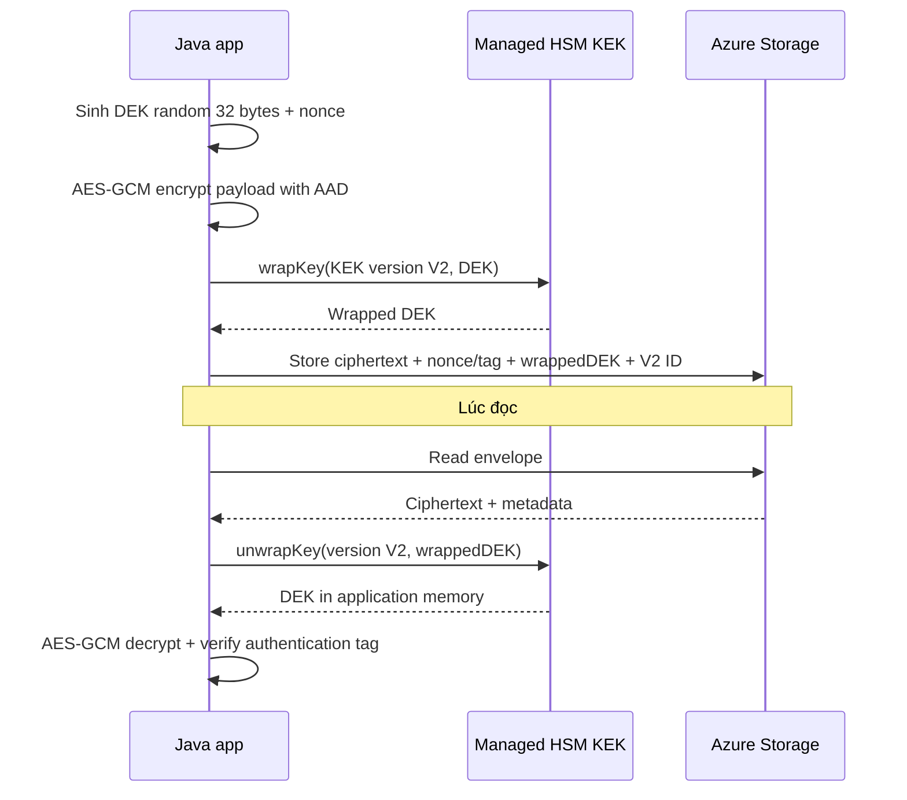

### Versioned key URI

Khi đọc một envelope cũ, ứng dụng cần dùng **key version đã lưu khi wrap**, không mặc định dùng latest version. Nếu V2 đã retire/disable, unwrap thất bại cho dù V3 đang enabled.

### Atomic writes

Ciphertext và metadata phải được ghi thành một **logical atomic record** hoặc có cơ chế chuẩn hóa kiểm chứng. Nếu ghi Blob ciphertext trước rồi mất mạng trước khi ghi wrapped DEK, bạn sẽ có ciphertext không giải mã được. Dùng single envelope file, conditional writes hoặc database transaction/outbox theo hệ thống.

### AAD với multi-tenant

Ví dụ `tenant-A/order-501` là AAD. Khi user Tenant B yêu cầu đọc, app phải **authorize Tenant B không được xem record A** trước khi unwrap. GCM AAD chỉ bảo vệ integrity của bối cảnh đã chỉ định; không tự thay authorization của ứng dụng.

## 29. Ký tài liệu qua HSM và bằng chứng xác thực

Một workflow ký chứng từ có thể như sau:

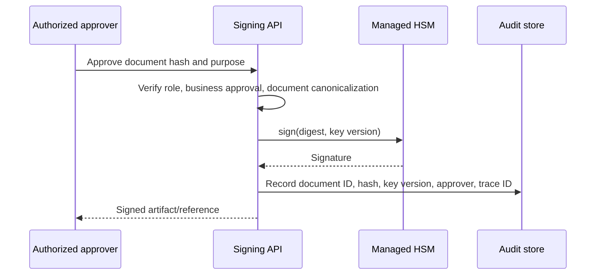

### Mỗi lớp bảo vệ gì?

- **Business authorization:** ai được ký loại chứng từ nào.
- **Canonicalization/digest:** ký chính xác dữ liệu phiên bản nào.
- **Managed HSM:** bảo vệ private signing key và thực hiện signing.
- **Audit trail:** lưu dấu approvals, document hash, key ID, timestamp.
- **Trust/PKI:** bên nhận biết public key/certificate identity nào đáng tin.

Nếu một người được phép gọi `sign` qua app không có kiểm tra business role, HSM vẫn có thể tạo chữ ký cho digest không được phê duyệt. **HSM bảo vệ key material, không tự chứng minh nội dung giao dịch được người có thẩm quyền chấp thuận**.

### Verify có thể làm ở đâu?

Tùy thuật toán và policy, một chữ ký public-key có thể được kiểm tra bằng **public key** ngoài HSM, giảm nhu cầu cho verifier lấy quyền crypto user. Tuy nhiên độ tin cậy của public key/chain/rotation/revocation phải được quản lý theo PKI/application contract.

## 30. Key operation latency và throughput

HSM cryptographic operations **không miễn phí và không có độ trễ bằng 0**. Một request wrap/sign từ App Service/AKS có thể chịu:

```text
Request construction
→ Entra credential/token acquisition or cache
→ DNS/TLS/network/private endpoint
→ Managed HSM authorization
→ HSM operation
→ response parsing
→ application processing
```

### Tránh gọi HSM cho từng chunk dữ liệu

Nếu upload file 1 GB được chia 4.096 chunks mà app gọi HSM wrap cho mỗi chunk, chi phí/latency có thể cao không cần thiết. Với envelope encryption, có thể tạo một DEK per object và wrap một lần, rồi mã hóa streaming/chunks theo protocol được thiết kế an toàn (nonce uniqueness và authentication boundaries cần review).

### Lưu ý caching

- Cache **public keys/metadata và clients** phù hợp có thể giảm request overhead.
- Không cache **unwrapped DEK plaintext dài hạn** nếu làm tăng phạm vi lộ dữ liệu.
- Không cache Azure access tokens theo cách custom bỏ qua SDK credential security/expiration.
- Rotation cần invalidate references theo key version và business policy.

### Các giới hạn khác nhau

Managed HSM có quota/service limits cho operations, key creation, connections và resource capacity tùy phiên bản/region. Đo **p95/p99, operations/s, throttling và peak** trước khi chọn kiến trúc cho thanh toán hoặc API latency-sensitive.

## 31. Network security: public endpoint, Private Link và DNS

Managed HSM có các cơ chế kiểm soát network access/private networking theo tính năng/region hiện hành. Một hệ thống có yêu cầu private-only phải thiết kế **cả đường đi của application lẫn công cụ quản trị/recovery**.

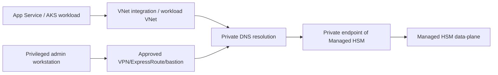

### Những điều Private Link không tự giải quyết

- Không tự cho phép app có key permissions; vẫn cần **Entra token + local RBAC**.
- Không thay thế kiểm tra TLS hostname và certificate chain.
- Không bảo đảm một laptop công khai ngoài Internet reach được HSM nếu không có route.
- Không tự thay network path của security-domain activation/backup workflows hoặc Azure service CMK integration; phải đối chiếu từng operation.
- Không bảo vệ plaintext đã xuất khỏi HSM vào RAM của ứng dụng.

### Checklist kết nối

1. HSM endpoint của application có đúng hostname `<hsm>.managedhsm.azure.net` không?
2. DNS trả private IP phù hợp từ chính VM/pod/App Service runtime chưa?
3. Private endpoint connection đã được phê duyệt chưa?
4. VNet peering/VPN/ExpressRoute/route table/NSG có cho phép traffic không?
5. Workload có thể truy cập Microsoft Entra token endpoint theo mô hình identity không?
6. Backend có local RBAC và key enabled không?
7. Service Azure dùng CMK có integration network được hỗ trợ hay cần cấu hình riêng?
8. Diagnostic/export endpoints có đường đi được phê duyệt không?

### Lỗi 403 và timeout

**403** có thể là authorization hoặc network access policy trả về từ service. **Timeout/TLS/DNS error** thường báo đường kết nối hoặc certificate. Không dùng cách sửa “tắt network restrictions” trước khi phân biệt từ status, tracer và network test trong sandbox.

## 32. Availability, zone/region và failure domains

Managed HSM cung cấp availability theo kiến trúc dịch vụ và SLA được Microsoft công bố, nhưng **không suy rằng key tự động sử dụng được trên một Managed HSM pool độc lập ở region khác**.

### Ba failure domains

| Domain | Ví dụ | Cần làm gì |
|---|---|---|
| **App runtime** | Java app/pod crash | Recreate workloads, managed identity và configuration |
| **Managed HSM service** | Outage, network partition hoặc authorization issue | Monitor service health, retry budget, failover plan |
| **Regional disaster/key recovery** | Pool/region không dùng được, cần restore | Security domain, backup, compatible target và tested runbook |

### RTO/RPO thực tế

- **RTO cryptography:** ứng dụng có thể sign/wrap/unwrap lại trong bao lâu?
- **RPO key/configuration:** backup có bao gồm phiên bản key và quyền cần thiết đến thời điểm nào?
- **RPO encrypted data:** data objects/ciphertext lưu ở Storage/DB có được backup/replicate độc lập không?
- **Business continuity:** cần tiếp tục đọc dữ liệu cũ hay chỉ ký dữ liệu mới?

### Một đặc điểm quan trọng của ký và giải mã

Nếu signing HSM tạm ngừng, có thể **queue jobs** và ký khi service phục hồi, nếu SLA nghiệp vụ cho phép. Nhưng nếu API bắt buộc **unwrap DEK để đọc dữ liệu người dùng**, mất HSM có thể làm data temporarily unavailable dù Storage vẫn khỏe.

### Không tạo “bypass key” khi HSM lỗi

Đừng tự giải quyết outage bằng cách lấy private key copy trong file để ký/mã hóa từ app, vì thao tác này đánh mất yêu cầu **khóa chỉ nằm trong HSM**. Tính khả dụng phải được thiết kế bằng **service/DR options được chứng nhận và key custody plan**, không hạ chuẩn bảo mật trong sự cố.

## 33. Disaster recovery: diễn tập khôi phục end-to-end

Một runbook đáng tin cần được diễn tập trên **khóa và ciphertext giả**. Không bao giờ dùng production signing key chỉ để chứng minh thao tác DR trong buổi học.

### Chuỗi phục hồi khái niệm

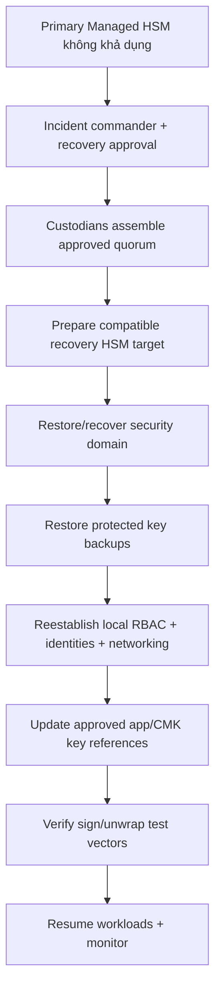

**Thứ tự và API chi tiết** phụ thuộc khả năng restore/backup thực tế và trạng thái nguồn/đích. Một vài bước có thể phải thực hiện ở những thời điểm hoặc môi trường khác nhau theo Managed HSM workflow được hỗ trợ; sơ đồ không phải script thực thi.

### Bằng chứng cho buổi diễn tập

```text
Exercise ID:
Test resource / region:
Security domain version / custody record:
Quorum reached: PASS/FAIL (không ghi private key)
Backup artifact reference:
Target HSM compatibility checked: PASS/FAIL
Key names/versions restored:
Local RBAC re-applied: PASS/FAIL
Network/DNS tested: PASS/FAIL
Can unwrap historical test DEK: PASS/FAIL
Can verify test signature: PASS/FAIL
RTO measured:
RPO observed:
Key material leaks detected: NONE/INCIDENT
Cleanup owner:
```

### Những điều không được ghi vào DR report

- Recovery private keys hoặc passwords.
- Security-domain encrypted artifact nếu policy cấm lưu ở ticket.
- HSM key material, DEK plaintext.
- Production document samples hoặc customer ciphertext không cần thiết.
- Token, Storage SAS backup URLs.

### Sự cố quorum

Nếu một custodian không thể tham gia, **không tự chia sẻ private keys qua chat để đủ quorum**. Kế hoạch recovery phải dự kiến người dự phòng, địa điểm dự phòng và quy trình nhận dạng người giữ khóa.

## 34. Key compromise: khác “lộ private key” và “lạm dụng quyền key”

Một HSM có thể bảo vệ private key không cho xuất, nhưng attacker chiếm workload identity có thể thực hiện **unauthorized signing/unwrap**.

### Hai tình huống cần tách

| Tình huống | Triệu chứng | Kế hoạch phản ứng |
|---|---|---|
| **HSM-backed key material suspected compromised** | Nghi ngờ quy trình import/recovery hoặc boundary mất tin cậy | Incident cấp cao, key replacement, PKI/trust/rewrap review |
| **Workload credential misused** | Spike sign/unwrap từ principal/host lạ | Thu hồi token/identity access, local RBAC, network restrictions; audit các operations |

### Runbook khi phát hiện key misuse

1. Xác nhận principal, key ID/version, thời gian và affected operations qua logs đáng tin.
2. Kích hoạt incident response với Security/Key Owner.
3. Chặn/thay quyền của principal bị ảnh hưởng; không xóa evidence.
4. Tạm disable key/version nếu business impact và policy cho phép, cân nhắc dữ liệu sẽ không giải mã được.
5. Kiểm tra signatures hoặc unwrapped data operations trong cửa sổ rủi ro.
6. Thay/rotate key, ngăn tiếp tục sử dụng version nghi ngờ.
7. Xử lý trust/certificate revocation, re-sign hoặc data rewrap khi cần.
8. Kiểm tra app/CI/CD/managed identity/privileged access bị xâm nhập từ đâu.
9. Khôi phục theo playbook với dual approval.
10. Kiểm toán lại role matrix, alerts, network và recovery custody.

**Không xóa key ngay lập tức như một phản xạ**: có thể làm mất khả năng đọc dữ liệu lịch sử hoặc xác minh chứng từ. Tạm khóa quyền, cô lập workload và có kế hoạch thay thế an toàn.

## 35. Audit logging, traces và giám sát crypto operations

Các tác vụ **tạo, sử dụng, thay đổi và khôi phục khóa** cần được giám sát bằng Azure Monitor/diagnostic logging và telemetry của ứng dụng.

### Những câu hỏi audit quan trọng

- Principal nào gọi `sign/unwrapKey/deleteKey`, vào lúc nào?
- Lệnh thành công, bị từ chối hay bị throttled?
- Key nào và version nào được sử dụng?
- Role assignment nào đã thay đổi trước sự cố?
- Có sự thay đổi network configuration/backup policy nào không?
- Số phép unwrap tăng bất thường sau deployment không?
- Các custodians có thực hiện recovery workflow theo quy trình không?

### Mô hình dữ liệu log an toàn

```json
{
  "timestamp": "2026-11-20T09:21:00Z",
  "principalAlias": "mi-billing-prod",
  "operation": "wrapKey",
  "keyAlias": "billing-kek",
  "keyVersionAlias": "v2",
  "outcome": "success",
  "durationMs": 34,
  "traceId": "4bf92f3577b34da6a3ce929d0e0e4736",
  "environment": "production",
  "source": "billing-service"
}
```

Đây là **application-generated log schema minh họa**, không phải JSON output của Azure Managed HSM. Không ghi DEK, raw signature inputs, ciphertext nhạy cảm, bearer token hoặc key-operation request body.

### Kết hợp ba nguồn chứng cứ

1. **Managed HSM diagnostic/audit logs:** operations, caller/status và chi tiết mà dịch vụ cung cấp theo phiên bản.
2. **Application logs/traces:** business request ID, tenant authorization decision, latency và error taxonomy.
3. **Azure activity/control-plane logs:** thay đổi tài nguyên, network/ARM policy và quyền được ghi lại.

Không kỳ vọng **một** log source sẽ chứng minh toàn bộ end-to-end business authorization; ví dụ HSM chỉ biết caller có quyền sign, không tự biết người ký đã có hai cấp phê duyệt hóa đơn.

### Alert gợi ý

| Tín hiệu | Ý nghĩa | Phản ứng |
|---|---|---|
| Denied crypto operations tăng | IAM scope, token hoặc tấn công | Kiểm tra principal/role/network |
| Bất thường unwrap/sign requests | Lạm dụng key hoặc code loop | Quarantine principal, review audit |
| Key disabled/expired sắp tới | Dữ liệu/điều hành có thể gián đoạn | Planned rotation |
| Role assignments thay đổi ngoài cửa sổ | Privilege escalation risk | Security review |
| Backup thất bại hoặc chưa chạy | DR gap | Đánh giá khôi phục |
| Private endpoint connectivity fail | App mất khả năng crypto | Kiểm tra DNS/route/approval |
| p95/p99 crypto latency tăng | Network/service/throttling | Capacity/health/traffic |
| HSM resource cost spike | Request storm hoặc quota/config | Cost Management/operations |

### Không dùng log làm kho recovery material

Security domain artifact, private shares và key backup artifacts **không phải telemetry fields**. Chỉ ghi **tham chiếu được bảo vệ**, timestamp, owner và kết quả kiểm thử.

## 36. Thiết kế SLI/SLO cho crypto dependency

### Các chỉ số nên có

```text
wrap_success_rate
unwrap_success_rate
sign_success_rate
crypto_operation_p95_latency_ms
crypto_operation_p99_latency_ms
authorization_denials_per_principal
key_version_usage_counts
key_rotation_progress_percent
backup_last_success_age
security_domain_recovery_drill_age
```

Đây là **tên SLI do ứng dụng/quy trình tự định nghĩa**, không khẳng định Azure Monitor phát sẵn mọi metric cùng tên.

### Ví dụ business SLO

```text
P99 invoice DEK unwrap latency < 200 ms
No unexpected key version usage after cutover
100% Tier-1 KEKs have backup/recovery evidence
0 unauthorized production sign operations
100% key-role changes are approved/audited
```

Những con số là **mục tiêu minh họa**; cần load test từ region/network thực tế và xem SLA/latency của service. Đối với ngân hàng/medical data, error budgets có thể khác rất nhiều.

### Giới hạn số metric labels

Không tạo label theo từng `invoiceId`/`customerId`/token — cardinality cao và rủi ro privacy. Dùng key alias, operation, status category và environment; tra cứu event cụ thể bằng trace/request ID trong logs có quyền.

## 37. Mô hình chi phí: Managed HSM không giống Key Vault Standard

Managed HSM có cost model phản ánh **pool/capacity chuyên dụng** và key operations theo cấu hình/giá hiện hành. Đối với workload nhỏ, chi phí cơ sở của một resource dedicated có thể chiếm phần lớn tổng chi phí.

### Những thành phần cần dự toán

| Thành phần | Điều cần tính |
|---|---|
| **Managed HSM pool** | Base/dedicated pool charge theo region/tier/time |
| **Crypto operations** | Số lần sign/verify/wrap/unwrap/encrypt/decrypt và tính phí theo model |
| **Key backups/recovery workflows** | Storage/backup operations và hạ tầng liên quan |
| **Network** | Private endpoints, VNets, VPN/ExpressRoute, data transfer |
| **App compute** | Java CPU/RAM cho AES-GCM, concurrency/thread pools |
| **Azure Monitor** | Log Analytics ingestion, retention, alerts |
| **Security operations** | PKI, custodians, dual-control, DR exercises |
| **CMK dependent services** | Storage/SQL/other service pricing riêng |
| **Multi-region DR** | Recovery resources/capacity phải sẵn sàng nếu SLA yêu cầu |

**Không cung cấp mức giá tuyệt đối khi chưa chọn region/SKU và ngày báo giá**. Dùng Azure Pricing Calculator/bảng giá đang áp dụng, Cost Management và đo operations thực tế.

### Ví dụ phép tính tải, không phải tiền

Giả sử một ứng dụng có:

```text
500 new encrypted invoices/minute
1 HSM wrapKey operation per invoice
10,000 invoice reads/minute
1 unwrapKey per read without cache
```

Suy ra:

\[
500 + 10\,000 = 10\,500\ \text{crypto operations/phút}
\]

hay khoảng \(175\) operations/giây trung bình trong giả định này. Đây là một **mô hình nhu cầu**, chưa tính key metadata calls, retries, parallel tenants, region bursts, cache và các giới hạn dịch vụ. Cần load test và budget trước khi cam kết throughput/latency.

### Cân nhắc thiết kế để giảm số operations

- Bọc DEK **theo object/batch key policy** chứ không bọc mỗi vài byte.
- Verify public-key locally khi trust model cho phép.
- Cache key metadata/clients thay vì gọi key listing liên tục.
- Tránh unwrap cùng DEK lặp lại vô nghĩa, nhưng **không cache plaintext DEKs dài hạn**.
- Giới hạn retry để tránh operation storms.
- Tắt/xóa **lab resources theo quy trình** thay vì để pool tính phí kéo dài.

### Tính giá trị bảo mật

Đánh giá hiệu quả theo **giảm rủi ro key extraction, phạm vi quyền, khả năng audit, recovery evidence, compliance fit** cùng tổng chi phí sở hữu. Không chỉ so sánh giá một lần ký.

## 38. Lựa chọn kiến trúc theo use case

| Trường hợp | Khuyến nghị ban đầu | Lý do |
|---|---|---|
| Một API cần lưu mật khẩu database | **Key Vault secrets** | Secret read/write, không phải HSM key operation |
| Website cần TLS certificate lifecycle | **Key Vault certificates** hoặc certificate management phù hợp | Managed HSM không phải certificate object store tương đương |
| Service cần HSM-backed signing key, yêu cầu vừa phải | **Đánh giá Key Vault Premium** | Có thể đã đủ protection và đơn giản hơn |
| Tổ chức yêu cầu single-tenant HSM pool và recovery quorum | **Đánh giá Managed HSM** | Custody/isolation/recovery phù hợp hơn |
| Data lake encrypted với CMK ở dịch vụ hỗ trợ | **Key Vault/Managed HSM theo integration matrix** | Service-specific CMK contract quan trọng |
| App tự encrypt hàng GB tài liệu | **Envelope encryption + HSM-backed KEK** | AES-GCM data plane, HSM bảo vệ KEK |
| Ứng dụng ký hợp đồng có quy trình phê duyệt 2 người | **Managed HSM hoặc Premium theo policy + business approval** | HSM không tự thay business authorization |
| Legacy HSM key cần chuyển từ on-prem | **BYOK/import design review** | Key type, transfer, custody, lifecycle |
| Budget thấp, chỉ cần app-level config secrets | **Managed HSM thường không phù hợp** | Cost/operations vượt yêu cầu |

### Chọn cách dùng khóa trước khi chọn tier

Một giải pháp có thể gồm **Key Vault cho secrets/certificates**, **Managed HSM cho chuyên dụng KEKs/signing keys**, **managed identities** cho workloads và **Storage/SQL** cho encrypted data. Không cần ép mọi bí mật vào một resource.

## 39. Threat modeling dành cho Managed HSM

### Assets cần bảo vệ

```text
1. Managed HSM KEKs / private signing keys
2. Security-domain encrypted artifact
3. Recovery private keys/quorum material
4. Managed identities / Entra role assignments
5. Wrapped DEKs / key version metadata
6. Encrypted business records
7. Plaintext trong Java runtime
8. Audit / backup evidence
```

### Những attacker/điểm xâm nhập

| Threat | Điều attacker muốn | Defense chính |
|---|---|---|
| Compromised Java container | Gọi `unwrap/sign` trái phép | Key scope, identity isolation, app authorization, monitoring |
| Compromised cloud admin | Tăng quyền/xóa HSM | Phân tách ARM/data plane, PIM/approval, delete protection |
| Stolen credential | Dùng data-plane token | Managed identity, short-lived credentials, revoke and audit |
| Malicious key officer | Xóa/rotate key không đúng quy trình | Separation of duties, reviews, logs, recovery |
| Backup artifact theft | Lấy recovery material | Encrypted backup, quorum private key separation |
| Single custodian compromise | Cố phục hồi/lạm dụng | Quorum + independent custody |
| Man-in-the-middle | Xem/sửa network requests | TLS validation, private networking |
| Ciphertext metadata tampering | Đổi key ID/nonce/AAD | Authenticated envelope, trusted metadata, conditional writes |
| Retry storm | Làm quá tải HSM/key operations | Backoff, retry budget, throttling, circuit breaker |
| Unauthorized CMK rotation | Khiến dữ liệu không đọc được | CMK policy, version pin, migration evidence |

### Security domain chỉ giải quyết một lớp

Quorum recovery **không kiểm soát trực tiếp** mọi `sign` runtime call và **không ngăn app ghi plaintext ra log**. Threat model phải bao gồm cả **app authorization, runtime, API, network, identity và governance processes**.

## 40. Lab 1 — Ra quyết định: có cần Managed HSM không?

### Đề bài

Ba đội có yêu cầu:

**Đội A:** Một ứng dụng HR cần lưu API key của hệ thống chấm công và certificate TLS.

**Đội B:** Ứng dụng thương mại điện tử cần khóa RSA trong HSM để ký biên nhận, nhưng chưa có yêu cầu HSM pool single-tenant hoặc security-domain quorum.

**Đội C:** Nền tảng thanh toán phải bảo vệ private signing keys trong HSM chuyên dụng, phân tách operator/crypto officer, quản lý recovery bằng quorum và lập hồ sơ DR.

### Bảng đánh giá

| Tiêu chí | A | B | C |
|---|---|---|---|
| Có secret/password/certificate objects | Có | Không phải yêu cầu chính | Không phải yêu cầu chính |
| Có crypto operations bằng non-exportable HSM key | Không nhất thiết | Có | Có |
| Có yêu cầu dedicated HSM boundary | Không | Chưa | Có |
| Có security-domain/quorum recovery | Không | Chưa | Có |
| Chấp nhận dedicated pool cost/operational burden | Không rõ | Cần tính | Đã đưa vào chương trình |

### Hướng giải

- **Đội A:** Key Vault secret/certificate management phù hợp hơn.
- **Đội B:** Xem Key Vault Premium HSM-backed keys trước; không khẳng định chỉ Managed HSM mới có HSM-protected key.
- **Đội C:** Managed HSM là ứng viên hợp lý, nhưng cần xác minh **certification, supported algorithms/integration, IAM, security domain, cost và DR**.

### Điều kiện nghiệm thu

Người học phải ghi rõ **yêu cầu bắt buộc** và **trade-off**; câu trả lời “Managed HSM an toàn nhất nên dùng mọi nơi” không đạt.

## 41. Lab 2 — Lập kế hoạch triển khai HSM pool

Chỉ thực hiện provisioning thật khi tổ chức cho phép **tài nguyên tính phí**, có budget và recovery custodians. Một Managed HSM pool không phải lab disposable rẻ tiền như một secret trong Key Vault.

### Prerequisites

```text
Azure subscription: sandbox được phê duyệt
Resource group: rg-hsm-governance-lab
Managed HSM name: <globally unique approved name>
Location: <region có hỗ trợ>
Expected tenant: <Entra tenant ID>
Recovery custodians: <danh sách nội bộ, không public>
Quorum: <theo policy + supported limits>
Network: <public restricted hoặc private access theo policy>
Budget owner: <approved>
Cleanup/retention owner: <approved>
```

### Thứ tự thao tác

1. Thu thập yêu cầu bảo vệ key, algorithm, tenant/region, chi phí và DR.
2. Xác định **pool resource** và principal ban đầu có quyền quản trị data plane theo creation workflow.
3. Chuẩn bị **recovery public keys** và quorum, tách private keys ở các custodians.
4. Tạo Managed HSM resource bằng Portal/IaC/CLI được phê duyệt, ghi lại resource ID và endpoint.
5. Thực hiện security-domain activation theo hướng dẫn dịch vụ hiện hành.
6. Kiểm tra encrypted security-domain artifact đã được lưu theo custody policy.
7. Cấu hình local RBAC, network và diagnostic settings.
8. Chỉ sau đó tạo **test RSA-HSM key**, không import production key.
9. Đo connection/crypto/API latency và test access denied.
10. Lập runbook dọn dẹp với lưu ý soft-delete/purge retention và **cost không biến mất chỉ vì ứng dụng ngừng gọi API**.

### Chặn triển khai khi thiếu quorum

Nếu chỉ có một người quản trị và không có recovery private keys được lưu riêng, nên **dừng ở mức design exercise**. Không tạo production HSM pool rồi “tạm bỏ qua security domain” như một việc không quan trọng.

## 42. Lab 3 — Đọc thông tin ARM resource bằng Azure CLI

Sau khi tài nguyên đã có và người học có quyền **read ARM metadata**, có thể xác minh mà không tạo key:

```bash
az login --tenant "<tenant-id>"
az account set --subscription "<subscription-id>"

az account show \
  --query "{subscription:id,tenant:tenantId,name:name}" \
  --output json

az resource show \
  --resource-group "rg-hsm-governance-lab" \
  --resource-type "Microsoft.KeyVault/managedHSMs" \
  --name "<managed-hsm-name>" \
  --query "{id:id,name:name,location:location,sku:sku,properties:properties}" \
  --output json
```

**Ý nghĩa:** Đây là **control-plane read**. Nó có thể trả metadata hạ tầng; không chứng minh người dùng có quyền `sign/unwrap` hoặc đã giữ được security domain. Nếu output chứa resource/network details nhạy cảm, chỉ lưu projection cần thiết vào báo cáo được kiểm soát.

### Có thể truy vấn key operations qua CLI không?

Nhóm `az keyvault key ...` trong Azure CLI có thể cung cấp tùy chọn kết nối Managed HSM như `--hsm-name` theo phiên bản/extension. **Trước khi thực thi**, kiểm tra:

```bash
az keyvault key --help
az keyvault key list --help
az keyvault key create --help
```

Không suy một lệnh Key Vault thường dùng tự trỏ đến Managed HSM khi thiếu đúng endpoint/parameter. Các thao tác `create`, `delete`, `purge`, `backup` và `restore` phải theo change process; bài này **không yêu cầu chạy mutation ngoài sandbox**.

## 43. Lab 4 — Tạo test key và thử role separation

### Mục tiêu

Chứng minh rằng **quyền quản lý Azure resource và quyền crypto key là hai việc khác nhau**.

### Chuẩn bị

- Một Managed HSM pool **đã activation** thuộc sandbox.
- Security officer được giao tạo test key.
- Workload identity `mi-hsm-lab-app` (hoặc principal lab).
- Key name `lab-invoice-kek`, RSA-HSM/algorithm được hỗ trợ.
- Operator thử nghiệm chỉ có ARM view rights.
- Role assignments được ghi nhận trong governance ticket.

### Quy trình

1. Officer tạo `lab-invoice-kek` bằng key management tooling đã được xác minh; chọn key ops `wrapKey/unwrapKey` khi phù hợp.
2. Officer dùng Managed HSM local RBAC cấp workload identity quyền crypto tối thiểu trên key/scope được hỗ trợ.
3. Người có ARM Reader/Contributor nhưng không có local RBAC thử gọi key operation trong môi trường kiểm thử.
4. Xác nhận **operation bị từ chối**; không gán thêm role tùy tiện để “làm xanh” test.
5. Chạy Java wrap/unwrap bằng workload identity đã được cấp.
6. Xác minh thao tác thành công và không có DEK plaintext trong log.
7. Thu hồi quyền của workload identity trong môi trường test có kiểm soát; sau propagation, xác minh request mới không được phép.
8. Khôi phục quyền test nếu cần cho lab tiếp theo.

### Bảng evidence

| Test | Expected |
|---|---|
| Azure ARM Reader xem metadata | PASS theo ARM role |
| ARM Reader gọi unwrap không có local RBAC | DENIED |
| Crypto identity wrap key được cấp | PASS |
| Crypto identity delete key | DENIED |
| Key officer tạo key | PASS nếu role/capability đúng |
| Disabled key phục vụ crypto operation | DENIED theo key state/SDK semantics |
| Network path bị chặn | Kết nối fail; không tự sửa bằng broad public access |

**Không chạy các phép thử disable/delete trên khóa dùng bởi dịch vụ khác.** Chỉ chọn test key độc lập có owner/cleanup plan.

## 44. Lab 5 — Envelope encryption end-to-end với Java

### Mục tiêu

Từ một chuỗi plaintext giả, người học:

1. Sinh **DEK 32 bytes** và nonce AES-GCM.
2. Mã hóa dữ liệu bằng JCA.
3. Dùng Managed HSM KEK `wrapKey` để bọc DEK.
4. Lưu **ciphertext, tag, nonce, wrapped DEK, key ID/version, algorithm và AAD**.
5. Dùng `unwrapKey`, AES-GCM decrypt và so sánh plaintext.
6. Thử sửa một byte ciphertext/tag/AAD để quan sát authentication failure.
7. Tắt quyền unwrap và xác minh không thể giải mã nếu không có DEK hợp lệ.

### Dữ liệu giả

```json
{
  "tenant": "test-tenant",
  "invoiceId": "invoice-lab-001",
  "amount": 150000,
  "currency": "VND"
}
```

### Luồng mã giả

```java
// PSEUDOCODE kết nối các đoạn Java ở phần trên:
//
// byte[] dek = randomBytes(32);
// byte[] aad = canonicalAad(tenantId, invoiceId, schemaVersion);
// LocalAesGcm.Encrypted e =
//     LocalAesGcm.encrypt(dek, utf8(invoiceJson), aad);
//
// WrapResult w = hsmCryptoClient.wrapKey(
//     KeyWrapAlgorithm.RSA_OAEP_256, dek);
//
// persistAtomically(
//     e.nonce(), e.ciphertextWithTag(), w.getEncryptedKey(),
//     approvedFullKeyVersionId, "RSA-OAEP-256", aadContext);
//
// // Khi đọc: authorize user/tenant trước khi unwrap.
// byte[] recoveredDek = hsmCryptoClient.unwrapKey(
//     KeyWrapAlgorithm.RSA_OAEP_256, stored.wrappedDek()).getKey();
// byte[] clear = LocalAesGcm.decrypt(
//     recoveredDek, stored.nonce(),
//     stored.ciphertextWithTag(), trustedAad);
//
// finally: zeroize byte arrays best-effort,
// do not claim all JVM memory copies are erased.
```

### Vì sao dùng pseudocode?

Phần này thể hiện **giao thức và thứ tự xử lý**, không che giấu các vấn đề production như record schema validation, atomic persistence, hash/version check, concurrency, exceptions, memory erasure, streaming hoặc KMS throttling. Để chạy thật, kết hợp các lớp Java SDK/JCA trong phần 25–27, thêm dependencies/try-finally/error handling và kiểm chứng bằng tests trong sandbox.

### Test negative cases

| Case | Kết quả đúng |
|---|---|
| Nonce bị sửa | AES-GCM authentication fail |
| Ciphertext/tag bị sửa | Không trả plaintext |
| AAD tenant bị đổi | Authentication fail nếu AAD ràng buộc đúng |
| Key version ID sai | HSM unwrap fail hoặc không khớp; không silently fallback |
| Key disabled | Crypto call không được thực hiện theo policy |
| Identity thiếu local RBAC | Access denied |
| Ciphertext thiếu wrapped DEK | Record invalid, báo business error |
| Wrapped DEK đã được rewrap nhưng key ID chưa cập nhật | Reconciliation/rollback; không trả dữ liệu sai |

## 45. Lab 6 — Rotation và historical decrypt

### Kịch bản

Người học có ba envelopes:

```text
invoice-001: wrapped DEK bằng KEK V1
invoice-002: wrapped DEK bằng KEK V1
invoice-003: wrapped DEK bằng KEK V2
```

### Phần A — Chuyển new writes

1. Security officer tạo/enable V2 theo quy trình.
2. App cấu hình new encrypt operations dùng V2.
3. Old envelopes vẫn lưu full V1 key version ID.
4. Test đọc cả ba hóa đơn: PASS.

### Phần B — Rewrap

1. Đọc mỗi record V1 dưới quyền có phép.
2. Unwrap DEK bằng V1.
3. Wrap cùng DEK bằng V2.
4. Ghi wrapped DEK mới và key ID V2 **cùng một conditional/atomic update**.
5. Checkpoint progress và retry an toàn.
6. Test decrypt lại invoice-001/002 bằng V2.
7. Kiểm tra không còn record sống cần V1.
8. Chỉ sau khi approval và backup/retention review mới retire V1.

### Phần C — Failure injection

Giả lập worker dừng sau wrap V2 nhưng **trước** commit database update. Kết quả mong muốn: record vẫn còn V1 envelope hợp lệ, không bị nửa-vời. Nếu không có transaction, thiết kế trạng thái **PENDING_REWRAP** và reconciliation/rollback có checkpoint.

### Điều tuyệt đối tránh

Không purge V1 ngay sau khi tạo V2. Không chạy script rewrap production song song với application migrations mà không có versioning/locks/idempotency guard.

## 46. Lab 7 — Diễn tập recovery về mặt quy trình

Nếu không có sự chấp thuận của Security/DR owners, **chỉ diễn tập trên giấy**:

```text
Scenario: Region A Managed HSM pool cannot be used.

Participants:
  Incident commander
  HSM administrator
  Custodian A, B, C
  Application service owner
  Network/identity engineer
  Auditor

Required evidence:
  Security-domain artifact exists in approved custody
  Quorum private keys available independently
  Compatible backup accessible
  Target/network/permissions plan documented
  Test vectors for old-key unwrap and signature verify
  RTO/RPO criteria
```

### Câu hỏi diễn tập

1. Nếu một custodian không có mặt, quorum còn đạt không?
2. Có ai vô tình giữ tất cả private keys trong cùng một vault không?
3. Backup của V1 và V2 đang ở đâu, có kiểm soát retention không?
4. Có thể tạo target pool ở region phù hợp mà không phá ranh giới pháp lý?
5. Làm sao xác minh một old ciphertext decrypt được mà không log plaintext?
6. Các CMK dependent services có cần đổi key URI/network grants không?
7. Nếu target pool chưa sẵn sàng, hệ thống có graceful degraded mode hợp lệ không?
8. HSM không phục hồi được trong RTO, có quy trình escalation nào?

### Chỉ khi được phê duyệt

Một restore drill thật phải dùng **test pool/test keys/test backups** với người nắm quorum tham gia chính thức. Không gửi security domain/recovery private material cho worker, ChatGPT hoặc ticket hỗ trợ không có quyền.

## 47. Troubleshooting: vì sao HSM call thất bại?

| Triệu chứng | Nguyên nhân có thể | Cách điều tra |
|---|---|---|
| Resource xem được trong Azure Portal nhưng key API `403` | Chỉ có ARM role, thiếu Managed HSM local RBAC | Kiểm tra principal, data actions, scope |
| Token acquisition failed | Managed identity/workload federation, tenant hoặc audience | Credential chain, identity/runtime |
| HTTP `401` | Token invalid/wrong audience/expired | Token acquisition, tenant, endpoint |
| HTTP `403` qua private access | Local role hoặc network rules | Tách IAM denial khỏi firewall |
| TLS/DNS failure | Private DNS, route, proxy, trust store | Kiểm tra từ chính workload runtime |
| Key not found | Sai HSM hostname, name/version hoặc key deleted | Kiểm tra versioned URI và lifecycle |
| Key disabled/expired | Key state không cho phép crypto | Re-enable/rotate theo quy trình |
| Algorithm not supported | Key type/size/padding không tương thích | Xác minh RSA-HSM/EC-HSM và API |
| `wrapKey` được nhưng `unwrapKey` bị từ chối | Role/key ops cho phép wrap nhưng không unwrap | Role matrix và key permissions |
| Decrypt AES-GCM fail | Sai AAD/nonce/tag/DEK hoặc record corruption | Validate envelope schema và metadata |
| Old data không đọc được sau rotation | V1 disabled/purged hoặc thiếu V1 key URI | Key usage inventory, rollback/rewrap |
| Key operations bị throttled | Quota/capacity/too many retries | p95/p99, operations/sec, retry budget |
| CMK service ngừng đọc dữ liệu | Key disabled, identity/network/permissions | Service-specific key settings/alerts |
| Backup job fail | Permission, network, artifact destination hoặc service state | Backup logs, rights, target support |
| Restore exercise fail | Security domain/quorum/backup incompatibility | Recovery custody/runbook/version |
| HSM billing tăng | Dedicated pool active, crypto volume hoặc logs | Usage/cost/resource inventory |

### Lưu đồ

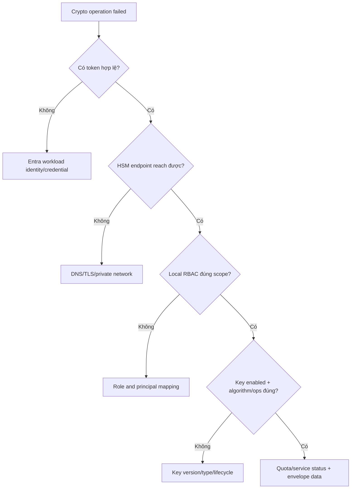

Không vì “không tạo được key” mà gán toàn pool Administrator cho application. Cần phân biệt operator, key officer, crypto user và recovery custodian đúng chức năng.

## 48. Checklist production: bảo vệ khóa chuyên dụng

### 48.1 Quyết định dịch vụ

- [ ] Đã có threat model và yêu cầu pháp lý/kiểm toán cụ thể cho HSM.
- [ ] Đã chứng minh Key Vault Standard/Premium không đáp ứng một yêu cầu bắt buộc nào, hoặc vì sao Managed HSM phù hợp hơn.
- [ ] Đã kiểm tra chứng chỉ/validation scope HSM và phiên bản/khu vực đang triển khai.
- [ ] Đã xác minh key types, padding, algorithms và key operations được hỗ trợ.
- [ ] Đã kiểm tra CMK integration thực tế nếu dùng khóa cho một dịch vụ Azure khác.
- [ ] Đã dự toán chi phí resource pool, crypto operations và DR.

### 48.2 IAM và key lifecycle

- [ ] Phân tách Azure ARM control plane và Managed HSM local data-plane RBAC.
- [ ] Managed HSM Administrator, Key Officer, Crypto User, Audit và Recovery Custodian không bị hợp nhất tùy tiện.
- [ ] Có scope per key và least-privilege data actions cho ứng dụng.
- [ ] Workload dùng managed/workload identity, không có long-lived secret trong source.
- [ ] Có inventory key name/owner/purpose/version/key operations/expiry.
- [ ] Có quy trình generate/import/BYOK và duyệt signing key.
- [ ] Có rotation plan và kiểm chứng historical decrypt trước retire/purge.
- [ ] Có emergency revoke/disable plan mà vẫn cân nhắc business availability.

### 48.3 Security domain và DR

- [ ] Security domain đã được khởi tạo với quorum hợp lệ.
- [ ] Recovery private keys giữ độc lập, không lưu chung cùng artifact/quyền.
- [ ] Có custody owner, người thay thế và chứng cứ truy cập.
- [ ] Encrypted security-domain artifact tồn tại trong kho được phê duyệt.
- [ ] Có backup/restore runbook, backup retention và compatibility review.
- [ ] Đã test restore bằng test keys/test ciphertext.
- [ ] RTO/RPO cho HSM dependency và dữ liệu mã hóa được chấp thuận.
- [ ] Có recovery procedures khi một custodian/region/identity không khả dụng.

### 48.4 Crypto và ứng dụng

- [ ] Truy cập `sign/wrap/unwrap` đều có application authorization đúng nghiệp vụ.
- [ ] Ký tài liệu có hash/canonicalization/PKI/audit theo contract.
- [ ] Envelope encryption dùng nonce uniqueness, authenticated encryption và AAD.
- [ ] DEK plaintext không bị log, cache dài hạn hoặc gửi tới telemetry.
- [ ] Wrapped DEK + full key version ID được lưu nhất quán/atomically.
- [ ] Có recovery path cho lost response, ETag conflict và partial rewrap.
- [ ] Không xuất private key hoặc đặt fallback key trong source code khi HSM lỗi.
- [ ] Có mã hóa dữ liệu at rest và network/TLS theo chính sách riêng.

### 48.5 Network/monitoring/cost

- [ ] HSM endpoint, private DNS, route, TLS và Entra token path được kiểm thử.
- [ ] Azure HSM diagnostic settings và ARM activity logs hoạt động.
- [ ] Đã có alerts cho unauthorized crypto calls, key disable/expiry và quyền thay đổi.
- [ ] Có p95/p99 latency, error rate, throttling và key usage monitoring.
- [ ] Logs không chứa plaintext, DEK, security-domain artifact hoặc private keys.
- [ ] Có Cost Management budget và owner cho dedicated HSM pool.
- [ ] Đã load test operations/sec, retries và workload burst trong staging.
- [ ] Có rollback và incident runbook cho mất key/network/CMK integration.

## 49. Những hiểu nhầm phổ biến

**“Managed HSM là Key Vault Premium đổi tên.”** Không. Managed HSM là dịch vụ/pool có mô hình single-tenant, custody, local RBAC và security domain khác với Key Vault Premium.

**“Managed HSM lưu mọi API password, connection string và TLS certificate object.”** Không. Nó tập trung vào cryptographic keys/operations; secrets/certificates cần dịch vụ/quy trình phù hợp khác.

**“Chỉ vì dùng HSM nên chắc chắn đạt mọi yêu cầu PCI/FIPS.”** Không. Cần xác minh phạm vi chứng nhận, version và thiết kế ứng dụng/đơn vị vận hành.

**“Single-tenant nghĩa khách hàng trực tiếp quản lý OS/firmware HSM.”** Không. Microsoft quản lý phần cứng và hạ tầng theo dịch vụ.

**“ARM Owner tự động có quyền sign mọi key.”** Không. Quyền data plane Managed HSM dùng local RBAC riêng theo thiết kế.

**“Data-plane Crypto User có quyền xóa Managed HSM pool trên Azure.”** Không nên suy ra như vậy. Control plane và data-plane role khác nhau.

**“Có managed identity là khỏi cần Managed HSM local RBAC.”** Sai. Token xác thực caller; local RBAC quyết định operation.

**“Biết key URI là có thể decrypt.”** Không. Cần identity, key enabled, operations và network tương ứng.

**“Security domain là Entra tenant ID.”** Không. Đây là cơ chế cryptographic recovery đặc thù, không phải tên tenant.

**“Security domain có thể gửi file và password cho một admin để tiện DR.”** Vi phạm mục tiêu quorum/custody; phải phân tách các recovery keys và quyền.

**“Backup keys là đủ, không cần security domain/quorum.”** Không theo recovery model Managed HSM khi quy trình khôi phục đòi hỏi cả hai.

**“Security domain chính là file private key plaintext của mọi KEK.”** Không. Đây là artifact/cơ chế recovery bảo vệ theo mô hình dịch vụ.

**“Soft delete thay thế backup và DR.”** Không. Nó không thay khôi phục vùng/thảm họa hoặc kiểm chứng decrypt lịch sử.

**“Purge luôn là cách cleanup lab nhanh nhất.”** Không. Retention/purge protection có constraints và xóa vĩnh viễn có thể phá dữ liệu.

**“RSA có thể encrypt trực tiếp file 2 GB.”** Không. RSA giới hạn input theo modulus/padding; dùng hybrid/envelope encryption.

**“EC-HSM signing key tự wrap AES key bằng RSA-OAEP.”** Không. Thuật toán/key type phải tương thích.

**“DEK nằm trong RAM app nên có Managed HSM là vô ích.”** Không. HSM vẫn bảo vệ master/KEK và giảm rủi ro extract private key, nhưng app memory là lớp cần bảo vệ riêng.

**“DEK không bao giờ rời HSM trong ví dụ wrap/unwrap Java.”** Sai. `unwrapKey` có thể trả DEK plaintext về JVM.

**“Xóa mảng byte[] bảo đảm mọi bản sao DEK đã biến mất khỏi Java memory.”** Không. JVM/JCE/GC có thể giữ bản sao.

**“AES-GCM có thể dùng lại nonce bất kỳ nếu dùng KEK trong HSM.”** Sai. Nonce uniqueness theo DEK là yêu cầu mật mã quan trọng.

**“Aad và tag không quan trọng nếu ciphertext đã encrypted.”** Sai. AAD/tag bảo vệ integrity/context; bỏ qua làm suy yếu authentication.

**“Có thể disable old key version ngay sau khi tạo new version.”** Không. Dữ liệu cũ có thể vẫn tham chiếu key cũ.

**“Tạo KEK V2 tự động rewrap mọi DEK từ V1.”** Không trong application envelope model; cần migration có kiểm chứng.

**“CMK ở một dịch vụ Azure có semantics giống app envelope encryption.”** Không. Service-managed CMK có giao thức và tính năng tích hợp riêng.

**“Mọi dịch vụ Azure chấp nhận Managed HSM key URI làm CMK.”** Không. Phải xác minh integration matrix/tier/region.

**“Managed HSM private endpoint khiến ứng dụng không cần Entra authentication.”** Không. Networking và IAM độc lập.

**“HSM key không export được nghĩa attacker không thể lạm dụng signing.”** Sai. Attacker chiếm identity có quyền sign vẫn có thể gọi sign.

**“Logs của HSM chứng minh người ký đã được trưởng phòng phê duyệt.”** Không. HSM audit cho biết caller/operation; business approval phải do ứng dụng ghi và enforce.

**“Backup succeeded đồng nghĩa DR guaranteed.”** Không. Cần artifact, quorum, target, permissions, network và restore test.

**“Khi HSM outage, có thể tạm ký bằng private key copy trong app.”** Cách đó thường phá yêu cầu non-exportable HSM key và cần tránh.

**“Một HSM pool không gọi API thì không tốn phí.”** Không thể mặc định. Dedicated resource có thể có base/capacity charge.

**“Dùng managed HSM sẽ tự giải quyết tất cả pháp lý về chữ ký điện tử.”** Không. Có PKI, trust anchors, certificate validity, timestamp, business approval, pháp lý và record retention riêng.

## 50. Câu hỏi tự kiểm tra

**Câu 1.** Azure Managed HSM dùng cho mục đích chính nào?

**Đáp án:** Quản lý cryptographic keys và key operations bằng HSM được quản lý trong pool single-tenant theo mô hình dịch vụ, phục vụ yêu cầu bảo vệ khóa chuyên dụng.

**Câu 2.** Vì sao không dùng Managed HSM làm secret store cho password database?

**Đáp án:** Managed HSM tập trung vào key operations, không thay Key Vault secrets/certificate object lifecycle.

**Câu 3.** Khi nào Key Vault Premium có thể đủ thay vì Managed HSM?

**Đáp án:** Khi cần HSM-backed keys nhưng không có yêu cầu bắt buộc về dedicated HSM pool, security-domain quorum hoặc custody model đặc thù.

**Câu 4.** “Single-tenant HSM” có nghĩa doanh nghiệp quản lý phần cứng trực tiếp không?

**Đáp án:** Không. HSM chuyên dụng theo isolation service; Microsoft vẫn vận hành hạ tầng theo contract.

**Câu 5.** ARM Owner và Managed HSM local Crypto User khác nhau như thế nào?

**Đáp án:** ARM Owner quản lý Azure resource control plane; local Crypto User được cấp quyền key operations data plane theo scope/role.

**Câu 6.** Managed identity có thay thế local RBAC không?

**Đáp án:** Không. Managed identity chứng minh principal; local RBAC quyết định phép toán mà principal được phép thực hiện.

**Câu 7.** Security domain giúp giải quyết vấn đề gì?

**Đáp án:** Là thành phần recovery/custody thiết yếu trong Managed HSM theo cơ chế của dịch vụ, phối hợp backup và quorum private materials.

**Câu 8.** Quorum làm giảm rủi ro gì?

**Đáp án:** Giảm khả năng một người đơn lẻ có thể thực hiện recovery không được phê duyệt; phân tách người giữ private recovery keys.

**Câu 9.** Vì sao không lưu encrypted security domain artifact với tất cả recovery private keys trong cùng một tài khoản?

**Đáp án:** Một tài khoản bị compromise có thể phá vỡ separation of duties/quorum custody.

**Câu 10.** Có backup key nhưng mất quorum materials thì sao?

**Đáp án:** Có thể không đáp ứng được điều kiện restore; cần bảo đảm cả backup, security domain và recovery private keys đều được bảo vệ/diễn tập.

**Câu 11.** KEK và DEK khác nhau thế nào?

**Đáp án:** DEK trực tiếp mã hóa dữ liệu; KEK bọc/bảo vệ DEK. Managed HSM thường bảo vệ KEK trong envelope design.

**Câu 12.** Vì sao không RSA-encrypt một tệp PDF 500 MB?

**Đáp án:** RSA bị giới hạn input size và không phải công cụ bulk data encryption; dùng AES-GCM và HSM wrap/unwrap DEK.

**Câu 13.** Khi Java gọi `unwrapKey`, DEK có ở đâu?

**Đáp án:** Có thể xuất hiện dưới dạng plaintext trong bộ nhớ Java caller, vì vậy cần runtime protection, zeroization best-effort và hạn chế cache/log.

**Câu 14.** Vì sao AES-GCM nonce phải độc nhất dưới cùng DEK?

**Đáp án:** Tái sử dụng nonce có thể phá confidentiality/integrity của GCM.

**Câu 15.** AAD có chức năng gì?

**Đáp án:** Ràng buộc bối cảnh không mã hóa (như tenant/object/version) vào authentication tag để phát hiện sai context/tampering.

**Câu 16.** Một key version mới có tự giải mã được DEK wrapped bằng version cũ không?

**Đáp án:** Không mặc định; phải lưu full versioned key ID và giữ version cũ hoặc rewrap có kiểm chứng.

**Câu 17.** Vì sao key rotation cần inventory số ciphertext còn dùng V1?

**Đáp án:** Nếu disable/purge V1 trước khi di chuyển xong, dữ liệu cũ có thể không unwrap được.

**Câu 18.** Sự khác nhau giữa generate key và BYOK?

**Đáp án:** Generate tạo key trong HSM; BYOK chuyển key có sẵn qua cơ chế secure import/transport được hỗ trợ và kiểm soát.

**Câu 19.** Ký số trên Managed HSM có tự chứng minh approver đã đồng ý nội dung hợp đồng không?

**Đáp án:** Không. Business authorization, canonicalization, signer identity/PKI, audit và quy trình pháp lý vẫn cần riêng.

**Câu 20.** Managed HSM có thể được dùng làm CMK cho mọi Azure service không?

**Đáp án:** Không. Cần xác minh từng service, tier, region, key types, encryption identity/permissions và network integration.

**Câu 21.** Private endpoint có thay thế Entra/local RBAC không?

**Đáp án:** Không. Private route không cấp data-plane crypto permission.

**Câu 22.** Vì sao một HSM `sign` operation thành công chưa đủ cho audit nghiệp vụ?

**Đáp án:** HSM biết authorized principal/operation, không biết approval workflow/document meaning nếu app không enforce/lưu evidence.

**Câu 23.** Phân biệt 401, 403 và timeout khi Java gọi Managed HSM.

**Đáp án:** 401 thường là xác thực/token; 403 có thể do local RBAC/network policy; timeout liên quan DNS/network/service/deadline. Phải kiểm tra cụ thể.

**Câu 24.** Vì sao ứng dụng chỉ cần wrap không nên có quyền delete key?

**Đáp án:** Least privilege giảm blast radius khi workload identity bị compromise.

**Câu 25.** Khi Managed HSM region không khả dụng, cần những tài sản nào để DR?

**Đáp án:** Security domain/quorum, compatible backup, target, RBAC/network/IaC, dữ liệu mã hóa riêng và tested runbook.

**Câu 26.** RPO của ciphertext và RPO của HSM key backups có nhất thiết giống nhau không?

**Đáp án:** Không. Hai hệ thống backup độc lập; phải thiết kế sao cho dữ liệu được phục hồi vẫn có keys cần dùng.

**Câu 27.** Vì sao Managed HSM không thể ngăn ứng dụng vô tình log plaintext invoice?

**Đáp án:** Sau khi app decrypt/nhận plaintext, việc bảo vệ bộ nhớ/log là trách nhiệm runtime/application.

**Câu 28.** Có thể dùng `Arrays.fill(dek, 0)` để đảm bảo không còn DEK trong bộ nhớ JVM không?

**Đáp án:** Không hoàn toàn. Nó chỉ xóa mảng cụ thể, JVM/JCE có thể có bản sao.

**Câu 29.** Khi dự toán Managed HSM cần tính những khoản nào ngoài số key?

**Đáp án:** Pool/base capacity, operations, network/private endpoint, backup/recovery, logs, application compute, DR và quản trị bảo mật theo giá hiện hành.

**Câu 30.** Trước khi khai báo hệ thống đáp ứng yêu cầu bảo vệ khóa chuyên dụng, phải xác minh những gì?

**Đáp án:** Threat model, certification scope, key type/algorithm, IAM local RBAC, security-domain quorum, backup/restore test, network, lifecycle/rotation, audit và chi phí.

## 51. Bài tập tình huống tổng hợp

**Đề bài:** Một nền tảng tài chính trên Azure có ba yêu cầu:

1. Ký xác nhận chi trả bằng private key không exportable.
2. Mã hóa bản sao kê PDF có thể dài 20 MB và lưu ở Azure Blob Storage.
3. Dịch vụ thanh toán chạy trên AKS cần chạy được khi DevOps không có quyền sử dụng private signing key.

Hệ thống có Microsoft Entra ID, Managed HSM pool được security officers quản trị, Azure Storage và Cosmos DB; dữ liệu giao dịch chứa PII nên không được ghi vào telemetry. Doanh nghiệp đặt mục tiêu khôi phục trong một khoảng thời gian được phê duyệt và kiểm toán cả key lifecycle.

### Hãy thiết kế

1. Đặt tên và phân loại signing key/KEK/DEK theo mục đích.
2. Chọn khi nào dùng Key Vault secrets/certificates và khi nào Managed HSM.
3. Xây role matrix cho platform operator, security officer, crypto workload, auditor và recovery custodian.
4. Thiết kế security-domain quorum, backup custody và diễn tập khôi phục.
5. Vẽ flow ký tài liệu và lưu chứng cứ approval/hash/version.
6. Vẽ flow envelope encryption AES-GCM + RSA-HSM KEK.
7. Mô tả envelope metadata bắt buộc cho restore sau 5 năm.
8. Xác định cách quản lý tenant-specific AAD và app authorization.
9. Thiết kế private network, DNS, AKS workload identity và Managed HSM local RBAC.
10. Lập kế hoạch rotate key mỗi kỳ chính sách và historical DEK rewrap.
11. Xác định SLI/alert cho sign/unwrap, denied operations và key disable.
12. Xây runbook khi key bị disable nhầm, pool outage hoặc một custodian mất recovery private key.
13. Đưa ra kế hoạch DR có key version verification và storage ciphertext restore.
14. Ước lượng operations/sec dựa trên số giao dịch/đọc hóa đơn.
15. Nêu một trường hợp **không** nên dùng Managed HSM dù doanh nghiệp đang có pool.

### Kiến trúc gợi ý

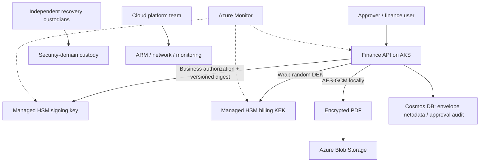

### Một lời giải theo trách nhiệm

| Thành phần | Thiết kế chính |
|---|---|
| Signing key | RSA-HSM hoặc EC-HSM với thuật toán ký được duyệt; workload chỉ `sign` |
| Encryption KEK | RSA-HSM KEK cho `wrap/unwrap`, scope riêng |
| DEK | Sinh mỗi document, AES-GCM, không lưu plaintext DEK |
| Envelope | Lưu ciphertext/tag/nonce/AAD/wrappedDEK/algorithm/full key version |
| App identity | AKS workload identity hoặc managed identity theo môi trường |
| IAM | Local RBAC per key; separate ARM admins và security-domain custodians |
| Certificate/PKI | Quản lý public trust/signature validation riêng theo nhu cầu |
| Approvals | Business API kiểm tra signer, value threshold, tenant và audit |
| Monitoring | Crypto outcomes/latency, denied calls, key lifecycle/role changes |
| DR | Quorum + security domain artifact + backups + target + restored test decrypt |
| Cost | Dedicated pool, crypto operations, network, Storage, logs và DR |

### Tình huống quan trọng

Khi App Service/AKS nhận HTTP timeout sau `wrapKey`, có thể chỉ mất response trong lúc HSM đã thực hiện phép toán. Vì **wrap cùng DEK có thể tạo ciphertext khác theo thuật toán/randomness**, không tự coi bytewise equality của wrapped keys là bằng chứng idempotency. Ứng dụng cần dùng **logical document/operation ID, conditional persistence và sự nhất quán của envelope metadata**, không retry ghi thêm bản sao kê mới chỉ vì response mất.

## Tổng kết

**Azure Managed HSM** phù hợp khi tổ chức cần **quản lý cryptographic keys bằng HSM được quản lý trong pool chuyên dụng**, có yêu cầu rõ về **single-tenant isolation, non-exportable HSM-backed key operations, phân tách quyền và security-domain quorum recovery**. Dịch vụ này **không phải kho secrets/certificate objects thay thế toàn bộ Azure Key Vault**, và cũng không tự làm ứng dụng đáp ứng mọi chứng nhận tuân thủ.

Thiết kế đúng phải tách **Azure ARM control plane khỏi Managed HSM local data-plane RBAC**, bảo vệ managed/workload identities, security-domain artifact và private recovery keys độc lập, kiểm soát key generation/import/BYOK, signing, wrap/unwrap, **rotation và khả năng giải mã dữ liệu lịch sử**. Với dữ liệu lớn, sử dụng **envelope encryption: AES-GCM ở application data plane và Managed HSM-backed KEK để bảo vệ DEK**, đồng thời hiểu giới hạn bảo mật của plaintext trong JVM/runtime.

Trước production, hãy xác minh **key/algorithm support, CMK integration, private DNS/network, backup/restore, quorum, RTO/RPO, audit logging, p95/p99 crypto latency, quota và tổng chi phí**. Khi có change control, least privilege và restore drill có chứng cứ, Managed HSM trở thành một thành phần **bảo vệ khóa chuyên dụng có thể kiểm toán và phục hồi**, thay vì chỉ là một nơi cất khóa đắt tiền.
