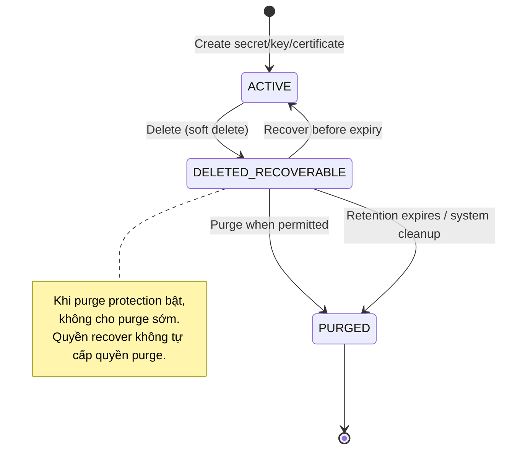
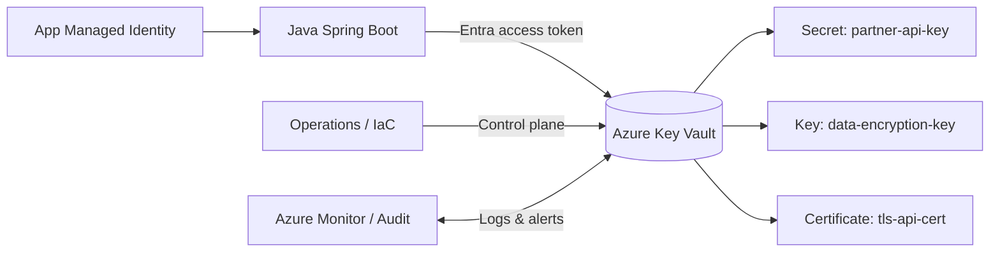
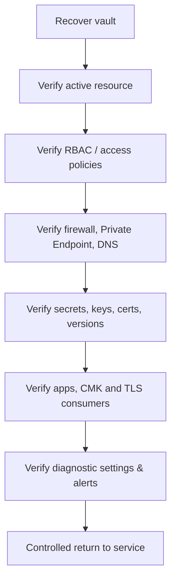
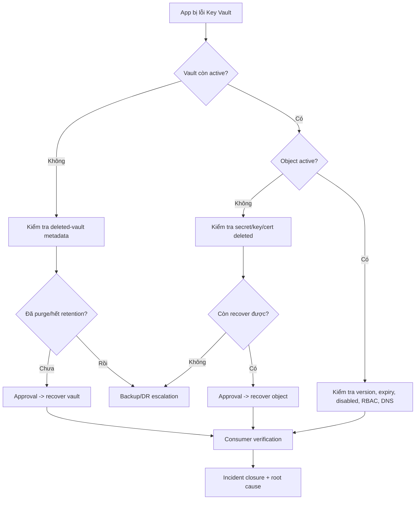

# Soft delete, purge protection và khôi phục Key Vault

Một ứng dụng Spring Boot chạy trên Azure App Service dùng **Azure Key Vault** để truy xuất secret kết nối đối tác, khóa dùng để mã hóa dữ liệu hoặc chứng chỉ TLS. Một thao tác xóa nhầm secret, một deployment IaC xóa sai vault hoặc một tài khoản quản trị bị chiếm quyền có thể khiến ứng dụng ngừng hoạt động, mất khả năng giải mã dữ liệu hoặc không còn chứng chỉ cần thiết. Trong các trường hợp đó, **xóa logic (soft delete)** và **chống xóa vĩnh viễn (purge protection)** là hai cơ chế quan trọng nhưng **không giống nhau**, cũng không thay thế backup, phân quyền và quy trình ứng cứu.

**Azure Key Vault** cung cấp môi trường lưu trữ và kiểm soát truy cập đối với **secrets, cryptographic keys và certificates**. Sau khi xóa một đối tượng hoặc xóa cả vault, tài nguyên có thể chuyển sang **trạng thái đã xóa nhưng còn khôi phục được** trong thời hạn lưu giữ. Một hành động **purge** là xóa vĩnh viễn dữ liệu đã ở trạng thái soft-deleted khi policy cho phép. **Purge protection** ngăn hành động purge trước khi hết thời hạn lưu giữ đã cấu hình. Trong một sự cố thật, bảo vệ này quyết định liệu thao tác của quản trị viên hoặc kẻ tấn công có thể khiến dữ liệu mất vĩnh viễn ngay lập tức hay không.

Bài học thuộc chương **Secret, khóa và chứng chỉ** của mô-đun `CLOUD_PROVIDERS_AZURE`, trong phạm vi khám phá Azure subscription, resource group, Microsoft Entra ID, mạng, compute, dữ liệu, giám sát, bảo mật và kiểm soát chi phí. Mục tiêu là thiết kế **khả năng phục hồi cho Key Vault**, thực hiện chẩn đoán/xem trạng thái đúng quyền, biết khi nào khôi phục **secret/key/certificate** hoặc **cả vault**, và đưa ra các quy tắc ngăn xóa không thể hoàn tác.

> **Phạm vi và an toàn:** Bài tập trung vào **Azure Key Vault (vault)**, không coi mọi thuộc tính giống hệt **Managed HSM**, Azure App Configuration hoặc một secret store khác. Tên lệnh, yêu cầu role, capability và quy tắc API có thể khác nhau theo phiên bản Azure CLI, SDK và mô hình RBAC/access policy. Ví dụ có đường dẫn/tên giả, không thực thi trên production. Các thao tác `purge`, xóa vault và bật purge protection **có hậu quả nghiêm trọng hoặc không thể hoàn tác**; chỉ thực hiện theo change management có phê duyệt trên môi trường đích.

## Mục tiêu học tập

Sau bài học, bạn có thể:

1. Giải thích các trạng thái **active, soft-deleted, recovered và purged** của vault hoặc đối tượng.
2. Phân biệt **soft delete**, **purge protection**, **retention period**, **backup/restore** và **business continuity**.
3. Hiểu những lựa chọn có tính **bất biến/không thể hoàn tác** và khi nào cần phê duyệt.
4. Phân biệt **xóa cả vault** với **xóa một secret, key hoặc certificate**.
5. Kiểm tra khả năng bảo vệ và danh sách tài nguyên đã xóa bằng Azure Portal/CLI theo quyền được cấp.
6. Xây runbook **khôi phục secret/key/certificate**, xác minh version, quyền và phụ thuộc.
7. Xây runbook **khôi phục một vault đã soft-delete**, xử lý xung đột tên và tài nguyên phụ thuộc.
8. Hiểu các yêu cầu Azure RBAC/data plane, Key Vault access policy, separation of duties và purge permissions.
9. Thiết kế hạ tầng bằng IaC, Azure Policy, resource locks và giám sát/audit để giảm xóa nhầm.
10. Đánh giá sự cố làm mất khóa mã hóa, secret cấu hình, chứng chỉ, hoặc nguồn tham chiếu từ App Service.
11. Kiểm thử phục hồi bằng dữ liệu giả và ghi bằng chứng về **RTO/RPO, thời hạn, rủi ro và chi phí**.
12. Viết checklist production cho Azure Key Vault trong kiến trúc ứng dụng Java/Spring Boot.

## 1. Phân biệt xóa logic, purge và khôi phục

### 1.1. Các định nghĩa cốt lõi

| Khái niệm | Bản chất | Điều cần nhớ |
|---|---|---|
| **Soft delete** | Giữ tài nguyên/đối tượng đã xóa ở trạng thái có thể khôi phục trong retention period. | Dữ liệu không tự trở thành active; ứng dụng có thể bị lỗi cho tới khi recover. |
| **Retention period** | Thời hạn giữ dữ liệu đã xóa trước khi đủ điều kiện xóa hẳn theo policy. | Không đồng nghĩa thời gian lưu version/backup hoặc SLA khôi phục. |
| **Recover** | Khôi phục một đối tượng/vault từ trạng thái soft-deleted thành tài nguyên hoạt động khi hợp lệ. | Cần đúng quyền, danh tính, subscription/region và trạng thái đủ điều kiện. |
| **Purge** | Xóa vĩnh viễn đối tượng/vault đã soft-delete khi policy cho phép. | Không thể coi là thao tác reversible; recovery thông thường sẽ không còn. |
| **Purge protection** | Cấm purge trước khi retention period kết thúc, kể cả với người có quyền purge. | Khi đã bật thì không thể tắt theo cơ chế Key Vault hiện hành. |
| **Backup/restore** | Sao lưu/khôi phục riêng theo tính năng và giới hạn của Key Vault. | Không thể giả định backup tồn tại chỉ vì soft delete được bật. |
| **Versioning** | Secrets/keys/certificates có lịch sử phiên bản theo loại và operation. | Xóa đối tượng theo name khác việc chọn version cũ; cần kiểm tra trạng thái cụ thể. |
| **Resource lock** | Control-plane guardrail ngăn một số thao tác quản lý resource. | Không thay thế purge protection, data-plane access control hoặc backup. |

**Thông điệp quan trọng:** *Soft delete cho bạn cơ hội khôi phục; purge protection bảo vệ cơ hội đó khỏi một hành động purge sớm.* Hai chức năng giải quyết hai nguy cơ khác nhau.

### 1.2. Trạng thái của một đối tượng



Đây là **sơ đồ logic**, không phải cam kết mọi object có cùng operation, trạng thái API hay thời gian thực thi cleanup. Một số hành động có thể thất bại nếu object đã được khôi phục, bị ràng buộc bởi trạng thái vault, quyền hoặc bản thân retention đã kết thúc.

### 1.3. Trạng thái của một vault

```text
ACTIVE VAULT
  ├─ Có thể chứa secrets, keys, certificates, versions, policies.
  └─ Delete vault:
       ↓
SOFT-DELETED VAULT
  ├─ Vault chưa thể phục vụ các request như trước.
  ├─ Tên vault có thể vẫn bị giữ dành riêng.
  ├─ Có thể recover khi còn retention và policy cho phép.
  └─ Purge chỉ khả thi nếu không bị purge protection/retention chặn.
       ↓
RECOVERED VAULT
  ├─ Kiểm tra objects/versions còn đầy đủ.
  ├─ Kiểm tra RBAC/role assignments, policies, Event Grid, network/DNS.
  └─ Kiểm tra từng ứng dụng dùng vault trước khi kết luận phục hồi.
```

**Khôi phục vault không đồng nghĩa khôi phục toàn bộ hệ sinh thái Azure liên quan.** Các resources độc lập như role assignments, Event Grid subscriptions, private endpoints, DNS entries hoặc App Service configuration cần được kiểm tra và có thể phải tạo/cấu hình lại theo runbook.

## 2. Hai mức xóa: vault và từng đối tượng

### 2.1. Xóa một secret/key/certificate

Một vault đang hoạt động có thể chứa:

```text
vault: kv-payments-prod
  secret: partner-api-key
  secret: database-password
  key:    encryption-key
  cert:   api-tls-certificate
```

Nếu `partner-api-key` bị xóa logic:

- Vault vẫn tồn tại và có thể phục vụ các đối tượng khác.
- Phiên bản active của secret bị xóa không còn truy xuất bằng lệnh `get secret` thông thường.
- Secret ở trạng thái deleted có thể được liệt kê/khôi phục khi đúng quyền.
- Ứng dụng đang lấy secret theo name có thể nhận lỗi; cache giá trị cũ có thể khiến lỗi **chưa xuất hiện ngay**.
- Tên secret đó có thể bị giữ cho đối tượng đã xóa, cản trở tạo mới bằng cùng tên cho tới khi recover hoặc purge hợp lệ.

**Đừng xử lý bằng cách tạo một secret mới cùng tên mà bỏ qua trạng thái soft-deleted.** Trước tiên phải kiểm tra deleted objects và quyết định recover hay thay thế theo quy trình được duyệt.

### 2.2. Xóa cả vault

Nếu xóa vault:

- Cả namespace và các đối tượng bên trong trở nên không khả dụng cho workload.
- Vault có thể xuất hiện trong danh sách deleted vaults theo subscription/location.
- Tên Key Vault có thể không thể tái sử dụng cho vault mới khi vẫn soft-deleted.
- Recovery phải thực hiện **ở mức resource**, không phải chỉ `az keyvault secret recover`.
- Các tích hợp chạy qua URI của vault sẽ gặp lỗi cho tới khi vault hoạt động lại và đường truy cập/permission được xác minh.

Đừng suy từ một lỗi `SecretNotFound` rằng vault bị xóa; có thể do **tên secret sai, phiên bản không tồn tại, soft delete, sai vault URI, thiếu quyền hoặc lỗi mạng**. Chẩn đoán trạng thái vault trước.

### 2.3. “Deleted secret trong vault active” khác “secret thuộc vault đã xóa”

| Câu hỏi | Vault active, object deleted | Vault đã soft-deleted |
|---|---|---|
| Có thể liệt kê objects hoạt động? | Có, nếu principal có quyền và vault reachable. | Không dùng vault như active resource. |
| Phạm vi recovery | Một secret/key/cert theo name. | Trước hết recovery ở cấp vault. |
| CLI chính | `az keyvault secret/key/certificate ...` | `az keyvault list-deleted / recover ...` |
| Ảnh hưởng | Có thể chỉ một workload/secret lỗi. | Có thể ảnh hưởng toàn bộ workloads trỏ tới vault. |
| Rủi ro tên | Name của object chưa thể sử dụng như object mới. | Name vault có thể chưa được dùng lại. |
| Việc cần xác minh sau recovery | Versions, permissions, consumers. | Tất cả objects + RBAC/network/dependencies. |

## 3. Soft delete: phạm vi bảo vệ và thời hạn lưu giữ

### 3.1. Cấu hình retention

Với Azure Key Vault hiện đại, **soft delete là cơ chế mặc định/bắt buộc đối với vault mới**, và retention period thường được lựa chọn trong khoảng **7–90 ngày** theo quy định/tính năng hiện hành; mặc định mới thường là **90 ngày** nếu không chọn khác. Cần xác nhận trên **loại vault, subscription, API version và Azure cloud cụ thể**.

**Đặc biệt:** `softDeleteRetentionInDays` là một lựa chọn quan trọng trong lúc **tạo vault**; sau khi vault được tạo, retention period nói chung **không thể điều chỉnh tùy ý**. Không tự giả định có thể đổi từ 7 sang 90 ngày cho một vault production đang vận hành để đáp ứng chính sách mới.

Ví dụ:

```text
Vault A: soft delete retention = 7 days
Vault B: soft delete retention = 90 days

Secret bị soft-delete lúc 10:00 UTC ngày D.

Trong retention window:
  - Có thể recover với điều kiện hợp lệ.
  - Có thể purge sớm hay không còn phụ thuộc purge protection.

Sau retention:
  - Không thể dựa vào soft delete để bảo đảm còn khả năng recover.
  - Cần bản backup/DR hợp lệ và quy trình riêng nếu có.
```

Không tính ngày theo cảm nhận địa phương; ghi **UTC timestamps** và đối chiếu `scheduledPurgeDate` hoặc thông tin service trả về. **Retention không phải RTO:** dù giữ được secret 90 ngày, người dùng vẫn phải có danh tính, quyền, URI, mạng và quy trình để phục hồi trong thời gian mục tiêu.

### 3.2. Điều gì được giữ và điều gì không được bảo đảm?

Soft delete có thể hỗ trợ recovery của đối tượng Key Vault hoặc vault đang ở trạng thái xóa logic, nhưng không phải phép sao lưu toàn bộ Azure infrastructure:

- Không tự khôi phục cấu hình của **App Service/AKS/Functions** đã bị xóa.
- Không tự khôi phục **database** đã mã hóa bằng key nếu DB backup/ciphertext cũng mất.
- Không đảm bảo role assignments, network objects hoặc Event Grid subscriptions độc lập trở lại chính xác nếu các resource đó cũng đã bị xóa.
- Không làm sai cấu hình ứng dụng trở nên đúng: URI/vault name/secret name và phiên bản vẫn phải được kiểm tra.
- Không bảo vệ khỏi việc **sửa nội dung một secret trước khi xóa**, hay lấy nhầm version, nếu không có version validation và audit.
- Không cho phép khôi phục sau **purge hợp lệ** chỉ bằng lệnh recover.

### 3.3. Secret, key, certificate và versions

Key Vault có **versioning theo đối tượng**, nhưng cần phân biệt:

- Khôi phục một **đối tượng theo tên** từ soft delete.
- Truy cập một **version cụ thể** của đối tượng còn hoạt động.
- Chọn version trong URI của ứng dụng, có thể khiến app bám vào một version cũ.
- Khôi phục **nội dung/khóa/chứng chỉ** cần thiết nhưng chưa chắc khôi phục consumer configuration.

Một ứng dụng tham chiếu `https://kv-payments-prod.vault.azure.net/secrets/partner-api-key/<version-id>` bị lỗi có thể do **version bị thu hồi/không tồn tại**, không phải soft delete của toàn secret. Không xóa rồi recover secret chỉ để “thử sửa” lỗi version. Hãy đọc trạng thái/diagnostics và đối chiếu source of truth.

## 4. Purge protection: giới hạn của quyền xóa vĩnh viễn

### 4.1. Purge khi chưa bật purge protection

Giả sử vault có soft delete nhưng **không** bật purge protection. Một principal có quyền purge phù hợp có thể thực hiện thao tác **xóa vĩnh viễn** một đối tượng hoặc vault đã ở trạng thái deleted, tùy quy tắc dịch vụ và resource state. Điều này tạo rủi ro:

- Người vận hành muốn “dọn tên vault” nhưng vô tình hủy cơ hội recover.
- Pipeline IaC hoặc script cleanup chạy sai subscription có thể xóa vĩnh viễn.
- Kẻ tấn công có quyền purge cố ý xóa cả vault và secrets/keys/certs.
- Nhân viên vội chữa lỗi bằng purge để tái tạo resource với cùng tên, làm mất dữ liệu có giá trị.

**Soft delete một mình chưa ngăn một người đủ quyền thực hiện purge sớm.**

### 4.2. Khi purge protection được bật

Khi **purge protection** được bật cho Azure Key Vault:

- Đối tượng/vault bị soft-delete được giữ trong thời gian retention đã định.
- Ngay cả người có quyền purge cũng **không thể purge sớm** khi protection còn hiệu lực.
- **Không thể tắt lại purge protection** sau khi bật theo cơ chế Key Vault hiện hành.
- Không có cách “nâng quyền admin một lần” để bỏ qua protection trong thời gian giữ, theo hợp đồng bảo vệ của dịch vụ.
- Khi hết retention, hệ thống có thể xóa dữ liệu đã xóa logic theo quy tắc lifecycle; **không coi protection là lưu trữ vĩnh viễn**.

Vì vậy việc bật purge protection giúp chống xóa vĩnh viễn do sai sót/kẻ tấn công, nhưng đồng thời làm **việc giải phóng tên và xóa dữ liệu theo yêu cầu ngay lập tức bị hạn chế** nếu đối tượng đã bị xóa. Cần kết hợp yêu cầu compliance, data deletion và DR từ **giai đoạn thiết kế vault**.

### 4.3. Bảng quyết định

| Tình huống | Soft delete | Purge protection | Kết quả kỳ vọng |
|---|---|---|---|
| Xóa nhầm secret, muốn recover | Bật | Bất kỳ | Có cơ hội recover trong retention, với quyền hợp lệ. |
| Kẻ tấn công có quyền purge và secret đã deleted | Bật | Tắt | Có thể làm mất vĩnh viễn nếu purge được phép. |
| Kẻ tấn công có quyền purge nhưng retention chưa hết | Bật | **Bật** | Không purge sớm; cần ngăn tiếp tục tác động và recover. |
| Muốn tái sử dụng vault name ngay sau xóa | Bật | Bật | Có thể không khả thi do name reservation/retention. |
| Muốn sửa `softDeleteRetentionInDays` sau khi tạo | Bật | Bất kỳ | Không trông chờ đổi được; cần chiến lược migration. |
| Hết retention khi resource đã deleted | Bật | Bật | Không dựa vào recover; cần backup/DR phù hợp. |

### 4.4. Purge protection không phải “bảo vệ khỏi mọi thay đổi”

Purge protection **không chặn** những việc sau:

- Principal có quyền vẫn có thể **xóa logic** object/vault; ứng dụng vẫn bị downtime.
- Principal có quyền có thể **thay đổi secret value/rotate key** theo API được cho phép.
- Secret hết hạn, certificate expiry, consumer deployment lỗi hoặc TLS trust lỗi vẫn xảy ra.
- Quản trị viên có thể vô tình **xóa private endpoint hoặc role assignment** không thuộc chính vault.
- Ciphertext hoặc database bên ngoài Key Vault vẫn có thể bị xóa nếu backup không có.
- Các vấn đề availability/region/service health vẫn có thể ảnh hưởng phục vụ.

Cần phối hợp với Azure RBAC, Microsoft Entra ID/PIM, Azure Policy, Azure resource locks, backup/DR, monitoring và vận hành ứng dụng.

## 5. Mô hình trách nhiệm và đường đi của một sự cố

Giả sử một ứng dụng Java dùng `DefaultAzureCredential` và Key Vault SecretClient:



Có ít nhất ba mối quan tâm:

1. **Ứng dụng (data plane):** có đọc được secret/decrypt bằng key hay không?
2. **Quản trị (control plane):** vault có đang active, đã bị xóa hay đang trong recovery?
3. **Phục hồi:** có được phép recover object/vault và còn retention, identity, endpoint, DNS, role assignments không?

**Lỗi 403** thường liên quan quyền/policy/firewall; **lỗi 404** có thể do object không tồn tại, đã deleted hoặc URI sai; **lỗi timeout** có thể do mạng. Không được chẩn đoán vault bị xóa chỉ từ một HTTP status duy nhất. Kiểm tra Azure resource status và deleted objects theo đúng phân quyền.
## 6. Thiết kế chính sách bảo vệ trước khi tạo Key Vault

### 6.1. Các quyết định không nên để mặc định mà không đánh giá

Trước khi tạo một vault, đội nền tảng cần xác định **subscription, tenant, resource group, region, data classification, retention period, purge protection, permission model và RTO/RPO**. Nếu vault chứa key để giải mã database hoặc account storage, mất key có thể khiến ciphertext còn nguyên nhưng dữ liệu không thể đọc được. Nếu vault chỉ chứa một API token có thể cấp lại, chiến lược khôi phục có thể đơn giản hơn.

**Retention 7–90 ngày** là lựa chọn cần xem xét khi tạo vault mới theo khả năng Azure Key Vault hiện hành, với mặc định thông thường là **90 ngày**. Giá trị retention nói chung **không thay đổi được sau khi vault được tạo**; hãy coi đó là quyết định kiến trúc và kiểm tra trên API/region cụ thể. **Purge protection khi bật không thể tắt**, nên phải có owner chấp thuận trước khi kích hoạt trên vault có dữ liệu hoặc quy trình xóa đặc biệt.

### 6.2. Ví dụ Bicep tạo một vault mới

```bicep
@description('Tên Key Vault duy nhất theo quy tắc Azure.')
param vaultName string

@description('Azure region đã được phê duyệt.')
param location string = resourceGroup().location

resource vault 'Microsoft.KeyVault/vaults@2023-07-01' = {
  name: vaultName
  location: location
  properties: {
    tenantId: subscription().tenantId
    sku: {
      family: 'A'
      name: 'standard'
    }
    enableRbacAuthorization: true
    enableSoftDelete: true
    softDeleteRetentionInDays: 90
    enablePurgeProtection: true
    publicNetworkAccess: 'Disabled'
  }
}

output keyVaultName string = vault.name
```

**Chỉ là mẫu IaC để học**, không phải cấu hình production hoàn chỉnh hoặc cam kết API version hỗ trợ mọi thuộc tính trong mọi cloud. Khi `publicNetworkAccess: 'Disabled'`, ứng dụng phải có **Private Endpoint/Private DNS/VNet routing** phù hợp; nếu thiếu, vault có thể không truy cập được dù RBAC đúng. Cần bổ sung role assignments, diagnostic settings, alerts, tags và chính sách phù hợp. Không áp IaC này lên một vault đang chạy mà chưa xem **change plan**: retention và purge protection có giới hạn không thể đảo ngược.

### 6.3. Nếu retention hiện tại không đáp ứng compliance

Nếu vault đã tạo với 7 ngày nhưng chính sách mới yêu cầu 90 ngày, không tự giả định có thể dùng lệnh `update --retention-days` trên vault đó. Hãy đánh giá **migration sang vault mới** với đúng policy ngay từ lúc tạo. Migration secrets khác với migration cryptographic keys không exportable; chuyển vault mà **không giữ đúng key material/versions** có thể khiến dữ liệu đã mã hóa không còn giải mã được. Phải kiểm thử migration/cutover trước khi xóa vault cũ.

## 7. Azure CLI: kiểm tra trạng thái, không thay đổi tài nguyên

Các ví dụ dưới đây **chỉ đọc metadata**. Người chạy phải có đúng quyền và đăng nhập tenant/subscription được phê duyệt.

```bash
az login --tenant "<tenant-id>"
az account set --subscription "<subscription-id>"

VAULT="kv-recovery-lab"
RG="rg-keyvault-lab"

# Xem vault hiện hoạt và các thuộc tính bảo vệ.
az keyvault show \
  --name "$VAULT" \
  --resource-group "$RG" \
  --query "{name:name,location:location,softDelete:properties.enableSoftDelete,purgeProtection:properties.enablePurgeProtection,retentionDays:properties.softDeleteRetentionInDays}" \
  -o json

# Tìm các vault đã soft-delete trong phạm vi nhìn thấy.
az keyvault list-deleted -o table
```

Tên đường dẫn trong biểu thức JMESPath/JSON có thể phụ thuộc biểu diễn của phiên bản CLI. Nếu query trả `null`, xem output gốc `az keyvault show -o json` và trợ giúp CLI, **không kết luận ngay purge protection bị tắt**. `list-deleted` trống không chứng minh không có deleted vault nếu người dùng ở sai subscription hoặc thiếu quyền.

### 7.1. Đối tượng đã xóa trong một vault còn hoạt động

```bash
VAULT="kv-recovery-lab"

az keyvault secret list-deleted --vault-name "$VAULT" -o table
az keyvault key list-deleted --vault-name "$VAULT" -o table
az keyvault certificate list-deleted --vault-name "$VAULT" -o table
```

Đây là các thao tác **data-plane**. Một role `Reader` quản trị resource group không tự trao quyền liệt kê deleted secrets/keys/certificates. Cần xác minh mô hình **Azure RBAC** hoặc **access policy** của vault.

### 7.2. Xác minh một deleted secret theo name

```bash
az keyvault secret show-deleted \
  --vault-name "kv-recovery-lab" \
  --name "partner-api-key" \
  -o json
```

Kết quả theo API version có thể bao gồm thông tin **deleted date** và **scheduled purge date**. Không ước lượng recovery deadline chỉ bằng `now + 90 days` nếu retention của vault khác hoặc timestamp xóa không đúng. Nếu lệnh không trả ra đối tượng, có thể do name sai, secret chưa từng bị xóa, đã recover, đã purge, hết thời hạn hoặc người dùng thiếu quyền.

### 7.3. Phân biệt object-level và vault-level inspect

| Tình huống | Nhóm lệnh | Điều phải kiểm tra |
|---|---|---|
| Vault hoạt động, secret mất | `az keyvault secret show-deleted/list-deleted` | Name, version/retention và quyền data plane. |
| Vault hoạt động, key mất | `az keyvault key show-deleted/list-deleted` | Key name, key ID/version, crypto consumers. |
| Vault hoạt động, cert mất | `az keyvault certificate show-deleted/list-deleted` | Certificate policy, chain/version. |
| Không còn vault active | `az keyvault list-deleted` và management metadata | Subscription, location, vault name, resource group. |

Đừng chạy `az keyvault recover` khi chỉ một secret bị xóa; đừng chạy `az keyvault secret recover` khi cả vault đã biến mất.

## 8. Runbook khôi phục một secret

Giả sử ứng dụng Spring Boot dùng `SecretClient.getSecret("partner-api-key")` trên `kv-recovery-lab`, và request bắt đầu lỗi sau khi có hoạt động quản trị.

### 8.1. Kiểm chứng trước khi phục hồi

1. Xác định vault URI, environment, subscription, tenant, người sở hữu secret và thời điểm phát hiện lỗi.
2. Chẩn đoán **403/404/timeout**; loại trừ sai URI, RBAC, Private DNS, Key Vault firewall và secret version bị chỉ định nhầm.
3. Dừng automation/delete script gây lỗi, tránh có actor khác tiếp tục thay đổi.
4. Kiểm tra vault active và deleted secret thật sự tồn tại bằng lệnh read-only.
5. Xem scheduled purge time, trạng thái purge protection và xác nhận vẫn còn retention.
6. Yêu cầu approval từ owner, dùng principal có quyền **recover**, không tự thêm quyền purge.
7. Lập kế hoạch smoke test/rollback và theo dõi.

### 8.2. Recover secret — thao tác thay đổi trạng thái

```bash
# CHỈ chạy trong lab hoặc incident có approval, đúng vault/secret name.
az keyvault secret recover \
  --vault-name "kv-recovery-lab" \
  --name "partner-api-key"
```

Không chạy nhiều operator cùng lúc. Lệnh thành công không có nghĩa ứng dụng đã tự dùng đúng secret value; còn phải kiểm tra version, `enabled`, expiry, access policy, managed identity và Key Vault reference cache.

### 8.3. Chỉ kiểm tra metadata sau recover

```bash
# Không đưa secret value vào output/log.
az keyvault secret show \
  --vault-name "kv-recovery-lab" \
  --name "partner-api-key" \
  --query "{id:id,enabled:attributes.enabled,expires:attributes.expires,notBefore:attributes.notBefore}" \
  -o json
```

Trong production cần thêm **smoke test từ ứng dụng thật** dùng MI/TokenCredential, không sử dụng operator credentials để chứng minh app đã được cấp quyền. Nếu secret từng bị lộ, **recover không thay thế rotation**; cần cấp credential mới cho bên thứ ba và cập nhật consumers.

### 8.4. Không thể tạo secret mới cùng tên?

Một secret đang soft-deleted có thể vẫn giữ tên, ngăn tạo object active cùng tên. **Không purge để “dọn tên”** trước khi biết secret có vai trò gì, vì purge là mất vĩnh viễn khi được phép. Ưu tiên recover nếu phù hợp; nếu cần đổi tên, thiết kế cutover rõ ràng, không tự xóa secret cũ chỉ để tránh conflict.

## 9. Runbook khôi phục cryptographic key

Key Vault keys có thể là thành phần của **customer-managed encryption keys (CMK)**, key wrapping, signing hoặc application encryption. Mất key có thể làm data-plane ciphertext trở thành **không đọc được** ngay cả khi Blob/SQL backup vẫn còn.

```bash
# Read-only: xác minh deleted key.
az keyvault key show-deleted \
  --vault-name "kv-recovery-lab" \
  --name "data-encryption-key" \
  -o json

# STATE CHANGE: chỉ thực hiện sau approval.
az keyvault key recover \
  --vault-name "kv-recovery-lab" \
  --name "data-encryption-key"
```

Sau recover cần xác minh:

- Đúng **Key ID**, **key version** mà encrypted data/CMK integration cần.
- Key đang enabled, trong hạn và được phép thực hiện `wrapKey/unwrapKey/decrypt/sign` theo use case.
- Managed identity của workload/Storage/SQL có permission đối với key.
- Key Vault URI, versioned key URI và network truy cập đúng.
- Các ứng dụng/CMK services khôi phục được operation thực, không chỉ đọc metadata.
- Ciphertext, recovery points và backups nằm ở những hệ thống liên quan vẫn còn nguyên.

**Không thay thế key đã mất bằng key mới có cùng tên** rồi suy các dữ liệu đã mã hóa sẽ giải mã được. Key name không phải cryptographic material. Với keys không exportable hoặc HSM-backed, backup/migration có ràng buộc riêng; cần kiểm tra khả năng từ nguồn chính thức và policy của tài nguyên cụ thể.

## 10. Runbook khôi phục certificate

Một Key Vault certificate có thể liên quan tới certificate policy, các phiên bản, key material và secret representation theo cách tạo/import/issuer. Khi certificate bị xóa:

```bash
az keyvault certificate show-deleted \
  --vault-name "kv-recovery-lab" \
  --name "public-api-tls" \
  -o json

# STATE CHANGE: cần approval.
az keyvault certificate recover \
  --vault-name "kv-recovery-lab" \
  --name "public-api-tls"
```

Recovery chỉ là một phần công việc. Hãy kiểm tra **certificate chain, private key availability, expiry, SAN/subject, issuer/renewal policy**, và việc ứng dụng có thực sự **bind/synchronize** certificate đã khôi phục. Nếu CA đã revoke certificate, recover vào Key Vault **không làm CA bỏ trạng thái revoked**.

Với App Service certificate binding, Application Gateway/ingress hoặc TLS termination khác, cần xác minh **cơ chế sync, cache, identities và network**. Không giả định recover certificate xong là các proxy tự dùng đúng version ngay lập tức.

| Loại đối tượng | Smoke test sau recovery | Rủi ro nếu bỏ qua |
|---|---|---|
| Secret | App lấy được đúng phiên bản/giá trị kỳ vọng, theo quyền runtime. | Secret expired/sai quyền hoặc credential đã compromised. |
| Key | Workload thực hiện được phép toán crypto trên dữ liệu test hợp lệ. | Ciphertext không giải mã được do sai key/version. |
| Certificate | TLS chain/binding/expiry và access kiểm chứng. | TLS outage dù vault object đã active. |

## 11. Khôi phục toàn bộ Key Vault đã soft-delete

Khi **vault resource bị xóa**, không thể xử lý bằng `secret recover` trong khi vault chưa hoạt động.

### 11.1. Tiền kiểm

1. Xác minh chính xác **vault name, original location, resource group, subscription, tenant** và incident ID.
2. Dùng `az keyvault list-deleted` (read-only) tìm deleted vault và timestamp.
3. Xác nhận vẫn còn retention, đối tượng chưa bị purge và quyền **recover vault ở management plane** đã có.
4. Kiểm tra account/policy/IaC để tránh job đang xóa lại vault sau khi recover.
5. Lên kế hoạch kiểm tra **data-plane RBAC/access policies**, network và consumers sau recovery.

### 11.2. Recover vault — cần quyền và phê duyệt

```bash
# CHỈ sử dụng khi đúng deleted vault/region/resource group đã được duyệt.
az keyvault recover \
  --name "kv-recovery-lab" \
  --resource-group "rg-keyvault-lab" \
  --location "southeastasia"
```

Giá trị `southeastasia` chỉ là minh họa, **phải lấy region thật từ deleted vault metadata**. Lệnh có thể thất bại nếu location/scope sai, thiếu quyền, tên có xung đột hoặc đã hết retention. **Không** thay recover bằng `az keyvault create` để “tạo lại vault” khi tên vẫn được giữ; vault mới không tự mang key/secret/cert material cũ.

### 11.3. Kiểm tra sau recovery



**Khôi phục vault không đồng nghĩa toàn bộ tài nguyên tích hợp được khôi phục nguyên trạng.** Phải kiểm tra role assignments, Event Grid subscriptions, private endpoint connections, Private DNS records, resource locks, IaC state, Key Vault references trong App Service, và monitoring/alerts; một số là resources độc lập có thể cần tạo lại. Ngược lại, cũng không nên khẳng định mọi thứ đều bị mất: **đối chiếu thực trạng với baseline**.
### 11.4. Những dependency thường bị quên

| Dependency | Triệu chứng | Hành động xác minh |
|---|---|---|
| Azure RBAC assignments | App dùng MI nhận 403. | So principal ID/scope và role definition. |
| Vault access policies | SecretClient thiếu quyền get. | Kiểm tra model RBAC/access policy và permissions. |
| Private Endpoint / DNS | App timeout/dùng public endpoint bị chặn. | Kiểm tra approval, DNS/private IP, VNet routing. |
| App Service Key Vault references | Config value chưa cập nhật hoặc còn lỗi. | Reference status/cache và controlled refresh. |
| CMK in Storage/SQL | Dữ liệu mã hóa không mở được. | Key URI/version, wrap/unwrap, tenant/identity. |
| Certificate binding | TLS lỗi hoặc chứng chỉ cũ. | TLS chain/SNI/renewal/integration sync. |
| Event Grid subscriptions | Event handling không hoạt động. | Kiểm tra subscription, endpoint, filters và retries. |
| Diagnostics/alerts | Không còn telemetry. | Diagnostic settings, Azure Monitor và Log Analytics. |
| IaC/Policy/locks | Deployment tiếp tục xóa hoặc drift. | So state, reconcile đúng change request. |

## 12. Phân quyền recover, delete và purge: control plane khác data plane

Quyền của Key Vault không chỉ có một loại. Đội ứng cứu phải phân biệt **quản lý vault resource** qua Azure Resource Manager với **thao tác trên secrets/keys/certificates** qua Key Vault data plane.

### 12.1. Ma trận thao tác

| Đối tượng | Ví dụ thao tác | Quyền và mô hình cần kiểm tra |
|---|---|---|
| **Vault resource** | Tạo/xóa/khôi phục vault, thay cấu hình mạng. | Azure management-plane role/permissions tại subscription/resource group/resource phù hợp. |
| **Secret** | Get, list, set, delete, list deleted, recover, purge. | Azure Key Vault data-plane role hoặc vault access policy tương ứng. |
| **Key** | Get/list, sign/verify, wrap/unwrap, delete, recover, purge. | Data-plane permissions theo keys và operations. |
| **Certificate** | Get/list, import/create, manage issuer/policy, delete/recover/purge. | Permissions theo certificates và các đối tượng key/secret liên quan. |
| **Role assignments** | Tạo/cập nhật/xóa cấp quyền. | Quyền quản trị IAM riêng, không tự đi kèm mọi reader role. |
| **Private Endpoint/DNS** | Kết nối và phân giải địa chỉ vault. | Permissions trên network resources độc lập. |

Một operator có management-plane `Reader` có thể xem một số resource metadata nhưng **không mặc định đọc được giá trị secret**, càng không phải có quyền recover hoặc purge. Một principal có quyền recover secret **không tự có quyền recover một vault resource đã bị xóa**.

### 12.2. Azure RBAC so với vault access policy

Azure Key Vault có thể dùng:

- **Azure RBAC data-plane authorization** với built-in/custom roles được gán theo scope được hỗ trợ.
- **Legacy vault access policies** cho các operation trên secrets, keys, certificates theo cấu hình vault.

Ví dụ các vai trò có mục đích khác nhau:

| Role ví dụ | Mục đích chính | Cảnh báo |
|---|---|---|
| **Key Vault Secrets User** | Đọc giá trị secrets ở scope phù hợp. | Không mặc định được recover/purge. |
| **Key Vault Reader** | Đọc metadata của vault/objects theo quyền role. | Không đồng nghĩa xem được secret values. |
| **Key Vault Secrets Officer** | Quản trị các thao tác secret data plane theo role definition. | Quyền rộng; xác minh quyền delete/recover/purge thực tế. |
| **Key Vault Crypto Officer** | Quản lý operations/keys theo role definition. | Không cấp cho app chỉ cần unwrap một key. |
| **Key Vault Certificates Officer** | Quản lý certificates theo role definition. | Có thể ảnh hưởng certificate renewal/workflows. |
| **Key Vault Administrator** | Quyền data plane rất rộng. | Không cấp thường trực chỉ để recover một object. |
| **Key Vault Purge Operator** | Liên quan purge deleted objects theo role permissions. | Rủi ro không thể hoàn tác; tách người vận hành. |

**Tên role không thay thế review role definition và scope.** Azure RBAC/data-plane capabilities có thể thay đổi theo chính sách hoặc API; với vault dùng access policies phải kiểm tra đúng các permissions `recover` và `purge` theo loại đối tượng. Trong mô hình access policy, người có quyền quản lý policy có thể có đường nâng quyền data-plane nếu kiểm soát kém; đó là lý do nên xem xét Azure RBAC và separation of duties.

### 12.3. Thiết kế separation of duties

```text
Application Managed Identity:
    GET secret / unwrap key  (chỉ đúng resource/scope)
    Không DELETE, RECOVER, PURGE

Routine Operations:
    Đọc metadata và theo dõi alerts
    Không có quyền PURGE thường trực

Incident Recovery Operator:
    List deleted / Recover theo change ticket
    Thời hạn cấp quyền ngắn, có audit

Security/Purge Approver:
    Quy trình riêng cho xóa vĩnh viễn nếu được phép
    Hai bước xác minh resource name/tenant/subscription

IaC Deployment Identity:
    Quyền tạo/cấu hình resource có scope
    Không có job tự động PURGE như bước cleanup mặc định
```

Có thể sử dụng Microsoft Entra ID **Privileged Identity Management (PIM)**, approval và Conditional Access theo gói dịch vụ/quy định của tổ chức. Đừng đặt mọi quyền vào một principal chung chỉ vì quá trình dựng lab dễ hơn.

### 12.4. Quyền recovery không bảo đảm có thể đọc giá trị

Sau recover, operator có thể xác nhận object trở lại trạng thái active nhưng app vẫn nhận 403 vì MI của app thiếu data-plane role. Ngược lại, app có quyền đọc secret không nên được quyền xóa/purge. **Hai luồng authorization phải được kiểm chứng riêng.**

## 13. Purge là hành động phá hủy: khi nào không thực hiện?

Một yêu cầu “xóa hết vault này để dùng lại tên” không tự đủ căn cứ để purge. Trước khi cân nhắc bất kỳ thao tác xóa vĩnh viễn nào, phải trả lời:

1. Vault/object đang phục vụ **keys giải mã, CMK, secret đối tác, chứng chỉ hoặc pháp lý** nào?
2. Có **Azure services khác** dùng key URI hoặc certificate bản cũ không?
3. Dữ liệu được mã hóa có còn ciphertext/backups cần key đó không?
4. Có đang trong **legal hold, retention obligation, incident investigation** không?
5. Purge protection có đang bật và retention đã kết thúc chưa?
6. Có bản backup có thể restore **đúng cryptographic material** hay không; đã **diễn tập restore** thành công chưa?
7. Có owner và approver độc lập, change window và audit records không?
8. Có đúng **subscription, tenant, vault name, object name và location** không?

### 13.1. Cảnh báo về các lệnh purge

Các nhóm lệnh Azure CLI có thể cung cấp thao tác purge cho đối tượng và vault, chẳng hạn:

```text
# CHỈ NHẬN DIỆN CÚ PHÁP NHÓM LỆNH; KHÔNG CHẠY.
az keyvault secret purge      --vault-name <vault> --name <secret>
az keyvault key purge         --vault-name <vault> --name <key>
az keyvault certificate purge --vault-name <vault> --name <certificate>
az keyvault purge             --name <vault> --location <region>
```

Phần này **không phải runbook thực thi**; intentionally không cung cấp một script có thể chạy hàng loạt. Nếu purge protection đang bật, purge sớm không được phép dù người gọi có role phù hợp. Nếu protection không bật và purge được phép, thao tác có thể **xóa vĩnh viễn**. Hãy coi purge như một change phá hủy với kiểm tra hai người, không như cách sửa lỗi “ResourceAlreadyExists”.

### 13.2. Purge protection và yêu cầu xóa dữ liệu

Một tổ chức có thể đồng thời cần:

- Chống xóa sớm secrets/keys để bảo đảm khả năng phục hồi.
- Xóa dữ liệu cá nhân theo hạn định hoặc yêu cầu hợp lệ.
- Hạn chế lưu metadata/tên định danh nhạy cảm sau khi nghỉ dùng dịch vụ.

Nếu purge protection giữ deleted objects tới hết retention, chiến lược đáp ứng yêu cầu xóa phải được **thiết kế từ đầu**, không chỉ dựa vào nút purge. Phân loại nội dung cần xóa, hợp đồng/khung pháp lý, vùng lưu và retention của từng system. **Không khẳng định purge protection tự miễn trừ mọi nghĩa vụ pháp lý**; hãy hỏi security/compliance owner về policy áp dụng.

### 13.3. Khi bị khóa tên Key Vault

Một vault đang soft-deleted có thể giữ namespace name. Không thể giả định “xóa resource group rồi tạo vault lại tên cũ” sẽ giải phóng tên. Cần **recover đúng vault** nếu còn dữ liệu cần phục vụ; nếu xây vault mới bằng tên khác, phải đánh giá URI/cert/key migration và không thể coi đó là cùng resource identity. **Không purge chỉ để tạo mới** nếu dữ liệu còn phụ thuộc tên/key cũ.

## 14. Soft delete không thay thế backup và disaster recovery

### 14.1. Những loại mất mát khác nhau

| Rủi ro | Soft delete/purge protection hỗ trợ | Vẫn cần |
|---|---|---|
| Xóa nhầm một secret | Cơ hội recover nếu còn retention. | Owner/permission/monitoring, xác minh phiên bản. |
| Principal cố tình purge ngay | Purge protection chặn purge sớm. | Giảm quyền delete, incident response và audit. |
| Rotate sai secret value nhưng không xóa | Soft delete không tự đảo nội dung sai. | Version selection/rollback, source-of-truth và testing. |
| Certificate hết hạn | Không ngăn expiry. | Renewal/issuer monitoring và binding tests. |
| Key CMK bị disabled | Không tự enable key. | Kiểm tra key state/permissions và cryptographic operations. |
| Dữ liệu đã mã hóa bên ngoài vault bị xóa | Không bảo vệ ciphertext. | Backup/replication của database/Storage. |
| Vault/network/region không truy cập được | Dữ liệu có thể còn nhưng API lỗi. | Availability/DR, network runbooks, lựa chọn kiến trúc. |
| Vault hoặc object đã purge hợp lệ | Không còn recovery thông thường. | Backup hợp lệ nếu có, thiết kế tránh purge. |
| Resource ngoài vault bị xóa | Không tự khôi phục. | IaC, backups, dependencies inventory. |

### 14.2. Backup/restore secrets, keys và certificates

Azure Key Vault hỗ trợ những thao tác backup/restore **theo từng loại đối tượng và giới hạn dịch vụ**. Tuy nhiên:

- Không phải **raw secret string/certificate PEM export** mà có thể giả định thay thế mọi loại key/cert.
- Backup material có thể được bảo vệ theo cơ chế của Azure và có **ràng buộc về vault, subscription, geography, tenant hoặc key type**, tùy feature/loại đối tượng. Phải xác minh **tài nguyên cụ thể** và khả năng restore thực tế.
- Nếu một cryptographic key không exportable, không coi có thể sao chép private key ra file rồi nhập vào mọi Key Vault.
- Backup phải được quản lý **truy cập, encryption, retention, ownership**, và phải có **restore drill** để chứng minh có thể dùng.
- Backup/restore không tự bảo đảm App Service/Storage/SQL CMK integration sử dụng đúng key URI/version hoặc key material.
- Với Key Vault có cơ chế replication/service availability riêng, không suy mọi disaster recovery yêu cầu/có thể tạo một bản backup file rồi restore sang arbitrary region tức thì.

**Tối thiểu:** với các keys giữ vai trò giải mã dữ liệu lâu dài, phải thiết kế cách bảo toàn **khả năng thực hiện phép toán crypto trên ciphertext** sau DR, chứ không chỉ kiểm tra một Blob backup tồn tại.

### 14.3. RPO và RTO của Key Vault

- **RPO:** Được phép mất bao nhiêu thay đổi cuối cùng đối với secrets/keys/certificates/versions? Khi key/secret rotate, một bản backup cũ có còn phù hợp không?
- **RTO:** Sau sự cố, cần bao lâu để vault, permissions, private endpoint, DNS, app references và CMK consumers hoạt động trở lại?

Giả sử giữ soft-delete trong 90 ngày: điều đó **không có nghĩa RTO = 90 ngày**. RTO cần được đo bằng diễn tập; mục tiêu có thể là vài phút/giờ tùy ứng dụng và quy trình cấp quyền. Một vault được recover sau 5 phút nhưng App Service vẫn đọc sai secret trong 2 giờ chưa đạt RTO end-to-end.

### 14.4. Cơ chế dự phòng cho ứng dụng Java

Một ứng dụng dùng `DefaultAzureCredential` và Key Vault `SecretClient` nên:

- Không ghi secret vào log khi lỗi/troubleshooting.
- Reuse clients, cấu hình bounded retry cho **transient** 429/5xx/timeout; không retry mãi 403 do quyền hoặc deleted object.
- Kiểm tra secret version/expiry, phân biệt update/rotation với delete.
- Với cache, phải có TTL/refresh policy; cache không được coi là backup và không kéo dài secret sau revoke trái policy.
- Không tự fallback sang **environment secret/account key của admin** khi Key Vault lỗi.
- Với customer-managed encryption keys, kiểm thử khách hàng thực sự đọc/ghi dữ liệu được sau recover, không chỉ `get key` metadata.

## 15. Azure Policy, locks và IaC: ngăn xóa nhầm trước khi cần recover

### 15.1. Policy về purge protection

Trong phạm vi subscription/management group, có thể áp **Azure Policy** để audit/deny các vault không bật purge protection và/hoặc không tuân thủ những yêu cầu khác, theo policy definition được hỗ trợ. Hệ thống IaC (Bicep/Terraform/ARM) nên khai báo **enablePurgeProtection** và retention từ đầu.

**Đừng suy rằng một Azure Policy assignment sẽ tự thay đổi mọi vault đã tồn tại**, đặc biệt với properties bất biến. Policy có thể **audit hoặc deny** theo effect/definition; remediation phải được thiết kế và kiểm tra, không được tự xóa/recreate vault để đạt compliant state.

### 15.2. Resource locks không đồng nghĩa purge protection

Azure management locks như **CanNotDelete** (resource không bị xóa qua management plane theo scope) có thể giảm nguy cơ operator/IaC xóa cả vault. Nhưng:

- Không thay thế data-plane permission để xóa secret/key/certificate.
- Không thay thế purge protection.
- Người đủ quyền quản lý locks có thể có khả năng gỡ lock theo policy IAM.
- Lock có thể làm deployment/cleanup fail nếu pipeline không được thiết kế.

Dùng **locks để giảm xác suất xóa resource**, purge protection để giữ cơ hội phục hồi đối tượng/vault đã bị xóa, và RBAC/PIM để giảm quyền gây hại. Ba lớp bổ sung cho nhau.

### 15.3. IaC cần bảo vệ khỏi xóa ngoài dự kiến

Một PR thay đổi Terraform/Bicep có thể khiến vault bị thay thế khi thay thuộc tính không tương thích. Trước khi apply:

1. Xem **change plan/what-if**.
2. Kiểm tra có thao tác `Delete`, `Replace`, `Purge` hoặc resource name/region drift không.
3. Bảo vệ state, branch/release approvals và phân quyền deploy.
4. Xác định migration/backup/restore khi cần thay vault.
5. Ngăn pipeline cleanup tự purge các deleted vaults ngay sau test.
6. Sử dụng environment-specific names và isolation, tránh reuse production vault trong integration tests.
7. Khi rollback, **không mặc định hạ phiên bản IaC có thể tắt purge protection**.

### 15.4. Quyền control-plane có thể nguy hiểm dù không đọc được secrets

Một identity có quyền quản lý vault resource nhưng không có quyền xem secret values vẫn có thể **xóa cả vault hoặc thay đổi policy/network** nếu management privileges quá rộng. Ngược lại, data-plane officer có thể xóa individual secrets. Cần threat model **cả control plane và data plane**, không chỉ kiểm tra user nào có thể `get secret`.

## 16. Monitoring, audit và cảnh báo xóa/khôi phục

### 16.1. Sự kiện nên theo dõi

| Sự kiện / tín hiệu | Nguy cơ | Phản ứng mong muốn |
|---|---|---|
| Vault delete/recover/purge attempts | Mất toàn bộ namespace/objects. | Alert ưu tiên cao, xác nhận change ticket/owner. |
| Secret/key/certificate delete/recover/purge | Ảnh hưởng ứng dụng hoặc CMK/TLS. | Alert theo object classification và impact. |
| Purge protection/config change attempts | Guardrail/baseline drift. | Review policy và immutable-state expectations. |
| Role assignment / access policy change | Mất quyền hoặc privilege escalation. | So với approved baseline, PIM/audit. |
| Key disabled/expired/rotation | Encryption/decryption/signing outages. | Test cryptographic consumer, key owner action. |
| Certificate expiry/renewal failure | TLS downtime. | Renewal plan, binding/sync validation. |
| Key Vault 401/403/404/429/5xx | Identity, permissions, missing object hoặc throttling. | Điều tra theo layer, bounded retry khi transient. |
| Private DNS/endpoint failure | Vault không thể truy cập. | Network diagnostics, không mở public tùy tiện. |
| Deleted resource gần scheduled purge | Recovery deadline sắp hết. | Incident owner quyết định recover theo approval. |

### 16.2. Nguồn telemetry Azure

Có thể kết hợp:

- **Azure Activity Log** cho thao tác quản lý resource (control plane).
- **Key Vault diagnostic logs** và metrics được hỗ trợ; diagnostic settings gửi tới Log Analytics/Storage/Event Hub theo policy.
- **Azure Monitor alerts** cho điều kiện cụ thể và resource health.
- **Microsoft Entra ID audit/sign-in logs** cho quyền/truy cập khi có dữ liệu phù hợp.
- **Application Insights/OpenTelemetry** cho Java client errors, response latency và service dependencies.
- **IaC/CI deployment logs** cho thay đổi resource, permissions và network.

**Không mặc định mọi data-plane event đều nằm trong Activity Log**, và không bịa tên metric/log category chuẩn. Cần kiểm tra cách bật diagnostics, retention và cấu trúc schema thực tế của Key Vault version/region. Application logs không nên chứa secret values, key material, raw access tokens, SAS URLs hoặc certificate private keys.

### 16.3. Mẫu incident event log

```json
{
  "incidentId": "INC-LAB-007",
  "eventUtc": "2026-11-20T10:00:00Z",
  "vault": "kv-recovery-lab",
  "objectType": "secret",
  "objectName": "partner-api-key",
  "action": "DELETE_DETECTED",
  "status": "INVESTIGATING",
  "approvedRecovery": false,
  "owner": "platform-security"
}
```

Dữ liệu trên **giả lập**, không phải logs Azure thực. Có thể giảm nhạy cảm tên object hoặc hash nếu logs có nhiều người truy cập. Với secret có tên chứa thông tin cá nhân/nhạy cảm, cần redaction và retention phù hợp.

### 16.4. Cảnh báo không được tự chạy purge

Một automation nhìn thấy deleted objects rồi “dọn sạch” ngay là **một anti-pattern**. Khi alert phát hiện xóa bất thường, phản ứng an toàn là **ngăn actor tiếp tục, giữ bằng chứng và đánh giá recover**. Chỉ khi có yêu cầu riêng đã được thẩm định mới xem xét purge, nếu purge protection và policy cho phép.

## 17. Rủi ro xung đột tên và thay thế vault

Một vault đã soft-deleted có thể khiến thao tác tạo vault mới cùng tên thất bại. Đây **không phải lỗi ngẫu nhiên của ARM**: tên được giữ để hỗ trợ recovery và tránh reuse ngoài ý muốn.

### 17.1. Luồng xử lý “vault name unavailable”

```text
IaC create vault -> error about name unavailable
      |
      +-- Verify subscription/tenant/location expected
      |
      +-- Check deleted vaults (authorized read)
      |     |
      |     +-- Found same name, needed data?
      |          |
      |          +-- Yes -> Recovery assessment and approved recover
      |          +-- No  -> Check retention/purge protection and change policy
      |
      +-- Not found or no visibility?
            -> Verify global name constraints, access rights,
               external use/name allocation; do not purge blindly
```

Không tự “bẻ khóa” bằng cách xóa resource group khác hoặc gửi purge request sang subscription khác. Nếu tên được giữ bởi soft-deleted vault có purge protection, có thể phải **đợi retention** thay vì tái sử dụng ngay.

### 17.2. Thay vault name làm thay đổi URI

Một Key Vault endpoint thường có dạng:

```text
https://<vault-name>.vault.azure.net/
```

Nếu tạo vault mới với tên khác, application references, SDK config, CMK integrations, certificate bindings và network/DNS cần **cập nhật**. Khóa có cùng tên trong vault mới vẫn **khác key identity/material**. Đặc biệt với CMK, không thay cấu hình sang vault mới khi chưa bảo đảm key đủ điều kiện dùng lại cùng dữ liệu.

## 18. Ví dụ Java: recovery và consumer validation

Ở ứng dụng Java thông thường, **runtime không nên có quyền recover hoặc purge**. `DefaultAzureCredential` dành cho runtime giúp đọc secret hoặc làm key operations được cấp phép; recovery do **operator runbook** thực hiện.

Ví dụ kiểm tra consumer sau recovery bằng Azure SDK:

```java
import com.azure.core.credential.TokenCredential;
import com.azure.identity.DefaultAzureCredentialBuilder;
import com.azure.security.keyvault.secrets.SecretClient;
import com.azure.security.keyvault.secrets.SecretClientBuilder;
import com.azure.security.keyvault.secrets.models.KeyVaultSecret;

public final class VerifyRecoveredSecret {
    public static void main(String[] args) {
        String vaultUrl = System.getenv("AZURE_KEYVAULT_URI");
        if (vaultUrl == null || vaultUrl.isBlank()) {
            throw new IllegalArgumentException("Missing Key Vault URL");
        }

        TokenCredential identity =
            new DefaultAzureCredentialBuilder().build();

        SecretClient client = new SecretClientBuilder()
            .vaultUrl(vaultUrl)
            .credential(identity)
            .buildClient();

        KeyVaultSecret secret = client.getSecret("partner-api-key");

        // Ví dụ chỉ xác minh secret có giá trị; KHÔNG log nội dung.
        if (secret.getValue() == null || secret.getValue().isBlank()) {
            throw new IllegalStateException("Secret value unavailable");
        }

        System.out.println("Secret retrieval succeeded");
    }
}
```

**Điều kiện tiên quyết:** vault đã được recover, MI/service principal có quyền `get` secret, Key Vault URI đúng và network reachable. Ví dụ không xác minh giá trị API token có còn được bên thứ ba chấp nhận; trong production phải test integration theo chức năng thật, không in secret.

**Lưu ý:** Nếu chạy lab trên laptop, `DefaultAzureCredential` có thể chọn Azure CLI user thay vì MI production; kết quả local **không thay thế** smoke test từ App Service/AKS runtime thực tế. Không cấp operator recovery/purge quyền cho application chỉ để kiểm tra sau recover.

### 18.1. Khi Key Vault references có cache

Azure App Service và các services khác có thể dùng **Key Vault references** hoặc đồng bộ certificates theo cơ chế riêng. Sau recovery/rotation, trạng thái application có thể chưa phản ánh ngay do cache/refresh/health của service. Kiểm tra tài liệu tích hợp, status của reference và cơ chế refresh/restart phù hợp. Không restart tất cả production instances chỉ vì chưa thấy secret mới trong một log cũ; phải xác định chính xác nơi cache và quy trình bảo trì.
## 19. Runbook ứng cứu sự cố theo giai đoạn

Một sự cố Key Vault có thể ảnh hưởng toàn bộ ứng dụng, mã hóa dữ liệu hoặc chứng chỉ TLS. **Mục tiêu của incident response không chỉ là chạy lệnh recover**, mà phải dừng tác động tiếp theo, bảo toàn bằng chứng, phân loại lỗi, khôi phục đúng cấp và xác nhận người dùng thực sự được phục vụ trở lại.

### 19.1. Phát hiện và cô lập

1. Xác định application impact: secret retrieval, key unwrap/decrypt, TLS binding hay cả vault namespace.
2. Ghi lại **UTC timestamp**, tenant, subscription, resource group, vault URI, object name/ID và version nếu có.
3. Kiểm tra theo quyền được cấp: **Azure Activity Log, Key Vault diagnostics, role changes, IaC/deployment records**.
4. Tạm dừng automation/delete/rotation đang gây lỗi theo quy trình phê duyệt.
5. Nếu nghi identity bị chiếm quyền, phối hợp security team để hạn chế/revoke actor trước khi recovery.
6. Không ghi raw secret, tokens, private key, certificate private material hoặc connection strings trong ticket.
7. Xác định incident commander/operator chính, tránh hai người chạy thao tác phục hồi xung đột.

### 19.2. Chẩn đoán và chọn đường phục hồi



Đừng cố recover khi nguyên nhân thực sự là **403 do IAM**, **timeout do DNS**, **certificate hết hạn** hoặc **key disabled**. Một lệnh recover không sửa được mọi lỗi Key Vault.

### 19.3. Khôi phục và xác minh

- **Vault active, object deleted:** recover loại `secret`, `key` hoặc `certificate` sau khi xem deleted metadata.
- **Vault resource deleted:** recover vault ở management plane, sau đó kiểm tra tất cả objects và dependencies.
- **Purged/hết retention:** không hứa recovery bằng soft delete; đánh giá backup, key material và business recovery.
- **Sau recover:** kiểm tra **app runtime identity**, RBAC/access policy, Private Endpoint/DNS, object versions, CMK và certificate binding.
- **Nếu credential lộ:** recovery không đủ; còn phải revoke/rotate với bên cấp credential.
- **Nếu mã hóa bị ảnh hưởng:** thử phép toán crypto trên dữ liệu kiểm tra hợp lệ; không chỉ kiểm tra key name tồn tại.

### 19.4. Mẫu nhật ký incident

```text
Incident ID:                 <recorded>
Subscription/tenant/vault:   <verified>
Affected object/version:     <redacted as necessary>
Detection UTC:              <observed>
Delete time / purge deadline:<observed>
Purge protection:           <confirmed true/false>
Suspected root cause:       <operator/IaC/security/other>
Action approval:            <recorded>
Recovery start/finish UTC:  <measured>
Consumer smoke tests:       <PASS/FAIL>
RBAC/network verification:  <PASS/FAIL>
Observed RTO:               <measured>
Owner sign-off:             <approved>
Preventive action:          <policy/test/permission change>
```

Đây là **mẫu**, không phải báo cáo thử nghiệm đã thực hiện. Không ghi object values hoặc cryptographic material.

## 20. Các tình huống production

### 20.1. Secret bị xóa, Spring Boot có lỗi không đồng đều

Một API Java dùng `SecretClient.getSecret("partner-api-key")`. Job cleanup xóa secret; các pods cũ có cached value vẫn hoạt động, pods mới khởi động lại thì lỗi.

**Cách xử lý:** Dừng job cleanup, đọc deleted secret metadata, recover đúng name khi còn retention, xác minh enabled/expiry/version, test từ **runtime managed identity** và API đối tác. Nếu secret có nguy cơ compromise, phối hợp **rotation**; đừng chỉ giữ secret cũ. Sửa IAM để job không có quyền delete ngoài phạm vi.

**Bài học:** Soft delete không ngăn downtime, và app cache có thể che giấu sự cố.

### 20.2. Key CMK bị xóa, ciphertext còn nhưng không giải mã

Storage/SQL/VM Disk sử dụng key trong Key Vault; sau khi key bị xóa, một dịch vụ không thể unwrap hoặc decrypt.

**Cách xử lý:** Ưu tiên severity cao, xác định key bị soft-delete hay disabled/expired, recover nếu phù hợp, kiểm tra **key version/material** và permissions của consumer. Không tạo key mới cùng name rồi suy ciphertext sẽ đọc lại được. Kiểm thử end-to-end bằng dữ liệu hợp lệ, đồng thời xác minh backup/DR và retention deadline.

**Bài học:** Bảo tồn **cryptographic material và đúng key version** quan trọng hơn tên object.

### 20.3. IaC xóa cả vault, tên chưa sử dụng lại được

Một deployment thay đổi cấu hình khiến vault bị xóa. Script triển khai tiếp theo cố tạo vault mới cùng tên và thất bại.

**Cách xử lý:** Dừng script, kiểm tra deleted vaults đúng subscription/region, recover vault sau approval, đối chiếu RBAC, Private DNS/Endpoints, diagnostic settings, app references và CMK bindings. Sửa change plan/approval/locks để tránh xóa lại.

**Không được giải quyết bằng purge tự động**: đó có thể xóa vĩnh viễn toàn bộ cơ hội recovery, đặc biệt nguy hiểm khi vault chứa keys giải mã.

## 21. Bài thực hành an toàn với dữ liệu giả

**Chỉ thực hiện trong lab được phê duyệt.** Không xóa hoặc purge production Key Vault; không dùng key phục vụ database thật hoặc certificate được ứng dụng thật sử dụng.

### 21.1. Điều kiện tiên quyết

```text
Subscription:         <approved-lab-subscription>
Resource group:       rg-keyvault-lab
Vault:                kv-recovery-lab-unique
Secret giả:           dummy-recovery-token
Secret content giả:   example-only-not-a-credential
Vault retention:      <observed>
Purge protection:     <observed>
Recovery operator:    <approved identity>
```

Các giá trị `<...>` phải được xác minh. Nếu purge protection bật trên vault lab, **không mong xóa vault để giải phóng tên ngay**; tính toán vòng đời, tài nguyên còn tồn tại và chi phí trước khi thực hành.

### 21.2. Các bước có kiểm soát

1. Đăng nhập tenant/subscription lab; kiểm tra vault name và role assignments.
2. Xem properties **soft delete, retention và purge protection**.
3. Tạo một secret hoàn toàn giả trong vault lab nếu được phép.
4. Kiểm tra metadata secret (không in value).
5. Theo phê duyệt lab, thực hiện **soft delete** secret giả qua bước được reviewer kiểm soát; không dùng purge.
6. Kiểm tra `az keyvault secret list-deleted` và `show-deleted`.
7. Recover secret giả sau approval bằng lệnh minh họa trong mục 8.
8. Kiểm tra metadata, enabled/expiry, và một client ứng dụng giả đọc được secret.
9. Thử với principal **không có quyền recover** để chứng minh bị từ chối.
10. Ghi RTO, audit evidence và cleanup theo policy; không tự xóa vault production hay bypass retention.

### 21.3. Phần thực hành chỉ đọc

```bash
az keyvault show --name "kv-recovery-lab-unique" -o json

az keyvault secret list-deleted \
  --vault-name "kv-recovery-lab-unique" -o table

az keyvault secret show-deleted \
  --vault-name "kv-recovery-lab-unique" \
  --name "dummy-recovery-token" -o json
```

**Các thao tác delete/recover cần approval riêng**: những lệnh read-only ở đây chưa thực hiện xóa. Nếu secret giả thực sự đã soft-delete và operator được cấp quyền, dùng `az keyvault secret recover` theo mục 8. Chủ đích **không có script purge** trong lab.

### 21.4. Bằng chứng nghiệm thu

| Hạng mục | Bằng chứng phải thu thập |
|---|---|
| Vault đúng scope | Tenant, subscription, region, resource group. |
| Chính sách bảo vệ | Retention days, purge protection status. |
| Deleted object | Name, deletion UTC, scheduled purge khi có. |
| Recovery action | Operator, approval, CLI/API outcome. |
| Secret active | Metadata và consumer get secret test; không log value. |
| Quyền âm tính | Principal thiếu recover không được thao tác. |
| Thời gian | Detection → recovery → application restored. |
| Incident review | Root cause, policy change, owner sign-off. |

Một lab chỉ khôi phục secret **không chứng minh** quy trình khôi phục Key Vault chứa HSM-backed CMK hay toàn bộ vault production. Những tình huống này cần exercise riêng phù hợp security requirements.

## 22. Ma trận kiểm thử độ tin cậy và bảo mật

| Tình huống | Kiểm thử | Kết quả mong muốn |
|---|---|---|
| Secret soft-delete | Xóa secret giả trong sandbox. | Có deleted record khi đọc bằng quyền phù hợp. |
| Recover secret | Recover object còn retention. | Active object/versions được kiểm tra. |
| Recover sai name | Tìm deleted name không tồn tại. | Không tự tạo secret khác hoặc purge. |
| Principal thiếu quyền | Dùng identity không có quyền recover. | Bị từ chối, không cấp quyền nâng cao tự động. |
| Purge protection | Review policy và deleted resource state. | Không thử purge production; retention được xác minh. |
| Wrong tenant/subscription | Mô phỏng mismatch trong checklist. | Dừng trước thao tác thay đổi. |
| Vault-level delete | Tabletop hoặc vault sandbox chuyên biệt. | Dùng đúng management-level recovery. |
| Vault recovered, app 403 | MI thử đọc secret khi thiếu quyền. | Điều tra RBAC/access policy. |
| Vault recovered, app timeout | Kiểm thử DNS/private network có kiểm soát. | Phân loại network, không mở public toàn bộ. |
| Key version mismatch | Crypto test với key giả/được duyệt. | Không thay key material bừa bãi. |
| Certificate expired | Thử metadata và TLS test. | Phân biệt expiry với deletion. |
| Deleted vault name conflict | IaC plan thử tạo tên đang được giữ. | Chặn cleanup/purge tự động. |
| Duplicate recovery operations | Diễn tập tabletop. | Một incident owner, tránh đồng thời gây xung đột. |
| Diễn tập backup/restore | Thực hiện theo service constraints trên dữ liệu giả. | Restore có thể dùng được, không chỉ có file backup. |
| Audit | Kiểm tra Activity Log và diagnostics. | Có timeline và thay đổi IAM, không log secrets. |
| IaC drift | Plan cố thay immutable protection. | Bị review/chặn và mở migration plan. |

### 22.1. Định nghĩa PASS

Một đợt diễn tập chỉ đạt khi **đúng vault/object**, recovery không có purge ngoài ý muốn, permissions phù hợp, app/CMK/TLS consumers hoạt động, không lộ secrets/tokens và có timeline **RTO thực đo**. Exit code thành công của CLI **không đủ** nếu ứng dụng vẫn báo lỗi.

## 23. Những lỗi thường gặp

| Triệu chứng | Nguyên nhân | Hướng xử lý |
|---|---|---|
| `getSecret` trả 404. | Sai name/version, object soft-deleted hoặc chưa tạo. | Kiểm tra active/deleted metadata và đúng vault. |
| Secret recover 403. | Thiếu data-plane recover permission hoặc network policy. | Xác minh RBAC/access policies và identity. |
| Vault recover bị từ chối. | Thiếu management-plane permission, sai scope. | Kiểm tra subscription/resource group/location. |
| Tên vault không dùng lại được. | Deleted namespace reservation hoặc tên đã sử dụng. | Kiểm tra deleted vault, không purge tùy tiện. |
| Purge sớm bị chặn. | Purge protection hoạt động. | Tôn trọng retention/approval, không tìm cách bypass. |
| Retention thay đổi thất bại. | Thuộc tính retention bất biến theo vòng đời vault. | Thiết kế migration, không delete/recreate thiếu kế hoạch. |
| Vault đã recover nhưng app vẫn 403. | Runtime MI chưa có quyền hoặc permission model sai. | Xác minh principal/role scope và data plane. |
| Vault đã recover nhưng app timeout. | Private DNS/Endpoint/network chưa đúng. | Kiểm tra đường kết nối và firewall. |
| Secret đã recover nhưng API vẫn lỗi. | Secret sai version/expired/cached/đối tác thu hồi. | Kiểm tra validity và rotation/refresh policy. |
| Key recover nhưng không giải mã. | Sai material/version/permissions. | Kiểm tra Key ID và cryptographic operations. |
| Certificate recover nhưng TLS lỗi. | Expired/CA revoked/chain/binding stale. | TLS smoke test và certificate policy. |
| CLI query trả null. | JMESPath không đúng output version. | Đọc JSON gốc, không suy protection bị tắt. |
| Deleted object không hiện. | Sai scope/permission, đã purged hoặc hết retention. | Kiểm tra log, location, quyền và thời hạn. |
| Alerts không ghi nhận delete. | Diagnostics hoặc log query không đúng plane. | Kiểm tra Activity Log và Key Vault diagnostics. |

## 24. Câu hỏi ôn tập

1. **Soft delete khác purge protection thế nào?** Soft delete duy trì khả năng recover; purge protection ngăn xóa vĩnh viễn sớm.
2. **Đã bật purge protection có thể tắt lại không?** Không theo cơ chế Key Vault hiện hành.
3. **Soft-delete có ngăn downtime khi secret bị xóa không?** Không; object đã xóa không được ứng dụng truy cập như active.
4. **Recover secret và recover vault có giống nhau không?** Không; data-plane object vs management-plane resource.
5. **Có thể recover sau purge hợp lệ không?** Không bằng soft-delete recovery thông thường.
6. **Retention 90 ngày có phải RTO?** Không; RTO là thời gian end-to-end phục vụ trở lại.
7. **Có thể tạo key cùng tên để giải mã ciphertext cũ?** Không chỉ dựa vào tên; cần đúng key material/version.
8. **Purge protection có thay thế backup không?** Không.
9. **Role Reader có đọc secret values không?** Không mặc định.
10. **Ai nên có quyền purge thường trực?** Rất hạn chế theo least privilege, approval và audit.
11. **Vì sao phải kiểm tra Private DNS sau vault recovery?** Mạng/Private Endpoint là dependencies riêng.
12. **Vì sao TLS vẫn lỗi sau certificate recover?** Binding/cache/chain/CA status có thể chưa đúng.
13. **Một 403 chứng minh secret bị xóa?** Không; thường là authorization hoặc network policy.
14. **Khi vault name unavailable sau delete nên làm gì?** Xem deleted vault, không purge mù quáng.
15. **Vì sao không test purge trong lab dùng chung?** Có thể phá vĩnh viễn dữ liệu, ảnh hưởng name/retention.
16. **Khi nào đóng incident?** Khi key/secret/cert, IAM/network và ứng dụng đã vượt smoke tests, có sign-off.

## 25. Checklist production

- [ ] Đã định danh owner, tenant/subscription/resource group/region và mục đích vault.
- [ ] Soft delete/retention được xác minh và đáp ứng policy trước khi tạo vault.
- [ ] Purge protection được cân nhắc/bật theo security/compliance và hiểu tính **không thể tắt**.
- [ ] Retention period, name reservation và recovery deadline được đưa vào tài liệu vận hành.
- [ ] IaC khai báo retention/purge protection và có what-if/plan approvals.
- [ ] Azure Policy/locks được dùng đúng chức năng, không nhầm với data-plane purge protection.
- [ ] Không có script tự động purge deleted vaults/keys/secrets/certs.
- [ ] App runtime identities chỉ có quyền read/crypto operations cần thiết, không delete/purge.
- [ ] Recover/delete/purge được phân quyền riêng, có approval/PIM/audit khi yêu cầu.
- [ ] Mô hình Key Vault Azure RBAC hay access policies được xác định và kiểm chứng.
- [ ] Có runbook riêng cho **object recovery** và **vault recovery**.
- [ ] Có thể đọc deleted objects, deletion UTC, scheduled purge time bằng quyền phù hợp.
- [ ] Không ghi secret values, key material, tokens hoặc private keys vào logs/tickets.
- [ ] Có inventory key versions/CMK integrations và smoke tests giải mã dữ liệu test.
- [ ] Có inventory certificate bindings/expiry/issuer/chain và TLS validation.
- [ ] Có chính sách rotate secret khi bị compromise, không chỉ recover credential cũ.
- [ ] Có inventory App Service/AKS/Functions/Container Apps consumers và MI/OIDC principals.
- [ ] Có inventory RBAC, Private Endpoint/DNS, Event Grid, diagnostics và App Service references.
- [ ] Có cảnh báo xóa vault, xóa object, role changes và purge attempts.
- [ ] Azure Activity Log, Key Vault diagnostic logs và app telemetry có retention/ACL thích hợp.
- [ ] Đã phân biệt lỗi 401/403/404/network với deletion trong runbook.
- [ ] Backup/restore của object quan trọng được đánh giá và thử trên đúng loại key/cert.
- [ ] RTO/RPO end-to-end được xác định và kiểm thử, không đồng nhất với retention.
- [ ] Đã diễn tập negative permission tests, wrong tenant, name conflict và sự cố IAM/network.
- [ ] Có owner/compliance approval trước mọi hoạt động purge hoặc key migration.
- [ ] Recovery chỉ được coi hoàn thành sau khi business consumers, CMK/TLS và audit cùng PASS.

## Kết luận

**Soft delete, purge protection và khôi phục Key Vault** bảo vệ khả năng phục hồi của **secrets, keys, certificates và vault resource** khi bị xóa nhầm hoặc bị tấn công. Soft delete giữ cơ hội recover trong retention; purge protection ngăn xóa vĩnh viễn trước khi hết thời hạn và **không thể tắt sau khi bật**. Nhưng hai cơ chế này không ngăn gián đoạn dịch vụ ngay lúc delete, không thay thế backup hoặc quyền truy cập đúng, và không tự khôi phục IAM, mạng, references hay cryptographic consumers. Trong production, cần phân biệt **object-level với vault-level recovery**, kiểm tra **tenant/subscription/region, versions, RBAC/access policies, Private Endpoint/DNS, CMK và certificates**, rồi xác minh dịch vụ thực sự hoạt động. Kết hợp IaC, Azure Policy, resource locks, separation of duties, monitoring, quy trình approval và diễn tập RTO/RPO sẽ giúp giảm nguy cơ mất key material không thể phục hồi, đưa ứng dụng Azure trở lại hoạt động có thể kiểm chứng và quản trị Key Vault một cách bền vững.


