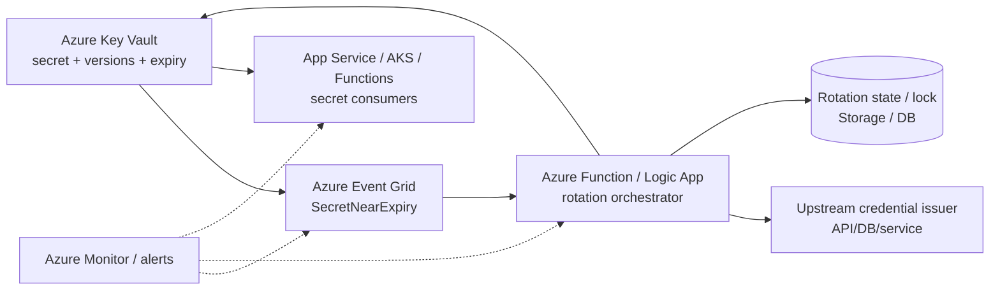
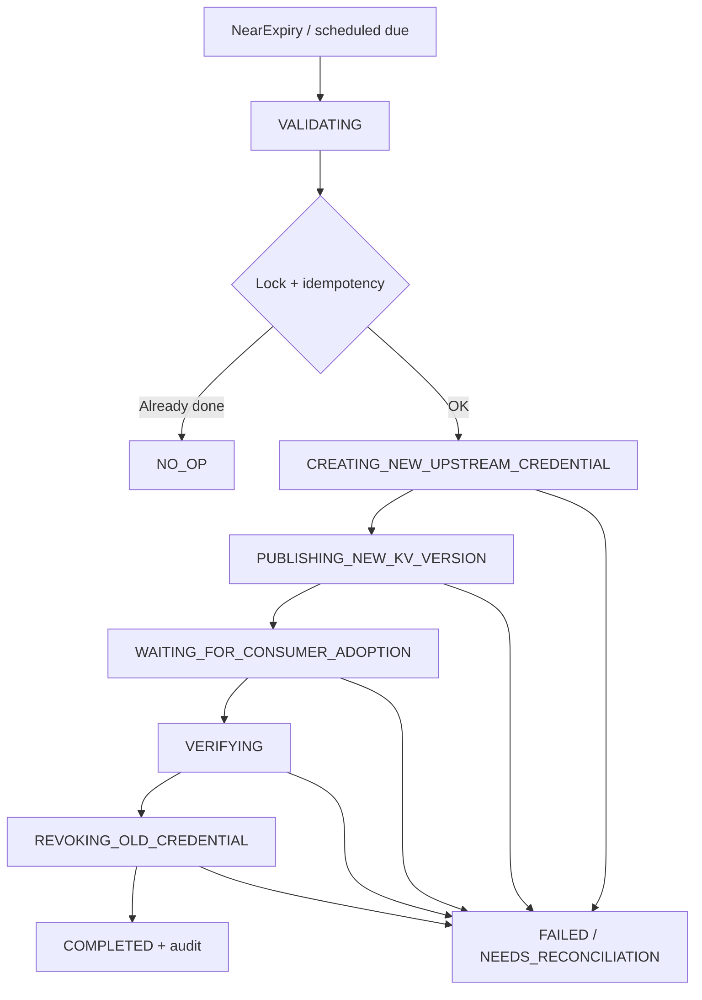
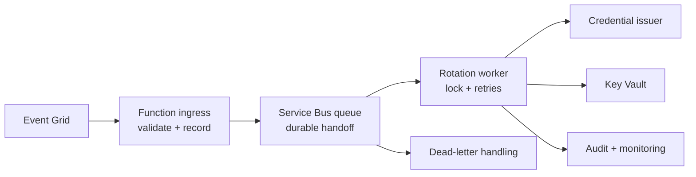
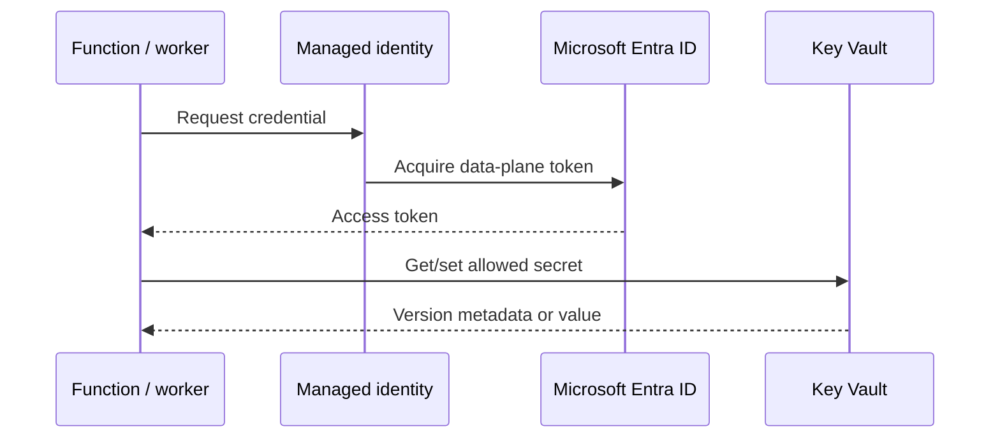
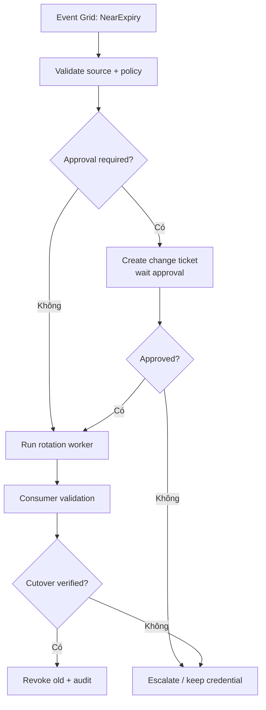
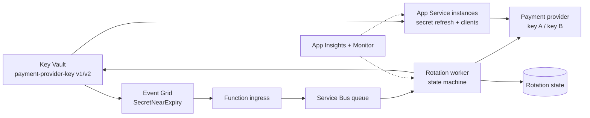

# Luân chuyển secret bằng sự kiện và tự động hóa

Một ứng dụng Java/Spring Boot trên **Azure App Service** dùng API key để gọi dịch vụ thanh toán bên thứ ba. Khóa được lưu trong **Azure Key Vault**, có ngày hết hạn sau 90 ngày. Người vận hành thỉnh thoảng tạo khóa mới trên hệ thống đối tác, cập nhật Key Vault và thông báo các nhóm phát triển khởi động lại ứng dụng. Chỉ cần bỏ sót một instance, phiên bản khóa cũ tiếp tục được sử dụng; nếu khóa cũ bị thu hồi sớm, giao dịch lỗi hàng loạt. Khi một người trực ca nghỉ phép đúng tuần khóa hết hạn, quy trình thủ công có thể ngừng hoạt động.

Thiết kế tốt hơn là **event-driven secret rotation**: Key Vault phát sự kiện khi secret sắp hết hạn; **Azure Event Grid** định tuyến tới **Azure Functions, Logic Apps** hoặc một worker được phê duyệt. Worker thực hiện quy trình đổi credential **ở hệ thống nguồn**, tạo **version mới trong Key Vault**, kiểm thử ứng dụng đã dùng được credential mới, và **chỉ thu hồi phiên bản cũ khi đủ bằng chứng cutover**. Hệ thống còn phải xử lý sự kiện lặp/trễ, lỗi một nửa quy trình, cache ở ứng dụng, quyền hạn và audit.

Điểm khó nhất **không phải** API tạo secret version. Vấn đề là đảm bảo **credential thật ở dịch vụ đích**, **giá trị trong Key Vault**, và **các ứng dụng tiêu thụ** chuyển phiên bản theo thứ tự an toàn.

Bài học thuộc chương **Secret, khóa và chứng chỉ** của module **CLOUD_PROVIDERS_AZURE**. Phạm vi module trải từ subscription, resource group, Microsoft Entra ID, mạng ảo, compute, storage và dữ liệu đến vận hành, giám sát, bảo vệ và kiểm soát chi phí kiến trúc ứng dụng trên Azure. Ở đây, ta tập trung **Azure Key Vault secrets + Event Grid + automation**, nhưng cũng phân biệt với việc xoay **cryptographic keys** và **certificates** vì ba loại này có cơ chế riêng.

**Sau bài học, bạn có thể:**

- Phân biệt **secret rotation, key rotation, certificate renewal, versioning, expiration và revocation**.
- Giải thích các sự kiện `Microsoft.KeyVault.SecretNearExpiry`, `SecretExpired` và `SecretNewVersionCreated`.
- Thiết kế pipeline **Key Vault → Event Grid → Azure Function/Logic App → credential provider → Key Vault → application consumers**.
- Thực hiện **two-phase cutover**, dựa trên khoảng thời gian tồn tại song song của credential cũ/mới.
- Phòng tránh lỗi do **duplicate/out-of-order events, retry storm, webhook authentication, poison messages và partial failure**.
- Dùng **managed identity, Azure RBAC, Key Vault Secrets User/Officer, network isolation** đúng vai trò.
- Hiểu **versionless/versioned references, caching, refresh, connection pools và ứng dụng long-running**.
- Thiết kế state machine, idempotency key, audit, metrics, cảnh báo, rollback và các bài kiểm thử sản xuất.

## 1. Secret rotation là gì và điều gì không phải rotation?

**Secret** là thông tin nhạy cảm dùng làm credential hoặc dữ liệu bảo mật, ví dụ **API key, database password, access token tĩnh**. **Secret rotation** là quy trình thay giá trị credential cũ bằng giá trị mới, sau đó làm cho consumers dùng mới và ngăn credential cũ tiếp tục được sử dụng.

| Thao tác | Ý nghĩa | Có đủ để gọi là luân chuyển hoàn chỉnh? |
|---|---|---|
| Đổi metadata `expiresOn` của Key Vault secret | Cập nhật thời điểm hết hạn/nhắc việc | **Không** đổi credential thật |
| Tạo Key Vault secret version mới | Lưu giá trị mới trong vault | **Chưa**, nếu upstream hoặc consumers chưa đổi |
| Regenerate API key ở hệ thống đối tác | Đổi credential có hiệu lực ở upstream | **Chưa**, nếu Key Vault/apps vẫn dùng khóa cũ |
| App Service restart | Có thể nạp lại value đã lưu | **Không**, nếu secret chưa được rotate |
| Disable secret version cũ trong Key Vault | Ngăn/giới hạn cách truy cập version theo service policy | **Không bảo đảm** upstream credential đã bị thu hồi |
| **Rotate → publish → verify → revoke** | Hoàn tất chuỗi đổi credential và consumers | **Có**, nếu đã xác minh trạng thái cuối |

### 1.1. Ba đối tượng thường bị nhầm

| Loại Key Vault object | Dùng để làm gì? | Cơ chế rotation thường gặp |
|---|---|---|
| **Secrets** | Password/API keys/secret text | Automation tự viết hoặc tích hợp quản lý credential thật; không phải mọi secret có built-in rotation |
| **Keys** | Khóa cryptographic dùng encrypt/sign/wrap | Key Vault có cơ chế **key rotation policy** với các loại key được hỗ trợ; vẫn phải quản lý consumers |
| **Certificates** | Chứng chỉ X.509 và private key liên quan theo chính sách | Certificate lifecycle/renewal policy, issuer integration hoặc external CA; có thể có secret backing |

**Không lấy thao tác `rotate-key` cho Azure Key Vault cryptographic key làm bằng chứng Key Vault tự đổi database password bên ngoài.** Database/đối tác vẫn cần một operation đổi credential tại hệ thống đó.

### 1.2. Expiration không phải revocation ở hệ thống nguồn

Trường thời gian `exp` của Key Vault secret giúp quản lý vòng đời, cảnh báo và có thể ảnh hưởng truy cập theo semantics dịch vụ. Nó **không tự đặt lại database login password**, **không tự vô hiệu API key ở đối tác**, và **không bảo đảm ứng dụng ngừng dùng một credential đã cache**. Cần thiết kế hành động revoke tại **credential issuer**.

## 2. Kiến trúc tổng thể: một sự kiện kích hoạt một quy trình dài



**Hai sự thật cần luôn giữ tách biệt:**

1. Event Grid cho biết **một sự kiện vòng đời secret đã xảy ra hoặc sắp xảy ra theo metadata**.
2. Rotation workflow quyết định **có được phép đổi credential, thứ tự nào, kiểm thử gì, và khi nào revoke**.

Event Grid không tự đăng nhập database để thay password, không tự cấp quyền cho Azure Function, không tự làm mới connection pools và không cung cấp distributed transaction giữa Key Vault với một SaaS bên ngoài.

### 2.1. Thành phần và trách nhiệm

| Thành phần | Trách nhiệm | Không nên làm |
|---|---|---|
| **Key Vault** | Lưu secret versions, thuộc tính vòng đời, phát sự kiện được hỗ trợ | Lưu group master secret vào logs |
| **Event Grid** | Lọc/định tuyến sự kiện đến subscriber, retry delivery theo policy | Xem event là mật khẩu hoặc lệnh bảo mật đã được xác thực theo nghiệp vụ |
| **Function/Logic App** | Điều phối, kiểm tra điều kiện, gọi issuer, publish, verify, revoke | Chạy vô hạn hoặc cấp quyền admin toàn subscription |
| **Upstream issuer** | Tạo/activate/revoke credential thực tế | Coi metadata Key Vault là source of truth duy nhất |
| **Rotation state store** | Idempotency, distributed lock, progress/approval/audit | Lưu secret plaintext nếu không cần |
| **Consumers** | Nạp phiên bản mới và quản lý cache/connection lifecycle | Pin mãi version cũ mà không monitoring |
| **Azure Monitor** | Metrics, alerts, incident workflow | Thu thập raw secret values |

## 3. Lifecycle của một secret qua các hệ thống

Xét API key `payment-provider-key`:

```text
T0: Provider chấp nhận credential A
    Key Vault secret version v1 chứa A
    App instances đang dùng A

T1: Key Vault phát SecretNearExpiry cho v1
    Automation tạo credential B ở provider

T2: Provider chấp nhận A và B (overlap period)
    Key Vault secret version v2 chứa B

T3: Consumers refresh và xác nhận dùng B

T4: Revoke credential A tại provider
    Disable/retire v1 theo chính sách

T5: Audit và hoàn tất rotation
```

**Chính sách chấp nhận đồng thời A/B** chỉ khả thi khi upstream cung cấp dual credentials, token overlap, nhiều active API keys hoặc phương án tương đương. Nếu provider chỉ chấp nhận một password tại một thời điểm, cần **chiến lược riêng** như blue/green identity, secondary login, rolling cutover có downtime được phê duyệt, hoặc migration qua proxy.

### 3.1. Không đặt lịch revoke bằng đồng hồ một cách mù quáng

Nếu application instance bị mất mạng tới Key Vault, nó có thể vẫn dùng A sau khi secret v2 được lưu. Revoke A ở T2 chỉ dựa trên “đã ghi v2” sẽ khiến các calls cũ lỗi. **Điều kiện revoke** phải có bằng chứng cutover (new credential success, consumer version adoption, grace period phù hợp và SLO).

### 3.2. Trình tự khi provider hỗ trợ dual credentials

```mermaid
sequenceDiagram
    participant E as Event Grid
    participant F as Rotation Function
    participant P as Provider / Database
    participant K as Key Vault
    participant A as Applications
    E->>F: SecretNearExpiry(v1)
    F->>F: Validate event + acquire lock
    F->>P: Create credential B; retain A
    P-->>F: Credential B
    F->>K: Set secret new version v2
    K-->>F: Version ID v2
    F->>A: Signal refresh / plan rolling reload
    A->>P: Authenticate with B
    P-->>A: Success
    A-->>F: Adoption/health evidence
    F->>P: Revoke credential A
    F->>F: Audit COMPLETE; release lock
```

Sơ đồ mô tả **business workflow**; Event Grid không mặc định chờ kết thúc từng bước và ứng dụng không tự gửi callback adoption trừ khi bạn xây dựng.

## 4. Sự kiện Key Vault liên quan tới secrets

Azure Key Vault có thể phát **Event Grid events** cho các thay đổi vòng đời được hỗ trợ. Những event types thường gặp:

| Event type | Ý nghĩa | Hành động khuyến nghị |
|---|---|---|
| `Microsoft.KeyVault.SecretNearExpiry` | Secret version đang tới thời điểm cảnh báo gần hết hạn | **Khởi tạo hoặc kiểm tra kế hoạch rotation** |
| `Microsoft.KeyVault.SecretExpired` | Secret version đã tới thời điểm hết hạn trong metadata | **Cảnh báo/incident** nếu chưa hoàn tất rotation |
| `Microsoft.KeyVault.SecretNewVersionCreated` | Một version secret mới được tạo | Xác minh/audit/cập nhật downstream; **không mù quáng rotate lần nữa** |

Ngoài secret events còn có key/certificate events như `KeyNearExpiry` hoặc `CertificateNearExpiry`, nhưng **chúng là các loại object và workflow khác**.

### 4.1. NearExpiry không phải “ngày hết hạn trừ một khoảng tùy ý”

Thời điểm Key Vault phát `SecretNearExpiry` theo **quy tắc của dịch vụ**, thường được mô tả là khoảng thời gian cố định trước `exp` của version tương ứng. Không thiết kế SLO chỉ dựa trên giả định một số ngày cố định bất biến; kiểm tra contract hiện hành, trạng thái subscription/event delivery và thêm **scheduled reconciliation** phòng event đến muộn hoặc bị mất.

### 4.2. Phải đặt thuộc tính vòng đời hợp lý

Nếu secret được tạo không có expiration metadata hoặc có metadata không phù hợp, không được mặc định sẽ có near-expiry event đúng lịch kinh doanh. Quy trình tạo secret phải thiết lập, kiểm tra:

- Ngày tạo/phát hành và `expiresOn` theo policy.
- Owner, hệ thống upstream và credential identifier.
- Rotation cadence, lead time, grace period và bảo mật.
- Người chịu trách nhiệm khi automatic rotation thất bại.

**Expiration metadata là đầu vào của cảnh báo**, không phải scheduler có cam kết tuyệt đối.

### 4.3. Sự kiện là tín hiệu, không chứa secret plaintext

Event thường mang metadata như event ID/type, subject, timestamp, vault/object/version IDs. **Không kỳ vọng payload sự kiện chứa giá trị secret.** Worker đọc metadata, xác minh nguồn/scope rồi truy cập Key Vault bằng identity được cấp quyền khi cần.

## 5. Event Grid envelope và phân loại sự kiện

Một event Grid schema mẫu **đã rút gọn, giả định**:

```json
{
  "id": "evt-secret-near-expiry-001",
  "eventType": "Microsoft.KeyVault.SecretNearExpiry",
  "subject": "payment-provider-key",
  "eventTime": "2026-11-20T08:00:00Z",
  "data": {
    "vaultName": "kv-payment-prod",
    "objectName": "payment-provider-key",
    "version": "opaque-version-id",
    "exp": 1790000000
  },
  "dataVersion": "1"
}
```

**Không copy JSON này làm payload chuẩn:** data fields, casing, subject structure và timestamps thực tế phụ thuộc **Event Grid schema/CloudEvents mode và phiên bản sự kiện**. Kết nối HTTP webhook còn có validation handshake/transport contract riêng. Khi code production, dùng SDK type/parser đúng event schema và validate fields tối thiểu.

### 5.1. Dùng các định danh nào để quyết định xử lý?

- **Source/resource ID**: Key Vault nào phát sự kiện? Có thuộc allowlist không?
- **Event type**: là NearExpiry hay NewVersionCreated?
- **Object/secret name**: có nằm trong rotation policy đã cấu hình không?
- **Version**: sự kiện nói về version nào? Version đó còn là current version không?
- **Event ID**: giúp loại trùng trong một kỳ nhận; không đủ để chống hai events khác ID yêu cầu rotate cùng secret.
- **Timestamp**: dùng phân tích, không phải bằng chứng duy nhất rằng event còn mới.

### 5.2. Không tin mỗi `subject`

Nếu receiver là webhook, không được tin một request Internet tự khai `eventType=SecretNearExpiry`. Phải dùng **Event Grid trigger/subscription đã được bảo vệ**, endpoint validation và cơ chế authentication phù hợp, kèm xác minh **source/vault ID** trong business logic. Nếu endpoint nhận CloudEvents, xác minh schema/cert/auth và không cho caller tùy ý chỉ định vault.

## 6. Event Grid delivery: ít nhất một lần, không bảo đảm thứ tự

Event-driven automation cần giả định:

- Sự kiện có thể **được giao lại nhiều lần**.
- Sự kiện có thể **đến trễ hoặc không đúng thứ tự**.
- Endpoint có thể timeout ngay cả khi đã nhận/xử lý một phần.
- Retry policy có giới hạn delivery attempts/time-to-live.
- Sau khi delivery thất bại quá thời gian, event có thể tới **dead-letter destination** nếu cấu hình; nếu không, có thể mất khả năng tự động xử lý.
- Event Grid **không** cung cấp exactly-once execution cho workflow đổi password xuyên hai hệ thống.

### 6.1. Idempotency hai lớp

Một giải pháp cần ít nhất:

1. **Event deduplication:** không xử lý lại cùng `event.id` cho cùng subscription.
2. **Business rotation deduplication:** không tạo credential mới mỗi khi nhận nhiều event cho **cùng secret/generation**.

Nếu Event Grid gửi event E hai lần, hàm phải nhận thấy workflow tương ứng đã chạy. Nếu E1 và E2 khác IDs cùng yêu cầu rotate `payment-provider-key`, cũng phải có **per-secret lock và rotation state**.

### 6.2. Không xóa event chỉ vì receiver trả 200

Với webhook, ACK thành công trước khi lưu durable job có thể làm mất yêu cầu nếu process crash ngay sau ACK. Nên:

- Dùng Azure Functions Event Grid trigger với runtime/retry semantics đã được kiểm chứng.
- Hoặc nhận event rồi **durably enqueue** công việc (ví dụ Service Bus) trước khi ACK.
- Thiết kế retry/DLQ/replay policy cho cả delivery và worker execution.

## 7. Trạng thái rotation workflow

Thay vì một hàm “gọi API rồi set secret”, dùng **state machine**:



### 7.1. Dữ liệu state tối thiểu

```json
{
  "rotationId": "kv-payment-prod/payment-provider-key/generation-042",
  "vaultResourceAlias": "kv-payment-prod",
  "secretName": "payment-provider-key",
  "triggerVersion": "v1",
  "workflowState": "WAITING_FOR_CONSUMER_ADOPTION",
  "newVersion": "v2",
  "oldCredentialReference": "provider-credential-a",
  "newCredentialReference": "provider-credential-b",
  "startedAtUtc": "2026-11-20T08:02:00Z",
  "lastUpdatedAtUtc": "2026-11-20T08:10:00Z",
  "approvalId": "change-1187",
  "attempt": 2
}
```

Đây là **schema nghiệp vụ minh họa**, không phải object Key Vault hoặc Event Grid. Các credential references là **opaque identifiers**, không phải secret text. Nên lưu state trong Azure Table/Cosmos DB/SQL/Storage theo nhu cầu transaction/locking, với encrypt-at-rest, RBAC và retention.

### 7.2. Version bị sự kiện nhắc có còn hiện hành?

Trước khi rotate:

1. Đọc metadata của secret name/version từ Key Vault nếu được phép.
2. Kiểm tra policy, enabled/expiration và version hiện hành.
3. Nếu một operator đã rotate và version mới đang active, event NearExpiry của **version cũ** có thể phải **NO_OP**.
4. Nếu đang có workflow khác, enqueue/reconcile chứ không tạo phiên bản mới không kiểm soát.

**Không lấy “received later” làm bằng chứng event đại diện state mới nhất.**

## 8. Thiết kế điều kiện kích hoạt: NearExpiry, schedule và break-glass

Một giải pháp production nên có nhiều nguồn kích hoạt:

| Trigger | Vai trò | Điều cần lưu ý |
|---|---|---|
| **SecretNearExpiry** | Chủ động rotate trước expiration | Event delivery + configured `exp` phải đáng tin |
| **Scheduled reconciliation** | Quét secrets/policy sắp hết hạn hoặc workflow mắc kẹt | Không scan toàn vault quá dày; cần least privilege |
| **Manual approved rotation** | Xử lý leak, urgent incident hoặc migration | Cần approval/audit và tránh trùng workflow |
| **SecretNewVersionCreated** | Kiểm tra consumers và version adoption | Không nên tự động rotate thêm chỉ vì version mới xuất hiện |
| **SecretExpired** | Alert sự cố hoặc escalation | Quá muộn nếu chỉ dùng event này để bắt đầu |

### 8.1. Nên rotate trước ngày hết hạn bao lâu?

Tính **lead time** từ:

```text
Lead time tối thiểu
  = độ trễ event/phát hiện
  + thời gian xin approval (nếu có)
  + thời gian tạo credential upstream
  + thời gian publish Key Vault
  + thời gian consumers refresh và chứng thực
  + grace period/rollback buffer
  + safety margin
```

Ví dụ hệ thống phải có ít nhất 72 giờ overlap để làm mới 100 replicas và chạy smoke test. Nếu NearExpiry được phát quá sát deadline theo nhu cầu, phải bổ sung **scheduled job chủ động** sớm hơn; không cố “đánh cược” vào một event.

## 9. Azure Functions và Logic Apps: chọn công cụ điều phối

| Tiêu chí | **Azure Functions** | **Logic Apps** |
|---|---|---|
| Logic nhiều bước/phức tạp | Lập trình chi tiết, test bằng code | Workflow declarative, connectors và approvals |
| Tích hợp Event Grid | Trigger/binding được hỗ trợ | Event subscription/trigger/connectors phù hợp |
| Gọi upstream API | HTTP/SDK do code quản lý | HTTP/connector actions, custom connector |
| State machine dài hạn | Durable Functions hoặc state store/queue | Stateful workflows khi dùng plan hỗ trợ |
| CI/CD | Source, build, test, deployment pipeline | IaC + workflow definitions |
| Retry/DLQ | Phải thiết kế end-to-end | Có workflow retry, cần idempotency và recovery |
| Identity/network | Managed identity, VNet/Private Endpoint tùy plan | Managed identity/network theo SKU/connector |
| Phù hợp | Rotation có crypto/SDK/custom API | Quy trình nhiều connector, approvals, thông báo |

Một Function event-trigger **không nhất thiết nên giữ một HTTP invocation chạy hàng giờ** chỉ để chờ toàn bộ consumers refresh. Với workflow dài, nên **durably enqueue** và dùng Durable Functions/Logic Apps stateful hoặc một state machine có scheduler.

### 9.1. Vì sao Event Grid → Function → Queue?



Kết cấu này tách **thời gian giao event** khỏi **thời gian quay credential**. Không để event handler phản hồi thành công trước khi state/job đã được ghi bền vững theo contract. Dùng `sessionId`/partitioning/lock khi cần serialize cùng secret, nhưng vẫn phải có **idempotency** ở worker.

## 10. Azure Key Vault RBAC và phân tách danh tính

**Microsoft Entra ID** bảo vệ phần lớn hoạt động quản trị Azure Key Vault; data plane có thể dùng **Azure RBAC** hoặc legacy access policies tùy resource/access configuration. Cần chọn **permission model rõ ràng**.

| Principal | Quyền cần thiết | Quyền không nên cấp mặc định |
|---|---|---|
| **Application consumer** | `get` secret value, thường tương ứng **Key Vault Secrets User** theo RBAC | Set/delete/purge mọi secret |
| **Rotation worker** | Get/set secret/version và metadata theo phạm vi, role phù hợp như **Key Vault Secrets Officer** | Owner subscription |
| **Event ingress** | Nhận/ghi metadata job, có thể không cần đọc secret plaintext | Key Vault Administrator |
| **Publisher/infra pipeline** | Quản lý Event Grid subscription, Key Vault setup theo approval | Truy cập upstream production database password |
| **Auditor/monitor** | Đọc logs/metadata cần thiết | Đọc tất cả secret values |
| **Emergency admin** | Break-glass theo PIM/approval | Credential thường trực không audit |

### 10.1. Cẩn trọng với phạm vi Secrets Officer

Một role có quyền `set` và đọc secret values có blast radius lớn nếu cấp cho toàn vault. Có thể cân nhắc **vaults phân tách theo ứng dụng/môi trường**, role assignment ở secret scope khi được hỗ trợ và phù hợp, hoặc **custom role/actions** theo thiết kế. Nhưng nếu automation cần quản lý nhiều versions, phải kiểm tra permission trên data plane và policy của vault thật.

### 10.2. Worker cần hai loại quyền khác nhau

Rotation worker thường cần:

1. Quyền vào **Azure Key Vault** để đọc/publish secret.
2. Quyền vào **upstream issuer** (database/admin API, SaaS provider, Storage account, service principal credential API...) để tạo/revoke credential.

**Có Key Vault Secrets Officer không tự có quyền đổi database password hoặc rotate partner API key.** Những quyền này phải được cấp tối thiểu, tách credential và audit riêng.

### 10.3. App runtime không cần quyền rotate

Ứng dụng web chỉ cần `get` secret hiện hành; không nên có quyền đổi API key của toàn tổ chức. Giảm blast radius nếu app bị khai thác.

## 11. Managed identity thay service principal secret

Ứng dụng chạy trên Azure Functions/App Service/AKS/VM có thể dùng **managed identity** để lấy token tới Key Vault khi được hỗ trợ. Điều này giúp tránh một vòng phụ thuộc: “Muốn tự rotate secret nhưng chính worker lại được bảo vệ bằng secret sắp hết hạn”.



### 11.1. System-assigned và user-assigned

- **System-assigned managed identity:** gắn với Azure resource; vòng đời cùng resource.
- **User-assigned managed identity:** identity độc lập có thể được gắn theo design và được quản lý riêng.
- **Workload identity** trên AKS/CI cũng có thể truy cập Key Vault theo cấu hình federation/Entra.

Khi gán role, phân biệt **client ID**, **principal/object ID** và **Azure resource ID**. Nếu `DefaultAzureCredential` trên máy phát triển dùng Azure CLI identity, production managed identity vẫn cần role được cấp riêng.

### 11.2. Authentication không thay network

Managed identity đúng vẫn có thể nhận timeout nếu Key Vault có Private Endpoint, DNS/route không đúng. Và networking đúng vẫn bị 403 nếu principal không có data-plane permission hoặc vault firewall/access model từ chối.

## 12. Network isolation: Key Vault, Event Grid, Function và provider

Đường đi của sự kiện và luồng rotation có **nhiều mạng**:

```text
Key Vault resource
  -> Event Grid delivery path
  -> Function/Logic App event ingress
  -> Rotation worker egress
      -> Key Vault data plane
      -> upstream API/database
      -> state store / queue
```

### 12.1. Private Endpoint không tự bảo vệ toàn bộ chuỗi

- Key Vault có thể được cấu hình private endpoint và public network restrictions theo tính năng/tier.
- Worker phải có approved route/DNS đến Key Vault và upstream.
- Event Grid endpoint delivery tới Function/Service Bus cần **delivery authentication, networking và identity** tương thích với loại endpoint/subscription.
- Nếu Function dùng VNet integration, cần kiểm tra DNS ở **host thực thi**, không chỉ ở portal.
- Với SaaS upstream public endpoint, dùng egress firewall/allowlist và TLS verification.
- Không mở public ingress vào worker không cần thiết chỉ vì Event Grid callback gặp 403.

### 12.2. Event Grid source authentication

Khi dùng **Azure Functions Event Grid trigger** hoặc endpoint Event Grid tích hợp, tận dụng cơ chế handshake/extension/identity delivery của sản phẩm. Với custom webhook, kiểm tra **subscription validation handshake**, optional AAD delivery authentication và source allowlist; không tin raw JSON posted bởi Internet.

### 12.3. Nhiều secrets trong cùng vault

Một event subscription theo vault có thể giao event cho nhiều secret names. Worker phải có **allowlist/policy mapping**: `payment-provider-key` dùng adapter thanh toán, `reporting-db-password` dùng adapter database; không được lấy mọi `objectName` làm URL/SQL username tùy ý.

## 13. Ví dụ Java: ứng dụng đọc secret bằng Azure Identity

Với ứng dụng Java/Spring Boot, một cách đọc secret là **Azure SDK for Java** `azure-security-keyvault-secrets` cùng `azure-identity`. Ví dụ sau chỉ **đọc** secret mới nhất theo name trong một Key Vault được phê duyệt:

```java
import com.azure.identity.DefaultAzureCredentialBuilder;
import com.azure.security.keyvault.secrets.SecretClient;
import com.azure.security.keyvault.secrets.SecretClientBuilder;
import com.azure.security.keyvault.secrets.models.KeyVaultSecret;

public final class ReadPaymentKey {
    public static void main(String[] args) {
        String vaultUrl = requireEnv("AZURE_KEY_VAULT_URL");
        String secretName = requireEnv("PAYMENT_SECRET_NAME");

        SecretClient client = new SecretClientBuilder()
            .vaultUrl(vaultUrl)
            .credential(new DefaultAzureCredentialBuilder().build())
            .buildClient();

        KeyVaultSecret secret = client.getSecret(secretName);

        // Chỉ log metadata đủ dùng. Không in secret.getValue().
        System.out.println("Secret name: " + secret.getName());
        System.out.println("Secret version: " + secret.getVersion());

        String credential = secret.getValue();
        try {
            // Truyền credential cho provider client được bảo vệ.
            // Không đưa vào logs, exception messages hoặc metrics.
            useCredentialWithProtectedClient(credential);
        } finally {
            // String trong Java không thể zeroize đáng tin cậy.
            // Bảo vệ heap/process access và tránh giữ credential lâu.
        }
    }

    private static String requireEnv(String name) {
        String value = System.getenv(name);
        if (value == null || value.isBlank()) {
            throw new IllegalArgumentException("Missing env: " + name);
        }
        return value;
    }

    private static void useCredentialWithProtectedClient(String credential) {
        // Placeholder: tích hợp thực tế của ứng dụng.
        if (credential.isBlank()) {
            throw new IllegalArgumentException("Empty credential");
        }
    }
}
```

**Điều kiện:**

- `AZURE_KEY_VAULT_URL` là vault URI được cấu hình tin cậy, không lấy từ request client.
- SDK versions tương thích; `azure-identity` và `azure-security-keyvault-secrets` đã được khai báo trong Maven/Gradle.
- Principal thực sự được chọn có quyền **get secret**.
- HTTPS/TLS/Private Endpoint/DNS hoạt động.
- Lệnh `getSecret(name)` thường đọc **current/latest version theo API**, còn `getSecret(name, version)` nhắm version cụ thể; verify SDK semantics khi dùng.

**Lưu ý:** code trên minh họa cách đọc, **không phải refresh policy**. Nếu ứng dụng chỉ gọi lúc startup rồi giữ `credential` cả năm trong singleton, nó không tự cập nhật khi vault có version mới.

### 13.1. Vì sao không log giá trị?

Secret là bearer credential. Log aggregator, support ticket, trace, crash dump, console của CI hoặc HTTP access log đều có thể giữ secret nhiều ngày. Khi troubleshooting, log **name, version (đã kiểm soát hiển thị), correlation ID, result/status**, không bao giờ log `getValue()`.

## 14. Versionless và versioned secret references

**Mỗi lần `set secret` bằng một name hiện có** tạo version mới theo Key Vault API. Consumers có thể tham chiếu:

```text
Versionless URI:
  https://kv-payment-prod.vault.azure.net/secrets/payment-provider-key

Versioned URI:
  https://kv-payment-prod.vault.azure.net/secrets/payment-provider-key/<version-id>
```

**Versionless** thường hướng tới version hiện hành khi client fetch lại; **versioned** pin cụ thể một version. Tuy vậy, hành vi hiệu lực còn phụ thuộc **cache, client lifecycle, reference resolution và permissions**.

| Chiến lược | Ưu điểm | Nhược điểm |
|---|---|---|
| **Versionless reference** | Có thể nhận version mới sau fetch/refresh | Dễ có propagation lag; cần kiểm soát rollout |
| **Pinned version** | Cấu hình tái lập, kiểm soát canary | Không tự đổi khi version mới được tạo |
| **Config pointer → versioned secret** | Rollout/rollback có version được duyệt | Cần publisher, consumer refresh và atomicity strategy |

### 14.1. Key Vault không đẩy plaintext secret vào JVM

Khi v2 được tạo, SDK Java/HTTP client/connection pool đang dùng v1 **không tự thay**. Cần reload secret, tái cấu hình consumer và xác minh authentication với v2.

### 14.2. App Service Key Vault references

App Service có tính năng Key Vault references trong application settings. Việc resolution/cache/refresh được quản lý theo semantics nền tảng (có thể có khoảng caching đáng kể), và có cơ chế refresh riêng khi cấu hình thay đổi hoặc qua API được hỗ trợ. **Không hứa secret đổi tức thời ở tất cả instances chỉ vì versionless URI.** Cần kiểm tra caching contract hiện hành và test thực tế khi dùng kill switch/rotation.

### 14.3. Spring Boot và Key Vault integrations

Nếu secret được bind thành `@Value` tại startup, đổi Key Vault version chưa đủ. Phải:

1. Nạp value mới.
2. Validate và không log.
3. Rebuild/reconfigure credential-bearing client nếu cần.
4. Bảo vệ in-flight requests.
5. Quan sát version adoption trước revoke.

Không tự ý tạo lại toàn bộ Spring context hoặc connection pool không có draining policy.

## 15. Rotation policy: từ business requirement đến kỹ thuật

Mỗi secret cần một **rotation contract**:

```yaml
secret: payment-provider-key
vaultAlias: kv-payment-prod
ownerTeam: payments-platform
credentialIssuer: approved-payment-provider
rotationCadenceDays: 60
maxAgeDays: 90
requiredOverlapHours: 72
minimumConsumersAdoptedPercent: 100
revokeOldCredential: after-verification-and-approval
consumerRefreshSloMinutes: 30
failureMode: keep-old-valid-and-escalate
```

**Đây là YAML business policy minh họa**, không phải cấu hình Key Vault/ARM/Event Grid được support trực tiếp. Các trường như `minimumConsumersAdoptedPercent` phải có cách đo thực tế và phải cân nhắc instance offline/long-lived processes.

### 15.1. Đừng áp một cadence cho mọi credential

- API key thanh toán có thể rotate định kỳ 60/90 ngày.
- Database password có thể cần stagger theo active users/connection pooling.
- Storage account key có **dual-key rotation** theo khả năng dịch vụ.
- Certificate có lifecycle theo issuer và client trust.
- Managed identity token do nền tảng cấp ngắn hạn thường **không cần tự viết Event Grid secret rotation** để “đổi token” mỗi vài tuần.

### 15.2. Rotation trigger và business state

Một secret NearExpiry khi workflow đã hoàn thành có thể được ghi `NO_OP`. Một secret không có near-expiry event nhưng chính sách max age đã vượt có thể được scheduler kích hoạt. Hệ thống phải dựa trên **rotation policy và state thực**, không chỉ event type.

## 16. Two-phase cutover: tạo mới rồi thu hồi cũ

### Phase A — Prepare

1. Kiểm tra policy, owner, source/vault allowlist, pending approvals.
2. Lấy distributed lock/idempotency state.
3. Kiểm tra upstream hỗ trợ **hai active credentials** hay không.
4. Tạo credential B tại upstream, vẫn giữ A hợp lệ.
5. Lưu credential B vào Key Vault version mới bằng identity được cấp quyền.
6. Kiểm tra version ID, metadata, status và **test authenticate** với B bằng kênh được duyệt.

### Phase B — Adopt

1. Thông báo/apply refresh qua configuration pipeline hoặc rolling deployment.
2. Theo dõi consumers đã dùng B qua version/revision **metadata** và upstream auth success.
3. Đo error rate, long-lived sessions, connection pooling và offline workers.
4. Chờ grace period thích hợp; không revoke chỉ vì timer đã hết nếu adoption chưa đạt.

### Phase C — Commit

1. Xác minh tất cả consumers quan trọng đã chuyển sang B.
2. Revoke A tại upstream theo change approval.
3. Kiểm thử A bị từ chối và B vẫn hoạt động.
4. Disable/retire v1 theo Key Vault retention policy.
5. Ghi audit, update rotation expiry/owner và giải phóng lock.

### 16.1. Nếu upstream chỉ có một password

Quy trình không thể đảm bảo zero downtime đơn giản chỉ bằng hai Key Vault versions. Cân nhắc:

- Tạo login/identity mới rồi chuyển clients trước khi xóa login cũ.
- Secondary account/credential khi sản phẩm hỗ trợ.
- Một proxy/auth broker có khả năng chuyển đổi thông tin xác thực có kiểm soát.
- Bảo trì có downtime được phê duyệt.

Không quảng cáo mọi hệ thống đều “zero-downtime rotation” nếu upstream không hỗ trợ overlap.

## 17. Thiết kế idempotency và distributed lock

### 17.1. Idempotency key

Một key có thể là:

```text
<approved-vault-resource-id>/<secret-name>/<rotation-generation>
```

`event.id` chỉ loại trùng **một delivery**. Nếu có nhiều NearExpiry events, manual trigger và scheduled trigger cho cùng secret, business key theo **rotation generation** mới tránh việc tạo B rồi C rồi D.

### 17.2. Phạm vi khóa

Khóa ở mức **secret/upstream identity**, không chỉ function instance. Nếu cùng một upstream API account được dùng bởi nhiều secret names, có thể cần **một lock ở mức provider credential scope** để tránh hai workflows đổi cùng upstream credential.

### 17.3. State store nên đáp ứng điều gì?

- Durable writes và conditional update/ETag.
- TTL/lease hoặc fencing token khi worker chết.
- Idempotent transition `PENDING→PREPARED→PUBLISHED→VERIFIED→COMPLETED`.
- Dữ liệu đủ để reconcile nếu API upstream thành công nhưng Key Vault write thất bại.
- RBAC, encryption, retention và audit.

Một **in-memory boolean lock** trong Azure Function không bảo vệ các replicas khác hoặc retry sau restart.

## 18. Partial failures: những điểm nguy hiểm nhất

| Thời điểm lỗi | Trạng thái có thể còn lại | Phương án an toàn |
|---|---|---|
| Trước khi gọi upstream | Chưa thay credential | Retry/NO_OP theo policy |
| Sau khi tạo B upstream, trước khi ghi v2 Key Vault | B tồn tại nhưng consumers chưa biết | Reconcile bằng upstream credential ID, publish B; tránh tạo thêm C |
| Sau khi ghi v2, trước khi consumers refresh | A/B cùng active, apps vẫn A | Giữ overlap, retry adoption workflow |
| Sau khi một nửa instances đã dùng B | Mixed fleet | Tiếp tục rollout và đo per-instance version |
| Sau khi revoke A nhưng một job vẫn dùng A | Authentication failures | Incident; cân nhắc re-enable A nếu có quyền và policy, hoặc chuyển job |
| Revoke A thành công nhưng function timeout | State ghi chưa hoàn tất | Query upstream trạng thái, không revoke lặp mù quáng |
| Retry event sau khi hoàn thành | Nguy cơ tạo thêm secret versions | Idempotent NO_OP + audit |

**Không có ACID transaction chung** giữa Key Vault, Event Grid và nhà cung cấp bên ngoài. Thiết kế phải có **compensating actions và reconciliation**, không chỉ `try/catch`.

### 18.1. Secret value có thể không được đọc lại từ upstream

Một số providers trả API key B **chỉ một lần** tại thời điểm tạo. Nếu Function tạo B rồi crash trước khi lưu Key Vault, B có thể không truy xuất được bằng API. State machine cần biết phải:

- Revoke/retire credential B mồ côi nếu khả thi.
- Tạo B2 một cách kiểm soát (không tạo vô hạn).
- Quản lý rollback/approval và audit không chứa secret plaintext.

Tránh lưu B tạm trong logs hoặc unencrypted state store để “phòng crash”. Nếu cần durable handoff bí mật, dùng hệ lưu trữ được bảo vệ/Key Vault ngay trong bước tạo theo contract.

## 19. Thời hạn và trạng thái của phiên bản Key Vault

Một secret version có thể có các thuộc tính vòng đời như `enabled`, `notBefore`, `expiresOn` và content metadata theo API hỗ trợ.

### 19.1. Tránh tự đặt metadata sai

Nếu version v2 mới được tạo nhưng vô tình giữ `expiresOn` từ v1 gần hết hạn, hệ thống có thể phát thêm NearExpiry/Expired events hoặc báo cảnh báo sai. Với automation:

1. Đặt expiry theo **rotation policy mới**, không copy mù quáng metadata cũ.
2. Kiểm tra timezone và UTC.
3. Ghi link đến upstream credential ID trong metadata **không chứa giá trị nhạy cảm** nếu policy cho phép.
4. Đảm bảo version mới enabled/not-before phù hợp với rollout.
5. Kiểm tra event mới do `setSecret` gây ra để tránh vòng lặp tự kích hoạt.

### 19.2. SecretNewVersionCreated không phải lệnh rotate lần nữa

Khi worker set v2, Key Vault có thể phát `SecretNewVersionCreated`. Nếu Event Grid subscription bắt tất cả events và handler cho event nào cũng tạo credential mới, kết quả là:

```text
NearExpiry(v1) → set v2 → NewVersion(v2) → set v3
→ NewVersion(v3) → set v4 → ...
```

Giải pháp: **lọc event types**; với NewVersion chỉ thực hiện **verification/adoption** hoặc audit theo policy. Dùng workflow state và idempotency trước mọi side effect.

## 20. Ví dụ Azure Functions: tiếp nhận SecretNearExpiry an toàn

Với **Python Azure Functions programming model v2** và Event Grid extension tương thích, có thể dùng `@app.event_grid_trigger`. Ví dụ sau **chỉ tiếp nhận, kiểm tra metadata và ghi log đã giới hạn**, **không đổi secret**, để tránh biến một mẫu code thành automation làm thay đổi production ngoài ý muốn.

```python
import logging
import os

import azure.functions as func

app = func.FunctionApp()

EXPECTED_EVENT_TYPE = "Microsoft.KeyVault.SecretNearExpiry"

@app.event_grid_trigger(arg_name="event")
def on_secret_near_expiry(event: func.EventGridEvent) -> None:
    if event.event_type != EXPECTED_EVENT_TYPE:
        logging.info("Ignoring event type %s", event.event_type)
        return

    data = event.get_json() or {}
    if not isinstance(data, dict):
        raise ValueError("Invalid event data")

    # Field names depend on the Event Grid schema/extension.
    vault_name = data.get("vaultName") or data.get("VaultName")
    secret_name = data.get("objectName") or data.get("ObjectName")
    version = data.get("version") or data.get("Version")

    allowed_vault = os.environ["ROTATION_ALLOWED_VAULT"]
    allowed_secret = os.environ["ROTATION_ALLOWED_SECRET"]

    if vault_name != allowed_vault or secret_name != allowed_secret:
        # Unexpected source/name must not cause credential mutation.
        logging.warning("Ignored unapproved rotation metadata")
        return

    # Không log event.get_json() toàn phần và không lấy secret value.
    logging.info(
        "Approved rotation trigger. event_id=%s vault=%s secret=%s",
        event.id, vault_name, secret_name
    )

    # PRODUCTION NEXT STEP:
    # 1. Verify trusted Event Grid subscription/source mapping.
    # 2. Durably store/queue idempotent rotation job.
    # 3. Return success only after reliable handoff.
    # 4. Separate worker performs controlled rotation.
    # Version is read for policy checks inside the worker.
    _ = version
```

**Giới hạn của ví dụ:**

- Không có durable queue, distributed lock, validation nguồn đầy đủ hoặc actual rotation: **chưa đủ để production**.
- Event Grid trigger/binding là integration được framework quản lý; không thay bằng một webhook tự viết thiếu xác thực.
- Code kiểm tra tên vault/secret để minh họa allowlist, **không thay được** kiểm tra **full resource ID/source** và permission.
- Trường `version`/casing/event envelope phải được xác nhận với event schema thật.
- Function nên dùng **managed identity** và không lưu Key Vault administration secret trong environment.
- Sự kiện **không được dùng trực tiếp** làm credential hoặc URL upstream.

### 20.1. Triển khai durable handoff

Worker nên nhận một job **không chứa plaintext secret**:

```json
{
  "jobType": "ROTATE_SECRET",
  "rotationKey": "kv-payment-prod/payment-provider-key/generation-042",
  "vaultResourceAlias": "kv-payment-prod",
  "secretName": "payment-provider-key",
  "triggerVersion": "v1",
  "eventId": "evt-secret-near-expiry-001",
  "requestedBy": "keyvault-event",
  "policyId": "payment-key-policy-v3"
}
```

Job được gửi vào **Azure Service Bus** bằng identity có quyền send; worker dùng receive/complete/dead-letter semantics riêng, với business idempotency trong state store. Nếu event ingress crash sau durable enqueue nhưng trước ACK, duplicate delivery vẫn phải an toàn.

## 21. Pseudocode của rotation worker

Ví dụ này mô tả **algorithm**, không phải code copy-paste sản xuất. `upstream` là adapter có contract riêng cho từng service.

```text
handle(job):
    validate_trusted_job_source(job)
    policy = load_approved_policy(job.secretName)
    assert policy.vault == job.vault

    lock = acquire_lease(policy.credentialScope)
    try:
        state = load_or_create_rotation_state(job.rotationKey)
        if state.status == COMPLETED:
            return NO_OP

        current = key_vault.read_secret_metadata(policy.secretName)
        if event_is_stale_or_not_due(job, current, state, policy):
            mark_no_op_and_audit()
            return NO_OP

        if state.status == NOT_STARTED:
            candidate = upstream.create_new_credential_safely()
            persist_upstream_credential_identifier(candidate.id)
            state.transition(PREPARED)

        if state.status == PREPARED:
            key_vault.publish_new_version(
                name=policy.secretName,
                credential_value=retrieve_candidate_securely(),
                expiration=compute_next_expiry(policy)
            )
            persist_new_key_vault_version()
            state.transition(PUBLISHED)

        if state.status == PUBLISHED:
            initiate_consumer_refresh_or_rolling_restart()
            state.transition(WAITING_FOR_ADOPTION)

        if state.status == WAITING_FOR_ADOPTION:
            if not all_required_consumers_verified():
                schedule_recheck_without_recreating_credential()
                return PENDING
            state.transition(VERIFIED)

        if state.status == VERIFIED:
            upstream.revoke_previous_credential()
            verify_old_credential_denied_and_new_one_works()
            state.transition(COMPLETED)
    finally:
        release_lease_safely(lock)
```

### 21.1. Vì sao từng state phải được persist?

Azure Function có thể được retry, scale-out, restart hoặc bị hủy giữa chừng. Nếu chỉ giữ biến trong RAM:

- Worker không biết đã tạo B upstream chưa.
- Retry có thể tạo thêm C/D.
- Có thể revoke credential sai nếu state mất.
- Không có chứng cứ giải thích vì sao rotation dừng.

Persist **external operation identifier/version ID** và state transitions. Tránh lưu plaintext credential trong state store; nếu upstream chỉ trả secret một lần, việc lưu an toàn phải là một phần thiết kế riêng.

### 21.2. Lease timeout và fencing

Nếu lease hết hạn trong khi worker A vẫn đang chạy, worker B có thể lấy lease mới rồi bắt đầu rotation. Cần **fencing token/conditional writes/state version checks** phù hợp để worker A không ghi đè state mới hoặc revoke nhầm. Không dựa duy nhất vào `lockAcquired=true` trong memory.

## 22. Logic Apps: workflow với approvals và nhánh xử lý lỗi

Khi rotation liên quan nhiều nhóm phê duyệt hoặc các connectors doanh nghiệp, Logic Apps có thể diễn đạt:



### 22.1. Stateful workflow

Nếu approval mất nhiều giờ/ngày, không nên giữ một HTTP request mở để đợi. Dùng **stateful Logic Apps** hoặc một Durable Functions/workflow state store theo khả năng plan hỗ trợ.

### 22.2. Connector và identity

Từng action cần kiểm tra:

- Connector dùng **managed identity**, service principal, OAuth connection hay API key?
- Secret/token của connection có đang tạo một vòng rotation phụ thuộc chính nó không?
- Access/role scope có tối thiểu không?
- Network path tới Key Vault và upstream có được phép không?
- Retry policy có tạo double-rotation không?

### 22.3. Logic Apps retry không thay idempotency

Nếu HTTP action tạo credential B thành công nhưng Logic Apps nhận timeout, action retry có thể tạo B2. Phải dùng **idempotency key** nếu upstream hỗ trợ, hoặc truy vấn operation state và reconcile.

## 23. Event Grid subscription: tạo đúng bộ lọc và đích

Để tránh vòng lặp, event subscription cần được cấu hình có chủ đích:

```text
Source:  approved Key Vault resource
Events:  Microsoft.KeyVault.SecretNearExpiry
Target:  approved Azure Function / Logic App / Service Bus
Policy:  bounded delivery retries + DLQ + monitoring
Filter:  object/subject filtering where supported and tested
```

### 23.1. Lọc event type ở hai lớp

1. **Event Grid subscription** chỉ đăng ký những event types cần xử lý.
2. **Worker** vẫn kiểm tra event type, source và secret policy trước khi quay credential.

Không tin configuration Event Grid là đủ để tránh sai lầm nếu một subscription khác hoặc manual invocation có thể gửi job vào queue.

### 23.2. Subject filters

Subject thường giúp lọc theo Key Vault object/path theo event schema. **Không hardcode định dạng `subject` theo một ví dụ rút gọn** trước khi quan sát event thật. Thử nghiệm với secret lab và xác nhận filter không loại nhầm events production.

### 23.3. Dead-letter destination

Nếu Event Grid hỗ trợ dead-lettering tới Storage, cần:

- Cấu hình Storage account/container phù hợp, IAM/network/identity delivery cho phép ghi.
- Kiểm tra điều kiện nào khiến event được dead-letter.
- Đặt retention, encryption, access review và alert.
- Thiết kế **replay tool** có idempotency, approval và kiểm tra trạng thái hiện tại.
- Giữ event metadata đủ để audit nhưng không tạo kho log chứa secrets.

**DLQ không có nghĩa sự kiện tự được xử lý lại**; phải có runbook hoặc automation kiểm tra DLQ.

## 24. Azure CLI: kiểm tra cấu hình mà không đọc secret plaintext

Các lệnh dưới đây **chỉ đọc metadata** trong một môi trường được phê duyệt. Đừng dùng `az keyvault secret show` rồi vô ý in field `value` ra terminal hoặc CI logs.

```bash
VAULT="kv-payment-prod"
SECRET="payment-provider-key"

# Xác minh đúng subscription và tenant:
az account show \
  --query "{name:name,id:id,tenantId:tenantId}" \
  -o table

# Xem resource metadata và permission model:
az keyvault show \
  --name "$VAULT" \
  --query "{id:id,location:location,rbac:properties.enableRbacAuthorization,publicNetworkAccess:properties.publicNetworkAccess}" \
  -o json

# Danh sách metadata (không có secret value):
az keyvault secret list \
  --vault-name "$VAULT" \
  --query "[].{name:name,id:id,expires:attributes.expires,enabled:attributes.enabled}" \
  -o table

# Metadata các versions của một secret:
az keyvault secret list-versions \
  --vault-name "$VAULT" \
  --name "$SECRET" \
  --query "[].{id:id,expires:attributes.expires,enabled:attributes.enabled}" \
  -o table
```

**Lưu ý:**

- Azure CLI `az keyvault secret list` và `list-versions` thường trả **metadata** chứ không trả secret value; vẫn không chia sẻ tùy tiện resource IDs/secret names của production.
- Field `attributes.expires` và query mapping có thể đổi theo CLI/REST serialization; nếu trả rỗng, xem metadata schema trong môi trường được bảo vệ.
- Lệnh `list-versions` có thể yêu cầu **list** permission ngoài `get`, tùy RBAC/access policy.
- Không tự chạy lệnh tạo/revoke credentials từ ví dụ read-only này.

### 24.1. Kiểm tra Event Grid subscription

```bash
VAULT_RESOURCE_ID="<approved-key-vault-resource-id>"

az eventgrid event-subscription list \
  --source-resource-id "$VAULT_RESOURCE_ID" \
  --query "[].{name:name,provisioningState:provisioningState,endpointType:destination.endpointType}" \
  -o table
```

Tên fields/CLI subcommands cần xác minh với phiên bản CLI/Event Grid extension và loại subscription thực tế. Đây là thao tác đọc cấu hình event subscription, **không chứng minh delivery tới Azure Function đang hoạt động**. Muốn chứng minh, phải xem metrics/event delivery/trigger logs hoặc chạy thử với vault/secret lab.

### 24.2. Bảo mật khi debug

Không dùng:

```text
az keyvault secret show ... -o json
```

trong pipeline logs chung vì response có thể chứa **`value`**. Nếu bắt buộc ứng dụng lấy secret để xác thực upstream, truyền qua memory/path được kiểm soát, không dump terminal. Cũng tránh dùng shell history có plaintext credential.

## 25. Rotation của Storage account keys: ví dụ dual credential

Storage account thường có **hai access keys** (ví dụ key1/key2) trong các cấu hình hỗ trợ shared-key authentication. Đây là ví dụ tốt cho **staggered rotation**:

```text
T0: App đang dùng key1; key2 là standby

T1: Regenerate standby key2
T2: Publish key2 trong Key Vault version mới
T3: App refresh sang key2 và được xác minh
T4: Regenerate/revoke old key1
T5: Verify old key1 invalid, key2 works
```

**Trước tiên nên đánh giá dùng Microsoft Entra ID/managed identity cho Azure Storage data plane** để giảm phụ thuộc Shared Key; không tạo vòng rotation access keys nếu không cần. Nếu vẫn dùng keys:

- Regenerate một key có thể khiến mọi clients đang dùng key đó mất quyền ngay.
- Có thể có SAS tokens ký bằng account key; regenerate ảnh hưởng chúng.
- Không đoán consumer đang dùng key1 hay key2; phải inventory và monitoring.
- Kiểm tra quyền management-plane cần để regenerate key và nguy cơ blast radius.
- Việc publish key2 vào Key Vault **chưa đảm bảo** tất cả apps đã chuyển.

### 25.1. Event-driven chỉ là trigger, không phải toàn bộ algorithm

Với secret chứa storage access key, NearExpiry có thể khởi động một worker xác minh key hiện hành, chọn key dự phòng, regenerate và publish. Logic phải **biết key slot**, consumers, SAS dependencies và trạng thái trước đó; không gọi `regenerateKey("key1")` vô điều kiện sau mỗi event.

## 26. Database password rotation: có thể không zero downtime

Một database chỉ có một SQL login/password thường **không hỗ trợ đồng thời hai mật khẩu cho cùng một login**. Nếu worker đổi password upstream trước, mọi connection mới dùng old password có thể lỗi.

Các phương án:

1. **Ưu tiên Microsoft Entra auth/managed identity** cho database nếu dịch vụ và client hỗ trợ; giảm secret dài hạn.
2. Dùng **hai logins/users** có quyền tối thiểu như blue/green, chuyển app credentials và thu hồi user cũ.
3. Nếu chỉ một login, thực hiện **maintenance cutover** với điều phối rolling restart/connection pool drain và downtime SLO.
4. Dùng ứng dụng/backend có thể giữ connection hoạt động trong khi quay password nếu database support, nhưng phải test reconnection.

### 26.1. Thứ tự an toàn với blue/green identities

```text
Create new login B with minimum privileges
  -> Validate B access
  -> Store B in Key Vault new version
  -> Refresh applications / rotate DB connections
  -> Confirm all critical apps use B
  -> Disable/drop login A according to retention policy
```

Tùy database, quyền schema, connection pooling và transaction semantics, bước cuối cần approval. Không xóa user A nếu còn reporting job offline sử dụng credential đó.

### 26.2. Tại sao chỉ đổi Key Vault secret có thể phá production?

Nếu Key Vault v2 chứa password mới nhưng database vẫn chỉ chấp nhận A, các ứng dụng vừa refresh sẽ không đăng nhập được. **Publish secret không được đi trước khả năng upstream nhận credential mới**, trừ khi workflow có transaction/cutover hợp lệ đặc thù.

## 27. SaaS API keys: upstream trả secret một lần

Nhiều SaaS chỉ hiển thị API key lúc vừa tạo. Workflow cần:

- **Create key B** qua endpoint quản trị đã xác thực.
- Lưu B ngay vào Key Vault version mới qua kênh được bảo vệ.
- Giữ **key ID/owner/expiry/scopes** để có thể revoke đúng B hoặc A, không lưu raw key trong state.
- Test B với một **low-impact API operation**.
- Rollout theo cohorts/instances và đo upstream authentication success.
- Revoke A khi cutover được xác minh.
- Xử lý nhánh lỗi “B được tạo nhưng không publish được”; revoke B mồ côi hoặc reconcile theo contract.

### 27.1. Không tự động nhân bản phạm vi credential

Credential B nên có quyền **tối thiểu tương đương mục tiêu sử dụng**, không lấy quyền admin của credential A nếu app chỉ đọc một API. Rotation là cơ hội để **giảm scope**, nhưng thay đổi quyền cũng có thể làm workload fail; cần test functional authorization.

### 27.2. Khi upstream không cho tự tạo key

Nếu provider không có API hoặc quy trình yêu cầu thao tác thủ công, workflow vẫn có ích:

```text
NearExpiry
  -> create change ticket / notify owner
  -> secure approval and manual key creation
  -> verified secret handoff into Key Vault
  -> automated consumer rollout checks
  -> approved revocation and audit
```

Không “giả tự động” bằng cách gửi plaintext key qua email/Slack để nhân viên dán vào portal.

## 28. Monitoring và audit ở nhiều lớp

### 28.1. Event Grid delivery

Quan sát:

- Published/matched events theo loại.
- Successful/failed deliveries, retry attempts và dead-letter count.
- Endpoint health, authentication/delivery failure và event lag.
- Duplicate/out-of-order events được worker nhận.

### 28.2. Rotation worker

Quan sát:

- Số secrets **due/overdue** theo policy.
- Rotation started/succeeded/failed/stuck counts.
- Thời gian từ NearExpiry đến PUBLISHED, VERIFIED, COMPLETED.
- Workflow state age và retry count.
- Lease contention và idempotent NO_OP count.
- Partial failures theo bước tạo upstream, ghi Key Vault, consumer refresh, revoke old.

### 28.3. Consumers và upstream

Quan sát:

- Tỷ lệ authentication success/fail theo **credential identifier/version** đã được redacted hoặc mã hóa/giảm lộ metadata.
- Số App Service/AKS instances đã dùng version mới.
- Connection pool reuse/recreation và long-lived sessions.
- API latency, error rate, 401/403 và business SLO.
- Upstream credential A đã bị revoke thực sự hay chưa.

### 28.4. Audit schema ví dụ

```json
{
  "correlationId": "rotation-claim-092",
  "rotationKey": "kv-payment-prod/payment-provider-key/generation-042",
  "triggerEventType": "Microsoft.KeyVault.SecretNearExpiry",
  "workflowState": "VERIFIED",
  "newVersionAlias": "v2",
  "consumerAdoptionPercent": 100,
  "oldCredentialRevoked": false,
  "elapsedSeconds": 412,
  "retryCount": 1,
  "requiresHumanApproval": true
}
```

Đây là schema **ứng dụng tự thiết kế**, không phải Event Grid/Key Vault response. Không log plaintext secret, SAS tokens, private keys, raw connection strings hoặc đầy đủ event payload khi không cần. Tùy sensitivity, thậm chí secret name/vault name cần pseudonymization trong dashboards rộng.

### 28.5. Azure Activity Log và Key Vault diagnostics

- **Azure Activity Log** giúp audit các thao tác management-plane.
- **Key Vault diagnostic/resource logs** giúp quan sát data-plane operations theo loại log/tier được hỗ trợ.
- **Event Grid metrics** theo dõi delivery.
- **Application Insights/Log Analytics** theo dõi Functions/Apps.
- **Rotation state store** theo dõi business workflow và approvals.

Không giả định Activity Log một mình chứa **secret-value reads hoặc upstream credential changes**. Configure diagnostics, retention, RBAC và data minimization phù hợp.

## 29. SLO và alerting cho rotation

Một tổ chức có thể đặt chính sách:

| Chỉ số | Mục tiêu nội bộ minh họa | Phản ứng nếu vi phạm |
|---|---|---|
| Time-to-start sau NearExpiry | Bắt đầu workflow trong 15 phút | Alert Event Grid/Function |
| Rotation success before expiry | Hoàn thành tối thiểu 72 giờ trước expiry | Escalate owner/on-call |
| Consumer adoption | 100% các consumers được kiểm kê trước revoke | Block revoke, incident |
| Workflow stuck age | Không state nào kẹt quá 2 giờ nếu thiếu justification | Retry/reconcile hoặc manual |
| Secret overdue | 0 credentials đã quá policy maximum age | Critical alert |
| DLQ events | 0 chưa được triage trong 30 phút | Replay/diagnosis |

Các mục tiêu trên **không phải Azure SLA công bố**. Giá trị thực phải dựa trên fleet size, upstream provider, thời gian refresh, criticality và khả năng rollback.

### 29.1. Alert không thay hành động

Azure Monitor alerts có thể thông báo Slack/Teams/email/on-call, nhưng **không tự revoke upstream key** nếu không có action workflow. Đừng coi “alert resolved” là “rotation đã được xác minh”.

### 29.2. Escalation theo hạn sử dụng

```text
T-30d:  Rotation due / planning
T-14d:  Alert nếu chưa PREPARED
T-7d:   Escalation nếu chưa VERIFIED
T-72h:  Block risky changes, manual response
T0:     Incident nếu credential hết hạn và chưa cutover
```

Mốc thời gian là **policy minh họa**, không phản ánh chính xác ngày Azure tự phát NearExpiry cho mọi secret. Dùng scheduler/metadata theo nhu cầu riêng.

## 30. Cost governance và hiệu năng

Chi phí có thể phát sinh từ:

| Thành phần | Nguồn chi phí |
|---|---|
| **Key Vault** | Operations, tier, bảo vệ khóa/secret theo pricing hiện hành |
| **Event Grid** | Event delivery/operations theo service tier |
| **Azure Functions** | Executions/compute theo hosting plan |
| **Logic Apps** | Workflow/connector actions theo plan |
| **Service Bus / Storage** | Queue, state store, transaction/retention |
| **Azure Monitor** | Log ingestion, metrics, alerts, retention |
| **Private networking** | Private Endpoint, outbound connectivity |
| **Upstream issuer** | Phí phát hành/rotating credential hoặc API calls theo provider |

Không gắn một mức USD cố định cho “mỗi rotation” khi chưa kiểm tra **SKU, region và bảng giá thực tế**.

### 30.1. Retry storm gây cả chi phí và rủi ro

Nếu một Event Grid event bị giao 5 lần, Function retry 4 lần, worker lại gọi issuer 3 lần, có thể xảy ra số attempts rất lớn nếu không có dedupe và ngân sách retry. Điều này vừa tăng chi phí vừa tạo **nhiều credentials không mong muốn**.

### 30.2. Không quét toàn vault liên tục

Reconciliation hữu ích nhưng không cần quét hàng nghìn secret versions mỗi giây. Chọn cron/interval theo expiry policy và quét **metadata**, tránh đọc secret value nếu chỉ cần xác định ngày hết hạn. Dùng paging, backoff, RBAC và monitoring.

### 30.3. Dùng identity-based access khi có thể

Giảm số long-lived API keys/connection strings bằng **managed identity/Entra ID** khi upstream và ứng dụng hỗ trợ; ít secrets hơn có nghĩa ít rotations, ít on-call incidents và blast radius nhỏ hơn. Không tự viết một automation để rotate token ngắn hạn do nền tảng đã quản lý.

## 31. Case study A: luân chuyển API key thanh toán với App Service

**Bối cảnh:** ứng dụng Java/Spring Boot trên App Service có 12 instances. Dịch vụ thanh toán hỗ trợ **hai API keys active song song**, mỗi key có identifier và ngày hết hạn. Ứng dụng hiện dùng `payment-provider-key` trong Key Vault; cập nhật key thủ công gây outage khi một instance vẫn giữ kết nối/credential cũ.

### 31.1. Kiến trúc



### 31.2. Quy trình chi tiết

1. **Inventory:** liệt kê ứng dụng, batch jobs, test clients và consumers khác đang dùng A.
2. **NearExpiry:** Event Grid giao event đến Function ingress được bảo vệ.
3. **Validate:** check source/vault/secret/version, policy và idempotency state.
4. **Prepare:** tạo B tại payment provider, giữ A còn active; gán quyền tối thiểu.
5. **Publish:** lưu B thành Key Vault v2, đặt metadata hết hạn mới.
6. **Adopt:** kích hoạt làm mới App Service Key Vault references/rolling restart/SDK refresh theo cơ chế đang dùng; không giả định tức thời.
7. **Verify:** smoke test thanh toán sandbox/có tác động thấp, quan sát auth success theo key ID B và xác minh toàn bộ 12 instances/jobs.
8. **Revoke:** chỉ sau khi đủ bằng chứng và grace period, revoke A ở provider.
9. **Retire:** disable/retire secret version v1 theo policy, giữ audit.
10. **Monitor:** xem error rate, client credential version và incident window.

### 31.3. Các test phá hoại được kiểm soát

- **Nhận NearExpiry hai lần:** upstream chỉ có một credential mới B được tạo.
- **App instance số 7 offline:** không revoke A nếu instance còn khả năng quay lại dùng A mà chưa có recovery plan.
- **Function crash sau khi tạo B:** lần chạy lại reconcile B, không tạo thêm C ngay.
- **Key Vault 403:** không in B ra logs để lưu tạm; quy trình giữ/revoke B mồ côi theo policy.
- **Consumer B auth fail:** chặn revoke A, rollback pointer/refresh nếu có thể.
- **NewVersionCreated v2:** không tạo v3 tự động do vòng lặp.

**Tiêu chí hoàn thành:** tất cả consumers quan trọng dùng B, A đã thực sự bị provider từ chối, và không phát sinh payment failures vượt SLO trong cutover.

## 32. Case study B: dual-key rotation cho Azure Storage

**Bối cảnh:** một ứng dụng cũ dùng Storage account shared key qua connection string. Tổ chức muốn chuyển sang identity-based authentication nhưng vẫn phải vận hành khóa đến khi migration hoàn tất.

### 32.1. Phương án dài hạn

Ưu tiên **Azure Storage data-plane RBAC + managed identity** khi workload/SDK hỗ trợ, thay vì tiếp tục giữ account keys. Migration có thể gồm:

1. Kiểm kê clients/SAS tokens/SDKs phụ thuộc Shared Key.
2. Cấp data-plane role đúng scope cho managed identity.
3. Chuyển nhóm consumers sang OAuth/Entra theo từng đợt.
4. Đo authentication, latency và access failures.
5. Chỉ vô hiệu Shared Key access nếu chính sách và tất cả consumers cho phép.

### 32.2. Khi vẫn phải rotate account key

```text
Key1 đang active ở applications; Key2 dùng làm standby.
  -> Regenerate Key2 trong cửa sổ được duyệt
  -> Lưu Key2 thành secret v2 ở Key Vault
  -> Refresh applications sang Key2
  -> Verify clients và SAS dependencies
  -> Regenerate Key1 (old) sau thời gian overlap
  -> Verify Key1 đã vô hiệu, Key2 còn dùng được
```

**Rủi ro:** SAS token ký bằng account key bị regenerate có thể mất hiệu lực; các ứng dụng ngoài inventory có thể đang sử dụng key1 hoặc key2. Không nhận “Key Vault v2 đã tồn tại” làm tín hiệu đủ để regenerate key1.

### 32.3. Quan hệ với Event Grid

SecretNearExpiry của secret `storage-account-key` chỉ kích hoạt workflow; worker phải hiểu **account ID, key slot, credential dependencies và permission to regenerate**. Việc đọc secret versions bằng Key Vault API không cho biết tự động ai đang dùng key slot nào.

## 33. Case study C: mật khẩu database và ứng dụng background jobs

**Bối cảnh:** Spring Boot API có nhiều replicas và một nightly batch job; cả hai dùng cùng database login. Database chỉ hỗ trợ một password cho login này. Khi đổi password, những database connection pools đang mở còn tồn tại nhưng lần reconnect mới có thể thất bại.

### 33.1. Vì sao không thể “set v2 rồi restart toàn bộ”?

Nếu đổi database password thành B trước khi app refresh, app dùng A không reconnect được. Nếu publish B vào Key Vault trước nhưng database vẫn chỉ nhận A, app refresh sớm không đăng nhập được. Không có khoảng A+B overlap đối với **một login duy nhất**, vì vậy **không có zero-downtime guarantee**.

### 33.2. Thiết kế cải tiến

**Phương án ưu tiên:** dùng Microsoft Entra authentication/managed identity nếu loại database và driver hỗ trợ. Nếu vẫn phải rotate password:

1. Tạo **login B** với quyền tối thiểu song song nếu database/ứng dụng cho phép.
2. Cấu hình access policies và test B.
3. Publish B trong Key Vault v2.
4. Refresh API instances và batch worker ở lịch được duyệt.
5. Kiểm tra tất cả connection pools và nightly job dùng B.
6. Disable login A sau khi adoption đã được xác minh.

Nếu không thể tạo login B, phải có **maintenance window, draining, restart và rollback/forward-fix plan**. Sự kiện NearExpiry vẫn hữu ích để mở ticket và theo dõi lịch, dù cutover không hoàn toàn tự động.

### 33.3. Cách kiểm chứng

- API health endpoint phải kiểm tra database operation phù hợp, không chỉ báo JVM process còn sống.
- Quan sát new connections/auth failures, pool recycle và exception spikes.
- Batch jobs có thể offline nhiều giờ; chỉ tính adoption khi job đã được kiểm chứng dùng credential mới.
- Không đưa password vào `application.yml`, log message hoặc connection string trong metrics.

## 34. Thiết kế kiểm thử end-to-end

Automation có quyền đổi credentials nên cần **test ít nhất ba lớp**, không chỉ unit test một Function:

### 34.1. Unit tests

Sử dụng fake `KeyVaultGateway`, `CredentialIssuer`, `RotationStore` và `ConsumerAdoptionTracker`. Kiểm thử:

- Event type sai, source/vault/secret không trong allowlist → NO_OP.
- Secret chưa đến kỳ rotation → NO_OP.
- Event stale version, current version đã khác → NO_OP.
- Two duplicate events cùng ID → chỉ một workflow.
- Hai events khác ID nhưng cùng secret/generation → chỉ một upstream rotation.
- Upstream không hỗ trợ overlap → chặn chế độ tự động unsafe.
- Key Vault publish thất bại sau khi tạo B → vào NEEDS_RECONCILIATION.
- Consumer adoption chưa đủ → **không** revoke A.
- Revoke A đã thành công nhưng response timeout → re-read upstream before retry.

### 34.2. Integration tests trong sandbox

Tạo **Key Vault + Event Grid subscription + Function/Logic App + queue** trong subscription **lab được phê duyệt** và dùng **mock credential issuer** không ảnh hưởng hệ thống thật:

1. Tạo secret test với expiration metadata phù hợp.
2. Kích hoạt event type/endpoint test theo khả năng service, không giả lập bằng một JSON không xác thực gửi vào production.
3. Kiểm tra Event Grid delivery, Event Grid trigger authentication và durable handoff.
4. Kiểm tra idempotency với duplicate/reordered events.
5. Inject Key Vault 403, DNS timeout, throttling, Service Bus downtime.
6. Cho worker chết giữa PREPARED và PUBLISHED.
7. Kiểm tra LRO/workflow state còn tồn tại khi Function host restart.
8. Quan sát telemetry không chứa plaintext secrets.
9. Kiểm tra DLQ/replay không nhân đôi upstream credentials.
10. Dọn tài nguyên lab theo cost/retention policy.

### 34.3. Consumer refresh tests

Thử với ứng dụng giống production:

- Java SDK `getSecret(name)` nạp version mới khi fetch lại.
- App Service Key Vault reference có cache/refresh policy phù hợp, không giả định update tức thời.
- Spring Boot/connection pool được reconfigure đúng.
- Offline worker sau khi reconnect không dùng v1 bị revoke.
- Một request dài không bị đổi credential giữa chừng theo cách phá business transaction.
- Nếu rollback pointer về v1, upstream A **vẫn phải còn active** trong giai đoạn rollback.

### 34.4. Chaos tests

```text
Event Grid duplicate delivery
Function crash after credential B created
Key Vault unavailable for 20 minutes
SaaS issuer responds 500 then eventually succeeds
Service Bus redelivery after lock timeout
One application instance stale for 3 hours
Old credential revoked but telemetry still shows A
SecretNewVersionCreated arrives before NearExpiry retry
```

**Kết quả chấp nhận:** không mất control của credential, không tạo rotation loop, giữ khả năng phục hồi và có bằng chứng audit cho mọi state.

## 35. Runbook: tự động rotation gặp lỗi

### Giai đoạn 1 — Xác định trạng thái

1. Xác định **approved Key Vault**, secret name, current version và expiration.
2. Đối chiếu Event Grid subscription, event type, event ID và delivery status.
3. Kiểm tra workflow `rotationKey`, state, lease owner và last successful transition.
4. Xác minh upstream credential A/B hiện đang hợp lệ nào — qua API quản trị được cấp quyền, không qua log raw secret.
5. Xác định applications/jobs đang sử dụng version nào.
6. Đánh giá còn bao nhiêu thời gian trước expiry và mức độ sự cố.

### Giai đoạn 2 — Phân loại nguyên nhân

| Triệu chứng | Nguyên nhân có thể | Phản ứng |
|---|---|---|
| Không có NearExpiry event | Thiếu expiration, source/subscription/filter sai, delivery issue | Kiểm tra metadata và scheduled reconciliation |
| Event vào DLQ | Endpoint lỗi/auth/network, delivery exhausted | Sửa delivery path, replay có idempotency |
| Function 401/403 khi Key Vault | Sai managed identity hoặc data-plane RBAC | Sửa đúng principal/scope |
| Key Vault DNS/TLS timeout | Private Endpoint/route/clock/proxy | Sửa network, không cấp Owner |
| Upstream tạo B rồi Function crash | Partial state, thiếu durable handoff | Reconcile B theo credential ID, không tạo vô hạn |
| V2 ở Key Vault nhưng apps vẫn A | Cache/version pin/bean lifecycle | Refresh/rolling update và verify adoption |
| Apps dùng B nhưng upstream từ chối | B không active/scope sai | Giữ A, dừng revoke, sửa issuer/publish |
| Rotation lặp liên tục | NewVersion event tự kích hoạt | Lọc event type, business lock/idempotency |
| Multiple workers cùng rotate | Lock/lease yếu hoặc trùng job | Fencing, per-secret state, serialize |
| Secret hết hạn và app lỗi | Rotation overdue hoặc upstream credential expired | Incident, emergency cutover/restore theo policy |
| Revoke A thất bại | Upstream API error hoặc quyền thiếu | Giữ workflow pending, escalate |
| Revoke A thành công nhưng retry | Worker chưa persist COMMITTED | Query upstream before side effect |

### Giai đoạn 3 — Giảm thiểu an toàn

1. Nếu A và B đang active nhưng consumers chưa chuyển đủ, **giữ A** cho đến khi có phương án cutover hợp lệ.
2. Nếu B chưa được publish, bảo vệ/reconcile B mồ côi, không gửi qua email/chat.
3. Nếu credential bị lộ, ưu tiên **incident containment và thu hồi** theo severity, chấp nhận downtime khi cần; không trì hoãn chỉ vì muốn giữ zero downtime.
4. Tạm dừng rotation trigger/worker nếu đang tạo vòng lặp credentials, nhưng bảo đảm alert/scheduled reconciliation vẫn theo dõi.
5. Khôi phục đúng role/network và dùng manual approved runbook nếu automation không thể phục hồi trong deadline.

### Giai đoạn 4 — Hoàn tất hoặc rollback

1. Ghi current upstream/key-vault/application versions vào state.
2. Thực hiện phần còn thiếu theo state machine, **không chạy lại từ đầu mù quáng**.
3. Xác minh credential mới hoạt động qua functional smoke test và SLO.
4. Chỉ revoke old theo policy/approval khi đủ adoption evidence.
5. Audit Key Vault version, issuer credential ID, owner, timestamps và change ticket.
6. Cập nhật retry, DLQ, monitoring, timeline và post-incident RCA.

### 35.1. Khi nào phải break-glass?

Khi credential có dấu hiệu bị rò rỉ, quyền không hợp lệ hoặc sự kiện an ninh nghiêm trọng:

- Báo incident/security owner.
- Có thể phải revoke ngay upstream, **không theo nhịp overlap thông thường**.
- Kích hoạt credential cấp cứu riêng và rolling deployment/refresh.
- Kiểm tra truy cập trái phép, audit logs và phạm vi ảnh hưởng.
- Không dùng một quy trình automation thường lệ để che một sự cố compromise.

## 36. Những sai lầm thường gặp

| Hiểu nhầm | Hệ quả | Cách làm đúng |
|---|---|---|
| “Đặt `expiresOn` là auto rotate” | Password thật không đổi | Có worker đổi upstream credential |
| “Key Vault Key rotation policy xoay luôn secret password” | Sai loại đối tượng | Tách keys/certs/secrets workflows |
| “NearExpiry luôn tới đúng thời gian mong muốn” | Miss deadline | Scheduled reconciliation + lead time |
| “Event Grid gửi đúng một lần” | Tạo nhiều keys, revoke nhầm | Idempotency + durable state |
| “NewVersionCreated cũng là lệnh rotate” | Rotation loop | Event-type filtering |
| “Có Key Vault Secrets Officer là đủ đổi DB password” | Lỗi upstream permission | Phân biệt vault và issuer authorization |
| “App có Reader role nên đọc được secret” | 403 data plane | Cấp Key Vault secret get role |
| “Đổi vault v2 là apps dùng v2” | Stale cache/connection pool | Refresh/reconfigure + verify |
| “Versionless URI tự cập nhật ngay” | Nhiều instances dùng A | Hiểu caching contract |
| “Version pinning an toàn mãi mãi” | Không tự rotate | Cần publisher version pointer |
| “Cứ 72 giờ thì revoke old” | Offline jobs hỏng | Verify adoption và policy |
| “DPS/Storage/SQL đều rotate cùng một API” | Sai provider semantics | Adapter riêng theo credential issuer |
| “Function retry thành công nếu không throw” | Lost event khi ACK trước durable handoff | Queue/persist trước ACK |
| “DLQ tự xử lý lại” | Expired secret không ai biết | Monitoring + approved replay |
| “Private Endpoint thay managed identity” | Không giải quyết auth | IAM, network và event auth riêng |
| “Log full Event Grid body để debug” | Lộ metadata nhạy cảm | Structured redacted logs |
| “Xóa version cũ ngay sau publish” | Không có đường rollback | Overlap + retention |
| “Rotation thất bại thì tạo version mới liên tục” | Secret sprawl và tăng blast radius | Reconcile state, idempotent workflow |
| “Không cần test upstream” | Key Vault chứa credential không sử dụng được | Functional auth verification |

## 37. Checklist production

- [ ] Danh mục secrets có **owner, issuer, consumers, expiry, rotation cadence và SLO**.
- [ ] Phân biệt Key Vault **secret/key/certificate**, chọn cơ chế rotation đúng.
- [ ] Đặt metadata expiration và kiểm tra scheduler/near-expiry triggers.
- [ ] Event Grid subscription chỉ nhận event types và sources được phê duyệt.
- [ ] Event Grid trigger/webhook có validation, authentication và allowlist.
- [ ] Có **scheduled reconciliation** phòng sự kiện không tới/trễ.
- [ ] Không dùng event body làm nguồn plaintext secret hoặc URL upstream tùy ý.
- [ ] Function/Logic App có identity tối thiểu, không lưu service principal secrets dài hạn.
- [ ] Tách principal event ingress, rotation worker, application reader và operator.
- [ ] Rotation worker có quyền vào **upstream issuer riêng**, không chỉ Key Vault.
- [ ] Key Vault permission model/RBAC và Secret get/set đã được kiểm tra.
- [ ] Private Endpoint/DNS/TLS/network routes được thử từ runtime thật.
- [ ] Có durable handoff/Service Bus hoặc workflow stateful.
- [ ] Có per-secret/per-provider lock, idempotency key và state machine.
- [ ] Chống duplicate/out-of-order events, retries và replay từ DLQ.
- [ ] Có timeout, backoff, jitter và không chồng retries ở nhiều tầng vô hạn.
- [ ] Có runbook khi upstream tạo credential nhưng Key Vault publish thất bại.
- [ ] Credential mới được **activate upstream** trước khi consumer dùng.
- [ ] Dual-credential overlap hoặc approved maintenance strategy đã xác nhận.
- [ ] Consumer versionless/versioned references và cache refresh đã test.
- [ ] App Service/AKS/Functions/Java clients có cơ chế rebind/rolling update.
- [ ] Có bằng chứng adoption đủ trước khi revoke old credential.
- [ ] Có kiểm tra old credential bị từ chối sau revoke, new credential còn dùng được.
- [ ] Xử lý trường hợp offline/long-running consumers và credential pinning.
- [ ] Không có rotation loop do SecretNewVersionCreated.
- [ ] Không log secret plaintext, connection strings, auth headers hoặc raw tokens.
- [ ] Azure Monitor đo events, delivery/DLQ, workflow states, refresh lag, consumer errors.
- [ ] Có alerts trước expiry, overdue, stuck rotation, failed revoke và repeated auth failures.
- [ ] Có approval, audit IDs, retention và plan rollback/forward fix.
- [ ] Đã test sandbox với duplicate event, upstream timeout, crash, 403, Key Vault outage.
- [ ] Có ước lượng chi phí Key Vault/Event Grid/Functions/Logic Apps/Storage/Monitor.
- [ ] Có break-glass/security incident path nếu credential bị compromise.

## 38. Câu hỏi tự kiểm tra

1. Thế nào là **luân chuyển secret hoàn chỉnh**? Vì sao set một Key Vault version mới chưa đủ?
2. Secret, cryptographic key và certificate khác nhau thế nào trong Key Vault?
3. Vì sao metadata `expiresOn` không tự đổi password ở database?
4. Event `Microsoft.KeyVault.SecretNearExpiry` phù hợp kích hoạt hành động nào?
5. Vì sao `SecretNewVersionCreated` không nên mặc định khởi động một rotation mới?
6. Event Grid có bảo đảm exactly-once delivery hoặc in-order delivery không?
7. Phân biệt event deduplication và business rotation idempotency.
8. Vì sao cần durable queue hoặc state machine thay vì giữ một Function event handler chạy nhiều giờ?
9. Một worker đã tạo key B ở SaaS nhưng crash trước khi ghi Key Vault. Cần làm gì trước khi retry?
10. Nếu provider chỉ có một password cho mỗi login, có đảm bảo zero downtime bằng Key Vault versions không?
11. Khi nào nên dùng Logic Apps thay cho Azure Functions?
12. Một application có `Key Vault Secrets User` có được phép set secret version mới không?
13. Vì sao worker cần quyền riêng ở upstream credential issuer?
14. Managed identity giúp giảm vòng phụ thuộc vào chính secret đang rotate như thế nào?
15. Private Endpoint DNS lỗi sẽ có triệu chứng khác RBAC 403 ra sao?
16. SecretNewVersionCreated có thể gây rotation loop như thế nào?
17. Thế nào là **two-phase cutover** với hai credentials A/B?
18. Vì sao không revoke A chỉ vì Key Vault đã có v2?
19. App Service dùng versionless Key Vault reference có luôn nạp v2 tức thì không?
20. Java SDK `getSecret(name)` có tự refresh giá trị singleton đã đọc một lần không?
21. Tại sao nên ghi credential version adoption theo application instance và job?
22. Cần làm gì khi một background worker offline vẫn pin v1?
23. Tại sao cần khóa ở phạm vi **credential issuer** nếu hai secret names cùng trỏ tới một account?
24. DLQ Event Grid có tự động replay không?
25. Vì sao không nên log `az keyvault secret show -o json` trong CI?
26. Quy trình dual-key rotation Azure Storage có rủi ro gì với SAS tokens?
27. Với database password, vì sao blue/green login có thể an toàn hơn đổi một login duy nhất?
28. Nêu các trạng thái workflow và cách xử lý khi `REVOKING_OLD_CREDENTIAL` bị timeout.
29. Những metric nào chứng minh rotation thành công từ upstream đến consumer?
30. Khi credential bị lộ thật, workflow break-glass có thể khác routine rotation như thế nào?
31. Hãy xây dựng test với duplicate NearExpiry event và Function crash sau PREPARED.
32. Hãy thiết kế hệ thống rotation dùng Key Vault, Event Grid, Service Bus và một Java backend có 20 replicas.

## Kết luận

**Luân chuyển secret bằng sự kiện và tự động hóa** biến Key Vault từ nơi cất credential thành một mắt xích trong **quy trình bảo mật vòng đời**. **Azure Event Grid** phát và giao các tín hiệu như `SecretNearExpiry`; **Azure Functions/Logic Apps** điều phối xác thực sự kiện, tạo credential mới tại upstream, ghi Key Vault version mới, làm mới ứng dụng, kiểm tra adoption và cuối cùng thu hồi credential cũ. Kiến trúc an toàn phải coi **Event Grid delivery là at-least-once**, xử lý **idempotency, distributed locks, state machine, retries, DLQ, partial failures, RBAC/managed identity và network isolation**. Đồng thời, **Key Vault expiration không tự revoke upstream credentials, versionless references không tự refresh ngay mọi client, và một version mới không có nghĩa rotation đã hoàn tất**. Khi có audit, observability, scheduled reconciliation, kiểm thử cutover và break-glass runbook, doanh nghiệp có thể giảm thao tác thủ công, thu hẹp khoảng lộ secret và giữ ứng dụng Azure vận hành ổn định mà không đánh đổi an toàn.
