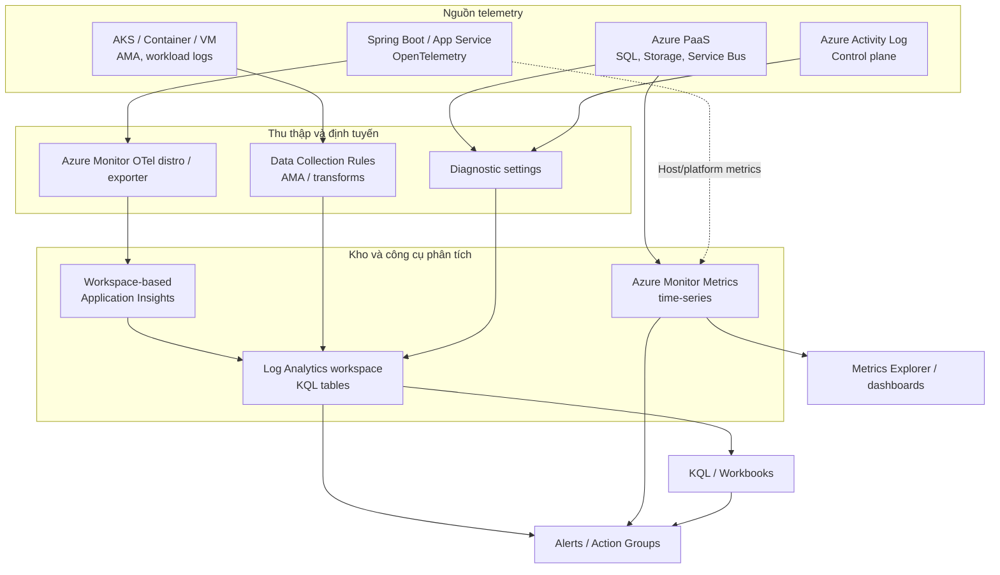
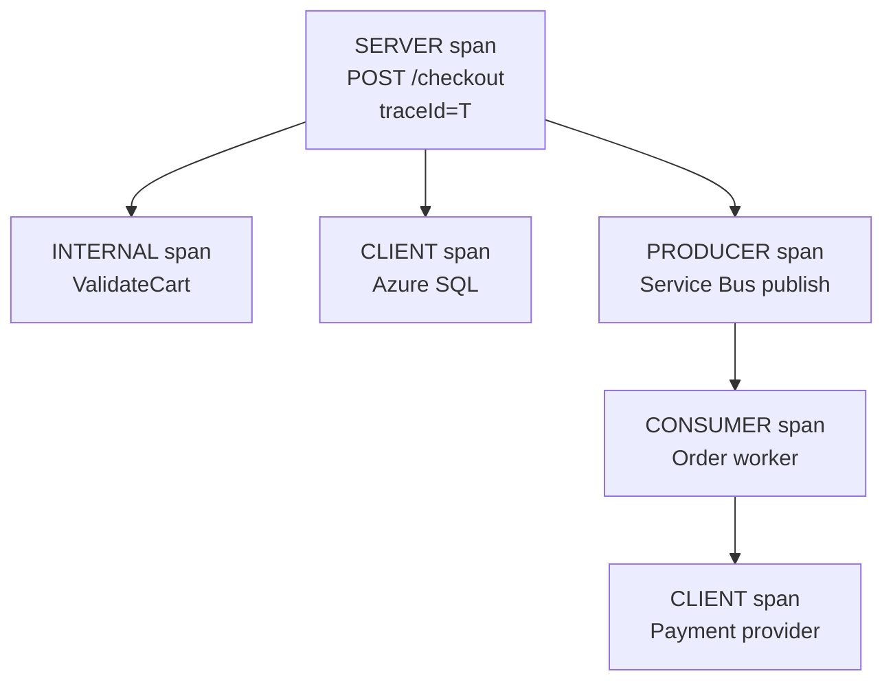
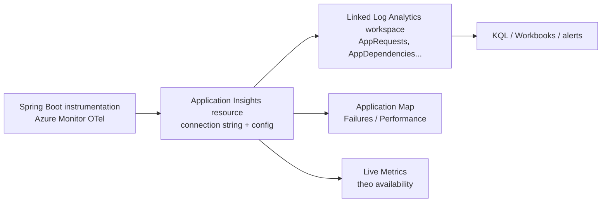
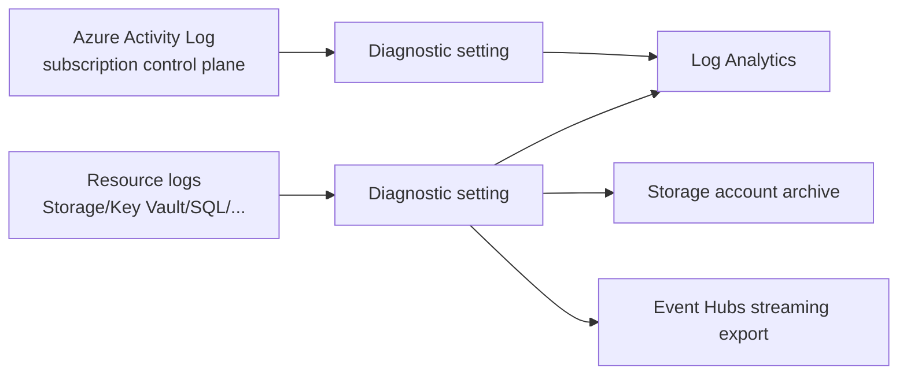
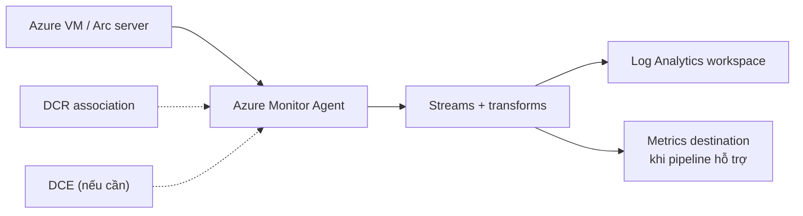
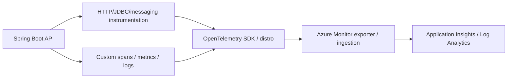
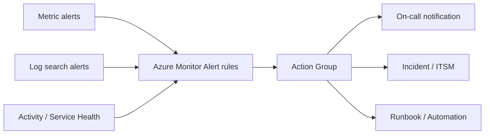
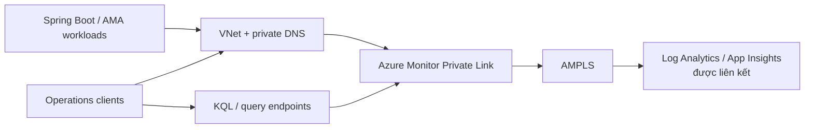
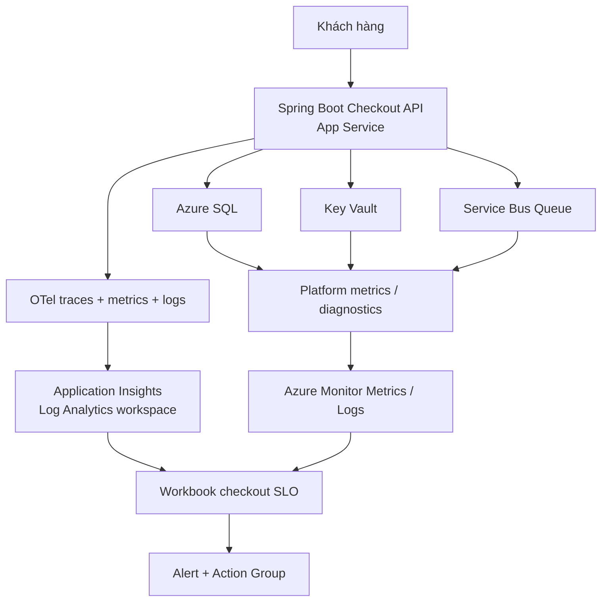

# Kiến trúc Azure Monitor với metric, log và trace

Một ứng dụng thương mại điện tử triển khai trên Azure App Service có ba thành phần: API Java Spring Boot, Azure SQL Database và Azure Service Bus. Một buổi tối, khách hàng phản ánh thanh toán chậm, nhưng dashboard CPU của App Service vẫn bình thường. Nhóm vận hành không biết lỗi đến từ truy vấn SQL, kết nối Service Bus, code Java hay một thay đổi mạng vừa triển khai. Chỉ số CPU không đủ để trả lời; cần kết hợp **metric** về độ trễ và tỷ lệ lỗi, **log** có ngữ cảnh, và **distributed trace** nối các thao tác trong cùng một yêu cầu.

**Azure Monitor** là hệ thống quan sát và giám sát trên Azure, thu nhận, phân tích, trực quan hóa và cảnh báo từ nhiều nguồn telemetry. Các thành phần thường gặp gồm **Azure Monitor Metrics**, **Azure Monitor Logs / Log Analytics workspaces**, **Application Insights**, **diagnostic settings**, **Data Collection Rules (DCRs)**, **Azure Monitor Agent (AMA)**, **alerts/action groups**, **Workbooks**, và các tích hợp **OpenTelemetry** cho ứng dụng. Chúng giải quyết các phần khác nhau của một kiến trúc quan sát, không phải những tên gọi thay thế lẫn nhau.

Trong module **CLOUD_PROVIDERS_AZURE**, người học tìm hiểu hệ sinh thái Microsoft Azure từ subscription, resource group, Entra ID đến mạng ảo, compute, lưu trữ và dữ liệu; học triển khai, giám sát, bảo vệ và kiểm soát chi phí một kiến trúc ứng dụng. Bài thuộc chương **Giám sát và quan sát hệ thống**, tập trung đúng chủ đề **“Kiến trúc Azure Monitor với metric, log và trace”**. Mục tiêu là thiết kế tín hiệu cần thu, đường đi của telemetry, truy vấn/quan hệ giữa các tín hiệu, cảnh báo, bảo mật, ngân sách và quy trình vận hành có thể áp dụng.

> **Giới hạn thực hành:** Tên tài nguyên, dữ liệu, ngưỡng cảnh báo và mã ví dụ đều dành cho lab. Cấu hình bảng Log Analytics, pipeline OpenTelemetry, khả năng DCR/DCE, Data Collection Endpoint, resource-specific tables, tier và chi phí thay đổi theo dịch vụ/region/phiên bản SDK. Khi áp dụng, luôn đối chiếu tính năng hiện có của tài nguyên, API/SDK và chính sách nội bộ; không gửi token, secrets, PII hoặc payload nhạy cảm vào telemetry.

## 1. Mục tiêu học tập

Sau bài này, bạn có thể:

- Phân biệt **monitoring** với **observability**, hiểu vai trò bổ trợ của **metric, log và trace**.
- Vẽ được luồng **Azure resource metrics → Metrics**, **resource/platform logs → Log Analytics**, **application telemetry → Application Insights/OpenTelemetry**.
- Giải thích các thành phần **resource, namespace, dimensions, metric series, log table, workspace, span, trace ID, parent span ID**.
- Phân biệt **Azure Activity Log**, **resource logs**, **application logs** và **guest OS/container logs**.
- Cấu hình **diagnostic settings**, **DCR**, **AMA** và workspace ở mức kiến trúc phù hợp.
- Chạy các truy vấn **KQL** phục vụ đánh giá lỗi, độ trễ, throughput, phụ thuộc và tương quan.
- Thiết kế instrumentation Java/Spring với **Azure Monitor OpenTelemetry** và context propagation.
- Xây cảnh báo **metric/log/availability**, action groups, dashboards và SLO theo nguyên tắc giảm alert fatigue.
- Kiểm soát **cardinality, sampling, retention, costs, RBAC, data residency, Private Link và redaction**.
- Viết runbook điều tra sự cố bằng metric → trace → log, và nhận diện các sai lầm thường gặp trong môi trường production.

## 2. Monitoring khác observability như thế nào?

**Monitoring (giám sát)** là quan sát tình trạng hệ thống qua những tín hiệu và câu hỏi đã biết: CPU có vượt 80% không, HTTP 5xx có tăng không, queue backlog có lớn hơn ngưỡng không?

**Observability (khả năng quan sát)** là khả năng suy luận **trạng thái bên trong từ các đầu ra telemetry**, kể cả khi nguyên nhân chưa được dự đoán trước. Khi khách phản ánh “mỗi lần bấm thanh toán lâu 12 giây”, observability giúp liên kết request với từng span, SQL query, retry và exception, từ đó khoanh vùng nút thắt.

| Góc nhìn | Monitoring | Observability |
|---|---|---|
| Câu hỏi điển hình | “Tỷ lệ lỗi có vượt ngưỡng?” | “Vì sao nhóm request này chậm, ở bước nào?” |
| Tín hiệu | Metrics, health checks, alerts | Metrics + logs + traces + topology/dependencies |
| Phản ứng | Phát hiện triệu chứng | Giải thích, xác minh giả thuyết và cải tiến |
| Khó khăn | Đặt ngưỡng đúng, tránh nhiễu | Correlation, sampling, coverage, cardinality, chi phí |
| Giá trị | Phát hiện sự cố sớm | Rút ngắn MTTR và tìm nguyên nhân gốc |

Observability không có nghĩa “thu càng nhiều logs càng tốt”. Thu telemetry không kiểm soát có thể làm **tăng phí ingest, chậm truy vấn, rò PII** và vẫn không giải quyết được câu hỏi nào. Bắt đầu từ **người dùng, SLO và các hành trình nghiệp vụ quan trọng**, sau đó thiết kế tín hiệu đúng mục đích.

## 3. Ba trụ cột metric, log và trace

| Tín hiệu | Dữ liệu | Giải đáp | Ví dụ |
|---|---|---|---|
| **Metric** | Giá trị số theo thời gian, thường có dimensions | “Bao nhiêu? Khi nào? Tăng/giảm ra sao?” | `http.server.request.duration` p95, CPU %, error rate |
| **Log** | Event có timestamp và fields/ngữ cảnh | “Đã xảy ra gì? Vì sao lỗi?” | `payment_authorization_failed` với mã lỗi đã ẩn dữ liệu |
| **Trace** | Chuỗi spans của cùng một hoạt động phân tán | “Request đi qua những bước nào? Chậm ở đâu?” | API → SQL → Service Bus → Worker |

### Minh họa một request có đủ ba tín hiệu

```text
Metric:
  http.server.request.duration{route="/checkout",status="500"} = 2.3 s

Log:
  2026-11-20T10:05:03Z ERROR payment dependency timeout
  trace_id=4bf92f... service=checkout-api exception_type=TimeoutException

Trace:
  traceId=4bf92f...
  [SERVER] POST /checkout              2.30 s
      [CLIENT] Azure SQL: update order  0.05 s
      [CLIENT] Payment gateway          2.20 s  <-- hotspot
      [INTERNAL] Publish event          0.02 s
```

**Metric** giúp phát hiện số request chậm tăng; **trace** chỉ ra payment gateway mất 2,20 giây; **log** cho biết timeout/rate-limit hoặc cấu hình nào liên quan. Không tín hiệu đơn lẻ nào luôn đủ.

### Tương quan không tự động xuất hiện

Metric thường **không chứa từng traceId** vì tạo series theo từng request sẽ gây cardinality quá lớn. Traces/logs có thể mang `traceId`/`spanId` để liên kết. Một số hệ thống hỗ trợ **exemplars** hoặc click-through từ metric đến trace theo tích hợp cụ thể; đừng mặc định mọi Azure metric có liên kết tự động tới một trace.

## 4. Kiến trúc tham chiếu Azure Monitor



**Sơ đồ khái niệm**: không phải mọi PaaS metric luôn đi qua diagnostic settings. Nhiều **platform metrics** được Azure tự thu và có thể xem trực tiếp trong **Azure Monitor Metrics**. **Resource logs** thường cần bật diagnostic settings để chuyển tới Log Analytics/Storage/Event Hubs. Application Insights workspace-based lưu application telemetry trong workspace được liên kết; các loại log/metric cụ thể có thể dùng những pipeline và bảng khác nhau.

### Thành phần và trách nhiệm

| Thành phần | Trách nhiệm |
|---|---|
| **Azure Monitor Metrics** | Lưu/tra cứu các metric series của Azure platform và một số nguồn custom/application được hỗ trợ |
| **Azure Monitor Logs** | Truy vấn các bản ghi dạng bảng trong Log Analytics với KQL |
| **Log Analytics workspace** | Vùng lưu và quản trị log data/retention/access |
| **Application Insights** | Quan sát ứng dụng: requests, dependencies, exceptions, traces, availability, user flows theo khả năng |
| **Diagnostic settings** | Route platform/resource logs và một số metrics tới destination được hỗ trợ |
| **Azure Monitor Agent (AMA)** | Thu telemetry máy/OS/guest theo DCR |
| **DCR (Data Collection Rule)** | Định nghĩa sources, streams, destinations và transformations cho pipeline phù hợp |
| **DCE (Data Collection Endpoint)** | Endpoint thu nhận/cấu hình cho những kiến trúc DCR/agent phù hợp; không bắt buộc cho mọi source |
| **Alerts** | Đánh giá điều kiện metrics/logs/availability và tạo sự kiện cảnh báo |
| **Action Groups** | Định tuyến thông báo/hành động khi alert kích hoạt |
| **Workbooks** | Kết hợp visualization từ KQL, metrics và tham số để vận hành |

## 5. Những nguồn tín hiệu khác nhau trong Azure

Một kiến trúc quan sát tốt phải xác định **nguồn phát**, **tín hiệu** và **đích lưu**. Ví dụ:

| Nguồn | Metrics thường gặp | Logs/traces cần cấu hình |
|---|---|---|
| **App Service** | HTTP requests, CPU/memory theo metric definitions | App logs, HTTP logs, Application Insights instrumentation |
| **Spring Boot** | Request duration, JVM runtime, business counters | Structured application logs, OTel spans/dependencies |
| **Azure SQL** | CPU, DTU/vCore, storage, connections | SQL diagnostics/audit, query metrics theo feature |
| **Storage account** | Transactions, ingress/egress, latency/availability | Blob/DFS service diagnostics theo categories |
| **Service Bus** | Active/dead-letter counts, throughput, errors | Operational/audit logs khi diagnostic category hỗ trợ |
| **Event Hubs** | Incoming/outgoing, throttling, capacity | Resource/operational logs, consumer app trace |
| **AKS** | Node/pod/system signals theo integration | Container insights/Prometheus logs/metrics và app traces |
| **Azure VM** | CPU/network/disk platform metrics | Guest syslog/Windows Events/performance counters qua AMA + DCR |
| **Azure Resource Manager** | Không phải application trace | **Azure Activity Log** cho control-plane events |
| **Key Vault** | Request volume/latency hoặc service metrics | Audit events qua diagnostic settings |

**Không mọi log đều có sẵn mặc định.** Một resource có Metrics chart không đảm bảo đã gửi diagnostic logs vào workspace; một Application Insights resource không tự thu đủ traces từ app chưa được instrument.

### Azure Activity Log khác application logs

**Azure Activity Log** ghi sự kiện control plane ở subscription, ví dụ ai thay đổi network rule hoặc tạo resource. Nó **không thay thế** log “request /checkout báo 500” trong Spring Boot. Resource logs và application traces có pipeline khác, cần cấu hình riêng.

## 6. Thiết kế theo câu hỏi vận hành trước khi chọn bảng

Trước khi tạo workspace, hãy xác định:

1. **Hành trình người dùng nào quan trọng?** Đăng nhập, checkout, upload, đặt hàng.
2. **SLO nào cần bảo vệ?** Availability, latency, correctness, freshness.
3. **Sự cố nào cần phát hiện?** 5xx, p95 tăng, SQL throttling, Service Bus DLQ tăng.
4. **Khi alert nổ, người trực ca cần biết gì?** Service, region, deployment, traceId, runbook.
5. **Tín hiệu nào đo được triệu chứng?** Metric dimension ổn định, KQL query có bảng phù hợp.
6. **Tín hiệu nào tìm root cause?** Spans/dependencies, exception metadata, platform diagnostics.
7. **Retention và chi phí hợp lý?** High-cardinality logs/thời gian lưu và dữ liệu nhạy cảm.
8. **Ai được quyền đọc?** RBAC workspace/resource, dữ liệu multi-tenant/PII.

**Kết quả thiết kế** có thể là bảng ánh xạ:

| SLO / vấn đề | Metric alert | Truy vấn log | Trace |
|---|---|---|---|
| Checkout thành công | HTTP server error rate | `AppRequests` 5xx theo route | Trace request thất bại |
| Checkout p95 dưới ngưỡng | Request duration p95 | Percentile request durations | Dependency spans SQL/gateway |
| Queue không tồn quá lâu | Active messages/oldest age theo khả năng metric | Worker processing errors | Producer → broker → consumer |
| Không mất business event | Sink success/failure counter | Outbox/checkpoint/audit logs | Event trace context |
| Không thay network bất ngờ | Azure Activity Log alert | `AzureActivity` / resource diagnostics | Deployment correlation |

## 7. Metric là gì? Time series, aggregation và dimensions

Một metric đo giá trị số tại thời điểm/chu kỳ, chẳng hạn CPU %, request count hoặc processing duration. Một **time series** được xác định bởi metric name + tập dimension labels/values + source.

```text
metric: http.server.request.duration
unit: seconds
labels:
  service.name: checkout-api
  http.route: /checkout
  http.response.status_code: 200
aggregation: histogram / p95 query
```

### Các loại metric phổ biến

- **Counter (monotonic):** số sự kiện tích lũy, ví dụ `orders_processed_total`; khi đọc có thể tính rate/độ tăng trong window.
- **Up/down counter hoặc gauge:** số đang chờ, số kết nối, active workers; giá trị tăng/giảm theo thời điểm.
- **Histogram/distribution:** ghi nhận phân phối thời gian request/dependency, hỗ trợ percentiles theo cơ chế lưu/aggregation.
- **Azure platform metric:** do service phát, có units/aggregation được định nghĩa sẵn; không mặc định giống OpenTelemetry metric instruments.

### Aggregation quan trọng

```text
Một phút có:
  100 request nhanh: 50 ms
  5 request chậm:   3000 ms

Average có thể nhìn tương đối ổn,
nhưng p95/p99 vẫn phản ánh tail latency ảnh hưởng user.
```

Không lấy **average của các p95** rồi coi đó là p95 toàn bộ request: percentile không có tính chất cộng như sum. Phải dùng raw distribution/histogram hoặc các phép tổng hợp được backend hỗ trợ trên dữ liệu phù hợp.

### Dimensions/cardinality

Nên dùng dimensions hữu ích và có cardinality giới hạn:

```text
service.name = checkout-api
deployment.environment = production
cloud.region = southeastasia
http.route = /checkout
result = success|failure
```

**Không dùng `orderId`, `userId`, `traceId` hoặc URL có mã khách hàng làm metric dimension**. Mỗi giá trị duy nhất tạo thêm time series, tăng chi phí và làm hệ thống khó truy vấn. Định danh request cụ thể thuộc log/trace với chính sách bảo mật phù hợp.

## 8. Azure Monitor Metrics: platform metrics và custom metrics

**Platform metrics** thường được Azure resource cung cấp sẵn trong Metrics Explorer: ví dụ CPU của App Service, số operations của Storage, active messages của Service Bus. Tập metric chính xác phụ thuộc loại resource/tier và API.

### Truy vấn metric qua Azure CLI

```bash
az login
az account set --subscription "<subscription-id>"

APP_ID=$(az webapp show \
  --resource-group "rg-observe-lab" \
  --name "app-checkout-lab" \
  --query id --output tsv)

# Xem danh sách metric definitions của đúng resource.
az monitor metrics list-definitions \
  --resource "$APP_ID" \
  --output table

# Khi đã xác nhận tên metric chính xác qua list-definitions:
az monitor metrics list \
  --resource "$APP_ID" \
  --metric "<metric-name-from-definitions>" \
  --interval PT1M \
  --aggregation Average \
  --output json
```

Đoạn thứ hai có **placeholder**, không thể chạy trực tiếp cho đến khi điền metric name và aggregation được phép. Không suy đoán mọi dịch vụ có cùng metric `CpuPercentage` hoặc cùng dimension labels.

### Metrics Explorer giúp gì?

Một vận hành viên có thể:

1. Chọn resource/region/metric namespace.
2. Chọn metric name, aggregation và time granularity.
3. Chia theo một dimension được hỗ trợ, ví dụ status/category/location.
4. So sánh trước/sau deployment.
5. Tạo cảnh báo metric có ý nghĩa hoặc ghim biểu đồ vào dashboard/workbook.

**Đừng dùng “All metrics” rồi gửi mọi series ra logs vì sợ bỏ sót.** Metric definitions và retention/aggregation phù hợp sẽ quyết định thiết kế; đẩy metrics vào logs có thể làm tăng phí ingest và chưa chắc giữ nguyên semantics của metric store.

### Custom metrics

Ứng dụng có thể phát custom metrics qua OpenTelemetry và Azure Monitor pipeline/tính năng được hỗ trợ. Ví dụ:

```text
business.orders.processed
  unit = {order}
  attributes = {tenant_tier, result}

business.payment.authorize.duration
  unit = s
  attributes = {provider, result}
```

Tránh label `customer_id` hoặc `order_id`. Không dùng metric làm audit log: metric counter không lưu từng bản ghi với chi tiết lý do và người thực hiện.

## 9. Log là gì? Structured events và hệ bảng Log Analytics

Log là record sự kiện có timestamp, severity và fields. Log có thể là:

- **Application log** từ Spring Boot, ví dụ `WARN payment provider slow`.
- **Request/dependency telemetry** của Application Insights, ví dụ request status, SQL call duration.
- **Platform/resource log** qua diagnostic settings, ví dụ Key Vault audit hoặc gateway access logs.
- **Guest log** từ VM syslog/Windows Event Logs qua AMA/DCR.
- **Azure Activity Log** cho thay đổi control plane.

### Structured logging thay vì chuỗi tự do

Không tốt:

```text
Something went wrong for order 9839482, user alice@example.com,
payment card ending 1234, secret=...
```

Tốt hơn:

```json
{
  "timestampUtc": "2026-11-20T10:12:00Z",
  "level": "ERROR",
  "service": "checkout-api",
  "environment": "production",
  "operation": "AuthorizePayment",
  "errorType": "DependencyTimeout",
  "provider": "payment-gateway",
  "traceId": "4bf92f...",
  "spanId": "00f067...",
  "durationMs": 2200
}
```

**Không đưa PII, access token, connection string, Authorization header hoặc toàn bộ request body vào logs**. Một trace ID có thể dùng để tìm request cụ thể; nếu có yêu cầu compliance, cần chính sách truy cập/retention đối với log records.

### Workspace và bảng

**Log Analytics workspace** là nơi lưu nhiều bảng log. Các bảng điển hình (tùy integration/cấu hình) có thể gồm:

| Bảng | Nguồn/ý nghĩa thường gặp |
|---|---|
| `AppRequests` | Request telemetry Application Insights workspace-based |
| `AppDependencies` | Dependency calls từ application instrumentation |
| `AppTraces` | Trace/log message telemetry ứng dụng |
| `AppExceptions` | Exception telemetry ứng dụng |
| `AppEvents` | Custom application events theo pipeline |
| `AzureActivity` | Subscription Activity Log nếu được đưa vào workspace |
| `AzureDiagnostics` | Resource logs khi dùng legacy/Azure diagnostics table mode |
| Resource-specific tables | Resource logs ghi vào bảng riêng theo resource/category được hỗ trợ |
| `Heartbeat` / `Perf` / `Event` / `Syslog` | Những dữ liệu guest/agent khi được cấu hình |

Không phải workspace nào cũng có đủ bảng. Nếu Application Insights chưa được liên kết hoặc không có traffic, `AppRequests` có thể rỗng; nếu diagnostic settings chọn **resource-specific tables**, không thể giả định mọi resource log đều nằm trong `AzureDiagnostics`.

## 10. Trace và span: hiểu đường đi của một request phân tán

Một **trace** mô tả một hoạt động end-to-end, thường bắt đầu từ ingress request. Trace gồm nhiều **spans**, mỗi span đại diện một thao tác và quan hệ parent-child hoặc links theo chuẩn instrumentation.



Các khái niệm:

- **Trace ID**: định danh toàn bộ trace, thường được propagate qua các lời gọi.
- **Span ID**: định danh một span riêng.
- **Parent span ID**: quan hệ cha-con khi có.
- **Span kind**: SERVER, CLIENT, PRODUCER, CONSUMER, INTERNAL theo OTel semantics.
- **Attributes**: metadata như `service.name`, `http.route`, `db.system`, được giới hạn cardinality.
- **Events/status**: thời điểm và trạng thái bên trong span, không thay thế structured logs.
- **Links**: mối liên hệ với spans/traces khác, thường hữu ích khi async queues/batches.

### Context propagation

Các headers theo chuẩn **W3C Trace Context** như `traceparent` và `tracestate` có thể truyền ngữ cảnh qua HTTP. Trong messaging, propagation thường qua **message application properties** hoặc cơ chế instrumentation/broker integration phù hợp.

```text
HTTP request:
  traceparent: 00-<trace-id>-<parent-span-id>-01

Spring order API:
  traceId = T
  publish Service Bus message

Order worker:
  extract tracing context từ message headers/properties
  create CONSUMER span hoặc span link phù hợp
```

**Không mặc định một queue message luôn trở thành child span trực tiếp của HTTP request.** Với xử lý bất đồng bộ, batch/fan-out, span links hoặc mô hình mới có thể phù hợp hơn. Quan trọng là giữ correlation và không biến trace thành một chuỗi giả kéo dài nhiều ngày.

### Traces khác logs

Một span có thời gian bắt đầu/kết thúc, status và attributes; log record mô tả sự kiện. Không nên ghi mỗi debug statement thành span, cũng không nên chỉ log start/end để thay thế distributed tracing. Thiết kế span theo **meaningful operation boundaries**.

## 11. Application Insights workspace-based: vị trí trong Azure Monitor

**Application Insights** tập trung vào telemetry ứng dụng: inbound requests, outbound dependencies, exceptions, logs, availability và trải nghiệm người dùng theo instrumentation/tính năng. Kiến trúc **workspace-based Application Insights** liên kết dữ liệu với Log Analytics workspace để phân tích bằng KQL và quản trị tập trung.



Sơ đồ mô tả **mối quan hệ quản lý và luồng telemetry ở mức logic**; không có nghĩa OTel SDK thực hiện từng bước HTTP qua Application Insights resource như một proxy. Trong môi trường thật, exporter gửi telemetry tới ingestion endpoint tương ứng của Azure Monitor/Application Insights, còn workspace liên kết nhận dữ liệu theo tích hợp.

### Connection string có phải secret?

**Application Insights connection string** chỉ cấu hình ingestion endpoints và instrumentation resource, không phải credentials có quyền đọc dữ liệu. Tuy nhiên không nên phát tán vô hạn vì có thể tạo nhiễu/cost và tiết lộ topology; lưu như configuration theo policy. **Không nhầm instrumentation key/connection string với Entra authorization**: quyền quản lý/đọc workspace vẫn qua Azure RBAC và các cơ chế phù hợp.

### Vì sao một app nên khai báo service identity?

Trong OpenTelemetry, `service.name`, `service.namespace`, `service.version` và `deployment.environment.name` giúp phân biệt:

```text
checkout-api / production / v2.8.1
orders-worker / production / v1.7.4
checkout-api / staging / v2.9.0-rc
```

Nếu tất cả services cùng tên `unknown_service:java`, Application Map và filters khó phân biệt. Nhưng cũng không để mỗi pod có `service.name` duy nhất; pod/container instance ID có chỗ dùng riêng như resource attributes và không nên làm nổ cardinality của metric dimensions.

## 12. Azure Activity Log, resource logs và diagnostic settings

Một thay đổi trên Azure có thể gây sự cố dù Spring code không đổi. Ví dụ ai đó sửa Service Bus network rule khiến worker không kết nối được; **Azure Activity Log** giúp tìm hoạt động quản trị, trong khi Application Insights thấy client failures.

### Dòng dữ liệu platform



**Diagnostic settings** có thể định tuyến các log categories/metric categories được hỗ trợ tới **Log Analytics**, **Storage account** hoặc **Event Hubs** tùy source/destination. Không phải mọi resource hỗ trợ mọi category/destination. Đối với Activity Log, cấu hình xuất ở phạm vi subscription và quyền tương ứng, không coi là diagnostic setting của từng App Service.

### Khi nào cần bật diagnostic settings?

Ví dụ:

- **Key Vault**: audit truy cập và thao tác trên keys/secrets theo category được hỗ trợ.
- **Storage Blob**: các operational/resource logs phục vụ sự cố authorization/transactions.
- **Service Bus**: operational logs phù hợp khi cần điều tra quyền/thao tác, kết hợp broker metrics.
- **Azure SQL**: diagnostics/auditing theo policy của database/server.
- **Azure Firewall/NSG/Gateway**: logs mạng để truy tìm drop/deny.

**Resource logs không nhất thiết có sẵn trước lúc bật**; không nên kỳ vọng khôi phục lại lịch sử đã không thu. Khi bật, xác minh đúng log category, destination, bảng và ingestion hoạt động thực bằng một sự kiện lab.

### Destination khác nhau phục vụ mục đích khác nhau

| Destination | Thích hợp | Cần chú ý |
|---|---|---|
| **Log Analytics workspace** | KQL, correlation, alerts, investigations | Ingestion/retention cost, workspace RBAC |
| **Storage account** | Archive dài hạn, compliance/export | Lifecycle/immutability, khó query trực tiếp như LAW |
| **Event Hubs** | Streaming logs tới SIEM/consumer bên ngoài | Event Hub capacity, consumers, authorization |

Một log category được xuất tới nhiều destinations có thể phát sinh phí và cần thiết kế retention ở từng nơi. Không tự đổ toàn bộ high-volume access logs vào Log Analytics mà không dự báo chi phí.

## 13. Azure CLI: xem diagnostic categories trước khi cấu hình

Ví dụ với một Key Vault lab:

```bash
az login
az account set --subscription "<subscription-id>"

KV_ID=$(az keyvault show \
  --resource-group "rg-observe-lab" \
  --name "kv-observe-lab" \
  --query id --output tsv)

# Tìm categories hỗ trợ trên chính resource.
az monitor diagnostic-settings categories list \
  --resource "$KV_ID" \
  --output json

# Kiểm tra settings đang có.
az monitor diagnostic-settings list \
  --resource "$KV_ID" \
  --output json
```

Sau khi thấy categories thật, mới định tuyến vào workspace:

```bash
LAW_ID=$(az monitor log-analytics workspace show \
  --resource-group "rg-observe-lab" \
  --workspace-name "law-observe-lab" \
  --query id --output tsv)

# Thay category bằng tên trả về từ categories list.
az monitor diagnostic-settings create \
  --resource "$KV_ID" \
  --name "send-audit-to-law" \
  --workspace "$LAW_ID" \
  --logs '[{"category":"<supported-category>","enabled":true}]'
```

**Cảnh báo:** Lệnh `create` thay đổi cấu hình và có thể phát sinh phí ingestion. Placeholder `<supported-category>` không dùng được nguyên bản. Tùy CLI version, cách khai báo `--logs`/`--metrics` và table destination mode có thể khác; kiểm tra `--help`, categories và policy trước khi chạy. Chỉ tạo trên tài nguyên được cấp phép.

### Resource-specific tables

Khi chọn destination Log Analytics, một số diagnostic logs có thể được lưu vào **bảng riêng theo resource/category** (resource-specific mode), thay vì bảng `AzureDiagnostics` tổng hợp. Truy vấn cần dựa trên **bảng được triển khai thực**, không hard-code duy nhất `AzureDiagnostics`.

### Không ép metric sang log khi không có nhu cầu

Platform metrics đã xem được trong Metrics Explorer; việc route metrics qua diagnostic settings có quy tắc và khả năng hỗ trợ riêng. Nếu mục tiêu chỉ là alert CPU/transactions, **metric alert trực tiếp** thường phù hợp hơn ingest toàn bộ samples vào Log Analytics rồi query lại.

## 14. Azure Monitor Agent, Data Collection Rules và Data Collection Endpoints

**Azure Monitor Agent (AMA)** là thành phần thu thập telemetry ở guest/compute environments được hỗ trợ, thường triển khai trên Azure VMs/Arc-enabled servers và dùng **Data Collection Rules (DCRs)** để xác định dòng dữ liệu cần thu. Không nhầm AMA với **OpenTelemetry SDK trong Java process**: AMA có thể thu OS/performance/syslog, còn OTel instrumentation giúp tạo traces và app metrics có ngữ cảnh của code.

### DCR quy định gì?

Một **DCR** có thể mô tả:

1. **Data sources/streams**: performance counters, syslog, Windows events hoặc custom data pipeline phù hợp.
2. **Destinations**: ví dụ Log Analytics workspace hoặc đích khác được hỗ trợ cho loại data.
3. **Data flows**: luồng source → transformation → destination.
4. **Transformations**: lọc/chuẩn hóa trường bằng KQL transformation theo capability của pipeline.
5. **Associations**: gắn DCR với những tài nguyên/máy phù hợp.



### DCE có luôn bắt buộc không?

**Không.** Data Collection Endpoint phục vụ những kịch bản agent/configuration/data ingestion cần endpoint được chỉ định, private networking hoặc cơ chế API phù hợp. Nhiều pipeline DCR có endpoint/đường đi khác và không cần DCE riêng; quyết định dựa trên **loại nguồn, agent version, network requirements và API hiện hành**.

### Bài toán chọn nguồn

| Nhu cầu | Hướng thu thập |
|---|---|
| Windows Event Log trên VM | AMA + DCR Windows events |
| Linux Syslog trên VM/Arc | AMA + DCR Syslog |
| Guest performance counters | AMA + DCR performance counters |
| Application spans Java | Azure Monitor OpenTelemetry Distro/SDK hoặc exporter tương thích |
| Resource logs Key Vault | Diagnostic settings resource-side |
| Azure SQL CPU platform metric | Azure Monitor Metrics |
| Container logs AKS | Container Insights/AMA-based integration theo cấu hình |
| Managed Prometheus metrics | Azure Monitor managed service for Prometheus pipeline thích hợp |

**Không dùng một DCR mặc định có toàn bộ syslog levels** chỉ vì “sợ mất log”: debug/notice có thể chiếm dung lượng lớn. Tạo DCR theo nguồn dữ liệu thực, noise level, compliance và SLO.

### Biến đổi ở ingestion time

Một DCR transform có thể loại bỏ hoặc chuẩn hóa một số trường/trường hợp **trước khi dữ liệu vào table**, giúp giảm phí và rủi ro. Nhưng transform sai có thể **làm mất dữ liệu không khôi phục được**, đặc biệt khi chỉ có một đường lưu. Kiểm thử trên lab với mẫu log thật, xem schema output, có version control và rollback.

## 15. Log Analytics workspace: thiết kế theo môi trường và quyền

Một enterprise có thể dùng **một workspace chung** hoặc nhiều workspaces theo environment/region/security boundary. Không có quy tắc “mỗi resource một workspace” hay “cả tổ chức một workspace” luôn đúng.

### Các tiêu chí tách workspace

| Tiêu chí | Khi có thể cần tách |
|---|---|
| **Data residency** | Logs từ thị trường/region phải ở location được chấp thuận |
| **Security** | Teams khác nhau không được đọc logs nhạy cảm của nhau |
| **Retention** | Audit logs 1 năm, debug logs 7 ngày theo policy |
| **Billing** | Cần chargeback giữa business units/khác ownership |
| **Scale/limits** | Query workload hoặc table/data ingestion có đặc tính riêng |
| **Operations** | Staging cần tránh tạo alert/cost trên production |

### Thiết kế mẫu

```text
Production (regional boundary):
  law-prod-sea
    ├── Application Insights: checkout-api-prod
    ├── Application Insights: orders-worker-prod
    ├── Azure Activity / PaaS diagnostic logs
    └── AMA logs / container signals

Non-production:
  law-nonprod-sea
    ├── Application Insights: checkout-api-staging
    ├── Test diagnostics
    └── Short retention + budget
```

Nếu nhóm dùng nhiều workspaces, có thể truy vấn cross-workspace theo khả năng KQL và quyền, nhưng query phức tạp/cost/access policy tăng. Đừng dùng cross-workspace như cách vượt quyền tách dữ liệu đã được quy định.

### RBAC: đọc logs không phải quyền quản trị resources

Một nhân viên có **Reader** trên resource group chưa chắc được đọc tất cả log tables từ một workspace khác không thuộc scope hoặc data access model phù hợp. Cần thiết kế:

- Azure RBAC ở **workspace** cho người được phép đọc/viết cấu hình.
- Resource-context vs workspace-context access theo cấu hình workspace.
- Table-level granular access khi tính năng hỗ trợ và policy yêu cầu.
- Action group/integration identity riêng cho automation.
- Quản trị viên workspace không tự động nên được đọc raw PII nếu không cần.

**Không đặt secrets vào log** rồi kỳ vọng RBAC sẽ giải quyết trọn vẹn nguy cơ rò rỉ. Access control là lớp thứ hai, ingestion-time redaction/data minimization mới là nền tảng.

## 16. KQL cơ bản: từ dữ liệu thô tới insight

**Kusto Query Language (KQL)** giúp truy vấn Log Analytics bằng pipeline operators. Một truy vấn thường bắt đầu từ tên **table**, lọc `TimeGenerated` sớm, rồi `summarize`, `project` và `order by`.

### Mẫu truy vấn tối thiểu

```kusto
AppRequests
| where TimeGenerated >= ago(1h)
| where Name has "checkout"
| summarize Requests=count() by bin(TimeGenerated, 5m)
| order by TimeGenerated asc
```

**Điều kiện:** workspace có dữ liệu Application Insights và bảng `AppRequests`, field `Name` chứa tên operation tương ứng. Ở một workspace khác, table hoặc field có thể khác; xác minh schema và dùng tên columns thực.

### Các toán tử nên nắm

| Toán tử | Công dụng | Ví dụ |
|---|---|---|
| `where` | Lọc dữ liệu | `where TimeGenerated >= ago(15m)` |
| `project` | Chọn/đổi tên fields | `project TimeGenerated, Name, DurationMs` |
| `extend` | Tạo trường tính toán | `extend IsFailure = Success == false` |
| `summarize` | Tổng hợp theo nhóm | `summarize Failures=count() by Name` |
| `bin` | Gom theo thời gian | `bin(TimeGenerated, 5m)` |
| `join` | Nối các bảng theo keys | Request vs dependency theo correlation |
| `parse_json` | Phân tích JSON string | Custom dimensions khi có |
| `top` / `order by` | Sắp xếp | Top slow operations |
| `let` | Đặt biến/query expression | Tái sử dụng khoảng thời gian |

### Kiểm tra table/schema trước

```kusto
AppRequests
| where TimeGenerated > ago(24h)
| take 10
```

Trong Log Analytics portal, xem **Tables** và sample schema thật. Trước khi đưa KQL vào alert, thử với thời gian dữ liệu có thật, kiểm tra nulls, time zone và scope. **KQL chạy thành công nhưng trả 0 rows không chứng minh hệ thống không có lỗi**: có thể instrumentation/tables chưa được bật hoặc filter sai.

## 17. KQL: HTTP error rate và p95 latency

### Tỷ lệ lỗi request

```kusto
AppRequests
| where TimeGenerated >= ago(1h)
| summarize
    TotalRequests=count(),
    FailedRequests=countif(Success == false)
  by bin(TimeGenerated, 5m), AppRoleName
| extend ErrorRatePercent =
    iff(TotalRequests == 0, 0.0,
        100.0 * todouble(FailedRequests) / todouble(TotalRequests))
| order by TimeGenerated asc
```

**`Success` có thể dựa trên logic của instrumentation**, không phải định nghĩa riêng “chỉ HTTP 5xx”; nếu SLO chỉ coi 5xx là lỗi, hãy lọc `ResultCode` tương ứng với yêu cầu và loại 4xx hợp lệ. **Không gộp tất cả 404 vào incident** nếu 404 là business behavior bình thường.

### p95 request duration

```kusto
AppRequests
| where TimeGenerated >= ago(1h)
| where Name has "checkout"
| summarize
    Count=count(),
    P50Ms=percentile(DurationMs, 50),
    P95Ms=percentile(DurationMs, 95),
    P99Ms=percentile(DurationMs, 99)
  by bin(TimeGenerated, 5m), AppRoleName
| order by TimeGenerated asc
```

Trong workspace-based Application Insights, `DurationMs` thường lưu duration theo milliseconds; xác minh field type/units thật. Nếu chỉ có 4 requests trong cửa sổ 5 phút, p95 không đáng tin như một phân phối có hàng nghìn mẫu. Thêm điều kiện **minimum traffic** vào quy tắc alert.

### Lỗi 5xx theo route (khi ResultCode là chuỗi HTTP code)

```kusto
AppRequests
| where TimeGenerated >= ago(30m)
| extend StatusCode = toint(ResultCode)
| where StatusCode between (500 .. 599)
| summarize Failures=count() by Name, StatusCode
| top 20 by Failures desc
```

Không lấy `ResultCode` của một dependency SQL rồi diễn giải như HTTP status code: dependency types có semantics khác. Chỉ query trong bảng/field phù hợp.

## 18. KQL: Dependencies, exceptions và correlation theo OperationId

### Tìm dependencies chậm

```kusto
AppDependencies
| where TimeGenerated >= ago(2h)
| summarize
    Count=count(),
    Failed=countif(Success == false),
    P95Ms=percentile(DurationMs, 95)
  by Target, Type, AppRoleName
| top 20 by P95Ms desc
```

Khi kết quả chỉ ra `Azure SQL` có p95 tăng, cần tiếp tục xem **database service metrics/query diagnostics**. Một trace span nói “SQL call mất 5 giây” không tự phân biệt lock contention, CPU pressure, network delay hay retry ở JDBC.

### Exceptions mới nhất

```kusto
AppExceptions
| where TimeGenerated >= ago(1h)
| project TimeGenerated, AppRoleName,
          ExceptionType, OuterMessage, OperationId
| order by TimeGenerated desc
| take 50
```

**OuterMessage** có thể chứa dữ liệu ứng dụng/PII nếu code ghi exception không an toàn. Với môi trường nhạy cảm, giới hạn quyền và cân nhắc chỉ hiển thị error type/code, không chia sẻ screenshot có payload.

### Lần theo một trace/operation

```kusto
let Operation = "<observed-operation-id>";
union isfuzzy=true
    (AppRequests | where OperationId == Operation
        | project TimeGenerated, OperationId, Id, ParentId,
                  Name, DurationMs, Success, ItemType="request"),
    (AppDependencies | where OperationId == Operation
        | project TimeGenerated, OperationId, Id, ParentId,
                  Name, DurationMs, Success, ItemType="dependency")
| order by TimeGenerated asc
```

Query này là **hướng tương quan điển hình** với schema của Application Insights workspace-based. `OperationId` thường đại diện một trace/operation và `Id`/`ParentId` thể hiện quan hệ telemetry. Khi dùng OTel, hãy xác minh mapping traceId/spanId→columns; một số pipelines dùng table columns hoặc dynamic properties khác. `union isfuzzy=true` không thay thế việc kiểm tra dữ liệu khi bảng không có.

### Đối chiếu logs của cùng operation

```kusto
AppTraces
| where TimeGenerated >= ago(2h)
| where OperationId == "<observed-operation-id>"
| project TimeGenerated, SeverityLevel,
          Message, AppRoleName, OperationId
| order by TimeGenerated asc
```

Để có log correlation, Java logger phải ghi context/trace ID theo cấu hình instrumentation hoặc OTel bridge; **không tự giả định mọi `System.out.println` được đồng bộ thành AppTraces có OperationId**.

## 19. KQL: Azure Activity Log và thay đổi cấu hình

Khi alert 5xx bắt đầu ngay sau một triển khai, tìm activity logs để xác định ai/what thay đổi hạ tầng:

```kusto
AzureActivity
| where TimeGenerated >= ago(6h)
| where ActivityStatusValue in~ ("Succeeded", "Failed")
| project TimeGenerated, OperationNameValue,
          ResourceGroup, ResourceId, Caller, ActivityStatusValue
| order by TimeGenerated desc
```

**Điều kiện:** Subscription Activity Log đã được định tuyến vào workspace và table `AzureActivity` có dữ liệu. Nếu không có, portal **Activity Log** trên subscription vẫn có thể hiển thị những hoạt động có trong thời hạn nền tảng lưu, nhưng không tự đưa chúng vào Log Analytics.

### Không quy kết nguyên nhân chỉ từ thời điểm

Nếu HTTP 5xx tăng sau khi có sự kiện `Microsoft.Web/sites/write`, đây là **tín hiệu tương quan**, chưa chứng minh deployment là nguyên nhân. Cần kiểm tra release version, code changes, feature flags, downstream status và traces trước khi kết luận.

### Đọc kết quả có trách nhiệm

Field `Caller` có thể là user, principal hoặc service; không nên suy đoán một cá nhân “làm hỏng hệ thống” chỉ từ một entry khi deployment automation chạy dưới danh tính chung. Gắn change tickets/deploy IDs và audit trail đầy đủ.

## 20. TimeGenerated, ingestion time và timezone

Một event có thể được phát lúc 10:00 nhưng chỉ được ingest vào Log Analytics lúc 10:02 do buffering/retry. Những khái niệm:

- **Event timestamp/TimeGenerated**: thời gian gắn với record theo nguồn/pipeline.
- **Ingestion time**: thời điểm dữ liệu thực sự vào storage/query backend khi có thể quan sát.
- **Processing time**: thời điểm KQL/alert chạy hoặc processor xử lý.

### KQL kiểm tra ingest delay

```kusto
AppTraces
| where TimeGenerated >= ago(2h)
| extend IngestDelaySeconds =
    datetime_diff("second", ingestion_time(), TimeGenerated)
| summarize
    Samples=count(),
    P50DelaySec=percentile(IngestDelaySeconds, 50),
    P95DelaySec=percentile(IngestDelaySeconds, 95)
  by bin(TimeGenerated, 10m)
| order by TimeGenerated asc
```

Đây là truy vấn chẩn đoán độ trễ với **những bảng/hệ thống hỗ trợ `ingestion_time()`**; kết quả có thể null hoặc phụ thuộc cách ingestion được cấu hình. Không mặc định mọi Azure Monitor dataset hỗ trợ ingestion time như nhau.

**KQL timestamps thường dùng UTC**. Hiển thị theo giờ địa phương tại dashboard không làm đổi timestamp đã lưu. Khi điều tra sự cố ở Việt Nam, nên ghi cả **UTC và múi giờ người dùng**, tránh lệch 7 giờ khi so với CI/CD release và Azure Activity Log.

### Alert đánh giá có độ trễ

Một log alert chạy mỗi 5 phút và query 5 phút dữ liệu có thể **bỏ sót log ingest trễ** hoặc cảnh báo lặp khi dùng window chồng nhau. Cần thiết kế evaluation frequency, lookback, event timestamp/ingestion latency, suppression và dedup đúng với SLO. Metric alerts thường thích hợp hơn log alerts cho tín hiệu nền tảng có độ trễ thấp khi metric khả dụng.

## 21. Instrumentation Java/Spring Boot với OpenTelemetry

**OpenTelemetry (OTel)** là tập hợp API/SDK/semantic conventions và công cụ thu telemetry độc lập vendor. Trên Azure, bạn có thể dùng **Azure Monitor OpenTelemetry Distro/Java agent hoặc exporter** được hỗ trợ để chuyển traces, logs và metrics phù hợp vào Application Insights/Azure Monitor.

### Chọn hướng instrumentation

| Hướng | Ưu điểm | Cần kiểm tra |
|---|---|---|
| **Java auto-instrumentation/agent** | Thu HTTP client/server, JDBC và nhiều libraries mà ít sửa code | Agent version tương thích Java/Spring, cấu hình exporter |
| **OpenTelemetry API thủ công** | Tạo span cho bước nghiệp vụ, custom attributes và events | Có SDK/exporter hoạt động để phát telemetry thật |
| **Spring Boot Actuator + Micrometer Observation** | Instrumentation quen thuộc trong hệ Spring | Bridge/exporter tương thích OTel và tránh double instrumentation |
| **Azure Monitor OpenTelemetry Distro** | Tích hợp Azure Monitor và auto/config theo capabilities | Đúng Java package/version, connection string, sampling |
| **Collector/agent trong hạ tầng** | Tập trung processing/export cho workloads theo khả năng | Routing, auth, retries, scaling, governance |

**Chỉ thêm dependency `opentelemetry-api` không tự gửi trace lên Azure Monitor**. Cần provider/instrumentation + exporter hoặc agent đã cấu hình, và Azure Monitor/App Insights resource hợp lệ.

### Một sơ đồ Java instrumentation



## 22. Cấu hình Application Insights cho một Spring Boot service

Ví dụ có Application Insights resource `appi-checkout-prod` kết nối Log Analytics workspace `law-prod-sea`. Java service cần thông tin connection string do Azure cấp cho resource **đúng môi trường**.

### Cấu hình qua environment variables

```text
APPLICATIONINSIGHTS_CONNECTION_STRING=InstrumentationKey=<key>;IngestionEndpoint=https://<supported-ingestion-endpoint>/
OTEL_SERVICE_NAME=checkout-api
OTEL_RESOURCE_ATTRIBUTES=deployment.environment.name=production,service.version=2.8.1
```

Đây là **mẫu**, không phải connection string hợp lệ để chạy ngay. Dùng connection string thực của Application Insights resource được phép; endpoint có thể khác tùy cloud/region. Cú pháp biến môi trường và semantic conventions phụ thuộc agent/distro/version. **Không copy cấu hình của staging sang production** vì có thể gây trộn dữ liệu.

### Java agent hoặc distro: chọn một pipeline rõ ràng

Có thể cấu hình Azure Monitor Java/OpenTelemetry distribution **qua agent hoặc code** theo package hiện hành. Một lựa chọn kiểu Java agent:

```bash
# Pseudocommand: thay path /opt/agents/<approved-agent>.jar bằng
# Java agent thực sự tương thích được tổ chức duyệt.
java -javaagent:/opt/agents/<approved-agent>.jar \
  -jar checkout-api.jar
```

**Không phải mọi JAR OpenTelemetry generic tự gửi được tới Azure Monitor** khi chỉ đặt `APPLICATIONINSIGHTS_CONNECTION_STRING`. Chỉ dùng biến này theo hướng dẫn **Azure Monitor agent/distro** cụ thể; nếu dùng generic OTel Java agent, cần cấu hình **OTLP endpoint/exporter/collector** tương ứng. Tránh bật đồng thời Application Insights classic agent, OTel agent và SDK auto-instrumentation mà không biết chúng có thể tạo duplicate spans.

### Ví dụ dependencies cho manual spans

```xml
<dependencies>
  <dependency>
    <groupId>io.opentelemetry</groupId>
    <artifactId>opentelemetry-api</artifactId>
    <version>REPLACE_WITH_APPROVED_VERSION</version>
  </dependency>
  <dependency>
    <groupId>org.springframework.boot</groupId>
    <artifactId>spring-boot-starter-actuator</artifactId>
  </dependency>
</dependencies>
```

`REPLACE_WITH_APPROVED_VERSION` là **placeholder không hợp lệ** cho Maven; thay bằng OpenTelemetry BOM hoặc version được phê duyệt. Phải lắp provider/exporter từ agent/distro riêng nếu muốn thực sự quan sát spans.

### Một custom span có ngữ cảnh nghiệp vụ

```java
package example.observability;

import io.opentelemetry.api.GlobalOpenTelemetry;
import io.opentelemetry.api.trace.Span;
import io.opentelemetry.api.trace.StatusCode;
import io.opentelemetry.api.trace.Tracer;
import io.opentelemetry.context.Scope;
import org.springframework.stereotype.Service;

@Service
public class OrderValidationService {
    private final Tracer tracer = GlobalOpenTelemetry.getTracer(
            "checkout-api.business", "1.0.0");

    public void validateOrder(String orderType) {
        Span span = tracer.spanBuilder("orders.validate").startSpan();
        try (Scope ignored = span.makeCurrent()) {
            // Chỉ dùng giá trị có cardinality giới hạn.
            span.setAttribute("order.type", orderType);
            // Business validation thực tế đặt tại đây.
            if (orderType == null || orderType.isBlank()) {
                throw new IllegalArgumentException("Invalid order type");
            }
        } catch (RuntimeException e) {
            span.recordException(e);
            span.setStatus(StatusCode.ERROR);
            throw e;
        } finally {
            span.end();
        }
    }
}
```

**Điều kiện:** OTel SDK/provider phải được cấu hình để GlobalOpenTelemetry nhận đúng tracer provider; nếu không, span có thể là **no-op**. Không đặt `orderId` hoặc `customerEmail` thành attributes vì PII/cardinality. `orderType` cũng cần normalize về nhóm hữu hạn (ví dụ `standard`/`subscription`), không dùng đầu vào người dùng tùy ý.

### Lưu ý khi có async code

Ngữ cảnh span không tự truyền qua mọi Executor, CompletableFuture, Reactor pipeline hoặc queue callback. Instrumentation libraries/context propagation phải được cấu hình đúng. Nếu trace bị đứt giữa `POST /orders` và Service Bus worker, kiểm tra W3C trace context injection/extraction và process boundaries thay vì chỉ thêm `ThreadLocal` thủ công.

## 23. Spring Boot Actuator, Micrometer và OpenTelemetry

Spring Boot Actuator có thể phát endpoint/metrics cho ứng dụng, còn **Micrometer Observation/Tracing** giúp instrument operations theo abstraction quen thuộc của Spring. Khi dùng bridge OTel và exporter tương thích, các observations/spans có thể được đưa vào Azure Monitor theo kiến trúc đã chọn.

### Một custom observation

```java
package example.observability;

import io.micrometer.observation.Observation;
import io.micrometer.observation.ObservationRegistry;
import org.springframework.stereotype.Service;

@Service
public class CheckoutService {
    private final ObservationRegistry observations;

    public CheckoutService(ObservationRegistry observations) {
        this.observations = observations;
    }

    public void placeOrder() {
        Observation.createNotStarted(
                "checkout.place_order", observations)
            .lowCardinalityKeyValue("channel", "web")
            .observe(() -> {
                // Validate and persist order in a real implementation.
            });
    }
}
```

Đây là **mẫu instrumentation**: bản thân no-op body không tạo giá trị nghiệp vụ. Cần Spring Boot/Micrometer/OTel tracing bridge và exporter được cấu hình tương thích để observation xuất hiện dưới dạng telemetry mong muốn. Không đồng thời auto-instrument cùng một thao tác bằng nhiều công cụ gây double-count.

### Actuator metrics khác Azure platform metrics

Một endpoint `/actuator/metrics` có thể cho phép xem chỉ số JVM/process. Azure Monitor Metrics của App Service lại có platform signals theo tài nguyên Azure. Chúng bổ sung chứ không thay thế nhau:

- JVM GC pause tăng nhưng App Service CPU bình thường: cần application runtime metric.
- CPU App Service tăng nhưng JVM threads bình thường: có thể do sidecars/host processes hoặc load khác; cần scope đúng.
- SQL dependencies p95 tăng nhưng inbound request count ổn định: cần trace/dependency metrics.

**Bảo vệ Actuator endpoints:** Không public mọi endpoint nhạy cảm như `env`, `heapdump` hoặc `configprops` cho Internet. Cấu hình exposure, authentication và network theo security policy.

## 24. Trace propagation qua HTTP và messaging

Trong microservices, cùng một request có thể đi:

```text
Client → API Gateway → Spring Checkout API
                         → Azure SQL
                         → Service Bus queue
                         → Spring Order Worker
                         → Third-party payment API
```

Muốn xem end-to-end:

1. HTTP ingress server instrumentation tạo span.
2. HTTP/SQL client instrumentation tạo child spans.
3. Khi publish message, **inject context** vào message application properties theo chuẩn và thư viện hỗ trợ.
4. Consumer **extract context** và tạo consumer span hoặc span link theo semantics async.
5. Logs của từng service đính traceId/spanId qua correlation bridge.
6. Resource attributes nhận diện services/environments/versions.

### Java OTel context injection minh họa

```java
import io.opentelemetry.api.GlobalOpenTelemetry;
import io.opentelemetry.context.Context;
import io.opentelemetry.context.propagation.TextMapSetter;
import java.util.Map;

// applicationProperties là map metadata của message do SDK cung cấp.
Map<String, Object> applicationProperties = message.getApplicationProperties();
TextMapSetter<Map<String, Object>> setter =
        (carrier, key, value) -> {
            if (carrier != null) {
                carrier.put(key, value);
            }
        };
GlobalOpenTelemetry.getPropagators().getTextMapPropagator()
        .inject(Context.current(), applicationProperties, setter);
```

Đây là **snippet trong sender method** với biến `message` kiểu Service Bus message và OTel provider/propagators đã cấu hình. Ở consumer, dùng `TextMapGetter` tương ứng để extract. Không truyền trace context qua **message body JSON** một cách thủ công nếu standard application properties đã phù hợp, và tuyệt đối không truyền access token/secret trong tracing headers.

### Một lưu ý về bảo mật correlation

`traceparent` là metadata tương quan, **không phải bằng chứng danh tính hay quyền**. Không tin `traceId` do client gửi để cho phép đọc dữ liệu tenant khác. Authentication/authorization phải được thực hiện độc lập.

### Tracing với queue thường không có một parent tuyến tính

Một message có thể phát từ batch hoặc được xử lý nhiều lần, một Event Hubs batch có thể chứa events từ nhiều traces. Trong các trường hợp đó, **span links** và domain correlation IDs có thể phản ánh thực tế tốt hơn một cây span đơn. Thiết kế tracing cần đúng semantics của messaging SDK/instrumentation.

## 25. Sampling: giữ tín hiệu hữu ích mà không thu mọi span

Sampling là cơ chế chỉ thu một phần traces/events khi traffic lớn. Ví dụ 10.000 requests/s với mỗi request tạo 20 spans có thể tạo lượng telemetry đáng kể.

### Các chiến lược

| Loại | Ý nghĩa | Rủi ro |
|---|---|---|
| **Head sampling** | Quyết định ở đầu trace theo probability/rules | Có thể bỏ sót lỗi hiếm nếu chưa biết kết quả |
| **Tail sampling** | Quyết định sau khi thấy phần lớn trace | Cần collector/buffer/capacity; phức tạp hơn |
| **Adaptive sampling** | Điều chỉnh tỷ lệ theo tải theo hỗ trợ tool | Cần hiểu estimated counts và bias |
| **No sampling** | Giữ tất cả traces | Chi phí/throughput có thể lớn |
| **Logs level filtering** | Bỏ DEBUG/INFO không cần thiết | Không thay cho trace sampling, vẫn phải giữ audit |

### Dữ liệu sampled ảnh hưởng truy vấn

Nếu chỉ giữ 10% request traces, query `count()` trên `AppRequests` có thể **không bằng số request thật** nếu không tính item counts/weight hoặc dùng metric platform phù hợp. Application Insights có thể cung cấp trường như `ItemCount` cho một số telemetry được sampling; phải kiểm tra schema/tính năng cụ thể trước khi ước lượng.

**Không dùng sampled traces làm nguồn đếm tiền giao dịch**. Business finance counters phải dựa trên nguồn dữ liệu giao dịch/audit đáng tin, không phải số spans được lưu.

### Quy tắc sampling nên áp dụng

- Giữ hoặc ưu tiên những traces lỗi quan trọng khi pipeline hỗ trợ.
- Giữ một tỷ lệ traces thành công đại diện cho latency theo endpoint.
- Áp sampling nhất quán giữa services nếu cần reconstruct distributed trace.
- Không sample những **audit/security records bắt buộc** trừ khi policy cho phép.
- Theo dõi telemetry ingestion volume và mất dữ liệu do rate limits/drop.

## 26. Azure Monitor Alerts: metric, log và availability

Azure Monitor hỗ trợ nhiều dạng alert:

| Loại | Đầu vào | Khi nên dùng |
|---|---|---|
| **Metric alert** | Metric series/aggregation | CPU, latency, error count, active messages theo tín hiệu sẵn có |
| **Log search alert** | KQL query trên workspace/Application Insights | Điều kiện phức tạp kết hợp fields, exceptions, failed requests |
| **Activity Log alert** | Sự kiện control plane/service health theo khả năng | Thay đổi quyền/network, thay cấu hình quan trọng |
| **Availability/test alert** | Synthetic availability hoặc health tests hỗ trợ | Endpoint business-critical có vấn đề từ bên ngoài |
| **Service Health/Resource Health** | Azure service/resource health signals | Sự cố nền tảng/region/resource |

### Quy tắc chọn loại alert

1. **Symptom user-facing** trước: checkout success rate, latency, availability.
2. Dùng metric alert khi tín hiệu có sẵn và độ trễ thấp.
3. Dùng log alert cho correlation/business logic khi không có metric phù hợp.
4. Activity Log alert phục vụ changes/risk, nhưng không phải mọi change là incident.
5. Chỉ alert nếu có **owner, action cụ thể và runbook**, không phải mọi INFO log.

### Điều kiện cảnh báo minh họa

```text
SLO checkout API:
  error rate > 5% trong 10 phút
  AND tổng số requests >= 100

Alert severity: Sev2
Owner: checkout on-call
Action: kiểm tra AppRequests p95, dependency traces,
        deployment changes, SQL/service health
```

Ngưỡng ở trên là **mẫu thiết kế**, không phải Azure Monitor metric configuration đã được deploy. Nếu source chỉ có log table, có thể viết KQL để tính `ErrorRatePercent` và `TotalRequests` rồi dùng **scheduled query alert** theo cấu hình hỗ trợ.

## 27. SLI, SLO, error budget và burn rate

Để tránh hàng trăm alerts báo “CPU cao” nhưng người dùng vẫn hoạt động bình thường, nhiều đội vận hành dùng **Service Level Indicators (SLIs)** và **Service Level Objectives (SLOs)**.

### Định nghĩa

- **SLI:** phép đo chất lượng dịch vụ, ví dụ tỷ lệ request thành công, p95 latency, freshness.
- **SLO:** mục tiêu của SLI trong khoảng thời gian, ví dụ 99,9% request hợp lệ thành công trong 30 ngày.
- **SLA:** cam kết mang tính hợp đồng; không đồng nhất với SLO nội bộ.
- **Error budget:** phần sai lệch cho phép trước khi vượt mục tiêu.
- **Burn rate:** tốc độ sử dụng error budget so với tốc độ trung bình cho phép.

### Ví dụ availability SLO

Giả sử SLO là **99,9% thành công trong 30 ngày**. Error budget tương ứng:

\[
100\%-99.9\%=0.1\%.
\]

Nếu có 1.000.000 requests hợp lệ trong cửa sổ 30 ngày, budget ở mức số lượng là khoảng **1.000 requests lỗi** theo cách định nghĩa SLI. Đây không có nghĩa hệ thống được outage đúng “43,2 phút” nếu requests phân bố không đều; duration-based SLO và request-based SLO có semantics khác nhau.

### KQL tạo SLI trên request records

```kusto
let StartWindow = ago(1h);
AppRequests
| where TimeGenerated >= StartWindow
| where Name has "checkout"
| summarize
    Total=count(),
    Failures=countif(Success == false)
| extend AvailabilityPercent =
    iff(Total == 0, real(null),
        100.0 * (todouble(Total - Failures) / todouble(Total)))
```

Query dùng **mẫu telemetry không nhất thiết bằng mọi request** nếu sampling đang bật; để tạo SLO chính xác cần đảm bảo nguồn đo/weight phù hợp, ranh giới “valid requests” rõ và không bỏ trống dữ liệu.

### Multi-window, multi-burn-rate alerts

Một cảnh báo burn rate có thể kết hợp **cửa sổ ngắn** phát hiện outage nghiêm trọng và **cửa sổ dài** nhận diện lỗi kéo dài. Ví dụ:

- Nhanh: trong 5 phút và 1 giờ error budget bị tiêu nhanh.
- Chậm: trong 1 giờ và 6 giờ có lỗi liên tục dưới ngưỡng outage.

Con số/burn thresholds phải được tính theo SLO, risk tolerance, traffic và lịch on-call. Không sao chép ngưỡng từ một dịch vụ có 10.000 requests/s cho một batch job chạy 5 lần/ngày.

### Chú ý traffic rất thấp

Khi một API chỉ có 3 requests trong 10 phút, một lỗi tạo 33% error rate. Cảnh báo chỉ theo phần trăm sẽ **nhiễu**. Thêm **minimum requests**, sử dụng synthetic checks hoặc chọn cửa sổ dài hơn theo business SLA.

## 28. Action Groups, alert routing và incident lifecycle

**Alert rule** chỉ xác định “điều kiện đã thỏa”. **Action Group** quyết định gửi thông báo/hành động tới đâu và cơ chế nào được hỗ trợ. Các targets có thể gồm email, SMS, webhook, ITSM, automation và tích hợp khác tùy loại resource/region/chính sách.



### Những yếu tố vận hành

1. **Severity và ownership:** Sev0/Sev1/Sev2, đội chịu trách nhiệm, môi trường.
2. **Dedup/suppression:** không gửi 300 notifications cho cùng một sự cố.
3. **Alert processing rules:** mute/suppress hoặc route theo maintenance schedule khi được phép.
4. **Runbook link:** một alert phải mở được dashboard và hướng dẫn hành động.
5. **Resolution:** theo dõi thời gian điều kiện hết lỗi, không chỉ trigger.
6. **Escalation:** nếu không có người phản hồi trong SLA, nâng cấp kênh.
7. **Testing:** định kỳ thử action group trên môi trường an toàn, không mặc định webhook/email hoạt động.

### Alert payload không được chứa dữ liệu nhạy cảm

Webhook/notification thường đi qua hệ thống bên ngoài workspace. Không đưa **raw stack trace chứa token**, toàn bộ query kết quả có PII hoặc connection string vào email/SMS. Gửi resource ID, alert ID, severity, trace link/dashboard link có auth và hướng dẫn điều tra.

### Automation phải có giới hạn

Không cấu hình mọi `HTTP 500` kích hoạt “restart toàn bộ App Service” hoặc “scale SQL lên tier cao nhất”. Tự động khắc phục cần guardrails, rate limits, idempotency, audit và rollback; nếu không, một alert nhiễu có thể trở thành sự cố lớn hơn.

## 29. Azure Workbooks, dashboards và Application Map

**Azure Workbooks** cho phép kết hợp KQL và metrics trong các trang phân tích có tham số. Đây là công cụ quan sát **theo câu hỏi**, không chỉ tập hợp những chart đẹp.

### Một Workbook phục vụ checkout

**Trang 1 – Tổng quan:**

- Request rate, error rate, p95/p99 latency theo environment/version.
- Deployment markers và Activity Log changes.
- Trạng thái Azure SQL, Service Bus, Key Vault.

**Trang 2 – Điều tra:**

- Top lỗi theo route/error type.
- Dependencies chậm nhất trong 30 phút gần đây.
- Danh sách trace IDs có thời gian dài hoặc thất bại.
- Liên kết mở Application Insights transaction details/traces khi có.

**Trang 3 – Chi phí & ingest:**

- Log ingestion volume theo table.
- Retention/budget warnings.
- Sampling config và ước lượng coverage.

### Application Map và distributed traces

**Application Map** có thể hiển thị mối quan hệ app ↔ dependency theo telemetry được instrument, cùng health/performance. Nó hữu ích để nhận biết một Service Bus worker mới xuất hiện hoặc API gọi sang endpoint lạ.

**Không xem Application Map là CMDB hay bản đồ mạng vật lý chính xác tuyệt đối.** Nếu instrumentation không thấy một dependency, map có thể thiếu cạnh; nếu service names không nhất quán, một app có thể bị hiển thị thành nhiều nodes.

### Workbook chia sẻ cho ai?

KQL query có thể chạy trong context của người xem và chịu quyền data access phù hợp. Nhưng một Workbook chứa kết quả hay parameters không tự bảo vệ raw data nếu người dùng đã có quyền truy vấn workspace. Review workbook RBAC/sharing và tránh embedded secrets trong query text.

## 30. Chi phí Azure Monitor: ingest, retention, query và export

Một hệ thống telemetry có thể tạo **nhiều dữ liệu hơn hệ thống nghiệp vụ** nếu log mọi request body, mỗi retry và từng SQL statement. Chi phí cần xem theo toàn chuỗi:

```text
Source instrumentation
   -> Agent / DCR / exporter
   -> Ingestion
   -> Storage/retention
   -> Query/alerts
   -> Export/archive
```

### Các thành phần có thể phát sinh phí

| Thành phần | Khi nào tăng | Cách kiểm soát |
|---|---|---|
| **Log Analytics ingestion** | INFO/DEBUG logs quá nhiều, diagnostic categories rộng | Filter log levels, DCR transform phù hợp |
| **Log Analytics retention** | Lưu lâu dữ liệu không cần truy vấn | Chọn retention theo table/data plan và compliance |
| **Application Insights telemetry** | Spans/dependencies và logs dày đặc | Sampling, instrumentation scope, loại trừ noise |
| **Custom metrics / Prometheus** | Nhiều series/high-cardinality labels | Giảm dimensions và scrape volume |
| **Alerts / scheduled queries** | Nhiều alert rules, KQL nặng hoặc frequency cao | Gộp rule theo SLO, tối ưu query |
| **Diagnostic export** | Một event gửi tới nhiều destinations | Xác định use case rõ cho archive/SIEM |
| **Storage archive** | Giữ logs lâu, replication/tier | Lifecycle, retention, legal hold |
| **Network/private endpoints** | Data egress, cross-region ingestion, AMPLS/network | Cân nhắc region locality và policy |

**Giá/tier/retention mặc định thay đổi theo thời gian.** Không đưa ra một đơn giá bất biến cho GB logs hoặc “free 90 ngày” nếu chưa xác minh pricing plan/region/workspace data plan. Dùng Azure Pricing Calculator/Cost Management cùng usage metrics thực.

### KQL đo lượng ingestion theo table

Trong nhiều Log Analytics workspaces, bảng `Usage` có thể chứa thông tin usage theo DataType/Quantity:

```kusto
Usage
| where TimeGenerated >= ago(7d)
| where IsBillable == true
| summarize
    QuantityGB = sum(Quantity) / 1024
  by DataType
| top 20 by QuantityGB desc
```

**Cảnh báo units:** Với bảng `Usage`, `Quantity` thường được ghi theo đơn vị của dataset, có trường `QuantityUnit`; trước khi chia 1024 để suy ra GiB, phải **xác minh đơn vị và pricing metadata** trong workspace. Không dùng query này như hóa đơn chính thức. Tính phí thực có thể phụ thuộc data plan, included allowances, commitments và bảng khác.

### KQL tìm nơi sinh logs

```kusto
AppTraces
| where TimeGenerated >= ago(24h)
| summarize
    Records=count(),
    EstimatedCharacters=sum(strlen(Message))
  by AppRoleName, SeverityLevel
| order by Records desc
```

**Số ký tự log message không phải số bytes bị Azure tính phí**; record metadata, encoding và ingestion schema cũng có dung lượng. Dùng truy vấn để **xác định service/level gây noise**, rồi kiểm tra cost/usage chính thức.

### Một ví dụ thiết kế budget

Giả sử API phát 100 triệu requests/tháng; mỗi request giữ 20 spans đầy đủ thì có thể lên đến 2 tỷ spans trước các ràng buộc và sampling. Bạn cần:

1. Đo trung bình bytes mỗi span/record bằng telemetry thật.
2. Chọn tracing sampling/signal retention phù hợp SLO.
3. Giữ business audit ở hệ thống độc lập đáng tin, không cố đưa mọi tài liệu nghiệp vụ vào traces.
4. Đặt budget/alerts ở subscription/workspace.
5. Theo dõi trends sau release vì một thay đổi debug logging có thể tăng ingest gấp nhiều lần.

## 31. Retention, data governance và quyền đọc logs

Telemetry có thể chứa **IP, user agent, request path, database error message, correlation IDs**, thậm chí PII/secret nếu logger làm sai. Cần coi đây là **dữ liệu có phân loại**, không phải file debug vô hại.

### Quyết định theo loại dữ liệu

| Dữ liệu | Retention logic | Biện pháp |
|---|---|---|
| Metrics vận hành | Theo SLO/seasonality | Giữ aggregate cần thiết, giới hạn cardinality |
| Application traces | Theo MTTR và nhu cầu điều tra | Sampling, TTL, redaction |
| HTTP access logs | Theo security/SRE policy | Loại secrets/PII, hạn chế workspace readers |
| Security/audit logs | Theo compliance/legal hold | Retention nghiêm ngặt, archive được phép |
| Debug logs | Ngắn hạn và có điều kiện | Tắt mặc định trên production, tránh log bodies |
| Business transactions | Theo hệ thống nguồn, không lưu duy nhất trong Monitor | Database/audit store có governance |

### Những nguyên tắc

- **Privacy by design:** Loại bỏ hoặc băm định danh có thể liên kết với người dùng khi cần.
- **Least privilege:** Người on-call chỉ đọc những logs cần cho nhiệm vụ.
- **Data residency:** Chọn workspace region và destinations theo yêu cầu dữ liệu.
- **Controlled retention:** Dữ liệu không cần giữ lâu có thể dùng retention thấp hơn theo khả năng table/data plan.
- **Audit changes:** Ai bật debug logs, thay DCR, đổi diagnostic settings và workspace RBAC?
- **Compliance:** Xác minh quy tắc xóa, export, legal hold và loại dữ liệu nhạy cảm trước khi triển khai.

### Redaction tại nguồn tốt hơn sửa sau

Nếu API log bearer token, việc xóa log record sau vài ngày không ngăn token bị lộ trong thời gian đó. Hãy **chặn từ instrumentation/filter** trước khi xuất. DCR transformation là lớp bảo vệ thêm, nhưng có thể không bao phủ toàn bộ telemetry pipelines (ví dụ một số Application Insights exports).

### RBAC và endpoint bảo mật

Phân quyền người xem dashboard và người quản lý workspace là hai vai trò khác nhau. Với dữ liệu multi-tenant, cần đảm bảo người dùng không có quyền chạy query toàn workspace nếu chỉ được xem một tenant; một workbook có filter tenant **không phải security boundary** nếu người dùng có quyền KQL rộng.

## 32. Private Link, AMPLS và đường dữ liệu telemetry

Ứng dụng có thể nằm trong VNet private-only và Azure Monitor ingestion/query vẫn phải hoạt động. **Azure Monitor Private Link Scope (AMPLS)** là một thành phần dùng cho kiến trúc private connectivity của các Azure Monitor resources được hỗ trợ.

### Hai chiều cần phân biệt

| Luồng | Ví dụ | Rủi ro nếu bỏ qua |
|---|---|---|
| **Ingestion** | Java OTel agent/AMA gửi telemetry đến endpoint Azure Monitor | App có thể chạy bình thường nhưng không có logs/traces mới |
| **Query** | Người vận hành dùng Log Analytics query/API qua network | Workspace có dữ liệu nhưng dashboard/query từ private network thất bại |
| **Azure diagnostic settings** | Resource-side delivery vào workspace/Storage | Network path/feature model khác SDK agent; không giả định cùng đường |
| **Control plane** | Deploy DCR/workspace/roles qua ARM | Có thể cần endpoint/permissions khác ingestion |



Sơ đồ mô tả **luồng ở mức logic**; cấu hình thực cần xác minh AMPLS linked resources, access modes, private endpoint DNS zones/records, DCR/DCE requirements và feature availability theo service/region.

### Các bước thiết kế

1. Liệt kê nguồn telemetry từ App Service, VMs, AKS, PaaS, CI/CD và on-premises.
2. Chọn region/workspace/App Insights resource phù hợp với data residency.
3. Xác định nguồn nào dùng public ingestion, nguồn nào cần private.
4. Với AMPLS, kiểm tra **resource association** và public/private network access mode.
5. Cấu hình private endpoint/private DNS theo hướng dẫn của Azure Monitor cụ thể; không tự tạo DNS record theo phỏng đoán.
6. Thử từ **workload thực**: có dữ liệu mới vào đúng bảng không?
7. Thử từ network của người vận hành: KQL/dashboards có truy cập được không?
8. Chuẩn bị rollback trước khi khóa public endpoints.

**Có managed identity hoặc Entra token không đảm bảo mạng đi đúng.** Ngược lại, private IP connectivity không cấp data-reader permission trong workspace. Debug auth, DNS, route và ingestion configuration như những lớp riêng.

### Nguy cơ khi khóa public access đột ngột

Một số telemetry đến từ PaaS/resource-side diagnostic settings không đi theo cùng pipeline với AMA/OTel. Nếu thiết kế Private Link không tương thích với một source, bạn có thể tạo **monitoring blind spot**. Không tắt public access trên toàn hệ thống chỉ sau một lần test VM; thực hiện canary theo từng nhóm nguồn.

## 33. Mô hình phân tầng cho môi trường doanh nghiệp

Một ứng dụng có nhiều subscriptions, regions, tài nguyên và services sẽ cần quan sát ở ba tầng:

| Tầng | Ví dụ | Cần biết |
|---|---|---|
| **Business/experience** | Checkout thành công, thời gian đặt hàng, event processing lag | User có thực hiện được mục đích không? |
| **Application/runtime** | Spring requests, JVM, dependency spans, exceptions | Code và dependencies đang hoạt động thế nào? |
| **Infrastructure/platform** | App Service CPU, SQL capacity, Key Vault failures, AKS nodes | Resource và network có vấn đề gì? |

### Định danh môi trường và tài nguyên

Thiết kế thống nhất tên/tags/resource attributes:

```text
service.name = checkout-api
service.namespace = commerce
service.version = 2.8.1
deployment.environment.name = production
cloud.provider = azure
cloud.region = southeastasia
team = checkout-platform
```

**Không phải tất cả các field đều tự động trở thành Azure metric dimensions hay Application Insights columns.** Mapping tùy exporter/resource attributes. Hãy xác minh telemetry xuất ra để không dựa vào filters có thể rỗng.

### Metric phát hiện sự cố và trace tìm nguyên nhân

Một dashboard tốt có thể bắt đầu từ:

1. Business success rate.
2. Latency p50/p95/p99 và throughput.
3. Error budget burn rate.
4. Top dependencies/exception types.
5. Change/deployment markers.
6. Link tới request traces cụ thể.
7. Platform resource health và capacity.

Đừng bắt đầu bằng 50 biểu đồ CPU của từng VM rồi không có một chỉ số nào phản ánh trải nghiệm người dùng.

## 34. Case study: điều tra checkout chậm sau khi triển khai

### Bối cảnh

Ứng dụng Spring Boot `checkout-api` trên Azure App Service gọi Azure SQL để lưu đơn hàng, Azure Service Bus để gửi command và Key Vault để lấy cấu hình thanh toán. Sau một deployment lúc 10:00 UTC, tỷ lệ request chậm tăng nhưng **CPU thấp, không có 5xx đáng kể**.

Các thành phần quan sát:



### Điều tra theo bước

**Bước 1 — Xác nhận triệu chứng bằng metric.** Kiểm tra p95 request `/checkout` trước và sau 10:00 UTC, request rate, 5xx và số successful requests. Nếu p95 tăng nhưng 5xx không tăng, đây có thể là **latency degradation**, vẫn có thể vi phạm SLO.

**Bước 2 — Xem change timeline.** Query `AzureActivity` và deployment records: app settings, service identity, VNet integration, SQL config hay code version có thay đổi không?

**Bước 3 — Tìm top slow requests.** KQL:

```kusto
AppRequests
| where TimeGenerated between (datetime(2026-11-20T10:00:00Z)
                          .. datetime(2026-11-20T11:00:00Z))
| where Name has "checkout"
| top 20 by DurationMs desc
| project TimeGenerated, Name, DurationMs,
          Success, ResultCode, OperationId, AppRoleName
```

**Bước 4 — Lần theo dependencies** của những `OperationId` có duration lớn. Nếu `AppDependencies` cho thấy Key Vault call 1,5 giây xảy ra **mỗi request** thay vì chỉ lúc khởi động hoặc cache refresh, một cấu hình mới có thể đã loại bỏ cache trong ứng dụng.

**Bước 5 — Đối chiếu log.** Kiểm tra AppTraces/Exceptions có retry 429, DNS exception hay circuit breaker. Không log secret values từ Key Vault.

**Bước 6 — Kiểm tra platform.** Key Vault request metrics/diagnostics, App Service outbound connections, Service Bus throttling và SQL performance. Một dependency span chậm có thể do network thay đổi chứ không do logic Java.

**Bước 7 — Thử giả thuyết có kiểm soát.** Ví dụ rollback cấu hình Key Vault secret loading trong staging/blue-green, sau đó so p95 và request volume tương đương. Không restart toàn bộ App Service production khi chưa xác minh tác động.

**Bước 8 — Hậu kiểm.** Bổ sung alert p95/SLO, chỉnh cache/SDK policy, test regression, cập nhật runbook và theo dõi chi phí từ log tăng bất thường.

### Vì sao metric CPU không đủ?

Độ trễ request chịu ảnh hưởng **network, SQL locks, external dependency, thread pool exhaustion, GC, cold start, queue wait** và những vấn đề khác. CPU thấp không chứng minh app khỏe. **Trace spans** thường giúp rút ngắn việc khoanh vùng, còn logs và platform metrics giúp kiểm chứng nguyên nhân.

### Nếu traces bị sampling?

Có thể không giữ chính xác request người dùng phản ánh. Khi đó:

- Xem aggregate metrics/request distributions trước.
- Tìm những traces đã giữ có cùng route, deployment, errorType và thời gian.
- Tăng sampling có kiểm soát trong incident window nếu cho phép, tránh thu PII.
- Xem dependency metrics, SQL diagnostics và application structured logs.
- Không coi “không tìm thấy trace” là bằng chứng request chưa xảy ra.

## 35. Runbook: khi telemetry biến mất hoặc không khớp

### Tình huống A — App Service có traffic, AppRequests rỗng

1. Xác nhận đúng Application Insights resource, workspace, subscription/region và time range.
2. Kiểm tra application đã bật agent/distro/exporter chưa, cấu hình connection string hợp lệ chưa.
3. Kiểm tra Java process có load agent/profiler/instrumentation library đúng phiên bản không.
4. Xác minh network egress tới ingestion endpoint/AMPLS nếu private.
5. Kiểm tra sampling/drop/rate-limit và exporter retry/error logs (không in token).
6. Gửi một HTTP request **lab** có correlation ID, xem app có tạo span/log không.
7. Kiểm tra data latency, bảng `AppRequests`/`AppTraces` và resource liên kết.
8. Nếu dùng generic OpenTelemetry agent, xác minh OTLP/exporter routing; **`APPLICATIONINSIGHTS_CONNECTION_STRING` tự nó có thể chưa đủ**.

### Tình huống B — Platform metric có nhưng resource logs không có

1. Xem Metrics Explorer để xác nhận tài nguyên đúng.
2. Kiểm tra diagnostic settings trên đúng resource/subscription (không nhầm Activity Log với resource logs).
3. Kiểm tra categories đã chọn, workspace destination và permission tạo setting.
4. Xác minh bảng data destination: `AzureDiagnostics` hay resource-specific tables.
5. Gây một **sự kiện lab hợp lệ** và kiểm tra delay; không phát sinh incident giả trong prod.
6. Xem ingestion errors, workspace quotas/policy và DCR nếu pipeline liên quan.

### Tình huống C — Có request trace nhưng không thấy downstream span

1. Kiểm tra HTTP/SQL/Service Bus client instrumentation hỗ trợ thư viện đang dùng.
2. Xác nhận `service.name`, environment và exporter của downstream.
3. Kiểm tra W3C traceparent inject/extract qua HTTP/messages.
4. Với async batching, kiểm tra **span links** và tracer context; không chỉ parent-child.
5. Kiểm tra sampling ở từng service, tránh giữ parent nhưng bỏ hết children.
6. Đừng tự thêm plaintext user tokens vào trace attributes để “tìm correlation”.

### Tình huống D — Alert ồn liên tục nhưng người dùng không bị ảnh hưởng

1. Kiểm tra alert đo **symptom** hay chỉ resource utilization.
2. Xem minimum traffic và window/aggregation, tránh lỗi tỷ lệ do vài requests.
3. Xem alert có đánh giá data ingested trễ/không liên tục không.
4. Thiết kế suppression/dedup và phân cấp severity có trách nhiệm.
5. Chỉnh điều kiện theo SLO/error budget, không chỉ tăng threshold tùy tiện.
6. Lưu thay đổi alert rule trong IaC/changelog để phân tích khi incident khác xảy ra.

### Tình huống E — Chi phí Log Analytics tăng đột ngột

1. Xem Azure Cost Management và usage của workspace theo ngày.
2. Xem bảng `Usage`/telemetry counts theo table; kiểm tra unit/plan.
3. Tìm AppTraces tăng về INFO/DEBUG, exception spam, per-request logs.
4. Kiểm tra diagnostic category vừa được bật trên service traffic lớn.
5. Xác nhận sampling không bị tắt sau deployment.
6. Lọc/giảm noise tại nguồn hoặc DCR transform **sau khi có bằng chứng**.
7. Không tắt toàn bộ audit/security logs có yêu cầu compliance.

## 36. Bảng lỗi phổ biến và phân biệt nguyên nhân

| Triệu chứng | Nguyên nhân có thể | Kiểm tra ưu tiên |
|---|---|---|
| `AppRequests` không tồn tại | Workspace chưa liên kết App Insights hoặc schema/tenant khác | Tables, resource link, instrumentation |
| `AppRequests` tồn tại nhưng 0 rows | Sai time range, no traffic, exporter fail, sampling | App trace/exporter config, request lab |
| CPU metric xem được nhưng KQL logs rỗng | Metric auto thu, logs chưa bật diagnostic settings | Settings/categories/destination |
| `AzureDiagnostics` rỗng nhưng logs có | Resource-specific tables được chọn | Table inventory, diagnostic settings mode |
| VM không gửi syslog | AMA/DCR association hoặc permissions/network sai | Agent health, DCR/DCE, Syslog sources |
| Trace chỉ có một span | Không instrument dependency hoặc propagation sai | OTel agent/modules, context, sampling |
| Có traceId trong log nhưng không tìm ra request | Logs/requests gửi tới workspace khác, sampling hoặc mapping khác | App role/workspace/OperationId |
| HTTP 5xx tăng nhưng CPU thấp | Downstream/network/locks hoặc application error | Dependency spans, SQL/Key Vault metrics |
| KQL báo tên field không tồn tại | Table version/schema khác | Table schema/sample records |
| Query p95 trả NaN/null | Ít dữ liệu, Duration field rỗng hoặc wrong datatype | Type/units, min sample count |
| Alert không kích hoạt | Window/time semantics, aggregation, disabled rule/action group | Rule evaluation/history |
| Alert kích hoạt nhưng không thông báo | Action Group/connector/permissions bị lỗi | Action Group test, delivery logs |
| Log alert kích hoạt trễ | Ingestion lag, eval interval, query window | TimeGenerated vs ingestion latency |
| Metric series bùng nổ | orderId/userId/traceId dùng làm label | Cardinality review, metric schema |
| Costs tăng dù workload không đổi | Debug logs, duplicate instrumentation, new diagnostics | Usage tables, deployment diff |
| Khi khóa public ingestion mất telemetry | AMPLS/Private DNS/DCR route chưa đúng | Test từ workload, private connectivity |
| Workbook trả khác portal Metrics | Khác metric namespace, aggregation, time window/filters | So scope, time, dimensions |
| KQL SLI thấp hơn business transaction count | Sampling, định nghĩa valid request hoặc missing telemetry | Data source fidelity và weighting |
| Người xem workbook thấy PII ngoài quyền | Workspace readers được cấp quá rộng | RBAC, table/resource-context access |
| Trace giữa Service Bus producer và worker bị đứt | Missing messaging propagation hoặc async links | W3C context, client instrumentation |
| App bị double-count spans | Bật nhiều agents/SDK pipelines cùng instrumentation | Agent inventory, exporter paths |
| Log chứa access token | Logger/HTTP wire-level logging không được redact | Incident response, tắt log, thay secrets |

### Điều tra theo thứ tự hợp lý

```text
1. Xác nhận user-facing symptom / SLI bị ảnh hưởng
2. Chọn resource, time window UTC, environment và deployment
3. Dùng metric khoanh phạm vi (when, region, route, service)
4. Dùng trace tìm span/dependency chậm/lỗi
5. Dùng structured logs và platform diagnostics xác minh
6. Đối chiếu changes/Activity Log
7. Thử giả thuyết, rollback hoặc remediation có kiểm soát
8. Xác minh SLO phục hồi; ghi postmortem và cập nhật alerts
```

**Tuyệt đối không xử lý sự cố chỉ bằng cách bật tất cả debug logs không có hạn mức, cấp Owner trên workspace, tắt Private Link hoặc xóa/đổi retention production**. Mỗi thay đổi monitoring phải có mục đích, chủ sở hữu và khả năng rollback.

## 37. Bài tập và câu hỏi tự kiểm tra

### A. Phân biệt ba tín hiệu

CPU App Service bình thường nhưng 10% người dùng checkout chậm. Bạn xem metric, log hay trace trước, và vì sao?

*Gợi ý:* Bắt đầu từ metric user-facing latency/error để định phạm vi, trace để tìm dependency chậm, log/diagnostics để xác minh nguyên nhân. Một metric CPU riêng không chứng minh request khỏe.

### B. Azure Metrics khác Log Analytics

Metrics Explorer hiển thị Storage transactions, nhưng KQL `AzureDiagnostics` không trả bản ghi. Hệ thống có bị lỗi thu metric không?

*Gợi ý:* Chưa chắc. Platform metrics có thể tự có; resource logs cần diagnostic settings, destination/table phù hợp. Resource-specific table có thể không phải `AzureDiagnostics`.

### C. DCR có thay thế Application Insights không?

Bạn đã cài AMA trên VM chạy Spring Boot và tạo DCR syslog. Điều đó có tự tạo spans từ `POST /orders` qua Azure SQL không?

*Gợi ý:* Không. AMA/DCR thu guest logs/performance theo rule; muốn app spans cần OpenTelemetry/Application Insights instrumentation.

### D. KQL điều tra thất bại

Viết KQL tính error rate và p95 trên bảng `AppRequests` theo `AppRoleName` trong mỗi 5 phút; chỉ cảnh báo nếu có ít nhất 100 requests trong cửa sổ.

*Gợi ý:* `summarize count(), countif(Success == false), percentile(DurationMs,95) by bin(TimeGenerated,5m), AppRoleName` rồi `where Total >= 100`.

### E. Trace context trong queue

Spring Order API gửi Service Bus message, Order Worker xử lý nhưng Application Map không nối hai services. Trường nào hoặc bước nào có thể thiếu?

*Gợi ý:* W3C trace context inject/extract ở message properties, messaging instrumentation và span links/parent mapping.

### F. Metric cardinality

Một nhóm thêm `orderId` vào metric `checkout_duration`. Với 1 triệu orders/ngày, hậu quả gì?

*Gợi ý:* Số time series rất lớn, phí/tải query tăng. Order ID nên ở transaction/audit/log trace có quyền, không phải metric label.

### G. Sampling và dữ liệu tài chính

Application Insights chỉ giữ 10% traces. Có thể dùng số `AppRequests.count()` làm báo cáo thanh toán cuối tháng không?

*Gợi ý:* Không. Sampling làm lệch counts trừ khi đã xử lý weighting thích hợp, và trace telemetry không phải nguồn kế toán. Dùng database/ledger.

### H. Alert fatigue

Một app có 2 requests/giờ; mỗi lần có một 500 thì error rate bằng 50% và alert liên tục. Nên sửa thế nào?

*Gợi ý:* Minimum traffic, cửa sổ SLO phù hợp, synthetic checks và severity theo tác động người dùng.

### I. Dữ liệu bị ingest trễ

Log được phát lúc 10:00 nhưng xuất hiện trong workspace lúc 10:07. Alert log query 10:01-10:05 trên một window 5 phút có thể bỏ sót gì?

*Gợi ý:* Event time vs ingestion delay; thiết kế evaluation/lookback windows và alert logic theo độ trễ thực.

### J. Private ingestion

Một tổ chức bật Private Link/AMPLS và ngay sau đó `AppRequests` không có dữ liệu mới, dù app vẫn hoạt động. Cần kiểm tra lớp nào?

*Gợi ý:* App exporter/ingestion route, AMPLS links, DNS, network egress, permissions, và đúng workspace/resource; không cho rằng app bị lỗi nghiệp vụ.

### K. Trace và PII

Kỹ sư đề xuất ghi toàn bộ HTTP Authorization header để “debug 401”. Vì sao nguy hiểm và có lựa chọn tốt hơn?

*Gợi ý:* Bearer token là secret. Chỉ log error type, audience/scope không nhạy cảm, service/trace ID, request ID và trạng thái đã redact.

### L. SLO và error budget

Một API có SLO 99,9% successful requests trên 30 ngày, tổng 2 triệu requests. Error budget số lượng request là bao nhiêu theo cách định nghĩa đó?

*Gợi ý:* 0,1% × 2.000.000 = 2.000 requests lỗi cho phép, không quy đổi máy móc thành số phút downtime.

### M. KQL bảng không tồn tại

Một query `AzureDiagnostics | take 10` báo không có table. Cần làm gì trước khi kết luận source không có logs?

*Gợi ý:* Kiểm tra diagnostic settings, destination, resource-specific tables, category và ingestion latency.

### N. Retention theo trách nhiệm

Dev muốn giữ DEBUG logs 365 ngày, còn audit team cần security logs 365 ngày. Có nên dùng cùng một retention bất kể bảng?

*Gợi ý:* Thiết kế theo dữ liệu/compliance, giảm debug noise/retention, giữ audit đúng policy. Có thể sử dụng table-level data plans/retention khi hỗ trợ.

### O. Thiết kế incident dashboard

Thiết kế một Workbook cho ứng dụng checkout: chọn 5 tín hiệu phải có và diễn giải mối liên hệ từ alert → trace → log → resource diagnostics.

*Gợi ý:* Error rate, p95 latency, traffic, top dependency duration, deployment changes, cùng trace search và KQL drill-down.

## 38. Lab end-to-end: Spring Boot + Azure Monitor

**Mục tiêu:** Tạo đường quan sát hoàn chỉnh trên **tài nguyên lab được cấp quyền**, từ application metrics/logs/traces tới Log Analytics, KQL và alert có runbook. Không sử dụng tài khoản production, không cố ý gây outage và không đưa dữ liệu cá nhân thật vào telemetry.

### Tài nguyên giả định

| Tài nguyên | Giá trị lab | Mục đích |
|---|---|---|
| Resource group | `rg-observe-lab` | Scope triển khai |
| App Service | `app-checkout-lab` | Chạy Spring Boot |
| Application Insights | `appi-checkout-lab` | Application telemetry |
| Log Analytics workspace | `law-observe-lab` | KQL/retention |
| Key Vault | `kv-observe-lab` | Resource diagnostics minh họa |
| Action Group | `ag-checkout-lab` | Alert routing thử nghiệm |
| Workbook | `wb-checkout-lab` | Điều tra end-to-end |

### Bước 1 — Kiểm tra workspace và liên kết Application Insights

1. Trong Azure portal, xem **Application Insights → Properties** để xác minh Log Analytics workspace liên kết.
2. Kiểm tra location/region/retention/permissions được phép.
3. Xác nhận không trỏ staging app tới workspace production.
4. Kiểm tra `AppRequests`/`AppDependencies`/`AppTraces` đã có dữ liệu chưa, **không tự giả định**.

Nếu App Insights resource chưa có, yêu cầu pipeline IaC/admin được ủy quyền tạo; không dùng một instrumentation key lấy từ tài khoản của người khác.

### Bước 2 — Instrument Spring Boot

1. Chọn Azure Monitor OpenTelemetry distro/Java agent phù hợp Java/Spring Boot version.
2. Đặt application connection string từ resource lab bằng app settings an toàn.
3. Thiết lập `service.name=checkout-api` và environment `staging`/`lab`.
4. Giữ HTTP/JDBC/HTTP client instrumentation và thêm một custom `orders.validate` span.
5. Dùng structured logging có `traceId`/`spanId` sau khi cấu hình correlation bridge.
6. Không bật double instrumentation từ nhiều Java agents đồng thời.

### Bước 3 — Phát traffic kiểm thử

Chỉ dùng endpoints lab có auth:

```bash
# URL lab và endpoint này chỉ tồn tại khi ứng dụng đã triển khai.
curl -i "https://<lab-app-host>/health"
curl -i "https://<lab-app-host>/lab/checkout?scenario=success"
curl -i "https://<lab-app-host>/lab/checkout?scenario=slow"
```

Các routes là **ví dụ minh họa**, không phải API tự xuất hiện khi thêm Application Insights. Nếu muốn thử chậm, tạo một handler lab có giới hạn thời gian/traffic rõ ràng; tránh `sleep` lâu trong production request threads.

### Bước 4 — Xem metric

- Chọn App Service Metrics Explorer, xem CPU và HTTP request metrics được resource hỗ trợ.
- Xem Application Insights performance/dependencies hoặc custom metrics đã được instrument.
- So p95 latency giữa `scenario=success` và `scenario=slow` (nếu service có một chiều đo hợp lệ).
- Kiểm tra metric dimensions/cardinality, không đưa `traceId` vào label.

### Bước 5 — Xem logs và traces

KQL:

```kusto
AppRequests
| where TimeGenerated >= ago(1h)
| top 20 by TimeGenerated desc
| project TimeGenerated, Name, Success, DurationMs,
          ResultCode, OperationId
```

Lấy một `OperationId` rồi chạy truy vấn request/dependency correlation ở mục 18. Nếu có logs đã instrument, xem `AppTraces` của cùng operation. Chụp/đưa vào report **chỉ metadata không nhạy cảm**, không copy toàn bộ request body.

### Bước 6 — Thêm resource diagnostics

- Dùng `az monitor diagnostic-settings categories list` trên Key Vault lab.
- Bật một log category được hỗ trợ và route vào `law-observe-lab` bằng IaC/portal được duyệt.
- Tạo một thao tác đọc metadata lab hợp lệ để phát sinh event nếu service hỗ trợ ghi log kiểu đó.
- Xem dữ liệu ở table thực, không chỉ `AzureDiagnostics`.

### Bước 7 — Tạo Workbook và alert

Thiết kế một Workbook gồm: request error rate, p95 latency, top dependencies, exceptions, latest changes. Tạo một **test alert** có owner/action group bằng metric hoặc log threshold **thích hợp trên lab**; kiểm tra actual notification và đóng alert.

Không đưa PII vào alert payload. Không gửi tin nhắn on-call production từ lab nếu chưa có quyền; dùng action group test.

### Bước 8 — Fault injection an toàn

| Tình huống lab | Dự kiến quan sát |
|---|---|
| App trả HTTP 500 có chủ đích ở route test | Request failure metric/log/trace có correlation |
| Dependency sleep/timeouts giả | p95 tăng và child span/dependency chậm |
| Tạm dừng exporter trong lab | App có traffic nhưng workspace không có telemetry mới |
| Diagnostic setting bị tắt trong lab | Resource logs ngừng, platform metrics vẫn có thể xuất hiện |
| Java agent bị bỏ khỏi staging deployment | Application Insights request/dependency spans có thể giảm/mất |
| Log level chuyển DEBUG trong một thời gian ngắn | AppTraces count/ingestion volume tăng |
| Truy vấn quá hẹp | KQL trả 0 rows dù data tồn tại |

Mỗi test phải có **thời hạn, phạm vi, người chịu trách nhiệm và rollback plan**. Không tắt ingestion của môi trường dùng chung hoặc tạo dữ liệu lỗi tác động người dùng thật.

### Mẫu báo cáo

```text
Lab ID: azure-monitor-spring-001
Java/Spring/OpenTelemetry versions: [record]
Application Insights resource / workspace: [lab values]
AppRequests ingestion: PASS/FAIL
AppDependencies tracing: PASS/FAIL
Structured logs with correlation: PASS/FAIL
Platform metric visible: PASS/FAIL
Key Vault resource diagnostic logs: PASS/FAIL
Metric/log alert route: PASS/FAIL
Workbook drill-down: PASS/FAIL
Telemetry contains no secrets/PII: VERIFIED/NEEDS_REVIEW
Observed latency/error/cost impact: [measurements]
Unresolved issues and rollback: [details]
```

Đây là **mẫu điền kết quả**, không phải xác nhận đã thực thi lab. Chỉ ghi PASS sau khi thực sự đo được kết quả ở subscription được cấp quyền.

## 39. Checklist triển khai Azure Monitor production

### Kiến trúc và coverage

- [ ] Có danh sách user journeys, services, resource topology và SLO quan trọng.
- [ ] Đã phân biệt metric, log, trace, platform/resource/guest/application sources.
- [ ] Azure Monitor Metrics có platform metrics cần thiết; không mặc định mọi resource cần route metrics qua logs.
- [ ] Log Analytics workspaces được thiết kế theo region, môi trường, security boundary và retention.
- [ ] Application Insights workspace-based liên kết đúng workspace/region.
- [ ] Diagnostic settings được bật cho đúng resource categories, đích và table mode.
- [ ] AMA/DCR/DCE được cấu hình cho những guest/data sources cần, không cài redundant agents.

### Instrumentation ứng dụng

- [ ] Có OpenTelemetry/Java agent/distro hoặc Micrometer bridge/exporter đúng versions.
- [ ] `service.name`/`service.version`/environment được đặt nhất quán.
- [ ] HTTP/JDBC/queue dependencies được instrument và giữ trace context.
- [ ] Custom spans/metrics chỉ dùng meaningful operations và low-cardinality labels.
- [ ] Không xuất duplicate spans do nhiều agents/exporters.
- [ ] Sampling được định nghĩa rõ; không dùng sampled traces làm nguồn kế toán.
- [ ] Structured logs có traceId/spanId khi phù hợp và được redact.

### Truy vấn và cảnh báo

- [ ] KQL đã test trên **bảng/schema/units thực**.
- [ ] Có metric và log alerts cho SLO availability/latency/error budget.
- [ ] Alert rules có min traffic/window phù hợp, tránh nhiễu.
- [ ] Action groups đã được thử và có runbook, owner, severity, escalation.
- [ ] Workbooks có overview và drill-down metric → trace → log → diagnostic.
- [ ] Azure Activity Log/change tracking hỗ trợ xác định deploy/network/IAM changes.
- [ ] Có runbook “AppRequests rỗng”, “Resource logs thiếu” và “traces bị đứt”.

### Security, privacy và compliance

- [ ] Workspace/App Insights/alert RBAC theo nguyên tắc quyền tối thiểu.
- [ ] Không có token, SAS, password, raw Authorization header hoặc PII không cần thiết trong logs/spans.
- [ ] Data residency/retention/legal hold phù hợp policy; dữ liệu audit không bị sample tùy tiện.
- [ ] Private ingestion/query qua AMPLS/DCE/DNS đã được kiểm thử trên từng nguồn phù hợp.
- [ ] Không khóa public endpoints trước khi xác minh mọi ingestion source quan trọng.
- [ ] Có audit cho diagnostic settings, DCR, workspace permissions và alert changes.

### Chi phí và vận hành

- [ ] Có baseline ingestion theo table, sampling rate và forecast volume khi peak load.
- [ ] Có budget/alerts cho Log Analytics, App Insights, custom metrics và exports.
- [ ] Không thu DEBUG logs/mỗi span không cần thiết ở production mặc định.
- [ ] Retention theo loại dữ liệu, không kéo dài tất cả tables một cách mù quáng.
- [ ] Có capacity/quotas plan và khả năng phát hiện ingestion drops/throttling.
- [ ] Có canary khi đổi agent/DCR/diagnostic settings hoặc migration workspace.
- [ ] Đã test failover/incident: application phục hồi, telemetry cũng khôi phục và đủ ngữ cảnh.
- [ ] Có postmortem để cải thiện SLO, alerts và instrumentation sau mỗi sự cố.

## 40. Kết luận

**Kiến trúc Azure Monitor với metric, log và trace** không phải là ba dashboard độc lập. **Metric** giúp phát hiện xu hướng và vi phạm SLO nhanh; **log** lưu sự kiện, lý do và ngữ cảnh; **trace** nối các thao tác xuyên HTTP, SQL và messaging để tìm nút thắt. Trên Azure, **Azure Monitor Metrics**, **Log Analytics**, **Application Insights**, **diagnostic settings**, **AMA/DCR**, **OpenTelemetry**, **Workbooks** và **alerts/action groups** kết hợp thành một hệ thống quan sát khi được cấu hình đúng nguồn và đích dữ liệu.

Kiến trúc tốt bắt đầu từ **user journeys, SLI/SLO và câu hỏi vận hành**, không bắt đầu bằng việc bật mọi loại log. Với **structured telemetry, context propagation, KQL correlation, quyền tối thiểu, Private Link được kiểm chứng, retention/sampling có chủ đích và kiểm soát chi phí**, đội vận hành có thể đi từ triệu chứng đến nguyên nhân gốc mà không đánh đổi an toàn dữ liệu. Đích cuối cùng là **phát hiện sự cố sớm, giải thích đúng nguyên nhân, phục hồi có bằng chứng và cải thiện trải nghiệm người dùng qua mỗi lần phát hành**.
