# Application Insights cho ứng dụng Java và Spring Boot

Một hệ thống đặt hàng dùng **Spring Boot** chạy trên Azure App Service. API `POST /orders` gọi Azure Cosmos DB để lưu đơn, Azure Blob Storage để xuất hóa đơn và Azure Service Bus để gửi yêu cầu thông báo. Sau một lần triển khai, người dùng phản ánh ứng dụng chậm; phía Java chỉ ghi `500 Internal Server Error`, trong khi metrics CPU không tăng. Nhóm kỹ thuật cần biết: **request nào chậm, mất thời gian ở controller hay Azure SDK, có bao nhiêu lần retry, lỗi 429 có lan sang toàn hệ thống, và vì sao một số request không có log tương ứng?**

**Azure Application Insights** — một khả năng trong **Azure Monitor** — giúp thu thập và phân tích **requests, dependency calls, exceptions, traces/logs, metrics và distributed traces** từ ứng dụng. Với Java và Spring Boot, ta có thể sử dụng **Application Insights Java agent**, **Azure Monitor OpenTelemetry Distro** hoặc một pipeline **OpenTelemetry/Micrometer** được cấu hình phù hợp. Dữ liệu có thể được truy vấn qua Application Insights và **Log Analytics/Kusto Query Language (KQL)**, hiển thị bằng Application Map, transaction diagnostics, workbooks và alerts.

Bài thuộc chương **Giám sát và quan sát hệ thống** của module `CLOUD_PROVIDERS_AZURE` — lộ trình khám phá Azure từ subscription, resource group và Microsoft Entra ID đến mạng ảo, tính toán, lưu trữ, dữ liệu, bảo mật, giám sát và kiểm soát chi phí. Trọng tâm ở đây là **cách instrument, vận hành và khắc phục sự cố cho ứng dụng Java/Spring Boot trên Azure**, không chỉ thao tác bật một công tắc trên Portal.

> **Lưu ý phiên bản:** Tính năng/tên cấu hình của Application Insights Java agent, Azure Monitor OpenTelemetry Distro, Spring Boot, Micrometer và Azure SDK thay đổi theo version. Các ví dụ dùng những khái niệm và API phổ biến; trước production cần pin JDK, Spring Boot, agent, dependencies và kiểm tra khả năng instrumentation tương thích. Chọn **một pipeline instrumentation chính**, tránh bật trùng nhiều Java agents/exporters để không nhân đôi spans và chi phí. Ví dụ không chứa connection string thật, token hay dữ liệu khách hàng.

## Mục tiêu học tập

Sau bài, bạn có thể:

1. Giải thích vai trò Application Insights trong Azure Monitor, sự khác biệt giữa **resource, workspace và SDK/agent**.
2. Phân biệt **logs, metrics, traces, requests, dependencies, exceptions, availability tests và business events**.
3. Thiết lập Application Insights dạng **workspace-based** và kết nối telemetry từ một Spring Boot app bằng Java agent.
4. Hiểu **Application Insights connection string**, tài nguyên telemetry đích, vùng dữ liệu, identity và bảo mật của đường ingestion.
5. So sánh ba hướng tiếp cận **Java agent auto-instrumentation**, **Micrometer Observation/Tracing** và **OpenTelemetry API/SDK/Collector**, biết cách tránh duplicate spans.
6. Đọc **W3C Trace Context**, trace/span IDs, parent-child spans và correlation giữa HTTP, Azure SDK, database, messaging.
7. Gắn **custom business spans và attributes có cardinality thấp**, xử lý context khi dùng Reactor/WebFlux và Spring Boot.
8. Tạo structured logs, exception mapping, metrics và alerts mà không lộ PII, SAS, Authorization headers hay connection strings.
9. Viết các truy vấn **KQL** theo request failure rate, p95 latency, dependency errors, exception trend và operation ID.
10. Chẩn đoán “không thấy telemetry”, “traces bị đứt”, “logs quá nhiều”, sampling và ingest delay bằng runbook.
11. Thiết kế **SLI/SLO**, dashboards, log retention, sampling và chi phí ingestion.
12. Thực hiện lab end-to-end và chuẩn bị checklist triển khai App Service, AKS, container hoặc máy ảo.

## 1. Tại sao chỉ xem application log là chưa đủ?

Một HTTP request có thể qua nhiều dịch vụ:

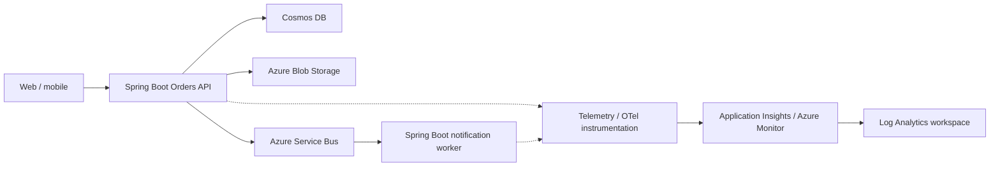

Từ một màn hình trắng, chúng ta cần lần theo:

- **Request latency** tăng ở route nào, instance nào, lúc nào?
- **Dependency** nào mất nhiều thời gian (Cosmos DB, Blob, Service Bus, JDBC, HTTP)?
- **Exception** do application bug, credentials, network, throttling hay timeout?
- Có **trace ID** để đi từ request đến dependency và worker không?
- Trên hệ thống nhiều replicas, log có bị rời rạc không?
- Một spike `429` có bị **retry storm** làm tăng p95/p99 latency không?
- Bản ghi nào bị **sampling** bỏ qua và có cần một source đếm đầy đủ cho SLO không?
- Có đang đưa thông tin cá nhân/secret vào telemetry không?

Application Insights cung cấp công cụ để quan sát những điều này, nhưng **không tự hiểu semantics nghiệp vụ**. “HTTP 200” vẫn có thể là nghiệp vụ trả kết quả sai, còn “HTTP 404” có thể là kết quả expected khi đối tượng không tồn tại.

## 2. Application Insights nằm trong hệ sinh thái Azure Monitor

| Thành phần | Vai trò |
|---|---|
| **Azure Monitor** | Nền tảng giám sát metrics/logs/traces/alerts của Azure và applications |
| **Application Insights** | Application Performance Monitoring (APM): requests, dependencies, transactions, exceptions, application map |
| **Log Analytics workspace** | Lưu/truy vấn log/telemetry theo mô hình workspace-based với KQL |
| **Azure Monitor Metrics** | Time-series metrics, charts, alerts và những chỉ số theo resource |
| **Azure Monitor Alerts** | Metric/log/activity alerts và action groups |
| **Azure Workbooks** | Báo cáo/visualization kết hợp logs và metrics |
| **Application Map** | Đồ thị quan hệ các application components và dependencies đã instrument |
| **Application Insights Java agent / Azure Monitor OTel Distro** | Thu thập/instrument Java telemetry và gửi tới Azure Monitor |
| **OpenTelemetry (OTel)** | API, SDK, semantic conventions, context propagation và exporters tiêu chuẩn |

### Workspace-based Application Insights

Trong mô hình workspace-based, Application Insights liên kết với **Log Analytics workspace** để lưu/query application telemetry. Cần phân biệt:

```text
Application Insights resource
  ├─ instrumentation/ingestion configuration
  ├─ application diagnostics views
  └─ associated Log Analytics workspace
       ├─ AppRequests
       ├─ AppDependencies
       ├─ AppExceptions
       ├─ AppTraces
       └─ other tables (theo ingestion mode)
```

Tên bảng và columns có thể khác giữa **Application Insights workspace-based tables**, các bảng classic `requests/dependencies/traces`, hoặc telemetry đi qua OTel Collector/data collection rules. **Luôn khám phá schema thực ở Logs explorer** trước khi áp dụng một KQL mẫu.

### Application Insights không phải data lake nghiệp vụ

Không dùng App Insights để lưu toàn bộ order JSON, bản sao kê, thanh toán hoặc thông tin khách hàng như source of truth. Telemetry có **sampling, retention, ingestion delay, access control và billing**; database/message store mới quản lý dữ liệu nghiệp vụ.

## 3. Các loại telemetry quan trọng

| Loại | Ví dụ | Câu hỏi trả lời |
|---|---|---|
| **Request** | `POST /api/orders`, status 201, 420 ms | Endpoint nào chậm/lỗi? |
| **Dependency** | `CosmosDB UpsertItem` 135 ms | Service bên ngoài nào chiếm thời gian? |
| **Exception** | `TimeoutException`, `CosmosException` | Lỗi nào xảy ra, vị trí nào? |
| **Trace/log** | `invoice.upload_failed` và traceId | Sự kiện nào dẫn đến lỗi? |
| **Metric** | Request count, CPU, p95 latency | Xu hướng và ngưỡng theo thời gian? |
| **Availability** | HTTP probe từ điểm thử | Ứng dụng có đáp ứng từ bên ngoài? |
| **Custom event** | `CheckoutStarted` đã loại thông tin nhạy cảm | Thao tác nghiệp vụ nào diễn ra? |

### Hai nghĩa khác nhau của “trace”

Trong một số giao diện Application Insights, **traces** là **log messages**; trong OpenTelemetry, **trace** là chuỗi spans thuộc một yêu cầu phân tán. Tên giống nhau nhưng không có nghĩa mọi dòng AppTraces là một OTel distributed trace span.

### Quan hệ logs–metrics–distributed traces

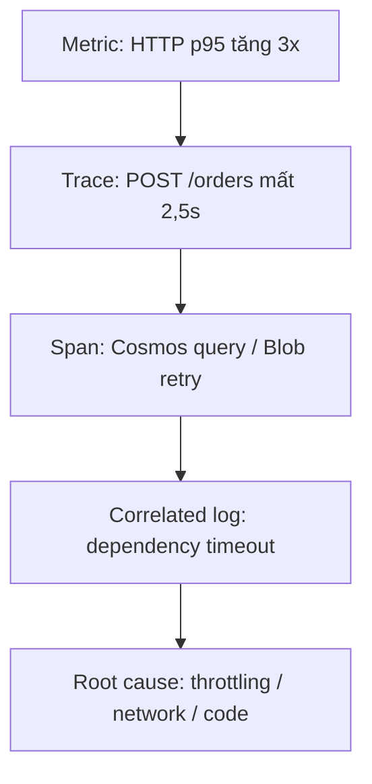

Người vận hành nên đi từ **mức độ ảnh hưởng** (metrics) tới **mẫu request cụ thể** (traces), rồi **chi tiết xử lý** (logs), thay vì tìm trong hàng triệu log lines không có correlation.

## 4. Kiến trúc instrumentation của một ứng dụng Java

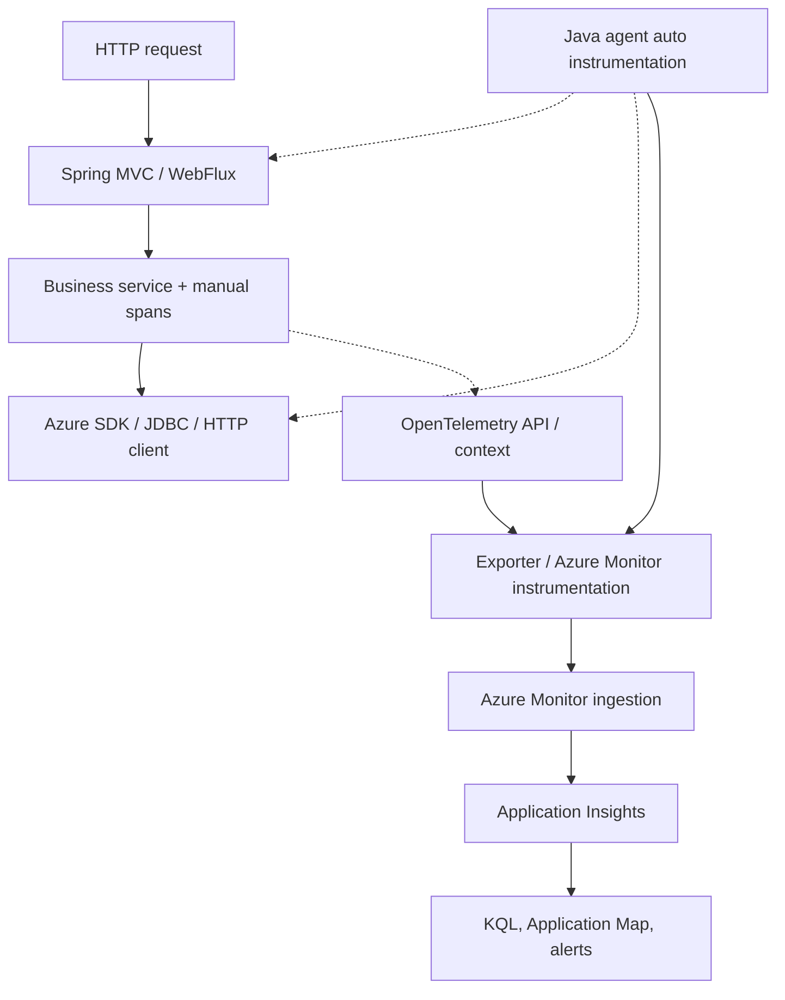

**Đừng hiểu sơ đồ là tất cả spans sẽ được tạo tự động ở mọi version.** Spring framework, Java HTTP clients, Azure SDK services, JDBC drivers và Reactor instrumentation có compatibility khác nhau.

### Các mức quan sát

1. **Inbound HTTP:** route, status, server duration, trace context.
2. **Application business logic:** tạo order, kiểm tra tồn kho, tính tổng tiền.
3. **Outbound dependencies:** HTTP, JDBC, Redis, Azure SDK.
4. **Messaging:** publish Service Bus message và consume ở worker.
5. **Runtime:** JVM memory/GC/threads và platform metrics.
6. **Infrastructure:** App Service, AKS, database/throttling, network và resource health.

Hệ thống cần liên kết các mức này, nhưng **metric của một JVM process không thay thế metric Cosmos DB hoặc network tại Azure resource**.

## 5. Application Insights connection string là gì?

Application Insights dùng **connection string** để cho biết resource/ingestion endpoint, ví dụ dạng:

```text
InstrumentationKey=<opaque-id>;IngestionEndpoint=https://<region-endpoint>/
```

Đây là **chuỗi cấu hình telemetry ingestion**, **không phải Azure Blob Storage connection string** hay Cosmos DB connection string. Đừng nhầm `InstrumentationKey` với **một mật khẩu data-plane Azure SDK**; nó là identifier/configuration của telemetry resource theo mô hình ingestion. Tuy vậy, **không công khai tùy tiện connection string production**, vì có nguy cơ telemetry injection/abuse nếu ingestion không dùng biện pháp xác thực bổ sung thích hợp.

### Nên cấu hình ở đâu?

Trong một Spring Boot app:

```text
APPLICATIONINSIGHTS_CONNECTION_STRING=<value from approved configuration>
```

Đặt qua App Service Application Settings, Kubernetes Secret hoặc cơ chế configuration/secret management theo policy. Không commit value production vào Git. **Không gán biến này bằng Storage SAS hoặc service principal client secret**.

### Authentication của ingestion

Tùy cấu hình Azure Monitor/OpenTelemetry exporter, telemetry ingestion có thể dựa trên connection string và/hoặc cơ chế Microsoft Entra authentication được hỗ trợ. **Không suy kết nối thành công là có quyền truy vấn Logs**: quyền ghi telemetry, quyền quản lý Application Insights resource và quyền đọc Log Analytics workspace là các phạm vi khác nhau.

## 6. Chọn một trong ba chiến lược instrument Java

| Cách | Ưu điểm | Hạn chế / lưu ý |
|---|---|---|
| **Application Insights Java agent** | Auto-instrument Spring MVC/WebFlux, HTTP, nhiều libraries; thiết lập ít code | Phụ thuộc compatibility, agent config và supported instrumentation |
| **OpenTelemetry + Azure Monitor Distro/Exporter** | Chuẩn OTel, chủ động pipeline và custom instrumentation | Phải quản lý SDK/agent/collector/exporter đúng version |
| **Spring Boot Actuator + Micrometer Observation/Tracing** | Gắn với Spring ecosystem, custom observation/metrics dễ | **Chưa đủ** để gửi App Insights nếu thiếu exporter/bridge tương thích |

### Chiến lược mặc định đề xuất cho lab

Dùng **một Application Insights Java agent** để dễ quan sát inbound requests, exceptions và outbound HTTP. Sau đó tạo **manual business spans** bằng OpenTelemetry API nếu agent/version hỗ trợ, thay vì vừa bật Application Insights agent vừa bật một OpenTelemetry Java agent khác.

### Khi nào dùng Micrometer?

Nếu Spring Boot 3+ đã có Micrometer Observation/Tracing và organization dùng OpenTelemetry Collector chung:

- chọn Micrometer–OTel bridge/exporter theo dependency BOM;
- thiết lập một trace pipeline;
- kiểm tra trùng instrumentation với Java agent;
- đồng nhất `service.name`/resource attributes, sampling và propagation.

**Micrometer metrics/Actuator endpoint không tự đảm bảo Azure Monitor nhận tất cả metrics/traces**. Cần exporter hoặc integration được cấu hình và xác minh thực tế.

## 7. Nguyên tắc “một nguồn instrumentation chính”

Một lỗi thường gặp:

```text
JAVA_TOOL_OPTIONS="-javaagent:applicationinsights-agent.jar"
JAVA_OPTS="-javaagent:opentelemetry-javaagent.jar"
Spring Boot Micrometer Tracing also exports to Azure Monitor
```

Nếu cả ba cùng instrument outbound HTTP, một dependency call có thể xuất hiện **nhiều spans**, lệch parent-child, số request tăng giả và tăng chi phí.

### Quy trình chọn

1. Kiểm tra agent/instrumentation đã có trên App Service/AKS/Java process.
2. Chọn ai là **owner của inbound/outbound auto-instrumentation**.
3. Chỉ thêm một exporter path chủ đạo khi chưa có lý do chạy song song.
4. Bật custom spans/metrics có chủ đích, kiểm tra không trùng với framework spans.
5. Dùng một bộ resource attributes nhất quán để Application Map không tạo các component “vô danh”.
6. Kiểm tra traces của request thử xem mỗi hop có số spans hợp lý.

### Không phải mọi duplicate entry đều do hai agents

Một request có thể hợp lệ có **logical Azure SDK operation span** và **HTTP transport span**; đây không nhất thiết là duplicate. Duplicate đáng nghi khi cùng HTTP method/URL/duration/cùng parent được ghi hai lần bởi hai libraries khác nhau. Phải kiểm tra span hierarchy trước khi tắt instrumentation.

## 8. Chuẩn bị Spring Boot và Application Insights resource

### Điều kiện tối thiểu

- Một subscription/resource group lab có budget.
- Application Insights resource kiểu workspace-based, liên kết Log Analytics workspace được phê duyệt.
- Ứng dụng Spring Boot chạy với JDK/agent version tương thích.
- Quyền đọc cấu hình resource để lấy connection string (không cần quyền xóa resource).
- Đường mạng từ JVM tới **telemetry ingestion endpoint**.
- Một người được quyền truy vấn Application Insights/Log Analytics để xác minh.
- Dữ liệu lab giả lập, không ghi tokens/PII vào logs.

### Tạo trên Azure Portal

1. Chọn subscription, resource group và **Application Insights**.
2. Chọn tên, region và **Log Analytics workspace** thuộc phạm vi/quyền được phép.
3. Xem xét data residency, retention/cost và chính sách access.
4. Tạo resource, ghi lại Application Insights resource ID/region và workspace ID vào inventory lab.
5. Từ cấu hình Application Insights, lấy connection string và truyền tới app qua environment/configuration channel phù hợp.
6. Không vội bật ingestion toàn bộ logs ở mức DEBUG trên production.

**Không tạo một Application Insights resource mới cho mỗi JVM instance.** Những replicas của cùng service/environment thường gửi telemetry vào cùng một application resource theo kiến trúc thống nhất, với role/instance metadata để phân biệt.

### Khi đã có resource dùng chung

Kiểm tra ai quản lý connection string, retention, sampling và quyền Logs reader. Không thay đổi DCR, workspace retention hoặc sampling production cho mọi ứng dụng chỉ để chạy một lab.

## 9. Cài đặt Application Insights Java agent

**Application Insights Java agent 3.x** là cách phổ biến để auto-instrument ứng dụng Java mà ít sửa code. Download bản agent chính thức theo release và phiên bản JDK được tổ chức phê duyệt; lưu file JAR trong máy/ảnh container hoặc artifact store đáng tin.

Ví dụ tên file:

```text
/opt/telemetry/applicationinsights-agent.jar
```

### Chạy JVM với agent

```bash
export APPLICATIONINSIGHTS_CONNECTION_STRING="<connection-string-from-configuration>"

java \
  -javaagent:/opt/telemetry/applicationinsights-agent.jar \
  -jar orders-api.jar
```

`-javaagent:...` là **JVM startup argument**; đặt trước `-jar`. Không phải Maven dependency tự được Spring Boot nạp làm Java agent.

### Dùng biến môi trường

Trong App Service hoặc container, một biến thường dùng là:

```text
JAVA_TOOL_OPTIONS=-javaagent:/opt/telemetry/applicationinsights-agent.jar
APPLICATIONINSIGHTS_CONNECTION_STRING=<configured telemetry destination>
```

**Cẩn thận:** `JAVA_TOOL_OPTIONS` được JVM đọc khi khởi động và có thể ảnh hưởng **mọi Java process** trong container/runtime nhận biến này. Kiểm tra đường dẫn agent, môi trường và các JVM helper processes trước khi bật.

### applicationinsights.json là gì?

Java agent có thể đọc file cấu hình `applicationinsights.json` theo cơ chế/tên đường dẫn được documentation phiên bản hỗ trợ. Ví dụ **rút gọn**:

```json
{
  "role": {
    "name": "orders-api"
  },
  "sampling": {
    "percentage": 100
  }
}
```

Đây là cấu hình **cho lab có traffic thấp**. Kết nối tới resource có thể được truyền qua environment variable để tránh đưa connection string vào file. Vị trí tìm `applicationinsights.json`, tên fields và khả năng override bằng environment **phụ thuộc bản agent**; kiểm tra startup logs/configuration docs của bản đang sử dụng.

**Không dùng 100% sampling cho production high-volume chỉ vì lab cần thấy mọi trace.** Phải đo chi phí và quyết định chính sách lấy mẫu.

### Có cần Maven dependency Application Insights không?

Để Java agent tự instrument Spring Boot, thường **không cần** đưa agent JAR làm dependency vào `pom.xml` của ứng dụng. Nếu muốn **manual OpenTelemetry spans**, thêm OTel API hoặc library phù hợp. Không trộn nhiều SDK instrumentation libraries mà chưa có kế hoạch tương thích.

## 10. Xác minh Java agent thực sự chạy

**Có JAR trong image không đồng nghĩa JVM đã nạp agent.**

### Kiểm tra startup

1. Xác minh JVM startup command/`JAVA_TOOL_OPTIONS` có `-javaagent`.
2. Kiểm tra đường dẫn file JAR tồn tại, có quyền đọc.
3. Kiểm tra agent version tương thích với JDK.
4. Xác minh agent đọc đúng telemetry configuration.
5. Gửi một HTTP request thử vào Spring Boot.
6. Xác minh dữ liệu xuất hiện ở Application Insights sau khoảng ingestion delay hợp lý.
7. Kiểm tra đúng role name và environment.

### Dấu hiệu lỗi

| Dấu hiệu | Khả năng |
|---|---|
| `Error opening zip file or JAR manifest missing` | Sai path/JAR không hợp lệ |
| JVM không khởi động khi bật agent | JDK/agent compatibility, file access, JVM args |
| Không thấy ingestion | Connection string/exporter/network chưa đúng |
| Request có dữ liệu nhưng dependency trống | HTTP/SDK instrumentation chưa hỗ trợ hoặc chưa bật |
| Traces hiển thị ở resource khác | Sai connection string / service config |
| Role name là một giá trị mặc định khó hiểu | `role`/OTel resource attributes chưa cấu hình |
| Spans trùng đôi | Hai agents hoặc two exporters/instrumentations |

### Test tối thiểu

```bash
curl -i http://localhost:8080/actuator/health
curl -i http://localhost:8080/api/orders/demo
```

Các URL trên chỉ là **ví dụ** nếu ứng dụng tự triển khai endpoints và Actuator đã được cấu hình cho phép truy cập. Không mở public toàn bộ Spring Boot Actuator endpoints để “có telemetry”.

## 11. Spring Boot Actuator, Micrometer và Application Insights

Trong Spring Boot, **Actuator** cung cấp health/info/metrics/observations theo dependency/config, còn **Micrometer** giúp chuẩn hóa đo đạc metrics và observations. Application Insights là backend telemetry Azure; chúng không tự động đồng nghĩa.

### Vai trò từng lớp

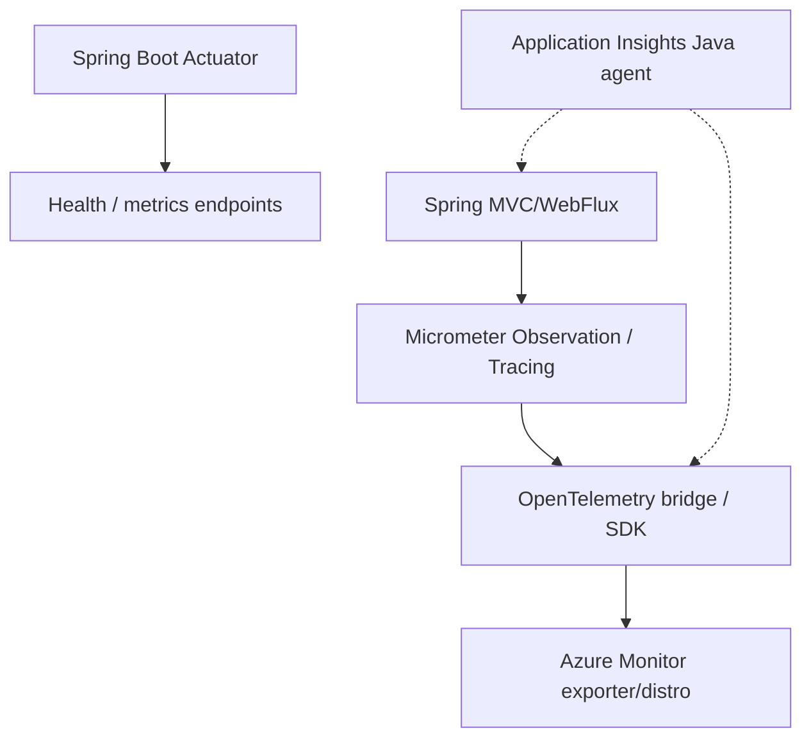

Sơ đồ biểu diễn các khả năng lựa chọn; **không bật tất cả đường song song một cách mặc định**.

### Khi dùng Java agent

- Bắt đầu từ agent để thu requests/dependencies/exceptions.
- Actuator vẫn hữu ích cho Kubernetes readiness/liveness và số liệu JVM/HTTP.
- Nếu Micrometer Tracing cũng được cấu hình để tạo/export spans, kiểm tra có duplicate HTTP spans và context conflict không.
- Thêm custom spans/metrics có chủ đích, không tạo mới trace pipeline nếu không cần.

### Khi dùng Micrometer + OpenTelemetry

- Pin Spring Boot dependency management cùng bridge/exporter versions phù hợp.
- Chọn exporter tới Azure Monitor hoặc Collector theo architecture.
- Đảm bảo parent-child trace context và semantic attributes đồng nhất.
- Xác nhận metrics được xuất — việc có `/actuator/metrics` không chứng minh dữ liệu đã ingest vào Application Insights.

## 12. Một Spring Boot service mẫu

Ví dụ app xử lý yêu cầu tạo hóa đơn bằng Blob Storage. Đoạn code dưới đây tập trung vào **business logs, typed errors và request correlation**.

### Maven dependencies cốt lõi

```xml
<!-- Version được Spring Boot BOM/Azure SDK BOM phê duyệt quản lý. -->
<dependencies>
  <dependency>
    <groupId>org.springframework.boot</groupId>
    <artifactId>spring-boot-starter-web</artifactId>
  </dependency>
  <dependency>
    <groupId>org.springframework.boot</groupId>
    <artifactId>spring-boot-starter-actuator</artifactId>
  </dependency>
  <dependency>
    <groupId>com.azure</groupId>
    <artifactId>azure-storage-blob</artifactId>
  </dependency>
  <dependency>
    <groupId>com.azure</groupId>
    <artifactId>azure-identity</artifactId>
  </dependency>
</dependencies>
```

Lựa chọn đúng Spring Boot BOM/Azure SDK BOM và versions là việc của project thực tế; đoạn dependencies **chưa phải pom.xml đầy đủ** (thiếu parent/BOM/version declarations).

### application.yml

```yaml
spring:
  application:
    name: orders-api

management:
  endpoints:
    web:
      exposure:
        include: health,info

logging:
  level:
    root: INFO
    com.example.orders: INFO
    com.azure: WARN

orders:
  blob-endpoint: \${AZURE_STORAGE_BLOB_ENDPOINT}
  invoice-container: invoice-lab
```

`\${AZURE_STORAGE_BLOB_ENDPOINT}` là Spring property placeholder; trong môi trường triển khai, set endpoint hợp lệ **không chứa SAS**. Không hardcode account key/secret. Việc chỉ expose `health,info` giảm bề mặt thông tin Actuator; vẫn cần auth/network cho những endpoints không công khai.

### Blob service client bean

```java
package com.example.orders;

import com.azure.identity.DefaultAzureCredentialBuilder;
import com.azure.storage.blob.BlobServiceClient;
import com.azure.storage.blob.BlobServiceClientBuilder;
import org.springframework.beans.factory.annotation.Value;
import org.springframework.context.annotation.Bean;
import org.springframework.context.annotation.Configuration;

@Configuration
public class AzureClientsConfig {
    @Bean
    public BlobServiceClient blobServiceClient(
            @Value("\${orders.blob-endpoint}") String endpoint) {
        return new BlobServiceClientBuilder()
            .endpoint(endpoint)
            .credential(new DefaultAzureCredentialBuilder().build())
            .buildClient();
    }
}
```

Ví dụ dùng **Microsoft Entra credentials**. Identity của workload phải có **Storage Blob Data Contributor** hoặc quyền tương đương đúng scope cho thao tác upload, không chỉ Azure ARM Contributor.

### Service với business logging an toàn

```java
package com.example.orders;

import com.azure.storage.blob.BlobClient;
import com.azure.storage.blob.BlobServiceClient;
import com.azure.storage.blob.models.BlobStorageException;
import org.slf4j.Logger;
import org.slf4j.LoggerFactory;
import org.springframework.stereotype.Service;

import java.io.ByteArrayInputStream;
import java.nio.charset.StandardCharsets;
import java.util.concurrent.TimeUnit;

@Service
public final class InvoiceService {
    private static final Logger LOG =
        LoggerFactory.getLogger(InvoiceService.class);
    private final BlobServiceClient blobs;

    public InvoiceService(BlobServiceClient blobs) {
        this.blobs = blobs;
    }

    public String uploadDemoInvoice(String orderId) {
        // In production: validate + authorize orderId and tenant before storage.
        if (!orderId.matches("[a-zA-Z0-9-]{1,60}")) {
            throw new IllegalArgumentException("Invalid order identifier");
        }
        long started = System.nanoTime();
        String blobName = "demo/" + orderId + "/invoice.txt";
        byte[] payload = "synthetic-demo-invoice"
            .getBytes(StandardCharsets.UTF_8);

        try {
            BlobClient client = blobs
                .getBlobContainerClient("invoice-lab")
                .getBlobClient(blobName);
            client.upload(new ByteArrayInputStream(payload),
                payload.length, false);
            LOG.info("invoice.upload_succeeded durationMs={}",
                TimeUnit.NANOSECONDS.toMillis(System.nanoTime()-started));
            return "CREATED";
        } catch (BlobStorageException error) {
            int status = error.getResponse() == null
                ? -1 : error.getResponse().getStatusCode();
            LOG.warn("invoice.upload_failed status={} category={} durationMs={}",
                status, classify(status),
                TimeUnit.NANOSECONDS.toMillis(System.nanoTime()-started));
            throw new InvoiceStorageFailure(
                "INVOICE_STORAGE_UNAVAILABLE", error);
        }
    }

    private static String classify(int status) {
        if (status == 401 || status == 403) return "AUTH_OR_ACCESS";
        if (status == 409 || status == 412) return "CONFLICT";
        if (status == 429) return "THROTTLED";
        if (status >= 500) return "SERVER_ERROR";
        return "OTHER";
    }

    static final class InvoiceStorageFailure extends RuntimeException {
        InvoiceStorageFailure(String message, Throwable cause) {
            super(message, cause);
        }
    }
}
```

**Giới hạn:** Đây là mã lab. Ở production phải có idempotency/conditional writes, typed business error mapping, retry/deadline budget, full authz và exception handler. Không in `error.getMessage()` khi có nguy cơ chứa URI/SAS. Đoạn code **không tự tạo OpenTelemetry span**; khi Java agent được bật và instrumentation hỗ trợ, các HTTP/dependency operations có thể tự xuất hiện.

## 13. Controller demo để tạo requests và status

```java
package com.example.orders;

import org.springframework.http.HttpStatus;
import org.springframework.web.bind.annotation.*;

@RestController
@RequestMapping("/api/orders")
public final class DemoOrdersController {
    private final InvoiceService invoices;

    public DemoOrdersController(InvoiceService invoices) {
        this.invoices = invoices;
    }

    @PostMapping("/{orderId}/invoice")
    @ResponseStatus(HttpStatus.CREATED)
    public String createDemoInvoice(@PathVariable String orderId) {
        return invoices.uploadDemoInvoice(orderId);
    }
}
```

Đây là **API lab** với dữ liệu giả, chưa có security filter. Không expose endpoint tạo file không authentication trong môi trường public/production. Một lần gọi đầu có thể tạo Blob; lần thứ hai với cùng `orderId` có thể nhận **409 BlobAlreadyExists**, cần trả public error code phù hợp thay vì “lỗi Azure”.

### Quan sát mong đợi

Nếu instrumentation hỗ trợ:

```text
Request:
  POST /api/orders/{orderId}/invoice
  duration, status, success

Dependency:
  Azure Blob Storage HTTP operation (logical or transport span)
  duration, status

Trace/log:
  invoice.upload_succeeded hoặc invoice.upload_failed
  traceId khi correlation được cấu hình
```

Trường `orderId` có thể được **ẩn trong route template** thay vì raw path để giảm dữ liệu nhạy cảm/cardinality. Khi chọn operation name, không dùng đường dẫn chứa tên người dùng hoặc SAS.

## 14. Exceptions: log đúng nơi và không làm giả success

Đừng xử lý lỗi SDK như thế này:

```java
// Anti-pattern: biến mọi lỗi thành success giả.
try {
    uploadInvoice();
} catch (Exception ignored) {
    return;
}
```

Cách xử lý phù hợp hơn là:

1. Phân biệt expected conflict và unexpected dependency failure.
2. Trả public error code, **không** trả raw stack/HTTP headers.
3. Ghi business context đã sanitize ở một boundary phù hợp.
4. Để instrumentation ghi request status/exception khi đúng policy.
5. Có alert dựa trên **final failures**, không đếm mọi retry attempt như API failure.

### Spring exception handler mẫu

```java
package com.example.orders;

import org.springframework.http.HttpStatus;
import org.springframework.http.ResponseEntity;
import org.springframework.web.bind.annotation.ExceptionHandler;
import org.springframework.web.bind.annotation.RestControllerAdvice;

import java.util.Map;

@RestControllerAdvice
public final class ApiErrorHandler {
    @ExceptionHandler(IllegalArgumentException.class)
    ResponseEntity<Map<String, String>> badInput(IllegalArgumentException e) {
        return ResponseEntity.badRequest().body(
            Map.of("code", "INVALID_INPUT"));
    }

    @ExceptionHandler(InvoiceService.InvoiceStorageFailure.class)
    ResponseEntity<Map<String, String>> storageUnavailable(
            InvoiceService.InvoiceStorageFailure e) {
        return ResponseEntity.status(HttpStatus.SERVICE_UNAVAILABLE)
            .body(Map.of("code", "INVOICE_STORAGE_UNAVAILABLE"));
    }
}
```

**Lưu ý:** Mapping tất cả `BlobStorageException` thành HTTP 503 chỉ để minh họa handler; production phải **phân biệt 409/404/412/429/5xx** theo business contract. Không có ứng dụng nào nên tự trả 503 cho mọi trường hợp “Blob already exists” mà không kiểm tra idempotency.

## 15. Distributed tracing: trace ID, span ID và parent–child

Một trace gồm nhiều spans cùng **trace ID**:

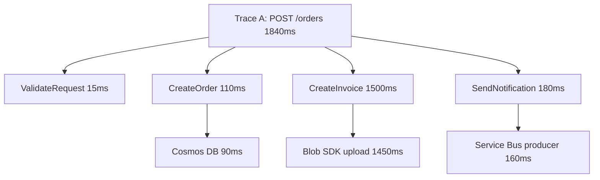

### Hai identifier bắt buộc phân biệt

| Field | Ý nghĩa |
|---|---|
| **traceId** | Một trace xuyên các process/services có context propagation đúng |
| **spanId** | Một span cụ thể, có thể có parent span ID |
| **operation ID** trong App Insights | Thường dùng để liên kết request/dependency/log records cùng trace theo ingestion schema |
| **Azure service request ID** | ID do Storage/Cosmos/service phát, không phải trace ID W3C |

W3C Trace Context truyền `traceparent` giữa services, ví dụ:

```text
traceparent: 00-4bf92f3577b34da6a3ce929d0e0e4736-00f067aa0ba902b7-01
```

`tracestate` có thể mang metadata của tracing vendors; không tự đưa user PII hoặc bearer token vào `tracestate`/`baggage`.

### Parent-child không phải timeline đơn thuần

Hai spans có thể chạy song song (ví dụ `Mono.zip` gọi Cosmos và Storage), hoặc một worker xử lý event sau khi HTTP request đã kết thúc. Parent-child thể hiện quan hệ context/causality, không bắt buộc con nằm trong duration của parent ở mọi async modeling. Đối với queue/messaging, **span links** có thể phù hợp hơn parent-child trong một số trường hợp.

## 16. Gắn custom business span bằng OpenTelemetry API

Auto-instrumentation thường thấy HTTP/JDBC/Azure SDK calls, nhưng không hiểu đầy đủ business workflow `ApproveOrder` hoặc `GenerateInvoice`. Có thể dùng **OpenTelemetry API** để bổ sung span có ý nghĩa:

```java
package com.example.orders;

import io.opentelemetry.api.GlobalOpenTelemetry;
import io.opentelemetry.api.trace.Span;
import io.opentelemetry.api.trace.StatusCode;
import io.opentelemetry.api.trace.Tracer;
import io.opentelemetry.context.Scope;

public final class BusinessTracing {
    private static final Tracer TRACER =
        GlobalOpenTelemetry.getTracer("orders-business");

    public void execute(Runnable operation) {
        Span span = TRACER.spanBuilder("Invoice.Generate")
            .setAttribute("app.operation", "GenerateInvoice")
            .startSpan();
        try (Scope scope = span.makeCurrent()) {
            operation.run();
            span.setAttribute("app.outcome", "succeeded");
        } catch (RuntimeException exception) {
            span.setAttribute("app.error_category", "dependency_failure");
            span.setStatus(StatusCode.ERROR, "Invoice generation failed");
            // Ghi exception details chỉ khi policy redaction cho phép.
            throw exception;
        } finally {
            span.end();
        }
    }
}
```

**Lưu ý:** Đây là manual span API; `GlobalOpenTelemetry` chỉ thực sự export spans nếu instrumentation SDK/agent đã cấu hình. Không mở thêm một OpenTelemetry SDK/exporter độc lập chỉ để class này hoạt động nếu Java agent hiện tại đã cung cấp context.

### Không tạo span cho mọi dòng Java

Một application trace gồm hàng nghìn tiny spans có thể tốn overhead và gây nhiễu. Chỉ tạo spans cho **business boundaries**, dependency calls chưa instrument và những giai đoạn có ý nghĩa với SLO/diagnostics.

### Không đưa dữ liệu nhạy cảm vào attributes

```text
Tốt:
  app.operation=GenerateInvoice
  invoice.type=monthly
  app.outcome=failed
  dependency.name=azure-blob

Không nên:
  customer.email=<private email>
  authorization=<token>
  invoice.content=<full PDF text>
  storage.sas=<signed URL>
```

## 17. Correlation ID của ứng dụng và trace ID

Một API có thể nhận `X-Correlation-ID` do gateway/client cấp. Không mặc định tin giá trị này:

- phải kiểm tra **length, charset và kích thước tối đa**;
- tránh dùng trực tiếp giá trị không kiểm soát làm metric label;
- không tự coi đây là identity/authorization proof;
- không thay trace ID chuẩn bằng một ID tùy ý.

### Một quy ước hữu ích

```text
traceId: W3C trace ID do instrumentation quản lý
spanId: current span ID
requestId: server/API instance tạo hoặc chấp nhận sau validation
businessEventId: stable ID cho idempotency/audit
azureRequestId: ID do Azure service trả khi có HTTP response
```

Application Insights có thể liên kết records theo **operation ID/trace context**; application correlation ID có thể là một custom dimension riêng phục vụ hỗ trợ khách hàng.

### Một request có thể có nhiều service request IDs

Ví dụ Blob SDK retry 3 attempts: ứng dụng chỉ có một business trace nhưng có thể nhận nhiều Azure request IDs, một cho mỗi HTTP attempt nếu service đã phản hồi. Không đánh đồng **logical operation success** với **một network attempt duy nhất**.

## 18. Structured logging với SLF4J và Logback

### Ví dụ log nghiệp vụ

```java
import org.slf4j.Logger;
import org.slf4j.LoggerFactory;

public final class OrderEvents {
    private static final Logger LOG =
        LoggerFactory.getLogger(OrderEvents.class);

    void success(String operation, long latencyMs) {
        LOG.info("orders.operation_succeeded operation={} elapsedMs={}",
            operation, latencyMs);
    }

    void failed(String operation, int httpStatus) {
        LOG.warn("orders.dependency_failed operation={} status={}",
            operation, httpStatus);
    }
}
```

Các placeholders `{}` giảm string formatting không cần thiết. Với JSON logging backend, bạn có thể ghi fields riêng thay vì một dòng text. **Đừng mặc định mọi log SLF4J xuất hiện trong Application Insights**: cần agent/exporter/sink hỗ trợ, level và filter phù hợp.

### Schema JSON log gợi ý

```json
{
  "timestamp": "2026-11-20T08:15:30Z",
  "severity": "WARN",
  "service": "orders-api",
  "environment": "staging",
  "operation": "CreateInvoice",
  "dependency": "azure-blob",
  "traceId": "4bf92f3577b34da6a3ce929d0e0e4736",
  "spanId": "00f067aa0ba902b7",
  "httpStatus": 429,
  "errorCategory": "throttled",
  "durationMs": 1250,
  "outcome": "retry_exhausted"
}
```

Đây là **schema do app quy định**; không phải field names mặc định của AppTraces. `spanId`/`traceId` chỉ có ý nghĩa nếu instrumentation thực sự cung cấp context.

### Tại sao không log raw headers/body?

Các HTTP headers có thể chứa `Authorization`, SAS, cookies, tenant information; bodies có PII/bank/account data. Application Insights là nền tảng vận hành, không phải kho chứa credentials hoặc payload khách hàng. Chỉ ghi **số liệu, mã lỗi, ID đã ẩn danh hóa có kiểm soát và bối cảnh cần thiết**.

## 19. MDC, thread pool và log correlation

**MDC (Mapped Diagnostic Context)** trong nhiều SLF4J backends sử dụng ThreadLocal để thêm traceId/correlationId vào log pattern.

### Ví dụ tự thêm một correlation ID đã validate

```java
import org.slf4j.MDC;

public static void process(String safeCorrelationId, Runnable action) {
    String previous = MDC.get("correlationId");
    try {
        MDC.put("correlationId", safeCorrelationId);
        action.run();
    } finally {
        if (previous == null) MDC.remove("correlationId");
        else MDC.put("correlationId", previous);
    }
}
```

**Luôn khôi phục MDC** khi thread pool tái sử dụng threads. Nếu không, request khác có thể mang ID của khách hàng trước.

### Reactor/WebFlux phức tạp hơn

`MDC` thường gắn với thread; Reactor execution có thể chuyển giữa nhiều schedulers. Không mặc định `MDC.get("traceId")` chính xác trong mọi `flatMap`/`publishOn` callback. Dùng OpenTelemetry/Reactor context propagation integration phù hợp phiên bản.

### Nếu logs có trace ID rỗng

- Kiểm tra OTel agent/tracing provider có active.
- Kiểm tra log correlation injection có hỗ trợ trong phiên bản agent.
- Kiểm tra async context propagation và scheduler.
- Xem sampling/export; **traceId rỗng trong log không chứng minh request không được xử lý**.

## 20. Spring MVC và Spring WebFlux: hai execution models

| Tiêu chí | Spring MVC (servlet) | Spring WebFlux (reactive) |
|---|---|---|
| Execution model | Request threads, blocking phổ biến | Reactor pipelines, non-blocking event loops |
| ThreadLocal/MDC | Tương đối dễ quản lý theo request thread | Cần bridge/propagation qua async boundaries |
| Azure SDK | Sync client phù hợp khi sizing threads đúng | Async client và composition `Mono/Flux` thường phù hợp |
| Rủi ro | Thread pool exhaustion, blocking slow dependencies | `block()` trên event loop, context loss, unhandled async errors |
| Auto-instrumentation | Kiểm tra Spring MVC support của agent | Kiểm tra WebFlux/Reactor support của agent |

### Anti-pattern: fire-and-forget rồi trả success

```java
// Không dùng trong service khi kết quả nghiệp vụ cần chắc chắn:
asyncUpload().subscribe();
return "uploaded"; // Upload có thể vẫn đang chạy hoặc thất bại.
```

Nếu app cần không đồng bộ bền vững, nên dùng **outbox/Service Bus job** và có workflow trạng thái, không chỉ `subscribe()` rồi bỏ qua errors.

### Anti-pattern: block trong Netty event loop

`mono.block()` trong WebFlux có thể gây nghẽn event loop, throughput giảm và request latency tăng. Dùng reactive composition hoặc chuyển blocking work sang scheduler được sizing đúng; đừng để telemetry overhead khiến các async callers bị block.

## 21. Correlation giữa messaging và HTTP requests

Một request `POST /orders` gửi `OrderCreated` vào Service Bus. Worker xử lý sau 20 giây trên một process khác:

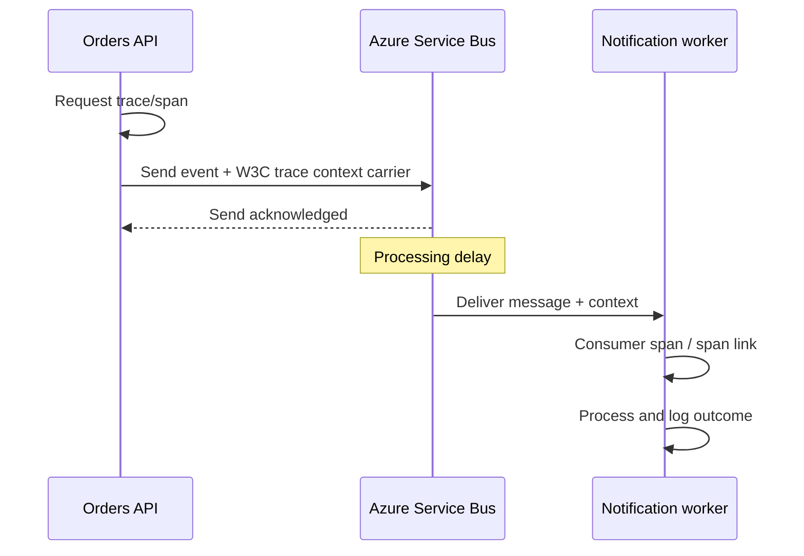

### Điều gì cần propagate?

- Message ID/business event ID cho deduplication.
- W3C trace context theo carrier/SDK/framework được hỗ trợ.
- Correlation ID nếu cần hỗ trợ nghiệp vụ.
- Tenant/permission context **đã validate hoặc được worker xác thực lại**, không tin claim tùy ý trong body.

### Worker cần xử lý gì?

Ở consumer:

1. Extract tracing context theo instrumentation support.
2. Tạo consumer span hoặc span link phù hợp với messaging semantic conventions.
3. Kiểm tra idempotency.
4. Xử lý message và ghi business outcome.
5. Hoàn tất/dead-letter message theo service semantics.

**Đừng tự bịa W3C `traceparent` mới bằng chuỗi ngẫu nhiên trong mỗi worker.** Dùng OTel propagators/agent integration để giữ causality. Với batch nhiều messages, một worker span có thể link nhiều producer contexts.

## 22. Azure SDK dependency instrumentation và giới hạn

Trong Spring Boot, gọi Azure SDK có thể sinh logical operation span, HTTP transport span hoặc dependency records **tùy dịch vụ, SDK version và agent instrumentation**.

| SDK | Điều muốn quan sát | Điểm cần kiểm tra |
|---|---|---|
| **Azure Blob Storage** | Upload/download, HTTP status, duration, request ID | Có dependency span/logs với redaction không? |
| **Azure Cosmos DB** | Query/upsert latency, RU, 429, diagnostics | Cosmos diagnostics/agent instrumentation có đủ không? |
| **Azure Service Bus** | Send/receive latency, processing span, retry | Context giữa producer/consumer có propagate không? |
| **Azure Key Vault** | Secret read outcome, latency, 401/403 | Không log secret value/response body |
| **Azure SQL/JDBC** | DB dependency/query time | Không tự log SQL có PII trong parameters |
| **Outbound HTTP** | Host/route/status/duration | Có double spans vì HTTP client + SDK không? |

### SDK retry có thể nằm trong một span

Một Blob upload span mất 2 giây có thể gồm network retries/backoff. **Không khẳng định Azure Blob service processing time là 2 giây** chỉ dựa vào client span. Phải phân biệt:

- total logical operation duration;
- mỗi HTTP attempt (nếu instrumentation hỗ trợ);
- retry delay;
- network/proxy/TLS;
- service-side latency;
- CPU/GC và thread pool của JVM.

### Logs và Application Map

Application Map biểu diễn dependencies được instrumented, không phải mọi network connection hoặc mọi database. Một service không xuất hiện trong map có thể do sampling, instrumentation unsupported, thiếu traffic hoặc role naming sai; không chứng minh service đó không được dùng.

## 23. Sử dụng Application Insights trên Azure Portal

Trong Application Insights resource, các góc nhìn thường có:

- **Overview/Metrics:** tổng quan lưu lượng, lỗi và latency.
- **Failures:** failed requests, failed dependencies, exceptions theo time range/operation.
- **Performance:** các operation chậm, distributions và dependency contributions.
- **Application Map:** liên kết services/dependencies dựa trên telemetry correlation.
- **Transaction search/End-to-end transaction details:** tìm một request cụ thể và xem spans/dependencies.
- **Live Metrics:** theo dõi một số tín hiệu gần realtime khi agent/tính năng hỗ trợ.
- **Logs:** truy vấn workspace với KQL.
- **Workbooks/Alerts:** thiết kế dashboard và cảnh báo.

Tên menu và khả năng xuất hiện thay đổi theo Azure Portal UI, resource type, workspace, agent và role. Nếu thiếu một mục, xác minh quyền truy cập, ingestion mode và data availability trước khi kết luận lỗi.

### Quy trình drill-down khi p95 tăng

1. Chọn đúng **subscription, Application Insights resource, environment và time range**.
2. Vào Performance, chọn operation `POST /api/orders`.
3. So sánh p50/p95/p99, lưu ý sampling/traffic distribution.
4. Chọn một transaction chậm.
5. Đọc timeline spans: inbound request, business spans, dependency calls.
6. Tìm status/resultCode/exception trong dependencies.
7. Dùng trace/operation ID để tìm logs liên quan trong Logs.
8. Đối chiếu service metrics/Service Health khi nghi Azure-side issue.

### Chọn time range đúng

Telemetry ingestion có thể trễ. Một request xảy ra lúc 08:00 UTC có thể xuất hiện trong query sau vài phút tùy pipeline. Khi điều tra, so sánh:

```text
Event timestamp
Telemetry ingestion timestamp (nếu bảng cung cấp)
Portal timezone display
Deployment timestamp
Alert evaluation window
```

Không nhầm giờ Việt Nam UTC+7 với event UTC dẫn đến truy sai cửa sổ.

## 24. KQL: đọc đúng schema trước khi truy vấn

**Kusto Query Language (KQL)** được dùng trong Log Analytics. Với workspace-based Application Insights, có thể gặp:

```text
AppRequests
AppDependencies
AppTraces
AppExceptions
AppMetrics
AppEvents
AppAvailabilityResults
```

Một số tài nguyên/queries classic dùng `requests`, `dependencies`, `traces` hoặc `exceptions`. **Không chạy truy vấn mẫu ở sai schema rồi cho rằng telemetry không tồn tại.**

### Xem columns đầu tiên

```kusto
AppRequests
| where TimeGenerated > ago(1h)
| take 5
```

Nếu bảng không tồn tại, kiểm tra **workspace liên kết, ingestion path và schema thật**. Khi chạy KQL ở Logs explorer, kiểm tra giá trị fields và types trong results trước khi join.

### Quy ước kiểm thử truy vấn

- Chọn time range đủ chứa requests vừa gửi.
- Dùng resource/workspace đúng.
- Phân biệt AppRoleName và service name.
- Không paste production connection string vào KQL.
- Nếu schema khác, chỉnh tên bảng/cột thay vì đoán dữ liệu.
- Dùng query results làm bằng chứng telemetry, không suy đầy đủ số requests khi sampling đang bật.

## 25. KQL: thống kê requests và failure rate

```kusto
AppRequests
| where TimeGenerated > ago(1h)
| summarize
    Requests = count(),
    Failures = countif(Success == false),
    P50Ms = percentile(DurationMs, 50),
    P95Ms = percentile(DurationMs, 95),
    P99Ms = percentile(DurationMs, 99)
    by AppRoleName, Name
| extend FailureRatePct =
    100.0 * todouble(Failures) / iif(Requests == 0, 1, Requests)
| order by Failures desc
```

### Diễn giải

- `Requests` là số records của telemetry **được ingest/query**, không nhất thiết số requests thực nếu sampling xảy ra.
- `Failures` dựa vào field `Success`, không tự hiểu nghiệp vụ.
- `P95Ms` và `P99Ms` nhạy với cỡ mẫu; nếu ít requests, nên xem số lượng trước khi kết luận regression.
- `Name` thường là tên route/operation, cần tránh raw high-cardinality URLs.

### So sánh theo từng khoảng 5 phút

```kusto
AppRequests
| where TimeGenerated > ago(2h)
| summarize
    Requests = count(),
    Failures = countif(Success == false),
    P95Ms = percentile(DurationMs, 95)
    by bin(TimeGenerated, 5m), AppRoleName
| order by TimeGenerated asc
```

Biểu đồ này giúp đối chiếu spikes với thời điểm deployment/incident. Với sampling, có thể cần dùng `ItemCount`/weighted aggregation theo schema và chính sách sampling thay vì `count()` thô; phải xác nhận liệu field weight có tồn tại và được dùng đúng.

## 26. KQL: tìm dependencies gây chậm

```kusto
AppDependencies
| where TimeGenerated > ago(1h)
| summarize
    Calls = count(),
    Failed = countif(Success == false),
    P95Ms = percentile(DurationMs, 95),
    P99Ms = percentile(DurationMs, 99)
    by AppRoleName, Target, Name, DependencyType
| order by P95Ms desc
```

### Không nhầm logical operation với HTTP attempts

Nếu agent đã instrument cả Azure SDK logical operation và outbound HTTP attempt, có thể xuất hiện nhiều dependency spans cho một business call. Phải xem **Name, DependencyType, target, parent-child** trước khi cộng tất cả thành số nghiệp vụ thực.

### Một truy vấn tìm HTTP result errors

```kusto
AppDependencies
| where TimeGenerated > ago(1h)
| where Success == false
| summarize Count = count()
    by AppRoleName, Target, Name, ResultCode
| order by Count desc
```

Nếu muốn tìm `429` ở Cosmos DB, lọc Target/DependencyType theo các giá trị **thực xuất hiện** trong schema, thay vì giả định Java SDK luôn ghi `Target="CosmosDB"`.

## 27. KQL: liên kết request và dependency qua operation ID

Một kỹ thuật hữu ích là join hai bảng theo cùng operation/trace ID:

```kusto
let slowRequests =
    AppRequests
    | where TimeGenerated > ago(2h)
    | where DurationMs > 1000
    | project
        RequestTime = TimeGenerated,
        OperationId,
        RequestName = Name,
        RequestDurationMs = DurationMs,
        RequestResultCode = ResultCode;
AppDependencies
| where TimeGenerated > ago(2h)
| join kind=inner (slowRequests) on OperationId
| project RequestTime, OperationId,
          RequestName, RequestDurationMs,
          DependencyTime = TimeGenerated,
          DependencyName = Name,
          Target, DependencyDurationMs = DurationMs,
          DependencyResultCode = ResultCode
| order by RequestTime desc
```

### Tại sao join này không luôn đúng 1:1?

- Một request có nhiều dependencies.
- Một dependency có thể thuộc async worker/trace khác.
- Sampling có thể bỏ request hoặc dependency.
- Propagation lỗi tạo operation IDs khác nhau.
- Dependency cùng trace nhưng khác branch/span; join OperationId không tái tạo đầy đủ quan hệ **parent-child**.

Với incident cụ thể, dùng transaction details/trace graph và `ParentId`/`Id` (nếu schema có) để hiểu quan hệ spans, không chỉ nhìn join.

## 28. KQL: exceptions và log messages

### Nhóm exceptions phổ biến

```kusto
AppExceptions
| where TimeGenerated > ago(24h)
| summarize Exceptions = count()
    by AppRoleName, Type, ProblemId
| order by Exceptions desc
```

Tên fields `Type`/`ProblemId` có thể khác tùy ingestion schema, nên kiểm tra với `take 5` khi query fail.

### Tìm business log theo tên sự kiện

```kusto
AppTraces
| where TimeGenerated > ago(2h)
| where Message contains "invoice.upload_failed"
| project TimeGenerated, AppRoleName,
          SeverityLevel, Message, OperationId, Properties
| order by TimeGenerated desc
```

### Tìm cùng operation ID

```kusto
let targetOperation = "<trace-or-operation-id>";
union
    (AppRequests
     | where OperationId == targetOperation
     | project TimeGenerated, Kind="request",
               Summary=Name, Code=ResultCode),
    (AppDependencies
     | where OperationId == targetOperation
     | project TimeGenerated, Kind="dependency",
               Summary=Name, Code=ResultCode),
    (AppTraces
     | where OperationId == targetOperation
     | project TimeGenerated, Kind="log",
               Summary=Message, Code="")
| order by TimeGenerated asc
```

Đoạn KQL là ví dụ cho các tables và columns được khai báo; một workspace khác có thể yêu cầu đổi bảng, field hoặc ép kiểu. Với trace ID user gửi từ frontend, **validate format và authorization** trước khi dùng làm điều kiện truy vấn logs của nhiều tenants.

## 29. KQL: so sánh trước và sau deployment

Khi release lúc 09:00 UTC làm API chậm, chọn khoảng trước/sau:

```kusto
let startTime = datetime(2026-11-20T08:00:00Z);
let deployTime = datetime(2026-11-20T09:00:00Z);
let endTime = datetime(2026-11-20T10:00:00Z);
AppRequests
| where TimeGenerated between (startTime .. endTime)
| extend Window = iff(TimeGenerated < deployTime, "before", "after")
| summarize
    Count = count(),
    Failed = countif(Success == false),
    P95Ms = percentile(DurationMs, 95)
    by Window, Name, AppRoleName
| order by Name asc, Window asc
```

**Ngày trong ví dụ chỉ để học cú pháp.** Ứng dụng thật cần chọn deployment timestamp chính xác và so sánh lưu lượng/tenant mix tương đương. Một p95 tăng có thể do traffic distribution khác nhau, không nhất thiết bản build mới có bug.

### Nên gắn build version

Với OTel resource attributes hoặc app custom telemetry (theo agent/version hỗ trợ), gắn:

```text
service.name = orders-api
service.version = 1.4.2
deployment.environment = staging
cloud.region = <Azure region>
```

Nếu version không được ghi trong telemetry, khó xác định trace lỗi thuộc deployment nào khi các replicas đang rolling upgrade.

## 30. Application Map: hiểu dependency graph

Application Map hữu ích để xem các components và dependencies được instrumented:

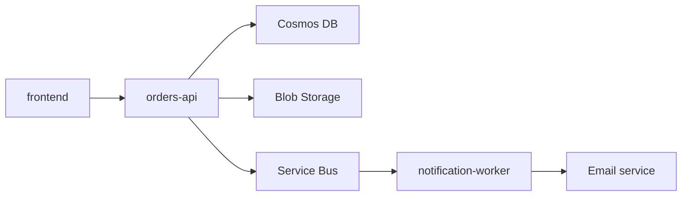

### Vì sao bản đồ không hiện worker?

Có thể:

- worker chưa gửi telemetry;
- exporter connection string trỏ sang resource khác;
- app role name không ổn định;
- Service Bus message context không propagate;
- không có traffic trong selected time window;
- instrumentation messaging SDK chưa hỗ trợ;
- data bị sampling/ingestion delay.

**Thiếu một node không chứng minh worker không chạy.** Đối chiếu worker logs, Service Bus queue metrics và traces.

### Không dùng map làm danh sách kiến trúc chuẩn duy nhất

Application Map phản ánh **những gì telemetry quan sát được**. Có thể thiếu dependency dùng custom protocol hoặc chỉ gọi rất hiếm. Dùng IaC/architecture diagrams và service inventory làm nguồn bổ sung.

## 31. Live Metrics và thời gian gần realtime

**Live Metrics** có thể hiển thị những chỉ số runtime/requests/failures gần realtime khi ứng dụng/agent và networking hỗ trợ.

### Dùng khi nào?

- Đang rolling deployment và cần thấy error rate/traffic thay đổi tức thời.
- Điều tra một spike ngắn.
- Xác nhận instances mới có hoạt động/telemetry.
- Kiểm tra request rate trước và sau mitigation.

### Không nên suy gì?

- Không xem Live Metrics là **sổ ghi toàn bộ request vĩnh viễn**.
- Không suy log/trace ở Live Metrics chắc chắn sẽ được lưu đầy đủ theo retention.
- Không dùng Live Metrics làm business audit hoặc định lượng hóa đơn.
- Không kết luận health tốt chỉ vì một biểu đồ request count bằng 0; có thể ingestion network bị chặn.

### Nếu Live Metrics không có dữ liệu

Kiểm tra agent feature/version, network tới Live Metrics endpoints, access restrictions, resource configuration và role/telemetry pipeline. **Một app vẫn có thể gửi standard telemetry nhưng Live Metrics không hoạt động** do các luồng/endpoint và chính sách khác nhau.

## 32. Sampling: vì sao không thấy mọi request?

Khi lưu lượng ứng dụng tăng, thu **100% request spans và dependency spans** có thể tạo chi phí/overhead lớn. Application Insights/OTel có các cơ chế **sampling** theo agent, SDK, exporter hoặc downstream pipeline.

### Sampling diễn ra ở đâu?

```text
Application/JVM
  ├─ Trace sampling (head-based hoặc chính sách hỗ trợ)
  ├─ Log/metric filtering
  └─ Exporter/processor
       └─ Collector / ingestion configuration
            └─ Application Insights / workspace
```

Một số agent có **sampling percentage hoặc adaptive sampling**, tùy version. Các cơ chế khác có thể nằm ở collector. **Không mặc định hai lớp sampling độc lập sẽ cho tỷ lệ hiệu dụng mong muốn hoặc giữ trace completeness**.

### Ví dụ ảnh hưởng đến việc đếm

Giả sử API nhận 10.000 requests, sample khoảng 10%:

```text
Actual requests:                  10,000
Sampled request records:         ~1,000
Expected errors, actual:            100
Sampled error records:             ~10 (nếu sampling không ưu tiên errors)
```

Đây là ví dụ thống kê đơn giản, **không đảm bảo kết quả chính xác** vì sampling có thể không đều, correlated, adaptive hoặc ưu tiên những events nhất định. **Không dùng `count()` thô trên sampled traces để tuyên bố tổng lượt truy cập/chi phí**.

### Sampling và trace completeness

Nếu spans trong cùng trace được lấy mẫu nhất quán, ta còn thấy parent–child đầy đủ hơn. Nếu mỗi component lấy mẫu khác chính sách, có thể thấy dependency mà thiếu request parent. Cần thống nhất propagation/sampler/exporter và xác minh mức completeness.

### Nên giữ signals nào?

- Aggregate request counts/error counts/latency histogram theo nguồn phù hợp với SLO.
- High-value error traces khi có chính sách khả thi và privacy controls.
- Business-critical audit events tại **hệ thống audit bền vững**, không dựa vào sampling.
- Một mẫu traces bình thường để nghiên cứu p95 và dependency distribution.

### Tránh “tăng sample lên 100%” như phản xạ

Khi thiếu một trace, trước tiên xem query time range, wrong resource/role, ingestion lag, parent propagation và exporter failures. Chỉ tăng sampling ở **lab/incident scope có thời hạn và budget**.

## 33. Metric cardinality và custom dimensions

Một metric có các dimensions như `service.name`, `operation`, `statusClass` hoặc `region` giúp phân tích có ý nghĩa.

### Low cardinality

```text
service = orders-api
operation = CreateInvoice
result = success | failure
region = southeastasia
```

### High cardinality nguy hiểm

```text
orderId = <unique per order>
userEmail = <unique per user>
requestId = <unique per HTTP call>
rawUrl = /customers/<userId>/orders/<orderId>
```

Metric labels có cardinality cao làm tăng time series, query pressure và phí backend; còn có thể lộ thông tin cá nhân. Với điều tra một order cụ thể, dùng **logs/traces có access control**, không tạo một metric series cho mỗi order.

### Custom metric làm gì?

Ví dụ metric `orders_created_total` hoặc `invoice_generation_duration` có thể cho biết mức độ nghiệp vụ và độ trễ. Trong một app dùng Micrometer, hãy xây custom counters/timers với labels ít giá trị; **phải cấu hình registry/exporter** để vào Azure Monitor. Không có exporter, `Counter.increment()` chỉ ghi nhận trong meter registry hiện hành chứ không tự xuất dữ liệu.

## 34. Custom metrics với Micrometer trong Spring Boot

### Ví dụ Timer và Counter

```java
package com.example.orders;

import io.micrometer.core.instrument.Counter;
import io.micrometer.core.instrument.MeterRegistry;
import io.micrometer.core.instrument.Timer;
import org.springframework.stereotype.Component;

import java.util.function.Supplier;

@Component
public final class OrderTelemetry {
    private final MeterRegistry registry;
    private final Counter created;

    public OrderTelemetry(MeterRegistry registry) {
        this.registry = registry;
        this.created = Counter.builder("orders.created")
            .description("Count of successfully created orders")
            .tag("source", "api")
            .register(registry);
    }

    public <T> T measureInvoice(Supplier<T> action) {
        Timer.Sample sample = Timer.start(registry);
        try {
            T result = action.get();
            created.increment();
            return result;
        } finally {
            sample.stop(Timer.builder("invoice.generation.duration")
                .tag("component", "invoice-service")
                .register(registry));
        }
    }
}
```

**Giới hạn:** `created.increment()` trong ví dụ nằm trong method có tên `measureInvoice`, nên **chỉ là mã minh họa cấu trúc metrics**, không được dùng như implementation chính xác của business metric “orders created”. Trong production, đặt counter đúng nơi transaction đã commit và không tăng khi kết quả cuối cùng chưa chắc chắn.

### Quan sát custom metric

Khi dùng Micrometer:

1. Đăng ký meter với tên và tags ổn định.
2. Cấu hình backend registry/exporter phù hợp.
3. Phát sinh một vài sự kiện test.
4. Kiểm tra meter xuất hiện trong telemetry backend thực.
5. Đối chiếu names/units/dimensions vì exporter có thể đổi quy ước đặt tên.

**Không khẳng định tất cả Micrometer meters tự xuất hiện trong AppMetrics khi chỉ cài Application Insights agent.** Kiểm tra tương thích và exporter route ở môi trường thực.

## 35. SLI/SLO cho một Spring Boot API

**SLI (Service-Level Indicator)** là chỉ số đo dịch vụ; **SLO (Service-Level Objective)** là mục tiêu vận hành. Ví dụ:

```text
Orders API successful response ratio >= 99.9% / rolling 30 days
POST /orders p95 latency              <= 800 ms
POST /orders p99 latency              <= 1,500 ms
Invoice dependency final failure rate <= 0.1%
Telemetry ingestion health           monitored separately
```

Các giá trị là **ví dụ minh họa**, không phải Azure SLA của Application Insights/App Service.

### Định nghĩa “success” theo nghiệp vụ

API trả `404` khi user truy vấn order không tồn tại có thể là expected business outcome; không tính là platform outage tùy service contract. `429` hoặc `503` sau retry budget thường cần tính là khả năng phục vụ suy giảm. Cần quy định:

- numerator/denominator rõ;
- loại request nào excluded (health probes? invalid client inputs?);
- telemetry sampling/weighting;
- tiêu chí terminal business success;
- time window và alert burn rate.

### Availability không bằng một health check

`GET /actuator/health` trả HTTP 200 chỉ chứng minh một health endpoint hoạt động theo cấu hình. Nó không đảm bảo **đăng nhập, Cosmos write, Storage upload và gửi email** đều thành công. Có thể thêm availability synthetic transaction an toàn với dữ liệu giả và rate-limit, không làm thay đổi đơn hàng production.

## 36. Azure Monitor Alerts và action groups

Đừng tạo alert trên mọi exception riêng lẻ. Cần thông báo dựa trên **tỷ lệ và mức ảnh hưởng**.

### Một số alert hữu ích

| Trigger gợi ý | Mục tiêu | Hành động |
|---|---|---|
| Request final failure rate tăng trong 5–15 phút | Phát hiện API outage | Gửi on-call + runbook |
| p95 latency vượt SLO | Nhận diện tail latency | So sánh dependencies và deployments |
| Cosmos `429` và retry pressure tăng | Phát hiện RU/hot partition pressure | Kiểm tra RU/partition/query |
| Azure Blob `503`/network timeout tăng | Storage/dependency issue | Service health + network diagnostics |
| Auth `401/403` tăng sau deployment | Identity/RBAC regression | Kiểm tra managed identity/roles/firewall |
| Telemetry biến mất từ một instance | Exporter/network/agent regression | Kiểm tra service health độc lập |
| Exception rate tăng theo build version | Regression | Triage/rollback |
| Log ingestion/cost vượt budget | FinOps/privacy issue | Giảm log verbosity, kiểm tra sampling |

### Action group có thể làm gì?

Gửi email/SMS/push/webhook/tích hợp automation theo tính năng. Cần có **on-call ownership, severity, deduplication, escalation và giờ trực**; nếu gửi 1.000 thông báo cho một outage, on-call có thể bỏ sót cảnh báo quan trọng.

### Alert không đồng nghĩa tự động khắc phục

Một `503` spike có thể đến từ service outage, app retry storm hoặc network policy. Automation restart tất cả instances có thể làm tăng tác động. Trước khi remediation tự động, cần runbook có **guardrails và rollback**.

## 37. Workbooks và dashboard vận hành

Một workbook phù hợp cho application owner có thể gồm:

```text
1. Traffic: requests/min theo endpoint/region
2. SLO: success rate, error budget
3. Latency: p50/p95/p99
4. Dependencies: top failures và slowest targets
5. Exceptions: top types và correlation samples
6. Runtime: CPU, memory, GC, thread/event loop metrics
7. Releases: build versions/deployment markers
8. Telemetry: ingestion/agent/export errors
9. Cost: ingestion bytes/retention trend
10. Links: incident runbooks và owning team
```

### Những metric sources cần phân biệt

- **App Insights traces/requests:** do ứng dụng xuất và có sampling.
- **App Service/AKS resource metrics:** platform-level, độc lập agent.
- **Cosmos/Storage/Service Bus metrics:** dependency resource metrics riêng.
- **JVM JMX/Micrometer metrics:** cần collector/exporter và units đúng.

Không cộng các metric tên giống nhau từ hai nguồn nếu **denominator/time units** khác.

### Dashboard chống “ảo tưởng xanh”

Nếu Application Insights không nhận telemetry, request count có thể bằng 0 và một số biểu đồ sẽ trông “không có lỗi”. Dashboard nên có **signal về telemetry freshness/exporter health** và Azure resource metrics để phân biệt app rảnh với observability đang hỏng.

## 38. Bảo vệ dữ liệu và quyền riêng tư của telemetry

Telemetry có thể trở thành một nguồn dữ liệu nhạy cảm nếu log quá nhiều:

| Nguồn | Rủi ro |
|---|---|
| HTTP URL/query | SAS token, API key, email, order ID |
| HTTP headers | `Authorization`, cookies, bearer token |
| Request/response body | PII, tài chính, y tế, passwords |
| Exception message | Internal URLs, secret values, SQL query parameters |
| Span attributes | Raw customer identifiers, session IDs |
| User/client metadata | IP, geo, device identifiers |
| Logback MDC | Tenant IDs/user data dễ lan sang requests khác |
| SQL dependency data | Raw SQL có literal sensitive |

### Nguyên tắc bảo mật

1. **Không log secrets** ngay từ source code; redaction downstream chỉ là lớp bổ sung.
2. Không bật HTTP BODY/HEADERS hoặc full SQL query capture mặc định.
3. Dùng route templates, endpoint aliases và labels ít giá trị.
4. Bật privacy filters/processors cho OTel agent/collector khi phù hợp.
5. Phân quyền Log Analytics/Application Insights theo least privilege.
6. Đặt retention, export và deletion policy tương ứng nghĩa vụ dữ liệu.
7. Dùng dữ liệu giả cho incident reproduction/labs.
8. Có runbook khi telemetry chứa secrets: cô lập quyền truy cập, rotate/revoke, audit, xử lý theo policy.

### Sự khác nhau giữa pseudonymization và anonymity

Hash `customerId` hoặc chỉ lưu một opaque ID có thể **vẫn liên kết tới khách hàng** qua hệ thống khác. Không tự kết luận đã ẩn danh hoàn toàn; áp dụng classification/retention phù hợp.

## 39. Connection string và telemetry injection threat model

Một Application Insights connection string thường không được xem như Azure resource management credential. Tuy nhiên việc công khai ingestion target có thể tạo cơ hội bên thứ ba **bơm telemetry rác**, làm nhiễu dashboards hoặc tăng chi phí nếu pipeline chấp nhận.

### Bảo vệ thực tế

- Lưu config ở App Settings/Key Vault/Kubernetes secrets theo policy.
- Dùng network egress restrictions/private ingestion options khi được hỗ trợ.
- Xem xét Microsoft Entra authenticated ingestion nếu environment và exporter hỗ trợ.
- Kiểm tra resource/workspace permissions, ingestion filters và usage alerts.
- Không cấp Logs Reader cho mọi user chỉ vì connection string không phải admin key.
- Không cho logs mang personal information quá nhu cầu.

### Identity của ứng dụng vs identity của telemetry

Một App Service managed identity có thể dùng để đọc Blob/Key Vault; điều này **không có nghĩa exporter tự dùng cùng identity để gửi telemetry** nếu chưa cấu hình. Ingestion authentication là một cơ chế cần kiểm tra riêng.

## 40. Chi phí Application Insights và Log Analytics

Nguồn phí chính thường liên quan **data ingestion, retention, loại dữ liệu/tables, sampling, logs volume, custom dimensions và các dịch vụ giám sát/collector kèm theo**.

### Bài toán throughput

Giả sử API xử lý:

```text
2,000 requests/giây
4 dependency calls/request
3 log events/request
1 exception record trên 1% requests
```

Số events lý thuyết:

\[
2\,000 \times (1 + 4 + 3) = 16\,000\ \text{telemetry records/giây}
\]

chưa tính exception records, JVM metrics, live metrics, retries và service-side logs. **Đây là số records trước sampling/filtering**, không phải chi phí tiền tệ. Kích thước mỗi record, ingestion plan/region và retention mới quyết định hóa đơn.

### Các cách tối ưu

- Giữ INFO/WARN mức hợp lý; DEBUG tạm thời theo incident.
- Không ghi một exception stack ở 5 tầng app/SDK/controller.
- Dùng sampling phù hợp, vẫn giữ SLO aggregate metrics.
- Gắn tags có cardinality thấp.
- Không log body/Authorization/SAS.
- Chỉ giữ telemetry theo retention policy.
- Chọn log plan, diagnostics categories và ingestion routing theo giá thực.
- Giám sát `Usage and estimated costs`/Cost Management ở workspace/AI resource.

### Đừng giảm chi phí bằng cách xóa mọi lỗi

Nếu sampling loại bỏ hết rare errors, runbook/incident analysis sẽ thất bại. Nên thiết kế sampling theo **mức quan trọng, volume, error classes và privacy**, không đơn thuần giảm số log nhiều nhất có thể.

## 41. Ngân sách cho cả Azure application, không chỉ App Insights

Một Spring Boot API chậm có thể gây tăng chi phí ngoài telemetry:

- Blob transactions tăng vì retry.
- Cosmos DB RU charge tăng vì query không tối ưu.
- Service Bus message redelivery khiến worker làm việc lặp lại.
- AKS/App Service autoscale tăng instance counts.
- Log Analytics ingestion tăng theo retry/exception storms.
- Outbound traffic/Private Link/collector infrastructure phát sinh phí.

**Application Insights giúp phát hiện cost drivers**, không thay Azure Cost Management. Kết hợp traces/logs với metrics của Azure resources và usage/cost analysis để tìm root cause.

## 42. Deploy Java agent trên Azure App Service

### Mô hình

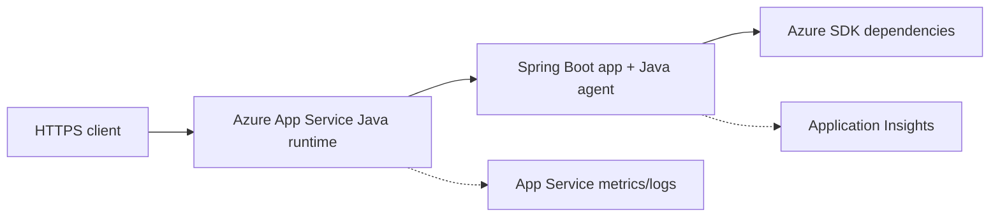

### Quy trình deployment tham khảo

1. Xác định App Service sử dụng **Java built-in stack** hay **custom container**, JDK version và startup command.
2. Chọn một cách instrumentation: App Service Application Insights integration được hỗ trợ **hoặc** tự nạp Java agent; tránh trùng.
3. Cung cấp connection string qua App Settings/configuration channel phù hợp.
4. Nếu tự nạp agent, bảo đảm file JAR tồn tại trước JVM start và `-javaagent` được gắn đúng.
5. Thiết lập role name/service version/environment.
6. Xác minh network egress tới ingestion endpoints.
7. Triển khai staging slot/canary, gửi request giả.
8. Xem Application Insights request + dependency traces, so sánh CPU/latency trước/sau.
9. Swap/cutover theo deployment plan; giám sát error rate và rollback nếu cần.

### App Service tự động bật Application Insights?

Một số stack/Portal workflows có tùy chọn bật Application Insights và **tự cấu hình instrumentation**. Đừng bật thêm `JAVA_TOOL_OPTIONS=-javaagent:...` khi platform integration đã nạp Java agent. Kiểm tra startup logs/transaction graph để xác định **đúng một instrumentation owner**.

### VNet integration và private ingestion

App Service outbound network, proxy, firewall và DNS có thể ảnh hưởng đường gửi telemetry. **Ứng dụng vẫn xử lý requests bình thường dù exporter thất bại**; không nên fail business request vì telemetry endpoint tạm thời unavailable, trừ chính sách audit nghiêm ngặt có thiết kế riêng.

### Deployment slots

Staging/prod slots có thể dùng connection strings riêng hoặc cùng telemetry resource với environment dimension; chọn mô hình nhất quán. Không để staging traffic trộn với production SLO mà không có nhãn hoặc filter.

## 43. Deploy trên AKS với Java agent

Trên AKS, mỗi Java container cần có agent/configuration theo image/initContainer/mount hoặc mechanism instrumentation được phê duyệt.

### Cách đóng gói vào image

Một Dockerfile minh họa (agent JAR được **cung cấp bởi build pipeline từ nguồn chính thức được xác minh**, không download tại runtime):

```dockerfile
FROM eclipse-temurin:21-jre
WORKDIR /app

COPY orders-api.jar /app/orders-api.jar
COPY applicationinsights-agent.jar /opt/telemetry/agent.jar

ENV JAVA_TOOL_OPTIONS="-javaagent:/opt/telemetry/agent.jar"
EXPOSE 8080
ENTRYPOINT ["java", "-jar", "/app/orders-api.jar"]
```

**Lưu ý:** Image reference/JDK cần được pin digest/version theo security policy; `COPY applicationinsights-agent.jar` ngụ ý build pipeline đã đưa agent tới build context có kiểm chứng checksum/license/provenance. Không sử dụng image/tag unverified trong production.

### Kubernetes Deployment rút gọn

```yaml
apiVersion: apps/v1
kind: Deployment
metadata:
  name: orders-api
spec:
  replicas: 2
  selector:
    matchLabels:
      app: orders-api
  template:
    metadata:
      labels:
        app: orders-api
    spec:
      containers:
        - name: orders-api
          image: example.registry.local/orders-api:1.0.0
          ports:
            - containerPort: 8080
          env:
            - name: APPLICATIONINSIGHTS_CONNECTION_STRING
              valueFrom:
                secretKeyRef:
                  name: application-insights-config
                  key: connectionString
          resources:
            requests:
              cpu: "250m"
              memory: "512Mi"
            limits:
              memory: "1Gi"
```

Đây là manifest **lab**, không có Service/Ingress, ServiceAccount/workload identity, security context, probes, autoscaling hay NetworkPolicy. Trong production, cần bổ sung theo tiêu chuẩn AKS. Dùng key của Secret không đồng nghĩa bảo mật tuyệt đối; quản trị Kubernetes RBAC, encryption at rest và secret rotation riêng.

### AKS-specific pitfalls

- Agent tăng CPU/memory và có thể ảnh hưởng JVM GC/heap sizing.
- Pod có thể bị OOMKilled nếu memory budget không tính agent overhead.
- Một `JAVA_TOOL_OPTIONS` áp dụng cho Java process nhưng không phải sidecar viết bằng ngôn ngữ khác.
- Collector/exporter cần egress DNS/firewall; AKS NetworkPolicy có thể chặn.
- Dynamic pod names nếu dùng làm service name sẽ gây hàng nghìn components; đặt **role/service name ổn định**, pod ID là instance attribute.
- HPA/cluster autoscaler có thể thay đổi replica count làm đồ thị phụ thuộc và cost biến động.
- Đừng gán pod resource labels như `containerId` vào custom metric dimension một cách không kiểm soát.

### Operator-level instrumentation

Nếu tổ chức dùng OpenTelemetry Operator/instrumentation injection, **không đồng thời bake một Application Insights Java agent vào cùng image** trừ khi đã kiểm chứng instrumentation compatibility và có lý do rõ ràng.

## 44. VM, container và môi trường hybrid

Ứng dụng Java có thể chạy trên Azure VM, Azure Container Apps, on-prem JVM hay môi trường hybrid. Những yêu cầu giống nhau:

1. Runtime/JDK/agent support.
2. App Insights resource/ingestion connection.
3. Egress TLS và trust store phù hợp.
4. Resource attributes có service/environment/instance.
5. Exporter retry/buffering không làm treo business threads.
6. Privacy filters và log retention.
7. Role/access controls cho telemetry query.

### Không cần hosting trên Azure để gửi Application Insights

Một Java app on-prem **có thể** gửi telemetry tới Azure Monitor nếu network/agent/exporter/tenant policy hỗ trợ. Tuy nhiên không nên tự đưa logs dữ liệu nhạy cảm sang region Azure khác khi chưa xét data residency và pháp lý.

### Khi mất mạng

Exporter có thể buffer/drop/retry telemetry theo SDK/agent; không mặc định mọi span giữ vô hạn hoặc được gửi chính xác một lần. Đặt **telemetry drop/error monitoring** và sizing collector theo expected volumes.

## 45. Troubleshooting: không thấy bất kỳ telemetry

### Kiểm tra theo tầng

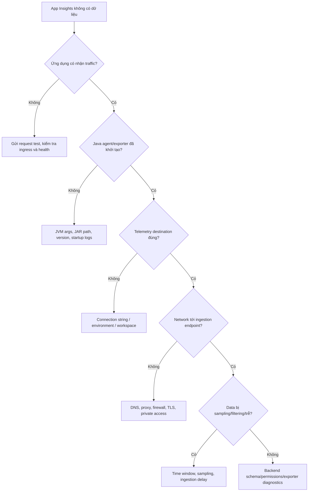

### Những điều cần kiểm tra cụ thể

| Bước | Câu hỏi |
|---|---|
| 1 | Bạn đang ở **đúng subscription/resource/workspace** không? |
| 2 | Application Insights resource có dùng đúng region/ingestion endpoint không? |
| 3 | JVM có `-javaagent` và đúng JAR version/path không? |
| 4 | Agent có bị lỗi startup hoặc config parse không? |
| 5 | Java app thực sự nhận HTTP request chưa? |
| 6 | Có Java agent/OTel exporter khác gây xung đột không? |
| 7 | Proxy/TLS/network chặn telemetry ingestion không? |
| 8 | Có sampling=0/filter/quy tắc exclude toàn bộ requests không? |
| 9 | Logs explorer dùng đúng table và time range không? |
| 10 | Role đọc Log Analytics workspace có đầy đủ không? |

**Không sửa bằng cách bật tất cả HTTP logging ở mức BODY**. Trước hết xem agent initialization và exporter health.

## 46. Troubleshooting: có request nhưng không có dependency

Giả sử AppRequests hiển thị `POST /orders`, nhưng AppDependencies không có Cosmos DB.

### Khả năng

- Client/SDK version không được instrumentation nhận diện.
- Sử dụng custom HTTP transport mà agent không hỗ trợ.
- HTTP client instrumentation bị tắt/filter.
- Dependency spans bị sampling hoặc export fail.
- Business code trả từ cache nên không gọi Cosmos.
- SDK call chạy trên async context mất liên kết nhưng span xuất hiện ở trace khác.
- Agent và SDK tracing adapters bị xung đột.

### Hướng xử lý

1. Xác nhận code path thực sự gọi dependency.
2. Kiểm tra service-side request metrics (Cosmos RU/requests) để có tín hiệu độc lập.
3. Đối chiếu SDK package/agent version compatibility.
4. Xem AppDependencies **toàn role/time window**, không chỉ trace hiện tại.
5. Kiểm tra sampling và propagators.
6. Nếu cần, thêm manual business span quanh dependency operation.
7. Đừng tự thêm HTTP body logging chỉ để tìm một span.

## 47. Troubleshooting: traces bị đứt qua Service Bus

Một Orders API gửi message, Notification Worker xử lý nhưng Application Insights hiển thị hai traces không liên quan.

### Nguyên nhân thường gặp

- Producer không inject W3C context vào message carrier.
- Consumer không extract context hoặc auto-instrumentation không hỗ trợ SDK/version.
- Producer/consumer dùng propagators khác nhau.
- Worker tạo một root span mới thay vì sử dụng extracted context/span link.
- Process chạy khác resource và user đang lọc sai role/workspace.
- One side sampled out, making graph incomplete.
- Messaging semantics chọn **span link**, người dùng đang kỳ vọng parent-child trực tiếp.

### Hành động

1. Log sanitized message ID/business event ID và trace ID ở producer/consumer.
2. Kiểm tra trace context carrier (không in sensitive headers).
3. So sánh agent/OTel instrumentation versions.
4. Kiểm tra producer send và consumer receive/process spans.
5. Xem span links nếu backend/UI hỗ trợ.
6. Xác nhận worker ở đúng App Insights resource hoặc có cross-resource navigation được phép.

Không tạo một `traceId` tự chế bằng cách copy `messageId` hoặc order ID; W3C trace/span IDs có định dạng và semantics riêng.

## 48. Troubleshooting: logs trùng, sampling và phí tăng

| Triệu chứng | Phân tích khả dĩ | Cách sửa |
|---|---|---|
| Một inbound request có hai request spans giống hệt | Double Java agents/instrumentation | Xác định instrumentation owner |
| Một lỗi tạo 6 stacktraces | Controller/service/SDK đều log ERROR | Log một boundary, rethrow typed error |
| `AppTraces` bùng nổ sau bật DEBUG | Logger levels/SDK HTTP logging | Giới hạn level/thời gian/namespace |
| Không thấy traceId trong một số Reactor logs | MDC ThreadLocal/context loss | Reactor OTel context bridge |
| Request count thấp hơn gateway logs | Sampling, route filters, ingestion loss | Dùng appropriate weighting/metrics |
| p95 sai khác giữa App Insights và reverse proxy | Time window, sampling, duration boundaries | So sánh cùng denominator/clock |
| Exception count tăng dù HTTP success ổn định | Exceptions đã catch/retry nhưng được instrument | Tách handled/transient và final failures |
| App Map tạo một node mỗi pod | Dynamic role name/service.name | Đặt service name ổn định, pod là instance |
| Azure Monitor query không có bảng | Sai workspace/ingestion schema | Xác minh table names |
| Exporter có latency/network errors | Proxy/egress/collector capacity | Kiểm tra transport và buffers |
| Chi phí không giảm sau giảm app INFO logs | Other diagnostics/retention/traffic | Xem usage tables/plan |

### Đọc traces đúng kỳ vọng

Một lần SDK request có thể sinh **nhiều spans hợp lệ** (logical operation và network attempt) chứ không phải mọi span lặp đều là duplication. So sánh **span IDs, parent IDs, names, attributes và start/end times**.

## 49. Runbook incident: Spring Boot API chậm đột ngột

### Giả định

10:00 UTC sau deployment, `POST /api/orders` p95 tăng từ 400 ms lên 2.200 ms; một phần requests trả `503`. Cosmos metrics hiển thị throttling `429`, một số Blob calls `403`.

### Quy trình

1. **Xác định impact:** region/instances/build version, requests per minute, failure rate và user-facing SLO.
2. **Mở Performance:** tìm slow routes, chọn traces bị ảnh hưởng và breakdown dependencies.
3. **Xem AppDependencies:** Cosmos p95/429, Blob 403 và tương quan theo deployment version.
4. **Tìm AppExceptions:** phân biệt token acquisition/RBAC, throttling, timeout và application bugs.
5. **Kiểm tra resource metrics:** Cosmos RU/partition, Storage firewall, App Service network/AKS CPU, Service Health.
6. **Đối chiếu credential:** App chạy identity nào sau deployment? Có data-plane role đúng không?
7. **Kiểm tra retry storm:** gateway, SDK và app có đang retry chồng tầng không?
8. **Giảm tác động:** giới hạn concurrency/retry, rollback nếu regression, điều chỉnh quyền đúng scope theo change process.
9. **Xác minh:** p95/failure rate hồi phục, traces mới không duplicate, telemetry không bị drop.
10. **Postmortem:** root cause, missing telemetry fields, alert thresholds, business reconciliation và owner actions.

### Một điều cần tránh

Storage `403` từ backend managed identity **không nên được diễn giải là người dùng cuối không có quyền**. Application authorization và Azure workload data-plane permissions là hai lớp khác nhau.

### Sample evidence template

```text
Incident ID:
UTC start / end:
AppRoleName, region, build:
Request name / result code:
Trace/operation ID:
Dependency target and status:
Azure request ID (nếu có):
SDK/JDK/agent version:
Service-side metrics:
Final error rate and p95:
Mitigation:
Root cause:
Follow-up test/alert:
Secret/PII in evidence: NONE
```

## 50. Runbook incident: telemetry đã ngừng xuất nhưng API vẫn chạy

### Tình huống

Requests vẫn đến API Gateway, nhưng Application Insights không hiển thị dữ liệu sau 13:00 UTC.

### Đừng vội kết luận hệ thống không có traffic

Cần một **tín hiệu độc lập** như App Service HTTP request metrics, AKS ingress, gateway logs hoặc Load Balancer metrics.

### Điều tra

```text
Gateway metrics show 500 req/min?
  ├─ No → Có thể traffic thật đã dừng hoặc ingress lỗi.
  └─ Yes
      ├─ Java agent startup/version changed?
      ├─ Connection string/role name changed?
      ├─ Exporter/collector backlog?
      ├─ DNS/egress/TLS/proxy blocked?
      ├─ Sampling/filter changed?
      ├─ Workspace/DCR/ingestion policy changed?
      └─ Query time range/schema/permissions correct?
```

### Bài học về monitoring the monitor

Đặt alert trên **telemetry freshness/exporter failures**, đồng thời có Azure platform metrics độc lập. Không thể dựa hoàn toàn vào App Insights để tự chứng minh exporter của nó đang khỏe.

## 51. Lab 1 — Tạo Application Insights và quan sát request đầu tiên

### Mục tiêu

Người học tạo một luồng:

```text
curl → Spring Boot Java app
     → Application Insights Java agent
     → Azure Monitor ingestion
     → Application Insights workspace
     → Logs / transaction search
```

### Chuẩn bị

| Hạng mục | Yêu cầu |
|---|---|
| Azure subscription | Sandbox được phép tạo Application Insights/Log Analytics |
| Application Insights | Workspace-based, được chỉ định region |
| Log Analytics workspace | Có quyền query để xác minh |
| JDK/Spring Boot | Bản tương thích Java agent |
| Agent | Application Insights Java agent từ nguồn chính thức đã kiểm tra |
| Network | Cho phép outbound TLS tới telemetry endpoints |
| Data | Sử dụng HTTP requests/dữ liệu giả |
| Budget | Có owner và retention/sampling giới hạn |

### Bước 1 — Chuẩn bị app

Tạo Spring Boot app demo như các phần 12–14 hoặc dùng một ứng dụng sandbox có route đơn giản `/api/orders/demo`. Nếu chưa có Storage, một route trả một giá trị giả cũng đủ kiểm tra **request telemetry**; phần dependency sẽ thử ở lab kế tiếp.

### Bước 2 — Bật Java agent

```bash
export APPLICATIONINSIGHTS_CONNECTION_STRING="<sandbox-connection-string>"
java -javaagent:/opt/telemetry/applicationinsights-agent.jar \
     -jar orders-api.jar
```

Tại Windows/PowerShell, cú pháp khai báo biến môi trường khác; hãy dùng môi trường hiện có và đảm bảo **không in connection string vào chia sẻ terminal recording**.

### Bước 3 — Gửi requests

```bash
curl -i http://localhost:8080/actuator/health
curl -i http://localhost:8080/api/orders/demo
```

Routes phải có thật; nếu app không expose `/api/orders/demo`, một request `404` cũng có thể được instrument nhưng cần phân biệt absence do endpoint chưa có với lỗi Application Insights.

### Bước 4 — Kiểm tra Azure

1. Application Insights resource → Requests/Performance hoặc Logs.
2. Query `AppRequests | where TimeGenerated > ago(1h) | take 20`.
3. Xem `AppRoleName`, `Name`, `DurationMs`, `ResultCode`, `Success`.
4. Chọn một request và tìm transaction/trace details.
5. So sánh event time và ingestion time/query time range.

### Kết quả

```text
JVM agent loaded: PASS/FAIL
Connection string target correct: PASS/FAIL
Sample request sent: PASS/FAIL
AppRequests row observed: PASS/FAIL
Role name expected: PASS/FAIL
Trace ID visible: PASS/FAIL
No sensitive request payload in telemetry: PASS/FAIL
```

Nếu request chưa thấy ngay, đừng tự chạy hàng chục nghìn requests chỉ để “kích hoạt telemetry”. Kiểm tra agent/exporter và chờ ingestion theo phạm vi thời gian hợp lý.

## 52. Lab 2 — Correlation HTTP → Azure Blob SDK

### Mục tiêu

Với `InvoiceService` ở phần 12:

1. Có Storage sandbox/container `invoice-lab`.
2. App identity có đúng **Storage Blob Data Contributor** ở scope được duyệt.
3. Gọi demo upload qua API.
4. Kiểm tra Application Insights inbound request và Blob dependency.
5. Tìm application log `invoice.upload_succeeded` trong cùng trace/operation.
6. Chạy lần thứ hai để tạo `409` có kiểm soát.
7. Phân biệt expected conflict với service outage.

### Luồng quan sát

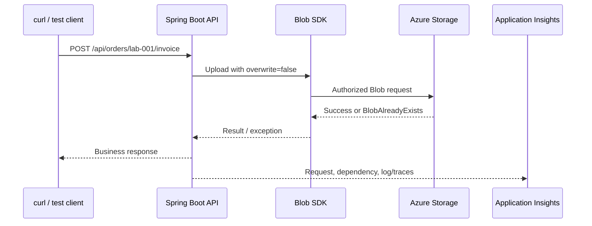

### KQL kiểm tra

```kusto
AppDependencies
| where TimeGenerated > ago(1h)
| where Name has "Blob" or Target has ".blob."
| project TimeGenerated, Name, Target, ResultCode,
          Success, DurationMs, OperationId
| order by TimeGenerated desc
```

Điều kiện `Name has "Blob"` chỉ là minh họa; nếu agent đặt tên khác, hãy xem `take 20` và điều chỉnh đúng format. Lệnh query không kiểm tra trực tiếp content/tên object.

### Nghiệm thu

Đảm bảo trong trace:

- request inbound có status/duration;
- dependency xuất hiện nếu instrumentation thực sự hỗ trợ;
- app log có business outcome;
- lỗi 409 không bị phân loại thành Azure outage một cách mù quáng;
- không có SAS/account key, raw invoices hoặc user data trong properties.

## 53. Lab 3 — Custom OpenTelemetry business span

### Mục tiêu

Tạo một span `Invoice.Generate` với OTel API và xem nó có quan hệ parent-child với Spring Boot inbound request hay không.

### Các bước

1. Bảo đảm dùng **một** agent/SDK tracing pipeline đang hoạt động.
2. Thêm OpenTelemetry API dependency tương thích.
3. Dùng `BusinessTracing.execute(...)` ở phần 16 bao quanh một business operation.
4. Gửi request test tới controller.
5. Mở Application Insights transaction view hoặc logs có trace/span IDs.
6. Xác minh span có cùng trace ID với inbound request.
7. Xem attributes `app.operation`, `app.outcome` và timing.
8. Gây một business exception test; kiểm tra error status có hợp lệ.

### Nếu custom span không xuất hiện

Kiểm tra:

- `GlobalOpenTelemetry` có provider thật hay no-op?
- Java agent API version compatibility.
- Sampling có loại trace?
- Agent/exporter có chấp nhận manual spans?
- `Scope` có được mở/đóng đúng?
- Có tạo span sau khi original context đã mất?

### Negative test

Đừng đưa `customerEmail` hoặc raw `Authorization` vào `setAttribute`. Thay bằng `app.operation` và sanitized category, rồi kiểm tra App Insights properties.

## 54. Lab 4 — Spring Boot Reactor context và lỗi async

### Kịch bản

Một WebFlux controller trả `Mono<String>`. App gọi async Azure SDK, sau đó `publishOn` một scheduler và ghi log. Team thấy log cuối cùng có `traceId` rỗng.

### Mẫu logic

```java
// Conceptual Reactor snippet: giả định service cung cấp Mono<String>.
return reactiveInvoiceService.generateInvoice(orderId)
    .doOnSubscribe(s -> LOG.info("invoice.generate_started"))
    .doOnSuccess(result -> LOG.info("invoice.generate_completed"))
    .doOnError(e -> LOG.warn(
        "invoice.generate_failed exceptionType={}",
        e.getClass().getSimpleName()));
```

**Không gọi `subscribe()` trong controller** nếu framework cần quản lý subscription và HTTP response. Trả publisher để Spring WebFlux thực hiện.

### Test matrix

| Case | Kiểm tra |
|---|---|
| Không chuyển scheduler | Trace/log có correlation hợp lệ |
| Chuyển `publishOn` | Trace context còn khi bridge hỗ trợ |
| Gây timeout | Error không bị nuốt |
| `onErrorResume` | Chỉ recover các lỗi nghiệp vụ được phép |
| Dùng `block()` trên event loop | Không được đưa vào production |
| Worker dùng `subscribe()` fire-and-forget | Cần durable job/queue và error handler |

### Quan sát bằng App Insights

Tìm cùng `OperationId` trước/sau async boundary. Nếu lệch, kiểm tra OTel Reactor instrumentation bridge, không tự thêm `MDC.put` vào mọi lambda khi chưa hiểu propagation.

## 55. Lab 5 — KQL, p95 và phân loại dependency failures

### Bước 1 — Tạo workload thử

Dùng requests giả có giới hạn tới một Spring Boot endpoint:

```text
20 successful requests
5 expected not-found requests
5 simulated dependency failures (chỉ trong sandbox)
```

### Bước 2 — Trả lời bằng queries

1. Tổng requests và failures của app trong 1 giờ?
2. Operation nào có p95 cao nhất?
3. Dependency target nào có nhiều errors nhất?
4. Exception type nào tăng nhiều nhất?
5. 429/503 có xuất hiện đúng dependency không?
6. Khi chọn một operation ID, có logs, request và dependencies tương ứng không?
7. 404 expected có bị tính vào SLO sai không?
8. Có dấu hiệu sampling/ingestion delay không?

### Bước 3 — Trình bày bảng

| Metric | KQL source | Diễn giải |
|---|---|---|
| Request throughput | AppRequests | Xem weight/sampling trước kết luận |
| p95 request latency | AppRequests.DurationMs | Không so trực tiếp với dependency p95 |
| Dependency failure | AppDependencies | Xác minh result code và target |
| Exception trend | AppExceptions | Có thể gồm handled exceptions |
| Business log | AppTraces | Log events có correlation nếu được config |

### Sai lầm cần tránh

Nếu `AppRequests | count` trả 30 nhưng client thực gửi 40, không tự kết luận 10 requests bị mất. Có thể sampling, query scope, ingestion delay, app không nhận request hoặc failed instrumentation. So sánh gateway/platform metrics và sampling configuration.

## 56. Lab 6 — Sampling và chi phí

### Bối cảnh

Một app có 1.000 requests/phút và mỗi request tạo request span + 3 dependencies + 2 log events.

Ước tính thô số events trước sampling:

\[
1\,000 \times (1+3+2) = 6\,000\ \text{records/phút}.
\]

### Nhiệm vụ

1. Trong lab, dùng 100% sampling để quan sát 10 requests.
2. Giảm sampling theo một cấu hình được agent hỗ trợ, ví dụ tỷ lệ mục tiêu thấp hơn (không cần khẳng định số records sẽ đúng tuyệt đối).
3. Gửi cùng lượng test traffic.
4. So sánh số traces/relationships và aggregated metrics.
5. Kiểm tra errors có còn đủ tín hiệu để alert không.
6. Dùng Azure usage/cost reports để đo bytes thực.
7. Xác minh secrets/PII redaction trước khi tăng verbosity.

### Kết luận

Giảm sampling có thể giảm tracing ingestion nhưng cũng làm giảm khả năng tái hiện một request cụ thể. Với SLO, cần nguồn aggregate count và phương pháp weighting phù hợp; **không dựa vào sampled trace count để báo cáo doanh thu hoặc audit**.

## 57. Lab 7 — Tạo alert và workbook phục vụ on-call

### Đầu vào

Chọn một SLO giả:

```text
Failure rate > 3% trong 10 phút
P95 request latency > 1200 ms trong 15 phút
Telemetry missing > 10 phút khi gateway vẫn có traffic
```

### Yêu cầu

1. Thiết kế query/metric alert theo logs/metrics được hỗ trợ.
2. Chọn severity, evaluation frequency/window và minimum traffic threshold.
3. Gắn action group cho người trực và runbook.
4. Thiết kế suppression/deduplication để không spam cùng sự cố.
5. Dùng Workbook hiển thị throughput, failures, p95/p99, dependencies và exception trends.
6. Thêm chú thích deployment marker/build version.
7. Kiểm tra cảnh báo bằng test traffic của sandbox.
8. Xác minh cảnh báo không tự động đóng/mở firewall hoặc restart production ngoài quy trình.

### Một vấn đề phổ biến

Nếu traffic bằng 1 request/10 phút và request đó thất bại, failure rate sẽ là 100%, nhưng có thể chưa đủ bằng chứng về một sự cố diện rộng. Quy tắc alert nên kết hợp **minimum sample size/traffic volume** và error burn-rate phù hợp.

### Nghiệm thu

```text
Alert query/metric target correct: PASS/FAIL
Window and threshold documented: PASS/FAIL
Action group destination approved: PASS/FAIL
Runbook link present: PASS/FAIL
Alert trigger from test confirmed: PASS/FAIL
Avoid duplicate notifications: PASS/FAIL
No PII/secrets in alert payload: PASS/FAIL
```

## 58. Lab 8 — Telemetry loss injection an toàn

### Mục đích

Xác minh nhóm vận hành phân biệt **ứng dụng ngừng phục vụ** với **exporter/telemetry path bị lỗi**.

### Cách thực hiện

Chỉ trong cluster/container sandbox:

1. Chạy endpoint test và ghi nhận gateway request metrics.
2. Cấu hình một môi trường test để **không gửi được telemetry** (ví dụ collector test không khả dụng; cần approval cho network rules).
3. Gửi cùng request test.
4. Xác nhận API vẫn xử lý theo business contract.
5. Quan sát Application Insights data giảm/mất.
6. Kiểm tra exporter logs/drop counters khi agent hỗ trợ.
7. Khôi phục telemetry path, xác minh dữ liệu mới xuất hiện.
8. Xem có backfill không; **không tự cho rằng mọi lost spans được gửi lại**.

### Hành vi mong muốn

Ứng dụng không phụ thuộc vào Application Insights exporter để commit mỗi order, nhưng hệ thống monitoring phải nhận ra **observability outage** và cảnh báo bằng một tín hiệu độc lập.

### Không thực hiện

Không tắt Log Analytics workspace/connection string production để “thử”. Không dùng request body thật hoặc dữ liệu khách hàng cho thử nghiệm exporter.

## 59. Checklist triển khai production

### 59.1 Architecture và instrumentation

- [ ] Chọn Application Insights resource/workspace/region phù hợp data residency.
- [ ] Xác nhận JDK, Spring Boot, Azure SDK và Java agent/OTel versions tương thích.
- [ ] Có **một instrumentation/exporter owner chính**, không double agents.
- [ ] Cấu hình `service.name`/role name, environment, build/version và instance.
- [ ] Inbound requests, meaningful dependencies và business spans được đo.
- [ ] W3C trace context hoạt động qua HTTP và messaging theo SDK support.
- [ ] Reactor/MDC context propagation được kiểm thử qua async boundaries.
- [ ] App Service/AKS ingress/platform metrics tồn tại độc lập với telemetry app.
- [ ] Agent được kiểm tra trên staging/canary với tải tương đương.

### 59.2 Logs, privacy và quyền

- [ ] Logging mức INFO/WARN phù hợp; DEBUG/TRACE có expiry và incident scope.
- [ ] Không ghi Authorization/SAS/connection string/PII/SQL sensitive literals.
- [ ] Không mặc định bật HTTP BODY_AND_HEADERS logging trên production.
- [ ] Có structured log fields và trace/correlation IDs đã validate.
- [ ] Không ghi một exception full stack tại nhiều layers.
- [ ] Telemetry ingestion và Logs query được phân quyền riêng.
- [ ] Workspace retention và export policy được Security/Compliance duyệt.
- [ ] Collector/agent redaction được test với dữ liệu giả.
- [ ] Có runbook khi phát hiện secret bị lộ trong logs/traces.

### 59.3 SLI/SLO và operations

- [ ] Định nghĩa success/failure theo business contract.
- [ ] Có p50/p95/p99 request và dependency latency.
- [ ] Có final error rate, 429/503 pressure và auth errors.
- [ ] Có dashboard/alerts/workbooks và on-call owner.
- [ ] Có telemetry freshness/exporter health alert độc lập.
- [ ] Chọn sampling có cân nhắc error capture, cost và SLO counting.
- [ ] KQL queries đã test trên **đúng schema thật**.
- [ ] Có deployments/build markers để điều tra regression.
- [ ] Có incident runbooks cho request chậm, missing spans, no telemetry.

### 59.4 Capacity/cost

- [ ] Đã đo agent/collector CPU/RAM overhead trên App Service/AKS.
- [ ] Đã tính số events/spans/bytes theo peak traffic và retries.
- [ ] Có Cost Management/Log Analytics usage alerts.
- [ ] Không dùng high-cardinality metric dimensions.
- [ ] Có data retention/log plan và sample rate phù hợp.
- [ ] Không để staging/debug telemetry trộn production SLO không filter.
- [ ] Đã xác định cách scale collector/exporter, queue/backpressure khi dùng.
- [ ] Đã test fallback khi telemetry ingestion fail mà không làm nghẽn API.

## 60. Những hiểu nhầm thường gặp

**“Bật Application Insights là toàn bộ code Java tự được instrument.”** Không. Tùy agent, framework, dependencies, SDK và version; custom business spans có thể vẫn cần bổ sung.

**“Application Insights Java agent và OpenTelemetry Java agent luôn nên bật cùng lúc.”** Không. Dễ tạo duplicate spans/overhead; chỉ kết hợp khi kiến trúc và compatibility đã được xác minh.

**“Spring Boot Actuator có metrics nên App Insights tự nhận tất cả.”** Không. Cần exporter/integration hỗ trợ.

**“Connection string của Application Insights là Storage account key.”** Không. Nó chỉ định telemetry ingestion resource, không phải data-plane credential của Blob/DB.

**“Connection string có thể public vô hạn mà không rủi ro.”** Không nên. Có telemetry injection/abuse/privacy/cost implications; dùng policy bảo vệ config và ingestion.

**“JAR agent có trong container nghĩa JVM đã chạy agent.”** Sai. Cần `-javaagent` trong startup và xác nhận khởi tạo.

**“Một App Service có auto integration vẫn cần tự thêm agent thứ hai.”** Không mặc định; phải xác định instrumentation owner.

**“Application Map hiển thị mọi dependency của kiến trúc.”** Không. Chỉ hiển thị những dependency được quan sát/instrumented và có dữ liệu.

**“App Insights không hiển thị worker nghĩa Service Bus worker không chạy.”** Không. Có thể khác resource, chưa instrument hoặc context không propagate.

**“Traces trong AppTraces luôn là distributed spans.”** Không. AppTraces thường là log/trace message records, khác với W3C trace graph.

**“`traceId` và `x-ms-request-id` là một.”** Không. Một cái là W3C trace ID, cái kia là Azure service request ID.

**“Một API request chỉ có một dependency.”** Không. Có thể gọi nhiều services, retries và async operations.

**“MDC tự đi theo Reactor Mono khi đổi scheduler.”** Không đảm bảo. Cần context propagation bridge phù hợp.

**“Dùng `subscribe()` rồi trả 200 nghĩa Azure upload đã xong.”** Không. Async work có thể còn chạy hoặc thất bại.

**“`block()` trên WebFlux event loop không sao khi traffic nhỏ.”** Không nên. Có thể gây starvation/throughput collapse khi tăng tải.

**“HTTP 200 chắc chắn là business success.”** Không. API có thể trả payload lỗi hoặc workflow thất bại ngầm.

**“HTTP 404 luôn là service outage.”** Không. Có thể là expected not-found theo contract.

**“HTTP 429 của Cosmos nghĩa agent lỗi.”** Không. Thường là throughput/RU throttling, cần xem SDK/resource diagnostics.

**“Dependency span 2 giây nghĩa Azure service xử lý 2 giây.”** Không. Có thể gồm retries, network, token, client processing.

**“Log mọi retry attempt ở mức ERROR giúp cảnh báo chính xác.”** Không. Tạo noise và tăng ingestion cost; phân biệt attempts với final outcomes.

**“Không thấy trace nghĩa request chắc chắn không xảy ra.”** Không. Sampling, instrumentation, exporter, time range hoặc permissions có thể là nguyên nhân.

**“Đếm `count()` trên sampled requests bằng tổng traffic thực.”** Không mặc định. Cần trọng số/metrics nguồn khác phù hợp.

**“100% sampling luôn cần để làm SLO.”** Không. Có thể dùng aggregate metrics/weighted stats, sampling phù hợp mục tiêu và cost.

**“Sampling 10% luôn giữ chính xác 10% số lỗi.”** Không. Kết quả phụ thuộc sampling algorithm và traffic distribution.

**“Tăng `com.azure` TRACE luôn có lợi để xem lỗi Azure SDK.”** Không. Có thể lộ metadata/secrets, tăng overhead/cost.

**“Mỗi customerId làm metric label để dễ truy vấn.”** Không. Gây high cardinality và rủi ro privacy.

**“App Insights sẽ tự xóa secret đã log nhầm.”** Không. Cần incident handling, revoke/rotate, retention/deletion theo policy.

**“Live Metrics là bản ghi chính xác mọi request để audit.”** Không. Đây là kênh giám sát gần realtime, không thay business audit.

**“KQL table `requests` và `AppRequests` tương đương trong mọi resource.”** Không. Tên/schema phụ thuộc workspace-based/classic/OTel ingestion.

**“Query không chạy nghĩa App Insights không có dữ liệu.”** Không. Có thể query sai bảng/cột/workspace/time zone.

**“Không thấy request failures nghĩa production khỏe.”** Không. Exporter có thể hỏng; phải giám sát telemetry freshness và platform metrics độc lập.

**“App Insights chỉ có phí agent installation.”** Không. Có ingestion, retention, query, collector/compute/network và resource monitoring costs theo pricing hiện hành.

**“Application Insights thay thế Azure Monitor resource metrics.”** Không. Application telemetry và platform/dependency resource metrics bổ sung nhau.

**“Một tracing dashboard đủ chứng minh dữ liệu đơn hàng được ghi chính xác.”** Không. Cần business transaction/outbox/reconciliation/audit riêng.

## 61. Câu hỏi tự kiểm tra

**Câu 1.** Application Insights nằm trong dịch vụ Azure nào?

**Đáp án:** Azure Monitor, tập trung APM/observability cho ứng dụng với requests, dependencies, exceptions, telemetry và distributed transaction views.

**Câu 2.** Workspace-based Application Insights liên kết với tài nguyên nào để lưu/truy vấn logs?

**Đáp án:** Một Log Analytics workspace theo cấu hình.

**Câu 3.** Sự khác nhau cơ bản của logs, metrics và distributed traces?

**Đáp án:** Logs mô tả sự kiện cụ thể; metrics là định lượng theo thời gian; traces theo dõi request qua spans/dependencies.

**Câu 4.** Application Insights connection string có phải Azure Blob connection string không?

**Đáp án:** Không. Nó dành cho telemetry ingestion; Blob connection string có semantics/quyền dịch vụ Storage khác.

**Câu 5.** Java agent được nạp như thế nào?

**Đáp án:** Qua JVM `-javaagent:/path/to/agent.jar` hoặc cơ chế platform/auto instrumentation được hỗ trợ.

**Câu 6.** Vì sao không nên cài hai Java agents tự động instrument cùng HTTP client?

**Đáp án:** Dễ có duplicate spans, context conflicts, overhead và tăng chi phí.

**Câu 7.** Spring Boot Actuator tự gửi mọi custom Micrometer metric tới App Insights chưa?

**Đáp án:** Chưa chắc; phải có exporter/integration registry phù hợp và xác minh ingestion.

**Câu 8.** `traceId` và `spanId` khác nhau thế nào?

**Đáp án:** Trace ID xác định trace end-to-end; span ID xác định từng bước/operation trong trace.

**Câu 9.** `traceparent` có vai trò gì?

**Đáp án:** Truyền W3C trace context giữa các process/services để liên kết spans.

**Câu 10.** `x-ms-request-id` có phải là span ID không?

**Đáp án:** Không. Đây là ID service request do một Azure service trả, cần lưu riêng nếu có.

**Câu 11.** Vì sao cần manual business span ngoài auto-instrumentation?

**Đáp án:** Agent có thể thấy HTTP/JDBC calls nhưng không hiểu nghiệp vụ CreateInvoice/ApproveOrder.

**Câu 12.** Mặc dù có OpenTelemetry API span, vì sao trace có thể không xuất hiện?

**Đáp án:** Chưa có provider/exporter, sampling bỏ trace, network/ingestion fail hoặc cấu hình resource sai.

**Câu 13.** MDC có rủi ro gì khi dùng thread pool?

**Đáp án:** Nếu không khôi phục/xóa MDC, request sau có thể kế thừa ID của request trước.

**Câu 14.** Vì sao Reactor cần context propagation khác ThreadLocal?

**Đáp án:** Callbacks chuyển threads/schedulers; ThreadLocal không tự đi theo toàn bộ pipeline.

**Câu 15.** Khi dùng Service Bus, vì sao producer và consumer có thể không cùng trace?

**Đáp án:** Không inject/extract W3C context, propagation mismatch, unsupported instrumentation hoặc sampling.

**Câu 16.** AppRequests và AppDependencies khác nhau thế nào?

**Đáp án:** AppRequests ghi inbound application operations; AppDependencies ghi outbound/dependency calls được instrumented.

**Câu 17.** `count()` trên sampled AppRequests có phản ánh toàn bộ requests không?

**Đáp án:** Không mặc định. Cần sampling weights/metrics/denominator phù hợp.

**Câu 18.** KQL dùng để làm gì trong Application Insights?

**Đáp án:** Lọc, aggregate, join và phân tích telemetry theo time range, services, errors và correlation.

**Câu 19.** Để xem p95 request latency theo operation, nên đọc loại bảng nào?

**Đáp án:** AppRequests (hoặc schema tương đương của ingestion), dùng trường duration phù hợp như DurationMs và percentile.

**Câu 20.** Làm sao tìm một dependency liên quan request chậm?

**Đáp án:** Xác định operation/trace ID từ request, xem transaction details hoặc join AppDependencies theo OperationId khi schema cho phép.

**Câu 21.** Vì sao Application Map có thể thiếu node của worker vẫn đang chạy?

**Đáp án:** Worker chưa instrument, khác telemetry resource, thiếu context, không có traffic trong time range hoặc sampling.

**Câu 22.** Live Metrics có thay business audit log không?

**Đáp án:** Không. Nó phục vụ theo dõi gần realtime, không bảo đảm lưu đầy đủ/không thay chứng từ giao dịch.

**Câu 23.** Vì sao không nên log toàn bộ `Authorization`/SAS URLs?

**Đáp án:** Chứa credentials, có thể bị lộ qua telemetry backend và làm tăng blast radius.

**Câu 24.** Metric cardinality là gì và vì sao đáng quan tâm?

**Đáp án:** Số tổ hợp dimension values; labels như orderId/email làm tăng time series, chi phí và rủi ro dữ liệu.

**Câu 25.** Khi ứng dụng có traffic nhưng App Insights không hiện dữ liệu, kiểm tra ba lớp nào?

**Đáp án:** Agent/exporter startup/config, telemetry network/ingestion endpoint và workspace/schema/time range/sampling.

**Câu 26.** Vì sao 403 từ Blob SDK không luôn nghĩa user của website bị cấm?

**Đáp án:** Có thể app managed identity thiếu Storage data-plane role hoặc firewall/policy chặn backend.

**Câu 27.** Vì sao dependency span 1.5s không chứng minh service xử lý 1.5s?

**Đáp án:** Client span có thể gồm token/network/retry/backoff/serialization/connection wait.

**Câu 28.** Nêu ba chỉ số SLO cho Spring Boot API.

**Đáp án:** Final success rate/availability theo business contract, p95/p99 latency và dependency failure/throttling rate.

**Câu 29.** Vì sao cần alert “telemetry freshness”?

**Đáp án:** Nếu exporter hỏng, dashboard có thể hiển thị không có request/lỗi; cần tín hiệu độc lập phát hiện sự mù quan sát.

**Câu 30.** Ngoài sampling và log level, yếu tố nào ảnh hưởng chi phí Application Insights?

**Đáp án:** Ingestion bytes/records, retention/table plan, labels/dimensions, collector compute/network, diagnostics và usage của các dịch vụ liên quan.

## 62. Bài tập thiết kế tổng hợp

Một công ty cung cấp thương mại điện tử triển khai:

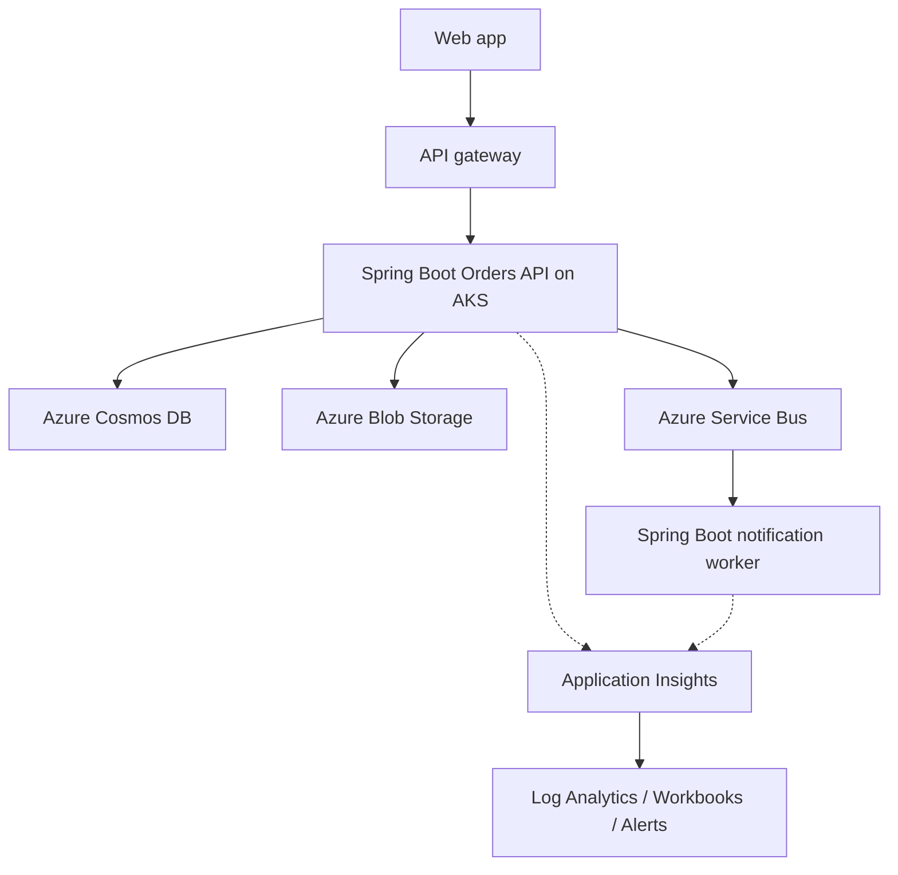

Sau khi nâng cấp ứng dụng, người dùng đôi khi nhận hai email, p95 tăng cao, Cosmos bị `429` và 15% requests không có trace trong transaction search. Team cũng thấy ingestion cost tăng gần gấp đôi.

### Yêu cầu

1. Chọn instrumentation strategy cho API và worker, tránh duplicate Java agents.
2. Thiết lập resource role names, environment, service version và time zone.
3. Định nghĩa parent–child spans hoặc span links giữa HTTP API, Service Bus và worker.
4. Thiết kế structured logs có traceId, business event ID và outcome nhưng không có PII.
5. Chỉ ra cách xác minh Cosmos 429 đang do throttling chứ không phải bug agent.
6. Phân biệt retries của SDK, API gateway và worker redelivery.
7. Đề xuất idempotency scheme để tránh gửi email trùng.
8. Dùng KQL tìm top slow requests và failed dependencies.
9. Giải thích vì sao 15% requests không có trace (sampling vs exporter vs propagation).
10. Đặt SLO với p95 latency, availability/final failure rate và telemetry health.
11. Thiết kế alerts tránh page on-call cho every expected HTTP 404.
12. Đo chi phí ingestion, kiểm tra log levels/duplicate spans và tối ưu sampling.
13. Mô tả canary rollout trên AKS và rollback khi overhead tăng.
14. Thiết kế runbook khi App Insights mất dữ liệu nhưng gateway vẫn có traffic.
15. Nêu cách kiểm chứng tất cả fixes bằng dữ liệu/traffic giả trước production.

### Một phương án đáp án

| Yêu cầu | Gợi ý |
|---|---|
| Instrumentation | Một AI Java agent **hoặc** OTel pipeline chủ đạo per process, không double |
| Correlation | W3C traceparent qua HTTP/Service Bus carrier; xem links khi async |
| Logs | operation, trace ID, event ID, sanitized error category, latency |
| Cosmos 429 | RU charge/hot partition, SDK diagnostics, request retries và capacity |
| Email duplicate | Stable business event ID, inbox/outbox idempotency, consumer dedup |
| Missing traces | Sampling, agent/exporter network, time range, context propagation |
| KQL | AppRequests, AppDependencies, AppExceptions và AppTraces theo schema |
| SLO | Final success rate, p95/p99, error budget, telemetry freshness |
| Costs | Sampling, log volume, duplicate spans, workspace retention |
| Rollout | Staging/canary với build version, compare SLO/cost và rollback |

### Câu hỏi phản biện

Nếu `Service Bus send` thành công nhưng worker không có trace trong Application Map, có thể khẳng định message bị mất không? **Không.** Cần kiểm tra Service Bus delivery/consumer metrics, message ID và worker processing records; Application Map chỉ dựa trên instrumentation/telemetry quan sát được.

Nếu tăng sampling lên 100% mà chi phí tăng nhưng vẫn không thấy một trace, có nên tăng tiếp log level lên HTTP BODY? **Không.** Kiểm tra export/resource/schema/network/propagation trước; bật body log dễ lộ thông tin và không chắc giúp tìm được lỗi.

## Tổng kết

**Application Insights cho Java và Spring Boot** là một phương án APM trong **Azure Monitor**, kết hợp **requests, dependencies, exceptions, logs, metrics và distributed tracing** để giúp đội kỹ thuật tìm chỗ chậm/lỗi của hệ thống Azure. Với **Application Insights Java agent**, một ứng dụng Spring Boot có thể có auto-instrumentation mà ít sửa code; với **OpenTelemetry/Micrometer**, có thể bổ sung business spans và custom metrics khi tích hợp exporter phù hợp.

Một hệ thống đáng tin phải hiểu **trace context/W3C propagation, async Reactor/MDC, Azure SDK retries, sampling, workspace KQL schema và ranh giới giữa application telemetry với resource metrics**. Hãy dùng KQL/Application Map/transaction details để xác định root cause, nhưng không suy rằng không có trace là request không xảy ra, không dùng sampled logs thay audit và không dùng một dashboard xanh thay cho SLO chính xác.

Khi triển khai production, hãy có **một instrumentation owner rõ ràng**, pin SDK/JDK/agent versions, gắn role/service version, cấu hình redaction và least-privilege access, đo p95/p99/final failure rates, đặt alerts theo mức ảnh hưởng và giám sát **telemetry exporter health** độc lập. Cân bằng sampling/retention/ingestion cost với nhu cầu điều tra, thử nghiệm App Service/AKS bằng traffic giả và diễn tập runbook. Làm như vậy, Application Insights trở thành **công cụ quan sát có khả năng hành động**, giúp ứng dụng Java/Spring Boot phục hồi nhanh và vận hành an toàn trên Azure.
