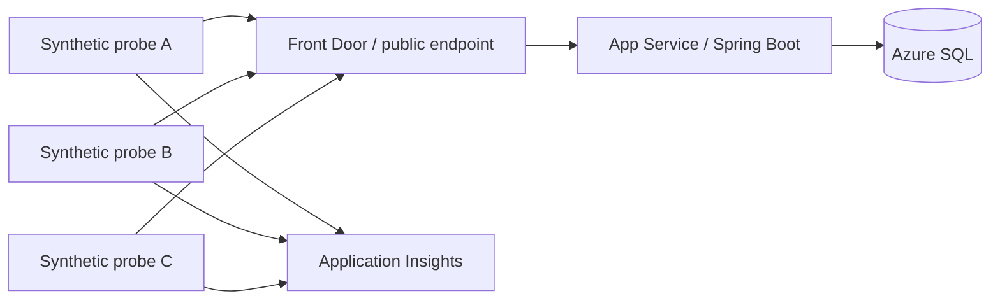
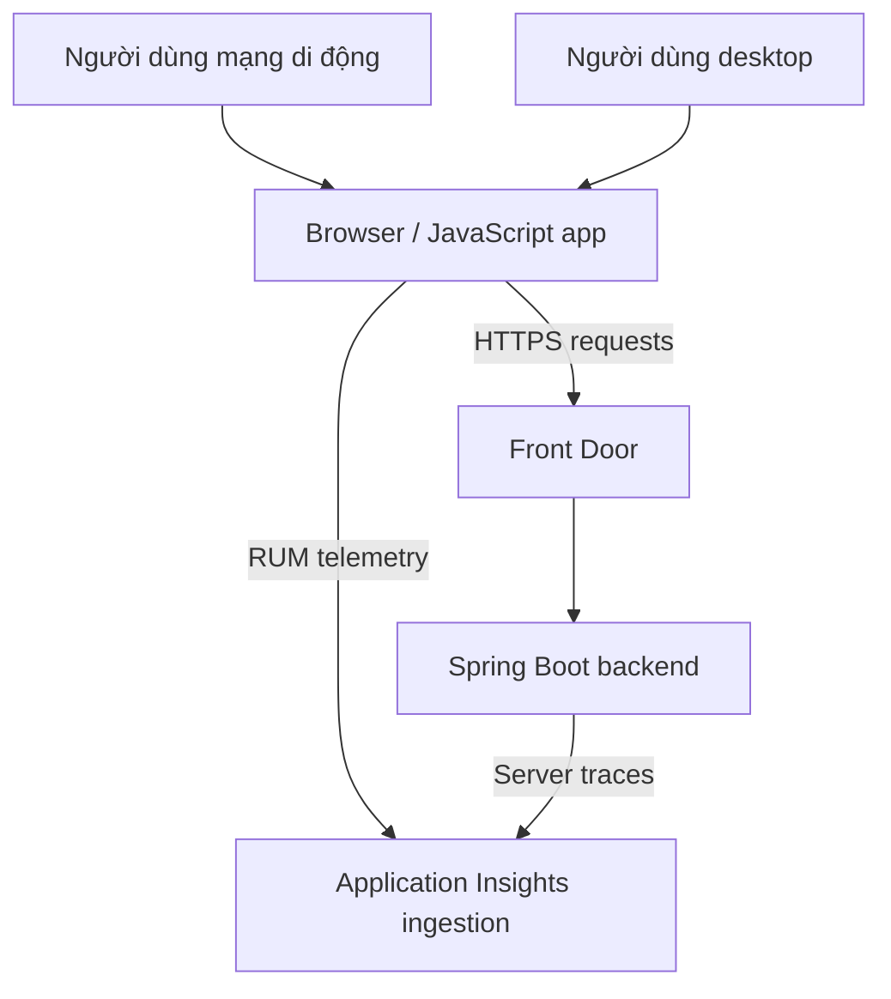
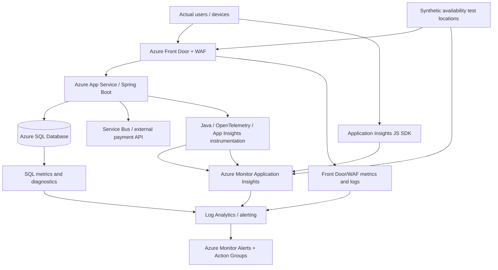
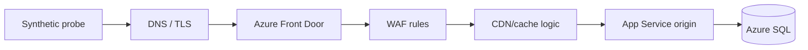
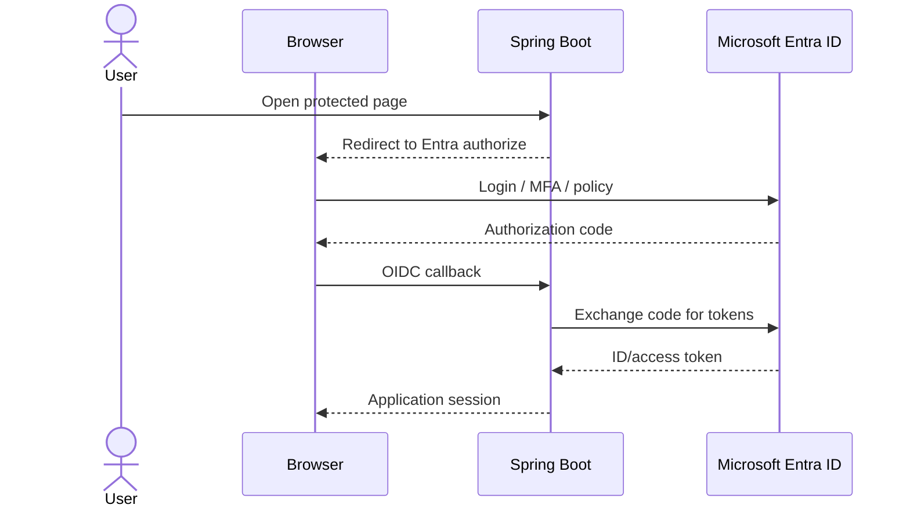
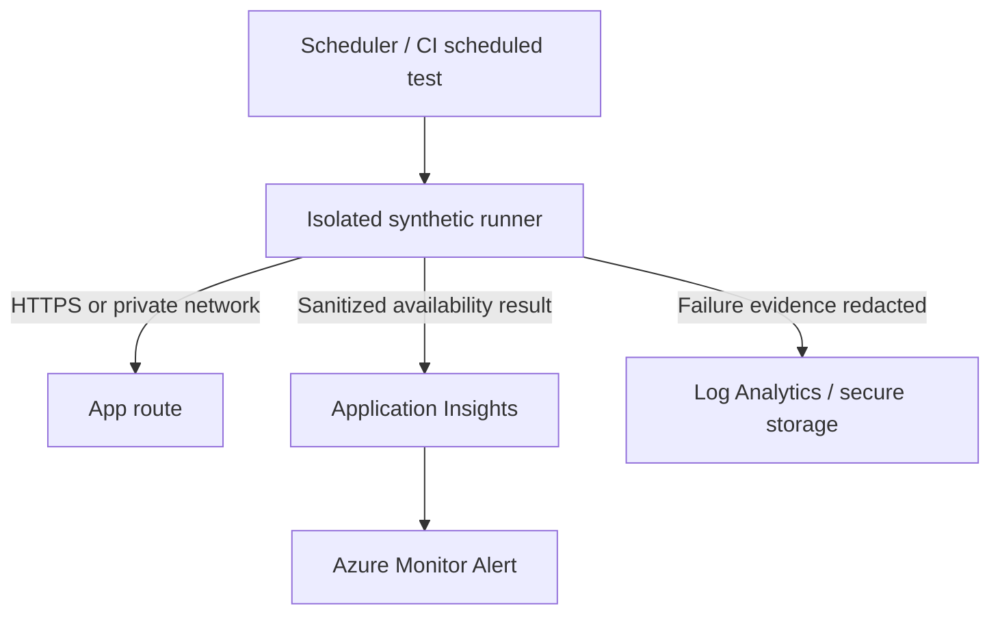
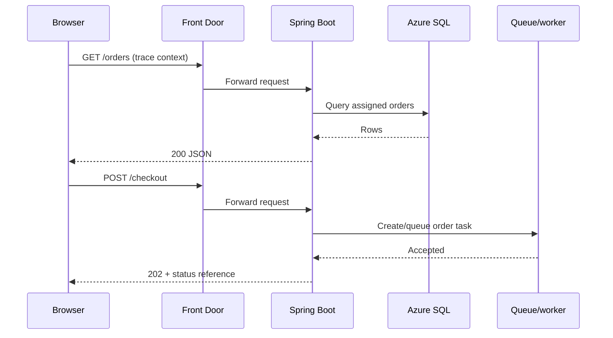
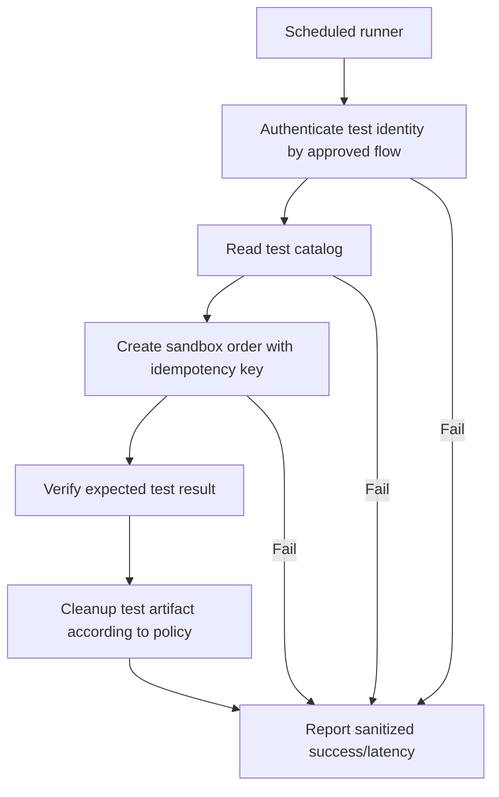

# Availability test và theo dõi trải nghiệm truy cập

Một doanh nghiệp triển khai hệ thống đặt hàng bằng **Spring Boot** trên **Azure App Service**, phân phối qua **Azure Front Door** và dùng **Azure SQL Database** để lưu đơn. Dashboard vận hành báo rằng tất cả instance đều “Healthy”, nhưng một số khách hàng ở miền Trung Việt Nam không đăng nhập được, người dùng di động thấy trang tải rất chậm, và một lần thay chứng chỉ làm một phần yêu cầu HTTPS thất bại. **Kiểm tra process còn chạy là chưa đủ để xác nhận người dùng thực sự truy cập được dịch vụ.**

Bài học **“Availability test và theo dõi trải nghiệm truy cập”** thuộc chương **Giám sát và quan sát hệ thống** của module **CLOUD_PROVIDERS_AZURE**. Từ subscription, resource group, Microsoft Entra ID, mạng ảo và dịch vụ ứng dụng đến dữ liệu, giám sát, bảo vệ và chi phí của kiến trúc Azure, bài hướng dẫn kết hợp **synthetic availability testing**, **real user monitoring (RUM)**, **Application Insights**, **Azure Monitor**, **distributed tracing** và **service level objectives (SLO)** để biết *dịch vụ có truy cập được, truy cập từ đâu, nhanh hay chậm, và nguyên nhân ở tầng nào*.

> **Phạm vi và giả định:** Các ví dụ hướng tới Azure Monitor Application Insights (workspace-based khi phù hợp), Azure App Service, Front Door và ứng dụng Java Spring Boot/JavaScript. Các tính năng Standard availability tests, custom availability tests, bảng Log Analytics, tên thuộc tính SDK, giới hạn region/tier và giao diện Portal có thể thay đổi; phải xác minh theo tài nguyên/API thực. Bài chưa triển khai thử hoặc thay đổi Azure subscription. Các URI, secret, giá trị và kết quả bên dưới đều là minh họa lab.

## Mục tiêu học tập

Sau bài học, bạn có thể:

1. Phân biệt **uptime của process**, **readiness**, **availability từ bên ngoài**, **tính khả dụng của hành trình người dùng** và **chất lượng trải nghiệm thực tế**.
2. Giải thích synthetic monitoring, passive RUM, session/user journey monitoring và distributed tracing.
3. Chọn endpoint, vùng thử, chu kỳ, timeout, yêu cầu nội dung và xác minh TLS cho availability test.
4. Cấu hình Standard availability test trong Application Insights qua Azure Portal.
5. Thiết kế custom synthetic test cho kịch bản nhiều bước hoặc private endpoints mà standard probe không hỗ trợ trực tiếp.
6. Tạo endpoint Spring Boot liveness/readiness với Actuator mà không công khai thông tin nhạy cảm.
7. Đo Core Web Vitals **LCP, INP, CLS** và theo dõi page view, client errors, network conditions qua RUM.
8. Phân biệt **TTFB**, server response time và thời gian người dùng cảm nhận hoàn tất thao tác.
9. Dùng KQL truy vấn availability, lỗi request, latency và mối liên hệ với các dependency.
10. Thiết kế alert có điều kiện theo số điểm đo, số lần thất bại, action groups và giảm báo động giả.
11. Định nghĩa SLI/SLO, error budget và phân tích tác động vùng địa lý.
12. Phân tích sự cố TLS/DNS/WAF, đăng nhập Entra, Front Door và backend bằng tín hiệu độc lập.
13. Kiểm soát bảo mật, dữ liệu cá nhân, chi phí và quota của synthetic/RUM.
14. Diễn tập một đợt lỗi có kiểm soát, thu bằng chứng và viết runbook ứng phó.

## 1. Availability không chỉ là HTTP 200

**Availability** mô tả khả năng người dùng hoặc client đạt được một kết quả dịch vụ hợp lệ trong cửa sổ thời gian xác định.

Ví dụ:

- Java process vẫn sống, nhưng database connection pool cạn → API có thể trả `500`.
- `/health/live` trả `200`, nhưng trang `/checkout` bị lỗi JavaScript → người dùng không mua được hàng.
- Một máy monitor ở Singapore truy cập được, nhưng ISP tại Việt Nam không phân giải DNS đúng → một nhóm người dùng không vào được.
- API trả `200` và JSON sai schema, khiến app mobile hiển thị màn hình trắng.
- Front Door trả trang HTML lỗi có mã `200` vì fallback route/SPA rewrites → test chỉ nhìn status code bị đánh lừa.
- Đăng nhập OIDC thành công, nhưng xác minh quyền khi lưu đơn hàng thất bại → hành trình giao dịch vẫn không hoàn tất.

### Tầng quan sát

| Tín hiệu | Trả lời câu hỏi | Không tự chứng minh |
|---|---|---|
| Host/process liveness | Process/OS còn chạy? | Trang truy cập từ Internet được không |
| Container readiness | Instance đã sẵn sàng nhận traffic? | Front Door/DNS/TLS hoạt động đúng |
| HTTP health check | Endpoint trả mã kỳ vọng? | Hành trình đăng nhập/đặt hàng thành công |
| Synthetic availability | Điểm đo chủ động có truy cập được không? | Tất cả user/ISP cũng truy cập được |
| RUM/browser telemetry | Người dùng thực thấy gì, mất bao lâu? | Người không tải được SDK sẽ luôn gửi được telemetry |
| Business transaction SLI | Đơn hàng có hoàn tất đúng? | Tất cả path/system đều tốt |
| Distributed traces | Request chậm/lỗi ở dependency nào? | Tổng thể người dùng không bị ảnh hưởng |

**Không dùng một health endpoint có `200` để tuyên bố SLO người dùng đạt 100%.** Cần nhiều tín hiệu đo ở các ranh giới khác nhau.

## 2. Synthetic monitoring: phép đo chủ động

**Synthetic test** là một “khách hàng robot” gửi request theo lịch từ một hoặc nhiều địa điểm để kiểm tra hệ thống.



### Mỗi lần thử cần biết gì?

Một lần test có thể sinh dữ liệu:

```json
{
  "testName": "orders-public-home",
  "location": "probe-location-a",
  "timestampUtc": "2026-11-20T09:00:00Z",
  "target": "https://orders.example.com/",
  "httpStatus": 200,
  "expectedContentFound": true,
  "tlsValid": true,
  "durationMs": 320,
  "success": true
}
```

Đây là **schema khái niệm**, không phải payload chính thức của Azure Monitor. Một Standard availability test có fields/capabilities và telemetry schema riêng.

### Lợi ích

- Phát hiện outage dù không có người dùng truy cập.
- Chủ động kiểm tra từ nhiều network locations.
- Kiểm tra DNS, TLS handshake, HTTP và một số nội dung phản hồi.
- Cho điểm chuẩn so sánh khi deploy/cấu hình WAF/network.
- Giúp cảnh báo trước khi số lượng user reports tăng cao.

### Giới hạn

- Test endpoint đơn giản không phát hiện mọi lỗi ở SPA, login, database hay payment flow.
- Một probe region không đại diện mọi ISP/mobile network.
- Các probes có thể bị WAF/proxy/bot protection chặn dù người dùng thật không bị.
- Health response từ cache/CDN có thể che lỗi origin.
- Mọi điểm đo đều có latency/network variations, cần ngưỡng và xác minh nhiều nguồn.

## 3. Real User Monitoring (RUM): tín hiệu thụ động từ browser

**RUM** là telemetry từ ứng dụng web đang được người dùng thực sử dụng: page views, navigation timing, frontend errors, network dependencies, Web Vitals và các user interactions được instrumentation.



### RUM trả lời gì?

- Người dùng từ một nhóm thiết bị/trình duyệt có **LCP** cao bất thường?
- Route `/checkout` có JavaScript exception sau phiên bản mới?
- User click “Đặt hàng” nhưng gặp lỗi network/HTTP?
- Tỷ lệ phiên người dùng bị lỗi tăng dù synthetic probe vẫn xanh?
- Tốc độ tải trang khác nhau giữa mobile/desktop và các khu vực?

### RUM không nhìn thấy mọi thất bại

Nếu người dùng **không tải được HTML/JS hoặc bị DNS/TLS chặn trước khi SDK chạy**, không có browser telemetry gửi về. Vì vậy synthetic tests và edge/network telemetry **bổ sung**, không thay thế RUM.

### Chi phí và quyền riêng tư

Browser instrumentation thu thập thông tin từ client thực; phải kiểm soát consent, retention, sampling, cookies/identifiers, URL query strings, PII và session tracing. Một connection string của Application Insights phục vụ **telemetry ingestion**, không phải mật khẩu người dùng; tuy nhiên exposure có thể dẫn tới telemetry pollution và không được dùng thay cơ chế xác thực business.

## 4. Kiến trúc quan sát end-to-end trên Azure

Một kiến trúc thường dùng:



**Dòng synthetic** đi qua public edge như người dùng nhưng không nhất thiết chạy browser. **Dòng RUM** xuất phát từ trình duyệt, có thể không có với người bị chặn trước khi trang load. **Server telemetry** cho thấy request/dependency/error của app. **Edge/WAF logs** cho biết request bị chặn hoặc cache phục vụ mà chưa đến backend.

Không cần bật tất cả logs mức debug; phải chọn signals trả lời câu hỏi vận hành và giới hạn giá/retention.

## 5. SLI, SLO, SLA: bắt đầu từ kết quả người dùng

- **SLI (Service Level Indicator):** đại lượng đo được, ví dụ tỷ lệ requests checkout thành công.
- **SLO (Service Level Objective):** mục tiêu nội bộ, ví dụ 99,9% requests checkout thành công trong 30 ngày, với phương pháp đo cụ thể.
- **SLA (Service Level Agreement):** cam kết hợp đồng có phạm vi/điều khoản, không mặc định đồng nghĩa SLO nội bộ.
- **Error budget:** mức lỗi chấp nhận được trước khi vượt mục tiêu SLO.

### Ví dụ hai SLI khác nhau

```text
Synthetic availability SLI:
  successful scheduled probes / all eligible scheduled probes

User transaction SLI:
  successful valid checkout attempts /
  all valid checkout attempts

Latency SLI:
  requests completed within 2 seconds /
  all eligible requests
```

**Synthetic SLI không tự là user SLI.** Nếu đo từ ba locations mỗi năm phút, kết quả phản ánh các lần thử và điều kiện test; không thể suy ra chính xác tỷ lệ người dùng Việt Nam bị ảnh hưởng.

### Ví dụ error budget

Một SLO **99,9% availability** trong 30 ngày liên tục (định nghĩa theo thời gian và đo 24/7) tương ứng khoảng **43,2 phút lỗi** trong 30 ngày. Nhưng nếu SLI đếm **requests** thay vì phút, budget là **0,1% requests hợp lệ**, không tự quy đổi sang phút khi traffic biến thiên.

## 6. Chọn URL/route cần kiểm thử

Một dự án nên có nhiều cấp availability test với mục tiêu rõ:

| URL/flow | Mục tiêu | Hạn chế |
|---|---|---|
| `GET /` | Public HTML qua Front Door | 200 chưa chứng minh JS hoạt động |
| `GET /health/public` | Check endpoint an toàn | Có thể bỏ qua database/login |
| `GET /actuator/health/readiness` | Instance sẵn sàng xử lý traffic? | Không nhất thiết public; phải bảo vệ |
| `GET /catalog?item=demo` | Real read-only business content | Có thể bị cache che lỗi origin |
| `GET /api/catalog/sample` | Public API response/schema | Không bao quát checkout |
| Login/checkout nhiều bước | Business journey | Cần custom runner/credentials an toàn |
| TLS certificate validation | Chứng chỉ endpoint hợp lệ | Không kiểm tra dữ liệu nghiệp vụ |

### Tiêu chí chọn target

1. **Ổn định, xác định trước kết quả** để tránh flaky tests.
2. **Không tạo side effects** nếu không có test cleanup/idempotency.
3. Đi qua cùng **Front Door/CDN/WAF/TLS** với người dùng khi muốn đo public reachability.
4. Trả nội dung phản ánh backend thật nếu mục tiêu kiểm thử backend.
5. Không phải endpoint đòi mật khẩu admin thật, token dài hạn hoặc dữ liệu cá nhân.
6. Có route/version sở hữu bởi team, có SLA và change management.
7. Không để probe bị rate limit hoặc anti-bot policy ngoài ý muốn.
8. Phân biệt `/live` với readiness và synthetic business check.

## 7. Azure Application Insights: Standard availability tests

Azure Monitor **Application Insights Availability** có khả năng cấu hình **Standard test** để kiểm tra URL từ các điểm đo được hỗ trợ. Các tùy chọn có thể bao gồm target URL, test locations, HTTP method/options, frequency, expected response, content match và TLS/SSL certificate validation theo feature/tier hiện hành.

### Quy trình qua Azure Portal

1. Chọn đúng **subscription, resource group, Application Insights resource** và workspace liên kết (nếu dùng).
2. Mở khu vực **Availability** (tên menu có thể khác theo giao diện).
3. Tạo **Standard test** mới và đặt tên ổn định, ví dụ `orders-home-public`.
4. Đặt target `https://orders.example.com/` là host công khai thực sự của user.
5. Chọn đủ **test locations** đại diện những tuyến mạng khác nhau được dịch vụ hỗ trợ.
6. Chọn interval/frequency và timeout theo SLO, quota và mức phát hiện mong muốn.
7. Chọn điều kiện thành công: HTTP status, response content matcher khi khả dụng.
8. Bật TLS/SSL certificate checks/expiry validation theo khả năng test.
9. Lưu; kiểm tra một vài kết quả và location distribution trước khi bật cảnh báo.
10. Cấu hình **Azure Monitor Alert rule** và **Action Group** cho owner/on-call phù hợp.

### Tránh suy diễn tính năng

Không phải mọi test hỗ trợ tất cả HTTP methods, authentication flows, browser rendering hoặc private networking. Xem feature matrix/SKU thực tế; **Standard URL test không phải Playwright/real browser**. Những gì chưa được test trực tiếp phải ghi rõ trong runbook.

## 8. Chọn locations và frequency có mục đích

### Ba nguyên tắc

- **Multi-location:** một probe có thể gặp sự cố mạng riêng; nhiều probes giúp phân biệt outage toàn cầu với sự cố tuyến/region.
- **Frequency:** chu kỳ ngắn giúp phát hiện sớm nhưng tạo nhiều test runs và có thể tăng giá hoặc noise.
- **SLO coverage:** test frequency/location phải phản ánh rủi ro người dùng và những điểm có thể đo, không chọn hoàn toàn theo mặc định.

### Ví dụ tính lượng phép thử

Giả sử **3 locations**, mỗi nơi chạy **1 lần/5 phút**:

```text
1 location:  24 hours × 60 / 5 = 288 attempts/day
3 locations: 288 × 3 = 864 attempts/day
30 days:     864 × 30 = 25,920 scheduled attempts
```

Đây là phép tính lý thuyết **nếu lịch chạy đều và không có run bị bỏ, retry hay thay cấu hình**. Giá thực theo gói dịch vụ, test type và số lần thực tế; không lấy số lần test làm phí tiền trực tiếp nếu chưa tra pricing.

### Chọn location “gần Việt Nam” có đảm bảo đo người dùng Việt Nam?

**Không.** Test location được cung cấp có thể ở quốc gia/khu vực khác và dùng tuyến mạng của nhà cung cấp cloud, không đại diện ISP di động ở Việt Nam. Bổ sung RUM, edge data và **private/test runners ở địa điểm thực tế được phê duyệt** khi SLA yêu cầu.

### Alert từ nhiều điểm đo

Nếu một location fail một lần nhưng các locations khác đều pass, có thể là false positive/transient. Có thể yêu cầu nhiều failures liên tiếp hoặc nhiều locations cùng fail, với trade-off **chậm phát hiện sự cố chỉ ảnh hưởng một vùng**. Không gộp mọi location thành một average rồi che mất sự cố vùng.

## 9. Điều kiện thành công phải vượt qua HTTP status

Ví dụ: route `/` trả `200` nhưng nội dung là trang lỗi “Service unavailable” từ fallback page.

Một synthetic test tốt có thể kiểm tra:

- **HTTP status** chính xác hoặc nhóm mã đã định nghĩa.
- **Response content marker**, chẳng hạn chuỗi/version của trang ứng dụng, không phải một từ luôn có cả trang lỗi.
- **Maximum response time** nếu latency là một điều kiện thành công có giá trị.
- **TLS certificate/hostname validity**, expiry window theo khả năng test.
- **Redirect policy**: login `302` hoặc HTTP→HTTPS redirection có phải hành vi đúng không?
- **DNS resolution** và HTTP connect/handshake từ test location.
- **Cache behavior**: response có tới backend khi cần kiểm tra origin không?
- **Semantic result**: business JSON schema và một field có giá trị mong đợi.

### Response mẫu cho endpoint synthetic chuyên dụng

```json
{
  "status": "ok",
  "component": "orders-public",
  "schemaVersion": 1
}
```

Không đưa DB hostname nội bộ, exception details, access tokens, signing keys hoặc danh sách dependencies vào endpoint public. **Một field `status=ok` không thể đảm bảo checkout đầy đủ**, chỉ chứng minh mức kiểm thử được định nghĩa.

## 10. Spring Boot Actuator: liveness khác readiness

Trong Spring Boot 3.x, `spring-boot-starter-actuator` cung cấp health endpoints:

```xml
<dependency>
  <groupId>org.springframework.boot</groupId>
  <artifactId>spring-boot-starter-actuator</artifactId>
</dependency>
```

Ví dụ `application.yml`:

```yaml
management:
  endpoint:
    health:
      probes:
        enabled: true
      show-details: never
  endpoints:
    web:
      exposure:
        include: health,info
```

Các endpoint thường gặp theo phiên bản/cấu hình:

```text
/actuator/health
/actuator/health/liveness
/actuator/health/readiness
```

### Liveness

Chủ yếu xác nhận **process nên tiếp tục chạy hay cần restart**. Không đưa mọi dependency vào liveness nếu sự cố DB tạm thời sẽ khiến toàn bộ instances restart lặp đi lặp lại.

### Readiness

Xác định instance **có nên nhận traffic mới hay không**, có thể phụ thuộc những services tối quan trọng theo business workload. Nếu database down nhưng application chỉ phục vụ public static content, cần cân nhắc readiness policy theo routes/service, không đặt một check cứng cho mọi use case.

### Synthetic availability

Kiểm tra từ bên ngoài qua Front Door/TLS/DNS/routing/WAF. Không được đồng nhất với readiness ở một instance nội bộ.

## 11. Ví dụ Spring Boot endpoint public để kiểm thử

Đối với một public landing endpoint độc lập, có thể có một route chỉ tiết lộ trạng thái tối thiểu:

```java
package vn.example.orders.monitoring;

import java.util.Map;

import org.springframework.http.ResponseEntity;
import org.springframework.web.bind.annotation.GetMapping;
import org.springframework.web.bind.annotation.RestController;

@RestController
public class PublicAvailabilityController {

    @GetMapping("/health/public")
    public ResponseEntity<Map<String, Object>> health() {
        return ResponseEntity.ok(
            Map.of("status", "ok", "schemaVersion", 1)
        );
    }
}
```

### Cần diễn giải đúng

Mẫu này chỉ chứng minh **HTTP request tới Spring container** có thể chạy một method và sinh JSON. Nó **không gọi SQL**, không kiểm tra checkout, không xác minh Entra login và không chứng minh Front Door route người dùng giống nhau. Vì vậy chỉ dùng nó làm **một tầng** trong bộ monitors.

### Khi cần kiểm tra dependency

Có thể bổ sung Spring Boot `HealthIndicator`/readiness group cho dependency trọng yếu, nhưng phải:

1. Chọn dependency thực sự ảnh hưởng mục tiêu.
2. Giới hạn timeout (tránh 30 giây treo health endpoint).
3. Không đưa debug/error details ra Internet.
4. Không tạo thao tác ghi dữ liệu qua `GET` nếu không có sandbox cleanup.
5. Không cho test trở thành nguồn DDoS nội bộ khi service đang yếu.
6. Thử với các trạng thái SQL down/token expired để hiểu rõ semantics.

## 12. App Service Health Check và Application Insights Availability khác nhau

**App Service Health Check** giúp platform xác định **instance nào khỏe** để quyết định routing/recovery theo tính năng App Service. Nó không đo một hành trình từ người dùng trên Internet.

**Application Insights Standard availability test** là chủ động gửi HTTP request từ các test locations đến URL được chỉ định, ghi lại success/failure/latency theo phía ngoài.

| Hệ thống | Đo ở đâu? | Mục đích |
|---|---|---|
| App Service Health Check | Platform → app instance | Instance routing/health |
| AKS liveness/readiness | Kubelet/control loop → container/pod | Restart hoặc nhận traffic |
| Front Door origin health probes | Front Door → origin | Chọn origin/route |
| Application Insights availability | Test location → public endpoint | Khả năng truy cập bên ngoài |
| RUM | Browser người dùng thực | UX/performance/errors |
| Business synthetic test | Custom runner → multi-step flow | End-to-end user transaction |

**Health checks khác nhau nên nhắm đúng tầng.** Không cấu hình một endpoint duy nhất quá nặng cho cả kubelet, Front Door và human journey, vì timeout/failure semantics khác nhau.

## 13. Kiểm thử đường đi Front Door, WAF và cache



### Một test có thể “xanh” nhờ cache

Khi `GET /` trả HTML từ CDN cache mà origin lỗi, availability probe chỉ thấy edge vẫn phục vụ. Điều này có thể là đúng nếu SLO đo **public cached content**, nhưng sai nếu dùng kết quả ấy để kết luận **checkout API còn hoạt động**.

### Nên có hai probes khi cần

1. **Edge reachability:** qua custom domain/Front Door, kiểm tra TLS và nội dung public.
2. **Origin/business reachability:** route không cache hoặc API read-only được phép, xác minh backend.

### WAF và anti-bot

WAF có thể chặn synthetic user agent hoặc IP dải monitor. Không tắt WAF toàn diện để test pass. Thiết kế allowlisting đúng test sources nếu có cơ chế hỗ trợ, dùng hostname/path hợp lệ và kiểm tra xem test exemption có tạo cửa hậu hay không. IP nguồn test có thể thay đổi; không hardcode dải địa chỉ không kiểm chứng.

## 14. TLS, DNS và certificate expiry

Một trang có thể trả `200` ở nguồn gốc nhưng người dùng không vào được vì **TLS handshake lỗi**.

### Cần kiểm tra

- DNS hostname của custom domain được phân giải đúng.
- Certificate vẫn còn hiệu lực, SAN khớp hostname.
- Chứng chỉ intermediate/root chain được client chấp nhận.
- Không hết hạn giữa lúc rotation hoặc TLS binding chưa refresh.
- Proxy/Front Door/Ingress phục vụ đúng certificate cho đúng SNI/host.
- HTTP→HTTPS redirect không tạo loop hoặc chuyển sai host.
- Không dùng certificate self-signed chưa được trust ở public endpoint.
- TLS/cipher policy tương thích những browser được hỗ trợ.

### Tại sao không chỉ check từ server?

Ứng dụng gọi `localhost` có thể không đi qua DNS, TLS, Front Door/WAF hoặc custom domain. Availability test từ bên ngoài và RUM có thể phát hiện sự cố mà local health không thấy.

### Khi certificate sắp hết hạn

Bật certificate expiry checks trong availability test nếu được hỗ trợ, kết hợp inventory và owner/renewal alerts. **Certificate được renew trong Key Vault không tự chứng minh listener/front end đã áp certificate mới**; cần probe TLS tới public hostname.

## 15. Monitoring đăng nhập Microsoft Entra ID

Người dùng vào trang public được, nhưng đăng nhập bị lỗi. Standard availability test chỉ GET `/` có thể vẫn xanh.

### Những bước có thể lỗi



### Test nào hợp lý?

- Test **public landing** và **login initiation** có redirect hợp lệ theo expected status/Location.
- Test login end-to-end bằng **custom synthetic browser** có **test-only identity, consent và MFA/Conditional Access policy được phê duyệt**, không dùng tài khoản admin hoặc vượt qua bảo vệ.
- Phân tích Entra **sign-in logs**, Spring Security auth failures, session/cookie errors và token endpoint dependencies.
- Test role-protected API bằng token cho **đúng audience/scopes**, không dùng raw token dài hạn trong script hoặc vault không đủ kiểm soát.

**Không giả định một Standard test công khai xử lý trọn OIDC interactive journey**, nhất là MFA, CAPTCHA, consent và cross-domain cookies.

## 16. Custom synthetic test: khi nào cần?

**Custom synthetic test** là runner có kịch bản riêng, ví dụ:

- Login và đọc dashboard trong môi trường test đã được cho phép.
- GET catalog → kiểm tra JSON field → thử search.
- Gọi internal/private API từ một runner trong VNet.
- Kiểm tra một phép gọi tới dependency sandbox theo test account.
- Thử giai đoạn checkout bằng **test orders không giao dịch thật**.
- Kiểm thử JavaScript rendering, click, form validation và navigation.

### Kiến trúc



Runner có thể chạy bằng Azure Functions/Container Apps Jobs/VM/AKS job hoặc giải pháp phù hợp, với network, schedule, identity và cost được quản lý. **Không có một template duy nhất cho mọi kiểu test**; khi dùng Application Insights custom availability telemetry phải xác minh SDK/API khả năng phát availability result của ngôn ngữ/version, không giả định gửi generic custom event sẽ tự xuất hiện thành Standard test.

## 17. Java: một HTTP synthetic runner đơn giản

Một Java runner có thể chủ động kiểm tra một route HTTPS public và tính latency. Ví dụ dùng JDK 17+ `java.net.http.HttpClient`:

```java
package vn.example.monitoring;

import java.net.URI;
import java.net.http.HttpClient;
import java.net.http.HttpRequest;
import java.net.http.HttpResponse;
import java.nio.charset.StandardCharsets;
import java.time.Duration;

public final class PublicEndpointProbe {

    public static void main(String[] args) throws Exception {
        String target = System.getenv("PROBE_URL");

        if (target == null || target.isBlank()) {
            throw new IllegalArgumentException(
                "PROBE_URL must be an approved HTTPS URL");
        }

        URI uri = URI.create(target);
        if (!"https".equalsIgnoreCase(uri.getScheme())) {
            throw new IllegalArgumentException(
                "Expected HTTPS for public production probe");
        }

        HttpClient client = HttpClient.newBuilder()
            .connectTimeout(Duration.ofSeconds(5))
            .followRedirects(HttpClient.Redirect.NEVER)
            .build();

        HttpRequest request = HttpRequest.newBuilder(uri)
            .timeout(Duration.ofSeconds(12))
            .header("Accept", "application/json")
            .GET()
            .build();

        long start = System.nanoTime();
        HttpResponse<String> response = client.send(
            request,
            HttpResponse.BodyHandlers.ofString(
                StandardCharsets.UTF_8)
        );
        long durationMs =
            (System.nanoTime() - start) / 1_000_000L;

        boolean passed =
            response.statusCode() == 200
                && response.body().contains("\"status\":\"ok\"");

        System.out.printf(
            "success=%s status=%d durationMs=%d%n",
            passed, response.statusCode(), durationMs);

        if (!passed) {
            System.exit(2);
        }
    }
}
```

### Giới hạn quan trọng

- Ví dụ kỳ vọng JSON **không có khoảng trắng** giữa `"status"`, dấu hai chấm và `"ok"`. Trong production nên **parse JSON với parser an toàn** rồi so sánh field, không dựa vào substring.
- Có timeout, **không follow redirects**, phù hợp target là endpoint HTTPS cố định; nếu muốn test redirects cần policy riêng và giới hạn redirect chain.
- Đo **thời gian tổng** của một request từ runner này, không phải browser LCP/INP.
- Chưa có scheduling, TLS cert-expiry policy, retry jitter, structured telemetry, attempt ID hay multi-region.
- Chưa gửi dữ liệu tới Application Insights; để tích hợp cần telemetry exporter/custom availability API được hỗ trợ, hoặc gửi metric/log có schema riêng.
- Không lấy `PROBE_URL` tùy ý từ request user. Chỉ cho phép **approved endpoints** để tránh biến runner thành SSRF scanner.
- Không log response body nếu có PII, tokens hoặc thông tin lỗi nhạy cảm.

### Bổ sung kết quả telemetry

Một custom result nên chứa `probeName`, `testRunId`, `location`, `timestamp`, `success`, `durationMs`, `statusCode` và `failureCategory`. Không ghi raw credentials/sessions hoặc full body. Với SDK hỗ trợ **availability telemetry**, dùng API chính thức và xác minh dữ liệu xuất hiện ở bảng/portal đúng. Nếu dùng OpenTelemetry generic spans/metrics, đừng gọi dữ liệu đó là Built-in Standard availability test nếu chưa mapping tương ứng.

## 18. Private endpoints: Standard test không thể mặc định vào VNet

Một API nằm sau **Private Endpoint** và tắt public access có thể không truy cập được từ Standard test locations bên ngoài.

### Hai chiến lược

1. **Public synthetic:** kiểm tra public route/front door như người dùng công cộng, nếu sản phẩm có public ingress.
2. **Private synthetic:** chạy runner **trong VNet/connected network** có DNS/Private Endpoint/identity đúng để kiểm tra internal APIs, rồi gửi kết quả về Azure Monitor.

### Không mở private API chỉ để monitor

Nếu phải giám sát private backend, **không mở tạm public network access rộng** hay đặt unauthenticated admin health endpoint lên Internet. Dùng network runner thích hợp, least-privilege identity và allowlist đã được security review.

### Hai ranh giới mạng

- **Runner → private API:** cần route, DNS, TLS, token.
- **Runner → telemetry ingestion:** cần outbound path tới Azure Monitor ingestion endpoint được cấu hình; đường private tới API **không tự** mở đường tới monitor ingestion.

Cần giám sát cả hai; nếu probe không thể gửi telemetry, *không có kết quả mới* không đồng nghĩa service được kiểm tra đang khỏe.

## 19. Availability result: success, latency và failure category

Một report có thể tách lỗi:

| Lỗi | Dấu hiệu | Tầng cần xem |
|---|---|---|
| DNS failure | Không resolve host | DNS/record/ISP |
| Connection timeout | Không tạo được TCP connection | Routing/firewall/outage |
| TLS handshake/cert failure | Chứng chỉ/CA/hostname không hợp lệ | Front Door/App Gateway/Ingress |
| HTTP 401/403 | Authentication/WAF/authorization | Entra/security/network |
| HTTP 404 | Route/hostname/deployment mapping sai | Gateway/routes/app |
| HTTP 429 | Throttling/quotas | Rate limits, tenant quotas, retry |
| HTTP 500/503 | App/origin/dependency unavailable | Java logs, DB/Service Bus |
| HTTP 200 nhưng content mismatch | Sai trang, fallback, bad deploy | CDN cache, app content, SPA |
| Timeout sau response chậm | Performance degradation | Server/dependencies/network |
| JavaScript error | Browser không hoàn tất app | RUM/frontend logs |
| Synthetic telemetry missing | Runner/ingestion/scheduler lỗi | Monitor reliability |

### Tại sao cần phân loại?

Nếu synthetic test fail do WAF block tại hai locations, restart Spring Boot có thể không giải quyết được. Nếu Key Vault token exchange 403 làm app fail, đổi chứng chỉ TLS của Front Door là sai hướng. Một alert nên dẫn on-call vào **tầng có bằng chứng**, không chỉ hiển thị “service down”.

## 20. Đo tốc độ trang thực: Core Web Vitals

Core Web Vitals là các tín hiệu trải nghiệm người dùng thực qua browser:

| Chỉ số | Ý nghĩa | Điều có thể làm kém |
|---|---|---|
| **LCP (Largest Contentful Paint)** | Khi nội dung lớn chính xuất hiện | HTML chậm, ảnh lớn, JS/CSS blocking |
| **INP (Interaction to Next Paint)** | Độ phản hồi trước tương tác | Main thread bận, long tasks, JS nhiều |
| **CLS (Cumulative Layout Shift)** | Mức dịch chuyển layout ngoài mong đợi | Ảnh không đặt kích thước, font swap, ads/widgets |
| **TTFB (Time to First Byte)** | Thời gian đến byte đầu | CDN cache miss, network, backend |
| **FCP (First Contentful Paint)** | Nội dung đầu tiên được vẽ | Render-blocking assets, server/network |
| **JS exception rate** | Client code lỗi sau khi load | Deploy lỗi, browser mismatch |

### Không nhầm metric

- **Server response time** (Spring controller) không bao gồm DNS, mạng người dùng và render.
- **TTFB** chưa bao gồm tải ảnh/scripts và xử lý UI.
- **LCP/INP/CLS** là **browser metrics**, không thể đo đúng bằng `curl` HTTP request.
- **Success HTTP 200** chưa có nghĩa người dùng tương tác được.
- Các ngưỡng “good/needs improvement/poor” của Core Web Vitals có thể thay đổi theo hướng dẫn web performance; kiểm tra phiên bản chuẩn hiện hành và phân tích p75/p95 theo nhóm thiết bị.

### Chọn nhóm để so sánh

Theo route, device type, browser version, network type được phép, geographic cohort và release version. Không so sánh trực tiếp trải nghiệm từ mạng desktop băng rộng với kết quả trên điện thoại 3G mà bỏ segmentation.

## 21. JavaScript RUM với Application Insights Web SDK

Đối với ứng dụng Spring Boot phục vụ frontend SPA/JS, có thể tích hợp **Application Insights JavaScript SDK**.

### Package

```bash
npm install @microsoft/applicationinsights-web
```

### Ví dụ

```javascript
import { ApplicationInsights } from "@microsoft/applicationinsights-web";

const appInsights = new ApplicationInsights({
  config: {
    connectionString: window.publicAppConfig.appInsightsConnectionString,
    enableAutoRouteTracking: true
  }
});

appInsights.loadAppInsights();
appInsights.trackPageView({
  name: "Orders dashboard",
  uri: window.location.origin + window.location.pathname
});
```

### Điều kiện

- `window.publicAppConfig` được frontend/server cấu hình bằng **connection string ingestion** của Application Insights resource đúng, **không chứa client secret/database password**.
- Không bật auto-route tracking và tự gửi thêm mọi page view mà không kiểm tra **duplicate events**.
- Nếu dùng router SPA, kiểm tra navigation semantics, consent/sampling và route aggregation.
- Không đưa query strings chứa search keywords, email, order tokens hoặc PII vào `uri`.
- CSP `connect-src` và network policy phải cho phép telemetry endpoint đã cấu hình; nếu bị chặn, RUM có thể không gửi về.
- Không tự thêm plaintext user email làm telemetry identity; dùng pseudonymous identifiers theo privacy controls.
- Đánh giá consent, cookie policies và retention theo quy định áp dụng.

**RUM cần instrumentation ở client.** Chỉ cài Java agent trong Spring Boot sẽ không tự biến server metrics thành LCP/INP/CLS của trình duyệt.


## 22. Đo LCP, INP và CLS từ người dùng thật

Một ứng dụng có thể dùng thư viện đo Web Vitals trong browser và gửi các metrics phù hợp tới Application Insights.

### Ví dụ JavaScript minh họa

```bash
npm install web-vitals
```

```javascript
import { onLCP, onINP, onCLS } from "web-vitals";

// appInsights is initialized only after consent, where required.
function reportMetric(metric, name, unit) {
  appInsights.trackMetric({
    name: name,
    average: metric.value
  }, {
    metricUnit: unit,
    route: window.location.pathname,
    release: window.publicAppConfig.releaseVersion
  });
}

onLCP(metric => reportMetric(metric, "CWV_LCP", "ms"));
onINP(metric => reportMetric(metric, "CWV_INP", "ms"));
onCLS(metric => reportMetric(metric, "CWV_CLS", "unitless"));
```

Trong ví dụ, `appInsights` là instance đã được khởi tạo ở mục 21. Code sẽ cần nằm cùng module/scope hoặc được truyền vào function khi tích hợp thật. **API, event callbacks và đường dẫn package cần được xác minh theo phiên bản `web-vitals` thực tế.**

### Những lưu ý về dữ liệu

- **LCP** và **INP** thường tính bằng milliseconds; **CLS** là chỉ số không đơn vị.
- Một số web-vitals callbacks có thể được gọi/cập nhật nhiều lần tùy lifecycle; thiết kế dedup/final-value handling trước khi tính báo cáo theo phiên.
- Với ứng dụng SPA, route changes có thể không có semantics giống một full navigation; cần phân biệt **initial load** và **soft navigations** theo công cụ/support.
- Không tự thêm email, tên khách hàng, nội dung form hoặc order ID vào dimensions.
- Nếu sampling, phải biết sampling rate khi diễn giải counts/percentiles.
- Page view duration do SDK báo và LCP/INP/CLS có định nghĩa khác nhau; không cộng/so sánh trực tiếp.
- Telemetry gửi qua network không đồng nghĩa mọi user đã bật consent hay có kết nối tới ingestion.

### Ví dụ đọc số liệu

Nếu p75 LCP tăng từ 2,1 lên 4,2 giây chỉ ở mobile mạng chậm, còn server p95 latency không đổi, nên kiểm tra image sizes, client JS, CDN cache và network assets. Không vội tăng số instances Spring Boot.

## 23. Java backend observability và distributed tracing

Ứng dụng Spring Boot cần thêm **request, dependency, exception, tracing** để trả lời câu hỏi một trang chậm vì frontend, API, SQL hay service ngoài.

Một lựa chọn là dùng **Azure Monitor Application Insights Java agent** phiên bản tương thích, hoặc OpenTelemetry instrumentation/exporter theo mô hình được sản phẩm hỗ trợ.

### Ví dụ khái niệm khởi chạy Java agent

```bash
# File agent phải có từ nguồn tin cậy và version đã pin.
# APPLICATIONINSIGHTS_CONNECTION_STRING được cung cấp qua
# môi trường/secret store theo deployment policy.

java \
  -javaagent:/opt/agents/applicationinsights-agent.jar \
  -jar orders-app.jar
```

Lệnh chỉ minh họa; agent filename, JDK support, config, authentication và telemetry collection behavior phải kiểm tra theo phiên bản. Không thực hiện lệnh khi soạn bài.

### Quan sát được những gì?

- HTTP request duration, HTTP status và exception type.
- Outbound HTTP calls tới vendor/Entra hoặc internal services.
- SQL/dependency latency khi instrumentation hỗ trợ.
- Trace/span correlations giữa ingress request và downstream dependencies.
- Instance/release/environment metadata không chứa secret.
- Những custom events/metrics cần thiết cho business journey.

### Những gì Java agent không tự biết

- Người dùng nhìn thấy pixel đầu tiên hay không.
- Browser có JavaScript exception trước khi API được gọi không.
- Tại sao ISP di động có DNS khác.
- User có thực sự đọc nội dung hoặc hoàn tất thao tác business không.

**RUM từ browser và instrumentation trên Java server phải được liên kết**, không xem chúng là dữ liệu thay thế nhau.

## 24. W3C trace context, OperationId và correlation

Một hành trình có thể gồm:



### Correlation cần lưu

- **Trace ID / operation ID:** liên kết spans trong một giao dịch.
- **Span ID / parent ID:** xác định quan hệ cha/con trong request.
- **Release version, route template, service name và region:** giúp khoanh vùng lỗi.
- **Tenant/business id:** chỉ đưa dưới dạng được chính sách cho phép, không nhét PII vào `traceparent`/`baggage`.
- **Request/attempt ID** riêng để phân biệt retries.

### Không nhân nhầm sampling

Nếu browser sample 10% nhưng Java sample 100%, joining browser → server có thể thiếu traces vì browser không thu thập. Nếu downstream sampling độc lập, một số spans không xuất hiện. **Missing trace không tự chứng minh dependency không được gọi**; phải xét sampling, consent, ingestion, clock skew và correlation headers.

### CORS và trace headers

Các trace context headers cần được gửi chỉ tới những destinations đáng tin. Đừng phát nội bộ `baggage` chứa thông tin nhạy cảm sang third-party origins. Kiểm tra CORS, SDK cross-origin correlation policies và server-side propagation.

## 25. SLI cho hành trình người dùng thay vì mỗi request

Một website thương mại điện tử có ba hành trình:

| Journey | Bước thành công | SLI đề xuất |
|---|---|---|
| Tìm kiếm sản phẩm | Tìm đúng kết quả hoặc trạng thái không có kết quả hợp lệ | Search success rate và p95 latency |
| Đăng nhập | Được xác thực và render dashboard | Login success rate theo attempts hợp lệ |
| Đặt hàng | Xác thực, xác nhận đơn, lưu bền vững, có order ID | Checkout completion rate |
| Thanh toán | Provider xác nhận trạng thái terminal hợp lệ | Payment finalization success rate |
| Xem báo cáo | Report có dữ liệu hoặc empty state hợp lệ | Report load success + LCP |
| Dùng trên mobile | Route render và thao tác không lỗi | Mobile p75 LCP/INP/CLS |

### Không dùng chỉ HTTP 200

Một POST `/checkout` trả `202 Accepted` chỉ báo request **được nhận**; business flow có thể chưa hoàn tất vì worker queue hoặc payment downstream. Nếu SLI là **đơn hàng hoàn tất**, phải đo trạng thái cuối, không đếm `202` là success tuyệt đối.

### Quy tắc định nghĩa

- Nêu rõ tập **eligible attempts**: loại trừ invalid client inputs theo chính sách nếu cần.
- Tránh loại hết 4xx làm SLI đẹp giả: **401 do login broken** là tác động user thực.
- Không đếm retry như nhiều người dùng khác nhau nếu metric là conversion/user attempt.
- Tách **business rejects hợp lệ** (hết hàng) và lỗi hạ tầng.
- Định nghĩa timeout/maximum acceptable time theo journey.
- Lưu IDs để dedup nhưng không phát PII vào telemetry công khai.
- Khi network/client telemetry thiếu, dùng backend business audit bổ sung.

## 26. Đo trải nghiệm theo thiết bị, vùng và release

Một báo cáo tổng thể “p95 latency = 1,8s” có thể che việc người dùng mobile ở một vùng bị chậm 8s.

### Segment nên cân nhắc

- **Route/page template:** `/catalog`, `/checkout`, `/orders/{id}`.
- **Release version:** so sánh trước/sau deployment.
- **Device category:** desktop/mobile/tablet theo thông tin có sẵn.
- **Browser:** Chromium/WebKit/Firefox, version cohorts khi phù hợp.
- **Network class:** slow/fast hoặc RTT buckets nếu telemetry cung cấp hợp pháp.
- **Region/cohort:** đủ thô để không suy ra vị trí cá nhân.
- **Tenant/business plan:** khi policy cho phép, dùng aggregated/hashed logical identifiers.
- **Synthetic location:** location labels được dịch vụ hỗ trợ.

### Tránh sai lệch thống kê

- **Selection bias:** người bị chặn DNS không có RUM.
- **Survivorship bias:** chỉ users hoàn tất load mới phát Web Vitals.
- **Sampling bias:** SDK sampling giữ lại tập nhỏ khác tổng thể.
- **Small-sample noise:** p95 theo một region có 4 requests không đáng tin.
- **Cached vs non-cached:** latency của HTML từ edge khác API origin.
- **Changing traffic mix:** release mới có nhiều mobile users hơn cũng làm metric tổng thay đổi.

Có thể đưa ra **sample counts, confidence/uncertainty, p50/p75/p95** kèm thời gian đo, thay vì một average đơn lẻ.

## 27. KQL: availability success rate trong Application Insights

Với **Application Insights workspace-based** đã có availability telemetry, bảng thường dùng là `AppAvailabilityResults`.

### Truy vấn kiểm tra schema trước

```kusto
AppAvailabilityResults
| getschema
```

Xem các trường hiện có của workspace trước khi copy truy vấn. Các bảng/column names có thể khác nếu dữ liệu được route theo mô hình khác hoặc dùng classic resources.

### Tỷ lệ thành công, latency theo test

```kusto
AppAvailabilityResults
| where TimeGenerated > ago(24h)
| summarize
    Runs = count(),
    Passed = countif(Success == true),
    Failed = countif(Success == false),
    P95DurationMs = percentile(DurationMs, 95)
  by Name, bin(TimeGenerated, 15m)
| extend AvailabilityPct =
    round(100.0 * Passed / Runs, 2)
| order by TimeGenerated asc
```

### Diễn giải

- `Runs` là số **telemetry results được lưu**, không nhất thiết toàn bộ attempts theo scheduler nếu ingestion lỗi/sampling/filtering.
- `Name` là tên test/availability operation theo schema được dùng.
- `DurationMs` là thời gian phép thử theo loại telemetry, không phải LCP.
- Nếu result `Success` thiếu/null trong dataset, phải quyết định xử lý unknown/invalid tests.
- Có thể tách theo **RunLocation** hoặc dimension tương ứng **sau khi xác minh tên cột**.
- Nếu kết quả bị lấy mẫu, mẫu số không nhất thiết đại diện toàn bộ lịch chạy.

### Theo từng location

Sau khi xác minh schema có trường location tương ứng, thêm location vào `by` để thấy sự cố vùng. **Không tổng hợp mỗi giờ trên toàn cầu rồi bỏ qua một location fail liên tục.**

## 28. KQL: request latency và lỗi server

Khi Java app phát HTTP request telemetry vào `AppRequests`:

```kusto
AppRequests
| where TimeGenerated > ago(24h)
| summarize
    Requests = count(),
    Failed = countif(Success == false),
    P50Ms = percentile(DurationMs, 50),
    P95Ms = percentile(DurationMs, 95),
    P99Ms = percentile(DurationMs, 99)
  by bin(TimeGenerated, 15m), Name
| order by TimeGenerated asc
```

### Câu hỏi mà truy vấn trả lời

- Endpoint nào tăng p95/p99 sau deploy?
- Error rate có tăng cùng lúc với synthetic failures?
- Có spike của `/checkout` nhưng `/health/public` vẫn ổn?
- Lỗi tăng ở route cụ thể hay toàn bộ service?

### Dependency latency

```kusto
AppDependencies
| where TimeGenerated > ago(24h)
| summarize
    Calls = count(),
    Failures = countif(Success == false),
    P95DurationMs = percentile(DurationMs, 95)
  by Type, Target
| order by Failures desc
```

**Kiểm tra fields `Type`, `Target`, `Success` trong workspace thật**. Outbound calls không được SDK instrument sẽ thiếu, và một failure ở SQL không chứng minh user checkout thất bại nếu app đã có fallback phù hợp.

### Tương quan theo operation

Nếu `OperationId` được thu thập tương thích ở các tables, lọc/joins bằng trace ID theo schema hiện hành. Đừng join trên email, raw IP hoặc order number có PII. Với sampling, kết quả join có thể thiếu một số spans.

## 29. KQL: page views, client errors và browser timing

### Page views

```kusto
AppPageViews
| where TimeGenerated > ago(24h)
| summarize
    PageViews = count()
  by bin(TimeGenerated, 1h), Name
| order by TimeGenerated asc
```

### Browser timings

Nếu SDK/exporter có phát `AppBrowserTimings`, trước hết xem schema:

```kusto
AppBrowserTimings
| getschema
```

Từ schema đã xác minh có thể phân tích network/send/receive/processing/total durations theo route. **Không tự giả định mọi trang SPA đều có record trong bảng này**, vì Web Vitals custom metrics có thể ở `AppMetrics` hoặc bảng riêng tùy exporter.

### Exceptions

```kusto
AppExceptions
| where TimeGenerated > ago(24h)
| summarize Errors = count() by Type
| order by Errors desc
```

### Truy vấn custom Web Vitals

Các mẫu mục 22 dùng `trackMetric` với tên `CWV_LCP`, `CWV_INP` và `CWV_CLS`. Nếu dữ liệu được ingest vào `AppMetrics`, kiểm tra `getschema` rồi lọc theo `Name` và value field phù hợp. **Đừng coi `trackMetric` là giá trị mặc định của `AppBrowserTimings`.** Có thể cần post-processing để tính p75 từ events, loại duplicates và xử lý sampling.

## 30. Alert rules: tiêu chí phát hiện và giảm báo động giả

Một alert có ích phải trả lời: **cái gì lỗi, ảnh hưởng ai, mức nghiêm trọng ra sao, ai xử lý và hành động đầu tiên là gì**.

### Ví dụ chính sách minh họa

| Alert | Điều kiện minh họa | Severity | Owner |
|---|---|---|---|
| Public endpoint down | Nhiều failures qua ít nhất hai test locations trong cửa sổ đánh giá | Critical | SRE |
| Regional partial outage | Một location fail liên tiếp, các locations khác pass | High/Medium | Network/Edge |
| TLS certificate near expiry | Còn ít ngày trước NotAfter | High/Medium | Platform/PKI |
| API error surge | Server failure rate vượt baseline và đủ sample size | High | Backend |
| Mobile LCP regression | p75 LCP theo mobile vượt mục tiêu đủ volume | Medium | Frontend |
| Checkout failures | Completion SLI giảm nhanh | Critical | Payments/Business |
| RUM disappeared | Browser events giảm nhưng traffic edge vẫn có | Medium | Observability/Frontend |

Thresholds là **ví dụ để thiết kế**, không phải defaults của Azure.

### Quy trình Azure Monitor

1. Xác định scope: Application Insights resource, workspace hoặc resource metrics.
2. Chọn metric/signal hoặc **Scheduled Query Alert** bằng KQL thích hợp.
3. Chọn aggregation/granularity, evaluation frequency và cửa sổ thời gian.
4. Xác định threshold, số điểm lỗi, missing data semantics và minimum sample count.
5. Khi cần, tách **dimensions** (test name, region, route) để không che partial outage.
6. Chọn **Action Group**: email/SMS/voice/webhook/ITSM automation theo chính sách và feature support.
7. Đặt severity, description, runbook URL và ownership.
8. Test firing/resolution trên môi trường lab, xác minh alert không chứa token/PII.
9. Dùng alert processing rules/suppression đúng maintenance window, không tắt mọi cảnh báo sau vài false positives.
10. Theo dõi alert volume và người nhận có hành động được không.

### Ví dụ Scheduled Query Alert signal

```kusto
AppAvailabilityResults
| where TimeGenerated > ago(15m)
| summarize
    Runs = count(),
    Failed = countif(Success == false)
| extend FailurePct =
    iff(Runs == 0, real(null), 100.0 * Failed / Runs)
| where Runs >= 5 and FailurePct >= 50.0
```

Đây là query **minh họa signal**. Một rule thực phải cấu hình evaluation/splitting/threshold đúng UI/API và xử lý **zero runs** riêng để phát hiện ingestion hoặc scheduler outage. Query này chưa phân biệt location vì còn tùy trường dữ liệu được hỗ trợ.

## 31. SLO, error budget và burn rate alerts

### Một SLO thực tế

```text
Service: Orders API
User journey: Read assigned orders
SLO: 99.9% of eligible requests successful over rolling 30 days
Latency objective: 95% of successful requests under 2 seconds
Exclusions: explicit approved invalid input / planned maintenance policy
Owner: Orders SRE team
Data sources: server request telemetry + business audit
```

### Error budget

\[
\text{Error budget fraction}=1-\text{SLO target}
\]

Với SLO 99,9%, budget là 0,1% attempts hợp lệ trong cửa sổ. Nếu trong một giờ số requests tăng gấp 10, **1 phút outage ở giờ cao điểm** có thể tiêu tốn request-based error budget nhiều hơn 1 phút lúc ít traffic.

### Burn rate

Burn rate đo mức tiêu thụ error budget **nhanh hơn mức đều đặn**. Một cảnh báo burn rate cao trong cửa sổ ngắn cần được phối hợp với cửa sổ dài để tránh nhiễu và phát hiện sự cố nghiêm trọng.

**Không chỉ dựa synthetic probes để tính business error budget**, trừ khi SLO được định nghĩa rõ là synthetic-based. Chọn numerator/denominator, missing data, sampling và eligible events trước khi công bố.

### Release gates

Nếu error budget gần cạn, có thể hoãn rollout rủi ro cao; nếu release gây tăng 5xx hoặc mobile LCP regression, canary rollback dựa trên SLI. Đây là quyết định **change management**, không phải automation tự xoay traffic khi chỉ một điểm đo bị false positive.

## 32. Alert liên tiếp và multi-region: cân bằng độ nhạy

Ví dụ:

```text
Probe A: fail, fail, fail, fail
Probe B: pass, pass, pass, pass
Probe C: pass, pass, pass, pass
```

Có ít nhất ba giả thuyết:

1. Network/test infrastructure của A lỗi (false positive cho service chung).
2. Một vùng/ISP **thật sự** không vào được (partial outage).
3. WAF rule chỉ chặn dải IP nguồn của A.

**Không đơn giản bỏ qua A.** Đối chiếu Front Door/WAF diagnostics, test logs, DNS/TLS và RUM/cohort thực tế. Một alert quốc gia/vùng nên được xử lý riêng với alert toàn cầu.

### Khi mọi probes fail

Có thể là outage site hoặc lỗi chung của tất cả probes vì target URL/config sai, identity test token hết hạn hoặc expired certificate. So sánh request/edge metrics và báo cáo khách hàng trước khi khẳng định “mọi người dùng đều down”.

### Alert fatigue

Giảm lặp bằng grouping theo root cause, suppression có thời hạn, escalation policy, deduplicated notifications và runbook. Không nâng mọi lỗi single probe lên sev1 vì sẽ làm team bỏ qua cảnh báo thật.

## 33. Thực thi synthetic nhiều bước an toàn

Một hành trình checkout hoặc login thực có side effects và cần credentials. Thiết kế test:



### Những điều kiện bắt buộc

- Dùng **test tenant, sandbox payment provider và test inventory**, không dùng tiền/đơn hàng thật.
- Không bypass MFA/Conditional Access cho tài khoản production. Nếu identity test cần login headless, thiết kế auth flow được phê duyệt với đội IAM.
- Secret/identity được lưu tại Key Vault hoặc workload identity theo chức năng; không commit password/token vào test script.
- Có **idempotency key**, TTL và cleanup để không tạo hàng nghìn orders nếu scheduler retry.
- Rate limit/concurrency cap; ngăn test trở thành nguồn tải phá hoại.
- Phân biệt **business check** và **monitoring infrastructure failure**.
- Không lưu screenshot chứa PII, token, payment details; chỉ giữ artifacts đã redact theo retention.
- Với private backend, runner phải ở network được phép, không mở public ingress.

### Test traffic và số liệu sản phẩm

Gắn tag/source `synthetic` ở application-level event khi có thể để **không làm méo conversion reports hay business analytics**. Tuy nhiên đừng cho client tự gắn `synthetic=true` để vượt qua security rules hoặc business validation.


## 34. Runbook: availability test thất bại nhưng App Service Health Check xanh

Một đêm sau deploy, Standard test từ nhiều locations báo thất bại, trong khi Portal vẫn báo các App Service instances healthy.

### Thứ tự điều tra

1. Xác định **test name, public hostname, probe locations, UTC timestamp, status/error category** và thời điểm deploy.
2. Kiểm tra URL target có đúng không; test credentials hoặc content matcher có đổi không.
3. Xem **DNS resolution, TLS certificate, SNI** từ phía test locations, không chỉ từ một laptop.
4. Đối chiếu **Front Door/WAF logs**, custom domain và origin health.
5. Kiểm tra có cached error page/status 200 làm content matcher fail hay không.
6. Kiểm tra App Service request logs, exceptions, startup/restart events và deployed version.
7. So sánh `AppAvailabilityResults` với `AppRequests` trong cùng cửa sổ.
8. Nếu không thấy request tại App Service, sự cố có thể ở **DNS, TLS, Front Door, WAF, CDN hoặc network** trước origin.
9. Nếu có requests và 5xx, xem dependency SQL/Storage/Key Vault hoặc code exception.
10. Nếu chỉ probe bị chặn bởi WAF, kiểm tra approved allowlisting và risk; không tắt toàn bộ WAF.
11. Xác minh bằng **một test độc lập**, RUM hoặc user report; phân biệt partial và global outage.
12. Ghi mitigation, impact, timeline, root cause và kiểm tra alert đã đóng đúng.

### Không nên làm

- Restart toàn bộ App Service chỉ vì synthetic fail mà chưa định vị tầng lỗi.
- Sửa status checker để luôn trả 200.
- Tắt TLS certificate validation.
- Mở private endpoint ra public chỉ để monitor.
- Xóa test sau một false positive mà không đánh giá partial regional impact.

## 35. Runbook: chỉ một vùng hoặc ISP gặp lỗi

```text
Probe location A: 0% success in last 15 minutes
Probe location B: 100% success
Probe location C: 100% success

RUM:
  Mobile users in cohort X: increased network failures
  Other cohorts: normal
```

### Các giả thuyết

- DNS caching hoặc record propagation khác nhau.
- ISP routing/BGP/peering sự cố.
- WAF policy/geolocation/IP reputation gây false block.
- Front Door POP/route/origin failover chỉ ảnh hưởng một đường.
- TLS chain/compatibility với một nhóm clients.
- Browser/CDN caching theo region.
- Synthetic test host/collector của location A bị lỗi.

### Bằng chứng nên kết hợp

| Nguồn | Câu hỏi |
|---|---|
| DNS checks từ vùng bị ảnh hưởng | Host có resolve đúng không |
| TLS handshake diagnostics | SNI/SAN/chain có hợp lệ không |
| Front Door/WAF logs | Có 403/block/rate limit theo zone/path không |
| RUM aggregate | Users thật trong cohort có lỗi không |
| App Service logs | Request có vào origin không |
| Provider service health | Có incident/maintenance được công bố không |
| ISP/network synthetic từ VNet/runner khác | Một synthetic location có bị cô lập không |

**Không coi vị trí của probe là cùng ISP với người dùng ở Việt Nam.** Nếu khách hàng chủ yếu trên mạng di động trong nước, cần kiểm chứng bằng telemetry mạng thực hoặc runner đặt trên network được phép có tính đại diện.

## 36. Runbook: HTTP 200 nhưng browser chậm hoặc trắng trang

Triệu chứng: Standard availability test vẫn xanh, nhưng conversion giảm và RUM báo JavaScript errors cùng LCP tăng.

### Thứ tự

1. Xác minh **release version**, route, browser/device cohort và thời điểm thay đổi.
2. So sánh p75/p95 LCP/INP/CLS trước và sau deploy.
3. Xem JS bundle/asset `404`, CSP violations, script integrity và CDN caching.
4. Kiểm tra **long tasks**/main-thread blocking, hydration/rendering errors.
5. Xem client-side network calls, API failures và CORS headers.
6. So sánh server `AppRequests` p95 với browser metrics: server nhanh nhưng LCP chậm?
7. Kiểm tra image sizes, font loading, CSS/JS blocking và cache headers.
8. Xác định có service worker cache phiên bản cũ không.
9. Tái hiện bằng browser/devtools ở thiết bị/network đại diện, có quyền và không lưu PII.
10. Nếu regression do release, rollback/canary fix theo policy và kiểm tra RUM hồi phục.

### Không “nâng cấp App Service Plan” theo phản xạ

Nếu vấn đề là bundle JavaScript 8 MB, ảnh lớn hoặc render trên CPU mobile, tăng số core Java server có thể không giúp. Cần đo từng phần của **critical rendering path** và xử lý đúng tầng.

## 37. Runbook: đăng nhập Entra thất bại nhưng homepage bình thường

### Tình huống

Synthetic GET `/` pass; user truy cập `/dashboard` bị redirect loop hoặc gặp `401/403`.

### Các tín hiệu cần kiểm tra

- **Entra sign-in logs:** tenant, app registration, Conditional Access/MFA outcome.
- **Spring Security logs:** OAuth state/nonce/callback errors, token exchange failures.
- **App Session Store:** cookie Secure/SameSite/domain, sticky session/shared Redis.
- **Redirect URI:** `https://orders.example.com/login/oauth2/code/entra` trùng app registration?
- **Token endpoint/JWKS access:** backend có outbound DNS/TLS không?
- **Client secret/certificate expiry:** secret trong Key Vault đã rotate và app refresh chưa?
- **API audience/role:** login thành công nhưng user thiếu role hoặc API token sai audience?
- **Front Door/WAF:** callback path có bị rewrite/chặn không?

### Synthetic test hợp lệ

Có thể kiểm tra `/dashboard` ban đầu trả redirect đến expected identity provider ở mức status/Location (không nhúng user credentials). Muốn end-to-end login phải dùng runner và test identity **được IAM phê duyệt**, tránh bỏ MFA/Conditional Access. Không chụp/lưu authorization code, access token, ID token, refresh token hay session cookie.

## 38. Giám sát chính công cụ giám sát: tránh điểm mù

Một hệ thống giám sát có thể bị lỗi ngay khi ứng dụng gặp sự cố.

### Những cách “không có dữ liệu” xảy ra

- Synthetic scheduler bị pause/disable hoặc thay cấu hình.
- Chỉ còn một probe location gửi kết quả.
- Application Insights connection string sai resource.
- Frontend CSP/ad blocker chặn RUM ingestion.
- Network/firewall chặn backend exporter.
- Telemetry sampling/drop làm thiếu dữ liệu.
- Workspace ingestion latency hoặc retention/filtering.
- Query đang đọc sai table/time range.
- Browser app không load JavaScript SDK vì HTML/TLS lỗi.
- Synthetic test error nhưng custom runner không phát telemetry khi exception.

### Khả năng tự kiểm tra

- Có **heartbeat riêng** cho synthetic runner/collector.
- Alert khi **zero runs / expected run count giảm**, bên cạnh failure rate.
- Kiểm tra configured tests vẫn enabled/owned và target URLs còn hợp lệ.
- Theo dõi ingestion failures và App Insights sampling configs.
- Cross-check với Front Door request volume hoặc service request count.
- Xác minh timezone, clock skew và KQL lookback windows.
- Có backup channel hoặc thủ tục kiểm tra độc lập cho severity cao.
- Retention đủ để postmortem, nhưng không để debug payload nhạy cảm bị giữ lâu.

**Unknown ≠ Healthy.** Nếu mất toàn bộ telemetry trong khi edge báo có traffic, status dashboard nên thể hiện “không đủ dữ liệu” và điều tra pipeline.

## 39. Privacy, security và an toàn của phép thử

### Bảo vệ dữ liệu người dùng thật

RUM có thể thu thập URL, user/session identifiers, browser/device/network information và client errors. Thực hiện:

- Chỉ gửi dữ liệu **cần cho mục tiêu vận hành**, không thu thập toàn bộ form inputs.
- Mask/remove **query strings, email, order IDs, access tokens, payment data**.
- Dùng pseudo-anonymous IDs hoặc aggregated cohorts theo consent/lawful basis.
- Giới hạn IP/geolocation precision theo policy; không suy ra vị trí cá nhân không cần thiết.
- Đặt data retention phù hợp, quản lý quyền đọc telemetry và exports.
- Hạn chế session replay/screenshot recording nếu không có căn cứ rõ và controls đặc thù.
- Không bật client-side console/network debug logging rộng trong production.
- Xem xét GDPR/quy định bảo vệ dữ liệu áp dụng cho tổ chức và customer geography.

### Bảo vệ synthetic runner

- Chỉ target **approved hosts**, chặn SSRF và arbitrary URL input.
- Dùng test-only identity, scoped rights, có audit và rate limits.
- Secrets/credentials giữ ở Key Vault/managed identity khi phù hợp.
- Không dùng production credit card, tiền thật hay account admin trong synthetic checkout.
- Test cleanup idempotent để không sinh hàng nghìn orders.
- Nếu dùng Playwright/screenshots, redact secrets/cookies/PII và giới hạn retention.
- Không làm yếu WAF hoặc bỏ CAPTCHA/MFA trên tài khoản thật để “đo end-to-end”.
- Đặt alert khi test traffic bất thường hoặc chính runner bị compromise.

### Telemetry ingestion không phải business API

Application Insights connection string để định tuyến telemetry **không cho phép** client truy cập dữ liệu business của bạn. Tuy nhiên attacker có thể gửi telemetry giả nếu ingestion endpoint công khai; dùng provenance/sampling/anomaly controls và không dựa một client event chưa xác minh để ra quyết định tài chính hay an toàn.

## 40. Chi phí, quota và thiết kế tiết kiệm

Các thành phần có thể làm tăng chi phí:

| Thành phần | Driver cần theo dõi |
|---|---|
| Standard availability tests | Số tests/locations/frequency, tính năng theo pricing hiện hành |
| Custom synthetic runners | Functions/VM/Container Apps/AKS compute, scheduling |
| Application Insights | Ingestion volume, sampling/retention |
| Log Analytics | Workspace data ingestion, retention, queries/features |
| Front Door/WAF | Request volume, bandwidth và security features |
| App Service/AKS | Compute, autoscale, health probe traffic |
| Browser RUM | Page view/events/custom metrics rate và quota |
| Alerting/notifications | Alert rules, action group integrations theo pricing |
| Storage/screenshot artifacts | Data capacity/retention, data egress |
| Operations | On-call, incident investigation, dashboard maintenance |

### Ví dụ workload

Một hệ thống có **5 tests × 3 locations × 1 lần/5 phút**:

```text
5 × 3 × 288 = 4,320 scheduled synthetic attempts/day
30 days: approximately 129,600 scheduled attempts
```

Đây là **số attempt lý thuyết**, chưa kể retries, skipped tests hoặc custom runners. Không tự nhân với một đơn giá cố định chưa kiểm tra; Azure có thể dùng các pricing units/tier khác nhau theo test feature.

### Các cách tối ưu đúng

1. Chọn **một số ít journeys có ý nghĩa** thay vì test mọi URL.
2. Dùng RUM sampling/throttling và không gửi event theo từng mouse movement nếu không cần.
3. Giữ server/request/dependency traces có correlation cần thiết.
4. Giảm log payload/PII lớn và duplicate page views.
5. Tối ưu test frequency theo detection target, không chỉ để “nhiều dữ liệu hơn”.
6. Tách critical alerts khỏi dashboard/reporting alerts.
7. Quản trị retention, resource tags, budgets và owner.
8. Kiểm tra synthetic bandwidth/test transactions không làm cạn inventory.
9. Cân nhắc alerts theo user SLI và multi-location data trước khi tăng số probes.

**Không hy sinh khả năng phát hiện outage nghiêm trọng chỉ để giảm vài phép thử**. Đồng thời không chạy synthetic vô hạn làm hệ thống tự tăng tải vào lúc đang yếu.

## 41. Bài thực hành: kiểm tra khả dụng và UX của ứng dụng Spring Boot

**Mục tiêu:** cấu hình một Standard availability test từ nhiều locations, ghi nhận RUM browser signals, tương quan với server telemetry và thử một failure an toàn trong môi trường lab.

### Chuẩn bị

- Azure subscription/resource group lab được cấp phép.
- Một App Service/Container App/AKS deployment có public URL test qua HTTPS.
- Một Application Insights resource (workspace-based nếu phù hợp), Azure Monitor/Log Analytics và quyền đọc/cấu hình test.
- Một ứng dụng Spring Boot có Actuator `/actuator/health` và một route public test.
- Một frontend test có Application Insights JS SDK nếu muốn phần RUM.
- Một test domain/cert hợp lệ; không dùng website production không được phép.
- Azure CLI/Portal theo quyền; có owner/cost limit cho synthetic.
- Không dùng user credentials/payment data thật.

### Bước 1 — Xác định SLI trước khi bấm tạo test

```text
Test name: orders-home-lab
Target: https://<LAB_HOSTNAME>/
Expected status: HTTP 200
Expected marker: "Orders Demo" (must not appear on error page)
Frequency: configurable within resource support
Locations: three supported locations
Timeout: based on dependency and user SLO
Owner: platform-lab
```

Đây là thông số minh họa; phải cân bằng detection/false positives và xác minh Standard test options có thật.

### Bước 2 — Kiểm tra Spring Boot health

Cài `spring-boot-starter-actuator` nếu lab project chưa có, bật `/actuator/health`/probes phù hợp, không expose details nhạy cảm. Kiểm tra `GET /` và `/health/public` khác ý nghĩa readiness.

### Bước 3 — Tạo Standard availability test

Trong Azure Portal → Application Insights → Availability, tạo Standard test theo target đã chọn, test locations, HTTP/content/TLS rules được hỗ trợ. Xác minh các lần đầu xuất hiện trong kết quả test.

### Bước 4 — Tạo alert và action group

Chọn rule dựa trên nhiều failures/locations, action group trỏ tới địa chỉ on-call lab. Gắn description/runbook. Không bật SMS/phone production hoặc webhook thay đổi hạ tầng ngoài approval.

### Bước 5 — Instrument Java server

Chọn Azure Monitor Java agent hoặc OpenTelemetry instrumentation theo version tương thích. Đặt connection string qua approved runtime configuration; kiểm tra requests/dependencies/exceptions có correlation và không có secret.

### Bước 6 — Instrument browser

Cấu hình JS SDK theo mục 21 và khi được phép, gửi Web Vitals theo mục 22. Kiểm tra consent/CSP, route grouping, sampling và privacy. Mở trang test từ mobile/desktop test devices, không đặt user email trong custom properties.

### Bước 7 — Truy vấn KQL baseline

Chạy truy vấn `AppAvailabilityResults` và `AppRequests` sau khi dữ liệu đã đến. Kiểm tra:

- Tổng số tests, failure rate, p95 duration.
- p95 server request latency.
- `AppPageViews` hoặc `AppMetrics` khi có browser telemetry.
- Có sai khác giữa synthetic và RUM vì sampling/route/network không?

### Bước 8 — Thử lỗi an toàn

Chỉ trên **lab**, tạo một route `/lab/fail` được kiểm soát hoặc deploy một release test trả content marker sai. Đừng tắt App Service production, xóa database hay phá certificate thật. Có thể mô phỏng TLS failure bằng mock/test environment được phép thay vì vô hiệu hóa trust của clients.

### Bước 9 — Xác minh alert và diễn giải

Khi test fail:

- Dashboard availability có ghi success=false không?
- Alert có trigger theo đúng window/location và action group không?
- Spring request logs có request? Nếu không, lỗi có thể ở edge/network.
- Browser RUM có ghi nhận lỗi không? Nếu JS không load, đây có thể là missing telemetry.
- Có cách xác minh độc lập để tránh false positive không?

### Bước 10 — Test hồi phục

Khôi phục release/route lab, quan sát probes pass trở lại và alert resolve theo rules. So sánh before/after p95, error rate và telemetry pipeline. Ghi postmortem ngắn, không log tokens/PII.

### Bước 11 — Thu bằng chứng

| Hạng mục | Bằng chứng |
|---|---|
| Resources | Subscription/resource IDs, hostname và region đã mask |
| Synthetic | Test name, locations, frequency, expected status/content |
| Backend | Spring Boot health semantics, version, request latency |
| Browser | RUM setup, Web Vitals, cohort và consent |
| Alerts | Rule threshold, action group, owner, sample count |
| Correlation | Trace IDs/release version, không chứa PII |
| Fail exercise | UTC start/end, failure type, synthetic detection latency |
| Recovery | Pass rate restored, alert auto-resolve/manual action |
| Costs | Estimated test runs, ingestion/retention/runner |
| Limitations | Những tín hiệu chưa đo/feature chưa hỗ trợ |

### Bước 12 — Dọn lab

Tắt/xóa test resources **chỉ nếu thuộc lab và có approval**. Đừng xóa Application Insights resource dùng chung hoặc disable alerts của production. Dữ liệu thử phải được giữ/xóa theo retention policy.

## 42. Checklist production trước khi dùng availability/RUM để vận hành

- [ ] Có owner và SLO rõ cho service, tenant/user journeys.
- [ ] Phân biệt liveness, readiness, edge availability, RUM và business success.
- [ ] Standard test target đúng public hostname/redirect/TLS route của user.
- [ ] Có nhiều test locations thích hợp; không gộp mất partial outage.
- [ ] Test frequency/timeout và expected status/content phù hợp mục tiêu.
- [ ] Không chỉ kiểm tra HTTP 200 nếu trang lỗi/fallback cũng trả 200.
- [ ] Health endpoints không tiết lộ internal config/stack trace.
- [ ] TLS certificate/expiry, DNS và custom domain được monitor.
- [ ] Front Door/WAF/CDN/origin health được quan sát riêng.
- [ ] Private endpoints dùng custom runner ở network được phép, không mở Internet.
- [ ] Synthetic login/checkout dùng test identity, sandbox data và idempotent cleanup.
- [ ] Không dùng raw production password/token trong scripts hoặc screenshots.
- [ ] Browser RUM có privacy/consent, token/URL/PII redaction và sampling plan.
- [ ] RUM đo LCP/INP/CLS đúng đơn vị và route/device cohort.
- [ ] Java app có request, dependency, exception và trace correlation.
- [ ] Server latency không bị dùng thay browser performance metrics.
- [ ] KQL đã kiểm tra table/schema/columns trong workspace thực.
- [ ] Queries báo sample count, percentile, failure ratio và time window.
- [ ] Alert xử lý false positives, multi-location failure và zero telemetry.
- [ ] Action Group có đúng on-call, escalation và runbook link.
- [ ] Có synthetic runner heartbeat để phân biệt target outage với collector outage.
- [ ] App/edge logs và service health được dùng để điều tra từng tầng.
- [ ] Distributed tracing không phát PII/tokens qua `traceparent`/`baggage`.
- [ ] Logs retention/sampling đủ postmortem nhưng không phát sinh chi phí quá mức.
- [ ] Production release có baseline, canary checks và rollback gates.
- [ ] Có kịch bản diễn tập DNS/TLS/WAF, bad deploy, backend 5xx và RUM gap.
- [ ] User SLI và synthetic SLI không được báo cáo như một tỷ lệ duy nhất.
- [ ] Có SLO/error budget và quyết định rõ khi gần vượt budget.
- [ ] Cost của Standard tests, custom runners, workspace, alerts được theo dõi.
- [ ] Không tự nhận việc viết bài/thiết kế test là bằng chứng đã chạy trên Azure.

## 43. Câu hỏi tự kiểm tra

1. Availability của process khác availability người dùng thấy ra sao?
2. Health Check của App Service khác Application Insights Standard test ở đâu?
3. Synthetic test trả lời câu hỏi nào mà RUM không trả lời?
4. Vì sao RUM có thể thiếu khi website hoàn toàn không tải?
5. Liveness và readiness khác nhau như thế nào?
6. Tại sao `GET /health/public` trả 200 không chứng minh checkout hoạt động?
7. Khi chọn synthetic locations, vì sao một region không đại diện toàn bộ ISP Việt Nam?
8. Chu kỳ và timeout của Standard test ảnh hưởng detection time/chi phí thế nào?
9. Vì sao content validation quan trọng khi trang error trả HTTP 200?
10. Chọn gì nếu target API private không thể truy cập từ public monitor?
11. Private Endpoint của API có mở đường tới Azure Monitor ingestion không?
12. Standard URL test có render/chạy toàn bộ JavaScript như browser không?
13. Tình huống nào cần custom synthetic runner nhiều bước?
14. Vì sao custom test nên có idempotency key và cleanup?
15. Có nên tự động mua hàng thật để giám sát checkout không? Vì sao?
16. Các rủi ro khi đưa test credentials vào Playwright script là gì?
17. LCP, INP và CLS đo ba khía cạnh nào?
18. Tại sao HTTP response time của Spring không tương đương LCP?
19. Khi server latency thấp nhưng mobile LCP cao, nên tìm nguyên nhân nào?
20. Vì sao một route SPA có thể tạo duplicate page-view events?
21. Vì sao không đưa user email hoặc order token vào browser telemetry?
22. Core Web Vitals custom metrics có tự xuất hiện trong `AppBrowserTimings` không?
23. `AppAvailabilityResults` thường dùng để hỏi những điều gì?
24. Một KQL availability query cần minimum sample count và missing data policy không?
25. Vì sao nên kiểm tra `getschema` trước khi chạy KQL từ tài liệu khác?
26. `AppRequests` và `AppDependencies` giúp phân biệt lỗi tầng nào?
27. Distributed trace ID và span ID dùng để làm gì?
28. Sampling ảnh hưởng correlation RUM–server trace như thế nào?
29. Azure Monitor Alert rule khác Action Group về trách nhiệm gì?
30. Tại sao nhiều failures từ nhiều locations đáng tin hơn một failure đơn lẻ?
31. Một location fail và hai location pass có chắc là false positive không?
32. Khi mọi probes pass nhưng RUM giảm, có thể đang xảy ra điều gì?
33. Khi synthetic telemetry biến mất, nên thể hiện trạng thái dịch vụ ra sao?
34. SLI, SLO và SLA khác nhau ở đâu?
35. Error budget request-based có quy đổi trực tiếp thành phút outage không?
36. Burn rate alert nên xét những cửa sổ thời gian nào?
37. Vì sao lệnh 202 Accepted chưa đủ để đếm checkout thành công?
38. Vì sao Front Door cache có thể khiến edge probe xanh dù origin lỗi?
39. Một TLS certificate được renew ở Key Vault có chứng minh website đang dùng cert mới không?
40. Khi web login Entra lỗi nhưng homepage pass, nên kiểm tra log nào?
41. Vì sao không tắt WAF/TLS validation để chữa probe failures?
42. Những dữ liệu nào phải loại khỏi synthetic screenshots và RUM?
43. Trong bài lab, bằng chứng nào chứng minh detect → alert → khôi phục thật sự hoạt động?
44. Đo được 100% synthetic pass có đủ kết luận người dùng mọi vùng truy cập tốt không?
45. Những khoản chi phí nào ngoài App Service cần tính khi bật observability?

## Kết luận

**Availability test và theo dõi trải nghiệm truy cập** đòi hỏi quan sát hệ thống từ nhiều hướng. **Azure Monitor Application Insights Standard tests** chủ động phát hiện những lỗi DNS/TLS/HTTP/nội dung từ các vị trí đo; **custom synthetics** kiểm tra hành trình hoặc private endpoints theo security boundary; **RUM** giúp thấy trải nghiệm của người dùng thật qua page views, Web Vitals và frontend errors; **Spring Boot/Java telemetry cùng distributed tracing** giúp tìm dependency gây chậm hoặc thất bại. Chỉ khi kết hợp những tín hiệu này mới có thể phân biệt *app còn chạy* với *người dùng thực sự hoàn tất tác vụ*.

Một triển khai production cần target/locations/frequency hợp lý, nội dung phản hồi có ý nghĩa, alert theo nhiều tín hiệu và SLO rõ, xử lý missing telemetry, kiểm thử failure/recovery, bảo vệ credential/PII và kiểm soát chi phí. Quan trọng nhất, **synthetic success không tương đương user satisfaction**, và **không có telemetry không đồng nghĩa hệ thống khỏe**. Mục tiêu cuối cùng không phải dashboard toàn màu xanh mà là hệ thống Azure có khả năng phát hiện sớm, xác định tác động, khoanh vùng nguyên nhân và phục hồi trải nghiệm truy cập một cách đáng tin cậy.


