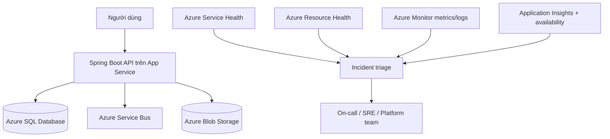
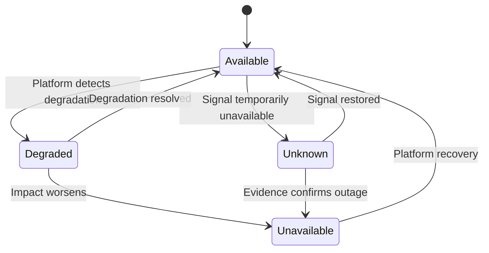
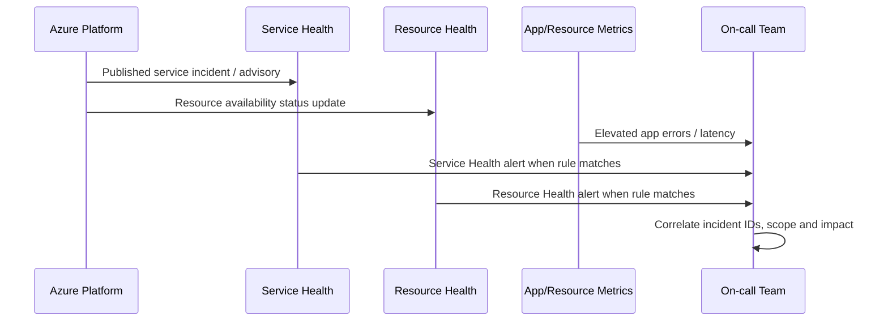
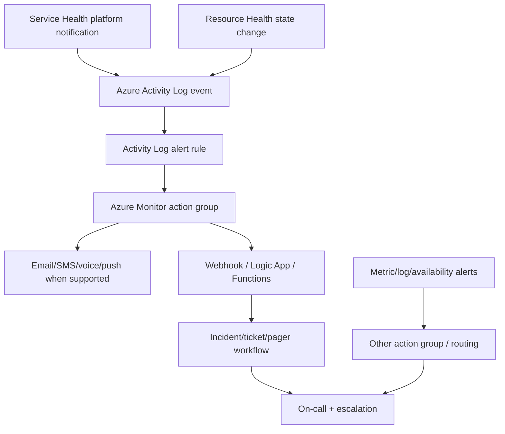
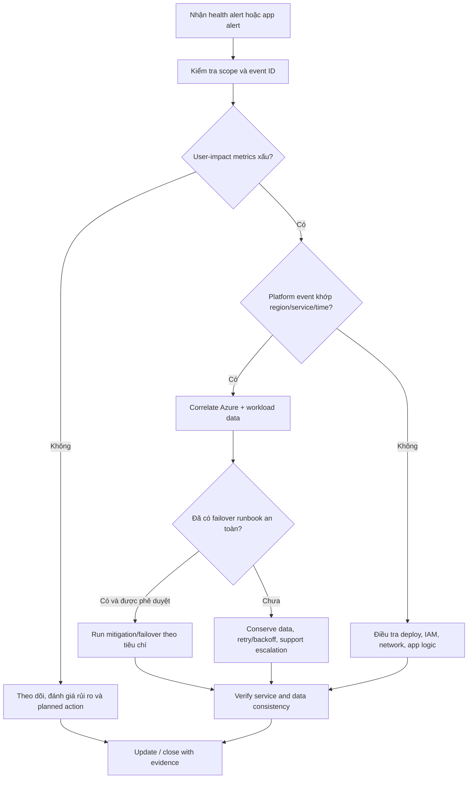

# Service Health, Resource Health và cảnh báo sự cố nền tảng

Một hệ thống Spring Boot chạy trên Azure có thể gặp lỗi HTTP 503 ngay cả khi mã nguồn và bản triển khai không thay đổi: Azure App Service đang gặp sự cố khu vực, một máy ảo nền tảng bị mất khả dụng, Azure SQL có hoạt động bảo trì, hoặc đường mạng tới một dịch vụ phụ thuộc đang gặp vấn đề. Nếu chỉ theo dõi log ứng dụng, nhóm vận hành thấy triệu chứng nhưng chưa biết nguyên nhân nằm ở **ứng dụng**, **tài nguyên Azure cụ thể** hay **dịch vụ nền tảng Azure**. Ngược lại, nếu chỉ theo dõi thông báo của Azure, nhóm vận hành có thể bỏ sót lỗi logic nghiệp vụ, cấu hình sai hoặc độ trễ do chính ứng dụng gây ra.

**Azure Service Health** và **Azure Resource Health** là hai góc nhìn bổ sung nhau trong Azure Monitor. Service Health cung cấp thông tin **cá nhân hóa theo subscriptions** về sự cố dịch vụ, kế hoạch bảo trì và thông báo ảnh hưởng của Azure; Resource Health cung cấp tín hiệu tình trạng **một tài nguyên Azure được hỗ trợ** như VM hoặc dịch vụ cụ thể. Kết hợp cả hai với **Azure Monitor metrics, logs, Application Insights, availability tests, alert rules và action groups**, chúng ta có thể phát hiện, phân loại và xử lý sự cố nền tảng kịp thời.

Bài học thuộc chương **Giám sát và quan sát hệ thống** của mô-đun `CLOUD_PROVIDERS_AZURE`: học cách giám sát, bảo vệ và vận hành kiến trúc ứng dụng trên Microsoft Azure, từ subscription/resource group, Entra ID, mạng ảo, tính toán, lưu trữ và dữ liệu đến cảnh báo và kiểm soát chi phí. Phạm vi tập trung vào **Service Health, Resource Health và cảnh báo sự cố nền tảng**; các ví dụ Java, Kubernetes, Azure CLI và KQL được dùng để liên hệ với quy trình vận hành thực tế.

> **Phạm vi phiên bản:** Giao diện Azure Portal, Azure Monitor alert experience, dữ liệu health, các resource types được Resource Health hỗ trợ, schema của Activity Log và các lệnh CLI/ARM API có thể thay đổi theo thời gian, loại subscription, region, quyền truy cập và Azure cloud. Đây là bài tự chứa về khái niệm và cách triển khai có kiểm soát; khi triển khai production, xác minh các tùy chọn hiện có trong subscription và tài liệu Azure đang áp dụng. Những số phút, phần trăm và tình huống bên dưới đều là **ví dụ giả lập**, không phải SLA hoặc sự cố Azure đang diễn ra.

## Mục tiêu học tập

Sau bài học, bạn có thể:

1. Phân biệt **Azure Service Health**, **Azure Resource Health** và **Azure Status** (trạng thái chung), cũng như Azure Monitor metrics/logs/Application Insights.
2. Hiểu những loại thông báo phổ biến: **service issues**, **planned maintenance**, **health advisories** và các thông báo an ninh có liên quan khi được cung cấp.
3. Đọc đúng các trạng thái **Available, Degraded, Unavailable, Unknown** của Resource Health và giới hạn của chúng.
4. Xây dựng **ma trận subscription–region–service–resource** để chỉ gửi cảnh báo đúng nhóm trực.
5. Thiết lập **Service Health / Resource Health Activity Log alert rules** với Azure Monitor **action groups** và kiểm tra đường gửi thông báo.
6. Phân biệt cảnh báo theo **event nền tảng** với metric/log/availability alerts để tránh coi một nguồn là chân lý tuyệt đối.
7. Dùng Azure Portal và các truy vấn/lệnh Azure CLI đọc cấu hình và Activity Log đúng quyền.
8. Tích hợp incident triage, correlation ID, impact analysis, escalation, runbook, failover khi được phê duyệt và postmortem.
9. Thiết kế phản ứng với **bảo trì có kế hoạch**, không tự biến mọi advisory thành sự cố nghiêm trọng.
10. Xây workflow bảo mật, IAM, multi-subscription, hạn chế alert noise và chống webhook alert giả mạo.
11. Viết kiểm thử cảnh báo, giám sát tỷ lệ giao thông báo, sự cố không có Resource Health signal, và đo **MTTD/MTTA/MTTR**.
12. Lập checklist triển khai production và chỉ tiêu theo dõi chất lượng hệ thống cảnh báo.

## 1. Ba tầng quan sát không thể thay thế nhau

Giả sử dịch vụ xử lý đơn hàng chạy trên Azure:



Cần trả lời **ba loại câu hỏi khác nhau**:

| Câu hỏi | Nguồn tín hiệu phù hợp | Không đủ để kết luận |
|---|---|---|
| “Azure đang thông báo sự cố ở dịch vụ hoặc region liên quan đến subscription này không?” | **Service Health**. | Sự cố Azure được thông báo chưa chắc gây lỗi ứng dụng cụ thể. |
| “Tài nguyên Azure `vm-orders-01` đang được nền tảng đánh giá khả dụng hay không?” | **Resource Health**, nếu loại tài nguyên hỗ trợ. | Resource Health `Available` không bảo đảm mọi endpoint/logic nghiệp vụ khỏe. |
| “Người dùng không thanh toán được trong 5 phút qua vì lỗi ở đâu?” | **Application Insights, metrics/logs, synthetic/availability tests, dependency traces** kết hợp các nguồn health. | Không thể suy nguyên nhân chỉ từ một thông báo hoặc một HTTP status. |

### 1.1. Service Health, Resource Health và Azure Status

| Nguồn | Phạm vi quan sát | Tính cá nhân hóa | Trường hợp sử dụng |
|---|---|---|---|
| **Azure Status** | Trạng thái dịch vụ Azure công bố rộng rãi. | Thường ở mức tổng quan, không đủ chi tiết về tài nguyên của mình. | Xem bối cảnh một sự cố diện rộng. |
| **Azure Service Health** | Sự kiện/khuyến cáo dịch vụ Azure có liên quan subscription, region, service của bạn. | **Theo subscription và phạm vi ảnh hưởng** của notification. | Nhận cảnh báo service issue/planned maintenance, liên hệ support và chuẩn bị ứng phó. |
| **Azure Resource Health** | Health hiện tại và lịch sử của **resource Azure được hỗ trợ**. | Gắn với resource cụ thể. | Chẩn đoán sự cố availability của VM hoặc một Azure resource. |
| **Azure Monitor metrics** | CPU, lỗi, throughput, latency và counters của resource/service. | Theo resource/metric dimensions. | Đo triệu chứng và threshold, ví dụ 5xx tăng. |
| **Azure Monitor logs** | Activity Log, diagnostic/resource logs, application telemetry khi đã thu thập. | Theo nguồn log và cấu hình thu thập. | Điều tra timeline, correlation, RCA. |
| **Application Insights / synthetic availability** | Ứng dụng, yêu cầu và dependencies nhìn từ người dùng/agent. | Theo application và test. | Chứng minh tác động thật, hiệu năng và business SLO. |

**Không dùng Azure Status như thay thế cho Service Health**, vì thông tin tổng quan có thể không phản ánh toàn bộ notification cá nhân hóa của subscription. **Không dùng Resource Health làm health check duy nhất** cho app: ứng dụng có thể lỗi toàn bộ chức năng dù host/resource vẫn `Available`.

### 1.2. Khái niệm event, alert và incident

- **Health event:** Thông báo/trạng thái do nền tảng ghi nhận. Một event có thể được cập nhật theo thời gian.
- **Alert rule:** Điều kiện lọc và quyết định khi nào phát tín hiệu tới đội vận hành.
- **Action group:** Bộ người nhận và các action/endpoints được gọi khi alert kích hoạt.
- **Incident ticket:** Bản ghi vận hành có owner, mức độ ảnh hưởng, timeline, hành động và trạng thái.
- **Resolution:** Sự kiện/service condition được Azure đánh dấu resolved hoặc hệ thống ứng dụng thực sự phục hồi; hai mốc không nhất thiết trùng nhau.

Một event nền tảng có thể tạo **nhiều notifications/updates** và nhiều application alerts. Cần correlation/dedup, không tạo vô hạn ticket cho cùng một nguyên nhân.

## 2. Azure Service Health: tín hiệu ở cấp dịch vụ

**Service Health** là trải nghiệm thông báo về các vấn đề có liên quan tới dịch vụ Azure mà subscription của bạn sử dụng hoặc có thể bị ảnh hưởng, tùy Azure xác định phạm vi. Trong Azure Portal thường có thể truy cập qua **Service Health** (hoặc Azure Monitor → Service Health theo UI hiện hành), xem sự kiện đang hoạt động, lịch sử và tạo cảnh báo sức khỏe dịch vụ.

### 2.1. Các nhóm sự kiện thường gặp

| Nhóm | Nội dung điển hình | Hành động vận hành |
|---|---|---|
| **Service issues** | Sự cố ngoài kế hoạch ảnh hưởng dịch vụ/region. | Triage tác động ứng dụng, correlation với metrics và thông báo Azure; xử lý incident. |
| **Planned maintenance** | Bảo trì/hoạt động đã lên kế hoạch có khả năng ảnh hưởng dịch vụ. | Đánh giá maintenance window, HA/failover/readiness, thông báo stakeholders. |
| **Health advisories** | Khuyến cáo/cập nhật quan trọng về tình trạng dịch vụ hoặc thay đổi có thể ảnh hưởng môi trường. | Giao owner đánh giá và theo dõi action/deadline, không mặc định page 24/7. |
| **Security advisories** | Thông báo an ninh liên quan được dịch vụ cung cấp trong trải nghiệm phù hợp. | Kiểm tra phạm vi, ưu tiên security review và remediation có phê duyệt. |

**Lưu ý:** Tên nhóm, nội dung và khả năng tạo filter/alert cho từng loại notification có thể thay đổi theo UI, cloud, subscription và tính năng. **Không mặc định tất cả security advisories sẽ có event với cùng schema hoặc gửi được qua một alert rule cụ thể**; xác minh tại subscription đích.

### 2.2. Những trường thông tin quan trọng của thông báo

Một notification có thể cung cấp, tùy loại và event:

- **Event/Tracking ID** để đối chiếu cập nhật và support ticket.
- **Tên dịch vụ** như App Service, Storage, SQL Database hoặc networking.
- **Affected region(s)**, có thể là một hoặc nhiều vùng, hoặc thông báo dạng global.
- **Affected subscription(s)** và/hoặc phạm vi tài nguyên khi Azure cung cấp.
- **Event status**: đang điều tra, mitigation, resolved, post-incident review hoặc trạng thái khác theo sự kiện.
- **Start time/last update time**, có thể khác thời điểm alert được tạo/được nhận.
- **Root cause/mitigation/update** khi Azure công bố; không phải lúc nào cũng có sớm.
- **Planned maintenance window** hoặc action deadline khi phù hợp.
- **Links/metadata** phục vụ support và theo dõi.

**Không cố diễn giải tất cả thời điểm là thời gian bắt đầu user impact.** Thông báo có thể đến sau khi lỗi đã diễn ra, và mốc Azure công bố không thay thế timestamp request lỗi trong ứng dụng.

### 2.3. Service Health không chứng minh trực tiếp app bị lỗi

Ví dụ Service Health thông báo `Azure Storage – East Asia service issue`, trong khi ứng dụng đang lưu Blob tại Southeast Asia. Cảnh báo này có thể **không liên quan trực tiếp** nếu workload không sử dụng East Asia, dù một dependency cross-region hoặc dịch vụ quản lý global có thể khiến kết luận phức tạp hơn.

Vì vậy khi nhận sự kiện:

1. Xác định **subscription, affected services, regions và resources/workloads**.
2. Đối chiếu **inventory/dependency map** do tổ chức quản lý.
3. Kiểm tra **availability, error rate, latency, queue lag** của workload liên quan.
4. Không kích hoạt failover tốn kém khi **chỉ có một advisory không gây user impact**, trừ policy/rủi ro yêu cầu.
5. Ghi nhận event ID và updates để theo dõi cho tới khi xử lý xong.

### 2.4. Có nhiều subscriptions và service regions

Một doanh nghiệp có thể có:

```text
management group: company
  subscription: prod-shared     -> Front Door, DNS, Key Vault
  subscription: prod-southeast  -> App Service + SQL Southeast Asia
  subscription: prod-eastasia   -> Storage East Asia, standby workload
  subscription: dev-test        -> sandbox resources
```

Thiết kế alert phải cân nhắc **phạm vi subscription**. Một Service Health alert chỉ được cấu hình ở một subscription có thể không bao phủ subscription khác. **Region filter** quá hẹp cũng có thể bỏ sót thông báo global hoặc dependencies cross-region; filter quá rộng sẽ tạo alert noise. Cần xây ma trận đối chiếu owner/services/regions, không sao chép một bộ lọc tùy tiện cho mọi subscription.

## 3. Resource Health: trạng thái của tài nguyên cụ thể

**Azure Resource Health** giúp đánh giá trạng thái sức khỏe và lịch sử health của **resource types được hỗ trợ**, có thể bổ sung thông tin liên quan sự kiện nền tảng ảnh hưởng tài nguyên. Truy cập thường qua **Resource → Resource Health** hoặc trải nghiệm Azure Monitor → Resource Health, tùy portal và loại resource.

### 3.1. Các trạng thái chính

| Trạng thái | Cách hiểu phù hợp | Ứng xử đề xuất |
|---|---|---|
| **Available** | Nền tảng đánh giá resource khả dụng theo health signal được định nghĩa cho loại resource đó. | Tiếp tục kiểm tra app metrics; không suy business SLO chắc chắn đạt. |
| **Degraded** | Resource còn hoạt động nhưng trải nghiệm/năng lực có thể suy giảm theo điều kiện được theo dõi. | Tương quan với latency/error, xem khuyến cáo và lập action. |
| **Unavailable** | Resource được nền tảng đánh giá không khả dụng. | Kích hoạt incident triage, kiểm tra user impact, HA/failover theo runbook. |
| **Unknown** | Nền tảng không có đủ thông tin health đáng tin cậy trong thời điểm/phạm vi hiện tại. | Điều tra telemetry/network/resource state; không coi là Available hoặc tự kết luận outage. |

**Resource Health không hỗ trợ mọi resource type theo cùng cách**, và trạng thái/chi tiết có thể khác nhau theo SKU/service. Ví dụ khả năng xem sức khỏe **VM** không đồng nghĩa mọi resource con hoặc dịch vụ PaaS đều cung cấp cùng lịch sử, lý do và metric.

### 3.2. Tại sao `Available` không phải `Healthy application`?

Một VM có thể **Available** nhưng:

- Java process bên trong đã crash.
- PostgreSQL connection pool hết kết nối.
- API có lỗi authorization hoặc regression.
- Queue consumer bị deadlock, không xử lý message.
- Secret hoặc certificate hết hạn.
- Người dùng từ một khu vực không truy cập được do DNS/CDN/client network.

Resource Health tập trung vào **tình trạng nền tảng của resource**, không phải một HTTP `/actuator/health` hoặc business transaction probe đầy đủ.

### 3.3. Nguyên nhân do nền tảng hay do người dùng?

Một số resource health event cung cấp ngữ cảnh phân biệt **Platform-initiated** và **User-initiated** hoặc mô tả hành động gây thay đổi, nếu service hỗ trợ. Điều này giúp đối chiếu:

- VM bị host failure ngoài ý muốn.
- VM bị restart/deallocate bởi operator/IaC.
- Resize/maintenance hoặc platform remediation.
- Resource bị thay đổi network/permissions.
- Resource có status Unknown trong giai đoạn chuyển đổi.

**Không suy “Platform-initiated” chỉ vì ứng dụng không có deployment mới**. Có thể do hành động quản trị qua Azure Portal, autoscale, automation hoặc đường phụ thuộc. Phải đối chiếu **Azure Activity Log** (management operations), resource health timeline và application metrics.

### 3.4. Resource Health có thể thay đổi trạng thái theo thời gian



Sơ đồ minh họa **một số chuyển trạng thái có thể xảy ra**, không phải mọi resource đều tuần tự đi qua các trạng thái này. Cảnh báo có thể tới **sau** khi trạng thái đã thay đổi hoặc bị gộp theo cơ chế phát event; hãy dùng timestamp của event và trace để dựng timeline.

## 4. Service Health và Resource Health phối hợp thế nào?

Một sự cố hạ tầng có thể hiển thị ở nhiều lớp:



| Tình huống | Service Health | Resource Health | Metrics/Application Insights |
|---|---|---|---|
| Azure Storage region gặp sự cố diện rộng | Có thể phát incident có liên quan subscriptions. | Có thể có tín hiệu ở resource được hỗ trợ. | Read/write timeout, 5xx, retry, latency. |
| Một VM host gặp vấn đề | Có thể không có Service Health notification diện rộng. | Có thể chuyển Unavailable/Degraded. | VM availability, request failures từ app. |
| Spring Boot lỗi sau deploy | Không nhất thiết có Service Health. | Host vẫn có thể Available. | 5xx tăng, exception traces, deployment version. |
| Bảo trì có kế hoạch | Planned maintenance có thể được công bố. | Resource Health có thể hoặc không đổi theo loại/ảnh hưởng. | Theo dõi SLO trước/trong/sau window. |
| DNS cấu hình sai bởi team | Không nhất thiết có Service Health. | Resource có thể Available. | Synthetic probe failures, DNS errors trong logs. |

**Nguyên tắc:** Cảnh báo nền tảng hỗ trợ **giải thích nguyên nhân và chủ động chuẩn bị**, còn **metrics/availability tests chứng minh tác động thật**. Đừng tắt app alerts chỉ vì đã tạo Service Health alerts.

## 5. Kiến trúc cảnh báo nền tảng: Alert rule → Action group → Incident

Azure Monitor hỗ trợ các kiểu alert khác nhau. Với thông báo Service Health và thay đổi Resource Health, một cơ chế phổ biến là **Activity Log alert** theo category và điều kiện lọc. Action group chịu trách nhiệm gửi notifications hoặc kích hoạt automation/ITSM.



**Quan trọng:** Sơ đồ thể hiện **một kiến trúc thường dùng**, không đảm bảo mọi resource health change hoặc security advisory đều phát một Activity Log event với cùng trường, schema hoặc tốc độ. Cần xác minh **subscription scope, alert category, supported event properties và delivery** trong môi trường thực tế.

### 5.1. Activity Log alert khác metric alert và log alert

| Kiểu alert | Điều kiện thường dùng | Thích hợp | Hạn chế |
|---|---|---|---|
| **Activity Log alert** | Event quản trị/health category theo subscription và điều kiện. | Service Health/Resource Health platform event; change/audit. | Event-driven, không đo error-rate liên tục. |
| **Metric alert** | Giá trị metric vượt ngưỡng tĩnh hoặc động theo thời gian. | VM CPU, HTTP 5xx, availability, DB latency. | Không tự có nguyên nhân sự cố Azure nền tảng. |
| **Log search alert** | KQL trên workspace/Application Insights hoặc logs phù hợp. | Correlate errors, dependency timeouts, custom business signals. | Cần thu thập logs và query đúng; có độ trễ ingestion. |
| **Smart/application alerts** | Hành vi bất thường hoặc availability failures theo sản phẩm. | Phát hiện app regression/user impact. | Không thay Service Health notifications. |

Có thể cùng một incident làm kích hoạt **3–5 alerts**. Hệ thống on-call nên gộp theo scope/service/time window/correlation ID, nhưng **không gộp nhầm hai incident độc lập** chỉ vì cùng region.

### 5.2. Cần lọc Service Health theo điều gì?

Một quy tắc nên xác định:

- **Subscriptions** nào thuộc phạm vi giám sát?
- **Service types** nào quan trọng (Storage, SQL, App Service, networking, Service Bus, Key Vault...)?
- **Regions** nào thực sự dùng hoặc là dependencies/DR target?
- **Event types** nào muốn page ngay, loại nào tạo ticket/email?
- **Action group** nào là người nhận/automation endpoint?
- **Severity/priority** nào do tổ chức định nghĩa; **đừng nhầm mức độ nội bộ với một trường Azure event luôn có sẵn**.
- **Owner và runbook** cho từng service/region/subscription là gì?

Mức độ khẩn cấp nên dựa trên **tác động business**. Một `Service issue` liên quan dịch vụ không dùng ở region khác không nhất thiết phải đánh thức toàn bộ on-call.

### 5.3. Cần lọc Resource Health theo điều gì?

Một quy tắc Resource Health có thể được định nghĩa cho:

- **Một subscription/resource group hoặc resource IDs** tùy loại rule/scoping được hỗ trợ.
- **Resource type** và danh sách resources quan trọng.
- **Health transitions/statuses** có sẵn qua rule builder/event schema.
- **Status Unknown**: có thể gửi ticket/điều tra thay vì mặc định SEV1.
- **Resource Health reason type** (platform/user initiated) nếu được hỗ trợ bởi event type/rule.
- **Actions**: nhóm VM/AKS/SQL/Storage owners thích hợp và runbook.

**Đừng giả định mọi filter đều khả dụng cho mọi resource**. Azure Portal có thể hỗ trợ tổ hợp khác với ARM/CLI; phải kiểm tra event sample trong subscription trước khi tạo IaC quy mô lớn.
## 6. Action group: thông báo, webhook và escalation

**Action group** là tập hợp các hành động Azure Monitor thực hiện khi một alert rule kích hoạt. Cùng một action group có thể được tái sử dụng cho nhiều alert rules nếu phù hợp chính sách vận hành.

### 6.1. Một số receiver và hành động

| Kênh | Ví dụ sử dụng | Cần kiểm soát |
|---|---|---|
| **Email** | Gửi bản tóm tắt tới nhóm SRE/platform owner. | Hộp thư được quản lý, không chỉ một cá nhân nghỉ phép. |
| **SMS / voice / app push** | Paging khẩn cấp tùy dịch vụ/quốc gia/gói được hỗ trợ. | Chi phí, độ tin cậy, thay người trực, tránh spam. |
| **Webhook** | Đẩy sự kiện tới incident router/ITSM. | Endpoint authentication, HTTPS, schema validation, idempotency. |
| **Logic Apps / Azure Functions** | Route theo service/region, enrich owner/dependency map. | Quyền thực thi, quota, retry, secret management. |
| **Event Hubs** | Đẩy dữ liệu sự kiện tới pipeline phân tích/sự cố. | Consumer lag, access control và retention. |
| **Automation Runbook** | Thực hiện tác vụ vận hành được phê duyệt. | Rất hạn chế quyền, không chạy failover/restart nguy hiểm mù quáng. |
| **ITSM integration** | Tạo/update incident theo nhà cung cấp được hỗ trợ. | Mapping state/priority/dedup, SLA và access policy. |

Các receiver types, quotas, khả năng **Common Alert Schema** và region hỗ trợ phụ thuộc Azure Monitor hiện hành. Không mặc định mọi channel được phép trong mọi subscription/cloud.

### 6.2. Hai cấp nhận thông báo

Một thiết kế có thể dùng:

```text
Action Group: ag-platform-critical
  ├─ On-call paging / incident router
  ├─ Secured automation or ticket integration
  └─ Shared emergency mailbox

Action Group: ag-platform-advisory
  ├─ Platform maintenance mailbox
  ├─ Planning ticket workflow
  └─ Dashboard / change calendar
```

**Service issue** ảnh hưởng ứng dụng revenue có thể route tới critical group; **planned maintenance** nhiều tuần sau có thể mở change task và nhắc owner, không nhất thiết page ngay lúc nhận. Nếu sau đó maintenance gây user impact, metric/availability alert sẽ kích hoạt quy trình incident.

### 6.3. Common Alert Schema và bảo mật webhook

Khi action group hỗ trợ **Common Alert Schema**, dữ liệu alert có cấu trúc tương đối thống nhất giữa một số alert types. Một số trường thường hữu ích:

- Alert rule ID và tên.
- **Alert target resource/scope**.
- **Fired time** và monitor condition khi có.
- **Monitor service**/alert category.
- Context riêng của Service Health/Resource Health theo event.
- Custom properties/correlation/links khi được gửi.

**Đừng coi một payload schema minh họa là hợp đồng đầy đủ cho mọi loại alert.** Một số alert/event types có `alertContext` khác nhau, tên field có thể không được cung cấp, và HTTP webhook retries có thể gửi lại cùng thông điệp.

Webhook receiver cần:

1. HTTPS với endpoint có authentication/validation phù hợp.
2. Kiểm tra request thực sự đến từ kênh được tin cậy; không dựa vào chỉ một field JSON do bất cứ ai tự gửi.
3. Không tin bất kỳ URL trong payload để server tự gọi tùy ý (tránh SSRF).
4. Deduplicate theo event/alert ID, target scope và state/time; **lưu bền vững idempotency key**.
5. Xử lý duplicate và out-of-order delivery; không giả định exactly-once.
6. Tối thiểu hóa payload/log chứa subscription IDs, resource IDs, email hoặc nội dung nhạy cảm.
7. Có retry/DLQ/poison-message handling ở incident router.
8. Phân quyền tách biệt: webhook nhận alert **không có quyền tự failover/xóa Azure resources** nếu không được phê duyệt.

### 6.4. Một alert rule có nhiều action groups?

Có thể gắn nhiều action groups khi rule/feature cho phép, nhưng nên tránh một sự kiện gọi tới quá nhiều hệ thống độc lập không có dedup. Thay vì gửi cùng alert tới 5 incident systems, có thể gửi vào **một router** quyết định owner và downstream workflow. Tuy nhiên router là điểm phụ thuộc; cần giám sát, HA và fallback email/paging nếu nó không hoạt động.

## 7. Thiết kế phạm vi theo subscription, region và owner

Đối với một module học Azure tổng thể, hãy nối health alerts với **kiến trúc ứng dụng thực tế**, không chỉ các dịch vụ bạn nhìn thấy trên dashboard.

### 7.1. Inventory tối thiểu

| Workload | Subscription | Region(s) | Dependencies | Owner |
|---|---|---|---|---|
| Orders API | `sub-prod-app` | Southeast Asia | App Service, SQL, Key Vault, VNet | App/SRE |
| Upload pipeline | `sub-prod-data` | Southeast Asia | Blob Storage, Service Bus, Functions | Data Platform |
| Disaster recovery | `sub-prod-dr` | East Asia | Standby compute/Storage, DNS/Front Door | Cloud Platform |
| Experiment environment | `sub-dev` | Southeast Asia | App Service, Storage | Dev Team |

Tên và phân bổ trên đều **giả lập**, không phải dữ liệu tổ chức thật. **Global dependencies** như Entra ID, Azure DNS hoặc Front Door cần được xem xét riêng, không bỏ qua chỉ vì resources compute nằm một region.

### 7.2. Xây ma trận routing

| Loại alert | Phạm vi | Ưu tiên vận hành gợi ý | Nhóm nhận |
|---|---|---|---|
| Service issue trên dịch vụ sản xuất trong affected region | Subscription production + dịch vụ quan trọng | **Triage ngay**; severity phụ thuộc user impact. | On-call platform + workload owner. |
| Resource Unavailable cho resource production quan trọng | Resource IDs/resource group phù hợp | **Triage ngay** và xem synthetic availability. | Workload on-call. |
| Resource Degraded | Resource quan trọng | Điều tra trong thời gian ngắn; tăng severity nếu metrics xấu. | Workload owner/SRE. |
| Resource Unknown | Resource quan trọng | Ticket/kiểm tra telemetry; không tự coi là outage. | Platform triage. |
| Planned maintenance gần cửa sổ ảnh hưởng | Service/region/workload | Change planning và readiness review. | Platform + change manager. |
| Health/security advisory có action deadline | Subscription hoặc dịch vụ liên quan | Review security/compliance theo mức độ. | Security/platform owner. |
| Service issue chỉ ở dev/test | Subscription dev/test | Thường ticket hoặc thông báo không page. | Dev team. |

Các mức ưu tiên này do **tổ chức tự đặt**, không phải thuộc tính Azure Service Health bảo đảm có sẵn. Đội trực cần runbook “dịch vụ nào ảnh hưởng doanh thu, SLO ra sao, failover có được phép không”.

### 7.3. Cảnh báo quá rộng và quá hẹp

**Quá rộng:** Tạo rule “all services, all regions” cho toàn bộ subscriptions và page ngay mọi notification. Hậu quả là nhiều trang báo động giả với người không phụ trách, dẫn đến **alert fatigue**.

**Quá hẹp:** Chỉ theo dõi App Service tại Southeast Asia nhưng hệ thống còn SQL East Asia, Front Door global, Storage ở subscription khác. Khi Azure có sự cố dependency, nhóm không nhận đúng thông báo.

Thiết kế tốt dùng **inventory có owner, cập nhật khi kiến trúc thay đổi**, và định kỳ test xem tất cả production dependencies/subscriptions đã có coverage.

### 7.4. Region/global và availability zones

Một thông báo có thể ảnh hưởng cả region, chỉ một subset, hoặc có thông tin availability zone tùy dịch vụ. **Không giả định Service Health luôn cung cấp thông tin zone-level**. Cảnh báo Service Health theo region là đầu vào để đánh giá; quyết định failover cần dựa trên kiến trúc HA, service health/metrics và các điều kiện vận hành thực tế.

## 8. Hướng dẫn Azure Portal: tạo Service Health alert

Một workflow phổ biến trong Azure Portal:

1. Đăng nhập đúng **Microsoft Entra tenant** và chọn subscription cần theo dõi.
2. Tìm **Service Health** bằng thanh tìm kiếm Azure Portal hoặc qua Azure Monitor.
3. Xem tab/danh sách **Service issues**, **Planned maintenance**, **Health advisories** (và loại thông báo khác khi được hỗ trợ); xác nhận có context phù hợp subscription.
4. Tìm mục **Health alerts** hoặc **Add service health alert** theo giao diện hiện hành.
5. Chọn **subscription(s)** hoặc phạm vi scope được rule builder hỗ trợ.
6. Chọn **services** quan trọng, **regions** liên quan và **event types** được hỗ trợ.
7. Đặt tên rule rõ nghĩa, ví dụ `al-sh-prod-sea-critical`; chọn resource group/location của rule theo yêu cầu của Azure Monitor.
8. Chọn hoặc tạo **Action Group** cho nhóm trực; đảm bảo receiver được cấu hình hợp lệ.
9. Xem lại filters để tránh thiếu global dependencies hoặc quá nhiều noise.
10. Tạo rule; sau đó kiểm tra danh sách alert rules và **test Action Group delivery**.
11. Lưu thông tin owner, runbook, subscription/region coverage và lần test cuối.
12. Kiểm tra lại sau khi đổi region/service/subscription hoặc có alert bị miss.

**Cảnh báo vận hành:** Thứ tự tab/button và vị trí Service Health trong Portal có thể thay đổi. Nếu một event type không xuất hiện trong rule builder, **không tự cho rằng nó được alert chỉ bằng cách chọn “All”**. Cần xác minh tài liệu/UI và event payload thực tế.

### 8.1. Ví dụ cấu hình (giả lập)

```text
Rule name:           al-sh-prod-app-services
Scope:               subscription sub-prod-app
Event types:         Service issues + relevant maintenance
Services:            App Service, Azure SQL, Key Vault
Regions:             Southeast Asia, East Asia, relevant global context
Action group:        ag-platform-critical
Enabled:             true
Owner:               Cloud Operations
Runbook:             RB-SH-001
Review cadence:      Monthly / after architecture changes
```

Phần trên là **bản thiết kế**; tùy capabilities của alert rule mà có thể cần chia thành hai rules (service issue vs maintenance) hoặc kết hợp filters theo cơ chế hỗ trợ. Không mặc định một rule có thể diễn đạt mọi logic Boolean phức tạp.

### 8.2. Tạo Resource Health alert trên Portal

Một workflow phổ biến:

1. Mở **Azure Monitor → Alerts → Create → Alert rule**, hoặc trang **Resource Health** của resource.
2. Chọn scope: đúng subscription/resource group/resource quan trọng và supported health signal.
3. Chọn loại **Activity Log** hoặc **Resource Health** theo UI hiện hành.
4. Chọn các trạng thái/events cần theo dõi, ví dụ Unavailable/Degraded khi rule hỗ trợ.
5. Chỉ định action group đúng owner và priority/routing.
6. Xem lại **scope filters** và resource types; tránh alert nhầm resource do automation của team khác quản lý.
7. Lưu rule và test đường gửi/incident integration.
8. Dùng Resource Health history và Activity Log để so event khi có thay đổi thật.

Nếu resource type **không hỗ trợ Resource Health**, dùng **metrics, availability/synthetic tests và resource-specific logs** thay thế; không tạo rule tượng trưng rồi giả định đã có coverage.

## 9. Azure CLI: kiểm tra cấu hình và Activity Log (chỉ đọc)

Azure CLI hữu ích để kiểm tra **alert rules, action groups, Activity Log** trong subscription. Các ví dụ sau tránh thao tác xóa/sửa, dùng placeholders thay cho resource IDs thật.

### 9.1. Chọn đúng subscription và xem rule

```bash
az login --tenant "<tenant-id>"
az account set --subscription "<subscription-id>"
az account show \
  --query "{subscription:id,tenant:tenantId,user:user.name}" \
  -o json

RG="rg-monitoring-prod"

# Liệt kê action groups trong resource group.
az monitor action-group list \
  --resource-group "$RG" \
  -o table

# Liệt kê các Activity Log alert rules trong resource group.
az monitor activity-log alert list \
  --resource-group "$RG" \
  -o json
```

**Không suy danh sách rỗng là chưa có alert trong subscription** nếu bạn chỉ xem một resource group. Alert rule có thể nằm ở resource group quản trị chung, còn scope của nó áp cho subscription khác hoặc rộng hơn, tùy loại rule/capability. Cần kiểm tra **resource IDs, rule scopes và action group targets**.

### 9.2. Xem một khoảng Activity Log gần đây

```bash
# Khoảng thời gian minh họa; hỗ trợ --offset có thể khác theo CLI version.
az monitor activity-log list \
  --offset 7d \
  --query "[].{time:eventTimestamp,category:category.value,operation:operationName.value,status:status.value,resourceId:resourceId}" \
  -o table
```

Khi muốn kiểm tra sự kiện health có liên quan, hãy xem `category`/`properties` trong **JSON gốc**. Đừng suy rằng một truy vấn lọc category không trả row tức là không từng có sự cố; Activity Log có **retention/visibility**, và có thể chưa phát event cho loại sự cố/notification cụ thể. Lệnh `az monitor activity-log list` là **read-only** nhưng vẫn có thể hiển thị resource IDs/operations nhạy cảm; bảo vệ output.

### 9.3. Kiểm tra một alert rule cụ thể

```bash
az monitor activity-log alert show \
  --resource-group "rg-monitoring-prod" \
  --name "al-sh-prod-app-services" \
  -o json
```

Từ JSON, kiểm tra:

- `enabled` thật sự đang true?
- `scopes` có đúng subscription/resource group dự kiến?
- `condition.allOf` (hoặc cấu trúc điều kiện của API version) có đúng **category/service/region/event type**?
- `actions.actionGroups` có tồn tại và trỏ đến action group còn hoạt động?
- Rule location, resource group và role assignments đúng?
- Dịch vụ/region có thêm mới nhưng rule chưa cập nhật?

**Đừng đồng nhất “rule tồn tại” với “alert chắc chắn đã gửi thành công”.** Phải test **receiver** và theo dõi actual event delivery/incident integration.

### 9.4. Xem Resource Health ở cấp resource

Resource Health thường có thể xem trên **Resource → Resource Health** trong Portal. Đối với automation qua REST/ARM, Azure có resource-specific endpoints của **Microsoft.ResourceHealth**, nhưng API versions, resource coverage và response shape khác nhau. Bài này **không hard-code một lệnh `az rest` với API version đoán mò**. Khi cần chương trình hóa, hãy lấy **API version hiện hành và resource ID hợp lệ** từ tài liệu chính thức của đúng resource type, rồi test read-only trong lab trước khi áp dụng.

## 10. IaC: ví dụ một Activity Log alert rule tổng quát

Một rule được quản lý bằng Bicep giúp tránh cấu hình tay không nhất quán, nhưng phải xác minh **API version, category condition và scope syntax** theo môi trường đang triển khai. Đoạn sau minh họa rule bắt **nhóm ServiceHealth events chung**, **chưa lọc theo service/region** để người học hiểu cấu trúc; production phải thu hẹp hoặc định tuyến sau theo inventory nếu được hỗ trợ.

```bicep
@description('Email nhóm vận hành, nhập từ deployment configuration.')
param operationsEmail string

@description('Resource group hosting alert rules/action groups.')
param alertResourceGroupName string = resourceGroup().name

resource platformActions 'Microsoft.Insights/actionGroups@2023-01-01' = {
  name: 'ag-platform-alerts'
  location: 'global'
  properties: {
    groupShortName: 'PLATOPS'
    enabled: true
    emailReceivers: [
      {
        name: 'team-email'
        emailAddress: operationsEmail
        useCommonAlertSchema: true
      }
    ]
  }
}

resource serviceHealthAlert 'Microsoft.Insights/activityLogAlerts@2020-10-01' = {
  name: 'al-sh-all-events-lab'
  location: 'global'
  properties: {
    enabled: true
    scopes: [
      subscription().id
    ]
    condition: {
      allOf: [
        {
          field: 'category'
          equals: 'ServiceHealth'
        }
      ]
    }
    actions: {
      actionGroups: [
        {
          actionGroupId: platformActions.id
        }
      ]
    }
  }
}
```

**Lưu ý quan trọng:**

- Đây là **mẫu minh họa Bicep**, không phải deployment đã chạy hay rule hoàn thiện cho production. Người triển khai phải kiểm tra compiler/API schema và test trên lab; tên API version/fields có thể thay đổi.
- Scope subscription cần phù hợp với deployment target/permissions; rule và action group resource nằm ở resource group trong ví dụ. **Không tự áp dụng vào production** hoặc chạy bằng principal có quyền quá rộng.
- `condition: category = ServiceHealth` tổng quát có thể tạo **alert noise**. Với production, thêm filters service/region/event type theo API capability hoặc dùng **router** phân loại; xác minh khả năng filter trước khi viết điều kiện.
- Không đảm bảo mọi advisory/security notification sẽ phát event có cùng category/shape; test loại sự kiện thực tế.
- Không đưa secrets vào email/webhook URL hoặc Bicep params; email receiver là cấu hình vận hành cần IAM thích hợp.
- Một Action Group **không tự xác nhận người trực đã đọc cảnh báo**; cần có incident acknowledgement, escalation và backup channel.

### 10.1. Resource Health alert trong IaC

Về mặt mô hình, cũng có thể dùng Activity Log alert rule với `category = ResourceHealth` khi Azure Monitor/service hỗ trợ, và thêm filters resource scope/status/reason thích hợp. Tuy nhiên **các trường và operator filter cần đối chiếu event schema**. Không nên copy một đoạn Bicep có field `currentHealthStatus`/`previousHealthStatus` tự bịa mà chưa có JSON event mẫu và chưa được thử với API version. Đối với resource không hỗ trợ Resource Health, thay bằng metric/log-based alerts.

### 10.2. Chọn cách quản trị cấu hình

- **Portal:** Dễ hình dung, phù hợp học tập và thí điểm.
- **Bicep/ARM/Terraform:** Phù hợp làm chuẩn hóa nhiều environments/subscriptions, có code review và drift detection.
- **Azure CLI/REST:** Hữu ích cho read-only inventory, audit và automation có kiểm soát.

Trong production, theo dõi **alert-as-code** giống quản lý hạ tầng khác: owner, change plan, test, rollback, expiration của tạm thời suppression và định kỳ review.
## 11. Đối chiếu với Azure Activity Log và Log Analytics

Khi điều tra, cần dựng timeline từ **nhiều nguồn có độ trễ và ngữ nghĩa khác nhau**. Service Health có thể cập nhật sau khi sự cố bắt đầu; Resource Health phản ánh trạng thái resource; Activity Log cho biết management/health events; Application Insights cho thấy requests của người dùng.

### 11.1. Activity Log không tự biến thành Log Analytics

Azure **Activity Log** tồn tại ở lớp Azure Monitor với phạm vi subscription và retention mặc định theo dịch vụ. Để chạy truy vấn KQL từ **Log Analytics workspace**, cần cấu hình **diagnostic settings/export phù hợp** để các Activity Log categories được đưa vào workspace. **Không mặc định có bảng `AzureActivity`** trong mọi workspace chỉ vì subscription đã có Activity Log.

Ví dụ sau chỉ áp dụng nếu dữ liệu Activity Log thực sự được đưa vào bảng `AzureActivity` với schema tương ứng:

```kusto
AzureActivity
| where TimeGenerated >= ago(7d)
| where CategoryValue in~ ("ServiceHealth", "ResourceHealth")
| project
    TimeGenerated,
    SubscriptionId,
    CategoryValue,
    OperationNameValue,
    ActivityStatusValue,
    ResourceId,
    CorrelationId
| order by TimeGenerated desc
```

**Giới hạn truy vấn:** Activity Log event fields có thể khác nhau theo event category và export pipeline. Không dùng số row từ truy vấn này để khẳng định mọi Service Health advisory đã được phân phối. Nếu không có dữ liệu, kiểm tra **workspace, diagnostic settings, time range, permissions, subscription và event type** trước khi kết luận không có sự cố.

### 11.2. Kiểm tra event context mà không tiết lộ dữ liệu

```kusto
AzureActivity
| where TimeGenerated >= ago(24h)
| where CategoryValue =~ "ServiceHealth"
| project
    TimeGenerated,
    SubscriptionId,
    OperationNameValue,
    ResourceId,
    Properties
| take 50
```

`Properties` có thể chứa JSON/string với nội dung riêng của từng event. Nếu cần parse, **phải xem record thật** của category/SDK version tương ứng và chỉ trích các fields có thật; không viết parser dựa trên object giả. Cũng không đưa toàn bộ `Properties` vào webhook công khai hoặc incident chat không được bảo vệ, vì resource IDs và details có thể nhạy cảm.

### 11.3. Application Insights: đo request failures

Nếu ứng dụng Spring Boot đã instrument và Application Insights dùng **workspace-based tables** như `AppRequests`, có thể truy vấn minh họa:

```kusto
AppRequests
| where TimeGenerated >= ago(2h)
| summarize
    Requests = count(),
    Failures = countif(Success == false),
    P95DurationMs = percentile(DurationMs, 95)
    by bin(TimeGenerated, 5m)
| extend FailureRatePct =
    iff(Requests > 0, 100.0 * todouble(Failures) / Requests, real(null))
| order by TimeGenerated asc
```

Nếu môi trường dùng **classic Application Insights tables** (ví dụ `requests`) hoặc custom schema, tên bảng/cột phải điều chỉnh. Không suy biến `Success` phản ánh toàn bộ trải nghiệm người dùng nếu instrumentation bỏ qua một số routes, synthetic probes hoặc business failures trả HTTP 200.

### 11.4. Dependency failures theo loại dịch vụ

```kusto
AppDependencies
| where TimeGenerated >= ago(2h)
| summarize
    Calls = count(),
    Failures = countif(Success == false),
    P95DurationMs = percentile(DurationMs, 95)
    by Target, Type, bin(TimeGenerated, 5m)
| order by TimeGenerated desc
```

Đây là cơ chế xác định liệu request lỗi tập trung ở Azure SQL, Blob Storage, Service Bus hay một API ngoài. Tên bảng/cột và mức độ auto-instrumentation phụ thuộc SDK/agent và Application Insights configuration.

### 11.5. Tạo timeline sự cố chung

```text
09:00 UTC  App Dependencies: SQL calls bắt đầu timeout
09:02 UTC  Application Insights alert: SQL failures > threshold
09:04 UTC  Service Health notification published
09:05 UTC  Service Health alert delivered to action group
09:07 UTC  On-call acknowledges and checks affected subscriptions
09:18 UTC  Application errors begin decreasing
09:21 UTC  Service Health status updated (investigating/mitigating)
09:40 UTC  App business transactions fully recovered
10:05 UTC  Azure announces incident resolved (illustrative)
```

**Tất cả thời điểm đều giả lập.** Không lấy `09:04` là “thời gian user bắt đầu bị ảnh hưởng”, vì telemetry cho thấy triệu chứng từ `09:00`. Khi postmortem, tách **platform event start**, **detection**, **alert delivery**, **acknowledgement**, **mitigation** và **user recovery**.

## 12. Một lần triage chuẩn cho sự cố nền tảng

Triage là quá trình xác định **mức độ ảnh hưởng và hành động phù hợp**, không chỉ chuyển tiếp email từ Azure.

### 12.1. Runbook 10 bước

1. **Tiếp nhận:** Action group gửi Service Health/Resource Health alert; tạo/cập nhật incident theo event ID, subscription và workload.
2. **Xác thực nguồn:** Kiểm tra notification trong Azure Portal hoặc nguồn Azure chính thức và alert rule metadata; không bấm link lạ từ email giả mạo.
3. **Xác định phạm vi:** Dịch vụ, regions, subscriptions, resource IDs và severity/maintenance time nếu có.
4. **Đối chiếu inventory:** Những ứng dụng nào phụ thuộc thành phần này? Có dependencies cross-region hoặc global không?
5. **Đo user impact:** Application Insights, synthetic tests, 5xx rate, P95 latency, queue backlog, DB connections, transaction success.
6. **Phân loại nguyên nhân:** Platform issue, resource-specific unavailability, application release, IAM/network/config hoặc một tổ hợp.
7. **Chọn mitigation:** Retry có giới hạn, degrade gracefully, scale/failover theo runbook, tạm dừng job rủi ro hoặc chỉ theo dõi nếu chưa có impact.
8. **Giao tiếp:** Gửi incident update có timestamp, affected services và những điều đã xác minh; tránh khẳng định Azure là nguyên nhân khi chưa đủ evidence.
9. **Theo dõi recovery:** Service Health updates + Resource Health + telemetry ứng dụng, kiểm tra dữ liệu bị tồn/đứt gãy.
10. **Đóng và cải tiến:** Lưu timeline, MTTD/MTTA/MTTR, missed alerts, owner và action items.

### 12.2. Sơ đồ phân loại



Tuyệt đối **không kích hoạt failover tự động chỉ vì Service Health event xuất hiện** nếu hệ thống không có khả năng chuyển vùng an toàn. Một chuyển vùng có thể làm mất dữ liệu, thay đổi nơi lưu dữ liệu theo quy định, xung đột active-active hoặc chi phí cao hơn incident gốc.

### 12.3. Phân biệt “Azure resolved” và “business recovered”

Azure có thể xác nhận lỗi nền tảng đã được giảm thiểu, nhưng ứng dụng vẫn có:

- Queue backlog chưa xử lý.
- Transactions cần retry hoặc reconciliation.
- Cache chứa trạng thái lỗi.
- Connection pools chưa khôi phục.
- Database replication lag.
- VM/Kubernetes pods cần readiness checks.
- Certificate/secret đã hết hạn từ trước.

Incident chỉ được đóng khi **ngưỡng business SLO/SLI phù hợp được khôi phục và các tác động dữ liệu được kiểm tra**, không chỉ dựa vào trạng thái thông báo nền tảng.

## 13. Planned maintenance: chuẩn bị trước thay vì xử lý sau

**Planned maintenance** giúp đội vận hành chủ động đánh giá các thay đổi hạ tầng Azure có khả năng ảnh hưởng dịch vụ.

### 13.1. Khi nhận thông báo bảo trì

1. Xác định **service, subscription, region, affected resources** khi được cung cấp.
2. Xem **maintenance start/end time**, time zone và khả năng thay đổi lịch.
3. Kiểm tra **SLA/availability** của workload, đặc biệt nếu chỉ có một instance.
4. Đối chiếu **deploy calendar** để tránh rollouts lớn trùng maintenance window.
5. Xem phương án tăng replicas, zone redundancy, connection retry, rolling update readiness.
6. Thông báo team owner và khách hàng khi hợp đồng yêu cầu.
7. Ghi ticket có owner, kiểm tra lại thông báo trước giờ bắt đầu.
8. Giám sát metrics/app health trong và sau window; không mặc định mọi lỗi xảy ra cùng lúc do bảo trì.
9. Kết thúc khi trải nghiệm người dùng và data consistency đạt chuẩn.

### 13.2. Ví dụ lịch bảo trì giả lập

```text
Service:            Azure SQL Database
Affected region:    Southeast Asia
Maintenance window: 2026-12-03 02:00–04:00 UTC (giả lập)
Production SLO:     99.9% success, API p95 < 500 ms (giả định)
Readiness:
  - Database retry policy có bounded exponential backoff
  - Connection pool health checks và timeout đúng
  - HA/failover đã được thử nghiệm
  - On-call có change ticket và đường escalation
  - Synthetic transaction checks được tăng giám sát
```

Các giá trị thời gian/SLO **không phải thông báo thật của Azure**. Trong production, dùng chính event Service Health và runbook do đội vận hành phê duyệt.

### 13.3. Đổi UTC sang giờ Việt Nam

Giờ Việt Nam (ICT, UTC+7) thường dùng trong lịch trực. Ví dụ:

```text
02:00 UTC  -> 09:00 ICT
04:00 UTC  -> 11:00 ICT
```

Khi báo lịch maintenance, luôn ghi **UTC và timezone người nhận** để tránh nhầm ngày. Nếu nhiều nơi dùng timezone/DST khác nhau, đổi bằng thư viện thời gian có timezone, không tự cộng 7 giờ cho mọi nước. Với Azure event update mới, kiểm tra timestamp sửa lịch lần cuối.

### 13.4. Bảo trì không có nghĩa đã xảy ra outage

Một maintenance notice có thể yêu cầu chuẩn bị nhưng **không có user impact** trên kiến trúc HA. Ngược lại, một app single-instance có thể lỗi dù Azure xem activity là planned. Đừng dùng event type để tự suy mức độ tác động; hãy đo metrics và failure reports.

## 14. Một Resource Health alert nên được xử lý thế nào?

### 14.1. VM Unavailable

Giả sử Resource Health của `vm-orders-01` chuyển từ Available sang Unavailable:

- Kiểm tra trạng thái VM, Azure Activity Log và sự kiện maintenance/redeploy (khi có).
- Tìm thông báo Service Health trùng dịch vụ/region nếu có.
- Xem Application Insights/monitoring: service có HA instance khác phục vụ không?
- Nếu thuộc VM scale set/autoscale group, kiểm tra autohealing/instance replacement theo policy.
- Nếu user-initiated event, đối chiếu IaC/restart/resize logs trước khi mở escalation tới Azure.
- Thực hiện runbook VM recovery theo supported operations; không mặc định “restart mọi VM” mà không biết data state.
- Ghi timeline health, app errors, remediation và recovery.

### 14.2. Degraded không nhất thiết yêu cầu SEV1

Tài nguyên `Degraded` có thể vẫn phục vụ nhiều request thành công. Để quyết định:

```text
Resource Health: Degraded
Application p95 latency: vẫn trong SLO
HTTP errors: không tăng
Traffic: bình thường
Mitigation: theo dõi gần hơn, mở ticket nếu phù hợp

Resource Health: Degraded
Application p95 latency: vượt SLO 3 lần
HTTP 5xx: tăng mạnh
Mitigation: incident triage, rollback/failover runbook khi có bằng chứng
```

Mọi con số trong ví dụ là giả định. **Không bỏ qua Degraded**, nhưng không mặc định diễn giải nó thành không khả dụng toàn phần.

### 14.3. Unknown phải xử lý như một trạng thái riêng

`Unknown` không có nghĩa “healthy”, nhưng cũng không tự chứng minh host down. Nguyên nhân có thể là **thiếu health signal trong một giai đoạn**, resource support limitation hoặc điều kiện khác. Hãy hỏi:

- Metrics/availability tests còn dữ liệu không?
- Resource và subscription có đúng không?
- Có đang provisioning/deploying hoặc network change không?
- Resource type có hỗ trợ Resource Health đầy đủ không?
- Có health event lặp lại/missing telemetry khiến rule báo liên tục không?

Có thể route `Unknown` tới platform triage với thời gian quan sát ngắn, nâng severity khi **business metrics** cho thấy ảnh hưởng.

## 15. Chống báo động trùng và alert fatigue

### 15.1. Một incident có thể tạo hàng chục alerts

Ví dụ một sự cố SQL theo region có thể phát:

- Một hoặc nhiều Service Health events/updates.
- Resource Health event cho tài nguyên được hỗ trợ.
- SQL connection failure alerts.
- Spring Boot 5xx và dependency failure alerts.
- Synthetic availability alerts ở nhiều regions.
- Alerts về queue backlog và downstream processing.

Nếu tất cả mở ticket SEV1 độc lập, đội vận hành bị phân tán. Thiết kế **correlation/dedup** trong incident router:

```text
Candidate incident key:
  (subscription or workload scope)
  + (affected service / resource family)
  + (region)
  + (platform event ID when present)
  + (bounded time window)

Store:
  primary incident ID
  related alert IDs
  affected resources
  opened/updated/resolved timestamps
  acknowledged owner
```

Không dùng **chỉ region và phút hiện tại** làm key vì có thể gộp nhầm hai outage không liên quan. Khi không có platform event ID, dùng service/target resources và timeline, giữ khả năng tách incident.

### 15.2. Phân tách severity và notification channel

| Tình huống | Hành vi gợi ý |
|---|---|
| Service Health service issue ảnh hưởng production + app outage | Page on-call và mở incident. |
| Service Health service issue ảnh hưởng dịch vụ không dùng | Ticket hoặc thông tin, không page. |
| Planned maintenance 30 ngày nữa | Change planning, reminder và owner assignment. |
| Resource Degraded nhưng SLO còn đạt | Triage trong giờ làm hoặc tăng giám sát. |
| Resource Unavailable với business impact rõ | Page theo service criticality. |
| Alert delivery test | Đánh dấu test; không đưa vào thống kê user impact. |

Không nhất thiết có trường `severity` của Azure trùng với P1/P2/P3 nội bộ. Routing engine phải map theo **policy của tổ chức** và ngữ cảnh workload.

### 15.3. Suppression không được che sự cố mới

Có thể dùng **alert processing rules**, action routing, suppression và maintenance windows theo khả năng sản phẩm. Tuy nhiên:

- Chỉ giới hạn đúng resource/service/time window.
- Không tắt **application SLO alerts** chỉ vì đang có maintenance notice.
- Có thời hạn hết hiệu lực, owner và audit.
- Test rằng một incident khác trong thời gian suppression vẫn được nhìn thấy.
- Khi maintenance kết thúc phải khôi phục alerting normal state.

## 16. Thông báo sai, thiếu hoặc chậm: không đơn giản đổ lỗi cho Azure

Một hệ thống có thể bỏ sót alert dù health event đã xảy ra. Hãy phân loại:

### 16.1. Lỗi nguồn tín hiệu

- Loại tài nguyên không được Resource Health hỗ trợ đầy đủ.
- Service Health không có notification riêng cho subscription/region/resource.
- Event được phát sau triệu chứng thực tế.
- Resource Health đánh giá Available dù app code hỏng.

**Giải pháp:** Không phụ thuộc duy nhất health; luôn có **app availability/metric/log alerts**.

### 16.2. Lỗi alert rule

- Rule ở sai subscription hoặc scope không bao phủ resource.
- Filter chỉ chọn Southeast Asia nhưng dependency nằm East Asia.
- Event type filter bỏ planned maintenance/security advisory cần nhận.
- Rule bị disable, xóa, drift do IaC hoặc hết hiệu lực suppression.
- Điều kiện so field sai với event schema.

**Giải pháp:** Audit alert-as-code, inventory và sample event payload. Kiểm tra cấu hình sau khi thêm resource/subscription.

### 16.3. Lỗi action group và downstream

- Receiver email sai hoặc không còn quản lý.
- Webhook endpoint lỗi 401/403, TLS hoặc timeout.
- Incident router dùng schema cũ không đọc được context mới.
- Duplicates làm ITSM rate-limit hoặc queue bùng nổ.
- Action group thiếu IAM/quota phù hợp hoặc kênh notification bị hạn chế.
- Điểm tích hợp nằm cùng region đang outage và không có fallback.

**Giải pháp:** Test action group, monitor delivery, downstream retry/DLQ, dùng fallback channel và xem lại HA của incident system.

### 16.4. Lỗi quy trình con người

- Cảnh báo được gửi nhưng không ai trực.
- Không có runbook/owner.
- Ticket không có mức độ ưu tiên hoặc không được acknowledge.
- Maintenance message không được chuyển thành change task.
- On-call mở rộng phạm vi outage mà không xác minh business metrics.

**Giải pháp:** Rota, escalation, SLA acknowledgement, bảng owner và drill định kỳ. **Gửi thành công không bằng được xử lý thành công**.
## 17. Tình huống thực tế: hệ thống đặt hàng nhiều subscriptions

Một công ty vận hành hệ thống đặt hàng Java/Spring Boot:

```text
Subscription Shared:
  Azure Front Door, DNS, Key Vault
Subscription Production Southeast Asia:
  App Service: orders-api
  Azure SQL: orders-db
  Service Bus: orders-events
Subscription DR East Asia:
  Standby application/data services
Subscription Development:
  App Service + Blob Storage lab
```

Hệ thống cần đo **business transaction success**, HTTP 5xx/P95 latency, SQL dependency errors, queue lag và có RPO/RTO khi xảy ra sự cố vùng. Đây là kiến trúc **giả lập**; không phải tài nguyên thực của tổ chức.

### 17.1. Những loại tín hiệu cần kết hợp

| Tầng | Tín hiệu | Owner |
|---|---|---|
| Service Health | Thông báo App Service, SQL, Service Bus, networking, Key Vault, DNS và vùng liên quan. | Cloud Platform |
| Resource Health | Health changes của các resource types production được hỗ trợ. | Workload/SRE |
| App Insights | Request failures, dependency timeout, API P95, trace correlation. | App SRE |
| Azure SQL/Service Bus metrics | DB errors, connections, message backlog/dead-letter. | Data/Messaging |
| Synthetic transactions | Kiểm tra đường đi người dùng bằng giao dịch giả không gây hại. | QA/SRE |
| Action group/incident router | Notification delivery, webhook errors, acknowledgement. | Incident Platform |
| Cost/quotas | Alert rules, Log Analytics ingestion, action group channel usage. | FinOps |

### 17.2. Diễn biến sự cố giả lập

```text
T0  Spring Boot SQL dependency requests bắt đầu timeout.
T1  App metric alert kích hoạt vì 5xx tăng.
T2  Service Health công bố thông báo liên quan SQL region.
T3  Activity Log alert gửi tới action group.
T4  Incident router gộp event với app incident.
T5  On-call đối chiếu SQL state, requests, queue writes và user impact.
T6  SRE đánh giá tiêu chí failover/RPO trước khi đổi vùng.
T7  SQL request latency trở lại mức cho phép.
T8  Reconcile pending orders và backlog; xác nhận SLO phục hồi.
T9  Azure/các hệ thống liên quan cập nhật trạng thái; đóng incident.
```

Tất cả mốc đều **minh họa**. Service Health có thể đến trước hoặc sau application alert; Resource Health có thể không đổi theo loại tài nguyên. Không tự động failover chỉ dựa vào thứ tự những sự kiện giả lập.

### 17.3. Bài học về nguồn dữ liệu

- **Chỉ Service Health:** không bắt được lỗi Java code, config hoặc SQL query sai.
- **Chỉ Resource Health:** có thể không phát hiện queue consumer deadlock hoặc lỗi DNS client; một số resource types không hỗ trợ.
- **Chỉ App Insights:** thấy request lỗi nhưng không biết Azure đang công bố incident/planned maintenance nào.
- **Kết hợp:** định hướng triage, xác nhận business impact, quyết định xử lý dựa trên bằng chứng và phục hồi an toàn.

## 18. Incident router: nhận, chuẩn hóa và bảo vệ alert

Khi tổ chức dùng `Action Group → Logic App / Azure Function → ITSM`, một router giúp map subscriptions, services và regions sang đúng owner, sau đó tạo hoặc cập nhật incident. Router cũng là một **đường nhận dữ liệu không hoàn toàn đáng tin**, phải kiểm soát authentication và payload.

### 18.1. Pipeline chuẩn hóa

```text
Receive Azure Monitor alert
   ↓
Authenticate/authorize integration endpoint
   ↓
Validate schema, body size, allowed event types
   ↓
Extract alert ID, subscription/target resource and timestamps
   ↓
Parse Service/Resource Health context when present
   ↓
Lookup owner/criticality from trusted inventory
   ↓
Deduplicate by stable ID and bounded time window
   ↓
Create/update incident, route paging or ticket
   ↓
Track acknowledgement, escalation and resolution
```

Nếu hệ thống gửi cùng event ba lần vì retry, không nên tạo ba incidents độc lập. Nếu một event cập nhật status liên tục, giữ **timeline trên cùng incident** khi có correlation ID đủ tin cậy.

### 18.2. Payload đã chuẩn hóa — chỉ là ví dụ

```json
{
  "alertId": "illustrative-alert-id",
  "category": "ServiceHealth",
  "subscription": "sub-prod-app",
  "service": "Azure SQL Database",
  "affectedRegion": "southeastasia",
  "platformEventId": "example-event-id",
  "firstSeenUtc": "2026-11-20T09:00:00Z",
  "owner": "data-platform",
  "priority": "pending-triage"
}
```

Đây là **format do incident router tạo sau parsing**, **không phải payload chuẩn nguyên văn của Azure Monitor**. `service`, `affectedRegion` và `platformEventId` có thể nằm trong nested context hoặc không có tùy event; owner phải tra từ **CMDB/inventory đáng tin**, không lấy từ một field JSON tùy ý.

### 18.3. Nguyên tắc bảo mật

1. Xác minh caller/token theo cách tích hợp Azure Monitor/action group hỗ trợ; không cho endpoint anonymous tạo incident tùy ý.
2. Giới hạn HTTPS, allowed origins/network theo thiết kế; không xem IP allowlist là biện pháp duy nhất.
3. Validate schema, kích thước, encoding và rate limits.
4. Không tự HTTP-fetch mọi link nhận được từ alert JSON (tránh SSRF).
5. Không giải mã/thực thi các lệnh shell/IaC nằm trong nội dung alert.
6. Ghi bền vững idempotency/correlation state; chấp nhận duplicate và out-of-order events.
7. Không để webhook handler có subscription Owner, quyền purge Key Vault hoặc quyền database failover mặc định.
8. Giới hạn quyền đọc resource IDs, subscription inventory và incident logs.
9. Có retry, fallback notification channel và dead-letter/quarantine cho payload lỗi.
10. Phân biệt alert delivery success với việc **người trực đã acknowledge**.

### 18.4. Automation remediation cần quyết định riêng

Một thông báo nền tảng **đúng** không luôn có nghĩa cần failover. Nếu tự động hóa hành động có tác động:

- Kiểm tra application SLI, ảnh hưởng users và dependency scope.
- Kiểm tra service data consistency, RPO/RTO và failover readiness.
- Có approval policy, runbook, IAM tối thiểu và rollback.
- Giới hạn repeated execution và concurrent incidents.
- Giám sát automation chính nó để tránh gây thêm outage.

**Không tự động restart mọi VM hoặc chuyển SQL primary chỉ vì một Service Health event được gửi tới action group.**

## 19. IAM, governance và multi-subscription

### 19.1. Quyền đọc health khác quyền tạo alert

| Vai trò trong quy trình | Quyền cần thiết | Không cần mặc định |
|---|---|---|
| Người theo dõi health | Đọc Service/Resource Health notifications trong phạm vi. | Owner của subscription. |
| Alert rule operator | Tạo/sửa Azure Monitor rules trên scopes được duyệt. | Quyền quản lý dữ liệu ứng dụng. |
| Action group administrator | Quản lý receivers/integrations. | Quyền xóa Azure resources. |
| Incident router | Đọc routing config, tạo/update ticket, ghi audit. | Quyền failover/purge tài nguyên. |
| SRE responder | Đọc metrics/logs, thực hiện approved runbook. | Quyền admin toàn tenant. |
| Security auditor | Xem policy/config/IAM changes theo phạm vi. | Đọc secrets hoặc PII không cần thiết. |

Kiểm tra role definitions và scopes thực tế trong Azure RBAC. Một `Reader` trên resource group không nhất thiết có quyền đọc một Log Analytics workspace thuộc subscription khác; một người được xem event không nên tự động sửa/tắt cảnh báo.

### 19.2. Phạm vi nhiều subscriptions/tenants

Khi có nhiều subscriptions, bảo đảm:

- Quyền xem health events cho từng subscription.
- Alert rules bao phủ đúng subscriptions/resources/regions theo capabilities hỗ trợ; **không mặc định một central alert rule bao toàn bộ tenant**.
- Action group resource IDs và permissions hợp lệ.
- Cross-subscription Log Analytics queries có data access được cấp.
- Owner map không suy chỉ từ resource group name.
- Tên subscription/tenant được kiểm chứng trước khi thay đổi alert rules.
- Quy trình cập nhật coverage khi có subscription/region/resource mới.
- Tách deployment identity, application identity và incident automation identity.

### 19.3. Giám sát thay đổi tới chính hệ thống alerting

- IaC/alert-as-code có pull request, code review, deployment plan và drift checks.
- Audit thao tác disable/delete alert rules hoặc sửa filters/scopes.
- Audit thay đổi action group email/webhook receivers.
- Giám sát diagnostic settings bị xóa/disable.
- Theo dõi suppression/action processing rule có expiration.
- Định kỳ kiểm tra alert rules còn enabled, endpoints còn phục vụ và owner còn trực.

**Một rule có trong Git không chứng minh Azure production đang bật rule đó.** Cần kiểm chứng trạng thái thực.

### 19.4. Bảo vệ dữ liệu của thông báo

Health alerts có thể tiết lộ resource IDs, regions, subscription IDs hoặc details về sự cố. Không gửi raw payload sang channel công khai hoặc SaaS bên ngoài chưa được phê duyệt. Có thể gửi summary đã giảm nhạy cảm và link tới portal/incident tool có authentication.

## 20. Chi phí và độ tin cậy của pipeline cảnh báo

Service Health/Resource Health cung cấp nguồn thông tin nền tảng, nhưng **các tầng Azure Monitor alerting, Action Group channels, Log Analytics, Functions/Logic Apps và ITSM** có thể phát sinh phí hoặc chịu quota theo cấu hình.

| Thành phần | Cost/quota cần kiểm tra |
|---|---|
| Azure Monitor alert rules | Loại rule, số lượng, pricing/quota theo dịch vụ hiện hành. |
| Action group receivers | Số recipients, SMS/voice notifications, channel quotas. |
| Log Analytics | Data ingestion, retention, archive và queries khi áp dụng. |
| Application Insights | Telemetry volume, sampling, retention. |
| Logic Apps / Azure Functions | Triggers, executions, compute/connectors. |
| Event Hubs | Capacity, throughput và retention. |
| Synthetic availability | Frequency, geographic locations và service pricing. |
| ITSM/on-call platform | License, pagers, integrations/SLAs. |

Không gán một giá cố định cho mọi notification; dùng **Azure Pricing Calculator, Cost Management và cấu hình SKU/region thực tế**.

### 20.1. Alert noise có chi phí nhân lực

Ví dụ giả lập:

```text
100 alerts/day × 5 phút triage = 500 phút ≈ 8,3 giờ/ngày
Trong đó chỉ 5 alerts cần hành động:
  Actionable alert fraction = 5%
```

Cần tránh over-filtering làm **false negatives**, nhưng phải giảm duplicate/không liên quan bằng subscription–service–region routing và correlation. Chất lượng cảnh báo không đo bằng **số email gửi đi**, mà bằng tốc độ phát hiện và xử lý tác động thật.

### 20.2. Alert pipeline cũng có thể mất khả dụng

- Activity Log event có ingestion/delivery delay.
- Webhook có thể bị timeout/401/403 và retry.
- ITSM router hoặc queue có thể gặp sự cố.
- Email/SMS đến chậm hoặc người trực không thấy.
- Giám sát quá tập trung vào một region có thể chịu cùng failure domain với ứng dụng.
- Một số resource không có Resource Health signal dù app đang lỗi.

Giải pháp: **fallback notification channel**, probe health của incident router, monitor delivery/acknowledgement và giữ **application-level availability/metric alerts độc lập** khi khả thi.
## 21. Đánh giá hệ thống alerting bằng MTTD, MTTA, MTTR và coverage

Một hệ thống giám sát tốt không phải hệ thống tạo nhiều alerts nhất, mà là hệ thống **phát hiện tác động thật kịp thời**, gửi đúng người, hỗ trợ quyết định phù hợp và giúp phục hồi an toàn.

### 21.1. Các chỉ số vận hành

| Chỉ số | Định nghĩa cần thống nhất | Dữ liệu đầu vào |
|---|---|---|
| **MTTD — Mean Time to Detect** | Trung bình thời gian từ lúc impact bắt đầu theo định nghĩa tới lúc phát hiện. | App metrics/synthetic tests và detection timestamp. |
| **MTTA — Mean Time to Acknowledge** | Trung bình thời gian từ alert/ticket phát tới lúc người trực xác nhận. | Action group/router/ITSM timestamps. |
| **MTTR — Mean Time to Restore/Recover** | Trung bình thời gian từ incident start tới khi dịch vụ đáp ứng tiêu chí phục hồi đã thỏa thuận. | Incident timeline và business SLI. |
| **Coverage** | Tỷ lệ production subscriptions/services/resources có cảnh báo phù hợp. | Asset inventory + active alert rules. |
| **Actionable alert rate** | Tỷ lệ alerts yêu cầu hành động hữu ích. | Triage labels và incident reviews. |
| **Duplicate alert ratio** | Tỷ lệ alerts gắn với incident đã có, không phải root cause mới. | Correlation/dedup logs. |
| **Delivery success rate** | Tỷ lệ alerts/test messages đến receiver, được xử lý theo contract. | Action group tests, webhook/queue logs. |
| **Acknowledgement SLO** | Tỷ lệ incidents được xác nhận trong giới hạn thời gian quy định. | On-call/ITSM timestamps. |

**Không đồng nhất Azure platform incident start với user impact start.** Service Health notification có thể xuất hiện sau khi ứng dụng bắt đầu timeout; Resource Health có thể chuyển Unavailable cùng lúc hoặc không có event. Dùng một chuẩn đo lường nhất quán theo ứng dụng.

### 21.2. Tính toán minh họa

```text
10:00 UTC  Business transactions bắt đầu lỗi
10:03 UTC  Application Insights alert kích hoạt
10:07 UTC  Service Health notification nhận bởi action group
10:10 UTC  On-call acknowledges
10:40 UTC  Business SLO khôi phục

Time-to-detect qua app alert:       3 phút
Time-to-ack từ app alert:          7 phút
Time-to-restore theo impact:      40 phút
Service Health thông báo sau:      7 phút kể từ lúc impact
```

Đây là **một sự cố giả lập**, chưa phải phép tính **mean** từ nhiều incidents. Nếu tính MTTR theo mốc khác nhau giữa team, số liệu không thể so sánh. Ghi rõ **start/end definitions, nguồn dữ liệu và exclusions**.

### 21.3. Coverage audit định kỳ

1. Lấy inventory subscriptions/regions/services/resources mới nhất.
2. Liệt kê alert rules và action group IDs đang enabled trong Azure.
3. Đối chiếu mỗi production workload có **Service Health + app-level + Resource Health nếu hỗ trợ**.
4. Kiểm tra action group recipients và integration endpoints có owner/on-call.
5. Xem alert processing suppression/mute có thời hạn hết hiệu lực không.
6. Kiểm tra diagnostic settings và Log Analytics ingestion.
7. Đọc incidents gần đây tìm **missed alerts**, wrong owner và duplicates.
8. Cập nhật IaC, routing table và escalation runbooks theo thay đổi.
9. Test các kênh và ghi bằng chứng (không gửi secrets).
10. Đánh giá cost/noise và SLO của pipeline alerting.

Nếu một workload mới chuyển từ Southeast Asia sang East Asia nhưng alert filters chưa được cập nhật, coverage thực tế **đã thay đổi** dù alert rule vẫn enabled.

## 22. Bài thực hành: cấu hình cảnh báo nền tảng trong subscription lab

Bài lab cần một **subscription được phép dùng**, Azure Monitor access, resource group cho rules/action groups và một mailbox/webhook test do người học hoặc nhóm vận hành quản lý. Không cần tạo sự cố Azure thật; **không cố làm hỏng resource production** chỉ để kiểm tra Service Health.

### 22.1. Kịch bản

```text
Lab subscription:     <approved-subscription-id>
Alert resource group: rg-monitoring-lab
Rule (Service Health): al-sh-lab
Rule (Resource Health): al-rh-vm-lab (nếu resource type hỗ trợ)
Action group:         ag-lab-notify
Receiver:             <approved-test-mailbox>
Services:             App Service / Virtual Machines / Storage as applicable
Regions:              <lab-region> + relevant dependencies
Owner:                <lab-operator>
```

Tên trong dấu `<...>` là placeholders, phải thay bằng thông tin đã xác minh. Người thực hiện cần quyền **xem event và tạo/đọc alert rules/action groups** tương ứng. Bài không giả định có sự cố Service Health xảy ra đúng lúc thực hành.

### 22.2. Phần A — Quan sát Service Health

1. Mở Azure Portal tại subscription lab.
2. Vào **Service Health**, xem các mục đang hoạt động và lịch sử được hiển thị.
3. Ghi ít nhất một mẫu event có thể xem nếu có: event ID, event type, service, region, status, timestamps.
4. Nếu không có event, **ghi “không quan sát được event trong cửa sổ lab”**, không bịa event.
5. Xem quyền subscription và policy để biết bạn có thể tạo health alert hay không.
6. Lập bảng services/regions thực sự cần theo dõi và người nhận.

### 22.3. Phần B — Tạo Action Group

1. Vào Azure Monitor → Alerts → Action groups (đường dẫn UI có thể đổi).
2. Tạo `ag-lab-notify` với email test được phê duyệt.
3. Bật Common Alert Schema nếu receiver/loại action hỗ trợ và integration muốn sử dụng.
4. Ghi lại action group resource ID, short name và receiver (không công khai địa chỉ nếu nhạy cảm).
5. Dùng **Test Action Group** của Azure khi sẵn có để kiểm tra email/endpoint.
6. Xác nhận người nhận thực sự nhận và acknowledgement theo test plan.
7. Lưu timestamp kết quả; nếu test không đến, kiểm tra receiver config/quota/filters.

**Test Action Group chỉ kiểm tra một phần đường gửi notification**, không tự chứng minh Service Health alert rule sẽ match đúng event khi Azure phát incident thật.

### 22.4. Phần C — Tạo Service Health alert

1. Từ Service Health/Health alerts, tạo rule scope subscription lab.
2. Chọn nhóm events cần test theo capabilities (service issues/planned maintenance).
3. Chọn services/regions phù hợp lab; tránh phát mọi notification sang production on-call.
4. Chọn `ag-lab-notify`.
5. Đặt `al-sh-lab` và ghi lại rule resource ID/conditions.
6. Dùng Azure CLI **read-only** `az monitor activity-log alert show` kiểm tra `enabled, scopes, conditions, actionGroups`.
7. Khi có Service Health event thực sự trong lab (nếu có), quan sát alert/incident delivery.
8. Nếu không có event, ghi kết quả giới hạn: **rule creation/config verification PASS, actual trigger NOT OBSERVED**.

**Không giả lập một Azure platform incident** bằng cách tự tạo JSON và kết luận Service Health alert rule đã hoạt động. JSON giả chỉ có thể test **incident router**, không phải event generation của Azure Service Health.

### 22.5. Phần D — Resource Health (nếu loại resource hỗ trợ)

1. Chọn một resource lab thuộc loại hỗ trợ Resource Health, ví dụ VM nếu có.
2. Xem trạng thái Available/Unknown/etc và lịch sử health thực tế.
3. Tạo alert rule theo Resource Health category/status và scope được hỗ trợ.
4. Gắn Action Group lab; kiểm tra config bằng Portal/CLI.
5. Nếu có health event tự nhiên, xem alert trigger và payload.
6. Nếu muốn làm fault injection trên VM lab, phải có **approval và dữ liệu đã backup**; hành động user-initiated VM stop/restart không tương đương platform-initiated outage và không bảo đảm tạo cùng event.
7. Đừng thay đổi hạ tầng production để tạo tình huống giả.

### 22.6. Phần E — Đối chiếu ứng dụng

Nếu có Spring Boot lab dùng App Insights:

- Theo dõi `/actuator/health` hoặc synthetic HTTP endpoint có kiểm soát.
- Bật request/dependency telemetry phù hợp (không thu PII/secrets).
- Tạo một **lỗi application-level có kiểm soát** trong lab, không gây thay đổi data thật.
- Xác nhận application alert được kích hoạt **độc lập** với Service Health notification.
- So sánh timestamps/owner routing và giải thích sự khác nhau giữa platform incident và application regression.

### 22.7. Biên bản nghiệm thu

```text
Subscription/tenant validated:        <PASS/FAIL>
Action group exists and enabled:      <PASS/FAIL>
Test notification delivered:         <PASS/FAIL>
Service Health rule scope:           <verified>
Services/regions/events:             <verified>
Service Health rule enabled:         <PASS/FAIL>
Actual Service Health event seen:    <YES/NO>
Actual Service Health trigger test:  <PASS/NOT OBSERVED>
Resource Health support verified:    <YES/NO>
Resource Health rule config:         <PASS/N/A>
App availability alert test:         <PASS/FAIL>
Incident router dedup test:          <PASS/FAIL/N/A>
Negative scope test:                 <PASS/FAIL/N/A>
Unauthorized config-change test:     <PASS/FAIL>
Owner/Runbook:                       <recorded>
Cost/Quota review:                   <recorded>
```

**Đừng đổi `NOT OBSERVED` thành `PASS` chỉ vì không có sự cố Azure trong lab.** Đó là kiểm tra trung thực, giúp phân biệt **rule configuration** với **event-trigger coverage**.

## 23. Ma trận kiểm thử production và negative cases

| Kiểm thử | Tình huống | Kết quả mong đợi |
|---|---|---|
| **Action Group test** | Gửi test notification bằng tính năng được hỗ trợ. | Receiver nhận và có evidence. |
| **Service Health rule enabled** | Đọc rule qua Azure Portal/CLI. | Enabled, scope/filters/action group đúng. |
| **Resource Health supported** | Chọn resource quan trọng. | Xác minh trạng thái/signal hoặc có alternate monitoring. |
| **Wrong subscription** | Kiểm tra một subscription không nằm trong scope. | Rule không bị coi là bao phủ sai subscription. |
| **Region mismatch** | Dependency thuộc vùng khác cấu hình filter. | Coverage audit phát hiện thiếu vùng. |
| **Service issue severity routing** | Test router với payload giả đã đánh dấu test. | Đi đúng team theo inventory/criticality, không page production tùy tiện. |
| **Planned maintenance routing** | Test thông báo maintenance giả. | Tạo change/reminder, không mặc định SEV1. |
| **Resource Unknown** | Kiểm thử routing logic với status Unknown giả. | Tạo triage/ticket, không coi là Available. |
| **Duplicate webhook** | Gửi cùng test alert ID nhiều lần. | Một incident logical, có update timeline. |
| **Out-of-order events** | Gửi Resolved rồi Investigating theo thứ tự giả. | Router áp policy version/time, không đảo trạng thái mù quáng. |
| **Webhook invalid auth** | Gửi HTTP request không có auth hợp lệ. | Bị từ chối; không tạo incident. |
| **Webhook contains URL** | Payload có malicious link. | Không tự fetch/execute URL. |
| **Receiver unavailable** | Làm hỏng endpoint lab có kiểm soát. | Retry/DLQ/fallback hoạt động theo contract. |
| **Rule disabled by IaC drift** | Simulate config drift trong test. | Audit phát hiện và mở remediation. |
| **Missing logs** | Không export Activity Log sang workspace lab. | KQL trả thiếu data nhưng không kết luận không có incident. |
| **App failure without Azure incident** | Tạo regression giả trên API lab. | Application alert phát hiện, không phụ thuộc Service Health. |
| **Synthetic availability only** | SLO test fail nhưng Resource Health Available. | Triage ứng dụng/dependency vẫn diễn ra. |
| **Subscription new resource** | Thêm resource lab theo quy trình. | Coverage inventory được cập nhật/kiểm tra rule. |
| **Maintenance suppression expiry** | Đặt suppression có hạn test. | Hết hạn trở về alerting bình thường. |
| **Security role separation** | Người xem cố sửa action group trong test. | Không có quyền thay đổi khi policy không cho phép. |

### 23.1. PASS không chỉ là “đã tạo alert”

Một triển khai production chỉ nên coi là **đạt** khi:

- Tất cả **workloads/dependencies quan trọng** được map với subscription, region và owner.
- Health events và app metrics được theo dõi đúng nơi, resource coverage gaps có phương án bù.
- Rule/action group thực sự enabled, receiver test nhận được notification.
- Incident router chống duplicate, validate source và có fallback khi endpoint lỗi.
- SRE có runbook/phân quyền và acknowledgement escalation đúng.
- Không dùng automation failover/xóa resources không được phê duyệt.
- Có dashboard MTTD/MTTA/MTTR, alerts actionable vs noisy và quy trình review.

## 24. Troubleshooting: khi Service Health/Resource Health alert không đến

| Triệu chứng | Nguyên nhân có thể | Kiểm tra |
|---|---|---|
| Không thấy Service Health event. | Sai subscription, region, loại event hoặc Azure không có notification liên quan. | Service Health Portal, scope, quyền, time range. |
| Rule `al-sh-prod` tồn tại nhưng không gửi. | Disabled, sai category/conditions, không có event match. | Activity Log alert show và event sample. |
| Resource Health không có trạng thái. | Resource type không hỗ trợ hoặc tín hiệu Unknown. | Resource Health capabilities, metrics/availability thay thế. |
| VM Resource Health Available nhưng API lỗi. | Lỗi app/network/SQL/dependency. | App Insights, Azure Monitor và synthetic tests. |
| Action Group test không tới email. | Receiver sai, blocked/filtered, config/quotas. | Test results, mailbox, action group details. |
| Webhook HTTP 401/403. | Endpoint auth/token/config không hợp lệ. | Auth integration, logs đã redacted, expiration. |
| Webhook 429/503. | Receiver quá tải, downstream unavailable. | Retry/DLQ/fallback, rate limits. |
| ITSM tạo trùng incident. | Webhook retries, không có idempotency. | Alert ID, event ID, duplicate correlation. |
| Cảnh báo sai đội. | Owner map cũ hoặc region/service mapping thiếu. | CMDB, routing table, service tags/inventory. |
| Quá nhiều alerts dev/test page production. | Filters quá rộng/action group chung. | Environment labels, rule scope và routes. |
| Planned maintenance không được thông báo. | Rule chỉ chọn Service issues hoặc filter loại event. | Event types supported và rule configuration. |
| Truy vấn `AzureActivity` không có dữ liệu. | Chưa export, sai workspace/query/time range. | Activity Log source và diagnostic settings. |
| Service Health có event nhưng alert không trigger. | Event category/fields không match rule hoặc thiếu scope. | Raw Activity Log event, rule allOf conditions. |
| Resource Health alert lặp nhiều lần. | Status flapping, duplicate notifications hoặc rule logic. | Timeline, suppression có hạn, dedup. |
| Azure resolved nhưng API vẫn lỗi. | Queue backlog, connection cache, app bug. | Business metrics, traces và data reconciliation. |
| On-call không acknowledge. | Rota/receivers/escalation chưa đúng. | On-call schedule, test pages, acknowledgement SLO. |
| Một subscription mới bị bỏ sót. | Không triển khai rule hoặc IAM thiếu. | Coverage inventory và per-subscription alert audits. |

### 24.1. Thứ tự xử lý lỗi alerting

```text
Có thực sự có event phù hợp?
    |
    +-- Không / chưa biết:
    |      Kiểm tra Service Health/Resource Health + app telemetry
    |
    +-- Có:
           |
           +-- Rule có bao phủ subscription/region/service?
           |       +-- Không: sửa scope/conditions theo approval
           |
           +-- Rule enabled và match đúng event fields?
           |       +-- Không: xem raw event + rule filter
           |
           +-- Action group active và receiver test pass?
           |       +-- Không: sửa receiver/quota/auth
           |
           +-- Downstream webhook/ITSM có ACK?
           |       +-- Không: retry/DLQ/fallback
           |
           +-- Người trực đã acknowledge?
                   +-- Không: escalation/rota/process
```

Không kết luận “Azure Monitor hỏng” khi chưa tách **event source → rule evaluation → action group → delivery → incident routing → human acknowledgement**.

## 25. Checklist triển khai Service Health và Resource Health production

- [ ] Đã lập inventory production subscriptions, regions, resource groups và services quan trọng.
- [ ] Mỗi workload có owner, business criticality, SLO và runbook.
- [ ] Đã phân biệt Azure Status, Service Health, Resource Health, metrics, logs và Application Insights.
- [ ] Đã xác minh Service Health notifications theo từng subscription và affected region/services.
- [ ] Đã xem xét service issues, planned maintenance, health advisories và security advisories khi có.
- [ ] Không suy một Service Health event đồng nghĩa ứng dụng đã outage.
- [ ] Đã kiểm tra những resource types có hỗ trợ Resource Health thật sự.
- [ ] Đã phân biệt Available, Degraded, Unavailable và Unknown với app health.
- [ ] Có Service Health Activity Log alerts bao phủ production subscriptions và global dependencies phù hợp.
- [ ] Có Resource Health alerts cho tài nguyên được hỗ trợ và có ý nghĩa.
- [ ] Có application metrics/availability/log alerts độc lập để bắt lỗi không phải do Azure platform.
- [ ] Scope/conditions của alert rules đúng subscription, region, service/event type và resource.
- [ ] Alert rules thực tế enabled, không chỉ có trong IaC.
- [ ] Action groups có recipients đúng đội trực và có fallback/secondary channel.
- [ ] Common Alert Schema và payload integration được kiểm thử theo từng alert type khi sử dụng.
- [ ] Webhook endpoint xác thực caller, validate schema và không tự gọi URLs chưa tin cậy.
- [ ] Incident router có idempotency/dedup và xử lý out-of-order updates.
- [ ] Không cấp webhook/automation quyền xóa/failover resources không cần thiết.
- [ ] Đã cấu hình monitoring/audit thay đổi rule, scope, action group và diagnostic settings.
- [ ] Đã xác minh Azure RBAC cho người xem health, operator alert rules và incident router.
- [ ] Multi-subscription/tenant coverage có owner và phương án kiểm tra IAM.
- [ ] Planned maintenance được chuyển thành change tasks và có readiness checklist.
- [ ] Suppression/action processing rules có scope hẹp, owner và expiration.
- [ ] Đã thử action group test; không coi test này là test tạo sự cố Service Health thật.
- [ ] Khi không có Service Health event trong lab, ghi `NOT OBSERVED` thay vì PASS giả.
- [ ] Activity Log export vào Log Analytics được xác minh trước khi dùng KQL.
- [ ] Log Analytics/Application Insights query dùng đúng schema và time range.
- [ ] Có timeline incident gồm event start, detection, delivery, acknowledgement, recovery.
- [ ] Có đánh giá business impacts, queue backlog, DB consistency sau khi Azure thông báo resolved.
- [ ] Đã đo/định nghĩa MTTD, MTTA, MTTR, coverage, duplicate ratio và actionable rate.
- [ ] Đã dự toán Azure Monitor/logs/action group/ITSM costs và quotas.
- [ ] Incident router/action group delivery có availability monitoring hoặc fallback khi lỗi.
- [ ] Có postmortem và cải tiến routing/owner/runbook sau incident hoặc architecture change.
- [ ] Đã thử các negative cases: wrong subscription, no resource support, bad webhook auth, duplicate alerts.
- [ ] Không ghi subscription/resource details, secrets, access tokens hoặc incident payload nhạy cảm vào public channels.
- [ ] Đã review alert coverage và owner/on-call rota định kỳ hoặc sau thay đổi hạ tầng.

## Kết luận

**Azure Service Health** giúp phát hiện và hiểu các **sự cố dịch vụ, bảo trì có kế hoạch và thông báo nền tảng** có liên quan đến subscription, services và regions của tổ chức. **Azure Resource Health** bổ sung góc nhìn về **tình trạng khả dụng của từng resource được hỗ trợ**, với các trạng thái Available, Degraded, Unavailable và Unknown. Cả hai đều **không thay thế** Application Insights, Azure Monitor metrics/logs hay synthetic availability: một sự cố Azure chưa chắc ảnh hưởng ứng dụng, và một ứng dụng có thể lỗi nặng dù nền tảng không phát Service Health incident. Để vận hành hiệu quả, hãy kết hợp **Activity Log alert rules, action groups, định tuyến theo subscription–region–service–owner, bảo mật webhook, correlation/dedup và incident runbooks**; đo kết quả bằng **business SLO, MTTD, MTTA, MTTR, alert coverage và tỷ lệ cảnh báo có ích**. Khi thường xuyên kiểm thử đường gửi thông báo và các tình huống lỗi, nhóm vận hành sẽ giảm bỏ sót sự cố, giảm cảnh báo nhiễu và phục hồi ứng dụng trên Azure theo một quy trình có thể kiểm chứng.


