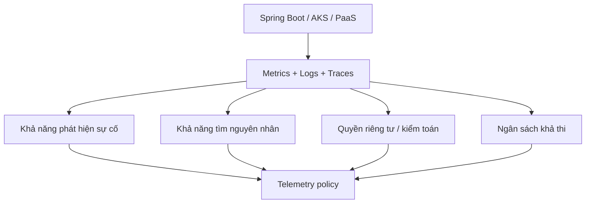
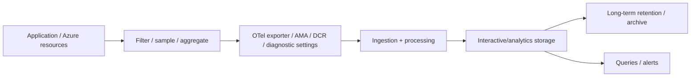
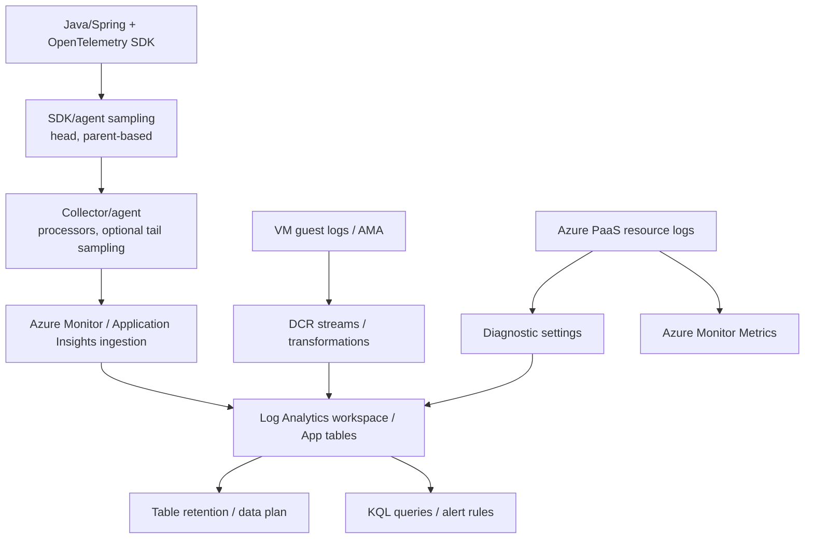
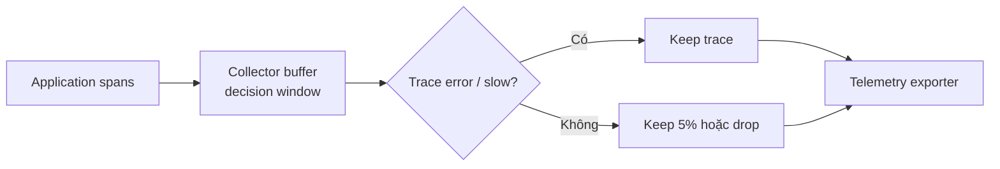
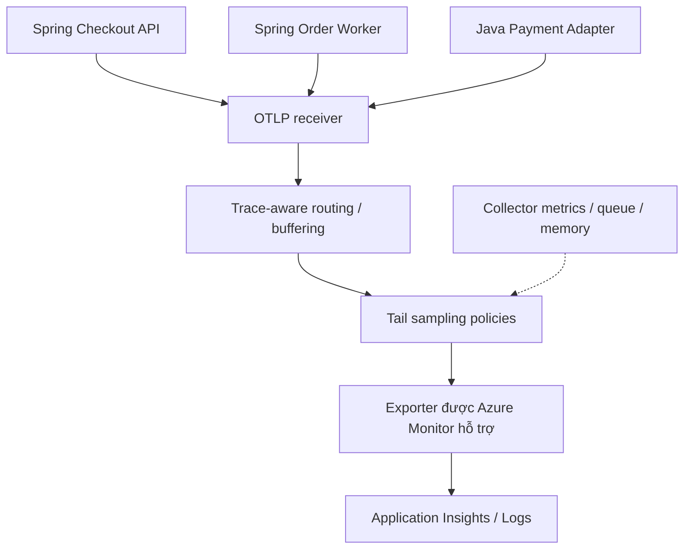
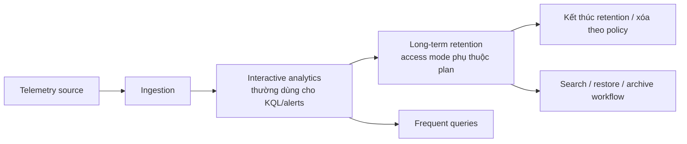
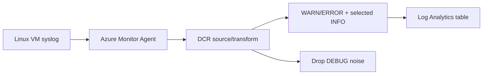
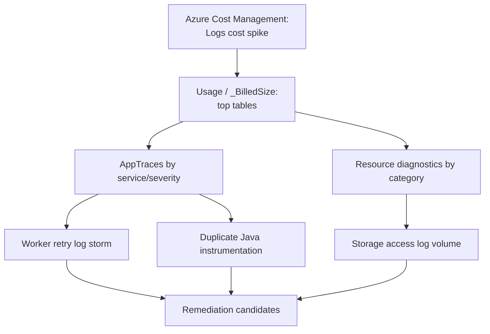

# Sampling, retention và kiểm soát chi phí telemetry

Một hệ thống đặt hàng chạy trên Azure có **Spring Boot API**, Azure SQL Database, Azure Service Bus, Azure Functions và AKS. Trong đợt cao điểm, ứng dụng nhận 4.000 yêu cầu/giây; mỗi yêu cầu tạo request span, nhiều dependency spans, application logs và custom metrics. Khi đội kỹ thuật bật thêm `DEBUG` để điều tra một lỗi hiếm, lượng telemetry vào Log Analytics tăng đột biến, trong khi những traces hữu ích lại khó tìm giữa hàng triệu sự kiện. Đến khi cần điều tra một sự cố đã xảy ra ba tháng trước, một số logs không còn trong thời hạn truy vấn thông thường.

Giải pháp không phải là **ghi lại toàn bộ vĩnh viễn** hay **tắt hết telemetry để tiết kiệm**. Cần thiết kế đồng thời ba cơ chế: **sampling** chọn dữ liệu biểu diễn/điều tra phù hợp, **retention** xác định loại dữ liệu nào được giữ trong bao lâu và ở tầng lưu trữ nào, **kiểm soát chi phí** định lượng lượng dữ liệu, hành vi truy vấn, chi phí dịch vụ phụ trợ và giới hạn ngân sách. Những quyết định này phải bảo vệ chất lượng cảnh báo, khả năng điều tra sự cố, quyền riêng tư và nhu cầu kiểm toán.

Trong module **CLOUD_PROVIDERS_AZURE**, chúng ta khám phá Microsoft Azure từ subscription, resource group, Entra ID tới mạng ảo, compute, lưu trữ và dữ liệu; đồng thời học cách triển khai, giám sát, bảo vệ và kiểm soát chi phí kiến trúc ứng dụng Azure. Bài thuộc chương **Giám sát và quan sát hệ thống**, giải quyết trực tiếp đề bài **“Sampling, retention và kiểm soát chi phí telemetry”** bằng Azure Monitor, workspace-based Application Insights, Log Analytics, OpenTelemetry, Data Collection Rules, Azure Monitor Metrics và các công cụ governance.

> **Phạm vi và lưu ý:** Các mức phí, retention tối thiểu/tối đa, tính năng Analytics/Basic/Auxiliary table, ingestion transformations, sampling và alert quotas có thể thay đổi theo region, subscription, data plan, bảng và phiên bản SDK. Ví dụ là mô hình học tập, không phải báo giá hay chính sách có hiệu lực trên tài nguyên của bạn. Không thực hiện thay đổi policy, tắt audit logs hoặc gửi dữ liệu thực lên workspace lab nếu chưa được phê duyệt.

## 1. Mục tiêu học tập

Sau bài học, bạn có thể:

- Phân biệt **sampling**, **filtering**, **aggregation**, **rate limiting**, **retention** và **archiving**, tránh dùng một khái niệm thay cho khái niệm khác.
- Hiểu cách **head, parent-based, tail, adaptive sampling** tác động đến độ đầy đủ của distributed traces và thống kê.
- Chọn dữ liệu **không được lấy mẫu** như security audit/financial ledger, và dữ liệu có thể giảm có kiểm soát.
- Cấu hình OpenTelemetry cho Spring Boot và nhận diện điểm khác biệt giữa **SDK/agent**, **Collector** và **Azure Monitor/Application Insights**.
- Ước lượng chi phí **log ingestion, retention, queries, transformations, alerts, export và networking**, không chỉ dung lượng raw file.
- Đọc thống kê `Usage`, `_BilledSize`, `_IsBillable` qua KQL trong ngữ cảnh khả dụng, và kiểm tra sự khác biệt với **Cost Management**.
- Thiết kế bảng/log data plan, thời gian giữ để điều tra nhanh và chiến lược lưu trữ lịch sử dài hạn có governance.
- Giảm **metric cardinality**, chọn structured log fields, sampling tỷ lệ phù hợp và tránh telemetry duplication.
- Áp dụng **DCR transformation, daily cap/budget alerts, retention policy, least-privilege access** mà không tạo blind spot.
- Thiết kế thử nghiệm trước/sau tối ưu và một runbook xử lý khi chi phí tăng hoặc mất dữ liệu quan sát.

## 2. Quan sát hệ thống có mục tiêu: bốn yêu cầu cùng tồn tại



Một chính sách telemetry là tốt khi cân bằng:

1. **Sufficient detection:** lỗi/vi phạm SLO vẫn được phát hiện đủ nhanh.
2. **Sufficient diagnosis:** còn trace/log để xác định nguyên nhân và tương quan dịch vụ.
3. **Compliance:** dữ liệu nhạy cảm được xử lý/giữ/xóa đúng chính sách.
4. **Sustainable cost:** ingestion và retention không tăng không giới hạn theo traffic.

Ví dụ: lưu **metric lỗi HTTP 5xx** theo phút có cardinality thấp để alert; chỉ giữ một phần **traces thành công** nhưng vẫn ưu tiên các traces lỗi khi pipeline hỗ trợ; **audit sự kiện thay đổi quyền** đi vào luồng lưu giữ riêng, có thời hạn và bảo mật; không ghi request body chứa PII.

### Một bảng định hướng trước khi tối ưu

| Tín hiệu | Dùng để làm gì? | Chính sách khởi đầu |
|---|---|---|
| **Service-level metrics** | SLI/SLO, lỗi, p95/p99, throughput | Thu aggregate đều đặn, dimensions hữu hạn |
| **Application traces** | Truy tìm các request và dependency chậm | Sampling có chủ đích, correlation nhất quán |
| **Application DEBUG/INFO logs** | Chẩn đoán chi tiết | Filter/rate-limit; debug chỉ bật có thời hạn |
| **WARN/ERROR logs** | Điều tra lỗi | Ưu tiên giữ trong khả năng; đánh giá flooding/duplication |
| **Security/audit logs** | Truy vết hành động và compliance | Không sampling tùy tiện; retention và quyền riêng |
| **Business financial records** | Đối soát giao dịch | Nguồn ghi bền vững riêng; không dùng trace sampled làm ledger |
| **Platform resource diagnostics** | IAM/network/service failures | Chọn categories thiết yếu; thiết kế destination/retention |

Không có một “giữ 10% logs” áp cho mọi loại record. Mỗi loại dữ liệu có **giá trị, độ nhạy cảm, cách phục hồi và yêu cầu tuân thủ** khác nhau.

## 3. Phân biệt sampling, filtering, aggregation và retention

Đây là bốn công cụ đặt ở những vị trí khác nhau trong pipeline:

| Cơ chế | Thực hiện | Ảnh hưởng |
|---|---|---|
| **Sampling** | Chọn một phần spans/traces/events theo xác suất hoặc quy tắc | Giảm mẫu được lưu/truyền, có thể gây sai lệch thống kê |
| **Filtering** | Bỏ loại telemetry không cần thiết trước khi ingest | Những record bị bỏ không thể truy vấn lại từ đích đó |
| **Aggregation** | Gộp nhiều phép đo thành counter/histogram/tổng hợp | Giữ xu hướng/SLI nhưng mất chi tiết từng request |
| **Rate limiting** | Giới hạn số telemetry items hoặc throughput | Có thể tạo khoảng mù khi tải cao |
| **Retention** | Xóa/chuyển tầng sau thời hạn lưu | Không làm giảm chi phí ingest ban đầu |
| **Archive/export** | Chuyển hoặc sao lưu sang lưu trữ khác | Có chi phí lưu/truy vấn/đưa dữ liệu ra, cần lifecycle |



**Retention ngắn** không giải quyết khoản tiền đã trả để **ingest** lượng logs khổng lồ. Nếu mỗi ngày ghi 100 GB DEBUG logs vào Analytics table và xóa sau 7 ngày, bạn vẫn có thể chịu phí ingest của 100 GB/ngày theo data plan. Ngược lại, **sampling trước export** có thể giảm lượng dữ liệu truyền và lưu nhưng làm mất những traces không được chọn.

### Câu hỏi quyết định

- Cần **đếm chính xác**? Dùng counter/histogram từ hệ đo đáng tin hoặc transactional source; tránh chỉ đếm sampled trace rows.
- Cần **điều tra từng sự cố**? Giữ các records có ngữ cảnh và quy định sampling giữ được tracing correlation.
- Cần **kiểm toán pháp lý**? Thiết kế nguồn và retention riêng, không có xác suất làm mất records.
- Chỉ muốn giảm **chi phí truy vấn lịch sử**? Xem data plan/long-term retention; không nhất thiết thay đổi app sampling.

## 4. Telemetry pipeline trong Azure: sampling ở đâu?



Mỗi đường có điểm kiểm soát **khác nhau**:

- **Java OTel instrumentation**: có thể quyết định trace sampling ở SDK/agent hoặc ở Collector nếu không drop trước.
- **Application Insights SDK/distro**: có thể có sampling/caching/ingestion behavior riêng theo phiên bản và mô hình exporter.
- **AMA + DCR**: xác định loại guest logs/counters, transformations được hỗ trợ; không tự đồng nghĩa trace sampling.
- **PaaS diagnostic settings**: chọn log categories/destinations; không giống việc thêm một Java OpenTelemetry sampler.
- **Azure Monitor Metrics**: metric time series/aggregation, không phải mọi service metric đều phải đi vào bảng Logs.

Vì vậy không nên nói “bật sampling trên Log Analytics sẽ làm toàn hệ thống giảm 50%” khi dữ liệu đến từ những pipeline không dùng cùng sampler.

## 5. Trace sampling khác log sampling thế nào?

Một distributed trace thường chứa nhiều spans từ nhiều services. Nếu độc lập lấy mẫu **từng span**, bạn có thể giữ trace của API nhưng mất span SQL/Service Bus khiến điều tra sai. Cần **quyết định ở cấp trace** và truyền sampling decision/context khi các bên hỗ trợ.

### Hai cách nghĩ

```text
Span-by-span random:
  API span       kept
  SQL span       dropped
  Service Bus    kept
  Worker span    dropped
  -> Cây trace bị thủng, chẩn đoán khó

Consistent trace decision:
  Trace A -> giữ các spans được instrument của A
  Trace B -> không xuất spans theo sampling decision
  -> Ít traces hơn nhưng dễ reconstruct
```

**Sampling logs** có thể dựa trên severity, event type, tỷ lệ hoặc correlation. Nhưng audit/security records hay lỗi nghiệp vụ đặc biệt không nên bị drop chỉ vì cùng một head-sampling decision với traces.

### “Giữ trace đầy đủ” vẫn không có nghĩa mọi span tồn tại

Thư viện thiếu instrumentation, network exporter lỗi, timeout, rate limit, pod restart hoặc context propagation sai vẫn có thể làm mất spans dù sampler chọn giữ trace đó. **Telemetry completeness** cần đo bằng test thực tế và báo cáo thiếu dữ liệu; sampling chỉ là một nguồn mất dữ liệu có chủ đích.

## 6. Head sampling: quyết định sớm

**Head sampling** đưa ra quyết định gần thời điểm trace bắt đầu, trước khi biết toàn bộ kết quả. Với xác suất 10%, kỳ vọng giữ khoảng một phần mười traces ở quy mô đủ lớn; **không có cam kết cứ đúng 10 requests thì giữ một**.

### Ưu điểm

- Giảm ngay số spans được record/export (tùy sampling implementation).
- Ít tài nguyên hơn tail sampling; phù hợp workload rất lớn.
- Có thể dùng quyết định dựa trên trace ID nhất quán trong các services nếu chuẩn propagation và sampling policy tương thích.

### Hạn chế

- Request lỗi hiếm có thể bị drop trước khi biết nó lỗi.
- Những latency outliers hiếm có thể biến mất khỏi tập trace.
- Thay tỷ lệ trên cùng trace ở các services khác nhau có thể làm mất bối cảnh.
- Một số SDK/collector hoặc exporter có override/sampling behavior riêng; cần kiểm tra thực tế.

### Cấu hình OpenTelemetry SDK/agent theo biến môi trường

Nhiều cấu hình **OpenTelemetry SDK autoconfigure/Java agent tiêu chuẩn** hỗ trợ:

```bash
OTEL_TRACES_SAMPLER=parentbased_traceidratio
OTEL_TRACES_SAMPLER_ARG=0.10
OTEL_SERVICE_NAME=checkout-api
```

Đây là **cấu hình mẫu của OTel SDK/agent**. Không giả định mọi **Azure Monitor OpenTelemetry distro** hoặc Application Insights Java agent sẽ áp dụng chính xác các biến này theo cùng cách: một distribution có thể có sampler/config API riêng. Kiểm tra compatibility, effective settings và số traces thực sự được ingest trên staging.

### Parent-based sampling

Một sampler parent-based thường tôn trọng upstream sampling decision nếu có parent context hợp lệ. Nó có thể giúp downstream tránh tạo những cây trace bị thủng. Tuy nhiên:

- Nếu upstream ngoài tổ chức tự đặt `sampled=false`, bạn cần hiểu chính sách trust/remote parent tương ứng.
- Nếu gateway không propagate `traceparent`, mỗi service có thể bắt đầu trace riêng.
- Sampling decision **không phải authorization**; không dùng bit sampled để tin user/tenant.
- Một đường async queue/batch có thể cần **span links**, không chỉ parent-child.

## 7. Tail sampling: quyết định sau khi nhìn thấy kết quả

**Tail sampling** trì hoãn quyết định cho đến khi có đủ spans/context để nhận biết request **lỗi, chậm hoặc hiếm gặp**. Ví dụ giữ toàn bộ traces có status error hoặc latency trên 2 giây và chỉ giữ 5% traces thành công nhanh.



### Lợi ích

- Tăng khả năng giữ những trace có giá trị chẩn đoán.
- Có thể áp policy theo latency/status/attributes được thu thập.
- Phù hợp khi traffic lớn nhưng cần bảo vệ những bất thường.

### Chi phí và rủi ro

- Collector cần **memory, decision wait/buffer, throughput và scaling**.
- Nếu ứng dụng head sample trước Collector, tail sampler **không thể khôi phục spans đã bị drop**.
- Nếu trace kéo dài hơn decision window hoặc spans đến muộn, Collector có thể quyết định với dữ liệu không đầy đủ.
- Trong kiến trúc nhiều Collector replicas, phải **định tuyến các spans cùng trace tới cùng điểm quyết định** hoặc dùng thiết kế phân tán phù hợp; nếu không trace bị cắt.
- Tăng tải CPU/memory của Collector có thể làm mất telemetry khi quá tải hoặc sau restart.

### Chính sách ví dụ

```text
1. Giữ trace có status ERROR.
2. Giữ trace có duration > 2000 ms.
3. Giữ 5% traces thành công ngắn.
4. Không dùng raw userId, orderId hay token làm sampling criterion/metric labels.
5. Đo CPU/memory và number of late/incomplete traces của Collector.
```

Đây là **mô hình policy**, không phải YAML cấu hình có thể copy cho mọi OTel Collector release. Tail-sampling processor và cấu trúc config tùy bản phân phối (thường OTel Collector Contrib), trong khi **Azure Monitor ingestion không mặc nhiên là một OTLP endpoint generic**. Cần cấu hình exporter supported hoặc gateway phù hợp và kiểm thử toàn chuỗi.

## 8. Adaptive sampling và Application Insights

**Adaptive sampling** điều chỉnh tỷ lệ ghi telemetry theo lưu lượng để giảm lượng dữ liệu vượt ngưỡng mong muốn. Những phiên bản Application Insights SDK/agent có cơ chế sampling riêng và có thể dùng **`ItemCount`/weight** trong một số dữ liệu để ước lượng số events gốc.

### So với fixed sampling

| Kiểu | Khi nào có ích | Điều phải kiểm chứng |
|---|---|---|
| **Fixed rate** | Tải khá ổn định, cần tỷ lệ có thể dự đoán | Tỷ lệ thực, sample bias, trace consistency |
| **Adaptive** | Tải dao động mạnh, giới hạn ngân sách telemetry | Effective sampling rate, ưu tiên errors, item weights |
| **Tail policy** | Muốn giữ slow/error traces sau khi có kết quả | Collector state, incomplete traces, workload |
| **No sampling** | Traffic nhỏ hoặc dữ liệu cần đủ bản ghi | Chi phí, rate limits và compliance |

**Không đồng thời bật nhiều tầng sampling độc lập mà không biết tổng tỷ lệ.** Nếu SDK chỉ giữ 10% và exporter giữ thêm 20% trong số đã qua, khoảng tỷ lệ còn lại có thể chỉ là **2%**, và trace coverage còn phụ thuộc policy. Trong một số trường hợp double sampling làm dữ liệu bị lệch không thể suy ngược chỉ bằng ItemCount.

### “Estimated counts” khác raw rows

Nếu một record đại diện 10 telemetry items do sampling và có `ItemCount=10`, đếm `count()` chỉ ra 1 row, trong khi `sum(ItemCount)` có thể ước lượng 10 items. Cách này chỉ hợp lệ với **schema/sampling pipeline thực sự bảo toàn weights**; không áp tùy ý cho mọi logs, metrics hay tail sampling policy.

## 9. Sampling và tính đúng của SLI/SLO

**Service Level Indicator (SLI)** cần một phép đo đáng tin cậy. Ví dụ tỷ lệ thành công của checkout:

\[
\text{Success rate}=
\frac{\text{số request hợp lệ thành công}}
{\text{tổng số request hợp lệ}}.
\]

Nếu chỉ giữ các traces được sampler chọn, `count()` trên trace rows có thể **không bằng tổng requests thật**. Một policy giữ 100% lỗi và 5% thành công sẽ **làm error rate tính trực tiếp từ traces cao giả tạo**.

### Ví dụ sai lệch rõ ràng

Giả sử thực tế trong một giờ:

| Thực tế | Số requests | Được lưu theo policy |
|---|---:|---:|
| Thành công | 99.000 | 5% = 4.950 |
| Lỗi | 1.000 | 100% = 1.000 |
| **Tổng** | **100.000** | **5.950** |

Tỷ lệ lỗi thật:

\[
\frac{1000}{100000}=1\%.
\]

Nếu tính thô trên traces đã được lấy mẫu:

\[
\frac{1000}{5950}\approx16.8\%.
\]

Vì vậy **không được dùng raw trace row count** để xác nhận SLA nếu sampling policy có trọng số khác nhau. Có thể cần **ước lượng có trọng số được pipeline bảo toàn** hoặc tốt hơn là các **counters/histograms** đo ngay ở nguồn với semantics phù hợp.

### Một kiến trúc SLO bền vững

- **Count/error rate:** platform/ingress/application metrics có số liệu rõ ràng, độ đầy đủ được kiểm chứng.
- **Latency p95/p99:** histogram/distribution được thu trước khi drop traces, có thể tính percentile hợp lệ.
- **Trace:** dữ liệu chẩn đoán có sampling; không giữ vai trò ledger.
- **Audit transaction:** database/event log nghiệp vụ riêng cho tính đúng của tiền và đơn hàng.

**Percentile trên sampled traces** có thể bị bias nếu sampler ưu tiên request chậm. Không dùng percentile đó để so chính xác với mục tiêu p95 trên mọi requests, trừ khi đã kiểm chứng phương pháp trọng số và phân bố.

### Tổng hợp qua nhiều instances

Tỷ lệ lỗi toàn hệ thống nên tính:

\[
\frac{\sum_i \text{failed}_i}{\sum_i \text{total}_i}
\]

chứ không phải lấy **average đơn giản của error rates từng pod** nếu các pods có lượng request khác nhau. Tương tự, average của các p95 pod không phải p95 toàn hệ thống.

## 10. KQL: kiểm tra sampling coverage trước khi tin kết quả

Với workspace-based Application Insights, một số bảng thường có `ItemCount`. Truy vấn dưới đây giúp **so raw rows với estimated items**, nếu pipeline thực sự cung cấp trường đó.

```kusto
AppRequests
| where TimeGenerated >= ago(24h)
| extend Weight = tolong(coalesce(ItemCount, 1))
| summarize
    StoredRows=count(),
    EstimatedOriginalItems=sum(Weight),
    MinWeight=min(Weight),
    MaxWeight=max(Weight)
  by AppRoleName, bin(TimeGenerated, 1h)
| extend ApproxKeepRatio =
    iff(EstimatedOriginalItems == 0, real(null),
        todouble(StoredRows)/todouble(EstimatedOriginalItems))
| order by TimeGenerated asc
```

**Giới hạn:** Đây là **xấp xỉ từ sample weights**, không phải chứng cứ đầy đủ của head/tail sampling. Nếu SDK/collector drop trước khi tính ItemCount, hoặc dữ liệu có ingestion drops, `EstimatedOriginalItems` không khôi phục được các items đã mất. Đừng dùng ratio này để “chứng minh” 100% traffic được observability bao phủ.

### Ước lượng error rate có trọng số

```kusto
AppRequests
| where TimeGenerated >= ago(2h)
| extend Weight = tolong(coalesce(ItemCount, 1))
| summarize
    EstimatedTotal=sum(Weight),
    EstimatedFailures=sumif(Weight, Success == false),
    StoredSamples=count()
  by AppRoleName, bin(TimeGenerated, 5m)
| extend EstimatedErrorRatePercent =
    iff(EstimatedTotal == 0, real(null),
        100.0 * todouble(EstimatedFailures)
              / todouble(EstimatedTotal))
| order by TimeGenerated asc
```

Query chỉ đúng trong mức độ **mẫu đại diện và weights đã được giữ nguyên**. Với tail sampling có ưu tiên lỗi, việc lấy cùng một weight cho mọi request có thể vẫn gây bias. Dùng **request counter/histogram hoặc nguồn hệ thống đáng tin hơn** khi làm SLO chính thức.

### So sánh với nguồn độc lập

Trong lab:

1. Gửi số request có thể kiểm chứng từ load generator.
2. Đo ingress request metric tại gateway/platform.
3. So `count()`, `sum(ItemCount)` và actual requests.
4. Làm riêng cases thành công, lỗi 5xx và slow requests.
5. Xác minh trace parent/children sau khi sampling.
6. Ghi rõ mọi sai lệch trước khi chọn tỷ lệ sampling production.

## 11. Java và Spring Boot: cấu hình head sampling có kiểm soát

Giả sử ứng dụng Spring Boot đã dùng OpenTelemetry Java agent/SDK autoconfiguration tương thích. Trong **một cấu hình OTel tiêu chuẩn**:

```properties
OTEL_SERVICE_NAME=checkout-api
OTEL_TRACES_SAMPLER=parentbased_traceidratio
OTEL_TRACES_SAMPLER_ARG=0.10
```

Chạy ứng dụng với một agent/exporter **đã được phê duyệt** và endpoint/credentials tương ứng; **không mặc định** generic OTel agent tự gửi được đến Azure Monitor chỉ nhờ `APPLICATIONINSIGHTS_CONNECTION_STRING`. Nếu dùng Azure Monitor OpenTelemetry Distro, phải đọc cấu hình sampling mà distro version đó hỗ trợ.

### Thêm custom span Java

```java
package example.observability;

import io.opentelemetry.api.GlobalOpenTelemetry;
import io.opentelemetry.api.trace.Span;
import io.opentelemetry.api.trace.StatusCode;
import io.opentelemetry.api.trace.Tracer;
import io.opentelemetry.context.Scope;
import org.springframework.stereotype.Service;

@Service
public final class CheckoutValidator {
    private final Tracer tracer = GlobalOpenTelemetry.getTracer(
            "checkout-api.business");

    public void validate(String orderCategory) {
        Span span = tracer.spanBuilder("checkout.validate").startSpan();
        try (Scope scope = span.makeCurrent()) {
            String normalized = "other";
            if ("standard".equals(orderCategory)) {
                normalized = "standard";
            } else if ("subscription".equals(orderCategory)) {
                normalized = "subscription";
            }
            span.setAttribute("checkout.order.category", normalized);

            if (orderCategory == null || orderCategory.isBlank()) {
                throw new IllegalArgumentException("Missing order category");
            }
            // Kiểm tra nghiệp vụ thật nằm ở đây.
        } catch (RuntimeException ex) {
            span.recordException(ex);
            span.setStatus(StatusCode.ERROR);
            throw ex;
        } finally {
            span.end();
        }
    }
}
```

Đoạn code tạo **span theo API**; muốn xuất lên Azure cần **OTel SDK/agent/propagator/exporter** đã được cấu hình. Sampler có thể quyết định không record span cho trace tương ứng. Các attributes được **chuẩn hóa** để không tạo độ lớn cardinality bằng user ID/order ID.

### Instrumentation double counting

Một ứng dụng có thể vô tình bật:

- Azure Monitor Java distro tự instrument HTTP/JDBC.
- Generic OpenTelemetry Java agent cũng instrument HTTP/JDBC.
- Spring/Micrometer bridge thêm một layer instrumentation nữa.

Nếu không kiểm tra, bạn có thể nhận **hai request spans**, nhiều dependency records và chi phí tăng. Dùng staging trace/metrics so **request count thật, số root spans** và số record sau instrumentation. Mục tiêu là **một owner rõ ràng cho cùng pipeline**, không phải “bật hết để chắc chắn”.

## 12. Tail sampling với OpenTelemetry Collector: thiết kế vận hành

Một mô hình nhiều services có thể đưa spans tới Collector tầng trung gian để áp tail policy.



### Pseudoconfiguration dễ đọc

```yaml
# PSEUDOCONFIG — không triển khai trực tiếp; thiếu receivers/exporters,
# authentication, TLS, memory limiter, scaling và routing.
processors:
  tail_sampling:
    decision_wait: 10s
    policies:
      - name: retain-errors
        type: status_code
        status_code:
          status_codes: [ERROR]
      - name: retain-slow
        type: latency
        latency:
          threshold_ms: 2000
      - name: sample-others
        type: probabilistic
        probabilistic:
          sampling_percentage: 5
```

**Không copy đoạn YAML này thành cấu hình production**: schema/processor distribution/version cần xác minh, và còn thiếu `service.pipelines`, exporters, resource limits, TLS, data loss policy. Với policy nhiều nhánh, phải xác nhận **semantics kết hợp OR** và thứ tự/priority mà processor hỗ trợ.

### Quan sát Collector cũng cần thiết

- Spans received/sent/dropped theo receiver/processor/exporter.
- Số traces còn chờ decision, memory usage, queue length.
- Decision latency và traces chưa đủ spans.
- Export retries/throttling, data loss do restart/scale.
- Phân bố traffic theo service/region/tenant (metadata đã giảm độ nhạy cảm).

**Collector có thể trở thành điểm mất telemetry** nếu thiếu capacity. Khi đặt tail sampling giữa mọi services và Azure Monitor, cần kế hoạch HA, load balancing theo trace ID, backpressure và nâng cấp có kiểm thử.

## 13. Sampling policy theo giá trị thay vì áp một tỷ lệ cứng

Một chính sách hợp lý có thể phân loại:

| Loại trace/log | Đề xuất đánh giá | Vì sao |
|---|---|---|
| Request thành công rất phổ biến | Sampling 1–10% *khi đã benchmark* | Thường đủ để tìm xu hướng chẩn đoán |
| HTTP 5xx | Ưu tiên giữ toàn bộ *nếu pipeline hỗ trợ* | Cần root cause và correlation |
| Request chậm vượt SLO | Ưu tiên qua tail sampling | Giữ tail latency outliers |
| Traces của batch reconciliation | Tỷ lệ cao hơn khi cần audit | Ít runs nhưng business impact lớn |
| Liveness/readiness probes | Filter/drop hoặc tỷ lệ rất thấp | Thường nhiều và ít giá trị chẩn đoán |
| SQL dependency spans thông thường | Kế thừa sampling theo trace | Tránh mất bối cảnh request |
| Security access denied | Log security/audit có chính sách riêng | Không lấy mẫu tùy tiện |
| Thao tác tài chính thành công/thất bại | Ledger/audit đáng tin + telemetry vận hành | Không dùng trace sampling làm ghi nhận chính thức |

**Con số 1–10% chỉ minh họa**, không phải mặc định của Azure Monitor hoặc lời khuyên áp dụng mù quáng. Traffic nhỏ, lỗi hiếm và yêu cầu compliance có thể cần 100% traces trong phạm vi nhất định; traffic cực lớn có thể cần kế hoạch kỹ hơn và các nguồn đo chính xác song song.

### Bốn câu hỏi trước khi hạ tỷ lệ

1. Một lỗi hiếm **1 lần trong 100.000 requests** còn có khả năng được giữ không?
2. Traces thành công còn đại diện đủ cho các routes/regions/versions hay chỉ route đông nhất?
3. Các distributed services có sampling decision nhất quán không?
4. SLO/financial/security reporting có nguồn không phụ thuộc sampled traces không?

Nếu chưa trả lời được, **không đặt sampler mới lên production** chỉ để giảm hóa đơn tuần này.

## 14. Logs: lọc trước ingest có thể quan trọng hơn sampling traces

Lượng log lớn thường đến từ:

- Request/response body logging vô ý.
- `DEBUG`/`TRACE` lâu ngày không tắt.
- Retry loop ghi cùng lỗi nhiều lần mỗi giây.
- HTTP health-check access logs.
- Framework/SQL ORM in statements với parameters hoặc connection pools.
- Log event bị lặp ở stdout, file shipper và OTel exporter.
- High-volume PaaS access diagnostics không được chọn category có chủ đích.

### Java logging levels

Trong Spring Boot:

```properties
# Ví dụ application-prod.properties, cần kiểm thử theo logging framework.
logging.level.root=INFO
logging.level.org.springframework.web=WARN
logging.level.org.hibernate.SQL=WARN
logging.level.com.example.checkout=INFO
```

**Không chuyển toàn bộ ERROR logs xuống OFF**. Nhưng thay vì log stack trace cùng lỗi 10.000 lần/giây, có thể:

1. Log chi tiết một số lần có rate limiting.
2. Ghi **counter** tổng số lỗi không bị sampling.
3. Giữ exemplar/correlation IDs để điều tra.
4. Tạo alert nếu error rate tăng và giảm spam log.

### Log category policy

| Category | Lab/production policy gợi ý |
|---|---|
| `app.business.critical` | Structured, giữ theo retention nghiệp vụ, không secrets |
| `app.error` | Ưu tiên giữ, rate-limit bản ghi lặp |
| `app.info` | Chỉ ghi lifecycle/events cần thiết |
| `app.debug` | Tắt mặc định ở production; time-box khi điều tra |
| `http.access` | Fields tối thiểu, tránh raw URLs chứa IDs, dự báo volume |
| `security.audit` | Cơ chế kiểm toán riêng, không probabilistic drop |

**Log filtering nên diễn ra càng gần nguồn càng tốt**, vì một log đã đi qua exporter/agent rồi mới drop ở workspace có thể vẫn tiêu tốn CPU/bandwidth/tài nguyên trung gian, và không phải mọi loại log hỗ trợ cùng ingestion-time transform.

## 15. Metrics cardinality: chi phí không chỉ đến từ Logs

Một custom metric với labels:

```text
http.server.duration{
  route="/orders/548321",
  userId="u-100209",
  status="200",
  pod="checkout-7f9c"
}
```

có thể sinh số time series rất lớn nếu `route` chứa path variables và `userId` không giới hạn. Điều này tác động memory, storage, scrape volume, query latency và chi phí của metrics backend (bao gồm managed Prometheus khi dùng).

### Sửa thành low-cardinality dimensions

```text
http.server.duration{
  route="/orders/{orderId}",
  status_class="2xx",
  service="checkout-api",
  environment="production"
}
```

**Không dùng raw path thay cho route template.** Trường tên pod/instance có thể cần cho debug ở metrics hạ tầng nhưng phải kiểm soát số instances và retention; không dùng danh tính user hay request trong metric labels.

### Ước lượng tổ hợp

Nếu một metric có 12 routes × 5 status groups × 4 regions × 3 deployments, tổ hợp lý thuyết đã là:

\[
12\times5\times4\times3=720\text{ series}
\]

trước khi tính HTTP methods, pods, namespaces và labels khác. Thêm một nhãn `customerId` với 100.000 giá trị có thể khiến không gian series phình rất mạnh; số series thực phụ thuộc dữ liệu, nhưng **rủi ro nhân bội** là điều cần thiết kế.

### Khi nào dùng logs/traces thay metrics?

- Muốn tìm request `order-123`: dùng logs/traces có kiểm soát truy cập.
- Muốn biết p95 checkout theo region: dùng metric histogram với ít dimensions.
- Muốn kiểm toán ai thay quyền: dùng audit record, không phải counter duy nhất.
- Muốn tổng hợp sự kiện financial: dùng database/ledger, không phải Prometheus counter bị reset.

## 16. Tránh duplication và lưu dữ liệu sai đích

Một incident thường làm cả nhà phát triển, SRE và security bật thêm telemetry. Kết quả có thể gồm ba bản cùng một application exception:

1. Spring logger phát ra stdout.
2. Container agent gửi stdout vào Logs.
3. OTel logging exporter gửi cùng event vào Application Insights.

Nếu cả hai đi vào cùng workspace, có thể có **hai records** và chi phí gấp đôi cho cùng sự kiện.

### Cách nhận diện

Trên một môi trường staging với request ID độc nhất:

1. Gửi một request có kiểm soát gây đúng một exception.
2. Tìm `traceId` trong `AppTraces`, container log table và exception table.
3. Phân biệt **các records có vai trò khác nhau** với duplicates cùng payload/timestamp.
4. Chọn đường ingestion chính, tránh xóa pipeline cần cho audit/container diagnostics.
5. Kiểm tra trước/sau thay đổi cả count, trace coverage và error details.

**Một span và một structured error log về cùng incident không nhất thiết là duplication**: chúng bổ trợ thông tin. Chỉ loại bỏ những bản ghi thực sự trùng hoặc không cần thiết.

## 17. Retention là gì? Phân biệt khả năng truy vấn nhanh và lưu dài hạn

**Retention** quyết định dữ liệu đã ingest được giữ trong một khoảng thời gian như thế nào, khi nào có thể truy vấn nhanh và khi nào chuyển sang cơ chế lưu/truy xuất khác hoặc bị xóa theo policy. Trong Azure Monitor Logs, các khái niệm và khả năng có thể khác tùy **table plan, workspace, region và loại bảng**.

### Hai nhu cầu khác nhau

- **Interactive analytics retention**: khoảng thời gian dữ liệu thường được truy vấn cho dashboard, troubleshooting và log alerts với cơ chế tương ứng của plan.
- **Long-term retention**: giữ dữ liệu ít được xem hơn phục vụ audit/forensics, có thể cần cách truy cập khác và phát sinh phí tìm kiếm/khôi phục.



Sơ đồ là **logic vòng đời dữ liệu**, không phải bằng chứng Azure tự thực hiện mọi bước hot → cold cho tất cả tables. Với một số plans, dữ liệu quá thời hạn interactive retention có thể có cách truy vấn/tìm kiếm/restore khác, và một số loại bảng không hỗ trợ mọi lựa chọn.

### Những câu hỏi cần trả lời

1. Dữ liệu cần thiết cho **incident investigation** trong bao lâu?
2. Alert/SLO query cần lookback bao nhiêu ngày?
3. Audit/security/compliance bắt buộc giữ bao lâu và có legal hold không?
4. Có cần truy vấn theo tenant/order ID đã được redacted không?
5. Dữ liệu có thể tái tạo từ source hoặc data lake không?
6. Nếu phải truy cập sau nhiều năm, **chi phí và thời gian tìm lại** có đáp ứng SLA?
7. Sau thời hạn lưu, dữ liệu cần **xóa** hay chỉ chuyển tầng?

### Retention là chính sách có rủi ro

Giảm retention từ 90 ngày xuống 14 ngày có thể không ảnh hưởng alert trong giờ, nhưng khiến nhóm bảo mật không thể điều tra sự kiện xảy ra tháng trước. Tăng retention vô thời hạn có thể vi phạm chính sách quyền riêng tư. **Cần thống nhất với security, compliance, data owner và SRE**, không chỉ với chủ ngân sách.

## 18. Azure Monitor Logs data plans: Analytics, Basic và Auxiliary

Azure Monitor Logs có những **table plans** khác nhau, có thể gồm **Analytics, Basic và Auxiliary** tùy bảng/region/khả năng hiện hành. Chúng được thiết kế cho các kiểu dữ liệu và hành vi truy vấn khác nhau.

| Tiêu chí | **Analytics** | **Basic** | **Auxiliary** |
|---|---|---|---|
| Mục đích điển hình | Truy vấn tương tác thường xuyên, alerts, điều tra chuyên sâu | Logs giá trị chẩn đoán nhưng ít query | Dữ liệu khối lượng rất lớn, query ít/tập trung |
| Chi phí và tính năng | Data ingestion/retention/query theo plan | Có thể khác cách tính ingestion/query | Có thể có ingestion cost khác và ràng buộc query |
| Query language/operators | Khả năng KQL rộng theo resource | Có thể bị giới hạn so với Analytics | Có thể có giới hạn riêng |
| Alerts/cross-table joins | Tùy tính năng, thường thích hợp hơn | Không mặc định đầy đủ | Không mặc định đầy đủ |
| Retention | Tùy Analytics/total retention config | Quy tắc và giới hạn riêng | Quy tắc và giới hạn riêng |
| Dữ liệu phù hợp | AppRequests/AppDependencies hoặc security-critical logs phù hợp | Access logs ít dùng | Verbose logs phát sinh rất lớn khi được hỗ trợ |

**Đây là định hướng lựa chọn, không phải bảng đầy đủ quyền tính năng.** Không phải bảng nào cũng được chuyển plan; khi chuyển plan có thể có **điều kiện, giới hạn, chu kỳ thay đổi và tác động tới query/alert**. Phải xác minh theo Azure portal/API và loại table thực.

### Khi nào không nên giảm plan chỉ vì rẻ?

Nếu một bảng log dùng để chạy **scheduled query alert mỗi 5 phút**, join với nhiều bảng khác và truy vấn sự cố liên tục, đưa sang plan có hạn chế query có thể làm hỏng quy trình phát hiện. Cần đo **tần suất truy vấn, scanned GB, SLO phát hiện và tính năng KQL cần dùng**, không chỉ volume.

### Chiến lược phân lớp dữ liệu

```text
Critical application request / dependency telemetry
  -> Analytics plan, retention phù hợp MTTR/SLO

Security/audit records
  -> Plan + archival/retention đáp ứng compliance

Verbose raw access logs
  -> Giảm tại nguồn; xem Basic/Auxiliary nếu bảng hỗ trợ
  -> Hoặc archive vào storage khi có yêu cầu
```

**Không coi kế hoạch table plan là thay thế data classification.** Lưu cả PII và diagnostics trong cùng một bảng giá rẻ vẫn có nguy cơ rò rỉ nếu RBAC/quyền truy vấn không đúng.

## 19. Table-level retention và long-term access

Một workspace có nhiều bảng với nhu cầu rất khác nhau:

| Bảng/nhóm | Sử dụng | Ví dụ retention *cần được phê duyệt* |
|---|---|---|
| `AppRequests` | SLO/incident metrics | Interactive đủ để so các chu kỳ phát hành |
| `AppDependencies` | SQL/HTTP latency diagnosis | Interactive tương ứng với MTTR window |
| `AppTraces` | App logs debug/INFO | Thời gian ngắn hơn nếu data không critical |
| `AppExceptions` | Error root cause | Đủ thời gian cho incident review |
| Audit logs | Compliance/forensics | Theo pháp lý/chính sách dữ liệu |
| VM syslog/noisy diagnostics | Operational troubleshooting | Dựa trên giá trị thực, tránh kéo dài quá mức |

### Chỉnh retention khác với tạo archive trên Storage

Đối với Log Analytics, **long-term retention** là một capability riêng của Logs theo plan/bảng được hỗ trợ. **Export diagnostic logs tới Azure Blob Storage** lại là một pipeline lưu trữ khác, cần thiết kế storage lifecycle, RBAC, encryption, immutability và cách query/reimport. Không nhầm hai phương án là tương đương về giá, tìm kiếm hoặc tuân thủ.

### Ví dụ cấu hình bằng portal ở mức quy trình

1. Mở **Log Analytics workspace** của môi trường.
2. Vào **Tables**, chọn bảng cần chỉnh.
3. Xem **table plan**, interactive/total retention và trạng thái hiện tại.
4. Kiểm tra ngày gần nhất cần truy vấn, alert rules, dashboard và quyền truy cập.
5. Áp retention được phê duyệt trên **bảng hợp lệ**.
6. Đọc lại settings và test query ở mốc dữ liệu trước/sau.
7. Ghi change ticket và rollback plan nếu phù hợp.

Không áp một `retentionInDays` từ snippet cũ cho tất cả bảng vì API/scope đã thay đổi. Kiểm tra Azure Monitor Logs table configuration API/CLI mà subscription hỗ trợ trước khi tự động hóa.

## 20. Kiểm toán và tính bất biến: retention không đồng nghĩa WORM

Một table giữ dữ liệu 365 ngày **không tự có nghĩa dữ liệu bất biến** hoặc thỏa mọi quy định pháp lý. Khi yêu cầu audit/forensics:

- Xác định nguồn dữ liệu gốc và người/identity có quyền ghi.
- Thiết kế **immutability/WORM/legal hold** ở kho lưu trữ phù hợp nếu bắt buộc.
- Ghi timestamp, source, checksum và chứng cứ tính toàn vẹn.
- Có quy trình cấp quyền đọc và ghi audit khi truy cập dữ liệu nhạy cảm.
- Có cách tìm lại một record theo yêu cầu trong thời hạn quy định.
- Áp cơ chế xóa/giữ theo legal hold và privacy request khi được phép.

**Không lấy mẫu log security audit chỉ vì ứng dụng phát sinh nhiều sự kiện.** Nếu audit flood tăng đột biến, ưu tiên xử lý **nguyên nhân gây flood, normalization, capacity và archive strategy**, không bỏ ngẫu nhiên 90% những chứng cứ cần thiết.

### Logs cũng có thể chứa secrets

Nếu ứng dụng đã ghi Authorization header ra log, retention ngắn hơn không làm dữ liệu đó trở nên an toàn trong thời gian còn lưu. Cần **ngăn phát sinh ở source, redact, hạn chế access**, và thực hiện response theo quy trình an ninh khi secret thực sự lộ.

## 21. Giá trị một GB telemetry: cần mô hình tổng chi phí

Một mô hình hữu ích:

\[
\begin{aligned}
\text{Telemetry TCO} ={}&
\text{Ingestion}+\text{Analytics retention}\\
&+\text{Long-term storage/access}\\
&+\text{Queries/search/restore}\\
&+\text{Metrics/alerts/exemplars}\\
&+\text{Export/network/processing}.
\end{aligned}
\]

Các khoản thực tế tùy price plan, region, commitment, free allowances, data categories và service integration. **Không nhân một “giá mỗi GB” duy nhất cho tất cả signals**: metric store, Azure Monitor managed Prometheus, Log Analytics và Application Insights có các cách tính khác nhau.

### Pipeline giảm chi phí cần nhìn end-to-end

| Quyết định | Có thể giảm | Có thể tăng/rủi ro |
|---|---|---|
| Head-sample 10% traces | Ingest, network, storage của traces | Miss rare failures, giảm correlation coverage |
| Tail-sample giữ errors/slow | Dữ liệu persisted nhưng giữ giá trị cao | Collector CPU/memory/operational cost |
| Tắt DEBUG mặc định | App logs ingest, noise | Thiếu chi tiết nếu debug không thể bật nhanh |
| DCR ingest transform | Dữ liệu đến table khi được hỗ trợ | Transform cost/khả năng mất record vĩnh viễn |
| Giảm Analytics retention | Storage/retention cost có thể thấp hơn | Điều tra lịch sử khó hơn |
| Chuyển table plan | Ingestion/query economics thay đổi | KQL/query/alert compatibility bị hạn chế |
| Archive ra Blob | Có thể tối ưu long-term storage | Phí archive/retrieval/egress, governance |
| Tăng sampling trên một service | Giảm riêng service đó | Traces phân tán bị thủng nếu policy không nhất quán |
| Tắt platform audit | Chi phí logs có thể giảm | Mất chứng cứ IAM/security; không được phép nếu compliance yêu cầu |

### Cost avoidance khác cost shifting

Chuyển một log khối lượng lớn từ Log Analytics sang Blob Storage có thể làm **workspace bill giảm**, nhưng doanh nghiệp vẫn trả storage transactions, retention, query/retrieval, pipeline compute và chi phí SRE khi cần điều tra. Đánh giá **TCO và thời gian truy xuất** thay vì chỉ biểu đồ một workspace.

## 22. Ước lượng ingestion volume từ lưu lượng ứng dụng

Giả sử một API có:

| Thông số | Giá trị mô phỏng |
|---|---:|
| Lượt request/ngày | 5.000.000 |
| Spans được tạo/request trước sampling | 12 |
| Kích thước một span đã mã hóa/logical | 1 KiB (giả định) |
| Head sampling | 10% |
| Application logs/request | 2 records × 0,5 KiB |
| Logs vẫn giữ | 100% (ví dụ để thấy chi phí) |

Số spans trước sampling:

\[
5{,}000{,}000\times12=60{,}000{,}000\ \text{spans/ngày}.
\]

Nếu giữ 10% theo cách đơn giản:

\[
6{,}000{,}000\ \text{spans/ngày}
\times 1\ \text{KiB}\approx 5.72\ \text{GiB/ngày}.
\]

Logs khác:

\[
5{,}000{,}000\times 2\times0.5\ \text{KiB}
\approx4.77\ \text{GiB/ngày}.
\]

Tổng dữ liệu **giả định về payload logic** xấp xỉ 10,49 GiB/ngày, **chưa phải GB được Azure tính phí** vì payload nén/truyền, schema, metadata, ingestion pricing và sampling handling có thể khác.

### Hai bài học từ ví dụ

1. Giảm traces 90% nhưng không thay đổi logs có thể chỉ cắt một phần tổng volume; phải đo **theo bảng, theo service, theo signal**.
2. Nếu đội phát triển thêm một log 1 KiB cho mỗi request, volume có thể tăng khoảng **4,77 GiB/ngày** trong ví dụ — dù request rate không đổi.

Đừng dùng 1 KiB/span làm “kích thước chuẩn”. Đo thực qua **`_BilledSize`/Usage + Cost Management** trên staging với payload và attributes thật.

## 23. KQL: bảng Usage và cách đọc đơn vị

Trong nhiều Log Analytics workspaces, bảng `Usage` cung cấp telemetry sử dụng theo `DataType`, `Quantity`, `QuantityUnit` và cờ billable. Đây là nguồn phân tích **không thay thế hóa đơn** và cấu trúc có thể thay đổi theo workspace.

### Kiểm tra schema và đơn vị trước

```kusto
Usage
| where TimeGenerated >= ago(7d)
| project TimeGenerated, DataType, Quantity,
          QuantityUnit, IsBillable
| take 30
```

Sau đó tổng hợp **theo đơn vị**, tránh gộp MB và các đơn vị khác thành một số vô nghĩa:

```kusto
Usage
| where TimeGenerated >= ago(7d)
| where tostring(IsBillable) =~ "true"
| summarize TotalQuantity=sum(Quantity)
    by DataType, QuantityUnit
| order by TotalQuantity desc
```

### Chuyển đổi khi đã biết đơn vị

Nếu xác nhận `QuantityUnit` là **MBytes** hoặc đơn vị MB tương ứng của bảng thực, có thể áp công thức chuyển đổi. Nhưng **MB decimal vs MiB binary** và định nghĩa unit thực phải xác minh trước khi tính.

```kusto
Usage
| where TimeGenerated >= ago(30d)
| where tostring(IsBillable) =~ "true"
| where QuantityUnit == "MBytes"
| summarize RecordedMB=sum(Quantity) by DataType
| order by RecordedMB desc
```

**Không tuyên bố `RecordedMB/1024` luôn là số GiB Azure sẽ tính phí** nếu chưa xác minh cách biểu diễn unit và billing rules; query này chủ yếu giúp xác định **DataType nào tăng**.

### Những giới hạn của Usage

- Một số table/data plan có usage/billing accounting khác biệt.
- Workspace có thể có free allowances, commitments hoặc credits.
- Dữ liệu Usage có độ trễ cập nhật.
- Chi phí query/long-term retention/egress có thể không nằm trong một phép cộng ingestion quantity.
- Một số dữ liệu không billable nhưng vẫn chiếm tài nguyên phân tích.

Khi cần quyết định ngân sách, **đối chiếu với Azure Cost Management** ở subscription/resource/charge type tương ứng.

## 24. KQL: tính dung lượng _BilledSize ở các bảng trọng yếu

Nhiều Azure Monitor Logs tables có các cột hệ thống như **`_BilledSize`** (ước lượng bytes billable của record theo semantics table) và **`_IsBillable`**. Chúng có thể hữu ích để so ứng dụng nào phát dữ liệu nhiều, nhưng không đảm bảo mọi table/plan đều có giá trị/cách tính giống nhau.

### Theo bảng Application Insights

```kusto
union withsource=SourceTable
    AppRequests,
    AppDependencies,
    AppTraces,
    AppExceptions
| where TimeGenerated >= ago(24h)
| where tostring(_IsBillable) =~ "true"
| summarize
    Rows=count(),
    ApproxBillableGiB=sum(_BilledSize) / pow(1024.0, 3)
    by SourceTable
| order by ApproxBillableGiB desc
```

**Điều kiện:** Các bảng trên tồn tại, trường có sẵn và truy vấn được phép. Nếu workspace không có `AppExceptions` hoặc tên bảng khác, phải sửa query theo schema. `_BilledSize` là thông tin của bản ghi chứ không phải **số tiền**, có thể khác số lượng báo trên hóa đơn do định nghĩa/điều chỉnh của pricing plan.

### Theo service và mức độ log

```kusto
AppTraces
| where TimeGenerated >= ago(24h)
| where tostring(_IsBillable) =~ "true"
| summarize
    Records=count(),
    ApproxGiB=sum(_BilledSize)/pow(1024.0, 3)
  by AppRoleName, SeverityLevel
| order by ApproxGiB desc
```

Nếu `checkout-api` có `INFO` chiếm 80% billable bytes, đó là ứng viên tốt để kiểm tra **per-request logging**. Không lập tức tắt mọi INFO log; phân loại theo event codes, nhu cầu điều tra và security trước.

### Không quét toàn workspace vô tội vạ

Truy vấn `union *` trên hàng trăm bảng và nhiều tháng có thể **rất nặng**. Với một workspace lớn:

1. Chọn bảng nghi vấn trước.
2. Giới hạn `TimeGenerated` sớm.
3. Chạy theo 1 ngày hoặc một vài giờ quanh đợt tăng chi phí.
4. Chọn dựa vào Cost Management/Usage để không scan dữ liệu không liên quan.
5. Đọc query cost/consumption theo data plan nếu có.

## 25. KQL: xác định service/version gây bùng telemetry

Bạn nghi ngờ deployment mới tạo nhiều logs. Có thể nhóm theo **`AppRoleName`**, severity và giờ:

```kusto
AppTraces
| where TimeGenerated >= ago(3d)
| summarize
    Rows=count(),
    ApproxGiB=sum(_BilledSize)/pow(1024.0, 3)
  by AppRoleName, SeverityLevel, bin(TimeGenerated, 1h)
| order by TimeGenerated asc
```

Để đối chiếu deployment version, chỉ nhóm theo một field thực sự được exporter ghi (có thể ở `Properties` hoặc resource attributes), không đoán có sẵn cột `service.version` trong mọi AppTraces.

### Giảm chi phí bằng “top talkers”

```text
Tổng volume ↑
  |
  +-- AppTraces ↑?
  |     +-- service/version/severity nào?
  |     +-- event code nào spam?
  |
  +-- AzureDiagnostics / resource tables ↑?
  |     +-- mới bật category nào?
  |
  +-- AppDependencies ↑?
        +-- duplicate instrumentation hay retry storm?
```

Từ đó tìm hành động có **bằng chứng**: tắt noisy DEBUG, giảm health-check spans, sửa retry loop, giới hạn access logging hoặc điều chỉnh sampling. Sau thay đổi, so **error detection và tracing completeness** chứ không chỉ số GB.

## 26. DCR transformations: lọc trước khi dữ liệu đến bảng

**Data Collection Rules (DCRs)** của Azure Monitor có thể định nghĩa streams, destinations và **ingestion-time transformations** cho những loại dữ liệu/bảng/đường thu được hỗ trợ. Đây là một cơ chế giảm lượng log không cần thiết **trước khi dữ liệu được lưu trong bảng**, khác với việc chạy KQL query rồi chỉ ẩn các rows trên dashboard.

### Ví dụ tình huống

Một VM sinh 20 triệu syslog events/ngày, trong đó 70% là các log `DEBUG` từ một service không quan trọng. Bạn có thể cân nhắc:

1. Tắt DEBUG ngay trong service (ưu tiên).
2. Điều chỉnh AMA/DCR data source để chỉ thu facilities/severities cần thiết.
3. Dùng transform lọc record khi đúng stream/table hỗ trợ.



### KQL transformation mẫu

```kusto
source
| where SeverityLevel in ("Warning", "Error", "Critical")
| project TimeGenerated, Computer, Facility, SeverityLevel, SyslogMessage
```

Đây là **mẫu logic cho một stream có các field đúng tên như vậy**, **không phải JSON DCR hoàn chỉnh**. Các transforms hỗ trợ một subset cú pháp KQL, yêu cầu **schema output tương thích target table**, và `SeverityLevel` có thể có tên/kiểu/giá trị khác theo stream. Không copy blindly vào DCR production; thử với source schema thực và API validations.

### Quy tắc an toàn

- **Không lọc security audit** hoặc failure records chỉ vì severity được gắn không đồng nhất.
- Chọn dataset cụ thể và chạy thử song song/canary.
- Ghi tỷ lệ dropped/kept và so với nguồn.
- Thiết kế version control/IaC cho DCR.
- Khi transform drop record, **không thể dùng KQL sau này khôi phục record từ workspace đó**.
- Transform không nhất thiết khả dụng cho mọi Azure resource diagnostic category hoặc Application Insights pipeline.

### Thay đổi nhỏ có thể gây hậu quả lớn

Ví dụ một hệ thống log `Unauthorized` ở severity `Information`. Nếu transform chỉ giữ `Error`, bạn có thể làm mất mọi bằng chứng đăng nhập không thành công. **Phân loại theo event codes/category và chủ đích**, không dựa hoàn toàn severity.

## 27. Diagnostic settings: category nào đáng chuyển vào Log Analytics?

Các Azure PaaS services có resource logs khác nhau: Key Vault audit, Storage transactions, Service Bus operations, networking/firewall access logs. Diagnostic settings thường cho phép chọn **log categories/category groups** và destinations được hỗ trợ.

### Chọn category theo use case

| Dịch vụ | Nhu cầu điều tra | Cân nhắc |
|---|---|---|
| **Key Vault** | Lần đọc secret thất bại, thay đổi cấu hình | Chọn audit categories phù hợp, retention theo security |
| **Storage** | Authorization failures, latency | Nhiều read operations có thể tạo log lớn |
| **Service Bus** | Network/authorization/operations | Kết hợp broker metrics, không log từng message body |
| **Azure SQL** | Auditing, query performance, resource metrics | Tách diagnostic/audit khỏi business transaction data |
| **Azure Firewall/Application Gateway** | Dòng traffic bị chặn, 4xx/5xx | Access logs lưu lượng lớn; lọc có chính sách |
| **AKS/VM** | Pod/container/guest failures | AMA/Container Insights pipelines và log levels |

### Đọc categories trước, không đoán tên

```bash
az login
az account set --subscription "<lab-subscription-id>"

RESOURCE_ID=$(az keyvault show \
  --resource-group "rg-telemetry-lab" \
  --name "kv-telemetry-lab" \
  --query id --output tsv)

az monitor diagnostic-settings categories list \
  --resource "$RESOURCE_ID" \
  --output json

az monitor diagnostic-settings list \
  --resource "$RESOURCE_ID" \
  --output json
```

Hai lệnh giám sát là **read-only**. Chỉ sau khi xác nhận category/destination mới sửa diagnostic settings qua IaC hoặc portal được phép. Một category mới bật có thể tăng chi phí nhanh, vì vậy cần đo một **pilot window** và đặt owner.

### Một sự kiện có thể được xuất nhiều nơi

```text
PaaS resource diagnostic log
   ├── Log Analytics (KQL / alert)
   ├── Storage archive (retention/compliance)
   └── Event Hubs (SIEM pipeline)
```

Mỗi đích phát sinh vận hành, phí và quyền riêng. Với compliance logging, đôi khi cần hai đích; với debug noise, ba đích có thể là lãng phí. **Không xóa một đích archive chỉ vì workspace đã lưu logs**, trừ khi đã kiểm tra thời hạn, tính bất biến, quyền và yêu cầu tìm lại.

## 28. Daily cap: cầu chì khẩn cấp, không phải cost-control strategy duy nhất

Một số cấu hình Application Insights/Log Analytics có cơ chế **daily cap** hoặc giới hạn ingestion liên quan. Tác dụng, phạm vi và thông báo khi chạm cap **phụ thuộc resource/tier/cấu hình**.

### Vì sao daily cap không phải bảo đảm chi phí cứng?

- Có thể có độ trễ giữa lúc phát sinh ingestion và khi ngưỡng được áp dụng.
- Không phải mọi pipelines/data categories nhất thiết chịu cùng một giới hạn.
- Những khoản như retention, queries, metric series, private endpoints hoặc export có thể vẫn phát sinh.
- Nếu chặn ingestion, **bạn mất dữ liệu để điều tra đúng lúc traffic/incident tăng mạnh**.
- Dashboard có thể trông “ổn” do dữ liệu ngừng đến, chứ không phải service khỏe.

### Quy trình quản lý an toàn

1. Dự toán baseline/peak ingestion.
2. Cấu hình **budget alerts và usage anomaly monitoring** sớm trước daily cap.
3. Theo dõi chính **ingestion pipeline health** (last data timestamp/dropped events).
4. Nếu có cap, đặt theo risk tolerance và hiểu rõ hậu quả khi hit cap.
5. Tạo runbook xử lý “telemetry stopped due to cap”, không tự động tắt alert.
6. Giữ nguồn đo SLO/audit quan trọng không phụ thuộc duy nhất đường ingest có thể bị chặn.

**Không dùng daily cap như giải pháp chính cho ứng dụng đột nhiên gửi 20 GB DEBUG logs/giờ.** Cần sửa log flood/duplicate instrumentation tại nguồn.

## 29. Azure Cost Management: từ dữ liệu Usage đến chi phí thực tế

**Azure Cost Management** giúp quan sát chi phí Azure theo subscription, resource group, service, tag hoặc charge type tùy dữ liệu và quyền. Nên dùng song song với Log Analytics Usage vì hai nguồn trả lời câu hỏi khác nhau.

| Nguồn | Câu hỏi |
|---|---|
| **Usage / _BilledSize KQL** | Bảng/service nào phát sinh nhiều telemetry bytes? |
| **Cost Analysis** | Khoản tiền nào phát sinh theo meter/service/charge period? |
| **Azure Budgets** | Có nguy cơ vượt ngân sách tháng/quý không? |
| **Azure Monitor metrics/alerts** | Tốc độ ingest, lỗi và nguồn dữ liệu có bất thường không? |
| **IaC/change records** | Ai vừa bật diagnostic category hoặc thay sampling? |

### Một quy trình phân tích chi phí

1. Chọn khoảng thời gian **trước** và **sau** chi phí tăng trong Cost Analysis.
2. Nhóm theo service/resource/charge type để xác định Logs ingestion hay chi phí khác.
3. Vào workspace `Usage` và bảng nghi vấn để tìm `DataType`/`AppRoleName`.
4. Đối chiếu **deploys, DCR/diagnostic settings/sampling** thay đổi thời gian đó.
5. Đo tỷ lệ dữ liệu có giá trị (sử dụng trong alert/investigation/compliance).
6. Thiết kế remediation và triển khai canary.
7. Kiểm tra **Cost Analysis + observability quality** trong một tuần/chu kỳ tải đủ đại diện.

### Tags và chargeback

Quy ước tags như `team`, `environment`, `costCenter` hỗ trợ quản lý tài nguyên và phân bổ chi phí ở mức có thể quan sát được. Tuy nhiên **tags của một Log Analytics workspace dùng chung không tự chia chính xác phí ingest theo app**. Chargeback thực sự có thể cần custom usage attribution theo `AppRoleName`/table/resource, cùng reconciliation với hóa đơn và chi phí không gắn vào app riêng.

### Budget alert là dự báo, không phải quota

Azure Budget alert **thông báo** khi vượt ngưỡng hoặc dự báo (theo loại hỗ trợ); bản thân nó không mặc định tự chặn telemetry ingestion hoặc scale down resources. Muốn hành động tự động phải có workflow riêng được phê duyệt với guardrails.

## 30. Kịch bản ngân sách: giảm 40% ingestion nhưng không mất SLO

Giả sử một workspace tiêu thụ xấp xỉ:

| Loại dữ liệu | Dung lượng tương đối ban đầu | Quan sát |
|---|---:|---|
| AppTraces INFO/DEBUG | 40% | Nhiều health-check/request logs |
| AppDependencies và AppRequests | 30% | Traces sampled chưa tối ưu |
| Platform diagnostics | 20% | Một access category rất lớn |
| Audit/security logs | 10% | Bắt buộc giữ theo policy |

Đây là số **giả định** để học phương pháp, không phải đo thực.

### Phương án thử nghiệm

- Giảm 50% phần AppTraces INFO/DEBUG **khi đã xác nhận những records có thể bỏ** → giảm khoảng 20 điểm % tổng dung lượng ban đầu.
- Giảm 1/3 phần AppRequests/Dependencies bằng sampling nhất quán và **giữ metrics SLO riêng** → giảm khoảng 10 điểm %.
- Chọn lại diagnostic category hoặc transform có kiểm chứng giảm 50% phần platform noise → giảm khoảng 10 điểm %.
- **Giữ nguyên** audit/security dataset.

Tổng mức giảm mô phỏng = **40% ingestion volume ban đầu**. Điều này **không chứng minh hóa đơn sẽ giảm đúng 40%**, vì retention, queries, metric storage, commitments và phí khác không nhất thiết tuyến tính với GB. Nếu log ingestion được tính theo mức cam kết đã mua, savings có thể chưa hiện trực tiếp cho đến khi điều chỉnh gói phù hợp.

### Điều kiện chấp nhận thay đổi

Sau khi giảm phải chứng minh:

1. HTTP error count và p95 SLO không bị thiếu.
2. Traces lỗi/chậm vẫn có đủ context để tìm root cause.
3. Key Vault/Storage/Service Bus access-denied vẫn điều tra được.
4. Audit/security event completeness giữ nguyên.
5. Dashboards/KQL/alerts không phụ thuộc fields bị loại.
6. Workspace ingestion/cost thật giảm qua một chu kỳ traffic đại diện.

**Chỉ giảm chi phí mà không test khả năng điều tra là tối ưu sai.**

## 31. Metric cost và managed Prometheus

Azure Monitor có thể phục vụ **platform metrics**, **custom application metrics** và **managed service for Prometheus** theo những cơ chế/tính năng/giá khác nhau. Khi thu Prometheus metrics từ AKS:

```text
AKS workloads
  -> metrics scrape endpoints
  -> managed Prometheus collector pipeline
  -> Azure Monitor workspace
  -> PromQL queries / dashboards / alerts
```

**Azure Monitor workspace dùng cho managed Prometheus không nên bị nhầm với Log Analytics workspace dùng KQL logs**; tên tương tự nhưng vai trò và backend khác nhau.

### Ba nguồn tăng tải

- **Time series cardinality:** nhiều labels/values.
- **Scrape frequency:** càng thường xuyên càng nhiều samples.
- **Metric churn:** series được tạo/xóa liên tục khi pods/namespaces thay đổi.

### Chính sách

1. Xác định metrics phục vụ SLO/alerts thật.
2. Giới hạn scrape jobs/targets theo nhu cầu.
3. Chuẩn hóa route/status labels, bỏ raw user/order IDs.
4. Kiểm thử đổi retention/scrape interval vì có thể ảnh hưởng phát hiện spike.
5. Giữ một tập metrics đáng tin không phụ thuộc trace sampling.
6. Theo dõi query performance và quota/rate limits theo tier.

Không dùng công thức phí Log Analytics GB để tính tùy tiện chi phí Prometheus samples/series; xem **pricing model của sản phẩm cụ thể**.

## 32. Alerting và sampling: tránh dashboard “khỏe” vì mất dữ liệu

Một hệ thống có thể báo `0 errors` vì **chẳng còn record nào đi vào workspace**. Do đó alert cần kiểm tra cả **tín hiệu lỗi** lẫn **độ tươi dữ liệu (freshness)**.

### Bốn cảnh báo độc lập

| Alert | Mục đích |
|---|---|
| **HTTP 5xx/error rate metric** | Phát hiện SLO bị ảnh hưởng |
| **Trace/exporter error** | Phát hiện app không gửi được telemetry |
| **Last ingestion time / heartbeat age** | Phát hiện telemetry pipeline bị đứt |
| **Usage/cost anomaly** | Phát hiện chi phí tăng vượt baseline |

### KQL kiểm tra có data mới

```kusto
AppRequests
| where TimeGenerated >= ago(30m)
| summarize LastEvent=max(TimeGenerated), Rows=count()
| extend AgeMinutes =
    datetime_diff("minute", now(), LastEvent)
```

**Chú ý:** Khi bảng hoàn toàn không có rows, `LastEvent` có thể null; query và alert phải xử lý null/no data riêng. Tính age trên event timestamp **không đo được ingestion delay chính xác**, và những workloads chỉ chạy theo lịch có thể hợp lệ khi không phát requests trong 30 phút. Định nghĩa freshness theo **expected signal cadence**, có synthetic heartbeat hoặc metric nguồn độc lập khi cần.

### Alert window phải xét sampling rate

Nếu một service chỉ có 20 requests/giờ và sampling 5%, có thể không có trace nào trong nhiều giờ. Không dùng “AppRequests count == 0 trong 10 phút” làm alert outage trực tiếp. Dùng nền tảng synthetic availability/ingress metrics và chính sách no-data được xác nhận.

### Khi daily cap đã chạm

Ứng dụng có thể còn hoạt động; traces/logs không tiếp tục được ingest ở pipeline chịu cap. SLO không được tính từ một dataset đã mất quá nhiều records. Hệ thống observability cần tự quan sát sức khỏe ingestion và báo rõ **data quality degraded** thay vì báo false green.

## 33. Data governance: sampling không thay privacy, retention không thay quyền

Telemetry có thể chứa: IP, URL path, database error messages, HTTP headers, người dùng, nội dung exception, connection strings hoặc raw payload nếu logger sai. Việc dữ liệu chỉ giữ một phần hoặc xóa sớm **không làm bản ghi đang tồn tại trở nên không nhạy cảm**.

### Phân loại dữ liệu ngay từ source

| Loại dữ liệu | Ví dụ | Chính sách |
|---|---|---|
| Public/operational | Service name, deployment version, status class | Có thể dùng cho metrics theo cardinality policy |
| Internal | Route template, error code, service dependency | Hạn chế truy cập theo vai trò |
| Sensitive | IP, user ID, tenant data, payment context | Data minimization, tokenization/pseudonymization |
| Secret | Authorization header, SAS, private key, password | **Không ingest** |
| Regulated/audit | Permission changes, financial/security activities | Retention, immutability, audit access theo compliance |

### Kiểm soát theo thứ tự ưu tiên

1. **Không thu** dữ liệu không cần thiết.
2. **Redact ở nguồn** trước khi span/log rời process.
3. Chuẩn hóa field values và route templates.
4. Sử dụng transform/filter được phép làm lớp bảo vệ bổ sung.
5. Giới hạn workspace/table/querier access bằng RBAC theo khả năng.
6. Chọn workspace region/retention phù hợp data residency.
7. Giám sát quyền truy cập logs và có incident response cho sự cố rò dữ liệu.

**Không dựa vào Workbook filter `tenantId` như security boundary** nếu người dùng có quyền query toàn bộ workspace. Multi-tenant telemetry có thể cần tách data access ở backend/workspace/table hoặc những cơ chế bảo mật được xác minh.

### Retention và yêu cầu xóa

Một yêu cầu quyền riêng tư có thể liên quan dữ liệu nằm ở **AppTraces, exported archive, SIEM, backup, retained snapshots hoặc diagnostic destination**. Cần biết sơ đồ dữ liệu, retention/legal hold và khả năng xóa theo sản phẩm, thay vì giả định xóa row ở ứng dụng nguồn là toàn bộ telemetry cũng biến mất ngay.

## 34. Thiết kế policy qua môi trường và mức độ quan trọng

Không dùng một sampling policy chung cho development, staging và production.

### Ma trận tham khảo

| Nhóm | Development | Staging | Production |
|---|---|---|---|
| Trace sampling | Cao/đầy đủ khi debug, với dữ liệu giả | Cao đủ để kiểm thử correlation | Tỷ lệ có kiểm soát, ưu tiên error/slow |
| Application DEBUG logs | Có thể bật thời hạn ngắn | Bật theo test window | Tắt mặc định, chỉ bật khi được phê duyệt |
| Audit logs | Theo policy, không dùng secret thật | Kiểm thử completeness | Giữ đủ theo compliance |
| Metrics SLO | Kiểm tra instrumentation | So với load generator | Phải có coverage đáng tin |
| Retention | Ngắn theo nhu cầu | Đủ cho QA/regression | Theo MTTR, incident review, legal |
| Workspace | Nonproduction workspace | Có thể tách riêng | Bảo vệ theo security/data residency |
| Budget | Thấp, có cleanup | Theo test peak windows | Baseline, forecast, anomaly alert |

Đây là **mẫu khung chính sách**, không phải một giá trị retention/sampling bắt buộc. Ví dụ một hệ thống IoT security-critical có thể cần 100% loại event nhất định trong production, còn service frontend có thể sample phần lớn traces thành công.

### Policy phải có metadata quản trị

```yaml
# Mẫu policy quản trị nội bộ, không phải Azure resource schema.
service: checkout-api
environment: production
owner: checkout-platform
data_classification: internal
metric_dimensions_allowlist:
  - service
  - region
  - route_template
  - status_class
trace_sampling:
  strategy: "parent_based_or_tail_policy_after_review"
  objective: "retain representative success and investigate errors"
log_levels:
  root: INFO
  noisy_http_health: filtered
retention:
  app_traces: "approved incident window"
  security_audit: "approved compliance policy"
cost:
  budget_owner: platform-finops
  anomaly_alert: enabled
validation:
  must_pass:
    - "SLI coverage"
    - "error trace availability"
    - "audit completeness"
    - "privacy redaction"
```

Không gửi YAML này vào Azure CLI: đây là **artifact mô tả quyết định** để đội kỹ thuật, security và FinOps review, version control và so thay đổi.

## 35. Case study: giảm chi phí Azure Monitor cho nền tảng thương mại điện tử

### Bối cảnh

Một công ty có:

- **Checkout API** chạy Spring Boot trên App Service.
- **Order Worker** tiêu thụ Azure Service Bus.
- **Product Catalog** chạy AKS.
- **Azure SQL** và **Storage** làm backend dữ liệu.
- **Application Insights workspace-based**, Log Analytics cho application/diagnostic logs và metrics cho SLO.

Trong một tháng lưu lượng tăng 3 lần, nhưng ingestion logs tăng **8 lần**. Một bug retry làm order worker ghi stack trace cho mỗi retry; đồng thời đội vận hành bật thêm Storage read diagnostics và một Java agent thứ hai trong checkout service.

### Phân tích bằng dữ liệu



**Bước 1:** Cost Analysis cho thấy chi phí Azure Monitor Logs tăng từ mức baseline; xem tương quan ingest/retention/queries thay vì chỉ tổng subscription cost.

**Bước 2:** Truy vấn `Usage` và `_BilledSize` theo ngày xác định `AppTraces` tăng mạnh, rồi xác định `orders-worker` với `ERROR` flood.

**Bước 3:** Kiểm tra code/metrics cho biết mỗi command lỗi ghi 10 stack traces vì retry 10 lần. Thay bằng **một structured terminal error log** kèm attempt count; dùng metric counter vẫn đếm đủ retry attempts. Không bỏ audit record về trạng thái order.

**Bước 4:** Kiểm tra `checkout-api` ghi gấp đôi request spans sau khi deploy agent mới. Chọn một pipeline instrumentation và thử lại tracing để không mất SQL/Service Bus dependency spans.

**Bước 5:** Resource diagnostics cho Storage read events tăng cao. Xác định security có cần 100% không; nếu không, giảm categories/áp transform có thể hỗ trợ, lưu riêng audit-critical events.

**Bước 6:** Tạo policy giữ representative successful traces và ưu tiên failures/slow traces; đảm bảo **request counters/SLO metrics không bị sampling**.

**Bước 7:** Chọn retention theo bảng, giữ AppRequests/Dependencies đủ phục vụ incident review, giảm retention debug logs và áp policy audit được security phê duyệt.

**Bước 8:** Đánh giá hiệu quả trên staging rồi rollout canary, đo ba nhóm kết quả:

| Chỉ số | Trước | Sau cần đạt |
|---|---|---|
| Azure Monitor cost/GB ingestion | Baseline thực | Giảm theo mục tiêu đã duyệt |
| HTTP SLO source fidelity | Kiểm chứng độc lập | Không giảm |
| Error/slow trace coverage | Mẫu tham chiếu | Đủ cho root-cause workflows |
| Audit log completeness | 100% records bắt buộc | Không giảm |
| Collector drop/queue failures | Giám sát | Không tăng ngoài ngưỡng |
| KQL/alert compatibility | Existing dashboards | Không regression |

### Kết quả mong muốn

Không cần hứa con số “sẽ giảm đúng 50%”. **Kết quả thực** phụ thuộc tỷ trọng dữ liệu, plan tính phí, retention commitments và traffic. Điều quan trọng là quyết định tối ưu có **baseline, metrics định lượng, chấp thuận của data owner và test bảo vệ SLO**.

### Khi nào không nên tối ưu trong incident?

Nếu production vừa mất telemetry do ingestion pipeline lỗi, đừng đồng thời đổi DCR, sampling và retention vì sẽ khó phân biệt nguyên nhân. Ưu tiên **khôi phục nguồn đo đáng tin**, xác nhận alert/forensic coverage rồi tối ưu từng thành phần sau.

## 36. Runbook 1: chi phí telemetry tăng đột biến

### Dấu hiệu

- Cost Management báo vượt forecast.
- `Usage`/`_BilledSize` tăng theo ngày.
- Workspace query chậm hơn hoặc dashboards có nhiều INFO/DEBUG.

### Các bước xử lý

1. Ghi **thời điểm bắt đầu**, subscription/workspace/region và charge types.
2. Kiểm tra Cost Management theo service/resources, xác nhận đó là telemetry chứ không phải SQL/compute.
3. Truy vấn `Usage` theo `DataType, QuantityUnit`, so cùng ngày tuần trước/đợt traffic tương ứng.
4. Dùng `_BilledSize` cho **các bảng đã xác định**; tránh quét toàn workspace nhiều tháng.
5. Tìm top service, severity, category, deployment revision.
6. Đối chiếu thay đổi `application.properties`, OTel agents, DCR, diagnostic settings, scaling/retry patterns.
7. Phân biệt **traffic business tăng hợp lệ** với **duplicate/noisy telemetry**.
8. Chọn thay đổi nhỏ nhất: sửa retry log flood, tắt DEBUG có thời hạn, bỏ duplicate exporter.
9. Chạy canary và kiểm tra error trace coverage, no-data alerts, audit completeness.
10. Xác minh chi phí sau một chu kỳ tải thực; cập nhật runbook và hạn mức cảnh báo.

### Không làm

- Không xóa workspace đang chứa audit data.
- Không giảm retention vượt chính sách compliance.
- Không tắt toàn bộ Application Insights để làm hóa đơn giảm ngay.
- Không chuyển hết tables sang plan rẻ hơn mà chưa kiểm tra KQL/alert/query restrictions.
- Không dùng daily cap thay cho sửa ứng dụng gây log storm.

## 37. Runbook 2: traces bị thiếu sau khi bật sampling

### Dấu hiệu

SRE thấy trace request ở checkout-api nhưng thiếu SQL/Service Bus spans, hoặc không tìm được failure trace đã xảy ra.

### Các bước

1. Kiểm tra service có instrumentation không: HTTP, JDBC, messaging, worker.
2. Đọc **effective sampler** trên từng service và exporter; tránh suy từ một env var.
3. Xác minh W3C `traceparent` propagation và tracing context ở async/messaging.
4. Kiểm tra parent-based decision hoặc trace-aware tail routing.
5. Xem Collector spans received/dropped, memory limit, decision wait, late spans.
6. Kiểm tra có **multiple agents** hoặc double sampling không.
7. Dùng synthetic trace có ID biết trước trong staging; so spans mong đợi/thực nhận.
8. Nếu cần, tăng coverage có kiểm soát tại nguồn gây lỗi; tránh bật 100% traces toàn production vô thời hạn.
9. Xác nhận metric SLO/alerts vẫn đầy đủ và tracing không ghi secrets/PII.

**Nếu head sampler đã bỏ trace**, tăng tail sampling ở downstream không thể khôi phục trace đó. Phải thay chính sách ở **điểm đầu chuỗi** hoặc dùng pipeline bảo toàn đầy đủ tới nơi quyết định.

## 38. Runbook 3: cần điều tra dữ liệu đã quá interactive retention

### Bước đầu tiên

Xác minh:

- Workspace, table, table plan và retention configuration tại thời điểm xảy ra sự kiện.
- Dữ liệu còn trong **long-term retention** được hỗ trợ hay đã thực sự bị xóa.
- Có đích **Storage archive/Event Hubs/SIEM** riêng không.
- Quyền của người yêu cầu, lý do pháp lý/incident và data classification.

### Nếu vẫn ở long-term retention

Theo plan và khả năng hiện hành, có thể cần sử dụng **search job/restore hoặc workflow truy cập long-term data** được hỗ trợ. Phương thức này có thể mất thêm thời gian, có phí query/restore và không phải KQL interactive trên bảng hot như bình thường.

### Nếu chỉ có Blob archive

Xác định container/prefix/time range, kiểm tra lifecycle/immutability, dùng công cụ được phê duyệt để tìm/extract dữ liệu. Không tự di chuyển archive chứa PII vào laptop cá nhân hoặc một Log Analytics workspace công khai để “query cho tiện”.

### Nếu đã hết retention ở mọi đích

Không tuyên bố có thể khôi phục từ Azure Monitor khi dữ liệu thực sự đã xóa. Báo rõ **evidence gap**, kiểm tra transaction source/change history thay thế nếu có và cải thiện retention policy sau incident. Đừng bịa log records dựa trên suy đoán.

### Một hiểu nhầm phổ biến

“Workspace vẫn còn nên logs 2 năm trước chắc vẫn xem được” là sai. **Resource tồn tại không đồng nghĩa tất cả dữ liệu lịch sử còn tồn tại**; phải nhìn retention và export/archival paths.

## 39. Bảng lỗi phổ biến: triệu chứng và hướng xử lý

| Triệu chứng | Nguyên nhân có thể | Kiểm tra/hành động |
|---|---|---|
| Trace count giảm sau release | Sampler/exporter thay đổi, lỗi instrumentation | Effective OTel config, trace test, exporter health |
| Còn API span, mất SQL span | Parent sampling không đồng bộ, JDBC instrumentation thiếu | W3C propagation, agent modules, child span coverage |
| Tail sampler không bắt được lỗi | Lỗi bị head-sample trước, traces đến muộn | SDK sampling, Collector decision window |
| Collector memory tăng nhanh | Tail buffering quá lớn, traffic spike | Queue/memory limiter, decision policies, scale/routing |
| Traces bị chia giữa collectors | Không sticky routing theo trace ID | Routing/aggregation topology, per-trace completeness |
| `AppRequests.count()` khác API gateway count | Sampling, ingestion drops, khác định nghĩa request | ItemCount/metric counters, traffic reconciliation |
| Error rate tính từ traces quá cao | Ưu tiên giữ errors nhưng drop success | Dùng SLO metrics hoặc sampling weights hợp lệ |
| `AppTraces` volume tăng gấp đôi | Duplicate logging pipeline hoặc INFO flood | Inspect stdout/OTel/agent, deployment diff |
| `Usage` không thấy đúng chi phí hóa đơn | Pricing/plan/credits/latency/query costs | Cost Management meter/charge comparison |
| `QuantityUnit` khác kỳ vọng | Bảng Usage schema/units khác | Kiểm tra schema trước khi chuyển đổi MB/GiB |
| `_BilledSize` không tồn tại | Table plan/metadata khác | Xem schema, dùng Usage/Cost Analysis |
| DCR transform không apply | Stream/table không hỗ trợ hoặc association sai | DCR schema/association/errors |
| DCR làm mất security events | Lọc theo SeverityLevel quá mạnh | Rollback, event category test, audit coverage |
| Diagnostic logs không còn | Setting bị tắt, category đổi, destination lỗi | Azure Activity Log, settings, table mode |
| App Insights không nhận traffic mới | Agent/exporter/ingestion network hoặc daily cap | Test signal freshness, ingestion errors |
| Logs dừng giữa ngày | Daily cap hoặc pipeline throttle | Ingestion policy, caps, independent heartbeat |
| Query p95 thay đổi sau sampling | Sampling biased, distribution không tương thích | Histogram/SLI metrics, weighted evaluation |
| Một metrics series tăng đột biến | High-cardinality label (userId/path) | Metric attributes, route templates |
| Prometheus storage cost tăng | Scrape interval quá ngắn, series churn | Targets, labels, samples, plan pricing |
| KQL alert không còn chạy | Table plan đổi hoặc query syntax bị giới hạn | Validate alert queries trong staging |
| Không tìm logs 180 ngày trước | Data vượt interactive retention hoặc đã xóa | Table retention/long-term/archive |
| Đổi retention không giảm chi phí ingest | Retention là phí khác, ingest vẫn giữ | Tối ưu source/drop, xem billing categories |
| Archive truy vấn rất chậm | Long-term access/workflow khác hot | Search/restore SLA, data retrieval plan |
| Workbooks thấy PII ngoài tenant | Quyền workspace quá rộng | RBAC/table access, source redaction |
| Alert “all green” nhưng app lỗi | No-data do cap, exporter down, stale dashboard | Independent SLO metric + freshness monitor |
| Chi phí giảm nhưng điều tra thất bại | Sampling/filter bỏ error traces/logs cần thiết | Rollback policy và chất lượng observability tests |

### Phương pháp chẩn đoán 5 tầng

```text
Nguồn telemetry
  -> Instrumentation / logs / metrics
  -> Sampler / filter / DCR / Collector
  -> Export / ingestion / authorization / network
  -> Data plan / retention / table storage
  -> KQL / alerts / dashboard / cost accounting
```

Đừng chỉ kiểm tra layer cuối cùng. Truy vấn KQL trả 0 rows có thể là source không phát, sampler bỏ data, exporter lỗi, pipeline bị cap, sai workspace, table plan/query restriction hoặc retention đã xóa.

## 40. Bài tập và câu hỏi tự kiểm tra

### A. Head sampling và lỗi hiếm

Ứng dụng có 500.000 requests/ngày và một lỗi xuất hiện đúng 2 lần. Nếu head sampling 5%, có chắc giữ được ít nhất một lỗi?

**Gợi ý:** Không. Xác suất lý thuyết giữ từng trace 5% không bảo đảm lỗi hiếm được giữ. Cần metrics lỗi đầy đủ và có thể dùng tail sampling ưu tiên errors nếu hạ tầng phù hợp.

### B. Double sampling

Java SDK giữ 10% traces, Collector sau đó giữ 20% traces đã được nhận. Tổng khoảng bao nhiêu nếu hai quyết định độc lập và ngẫu nhiên?

**Gợi ý:** Khoảng `0.10 × 0.20 = 0.02`, tức 2% traces gốc trong ví dụ. Thực tế còn phụ thuộc policies/consistency.

### C. Error rate bias

1000 requests có 990 success và 10 failures. Sampler giữ 10% success, 100% failure. Nếu tính raw `count()` trên sampled traces, error rate ước tính có đúng tỷ lệ lỗi thật không?

**Gợi ý:** Không. Thật 1%; records sampled gồm 99 success + 10 failures nên raw row error rate khoảng 9,17%. Phải dùng nguồn SLI không bị bias.

### D. Retention và ingestion

Workspace ingest 20 GB DEBUG logs/ngày; giảm retention từ 90 xuống 7 ngày có làm giảm lượng dữ liệu ingest hàng ngày không?

**Gợi ý:** Không. Thay đổi retention có thể ảnh hưởng chi phí lưu, không làm 20 GB/ngày ngừng được gửi. Cần giảm tại source/filter.

### E. Analytics vs Basic/Auxiliary

Một bảng đang chạy KQL joins và log alerts mỗi 5 phút. Nên chuyển ngay sang Auxiliary vì phí ingest thấp hơn?

**Gợi ý:** Chưa. Xác minh khả năng plan, query/alert restrictions, scanned volume, cost và SLO; có thể không phù hợp.

### F. DCR và audit

Security logs `Unauthorized` được phát ở severity `Information`. DCR filter chỉ giữ severity `Error`. Có rủi ro gì?

**Gợi ý:** Mất audit evidence. Chọn theo event category/ID, không chỉ severity, và test completeness.

### G. Daily cap

Một hệ thống hit daily cap lúc 14:00 và không nhận AppRequests tới nửa đêm. Dashboard zero errors có chứng minh API khỏe?

**Gợi ý:** Không. Telemetry mất là blind spot; dùng independent SLO metric/heartbeat và alert pipeline health.

### H. Query billable bytes

Viết KQL thống kê tổng `_BilledSize` ở `AppTraces` theo `AppRoleName` và severity trong 24 giờ; kiểm tra `_IsBillable`.

**Gợi ý:**

```kusto
AppTraces
| where TimeGenerated >= ago(24h)
| where tostring(_IsBillable) =~ "true"
| summarize Bytes=sum(_BilledSize)
    by AppRoleName, SeverityLevel
| order by Bytes desc
```

### I. Unit conversion

`Usage.QuantityUnit` được trả là `MBytes`. Có nên cộng chung vào record có unit `Bytes` mà không chuyển đổi?

**Gợi ý:** Không. Nhóm theo `QuantityUnit`, xác minh decimal/binary semantics rồi mới chuyển đổi.

### J. Metric cardinality

Một metric có label `userId` 1 triệu giá trị và `route` 20 values. Rủi ro?

**Gợi ý:** Nổ time-series cardinality, tăng memory/query/storage cost. Dùng route template và loại userId khỏi metric dimensions.

### K. Long-term evidence

Một vụ tấn công được phát hiện sau 14 tháng nhưng bảng audit interactive chỉ giữ 30 ngày. Cần xem đâu?

**Gợi ý:** Long-term retention/search/restore được hỗ trợ, Storage archive/SIEM theo policy; kiểm tra quyền và legal hold. Nếu mọi đích hết hạn, phải ghi rõ evidence gap.

### L. Double instrumentation

Một Java application bật đồng thời hai agents cùng instrument HTTP/JDBC. Dấu hiệu nào nhận biết và giải quyết ra sao?

**Gợi ý:** Duplicate spans, số AppDependencies/AppRequests không tương ứng traffic; chọn một owner/pipeline, thử lại trace coverage trước/sau.

### M. Export costs

Doanh nghiệp chuyển 90% access logs sang Blob để tiết kiệm Log Analytics. Vì sao chưa đủ kết luận TCO giảm?

**Gợi ý:** Cần tính Storage archive, ingestion/export, retrieval, egress, query compute, nhân lực điều tra và security compliance.

### N. SLO và traffic thấp

Một service chỉ có 10 requests/giờ, sampling 10%. Vì sao không nên alert “không có request trace 5 phút” là outage?

**Gợi ý:** Không có sample có thể là bình thường. Dùng synthetic check/ingress metric và expected cadence.

### O. Thiết kế policy

Hãy tạo bảng policies cho `checkout-api`, `orders-worker` và `security.audit` với: owner, value, sensitivity, sampling strategy, retention class, KQL/alert use, budget và test bắt buộc.

**Gợi ý:** Tách SLO metrics/audit khỏi sampled traces; SRE, Security, FinOps cùng duyệt; test privacy và dữ liệu bị mất.

## 41. Lab: đo chi phí và chất lượng telemetry trước/sau thay đổi

### Mục tiêu

Tạo một **Spring Boot demo trong môi trường lab được cấp quyền**, bật telemetry qua một pipeline OpenTelemetry/Azure Monitor được tổ chức hỗ trợ. Dùng dữ liệu giả và tải giới hạn, sau đó so sánh các phương án sampling/log filtering/retention mà không làm mất SLO/trace coverage.

### Hạ tầng và quyền cần có

| Thành phần | Ví dụ lab | Chú ý |
|---|---|---|
| Resource group | `rg-telemetry-lab` | Không dùng production |
| Spring Boot App Service hoặc Container App | `checkout-telemetry-lab` | Có agent/distro tương thích |
| Application Insights | `appi-checkout-lab` | Liên kết workspace lab |
| Log Analytics workspace | `law-telemetry-lab` | Có quyền đọc tables/KQL |
| Load generator | Script/test được phép | Không phát PII/thanh toán thật |
| Azure Cost Management | Cost viewer phù hợp | Theo dõi usage/chi phí với độ trễ |
| DCR/diagnostic resources | Chỉ nếu lab hỗ trợ | Không sửa global policy |

### Bước 1 — Baseline

1. Ghi Java/Spring/OpenTelemetry/agent versions.
2. Xác nhận đúng Application Insights connection string/exporter.
3. Chạy 5.000 synthetic requests có phân bố biết trước: 95% success, 3% slow và 2% error (hoặc mẫu riêng được phê duyệt).
4. So `ingress metric request count`, `AppRequests.count()`, `sum(ItemCount)` và error rate.
5. Đo `_BilledSize`/`Usage` trước/sau, có đánh dấu thời điểm.
6. Kiểm tra vài trace đại diện có HTTP, SQL và messaging child spans.
7. Ghi memory/CPU của application/Collector và chi phí do traces/logs phát sinh.

### Bước 2 — Head sampling thử nghiệm

Chỉ trên lab, cấu hình sampler theo SDK/agent hỗ trợ, ví dụ `parentbased_traceidratio=0.10`. Chạy lại cùng workload.

Kiểm tra:

- Tỷ lệ traces được lưu có gần tỷ lệ mong đợi về mặt thống kê không?
- Error traces có bị drop không?
- Một trace được giữ có đủ children không?
- Request SLO metric độc lập có giữ nguyên count/error rate không?
- `AppTraces` log volume có giảm không, hay chỉ trace data giảm?

### Bước 3 — Tail sampling nếu có Collector phù hợp

Khi lab có Collector/trace-aware routing và đủ resources:

1. Tắt/điều chỉnh head sampling để traces lỗi không bị drop trước tail decision.
2. Đặt policy ưu tiên error, slow và sample một phần success.
3. Chạy trace test với fast/slow/errors có known IDs.
4. Đo Collector memory, queue, decision latency và incomplete trace count.
5. So số slow/error traces giữ được với head sampling.

Nếu không có Collector, **bỏ qua bước này**, không mô phỏng tail policy bằng việc lọc `AppRequests` ở dashboard sau ingest rồi tuyên bố giảm phí.

### Bước 4 — Filter log spam

Phát một nhóm logs DEBUG/INFO giả ở service lab. Tắt một logger noisy hoặc thử DCR transform trên stream được hỗ trợ. Đo:

- Records/`_BilledSize` giảm bao nhiêu?
- `ERROR`/security event test vẫn được ghi không?
- KQL dashboards/alerts có bị mất fields không?
- Source CPU/network/Collector pressure có giảm không?

### Bước 5 — Retention/data plan review (không cần thay nếu lab không cho phép)

Kiểm tra **Tables** trong workspace:

1. Bảng nào là Analytics/Basic/Auxiliary, bảng nào cho phép đổi?
2. Interactive/total retention đang là gì?
3. Có query/alerts nào phụ thuộc bảng trước khi chuyển plan?
4. Long-term data cần truy xuất theo SLA nào?
5. Đề xuất retention theo value/security, nhưng **không ép thay đổi policy thực khi không được duyệt**.

### Bước 6 — Test ingestion health và privacy

- Tạo synthetic 5xx và xác minh SLO alert + trace/log correlation.
- Kiểm tra một no-data alert hoặc pipeline health check trong lab.
- Xác minh không có `Authorization`, SAS, PII hoặc raw DB credentials trong telemetry.
- Nếu có daily cap policy, chỉ **đọc trạng thái/cảnh báo**, không cố tạo hàng GB logs để hit cap.

### Bước 7 — Tổng hợp kết quả

```text
LAB: telemetry-cost-sampling-001
Environment: staging/lab
OpenTelemetry/Azure Monitor agent: <approved versions>
Test traffic: <N requests, RPS, % failures, % slow>

BASELINE:
  Ingress request count: <N>
  Stored AppRequests rows: <N>
  Estimated samples (if ItemCount valid): <N>
  AppTraces/AppDependencies billable volume: <GiB>
  Audit/security records present: <PASS/FAIL>
  P95 SLO fidelity: <PASS/FAIL>

CHANGE:
  Sampling strategy: <head/tail/adaptive> + effective rate
  Log filtering/retention proposals: <details>

AFTER:
  Ingestion reduction: <observed %>
  Actual Cost Management impact: <measured or pending>
  Error/slow trace coverage: <PASS/FAIL>
  Distributed trace completeness: <PASS/FAIL>
  Collector/exporter drops: <count>
  Alert/KQL regression tests: <PASS/FAIL>
  Privacy and audit coverage: <PASS/FAIL>

BLOCKERS: <details or NONE>
ROLLBACK PLAN: <policy/agent settings>
```

Đây là **mẫu báo cáo**, không phải tuyên bố lab đã chạy. Nếu Cost Management chưa phản ánh sự thay đổi do độ trễ billing/chu kỳ tính phí, ghi `PENDING` thay vì tự suy ra savings.

## 42. Checklist production: sampling, retention và cost governance

### Thiết kế tín hiệu và sampling

- [ ] Có danh sách **SLO/SLI, user journeys** và signals bắt buộc để phát hiện sự cố.
- [ ] Phân biệt metric, log, trace, audit/ledger và nguồn nào có số liệu chính xác.
- [ ] Head/tail/adaptive sampling được chọn theo đặc tính workload, không sao chép tỷ lệ tùy ý.
- [ ] Sampling decisions giữa services được kiểm tra theo trace context/parent/links.
- [ ] Pipeline không double-sample ngoài ý muốn; error/slow trace coverage đạt mục tiêu.
- [ ] Tail sampling có trace-aware routing, memory/capacity và incomplete trace monitoring.
- [ ] Không dùng traces sampled làm nguồn kê khai tài chính hoặc tính raw error rate sai.
- [ ] Không sample/delete security audit hoặc records pháp lý trái với chính sách.
- [ ] Java/Spring instrumentation không bị nhân đôi qua nhiều agents/exporters.
- [ ] Metric labels không chứa raw orderId/userId/traceId hoặc path variables.

### Log filtering, DCR và source control

- [ ] DEBUG/TRACE ở production được tắt mặc định hoặc bật có thời hạn/phê duyệt.
- [ ] Những health checks, retries, ORM logs và access logs có policy rõ.
- [ ] DCR/AMA transformations áp cho **đúng source/stream/table** có hỗ trợ.
- [ ] Ingestion-time transform có test bảo vệ `ERROR`/audit events và schema output.
- [ ] Diagnostic settings chỉ bật categories/destinations có business/compliance use case.
- [ ] Mọi changes được version control/IaC và có rollback.
- [ ] Có telemetry about telemetry: exporter drops, ingestion freshness, cap warnings.

### Retention và quyền

- [ ] Phân loại logs theo giá trị điều tra, security sensitivity, compliance và legal hold.
- [ ] Interactive/total/long-term retention được xác minh cho **từng table/data plan**.
- [ ] Các bảng Analytics/Basic/Auxiliary được chọn sau khi kiểm tra KQL/alert compatibility.
- [ ] Trước khi đổi retention, đã xác minh cách truy xuất hồ sơ quá hạn và chi phí restore.
- [ ] Archive xuất ra Storage/Event Hubs có lifecycle, encryption, access audit và data residency.
- [ ] Không dùng một workspace/table quá rộng làm biên bảo mật tenant giả.
- [ ] Secrets, raw Authorization headers, SAS, PII không cần thiết bị chặn ngay tại nguồn.
- [ ] Có yêu cầu và quy trình xóa/giữ dữ liệu theo legal/compliance.

### Cost governance và SLO

- [ ] Có baseline **billable ingestion theo service/table/data type** và giờ cao điểm.
- [ ] `Usage`/`_BilledSize` được đối chiếu với **Azure Cost Management**, không dùng một nguồn làm hóa đơn tuyệt đối.
- [ ] Có budget, forecast và anomaly alerts với owner/phạm vi rõ.
- [ ] Daily cap nếu dùng được coi là cơ chế phòng ngừa có thể tạo **data blind spot**.
- [ ] Có kế hoạch Prometheus/custom metrics cardinality và scrape control.
- [ ] Có giám sát chi phí **Collector, storage archive, query/search, export và network**.
- [ ] Mọi tối ưu được test trước/sau về **cost, SLO fidelity, trace completeness, audit coverage**.
- [ ] Có canary/rollback khi đổi sampler, agent, DCR, diagnostics, retention hoặc table plan.
- [ ] Có runbooks cho “cost spike”, “missing trace”, “ingestion stopped” và “long-term retrieval”.
- [ ] SRE, Security, FinOps và data owner đã thống nhất và ghi chép policies.

## 43. Kết luận

**Sampling, retention và kiểm soát chi phí telemetry** là một bài toán kiến trúc dữ liệu và độ tin cậy, không chỉ là giảm số GB logs trên hóa đơn. **Sampling** quyết định những traces/events nào được ghi nhận và ảnh hưởng khả năng điều tra cùng tính đại diện thống kê; **retention** quyết định thời hạn dữ liệu còn được truy vấn/lưu giữ và khả năng tìm lại chứng cứ; **cost governance** kết hợp nguồn phát, ingestion, data plans, long-term access, metric cardinality, queries, alerts và toàn bộ chi phí vận hành.

Trên Azure, cần hiểu **Application Insights/OpenTelemetry, Log Analytics workspaces, Azure Monitor Metrics, AMA/DCR, diagnostic settings và Cost Management** như những lớp có đường dữ liệu và cách tính khác nhau. Một tối ưu đúng thường bắt đầu từ **low-cardinality SLO metrics đáng tin, structured logs tối thiểu, sampling bảo toàn giá trị của error/slow traces, lọc noise trước ingest, retention theo mục đích và kiểm tra giá thực từ Cost Management**. Đồng thời phải giữ nguyên **security/audit evidence**, quyền riêng tư, độ đầy đủ dữ liệu và cảnh báo khi pipeline telemetry bị gián đoạn.

Tiêu chí thành công cuối cùng là **giảm chi phí quan sát mà vẫn phát hiện được sự cố, truy tìm được nguyên nhân gốc, đáp ứng được retention/compliance và chứng minh được chất lượng dữ liệu sau mỗi lần thay đổi**.
