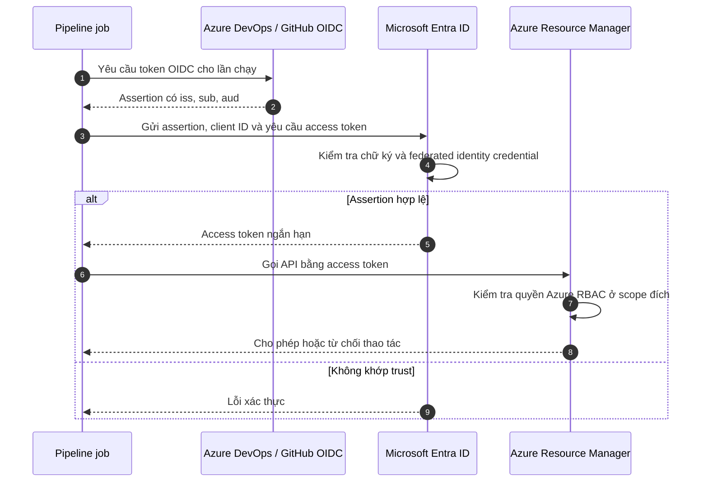

# Service connection và đăng nhập pipeline bằng federation

## 1. Bài toán và kết quả học tập

Trong chương **CI/CD và chuỗi cung ứng phần mềm** của module **CLOUD_PROVIDERS_AZURE**, chúng ta cần cho pipeline triển khai ứng dụng lên Microsoft Azure một cách tự động, có thể kiểm soát và kiểm toán. Quy trình này nối các kiến thức về subscription, resource group, Microsoft Entra ID, mạng, tính toán, lưu trữ, dữ liệu, giám sát và chi phí thành một chuỗi phát hành ứng dụng thực tế.

Ví dụ: mã nguồn API của cửa hàng nằm trong repository `acme/shop-api`. Mỗi lần phát hành, pipeline cần đăng nhập vào subscription của Azure, kiểm tra resource group `rg-shop-prod` rồi triển khai hạ tầng và ứng dụng. Nếu sử dụng tài khoản cá nhân hoặc lưu **client secret** dài hạn trong biến pipeline, đội phát triển phải bảo vệ và xoay vòng một thông tin nhạy cảm có thể bị lộ qua log, bản sao cấu hình hoặc quyền truy cập repository.

**Workload identity federation** cho phép pipeline chứng minh danh tính bằng token OpenID Connect (OIDC) do nền tảng CI/CD cấp, sau đó đổi token đó lấy access token của Microsoft Entra ID. Với cấu hình đúng, pipeline không cần lưu mật khẩu tài khoản Azure, client secret hay private key dài hạn.

Sau bài học, bạn có thể:

- Phân biệt **service connection**, **service principal**, **managed identity**, **federated identity credential**, OIDC token và Azure access token.
- Mô tả cơ chế tin cậy dựa trên bộ ba `issuer`, `subject` và `audience`, cũng như vai trò riêng của Azure RBAC.
- Tạo kết nối Azure Resource Manager bằng federation cho **Azure DevOps Pipelines**, đồng thời cấu hình đăng nhập OIDC cho **GitHub Actions**.
- Giới hạn quyền pipeline, kiểm chứng khả năng truy cập và xử lý những lỗi xác thực, phân quyền thường gặp.

**Kiến thức nền:** subscription/resource group; vai trò Azure RBAC; ứng dụng và service principal trong Microsoft Entra ID; YAML pipeline cơ bản. Các tên `acme`, `shop-api`, `production`, `rg-shop-prod` và `sc-az-rg-prod-wif` bên dưới đều là ví dụ, cần thay bằng giá trị của môi trường thực tế.

## 2. Những thành phần cần hiểu

| Thành phần | Ý nghĩa | Điểm cần nhớ |
| --- | --- | --- |
| **Pipeline / runner** | Công việc tự động chạy trên Azure DevOps hoặc GitHub Actions | Đây là workload đang yêu cầu quyền truy cập Azure. |
| **Azure DevOps service connection** | Cấu hình được quản lý trong một Azure DevOps project để task truy cập tài nguyên ngoài, chẳng hạn Azure Resource Manager | Là đối tượng cấu hình và phân quyền sử dụng trong Azure DevOps; **không đồng nghĩa** với service principal. |
| **App registration và service principal** | App registration định nghĩa ứng dụng trong Entra ID; service principal là danh tính ứng dụng trong tenant, được cấp quyền lên Azure | Federation có thể gắn với app registration và Azure RBAC được gán cho danh tính tương ứng. |
| **User-assigned managed identity** | Danh tính do Azure quản lý, có thể được sử dụng trong những mô hình federation được nền tảng hỗ trợ | Là phương án thay thế app registration trong một số luồng; vẫn phải cấu hình trust và RBAC. |
| **OIDC token / ID token** | Token có chữ ký do nhà cung cấp CI/CD phát hành, mô tả nguồn của lần chạy | Dùng làm bằng chứng danh tính để trao đổi token; không phải token để gọi API Azure Resource Manager. |
| **Federated identity credential** | Quy tắc tin cậy trong Entra ID gắn với một app hoặc managed identity | Chỉ chấp nhận assertion khớp issuer, subject và audience đã cấu hình. |
| **Entra access token** | Token do Microsoft Entra ID phát hành sau khi xác thực assertion | Được Azure CLI, SDK hoặc task dùng khi gọi API Azure. |
| **Azure RBAC** | Quyết định danh tính đã đăng nhập được làm gì tại subscription, resource group hoặc resource | Đăng nhập thành công **không tự động** có quyền triển khai. |

Trong thực tế, cụm từ **đăng nhập không dùng secret** nghĩa là pipeline không phải giữ **credential dài hạn của danh tính Azure**. Pipeline vẫn làm việc với token ngắn hạn trong lúc chạy, vì vậy log, artifact và tiến trình chạy vẫn cần được bảo vệ.

## 3. Luồng federation hoạt động như thế nào?



Ba claim then chốt trong assertion OIDC:

| Claim | Câu hỏi được trả lời | Ví dụ |
| --- | --- | --- |
| `iss` (issuer) | Ai phát hành token? | GitHub: `https://token.actions.githubusercontent.com` |
| `sub` (subject) | Pipeline/job/repository hoặc môi trường nào là nguồn token? | GitHub: `repo:acme/shop-api:environment:production` |
| `aud` (audience) | Token này được phát hành cho bên nhận nào? | Với Azure public cloud thông dụng: `api://AzureADTokenExchange` |

Khi thiết lập federated identity credential, phải sao chép **đúng** issuer, subject và audience theo nền tảng, loại job, môi trường và cloud đang sử dụng. Đặc biệt, đổi tên repository, project, service connection hoặc environment có thể làm subject không còn khớp. Các ví dụ ở đây sử dụng **Azure public cloud**; với sovereign cloud phải đối chiếu endpoint, audience và cấu hình đăng nhập tương ứng.

Có hai cửa kiểm soát tách biệt:

1. **Xác thực (authentication):** Microsoft Entra ID có tin assertion của pipeline và cấp access token cho đúng danh tính hay không?
2. **Phân quyền (authorization):** Azure RBAC có cho danh tính đó thao tác với resource group hoặc tài nguyên mục tiêu hay không?

Thêm federated identity credential giải quyết cửa thứ nhất; **role assignment** mới giải quyết cửa thứ hai. Ngoài ra, nền tảng CI/CD còn có quyền **ai được chạy job và ai được sử dụng kết nối**, cần cấu hình riêng.

## 4. Azure DevOps: Azure Resource Manager service connection bằng federation

Trong Azure DevOps, cách triển khai quen thuộc là tạo một **Azure Resource Manager service connection** dùng workload identity federation. Task như `AzureCLI@2` tham chiếu tên kết nối; Azure DevOps và task hỗ trợ sẽ thực hiện luồng lấy token, giúp script không phải tự quản lý client secret.

### 4.1. Tạo service connection

Trên Azure DevOps project, người có quyền quản lý service connections thực hiện:

1. Mở **Project settings → Service connections → New service connection**.
2. Chọn loại **Azure Resource Manager** và phương thức xác thực **Workload identity federation**. Nếu giao diện hiển thị lựa chọn tự động/thủ công, ưu tiên phương thức **App registration (automatic)** khi tổ chức và quyền Azure cho phép.
3. Chọn subscription và phạm vi phù hợp. Với ví dụ chỉ triển khai một ứng dụng, ưu tiên **resource group** `rg-shop-prod` thay vì cấp quyền trên toàn subscription.
4. Đặt tên có ý nghĩa, ví dụ `sc-az-rg-prod-wif`, lưu cấu hình và kiểm tra kết nối theo các chức năng UI hiện có.
5. Trong **Pipeline permissions**, chỉ cho phép những pipeline thực sự cần kết nối này. Tránh tùy chọn cấp quyền sử dụng cho mọi pipeline trong project.
6. Rà soát role assignment của danh tính trên Azure. Quyền đọc thử nghiệm có thể chỉ cần **Reader**; công việc triển khai cần quyền ghi phù hợp, thường là một role hẹp hoặc custom role ở đúng resource group. **Contributor** ở resource group là một ví dụ dễ hình dung nhưng rộng hơn mức tối thiểu của nhiều tác vụ.

Tùy lựa chọn và quyền của người tạo, quy trình tự động có thể tạo app/service principal, federated identity credential và role assignment cần thiết. Không nên suy ra rằng tất cả quyền đã đúng chỉ vì service connection lưu thành công; hãy kiểm chứng bằng thao tác thực tế.

**Phương thức thủ công:** Nếu tổ chức không cho phép tự tạo app hoặc dùng mô hình danh tính riêng, quản trị viên có thể tạo app registration hoặc user-assigned managed identity được hỗ trợ, thiết lập quyền RBAC rồi thêm federated credential theo đúng issuer/subject/audience mà wizard của service connection cung cấp. Với Azure DevOps, subject thường có dạng:

```text
sc://<organization>/<project>/<service-connection-name>
```

Issuer thường có dạng `https://vstoken.dev.azure.com/<organization-id>` và audience thường là `api://AzureADTokenExchange`. **Luôn lấy các giá trị thực được Azure DevOps hiển thị**, vì tên, định danh tổ chức và cách nền tảng phát hành token quyết định giá trị cần đăng ký trong Entra ID. Nếu đổi tên service connection hoặc project, phải kiểm tra và cập nhật trust tương ứng.

### 4.2. Dùng service connection trong Azure Pipeline

Giả sử kết nối `sc-az-rg-prod-wif` đã được cấp quyền cho pipeline và danh tính có quyền đọc resource group `rg-shop-prod`.

```yaml
# azure-pipelines.yml
trigger:
  branches:
    include:
      - main

pool:
  vmImage: ubuntu-latest

steps:
  - task: AzureCLI@2
    displayName: 'Kiểm tra đăng nhập Azure qua federation'
    inputs:
      azureSubscription: 'sc-az-rg-prod-wif'
      scriptType: bash
      scriptLocation: inlineScript
      inlineScript: |
        az account show \
          --query '{subscription:id,tenant:tenantId}' -o json
        az group show \
          --name 'rg-shop-prod' \
          --query '{name:name,id:id}' -o json
```

**Diễn giải:**

- `azureSubscription` là **tên service connection** mà task phải được phép sử dụng; không phải ID subscription.
- Task `AzureCLI@2` dùng service connection để đăng nhập Azure trước khi chạy `inlineScript`. Pipeline YAML này không khai báo client secret.
- `az account show` kiểm tra đúng tenant/subscription đã chọn; `az group show` xác minh danh tính có khả năng đọc resource group. Kiểm tra đọc **chưa chứng minh** đủ quyền tạo hoặc cập nhật tài nguyên.
- Tên service connection phải chính xác; việc dùng kết nối trong YAML còn chịu kiểm tra quyền **pipeline → service connection** của Azure DevOps.

Khi chuyển từ kiểm tra sang deploy, task có thể chạy lệnh `az deployment group what-if` hoặc `az deployment group create` đối với template Bicep/ARM nằm trong repository. Hãy chỉ bật bước triển khai sau khi đã xác nhận role và các biện pháp bảo vệ nhánh, môi trường, phê duyệt phù hợp.

### 4.3. Bảo vệ việc sử dụng kết nối

Azure RBAC giới hạn đích truy cập, nhưng pipeline bị sửa bởi người không đáng tin vẫn có thể gọi Azure bằng quyền của service connection nếu nó được cấp phép. Vì vậy cần kết hợp **branch policies/review**, **Pipeline permissions**, quyền chỉnh sửa YAML và **approvals/checks** cho môi trường production. Với nhiều môi trường, nên có kết nối và danh tính riêng cho dev, staging và prod để sự cố ở pipeline dev không kéo theo quyền của prod.

## 5. GitHub Actions: đăng nhập Azure qua GitHub OIDC

GitHub Actions không yêu cầu đối tượng *service connection* kiểu Azure DevOps. Workflow có thể nhận OIDC token do GitHub phát hành và dùng action `azure/login` để đổi token lấy quyền truy cập Azure.

### 5.1. Thiết lập trust và Azure RBAC

Ví dụ repository `acme/shop-api` phát hành từ job dùng GitHub Environment `production`.

1. Trong **Microsoft Entra ID → App registrations**, tạo/chọn app registration cho deployment (hoặc chọn mô hình user-assigned managed identity có hỗ trợ federation). Ghi lại **Application (client) ID**, **Directory (tenant) ID** và **Subscription ID**.
2. Trong cấu hình **Federated credentials**, thêm credential dành cho **GitHub Actions**. Chọn organization `acme`, repository `shop-api` và entity type **Environment** với tên `production`. Kiểm tra issuer, subject và audience trước khi lưu.
3. Tại resource group `rg-shop-prod`, gán cho service principal/danh tính deployment role đủ cho tác vụ thực tế. Gán role ở scope nhỏ nhất có thể.
4. Trong GitHub repository, tạo **Environment** `production` với quy tắc nhánh được phép deploy và required reviewers nếu cần. Lưu các giá trị `AZURE_CLIENT_ID`, `AZURE_TENANT_ID`, `AZURE_SUBSCRIPTION_ID` và `AZURE_RESOURCE_GROUP` dưới dạng **Environment variables** (hoặc cơ chế biến được tổ chức quy định).
5. Cấp cho job quyền `id-token: write` để GitHub có thể phát hành OIDC token và dùng `azure/login@v2` để đăng nhập. Quyền này không tự cấp Azure RBAC.

Với ví dụ trên, federated identity credential dự kiến khớp bộ giá trị:

```text
issuer   = https://token.actions.githubusercontent.com
subject  = repo:acme/shop-api:environment:production
audience = api://AzureADTokenExchange
```

**Phân biệt subject theo ngữ cảnh:** Với job có `environment: production`, subject mang dạng `repo:OWNER/REPO:environment:ENVIRONMENT`. Nếu cấu hình trust cho nhánh, subject lại có thể mang dạng `repo:OWNER/REPO:ref:refs/heads/main`. Hai subject đó **không tương đương**. Hãy cấu hình credential phù hợp với cấu trúc job thực tế và kết hợp bảo vệ môi trường, không tạo trust rộng ngoài nhu cầu.

### 5.2. Workflow mẫu hoàn chỉnh

```yaml
# .github/workflows/verify-azure-oidc.yml
name: Verify Azure federation

on:
  workflow_dispatch:

jobs:
  verify:
    if: github.ref == 'refs/heads/main'
    runs-on: ubuntu-latest
    environment: production

    permissions:
      contents: read
      id-token: write

    steps:
      - name: Checkout
        uses: actions/checkout@v4

      - name: Sign in to Azure using OIDC
        uses: azure/login@v2
        with:
          client-id: ${{ vars.AZURE_CLIENT_ID }}
          tenant-id: ${{ vars.AZURE_TENANT_ID }}
          subscription-id: ${{ vars.AZURE_SUBSCRIPTION_ID }}

      - name: Verify Azure context and resource group access
        env:
          RESOURCE_GROUP: ${{ vars.AZURE_RESOURCE_GROUP }}
        run: |
          az account show \
            --query '{subscription:id,tenant:tenantId}' -o json
          az group show \
            --name "$RESOURCE_GROUP" \
            --query '{name:name,id:id}' -o json
```

Workflow được kích hoạt thủ công trên nhánh `main`; job gắn với Environment `production` nên GitHub áp dụng các giới hạn/approval của Environment trước khi thực hiện các bước cần bảo vệ. `id-token: write` cho phép job yêu cầu token OIDC, còn `azure/login@v2` thực hiện đăng nhập Azure bằng ba ID đã cấu hình. Các ID trên là định danh cấu hình, **không phải client secret**. Trong một tổ chức có chính sách riêng, có thể lưu chúng bằng cơ chế biến hoặc secret được phê duyệt; dù chọn cách nào, **không đặt credential dài hạn vào repository**.

Có thể tiếp tục bằng `az deployment group what-if`/`create` sau khi checkout repository chứa Bicep hoặc ARM template và cấu hình quyền cần thiết. Trước khi đưa workflow vào production, cần xem xét **pin actions bằng commit SHA đã kiểm định** theo chính sách chuỗi cung ứng phần mềm của tổ chức; tag phiên bản như `@v2` giúp ví dụ dễ đọc nhưng không bất biến như SHA.

### 5.3. Vì sao bảo vệ Environment lại quan trọng?

Nếu một workflow có thể chạy trên mã nguồn tùy ý nhưng federated credential cho phép đăng nhập với quyền production, kẻ có khả năng thay đổi workflow có thể gọi API Azure trong phạm vi RBAC của danh tính đó. Do đó, cần kết hợp review thay đổi workflow, kiểm soát nhánh/tag phát hành, bảo vệ Environment, giới hạn người phê duyệt và giới hạn scope role. Hãy xem riêng các workflow chạy mã từ pull request bên ngoài, nhất là những luồng có thể cấp quyền cao cho mã chưa được review.

## 6. So sánh hai cách triển khai

| Khía cạnh | Azure DevOps Pipelines | GitHub Actions |
| --- | --- | --- |
| Cấu hình kết nối | Azure Resource Manager **service connection** dùng workload identity federation | Federated credential trong Entra ID + `azure/login` trong workflow |
| Nơi khai báo identity cho job | Thường thông qua tên service connection ở input của task, ví dụ `azureSubscription` | `client-id`, `tenant-id`, `subscription-id` trong `azure/login` |
| Bằng chứng danh tính | OIDC assertion do Azure DevOps cấp cho service connection | OIDC token do GitHub cấp cho job |
| Subject minh họa | `sc://org/project/service-connection` | `repo:owner/repo:environment:name` hoặc `repo:owner/repo:ref:refs/heads/branch` |
| Kiểm soát người dùng kết nối | Pipeline permissions, service connection security, checks | Workflow/job permissions, branch protection, Environment rules |
| Quyền thao tác Azure | Azure RBAC của service principal hoặc managed identity | Azure RBAC của service principal hoặc managed identity |
| Credential Azure dài hạn trong pipeline | Không cần khi luồng WIF đã cấu hình đúng | Không cần khi dùng OIDC đúng cách |

Cả hai trường hợp đều có mô hình cốt lõi: **nhà cung cấp CI/CD phát hành bằng chứng ngắn hạn → Microsoft Entra ID kiểm tra quan hệ tin cậy → Azure RBAC giới hạn tài nguyên**. Chúng khác chủ yếu ở đối tượng cấu hình của nền tảng và cách job yêu cầu token.

## 7. Thiết kế quyền truy cập an toàn

### 7.1. Tách identity theo môi trường và quyền hạn

Giả sử một dự án có `rg-shop-dev`, `rg-shop-staging` và `rg-shop-prod`. Nên dùng các service connection/federated credential và identity được kiểm soát theo môi trường. Ví dụ, identity chạy kiểm tra `what-if` có thể cần quyền khác với identity có thể triển khai. Với production, cân nhắc giới hạn ở đúng resource group, dịch vụ hoặc custom role, thay vì gán `Owner` hoặc `Contributor` toàn subscription.

Để tránh nhầm lẫn, hãy lập bảng quyền trước khi triển khai:

| Job | Nguồn tin cậy | Scope Azure | Quyền tối thiểu mong muốn |
| --- | --- | --- | --- |
| Kiểm tra hạ tầng | Nhánh main hoặc job kiểm tra được kiểm soát | Resource group thử nghiệm | Đọc cấu hình và quyền cho thao tác kiểm tra cần thiết |
| Triển khai staging | Pipeline/environment staging | `rg-shop-staging` | Tạo/cập nhật đúng tài nguyên staging |
| Triển khai production | Pipeline/environment production có bảo vệ | `rg-shop-prod` | Tạo/cập nhật đúng tài nguyên production; phân quyền đặc biệt tách riêng nếu cần |

Một role như **Contributor** không tự cho phép gán role RBAC mới; các tác vụ cần `Microsoft.Authorization/roleAssignments/write` phải có quyền phù hợp và quy trình kiểm soát riêng. Không nên tăng quyền pipeline lên Owner chỉ để xử lý một lỗi phân quyền chưa được phân tích.

### 7.2. Kiểm soát chuỗi cung ứng phần mềm

- Chỉ cho phép pipeline/workflow được phê duyệt sử dụng danh tính deployment; bắt buộc review khi sửa YAML và các tệp build/deploy quan trọng.
- Giới hạn subject federation, repository, nhánh và environment; sử dụng approvals cho production và kiểm tra lại trust sau các lần đổi tên.
- Giới hạn `id-token: write` trong GitHub ở **job thực sự cần Azure**, thay vì bật cho toàn bộ workflow khi không cần.
- Hạn chế truy cập log/artifact, không in token OIDC, access token, biến nhạy cảm hoặc nguyên nội dung credential ra stdout.
- Ghi nhận việc thay đổi federated credential, role assignment, service connection và quyền người chạy pipeline; sử dụng audit/sign-in logs của Entra ID và log CI/CD để điều tra.
- Định kỳ thu hồi kết nối, federated credential và role assignment không còn dùng. Không coi federation là lý do để bỏ qua vòng đời quyền truy cập.

## 8. Kiểm chứng sau cấu hình

Một bài kiểm tra tốt phải xác minh **đúng danh tính, đúng subscription, đúng scope và đúng giới hạn**:

1. **Đúng cấu hình:** xác minh client ID, tenant ID, subscription, tên service connection hoặc GitHub Environment; so sánh `issuer`/`subject`/`audience` thực với federated credential.
2. **Đăng nhập thành công:** chạy pipeline với nhánh/job được phép; xem kết quả `az account show`, bảo đảm tenant và subscription đúng.
3. **Truy cập tài nguyên mục tiêu:** chạy `az group show --name rg-shop-prod` để kiểm tra quyền đọc. Với pipeline deployment, chạy thử `what-if` hoặc triển khai thử có kiểm soát để kiểm chứng quyền ghi thực tế.
4. **Kiểm tra trường hợp bị chặn:** bảo đảm một pipeline không được authorize hoặc một nhánh/job không đáp ứng quy tắc bảo vệ không thể dùng quyền production. Không cần thử bằng cách cấp thêm quyền diện rộng.
5. **Quan sát:** xem log Azure DevOps/GitHub Actions, log đăng nhập workload identity trong Entra ID (nếu sẵn có), Azure Activity Log và log triển khai. Chỉ ghi các định danh hoặc mã lỗi phục vụ chẩn đoán, không tiết lộ token.

Một ví dụ cụ thể về kiểm chứng giới hạn: nếu identity chỉ được gán Reader ở `rg-shop-prod`, `az group show` có thể thành công nhưng thao tác cập nhật Azure Resource Manager sẽ bị từ chối do thiếu quyền. Đây là bằng chứng RBAC đang áp dụng, không phải bằng chứng federation bị hỏng.

## 9. Chẩn đoán sự cố thường gặp

| Hiện tượng | Nguyên nhân cần kiểm tra | Cách xử lý |
| --- | --- | --- |
| Entra ID báo không tìm thấy federated identity credential phù hợp (ví dụ `AADSTS70021` hoặc biến thể tương tự) | `issuer`, `subject`, `audience` không khớp, environment/nhánh khác, credential bị xóa hoặc đổi tên kết nối | So sánh các claim của job với credential thực; sửa trust theo danh tính và nguồn đáng tin cậy đã chọn. |
| GitHub `azure/login` không thể nhận OIDC token | Job thiếu `permissions: id-token: write`, workflow/job không hỗ trợ hoặc cấu hình quyền bị ghi đè | Cấp permission ở đúng job, kiểm tra điều kiện chạy và cơ chế OIDC của workflow. |
| Azure DevOps báo service connection không được phép sử dụng | Pipeline chưa được cấp quyền hoặc người sửa pipeline không có quyền dùng kết nối | Kiểm tra **Pipeline permissions**, service connection security và checks; chỉ authorize đúng pipeline. |
| Đăng nhập thành công nhưng nhận HTTP **403** khi gọi Azure API | Danh tính không có role đủ quyền hoặc role được gán sai scope; thay đổi quyền chưa có hiệu lực | Xác nhận principal ID, role assignment, resource scope và thao tác đang gọi; chờ quyền được cập nhật nếu vừa thay đổi. |
| `az account show` hiển thị sai tenant/subscription | ID hoặc service connection trỏ nhầm môi trường; Azure CLI context bị thay đổi | Sửa thông số, chọn subscription đúng và xác minh lại trước khi deploy. |
| Lỗi ứng dụng/tenant không tìm thấy (chẳng hạn `AADSTS700016`) | Client ID sai, app bị xóa hoặc tenant ID không tương ứng | Kiểm tra app registration, enterprise application và ID tenant thực tế. |
| Từng chạy được, sau đổi tên repository/project/Environment thì thất bại | Subject của token thay đổi so với credential đã đăng ký | Cập nhật federated credential, xác nhận pipeline permissions và chạy lại bài kiểm tra có kiểm soát. |

**Quy trình khoanh vùng nhanh:** Đầu tiên xác định lỗi xuất hiện **trước hay sau** khi nhận Azure access token. Nếu lỗi nằm ở bước đổi token, tập trung vào OIDC và trust. Nếu đã đăng nhập mà lệnh Azure bị `403`, kiểm tra Azure RBAC. Nếu job chưa được phép dùng service connection hoặc chưa qua Environment approval, xử lý quyền trên nền tảng CI/CD trước khi kiểm tra Entra ID.

## 10. Bài thực hành và tiêu chí hoàn thành

**Tình huống:** Nhóm phát triển muốn cho phép pipeline phát hành từ nhánh `main` kiểm tra và triển khai vào resource group `rg-shop-prod`. Yêu cầu bảo mật: không chứa client secret; deployment production phải được bảo vệ; pipeline khác không được dùng cùng quyền nếu không được phê duyệt.

Thực hiện theo một trong hai nền tảng, hoặc làm cả hai để đối chiếu:

1. Chọn một identity cho production, đăng ký federation theo đúng nguồn Azure DevOps service connection **hoặc** GitHub job/Environment; ghi lại issuer, subject và audience.
2. Gán RBAC ở phạm vi `rg-shop-prod` theo tác vụ thực tế, rồi xác minh quyền của chính principal đó.
3. Cấu hình pipeline YAML như ở mục 4 hoặc 5; thêm bảo vệ nhánh, quyền sử dụng kết nối hoặc Environment approval phù hợp.
4. Chạy kiểm thử trên `main`, quan sát ID subscription và kết quả đọc resource group; nếu có template deployment, kiểm tra `what-if`/triển khai có kiểm soát để xác minh quyền ghi.
5. Kiểm tra một trường hợp không được phê duyệt có bị chặn hay không. Ghi lại kết quả mà không lưu token vào báo cáo.

**Tiêu chí đạt:** job được phép đăng nhập bằng federation, đúng tenant/subscription, thao tác Azure được phép đúng scope và trường hợp bị cấm không vượt qua cơ chế bảo vệ. Nếu chỉ thực hiện bước đọc resource group, kết luận là **đã kiểm chứng đăng nhập và quyền đọc**; quyền triển khai vẫn cần bài kiểm tra riêng.

### Câu hỏi tự kiểm tra

**1. Nếu Azure DevOps service connection đã được tạo nhưng AzureCLI@2 báo không được phép dùng kết nối, cần kiểm tra gì trước?**  
Kiểm tra Pipeline permissions và quyền sử dụng service connection của pipeline/job. Đây thường là vấn đề ủy quyền trong Azure DevOps, xảy ra trước bước gọi Azure API.

**2. GitHub federated credential dùng subject `repo:acme/shop-api:ref:refs/heads/main`, nhưng job cấu hình `environment: production`. Vì sao có thể thất bại?**  
Job gắn Environment thường có subject dạng `repo:acme/shop-api:environment:production`. Hai giá trị không khớp nên Entra ID không chấp nhận assertion theo credential dành cho nhánh.

**3. Azure login thành công nhưng tạo resource bị `403`. Có nên sửa audience hoặc thay federation bằng client secret?**  
Không. Sau khi xác thực thành công, cần xem role assignment, resource scope và quyền của thao tác; thay loại credential không giải quyết thiếu Azure RBAC.

**4. Federation có thay thế quy tắc bảo vệ nhánh và kiểm soát quyền sửa pipeline không?**  
Không. Federation xác minh nguồn assertion theo trust đã đăng ký; nền tảng CI/CD vẫn phải giới hạn ai có thể tạo/chỉnh sửa job được tin cậy và ai được phát hành lên production.

## 11. Tài liệu nên tra cứu khi áp dụng thực tế

- Microsoft Learn: **Workload identity federation for Azure Resource Manager service connections** trong Azure Pipelines.
- Microsoft Learn: **Configure a federated identity credential on an app** và tài liệu **Workload identity federation** của Microsoft Entra.
- Microsoft Learn: **Azure RBAC overview** và hướng dẫn gán role tại resource group.
- GitHub Docs: **Configuring OpenID Connect in Azure** và **Deployments / Environments**.
- Repository `Azure/login` trên GitHub: các tham số và phiên bản action được hỗ trợ.

Giao diện cấu hình, khả năng dùng app registration/managed identity và các điều kiện theo tenant có thể thay đổi theo dịch vụ. Khi triển khai trong tổ chức, luôn đối chiếu tài liệu chính thức và các giá trị trust thực tế do nền tảng phát hành.
