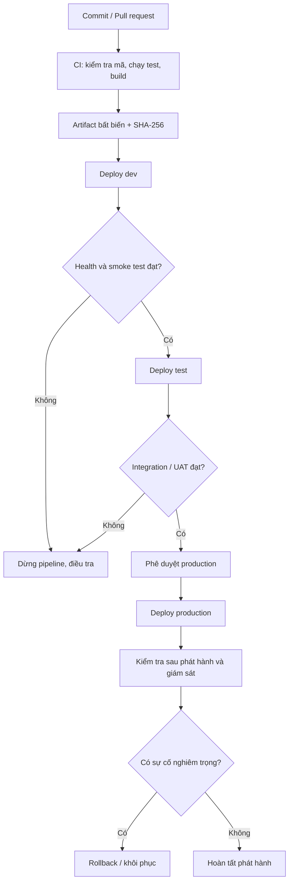

# Triển khai qua môi trường dev, test và production

## 1. Mục tiêu và bối cảnh

Khi phát triển một ứng dụng trên Microsoft Azure, việc mã nguồn chạy thành công trên máy lập trình viên mới là điểm khởi đầu. Một bản phát hành cần được **xây dựng, kiểm thử, triển khai và xác nhận** qua nhiều môi trường trước khi phục vụ người dùng thật. Trong chương **CI/CD và chuỗi cung ứng phần mềm** của mô-đun `CLOUD_PROVIDERS_AZURE`, chúng ta sẽ thiết kế luồng triển khai có kiểm soát cho một ứng dụng web trên Azure, từ môi trường phát triển đến môi trường production.

Sau bài học, bạn có thể:

- Giải thích mục đích của các môi trường **dev**, **test** và **production**, cùng các điều kiện để chuyển bản phát hành giữa chúng.
- Thiết kế ranh giới tài nguyên, danh tính, cấu hình, dữ liệu và quyền truy cập riêng cho từng môi trường trên Azure.
- Xây dựng pipeline CI/CD theo nguyên tắc **build một lần, triển khai cùng một artifact** ở mọi môi trường.
- Dùng GitHub Actions, OpenID Connect (OIDC), Azure App Service và quy tắc phê duyệt để minh họa quy trình promotion.
- Xác định cách giám sát, xử lý lỗi, rollback và quản lý thay đổi cơ sở dữ liệu khi phát hành.

**Tình huống xuyên suốt:** nhóm phát triển vận hành `Shop API`, một API .NET trên Azure App Service. Ứng dụng sử dụng cơ sở dữ liệu, lưu trữ và dịch vụ giám sát của Azure. Nhóm cần kiểm thử phiên bản mới với dữ liệu giả lập trước khi cho phép người dùng thật truy cập. Ví dụ sử dụng GitHub Actions để dễ đọc; cùng mô hình có thể triển khai bằng Azure Pipelines hoặc công cụ CI/CD tương đương.

## 2. Vai trò của từng môi trường

| Môi trường | Mục đích | Dữ liệu và quyền truy cập | Cổng chuyển tiếp | Cách triển khai thường gặp |
|---|---|---|---|---|
| **dev** (development) | Kiểm tra tích hợp sớm, phát hiện lỗi cấu hình hoặc lỗi khi chạy trên Azure | Dữ liệu giả lập; nhóm phát triển có quyền vận hành phù hợp | Deploy thành công, smoke test và health check đạt | Tự động sau khi thay đổi được hợp nhất vào nhánh tích hợp |
| **test** (QA/UAT/pre-production) | Kiểm thử tích hợp, hợp đồng API, hiệu năng cơ bản, nghiệp vụ và tính tương thích | Bộ dữ liệu kiểm thử; quyền hạn chế hơn dev; cấu hình gần production | Bộ kiểm thử và tiêu chí chấp nhận đạt | Tự động sau dev hoặc theo lịch phát hành |
| **production** (prod) | Phục vụ lưu lượng thật; ưu tiên tính sẵn sàng, bảo mật và khả năng khôi phục | Dữ liệu thật; quyền tối thiểu; giám sát và kiểm toán đầy đủ | Phê duyệt có thẩm quyền, artifact được xác minh, kế hoạch rollback | Triển khai có phê duyệt, ưu tiên rollout an toàn |

Tên môi trường không quyết định mức an toàn. Chẳng hạn, một môi trường tên `staging` chỉ có ích nếu các cấu hình quan trọng như runtime, cách xác thực, mạng, tài nguyên phụ thuộc và quy trình triển khai tương đồng production. Cần ghi rõ tiêu chí kiểm thử thay vì dựa vào tên gọi.

**Promotion** là việc cho phép một *phiên bản đã được tạo* đi sang môi trường tiếp theo. Đây là quyết định về chất lượng và mức rủi ro của phiên bản; không phải thao tác build mã nguồn lại ở mỗi môi trường.

## 3. Kiến trúc tham chiếu trên Azure



Một mô hình tài nguyên minh họa:

| Thành phần | dev | test | production |
|---|---|---|---|
| Resource group | `rg-shop-dev` | `rg-shop-test` | `rg-shop-prod` |
| Azure App Service | `app-shop-dev` | `app-shop-test` | `app-shop-prod` |
| Database | `shop_dev` | `shop_test` | `shop_prod` |
| Key Vault | Kho bí mật dành cho dev | Kho bí mật dành cho test | Kho bí mật dành cho production |
| Telemetry | Log và metric của dev | Log và metric của test | Log, metric, tracing và cảnh báo vận hành |

Các tên trên chỉ là ví dụ và phải bảo đảm tính duy nhất ở nơi Azure yêu cầu. Có thể sử dụng ba resource group trong một subscription ở bài thực hành; hệ thống quan trọng thường tách subscription production và non-production để phân định quyền, chính sách và chi phí rõ hơn. Resource group giúp quản lý vòng đời tài nguyên nhưng **không tự động tạo ranh giới bảo mật mạng**. Cần cấu hình Azure RBAC, Managed Identity, VNet, private endpoint, tường lửa và Azure Policy theo yêu cầu thực tế.

Trong một sản phẩm đầy đủ, từng môi trường cũng cần tài nguyên dữ liệu, storage, secret, danh tính ứng dụng và cấu hình kết nối riêng. Không cho dev hoặc test vô tình kết nối cơ sở dữ liệu production. Nếu cần dữ liệu gần thực tế, hãy khử định danh hoặc tổng hợp dữ liệu theo chính sách bảo vệ thông tin.

## 4. Nguyên tắc triển khai an toàn

### 4.1. Build một lần, promotion cùng artifact

Ví dụ, commit `abc123` được CI biên dịch thành `app.zip`. Pipeline tạo checksum, lưu `app.zip` làm artifact và dùng **chính tệp ZIP đó** khi triển khai dev, test, production. Mỗi lần promotion kiểm tra checksum trước khi triển khai.

```text
Commit abc123
   -> CI: app.zip (SHA-256: H)
   -> dev: app.zip (H)
   -> test: app.zip (H)
   -> production: app.zip (H)
```

Cách này tránh sai khác do biên dịch lại với phiên bản thư viện, runtime hoặc biến môi trường khác nhau. Đối với ứng dụng container, có thể dùng cùng một image trong Azure Container Registry và triển khai theo **image digest** thay vì tag có thể bị thay đổi. Checksum giúp phát hiện artifact bị thay đổi ngoài ý muốn; với hệ thống yêu cầu bảo đảm chuỗi cung ứng cao hơn, bổ sung chữ ký artifact, provenance, SBOM và chính sách xác minh xuất xứ.

### 4.2. Cấu hình thay đổi theo môi trường, mã ứng dụng giữ nguyên

Giá trị như URL dịch vụ, mức logging, tên database hoặc feature flag nên đến từ App Service application settings hay Azure App Configuration. Mật khẩu, token và connection string nhạy cảm nên được quản lý bằng **Azure Key Vault**, cấp quyền cho **Managed Identity** của từng ứng dụng, tránh hard-code hoặc đưa vào artifact.

Ví dụ các App Service application settings:

```text
APP_ENV=dev | test | production
CATALOG_API_URL=https://<endpoint-phu-hop-voi-moi-truong>
FEATURE_NEW_CHECKOUT=false
```

Mỗi App Service có giá trị riêng. Không nhúng địa chỉ môi trường hoặc secret vào source rồi build ba lần. Các cờ tính năng có thể giúp tách **triển khai mã** khỏi **bật chức năng**: đưa phiên bản mới lên production trước, sau đó mở chức năng theo nhóm người dùng được kiểm soát.

### 4.3. Quyền truy cập và xác thực phải theo môi trường

- Mỗi môi trường sử dụng danh tính triển khai phù hợp, với Azure RBAC giới hạn ở App Service hoặc resource group cần thao tác. Tài khoản CI chỉ cần quyền triển khai, không mặc nhiên cần `Owner` trên subscription.
- OIDC cho phép GitHub Actions xin token ngắn hạn thông qua **Microsoft Entra ID**; hạn chế dùng client secret dài hạn. Liên kết tin cậy (*federated credential*) phải khớp repository, environment và audience.
- Production có người phê duyệt, quy tắc nhánh được phép triển khai và audit trail. Tách vai trò người viết mã, người chấp thuận và người vận hành khi quy mô hoặc quy định yêu cầu.
- Mạng, secret và dữ liệu production phải có chính sách chặt hơn dev; không dùng chung tài khoản đặc quyền giữa môi trường.

## 5. Thực hành: GitHub Actions triển khai Azure App Service

### 5.1. Điều kiện chuẩn bị

Giả sử repository chứa solution `Shop.sln`, dự án `src/Shop.Api/Shop.Api.csproj`, API có endpoint `GET /health` trả mã HTTP thành công khi dịch vụ sẵn sàng. Dự án trong ví dụ dùng **.NET 10**; hãy đổi phiên bản SDK và đường dẫn cho đúng ứng dụng của mình.

Trước khi chạy workflow, hoàn thành các bước thiết lập một lần:

1. Tạo ba Azure App Service chạy đúng runtime và cấu hình mạng, database, application settings riêng; ghi nhận hostname HTTPS và tên từng Web App.
2. Tạo danh tính ứng dụng để triển khai bằng Microsoft Entra ID, gán quyền Azure RBAC ở phạm vi tối thiểu cho từng Web App. Nên dùng danh tính hoặc federated credential riêng theo môi trường để tránh lộ quyền chéo.
3. Trong Entra ID, cấu hình **federated credential** của GitHub OIDC với issuer `https://token.actions.githubusercontent.com`, audience `api://AzureADTokenExchange` và subject tương ứng, chẳng hạn `repo:ORG/REPO:environment:production`. Tạo subject cho `dev` và `test` tương ứng. Thay `ORG/REPO` bằng chủ sở hữu và tên repository thật.
4. Trong GitHub repository, tạo ba **Environments** tên chính xác `dev`, `test`, `production`. Ở từng environment, đặt secrets `AZURE_CLIENT_ID`, `AZURE_TENANT_ID`, `AZURE_SUBSCRIPTION_ID` trỏ tới danh tính và subscription đã cho phép. Đặt variables `WEBAPP_NAME` và `HEALTH_URL`, ví dụ `HEALTH_URL=https://app-shop-dev.azurewebsites.net/health`.
5. Cấu hình **required reviewers** và giới hạn nhánh triển khai cho environment `production` (theo tính năng khả dụng trên gói GitHub). Khai báo `environment: production` trong YAML **không tự tạo bước phê duyệt** nếu chưa bật protection rule ở repository.
6. Bảo đảm App Service hỗ trợ triển khai ZIP của ứng dụng đã `dotnet publish`; cấp đủ quyền cho danh tính CI, bật TLS và kết nối theo cấu hình của từng môi trường.

### 5.2. Workflow mẫu

Đặt nội dung sau tại `.github/workflows/promote-azure.yml` trong repository ứng dụng. Đây là **ví dụ tham khảo** minh họa luồng; trong dự án thật cần ghim action vào commit SHA đã đánh giá, bổ sung SAST/SCA, kiểm thử phù hợp và giới hạn quyền theo chính sách tổ chức.

```yaml
name: Promote Shop API on Azure

on:
  pull_request:
    branches: [main]
  push:
    branches: [main]

permissions:
  contents: read

jobs:
  build:
    runs-on: ubuntu-latest
    steps:
      - name: Checkout source
        uses: actions/checkout@v4
      - name: Install .NET SDK
        uses: actions/setup-dotnet@v4
        with:
          dotnet-version: '10.0.x'
      - name: Run tests
        run: dotnet test ./Shop.sln --configuration Release
      - name: Publish and checksum
        run: |
          dotnet publish ./src/Shop.Api/Shop.Api.csproj --configuration Release --output ./publish
          cd publish
          zip -r ../app.zip .
          cd ..
          sha256sum app.zip > app.zip.sha256
      - name: Preserve deployable artifact
        uses: actions/upload-artifact@v4
        with:
          name: shop-${{ github.sha }}
          path: |
            app.zip
            app.zip.sha256
          if-no-files-found: error

  deploy-dev:
    if: github.event_name == 'push'
    needs: build
    runs-on: ubuntu-latest
    environment: dev
    permissions:
      contents: read
      id-token: write
    steps:
      - uses: actions/download-artifact@v4
        with:
          name: shop-${{ github.sha }}
          path: ./release
      - name: Verify artifact
        working-directory: ./release
        run: sha256sum -c app.zip.sha256
      - uses: azure/login@v2
        with:
          client-id: ${{ secrets.AZURE_CLIENT_ID }}
          tenant-id: ${{ secrets.AZURE_TENANT_ID }}
          subscription-id: ${{ secrets.AZURE_SUBSCRIPTION_ID }}
      - name: Deploy dev
        uses: azure/webapps-deploy@v3
        with:
          app-name: ${{ vars.WEBAPP_NAME }}
          package: ./release/app.zip
      - name: Smoke test dev
        env:
          HEALTH_URL: ${{ vars.HEALTH_URL }}
        run: curl --fail --silent --show-error --retry 6 --retry-delay 5 --retry-all-errors "$HEALTH_URL"

  deploy-test:
    needs: deploy-dev
    runs-on: ubuntu-latest
    environment: test
    permissions:
      contents: read
      id-token: write
    steps:
      - uses: actions/download-artifact@v4
        with:
          name: shop-${{ github.sha }}
          path: ./release
      - name: Verify artifact
        working-directory: ./release
        run: sha256sum -c app.zip.sha256
      - uses: azure/login@v2
        with:
          client-id: ${{ secrets.AZURE_CLIENT_ID }}
          tenant-id: ${{ secrets.AZURE_TENANT_ID }}
          subscription-id: ${{ secrets.AZURE_SUBSCRIPTION_ID }}
      - name: Deploy test
        uses: azure/webapps-deploy@v3
        with:
          app-name: ${{ vars.WEBAPP_NAME }}
          package: ./release/app.zip
      - name: Smoke test and readiness check
        env:
          HEALTH_URL: ${{ vars.HEALTH_URL }}
        run: curl --fail --silent --show-error --retry 6 --retry-delay 5 --retry-all-errors "$HEALTH_URL"
      # Thêm API integration / contract / end-to-end tests ở đây.

  deploy-production:
    needs: deploy-test
    runs-on: ubuntu-latest
    environment: production
    permissions:
      contents: read
      id-token: write
    steps:
      - uses: actions/download-artifact@v4
        with:
          name: shop-${{ github.sha }}
          path: ./release
      - name: Verify artifact
        working-directory: ./release
        run: sha256sum -c app.zip.sha256
      - uses: azure/login@v2
        with:
          client-id: ${{ secrets.AZURE_CLIENT_ID }}
          tenant-id: ${{ secrets.AZURE_TENANT_ID }}
          subscription-id: ${{ secrets.AZURE_SUBSCRIPTION_ID }}
      - name: Deploy production
        uses: azure/webapps-deploy@v3
        with:
          app-name: ${{ vars.WEBAPP_NAME }}
          package: ./release/app.zip
      - name: Post-deployment health check
        env:
          HEALTH_URL: ${{ vars.HEALTH_URL }}
        run: curl --fail --silent --show-error --retry 6 --retry-delay 5 --retry-all-errors "$HEALTH_URL"
```

### 5.3. Pipeline thực thi như thế nào?

1. Khi có pull request vào `main`, job `build` chạy test và đóng gói để phát hiện lỗi sớm; ba job deploy không chạy vì điều kiện chỉ cho phép sự kiện `push`.
2. Sau khi mã được hợp nhất vào `main`, CI tạo `app.zip` và `app.zip.sha256` đúng một lần. Artifact được gắn với commit SHA trong cùng lượt chạy workflow.
3. Job `deploy-dev` tải artifact, xác minh checksum, lấy token OIDC bằng `azure/login@v2`, triển khai qua `azure/webapps-deploy@v3` và gọi `/health`. Lỗi ở bất kỳ bước nào sẽ chặn job tiếp theo.
4. `deploy-test` nhận **cùng artifact**, xác nhận hệ thống test hoạt động rồi chạy thêm integration, contract hoặc end-to-end tests do nhóm xây dựng. Ví dụ trên chỉ có health check; cần bổ sung bộ kiểm thử nghiệp vụ để đạt tiêu chí thực tế.
5. `deploy-production` chỉ đủ điều kiện bắt đầu sau `deploy-test`. Nếu đã bật required reviewers, GitHub tạm giữ job tại cổng phê duyệt production. Sau khi được chấp thuận, job dùng credential và biến cấu hình của environment production để triển khai artifact đã kiểm tra.

Lưu ý: checksum được tạo và lưu cùng artifact để phát hiện sai khác tệp trong luồng truyền tải; nó **không** thay thế xác minh danh tính người tạo hoặc chữ ký phát hành. Artifact của GitHub có thời hạn lưu trữ; muốn rollback lâu dài nên lưu phiên bản được duyệt trong kho phát hành có quy tắc retention và kiểm soát quyền riêng.

### 5.4. Điều kiện vượt cổng (*quality gates*)

| Cổng | Kiểm tra tối thiểu | Phản ứng khi không đạt |
|---|---|---|
| CI → dev | Compile, unit test, phân tích mã/phụ thuộc, tạo artifact và checksum | Chặn build và thông báo cho người phụ trách |
| dev → test | Deploy thành công, `/health` trả thành công, smoke test API | Dừng pipeline; kiểm tra log và cấu hình dev |
| test → production | Integration, contract, regression, kiểm thử dữ liệu/di trú schema; tiêu chí UAT khi áp dụng | Giữ bản phát hành ở test để khắc phục |
| Phê duyệt production | Người chấp thuận, kết quả QA, phạm vi thay đổi, thời điểm phát hành, hướng rollback | Không cho deploy cho tới khi được duyệt |
| Sau deploy production | Health, tỷ lệ lỗi, độ trễ, hành vi nghiệp vụ và cảnh báo | Kích hoạt quy trình ứng phó hoặc rollback |

Một HTTP 200 từ `/health` chỉ là kiểm tra ban đầu. Nó chưa chứng minh luồng đặt hàng, thanh toán, phân quyền hoặc kết nối các dịch vụ phụ thuộc hoạt động đúng. Nên có health endpoint cho *liveness* và *readiness* với phạm vi kiểm tra phù hợp, đồng thời tránh tiết lộ thông tin nội bộ qua endpoint công khai.

## 6. Hạ tầng và dữ liệu trong luồng promotion

### 6.1. Quản lý hạ tầng bằng mã

Định nghĩa App Service Plan, Web App, Managed Identity, Key Vault, network và các thành phần phụ thuộc bằng **Bicep**, ARM template hoặc Terraform. Dùng cùng module hạ tầng với parameter riêng cho `dev`, `test`, `production`. Một bước CI/CD riêng có thể chạy `what-if` (Bicep/ARM) hoặc `terraform plan`, kiểm tra thay đổi ngoài dự kiến và xin phê duyệt trước khi áp dụng vào production.

Các khác biệt có chủ đích như SKU, số instance, backup, private endpoint, mức retention log và budget được mô tả bằng parameter. Tránh tạo trực tiếp tài nguyên trên portal rồi bỏ quên việc đồng bộ về IaC, vì môi trường sẽ dần khác nhau và khó tái tạo khi có sự cố.

### 6.2. Thay đổi cơ sở dữ liệu không nhất thiết rollback được bằng cách đổi ứng dụng

Ví dụ phiên bản API mới cần thay cột `customer_name` bằng hai cột `first_name` và `last_name`. Nếu xóa cột cũ ngay rồi rollback ứng dụng, phiên bản cũ có thể không hoạt động. Dùng chiến lược **expand → migrate → contract**:

1. **Expand:** thêm cột hoặc cấu trúc mới theo cách tương thích với phiên bản cũ; không xóa dữ liệu đang được sử dụng.
2. **Migrate:** triển khai mã có thể đọc/ghi an toàn trong giai đoạn chuyển tiếp, backfill dữ liệu và kiểm tra kết quả trên test trước khi chạy production.
3. **Contract:** sau khi toàn bộ ứng dụng và tác vụ nền đã chuyển sang cấu trúc mới, xóa schema cũ ở một đợt phát hành sau có kiểm soát.

Thiết lập backup/restore và thử khôi phục theo yêu cầu RPO/RTO; việc khôi phục database có thể ảnh hưởng các giao dịch phát sinh sau bản backup, nên không được xem là thao tác rollback đơn giản. Trong production phải có người phụ trách dữ liệu và kế hoạch xử lý migration thất bại.

### 6.3. Bí mật và chuỗi cung ứng phần mềm

CI/CD là một phần của chuỗi cung ứng phần mềm: mã, thư viện, công cụ build, runner, artifact và danh tính triển khai đều có thể trở thành điểm tấn công. Tối thiểu nên kiểm soát:

- Dependency lockfile và kiểm tra lỗ hổng thư viện; giới hạn nguồn package được tin cậy.
- Quyền của workflow token và Azure RBAC ở mức tối thiểu; yêu cầu review khi thay đổi workflow hoặc IaC nhạy cảm.
- Action của bên thứ ba được ghim theo commit SHA và được rà soát định kỳ; tránh tùy tiện chạy script từ nguồn không xác minh.
- Secret được lấy lúc runtime qua Key Vault và Managed Identity, không đưa vào ZIP, log hoặc output của workflow.
- Ghi nhận commit SHA, artifact digest, thời điểm phát hành, environment, kết quả kiểm thử và người chấp thuận để truy vết sự cố.

## 7. Rollout production, quan sát và rollback

Workflow trên deploy trực tiếp vào Web App production để làm rõ trình tự promotion. Với dịch vụ có yêu cầu uptime cao, nên nâng cấp bước cuối thành **triển khai vào deployment slot `staging` của production App Service**, warm-up, kiểm tra endpoint, sau đó thực hiện **slot swap** theo kế hoạch. Deployment slot nằm trong cùng ứng dụng và chia sẻ App Service Plan; nó không thay thế môi trường test độc lập.

Ví dụ lệnh swap, **chỉ chạy sau khi đã tạo slot và kiểm tra cấu hình slot-specific**:

```bash
az webapp deployment slot swap \
  --resource-group rg-shop-prod \
  --name app-shop-prod \
  --slot staging \
  --target-slot production
```

Các thiết lập nhạy cảm theo slot cần được đánh dấu là *deployment slot setting*, chẳng hạn connection string hoặc Key Vault reference trỏ đến dữ liệu không được tráo đổi. Xác minh tác động tới request đang xử lý, background job và kết nối trước khi tự động hóa swap. Với Azure Container Apps hoặc AKS, có thể dùng revision/traffic splitting hoặc chiến lược rolling/canary tương ứng.

Sau mỗi lần phát hành, đối chiếu **Azure Monitor** và **Application Insights**: request rate, tỷ lệ lỗi 5xx, latency p95/p99, failed dependency calls, exception, CPU/memory, mức sử dụng database và chỉ số nghiệp vụ quan trọng. Gắn release ID/commit SHA vào telemetry để phân biệt lỗi mới với lỗi tồn tại từ trước. Cấu hình cảnh báo theo ngưỡng có ý nghĩa và hướng xử lý của nhóm vận hành.

Quy trình rollback nên được kiểm thử từ trước:

1. **Phát hiện:** health check, smoke test hoặc cảnh báo production cho thấy bản phát hành có vấn đề; xác định phạm vi ảnh hưởng và phiên bản đang chạy.
2. **Giảm tác động:** tắt feature flag lỗi hoặc ngừng rollout; nếu dùng slot và còn an toàn, swap về phiên bản ổn định. Nếu deploy trực tiếp, triển khai lại **artifact trước đó đã lưu**.
3. **Bảo toàn dữ liệu:** xác minh migration và tính tương thích giữa schema với phiên bản cũ; không chạy lệnh đảo schema mang tính phá hủy khi chưa đánh giá dữ liệu.
4. **Xác nhận phục hồi:** kiểm tra health, request thật, error rate, độ trễ, giao dịch nghiệp vụ và cập nhật nhật ký sự cố; mở lại lưu lượng theo điều kiện đã thống nhất.

Một thất bại phổ biến là pipeline đã deploy xong nhưng health check báo lỗi: trạng thái job **failed** không tự khôi phục phiên bản cũ. Cần định nghĩa quy trình hoặc cơ chế tự động rollback riêng và thử nghiệm trên test trước khi áp dụng production. Ngoài ra, nếu nhiều commit đang chờ duyệt, cần kiểm soát thứ tự phát hành để một lượt chạy cũ không ghi đè bản production mới hơn.

## 8. Tình huống lỗi và cách chẩn đoán

| Hiện tượng | Nguyên nhân nên kiểm tra | Hướng xử lý |
|---|---|---|
| `azure/login` không lấy được token | Subject OIDC không khớp `environment`, tenant/client ID sai, chưa tạo federated credential | Đối chiếu issuer, audience, subject, GitHub environment và thông tin Entra ID |
| Đăng nhập được nhưng deploy bị từ chối | Azure RBAC chưa cấp quyền ở phạm vi Web App/resource group, hoặc phân quyền chưa có hiệu lực | Xác minh assignment đúng principal, scope và role cần thiết |
| Deploy dev thành công, test thất bại | Environment variables, kết nối database, DNS/network hoặc secret của test khác dev | Kiểm tra cấu hình riêng, telemetry và dependency của test; không dùng tạm secret production |
| Kiểm thử xanh nhưng production lỗi sau vài phút | Đường tải khác test, warm-up chưa đủ, cấu hình slot, hiệu năng hoặc dependency thực | Theo dõi error rate/latency, ngừng rollout, đánh giá rollback và bổ sung phép thử gần production |
| Rollback app nhưng vẫn lỗi | Database đã đổi schema không tương thích hoặc side effect từ hệ thống khác | Áp dụng migration tương thích, phối hợp phục hồi dữ liệu và xử lý side effect |
| Production bị ghi đè bởi phiên bản cũ | Hai workflow chạy đồng thời hoặc bước phê duyệt tồn đọng | Kiểm soát concurrency, thứ tự release và kiểm tra commit đang được phép deploy |

Đừng in access token, connection string hoặc nội dung secret để gỡ lỗi. Sử dụng log đã che dữ liệu nhạy cảm, Azure Activity Log, App Service deployment logs và Application Insights để tìm nguyên nhân cụ thể.

## 9. Bài tập thực hành và tiêu chí hoàn thành

**Bài tập:** mở rộng mô hình `Shop API` cho một đội có ba môi trường và ba nhóm quyền: developer, QA và release approver. Mỗi thay đổi vào `main` cần đi qua dev, test và chỉ vào production khi được phê duyệt.

1. Vẽ sơ đồ các resource group, Web App, Key Vault và database cho từng môi trường. Giải thích tài nguyên nào có thể dùng chung và tài nguyên nào bắt buộc cần tách để bảo vệ dữ liệu.
2. Tạo ba GitHub Environments với `WEBAPP_NAME` và `HEALTH_URL` riêng. Thiết lập OIDC để một danh tính triển khai dev không thể sửa Web App production.
3. Điều chỉnh workflow mẫu sao cho sau deploy test có bài kiểm thử gọi endpoint nghiệp vụ (ví dụ `GET /api/products`) và kiểm tra cấu trúc phản hồi; khi test lỗi, production phải bị chặn.
4. Mô phỏng một bản phát hành lỗi bằng cách cho `/health` trả mã lỗi ở test. Quan sát job dừng, sửa nguyên nhân và phát hành một commit mới.
5. Viết runbook rollback dài một trang: tín hiệu kích hoạt, người quyết định, phiên bản ổn định gần nhất, thao tác khôi phục ứng dụng, kiểm tra tương thích database và cách xác nhận phục hồi.

**Tiêu chí đạt:** có một artifact gắn với commit, cùng checksum được kiểm tra ở ba môi trường; quyền và dữ liệu được phân tách; bất kỳ kiểm thử nào lỗi đều chặn promotion; production có quy tắc phê duyệt thực sự; nhóm xác định được bản phát hành đang chạy và có phương án khôi phục đã kiểm tra.

**Câu hỏi tự đánh giá:**

- Vì sao build lại ở production làm suy yếu khả năng truy vết, ngay cả khi mã nguồn không đổi?
- Điều gì xảy ra nếu workflow ghi `environment: production` nhưng repository không thiết lập required reviewers?
- Tại sao chuyển application settings sang Key Vault không có nghĩa ứng dụng có thể dùng chung Managed Identity giữa dev và production?
- Khi một migration đã xóa cột dữ liệu, tại sao deploy lại ZIP cũ chưa đủ để rollback?

## 10. Tài liệu tham khảo để mở rộng

- Microsoft Learn — [Deployment slots trong Azure App Service](https://learn.microsoft.com/azure/app-service/deploy-staging-slots).
- Microsoft Learn — [GitHub Actions cho Azure App Service](https://learn.microsoft.com/azure/app-service/deploy-github-actions).
- Microsoft Learn — [OpenID Connect với Azure và GitHub Actions](https://learn.microsoft.com/azure/developer/github/connect-from-azure-openid-connect).
- GitHub Docs — [Sử dụng environments cho deployment](https://docs.github.com/actions/deployment/targeting-different-environments/using-environments-for-deployment).
- Microsoft Learn — [Key Vault references cho App Service](https://learn.microsoft.com/azure/app-service/app-service-key-vault-references).

