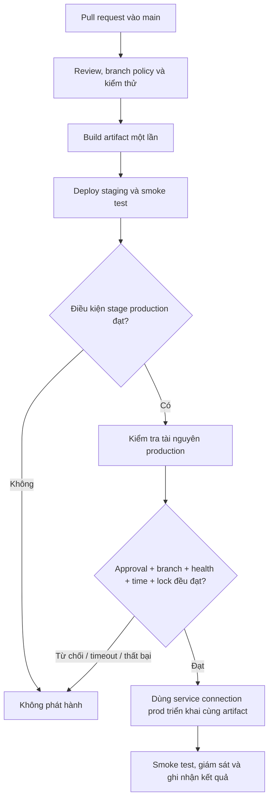

# Approval, environment check và kiểm soát quyền triển khai

> **Chương:** CI/CD và chuỗi cung ứng phần mềm  
> **Mô-đun:** `CLOUD_PROVIDERS_AZURE` — tìm hiểu hệ sinh thái Microsoft Azure từ subscription, resource group, Microsoft Entra ID, mạng, tính toán, lưu trữ và dữ liệu đến triển khai, giám sát, bảo vệ và kiểm soát chi phí ứng dụng.

## Mục tiêu học tập

Sau bài học, bạn có thể:

1. Phân biệt **approval**, **check**, **pipeline permission** và **Azure RBAC** trong một quy trình phát hành lên Azure.
2. Thiết kế cổng phê duyệt production bằng **Azure DevOps Pipelines Environments** và **Approvals and checks**, hiểu phần nào nằm trong YAML và phần nào do quản trị viên cấu hình bên ngoài YAML.
3. Dùng **service connection**, **workload identity federation**, phân quyền tối thiểu và phân tách nhiệm vụ để giới hạn ai và pipeline nào được phép triển khai.
4. Áp dụng kiểm tra nhánh, thời gian triển khai, sức khỏe hệ thống và khóa triển khai đồng thời; đọc kết quả khi stage bị chặn, bị từ chối hoặc hết thời gian chờ.
5. Vận dụng mẫu pipeline có build, staging và production, kiểm chứng rằng chỉ artifact đã kiểm thử mới được đưa lên production.

## 1. Bài toán thực tế: pipeline chạy được chưa có nghĩa được phép phát hành

Giả sử nhóm vận hành ứng dụng `myweb` trên Azure App Service. Mỗi lần hợp nhất pull request vào nhánh `main`, pipeline tự động build, kiểm thử rồi triển khai lên staging. Sau khi kiểm thử staging đạt, bản phát hành production phải được người có trách nhiệm chấp thuận. Nhóm cũng chỉ muốn phát hành trong khung giờ cho phép, không phát hành khi hệ thống đang báo động và không để hai lần triển khai production chồng lên nhau.

Nếu chỉ viết `condition` hoặc một bước `script` trong `azure-pipelines.yml`, người có quyền sửa pipeline có thể vô tình hoặc cố ý thay đổi logic đó. Azure DevOps cung cấp **Approvals and checks** được cấu hình trên tài nguyên mà stage sử dụng. Chủ tài nguyên kiểm soát các cổng này bên ngoài YAML; pipeline chạy đến stage sẽ phải đáp ứng các check trước khi stage được bắt đầu.

Bên cạnh đó, tài khoản dùng để triển khai phải thực sự có quyền trên Azure. Approval ở Azure DevOps không tự cấp vai trò Azure RBAC, và việc có quyền Azure RBAC cũng không mặc nhiên cho phép một pipeline sử dụng service connection đã khóa.

### Bốn lớp kiểm soát cần phân biệt

| Lớp | Câu hỏi được giải quyết | Nơi cấu hình điển hình |
|---|---|---|
| **Branch policy / kiểm soát mã nguồn** | Ai có thể thay đổi mã và định nghĩa pipeline trước khi hợp nhất? | Azure Repos branch policies hoặc hệ thống Git tương ứng |
| **Approval và check** | Khi nào một stage được phép bắt đầu trên tài nguyên được bảo vệ? | Azure DevOps → Environment/service connection → **Approvals and checks** |
| **Quyền Azure DevOps và pipeline permissions** | Ai quản trị environment hoặc service connection? Pipeline nào được dùng tài nguyên đó? | Security và Pipeline permissions của tài nguyên |
| **Quyền Azure** | Danh tính triển khai được tạo/sửa/xóa tài nguyên Azure nào? | Microsoft Entra ID, Azure RBAC tại subscription/resource group/resource |

**Environment trong Azure Pipelines** là đối tượng logic theo dõi và kiểm soát nơi triển khai, chẳng hạn `myweb-prod`. Nó **không đồng nhất** với Azure subscription, resource group hay Azure App Service. Một environment có thể chỉ là đối tượng logic mà chưa gắn resource cụ thể; deployment job vẫn có thể tham chiếu nó để ghi lịch sử triển khai và áp dụng check.

### Luồng phát hành mong muốn



## 2. Approvals and checks hoạt động ở đâu?

Trong một pipeline YAML, **stage** chứa các job. Khi stage sử dụng một tài nguyên được bảo vệ — ví dụ **environment**, **service connection**, **variable group**, **secure file**, **repository** hoặc **agent pool** — Azure Pipelines đánh giá các check cấu hình trên những tài nguyên đó. Stage chỉ được thực thi khi các check bắt buộc đáp ứng điều kiện; nếu không, stage có thể tiếp tục chờ, bị bỏ qua hoặc thất bại tùy loại check và kết quả.

Các check được **người quản lý tài nguyên** đặt thông qua giao diện quản trị; chúng không được khai báo như một `approval:` bên trong `azure-pipelines.yml`. Đây là cơ chế tách việc viết quy trình khỏi quyền cho phép sử dụng tài nguyên nhạy cảm.

### Các nhóm check thường gặp

| Nhóm | Tác dụng | Ví dụ khi phát hành |
|---|---|---|
| **Static checks** | Kiểm tra quy tắc dựa trên thông tin pipeline/artifact trước khi chạy stage | **Branch control** chỉ chấp nhận nhánh `main` đã được bảo vệ; **Required template** yêu cầu pipeline dùng mẫu chuẩn |
| **Pre-check approvals** | Yêu cầu người/nhóm được chỉ định chấp thuận trước khi chạy stage | Nhóm Release Managers xem changelog và phê duyệt production |
| **Dynamic checks** | Kiểm tra một điều kiện có thể thay đổi theo thời gian | **Business Hours**, REST API/Azure Function, **Azure Monitor alerts** |
| **Post-check approvals** | Bổ sung bước duyệt sau các nhóm check trước đó, trước khi tài nguyên được sử dụng | Bộ phận vận hành xác nhận điều kiện sau kiểm tra tự động |
| **Exclusive lock** | Điều phối quyền truy cập độc quyền để tránh các stage cùng dùng tài nguyên nhạy cảm | Chỉ một lần triển khai vào production tại một thời điểm |

Một stage sử dụng nhiều tài nguyên có thể phải vượt qua check của **tất cả** tài nguyên liên quan. Ví dụ stage `Production` có thể dùng cả environment `myweb-prod` và service connection `sc-myweb-prod`; check trên service connection vẫn quan trọng ngay cả khi ai đó thay đổi tham chiếu environment trong YAML.

Các check có thiết lập thời gian chờ, khoảng đánh giá lại hoặc cách xử lý kết quả tùy loại. Khi thiết kế quy trình, cần xem rõ tác động của timeout và thời điểm đánh giá lại; không nên giả định mọi check sẽ liên tục chạy cho đến khi thành công.

### Approval khác gì với ManualValidation?

- **Environment approval** được quản trị trên tài nguyên và có thể chặn stage **trước khi stage bắt đầu**. Đây là lựa chọn điển hình để bảo vệ môi trường production.
- **`ManualValidation@1`** là một task tạm dừng **trong pipeline**, thường dùng trong agentless/server job cho bước kiểm tra thủ công của quy trình. Vì task thuộc YAML, nó không nên là ranh giới quyền duy nhất cho production.
- **`condition:`** trên stage/job là logic điều khiển luồng, hữu ích cho việc lọc nhánh hoặc kết quả kiểm thử, nhưng không thay thế approval và quyền sử dụng tài nguyên.

Một thiết kế tốt kết hợp cả ba đúng mục đích: condition cho logic, task cho thao tác nội bộ và resource checks cho quyền cho phép phát hành.

## 3. Cấu hình environment production và các check

Ví dụ dùng hai môi trường Azure DevOps: `myweb-staging` và `myweb-prod`. Người phụ trách hệ thống chuẩn bị chúng trước để pipeline không tự tạo environment ngoài ý muốn.

**Bước 1 — Tạo environment.** Trong dự án Azure DevOps, mở **Pipelines → Environments → New environment** và tạo `myweb-staging`, `myweb-prod`. Thiết lập Security của từng environment, giới hạn ai được quản trị và ai có quyền sử dụng; kiểm tra mục **Pipeline permissions** để chỉ pipeline được chọn có thể dùng environment production.

**Bước 2 — Thiết lập approval.** Mở `myweb-prod` → **Approvals and checks** → thêm **Approvals**. Chỉ định người hoặc nhóm chịu trách nhiệm phát hành, ghi hướng dẫn phê duyệt (ví dụ: liên kết change request, kết quả staging, kế hoạch rollback), đặt timeout hợp lý. Khi có tùy chọn, tắt khả năng người khởi chạy tự chấp thuận lần chạy của mình; không giao toàn bộ quyền quản trị check cho người viết pipeline.

**Bước 3 — Chặn nhánh không hợp lệ.** Thêm **Branch control** cho nhánh phát hành cho phép, chẳng hạn `refs/heads/main`, và yêu cầu nhánh được bảo vệ nếu chính sách tổ chức đòi hỏi. Đồng thời áp dụng branch policy ở kho mã: bắt buộc pull request/reviewer, kiểm thử CI và hạn chế bypass. Check nhánh và branch policy hỗ trợ nhau, vì chúng xử lý hai thời điểm khác nhau.

**Bước 4 — Kiểm soát điều kiện vận hành.** Nếu phù hợp, thêm **Business Hours** (chỉ phát hành trong cửa sổ bảo trì), **Azure Monitor alerts** (không bắt đầu triển khai khi tín hiệu giám sát không đáp ứng điều kiện) hoặc một check REST API/Azure Function cho change management. Dịch vụ kiểm tra bên ngoài cần được vận hành và bảo vệ độc lập; thất bại khi gọi API phải được xử lý an toàn.

**Bước 5 — Chặn triển khai chồng lấn.** Cấu hình **Exclusive lock** trên tài nguyên sản xuất. Với các stage cần xếp hàng, có thể khai báo `lockBehavior: sequential` trong YAML. Hãy chọn rõ chính sách: xếp tuần tự mọi lần chạy, hay chỉ cho lần chạy mới nhất tiếp tục theo cơ chế khóa thích hợp.

**Bước 6 — Kiểm tra tài nguyên khác.** Mở **Project settings → Service connections** và bảo vệ `sc-myweb-prod` bằng phân quyền và pipeline permissions thích hợp. Nếu ranh giới bảo vệ production nằm ở service connection, hãy cân nhắc áp dụng check trực tiếp trên service connection; như vậy đổi tên hoặc bỏ environment trong YAML không tự tạo ra con đường truy cập Azure production. Không cần nhân đôi approval một cách máy móc trên mọi tài nguyên nếu điều đó khiến một lần phát hành phải duyệt lặp không cần thiết.

> **Điểm cần nhớ:** Màn hình và tên nút có thể thay đổi theo phiên bản Azure DevOps. Nguyên tắc không đổi là **admin của tài nguyên bảo vệ check; người sửa YAML không tự quyết định bỏ check của tài nguyên đó**.

## 4. Kiểm soát quyền triển khai từ Azure DevOps đến Azure

Một release chỉ an toàn khi **đúng pipeline được dùng đúng danh tính với đúng phạm vi quyền**. Có bốn câu hỏi cần trả lời:

1. **Ai được sửa pipeline?** Giới hạn quyền sửa `azure-pipelines.yml` và template thông qua review/branch policy. Với tổ chức có nhiều nhóm, có thể dùng **Required template** để bắt buộc quy trình chuẩn.
2. **Pipeline nào được phép dùng environment hoặc service connection?** Tắt cấp quyền dùng tự do cho mọi pipeline ở tài nguyên production và chỉ cấp cho pipeline đã xét duyệt thông qua **Pipeline permissions**.
3. **Ai được phê duyệt và ai được sửa check?** Tách người xây dựng ứng dụng, người phê duyệt phát hành và người quản trị tài nguyên. Tránh tình trạng một người có thể sửa YAML, xóa check và tự approve.
4. **Danh tính triển khai làm được gì trên Azure?** Gán Azure RBAC theo phạm vi nhỏ nhất đáp ứng tác vụ, ví dụ resource group hoặc App Service production cụ thể; không cấp `Owner` toàn subscription chỉ để triển khai ứng dụng.

### Ma trận phân quyền gợi ý

| Chủ thể | Quyền cần có | Quyền nên hạn chế |
|---|---|---|
| Developer | Tạo PR, chạy build/test, xem logs cần thiết | Tự sửa check production; dùng tùy tiện service connection prod |
| Release approver | Xem bằng chứng phát hành, chấp thuận/từ chối approval | Tự động có quyền thay đổi Azure RBAC hoặc xóa policy |
| Platform/DevOps admin | Quản trị environment, service connection, check, pipeline permissions | Dùng đặc quyền quản trị thường xuyên cho tác vụ deploy hằng ngày |
| Danh tính CI/CD staging | Deploy tới phạm vi tài nguyên staging | Chỉnh sửa production |
| Danh tính CI/CD production | Deploy đúng App Service/resource group production | Quản lý quyền truy cập subscription hoặc sửa tài nguyên ngoài phạm vi |

### Service connection và workload identity federation

Một **Azure Resource Manager service connection** cho Azure Pipelines biết danh tính và phạm vi Azure mà task được phép dùng. Khi khả dụng, ưu tiên **workload identity federation (OIDC)** thay vì lưu lâu dài client secret trong variable group hoặc file YAML. Azure DevOps có thể trao đổi token ngắn hạn cho kết nối được ủy quyền; vẫn cần Azure RBAC trên tài nguyên đích.

Nên tạo kết nối riêng, chẳng hạn:

- `sc-myweb-staging` → danh tính chỉ triển khai môi trường staging.
- `sc-myweb-prod` → danh tính chỉ triển khai môi trường production.

Đối với cả hai, bật kiểm soát pipeline được phép sử dụng, chỉ định người quản trị service connection phù hợp và kiểm tra lại Azure RBAC. **Quyền “Use” trong Azure DevOps không tự tạo quyền Azure**, và Azure RBAC không tự vượt qua các check của Azure DevOps.

Cẩn trọng với **deployment jobs chạy script thuần** có khả năng lấy credentials không được bảo vệ, thông tin truy cập lưu trong biến hoặc secret đưa trực tiếp vào kho mã: các đường này có thể vượt qua thiết kế approval. Tập trung quyền production trong service connection được bảo vệ và kiểm tra mọi con đường lấy credential.

## 5. Ví dụ pipeline: một artifact, hai đích triển khai

Giả sử:

- Repo có thư mục `app/` chứa nội dung ứng dụng đã chuẩn bị để đóng gói thành `app.zip` và tương thích runtime App Service. Trong dự án thật, thêm bước restore/build/test phù hợp framework trước khi lưu artifact.
- Hai Azure App Service Linux đã có: `web-myweb-staging` và `web-myweb-prod`.
- Service connection đã cấu hình: `sc-myweb-staging`, `sc-myweb-prod`.
- Hai environment đã tạo: `myweb-staging`, `myweb-prod`; **approval/check được đặt trên environment/service connection bằng giao diện Azure DevOps**, không nằm trong ví dụ YAML.

Tệp `azure-pipelines.yml` minh họa:

```yaml
trigger:
  branches:
    include:
      - main

pool:
  vmImage: ubuntu-latest

stages:
  - stage: Build
    displayName: Build and publish artifact
    jobs:
      - job: Package
        steps:
          # Thực tế: chạy build và test tự động trước bước đóng gói.
          - task: ArchiveFiles@2
            displayName: Package deployable app
            inputs:
              rootFolderOrFile: '$(Build.SourcesDirectory)/app'
              includeRootFolder: false
              archiveType: zip
              archiveFile: '$(Build.ArtifactStagingDirectory)/app.zip'
              replaceExistingArchive: true

          - publish: '$(Build.ArtifactStagingDirectory)/app.zip'
            artifact: drop

  - stage: Staging
    displayName: Deploy to staging
    dependsOn: Build
    condition: succeeded()
    jobs:
      - deployment: DeployStaging
        displayName: Deploy staging artifact
        environment: 'myweb-staging'
        strategy:
          runOnce:
            deploy:
              steps:
                - download: current
                  artifact: drop

                - task: AzureWebApp@1
                  displayName: Deploy Azure App Service staging
                  inputs:
                    azureSubscription: 'sc-myweb-staging'
                    appType: webAppLinux
                    appName: 'web-myweb-staging'
                    package: '$(Pipeline.Workspace)/drop/app.zip'

                # Thực tế: thêm smoke test staging và cho fail khi không đạt.

  - stage: Production
    displayName: Release to production
    dependsOn: Staging
    condition: and(succeeded(), eq(variables['Build.SourceBranch'], 'refs/heads/main'))
    lockBehavior: sequential
    jobs:
      - deployment: DeployProduction
        displayName: Deploy approved artifact
        environment: 'myweb-prod'
        strategy:
          runOnce:
            deploy:
              steps:
                - download: current
                  artifact: drop

                - task: AzureWebApp@1
                  displayName: Deploy Azure App Service production
                  inputs:
                    azureSubscription: 'sc-myweb-prod'
                    appType: webAppLinux
                    appName: 'web-myweb-prod'
                    package: '$(Pipeline.Workspace)/drop/app.zip'

                # Thực tế: thêm post-deploy smoke test và health monitoring.
```

**Cách đọc ví dụ:**

1. `Build` tạo **một** artifact tên `drop`. `Staging` và `Production` đều lấy chính artifact của lần chạy hiện tại qua `download: current`; không build lại trong production.
2. `deployment` job tham chiếu `environment: 'myweb-prod'`. Khi stage production đủ điều kiện bắt đầu, Azure Pipelines sẽ đánh giá các check trên environment và những tài nguyên được bảo vệ khác mà stage sử dụng.
3. Task `AzureWebApp@1` dùng service connection `sc-myweb-prod` để xác thực với Azure. Chính danh tính của kết nối đó cần Azure RBAC tương ứng trên App Service production.
4. `condition` chỉ cho phép production từ `main` khi staging thành công; **Branch control và approvals** do admin thiết lập vẫn cần để bảo vệ tài nguyên.
5. `lockBehavior: sequential` điều khiển cách xử lý lần chạy cạnh tranh **khi đã cấu hình Exclusive lock check** trên tài nguyên tương ứng. Chỉ khai báo thuộc tính YAML mà không cấu hình check khóa sẽ không tự sinh ra khóa độc quyền.

Ví dụ tập trung vào cổng kiểm soát nên chưa cung cấp quy trình build/test hoàn chỉnh cho một ngôn ngữ lập trình cụ thể, nội dung ứng dụng hay bước rollback. Trong hệ thống thật cần bổ sung kiểm thử tự động trước đóng gói, quản lý phiên bản artifact, health check sau deploy và quy trình khôi phục. Giai đoạn staging cần báo fail khi smoke test thất bại; một dòng comment không thực thi điều kiện kiểm thử.

## 6. Tình huống vận hành và chẩn đoán

### Kịch bản A — Người phát triển hợp nhất thay đổi đúng quy trình

1. Pull request được review và vượt qua branch policy.
2. CI build, test và xuất artifact có thể truy vết theo commit và pipeline run.
3. Staging triển khai artifact, smoke test đạt.
4. Production đến cổng kiểm soát: branch, người duyệt, khung giờ, health, quyền tài nguyên và lock được đánh giá.
5. Approver đối chiếu change request, phiên bản, bằng chứng kiểm thử và kế hoạch rollback rồi phê duyệt.
6. Stage production dùng danh tính service connection đúng phạm vi, triển khai artifact đã được thử nghiệm; nhóm giám sát log, metrics, traces và alerts của Azure Monitor/Application Insights.
7. Lưu liên kết run, commit, người duyệt, thời điểm deploy và kết quả smoke test phục vụ audit.

### Kịch bản B — Có người sửa YAML để bỏ environment production

Nếu họ bỏ `environment: 'myweb-prod'` và chuyển sang job trực tiếp, check đặt **chỉ trên environment** sẽ không bảo vệ đường đi mới. Vì vậy phải đồng thời bảo vệ **service connection production** bằng pipeline permissions, check phù hợp, chính sách thay đổi YAML và quyền Azure RBAC tối thiểu. Khi không có đường lấy credential production bên ngoài tài nguyên được kiểm soát, việc bỏ environment không đủ để triển khai trái phép.

### Kịch bản C — Approval đã được chấp thuận nhưng triển khai vẫn thất bại

Approval chỉ nói rằng lần chạy được phép tiếp tục ở thời điểm kiểm tra. Task vẫn có thể thất bại vì danh tính không có Azure RBAC, App Service không tồn tại, artifact sai định dạng, sai cấu hình hoặc ứng dụng không khỏe. Cần đọc lỗi task, xác minh quyền Azure và health check; **không mở rộng quyền vô điều kiện để chữa lỗi**.

### Bảng xử lý sự cố

| Triệu chứng | Nguyên nhân thường gặp | Cách kiểm tra/xử lý |
|---|---|---|
| Stage chờ `Approval` | Chưa có người duyệt, chưa đủ điều kiện hoặc người duyệt không hợp lệ | Xem **Checks** của stage, người duyệt được chỉ định, timeout và yêu cầu change |
| Stage không chạy, báo check thất bại | Branch control, Business Hours, REST/Azure Function hoặc Azure Monitor chưa đạt | Mở chi tiết check, xác nhận nhánh và trạng thái điều kiện ngoài pipeline |
| Pipeline báo không được phép dùng environment/service connection | Pipeline chưa được authorize hoặc quyền sử dụng tài nguyên không đủ | Kiểm tra **Pipeline permissions** và Security; chỉ cấp đúng pipeline |
| Task Azure trả `AuthorizationFailed` hoặc `Forbidden` | Danh tính service connection thiếu Azure RBAC ở scope cần thao tác | Xác định principal và scope, cấp vai trò tối thiểu cho tác vụ |
| Nhiều lần phát hành tranh nhau | Thiếu hoặc cấu hình sai Exclusive lock; đặt `lockBehavior` chưa phù hợp | Cấu hình lock trên tài nguyên production và kiểm tra chính sách xếp hàng |
| Approval hết hạn hoặc bị từ chối | Không được duyệt trong timeout, hoặc reviewer từ chối | Đọc lịch sử checks, khởi tạo phát hành mới theo quy trình sau khi giải quyết nguyên nhân |

**Lưu ý về audit:** Lịch sử approvals, checks và deployment trong Azure DevOps giúp truy vết quyết định; Azure Activity Log và telemetry ứng dụng giúp truy vết tác động phía Azure. Hai nguồn phục vụ hai câu hỏi khác nhau: *ai cho phép pipeline tiếp tục?* và *danh tính nào đã thao tác gì trên Azure?*

## 7. Thiết kế thực tế cho production

### Trước khi cho phép một release

- **Bảo vệ mã và YAML:** chỉ nhận thay đổi qua quy trình review; yêu cầu chạy CI; cân nhắc Required template khi có nhiều repo.
- **Bảo vệ tài nguyên:** tạo environment production, gắn approvals/check cần thiết; giới hạn ai quản trị chúng và pipeline nào có thể sử dụng.
- **Bảo vệ danh tính:** service connection riêng staging/production, ưu tiên workload identity federation, quyền Azure RBAC theo scope nhỏ nhất; không lưu token/secret trong code hoặc log.
- **Bảo vệ artifact:** kiểm thử rồi phát hành cùng phiên bản; gắn với commit/run, lưu provenance và có thể xác minh checksum/chữ ký nếu quy trình yêu cầu.
- **Bảo vệ vận hành:** health check, lịch phát hành, Exclusive lock, smoke test và rollback có kiểm soát. Thử cả đường lỗi, không chỉ luồng thành công.

### Rollback có cần approval?

Rollback production vẫn là một thay đổi production. Cần định nghĩa trước đường xử lý khẩn cấp theo chính sách tổ chức: ai có quyền kích hoạt, ai chấp thuận hoặc xử lý trường hợp khẩn cấp, sử dụng artifact đã biết là tốt, và cách ghi nhận hậu kiểm. Tránh đưa credential production vào một script rollback tự do khiến mọi check bị bỏ qua. Có thể triển khai lại phiên bản artifact trước đó qua cùng tài nguyên và cơ chế kiểm soát.

### Cần chú ý gì với người có quyền quản trị?

Một số quyền quản trị tài nguyên có thể thay đổi, quản lý hoặc trong những tình huống nhất định bỏ qua check. Vì vậy **phân tách nhiệm vụ** mới là nền tảng: cấp ít tài khoản admin, quản lý thay đổi check, đánh giá quyền định kỳ và theo dõi thay đổi cấu hình. Không coi một nút approval là đủ thay cho thiết kế quyền tổng thể.

## 8. Bài thực hành có hướng dẫn

**Bối cảnh:** Bạn quản lý ứng dụng `orders-api` với hai App Service `orders-staging` và `orders-prod`. Yêu cầu: tự deploy staging sau merge `main`; production cần nhóm Release phê duyệt, chỉ chạy từ nhánh bảo vệ `main` và không có hai đợt production đồng thời.

**Thực hiện:**

1. Tạo environment `orders-staging` và `orders-prod`. Cấp quyền sử dụng production chỉ cho pipeline triển khai đã chọn.
2. Tạo hai service connection Azure Resource Manager có danh tính riêng, quyền Azure RBAC lần lượt giới hạn ở resource group staging và production. Ưu tiên workload identity federation.
3. Trên `orders-prod`, tạo **Approvals** cho nhóm Release, **Branch control** cho `main` và **Exclusive lock**. Chọn thời gian chờ và cách xử lý từ chối.
4. Chuyển mẫu YAML mục 5 sang tên tài nguyên `orders`, giữ một artifact chung và kiểm tra deployment job production tham chiếu đúng environment/service connection. Thêm test thực thi có exit code thất bại khi ứng dụng không khỏe.
5. Chạy thử với tài khoản thử nghiệm và artifact an toàn: một lần không được phê duyệt, một lần phê duyệt; thử pipeline không được ủy quyền hoặc nhánh không hợp lệ, xác nhận production không bắt đầu.

**Tiêu chí đạt:** Có bằng chứng trong Azure DevOps rằng production bị giữ trước khi approval/check đạt; sau duyệt, stage dùng đúng artifact đã qua staging; Azure deployment chỉ có thể dùng danh tính giới hạn quyền; hai release tranh chấp không cùng lúc thay đổi production. Nếu không có quyền tạo/check tài nguyên thật, có thể mô tả thiết kế và các trạng thái kỳ vọng mà không cần triển khai thật.

**Câu hỏi tự kiểm tra:**

1. Vì sao thêm `condition: eq(variables['Build.SourceBranch'], 'refs/heads/main')` chưa đủ làm ranh giới bảo mật?
2. Environment approval có ngăn pipeline khác dùng cùng service connection production không? Cần thêm gì?
3. Nếu người duyệt đồng ý nhưng task báo `AuthorizationFailed`, bạn cần kiểm tra lớp quyền nào?
4. Vì sao `lockBehavior: sequential` phải đi cùng Exclusive lock check?
5. Một thay đổi rollback khẩn cấp nên được kiểm soát và truy vết như thế nào?

## 9. Ghi nhớ

Approval là quyết định **có cho stage dùng tài nguyên được bảo vệ hay không**. Các environment/resource checks bổ sung điều kiện tự động và khóa thời điểm triển khai. Pipeline permissions quyết định **pipeline nào có thể dùng tài nguyên Azure DevOps**; Azure RBAC quyết định **danh tính đó được thay đổi gì trên Azure**. Hãy kết hợp các lớp này với branch policy, artifact đã kiểm thử và giám sát sau phát hành để có quy trình CI/CD production có thể kiểm soát, kiểm chứng và truy vết.
