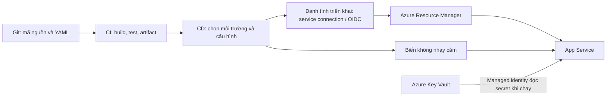

# Quản lý biến, secret và cấu hình của pipeline

Trong hệ sinh thái Microsoft Azure, một pipeline CI/CD thường phải biết **xây dựng phiên bản nào**, **triển khai tới tài nguyên nào**, **dùng cấu hình gì cho từng môi trường** và **lấy thông tin xác thực ở đâu**. Nếu đặt tất cả vào mã nguồn hoặc một tệp YAML duy nhất, việc thay đổi môi trường sẽ khó kiểm soát, đồng thời token, mật khẩu và khóa truy cập dễ bị lộ qua lịch sử Git, log hoặc artifact.

Bài học thuộc chương **CI/CD và chuỗi cung ứng phần mềm**, tập trung vào cách tổ chức biến (variable), bí mật (secret) và cấu hình khi triển khai ứng dụng trên Azure. Hai hệ thống pipeline được dùng làm ví dụ là **Azure Pipelines** trong Azure DevOps và **GitHub Actions**. Nguyên tắc cũng áp dụng cho các công cụ CI/CD khác.

## 1. Mục tiêu học tập

Sau bài này, bạn có thể:

1. Phân biệt biến thông thường, secret, tham số pipeline, cấu hình ứng dụng và danh tính triển khai.
2. Chọn phạm vi lưu trữ phù hợp cho cấu hình chung, cấu hình theo môi trường và dữ liệu nhạy cảm.
3. Dùng biến và secret an toàn trong Azure Pipelines, hiểu thời điểm biểu thức YAML được đánh giá.
4. Tích hợp Azure Key Vault, service connection và xác thực không cần mật khẩu dài hạn.
5. Cấu hình GitHub Actions với environment, repository variables, secrets và OpenID Connect (OIDC) khi triển khai Azure.
6. Thiết kế quy trình kiểm tra, phân quyền và xoay vòng secret mà không làm rò rỉ giá trị.

## 2. Tình huống xuyên suốt: triển khai Orders API

Giả sử nhóm phát triển dịch vụ Java `orders-api`, triển khai lên Azure App Service với ba môi trường:

| Thuộc tính | Development | Staging | Production |
| --- | --- | --- | --- |
| Azure resource group | `rg-orders-dev` | `rg-orders-stg` | `rg-orders-prod` |
| App Service | `app-orders-dev` | `app-orders-stg` | `app-orders-prod` |
| Chế độ ứng dụng | `development` | `staging` | `production` |
| Key Vault | `kv-orders-dev` | `kv-orders-stg` | `kv-orders-prod` |
| Phê duyệt triển khai | Có thể tự động | Theo quy tắc nhóm | Bắt buộc theo chính sách phát hành |

Các tên tài nguyên trên chỉ là ví dụ; khi thực hành phải thay bằng tài nguyên và quyền truy cập thực tế của bạn.

Pipeline nên tạo ra một artifact đã được kiểm thử, sau đó chuyển **cùng phiên bản artifact** qua các môi trường. Endpoint, tên tài nguyên và các thiết lập vận hành có thể khác nhau; mật khẩu cơ sở dữ liệu và token dịch vụ bên thứ ba phải được quản lý riêng cho từng môi trường. Không nên biên dịch lại mã chỉ để thay một mật khẩu hoặc URL của môi trường.



Đường nối từ Key Vault tới ứng dụng là mô hình nên ưu tiên khi nền tảng hỗ trợ: ứng dụng lấy bí mật tại runtime bằng danh tính được cấp quyền. Pipeline chỉ cần triển khai mã và cấu hình tham chiếu, qua đó giảm số tác vụ được tiếp xúc với giá trị secret.

## 3. Phân loại dữ liệu trước khi tạo pipeline

| Loại | Ví dụ | Nơi quản lý phù hợp | Lưu ý |
| --- | --- | --- | --- |
| Hằng số build | `BUILD_CONFIGURATION=Release`, phiên bản Java | YAML, template, tệp cấu hình được review | Không chứa thông tin xác thực |
| Biến môi trường triển khai | `RESOURCE_GROUP`, `WEB_APP_NAME`, region | Variable group, environment/repository variables | Giá trị theo dev/stg/prod |
| Tham số chọn luồng | Chọn `deployEnvironment`, bật/tắt bước kiểm thử | `parameters` trong Azure Pipelines, `workflow_dispatch.inputs` trong GitHub Actions | Giới hạn tập giá trị hợp lệ |
| Secret | API token, mật khẩu, private key | Azure Key Vault hoặc kho secret của CI/CD | Giới hạn phạm vi, tuổi thọ và quyền đọc |
| Danh tính triển khai | Service connection, federated identity | Azure DevOps/GitHub và Microsoft Entra ID | Ưu tiên OIDC/workload identity federation |
| Cấu hình runtime | Feature flag, URL phụ thuộc môi trường | Azure App Configuration, App Service app settings | Có thể cập nhật độc lập với artifact |
| Chứng chỉ và khóa mật mã | TLS certificate, encryption key | Key Vault với chính sách truy cập thích hợp | Không đưa private key vào artifact |

**Biến không đồng nghĩa với secret.** Một biến tên `DB_PASSWORD` vẫn là dữ liệu nhạy cảm dù được khai báo dưới khóa `variables:`. Ngược lại, subscription ID, tenant ID và client ID thường là mã định danh, không phải mật khẩu, nhưng vẫn cần quản trị quyền truy cập vào hệ thống.

**Che giá trị khỏi log không có nghĩa là bảo vệ được secret.** Cơ chế masking của CI/CD có thể thay thế một chuỗi đã biết bằng `***`, nhưng có thể bỏ sót chuỗi đã mã hóa, cắt nhỏ hoặc biến đổi. Bảo mật bắt đầu từ nơi lưu, danh tính được phép đọc và cách script sử dụng giá trị.

### Những gì nên và không nên đặt trong Git

Nên commit cấu trúc pipeline, template, danh sách tên biến, giá trị mặc định không nhạy cảm, ví dụ `.env.example` không chứa thông tin thực. Không commit `.env` chứa mật khẩu, khóa tài khoản dịch vụ, tệp chứng thực tải từ cloud, `secrets.json` hay log chứa token. Nếu secret từng được commit, **xóa khỏi commit mới là chưa đủ**: phải thu hồi hoặc thay secret, đánh giá phạm vi lộ và xử lý lịch sử repository theo quy trình của nhóm.

## 4. Biến trong Azure Pipelines: phạm vi và thời điểm đánh giá

Azure Pipelines cho phép khai báo biến ở cấp pipeline, stage và job; cũng có biến được quản lý trong giao diện hoặc nhóm biến (variable group). Một cấu hình đơn giản:

```yaml
trigger:
  - main

variables:
  - name: buildConfiguration
    value: Release
  - name: appName
    value: orders-api

pool:
  vmImage: ubuntu-latest

steps:
  - bash: |
      echo "Application: $APP_NAME"
      echo "Build mode: $BUILD_CONFIGURATION"
    displayName: Display non-sensitive build settings
    env:
      APP_NAME: $(appName)
      BUILD_CONFIGURATION: $(buildConfiguration)
```

Trong ví dụ, `$(appName)` và `$(buildConfiguration)` được Azure Pipelines thay bằng giá trị biến khi chạy tác vụ. Bên trong Bash, `$APP_NAME` và `$BUILD_CONFIGURATION` là **biến môi trường của tiến trình** đã được ánh xạ qua `env:`. Ánh xạ tường minh giúp xác định script nhận dữ liệu nào.

Ba dạng biểu thức dễ nhầm lẫn:

| Cú pháp Azure Pipelines | Thời điểm/cách dùng | Ví dụ |
| --- | --- | --- |
| `${{ variables.appName }}` | Template expression, được mở rộng khi pipeline biên dịch cấu trúc YAML | Chọn tên tác vụ, template hoặc giá trị tĩnh đã biết |
| `$(appName)` | Macro syntax, được thay trước khi tác vụ chạy | Truyền giá trị biến vào input hoặc `env:` của task |
| `$[ variables.isMain ]` | Runtime expression; thường dùng toàn bộ vế phải của khai báo biến hoặc điều kiện | Tính biến từ trạng thái lúc chạy |

Ví dụ cho runtime expression:

```yaml
variables:
  isMain: $[eq(variables['Build.SourceBranch'], 'refs/heads/main')]
```

Biến tạo hoặc cập nhật trong lúc chạy sẽ không thay đổi ngược lại phần YAML đã được xử lý ở thời điểm mở rộng template. Bởi vậy, **không dùng secret như một tham số template hoặc nhúng secret vào tên stage, job hay cấu trúc YAML**. Đặt secret vào input tác vụ có hỗ trợ secret hoặc ánh xạ vào môi trường của đúng bước cần dùng.

Khi cùng một tên biến tồn tại ở nhiều cấp, phạm vi gần job hơn có thể ghi đè phạm vi chung; biến từ UI, nhóm biến và biến lúc chạy còn có quy tắc xử lý riêng. Tránh đặt trùng tên giữa các nhóm biến, đặc biệt với secret. Dùng tiền tố nhất quán như `ORDERS_` và ghi rõ chủ sở hữu của từng biến.

### Biến output giữa các tác vụ

Một bước có thể phát sinh **giá trị không nhạy cảm** để bước kế tiếp sử dụng:

```yaml
steps:
  - bash: |
      echo "##vso[task.setvariable variable=artifactLabel]orders-api-$(Build.BuildId)"
    displayName: Create artifact label

  - bash: |
      echo "Artifact label: $ARTIFACT_LABEL"
    env:
      ARTIFACT_LABEL: $(artifactLabel)
```

Đây là ví dụ sử dụng biến ở bước sau **trong cùng job**. Khi chia sẻ giá trị giữa các job hoặc stage, cần khai báo output variable (`isOutput=true`) và dùng cú pháp `dependencies` hoặc `stageDependencies` đúng cấp. Không dùng logging command làm kênh vận chuyển secret tùy tiện.

## 5. Quản lý variable group và secret trong Azure DevOps

**Variable group** trong Azure Pipelines Library tập hợp các biến được nhiều pipeline dùng chung. Ví dụ nhóm `vg-orders-dev` gồm:

| Tên | Kiểu | Giá trị minh họa |
| --- | --- | --- |
| `RESOURCE_GROUP` | Thường | `rg-orders-dev` |
| `WEB_APP_NAME` | Thường | `app-orders-dev` |
| `APP_ENV` | Thường | `development` |
| `THIRD_PARTY_TOKEN` | Secret | Lưu trong UI/Key Vault; không ghi giá trị vào YAML |

Để sử dụng nhóm, pipeline cần quyền truy cập group; nên cấp quyền **theo từng pipeline** thay vì bật quyền cho tất cả. Quản lý ai được sửa nhóm biến cũng quan trọng như ai được chạy pipeline: người thay giá trị đích triển khai hoặc secret có thể làm thay đổi hành vi phát hành.

```yaml
trigger:
  - main

variables:
  - group: vg-orders-dev

stages:
  - stage: Configure_Dev
    displayName: Configure development App Service
    jobs:
      - deployment: ApplySettings
        environment: orders-dev
        pool:
          vmImage: ubuntu-latest
        strategy:
          runOnce:
            deploy:
              steps:
                - task: AzureCLI@2
                  displayName: Set non-sensitive application settings
                  inputs:
                    azureSubscription: sc-orders-dev
                    scriptType: bash
                    scriptLocation: inlineScript
                    inlineScript: |
                      set -euo pipefail
                      az webapp config appsettings set \
                        --resource-group "$RESOURCE_GROUP" \
                        --name "$WEB_APP_NAME" \
                        --settings APP_ENV="$APP_ENV" \
                        --output none
                  env:
                    RESOURCE_GROUP: $(RESOURCE_GROUP)
                    WEB_APP_NAME: $(WEB_APP_NAME)
                    APP_ENV: $(APP_ENV)

                - bash: |
                    set -euo pipefail
                    if [ -z "${THIRD_PARTY_TOKEN:-}" ]; then
                      echo "Thiếu secret THIRD_PARTY_TOKEN" >&2
                      exit 1
                    fi
                    echo "Đã kiểm tra secret cho tác vụ cần xác thực."
                  displayName: Validate secret availability
                  env:
                    THIRD_PARTY_TOKEN: $(THIRD_PARTY_TOKEN)
```

Trong ví dụ, `sc-orders-dev` là **tên service connection đã được tạo và cấp quyền trong dự án**. Task `AzureCLI@2` sử dụng kết nối đó để đăng nhập Azure và thay đổi một app setting không nhạy cảm. Bước kiểm tra secret chỉ kiểm tra sự hiện diện, không in ra độ dài, mẫu ký tự hay giá trị. Khi bổ sung tác vụ thực tế, hãy để script đọc token qua biến môi trường trong tiến trình; tránh chuyển token trên dòng lệnh, vì tham số có thể xuất hiện trong log hoặc danh sách tiến trình.

Một secret được đánh dấu trong Azure DevOps **không tự động xuất hiện dưới dạng biến môi trường của mọi script**. Cần ánh xạ rõ trong `env:` của bước có quyền đọc. Không đưa `$(THIRD_PARTY_TOKEN)` trực tiếp vào nội dung Bash trong YAML như một chuỗi lệnh có thể bị nội suy và log trước khi thực thi.

### Dùng Azure Key Vault trong Azure Pipelines

Có hai cách phổ biến:

1. **Liên kết variable group với Azure Key Vault:** quản lý các tên secret trong Library; khi chạy pipeline, hệ thống lấy giá trị từ vault thông qua service connection được ủy quyền. Nếu bổ sung tên secret mới, cần kiểm tra cấu hình chọn secret của variable group.
2. **Dùng tác vụ `AzureKeyVault@2`:** lấy các secret được chỉ định vào ngữ cảnh job tại thời điểm chạy.

Ví dụ cách thứ hai, đặt sau khi tạo vault và service connection phù hợp:

```yaml
steps:
  - task: AzureKeyVault@2
    displayName: Load API token from Key Vault
    inputs:
      azureSubscription: sc-orders-dev
      KeyVaultName: kv-orders-dev
      SecretsFilter: third-party-token
      RunAsPreJob: false

  - bash: |
      set -euo pipefail
      test -n "${THIRD_PARTY_TOKEN:-}" || {
        echo "Không đọc được token từ Key Vault" >&2
        exit 1
      }
      echo "Token đã sẵn sàng cho bước tích hợp."
    env:
      THIRD_PARTY_TOKEN: $(third-party-token)
```

Tác vụ phải có quyền truy cập vault và thao tác đọc secret phù hợp với mô hình Azure RBAC hoặc access policy đang áp dụng; tùy tích hợp có thể cần quyền liệt kê secret. Giới hạn danh sách `SecretsFilter` thay vì lấy tất cả, cấp quyền tối thiểu cho service connection và tách vault theo môi trường. Nếu Key Vault có private endpoint hoặc firewall, agent chạy pipeline cũng cần đường mạng phù hợp. Đừng coi việc kết nối thành công một lần là bằng chứng các agent khác hoặc các môi trường khác đều truy cập được.

**Khi nào pipeline cần giá trị secret?** Chỉ khi chính bước CI/CD bắt buộc dùng secret, chẳng hạn truy cập một hệ thống build bên ngoài không hỗ trợ federated identity. Nếu ứng dụng cần mật khẩu *sau khi triển khai*, hãy để ứng dụng hoặc nền tảng Azure đọc nó ở runtime bằng managed identity.

## 6. Azure Key Vault, App Configuration và cấu hình runtime

Các dịch vụ dưới đây giải quyết những nhu cầu khác nhau:

| Thành phần Azure | Chức năng chính | Ví dụ với Orders API |
| --- | --- | --- |
| **Azure Key Vault** | Quản lý secret, key, certificate và chính sách truy cập | Mật khẩu DB, khóa tích hợp |
| **Azure App Configuration** | Quản lý cấu hình tập trung và feature flags | Ngưỡng timeout, bật chức năng mới |
| **App Service app settings** | Cung cấp cấu hình cho một ứng dụng, thường dưới dạng biến môi trường | `APP_ENV`, tham chiếu Key Vault |
| **Managed identity** | Danh tính của workload Azure dùng để lấy token truy cập tài nguyên | App Service đọc Key Vault mà không lưu client secret |
| **Microsoft Entra ID / Azure RBAC** | Xác thực và ủy quyền danh tính trên tài nguyên | Cho phép đúng workload đọc đúng vault |

Ví dụ một app setting của App Service giữ **tham chiếu**, không chứa mật khẩu:

```bash
az webapp config appsettings set \
  --resource-group rg-orders-prod \
  --name app-orders-prod \
  --settings 'DB_PASSWORD=@Microsoft.KeyVault(VaultName=kv-orders-prod;SecretName=db-password)' \
  --output none
```

Điều kiện là App Service đã bật managed identity, danh tính đó có quyền đọc secret tương ứng trong `kv-orders-prod`, và các quy tắc mạng cho phép truy cập vault. App Service xử lý Key Vault reference để ứng dụng nhận được giá trị cấu hình. Secret có thể được cache, vì vậy xoay vòng trong vault không đảm bảo mọi tiến trình thấy giá trị mới tức thì; cần hiểu cơ chế làm mới của dịch vụ và thử nghiệm đường cập nhật.

Đối với Azure App Configuration, khóa thường không nhạy cảm được quản lý theo nhãn môi trường và có thể dùng feature flags. Các tham chiếu tới Key Vault cho cấu hình nhạy cảm cần được ứng dụng hoặc SDK xử lý với danh tính và quyền tương ứng. Không chuyển mật khẩu sang App Configuration dưới dạng chuỗi thuần chỉ vì nó dễ truy vấn hơn.

Kiến trúc này có một ranh giới trách nhiệm rõ ràng: **pipeline được quyền triển khai**, **ứng dụng được quyền đọc bí mật phục vụ runtime**. Hai danh tính có thể khác nhau và được cấp quyền riêng.

## 7. Xác thực tới Azure: service connection và OIDC

Để cập nhật Azure resource, pipeline cần chứng minh danh tính. Các cách tiếp cận thường gặp:

- **Azure DevOps service connection:** một tài nguyên kết nối mà task như `AzureCLI@2` tham chiếu qua `azureSubscription`. Khi có thể, cấu hình service connection dùng workload identity federation; giới hạn subscription/resource group và pipeline được phép sử dụng.
- **GitHub Actions OIDC:** GitHub cấp OIDC token ngắn hạn cho workflow được cấp quyền; Microsoft Entra ID xác minh mối quan hệ tin cậy (federated credential), sau đó cấp access token cho Azure.
- **Service principal kèm client secret dài hạn:** vẫn có trường hợp sử dụng, nhưng làm phát sinh trách nhiệm lưu, luân chuyển và thu hồi secret. Ưu tiên thay bằng danh tính liên kết khi nền tảng hỗ trợ.

OIDC **không tự cấp quyền Azure**: cần cả cấu hình liên kết danh tính trong Entra ID và role assignment đúng phạm vi trên tài nguyên cần quản lý. Ví dụ một pipeline chỉ cấu hình App Service ở `rg-orders-dev` thì nên giới hạn quyền tới các tài nguyên cần thiết, tránh mặc định cấp `Owner` trên cả subscription.

### Ví dụ GitHub Actions triển khai cấu hình không nhạy cảm

Workflow sau minh họa OIDC với GitHub environment `production`. Tạo environment, đặt các biến `AZURE_CLIENT_ID`, `AZURE_TENANT_ID`, `AZURE_SUBSCRIPTION_ID`, `AZURE_RESOURCE_GROUP`, `AZURE_WEBAPP_NAME`; cấu hình federated credential tin cậy đúng repository và environment; gán Azure role phù hợp cho danh tính.

```yaml
name: Configure Azure App Service

on:
  workflow_dispatch:

permissions:
  contents: read
  id-token: write

jobs:
  configure:
    runs-on: ubuntu-latest
    environment: production
    env:
      RESOURCE_GROUP: ${{ vars.AZURE_RESOURCE_GROUP }}
      WEB_APP_NAME: ${{ vars.AZURE_WEBAPP_NAME }}
    steps:
      - name: Sign in with OIDC
        uses: azure/login@v2
        with:
          client-id: ${{ vars.AZURE_CLIENT_ID }}
          tenant-id: ${{ vars.AZURE_TENANT_ID }}
          subscription-id: ${{ vars.AZURE_SUBSCRIPTION_ID }}

      - name: Apply non-sensitive runtime setting
        shell: bash
        run: |
          set -euo pipefail
          az webapp config appsettings set \
            --resource-group "$RESOURCE_GROUP" \
            --name "$WEB_APP_NAME" \
            --settings APP_ENV=production \
            --output none
```

Ở đây `vars` lưu **cấu hình không nhạy cảm**, còn `secrets` được dùng cho giá trị nhạy cảm. Nếu một bước thực sự cần API key của bên thứ ba, chỉ truyền vào bước đó:

```yaml
- name: Check external integration credential
  shell: bash
  env:
    THIRD_PARTY_TOKEN: ${{ secrets.THIRD_PARTY_TOKEN }}
  run: |
    set -euo pipefail
    test -n "${THIRD_PARTY_TOKEN:-}" || exit 1
    echo "Secret có mặt; không ghi giá trị ra log."
```

Đoạn trên là **một step bổ sung** cho workflow GitHub Actions, không phải một workflow độc lập. Đặt secret tại GitHub environment tương ứng, kiểm soát người có thể sửa environment, cấu hình reviewer và quy tắc branch/tag trước khi production job được phép bắt đầu. Nếu secret chưa được cấu hình, biểu thức có thể cho chuỗi rỗng; kiểm tra đầu vào giúp thất bại sớm.

**Lưu ý supply chain:** ví dụ dùng action phiên bản lớn `azure/login@v2` để dễ đọc. Với hệ thống cần kiểm soát nguồn phụ thuộc chặt chẽ, ghim action bên thứ ba theo commit SHA đã thẩm định và cập nhật qua quy trình review.

## 8. Tách môi trường và kiểm soát việc phát hành

Một thiết kế an toàn thường có cấu trúc:

```text
orders-api/
  .github/workflows/deploy.yml     # hoặc azure-pipelines.yml
  config/
    defaults.example.yml           # chỉ giá trị mẫu không nhạy cảm

Azure / CI-CD:
  dev  -> rg-orders-dev  -> kv-orders-dev
  stg  -> rg-orders-stg  -> kv-orders-stg
  prod -> rg-orders-prod -> kv-orders-prod
```

Tệp cấu hình trong repo giúp review **hình dạng** của cấu hình; giá trị môi trường thực tế nằm trong kho cấu hình hoặc cloud tương ứng. Tối thiểu cần đảm bảo:

1. **Mỗi môi trường có danh tính và quyền riêng:** service connection hoặc federated credential dev không được có quyền ghi vào production.
2. **Phân quyền secret theo nhu cầu:** bước build thông thường không cần đọc token của production. Production vault chỉ cho các danh tính được duyệt đọc secret cụ thể.
3. **Cổng phê duyệt ở đích triển khai:** Azure DevOps environment approvals/checks hoặc GitHub environment protection rules giúp kiểm soát ai được phát hành vào production.
4. **Artifact bất biến:** artifact được build/test một lần, chuyển qua staging rồi production; sử dụng số phiên bản, digest hoặc checksum để truy vết.
5. **Biến đầu vào có tên và kiểu rõ ràng:** phân biệt `RESOURCE_GROUP`, `WEB_APP_NAME`, `APP_ENV` theo môi trường; không tạo biến chung mơ hồ `PASSWORD` hoặc `URL` cho toàn tổ chức.

Nếu cần cho người chạy lựa chọn môi trường, hãy giới hạn danh sách `dev/stg/prod` bằng tham số được kiểm soát, đồng thời liên kết mỗi lựa chọn với environment và quyền tương ứng. **Một điều kiện trong YAML không thay thế được quyền Azure RBAC hay chính sách duyệt**: người sửa workflow có thể thay đổi điều kiện nếu thiếu bảo vệ branch và quyền duyệt.

## 9. Các kiểu rò rỉ và lỗi cấu hình thường gặp

| Tình huống | Hậu quả | Cách phòng tránh |
| --- | --- | --- |
| Viết `echo $TOKEN`, bật `set -x` hoặc chạy CLI ở chế độ debug | Secret xuất hiện trong log | Tắt tracing/debug tại bước xử lý secret; chỉ log trạng thái |
| Ghi token trực tiếp vào YAML hoặc file `.env` rồi commit | Lộ qua lịch sử Git và bản sao repo | Dùng Key Vault/secret store; kiểm tra secret trước khi merge |
| Nhúng secret vào tham số dòng lệnh | Lộ qua log, process list hoặc báo lỗi | Truyền qua cơ chế secret input, stdin hay environment phù hợp |
| Dùng một danh tính để triển khai mọi subscription | Một workflow bị chiếm có phạm vi ảnh hưởng rộng | Tách identity theo môi trường, Azure RBAC tối thiểu |
| Cho workflow của pull request chưa tin cậy truy cập secret | Mã từ người đóng góp có thể lấy secret | Giới hạn trigger, quyền token và environment protection |
| Lấy mọi secret trong vault bằng ký tự đại diện | Tăng lượng dữ liệu nhạy cảm đi qua agent | Chỉ lấy tên secret cần thiết, tách vault |
| Thay secret nhưng không cập nhật bên tiêu thụ | Ứng dụng ngừng xác thực | Xây dựng quy trình rotation, refresh và rollback |
| Ghép input không tin cậy vào shell command | Có nguy cơ command injection | Dùng `env:` và trích dẫn biến shell đúng cách; xác thực input |
| Đẩy secret vào artifact, cache hoặc output variable | Giá trị tồn tại lâu sau khi job kết thúc | Loại file nhạy cảm khỏi artifact/cache, giới hạn retention |

Một hệ thống masking có thể không che được token đã được encode, cắt chuỗi hoặc ghép chuỗi. Ngoài ra, biến môi trường là cơ chế truyền dữ liệu cho tiến trình, **không phải két sắt bảo mật**: mã độc chạy trong cùng phạm vi có thể đọc biến mà job được cấp. Hạn chế chạy mã không tin cậy trên job có secret; dùng agent riêng hoặc ranh giới tin cậy thích hợp.

## 10. Thực hành có hướng dẫn

**Mục tiêu:** cấu hình `orders-api` cho môi trường development mà pipeline không lưu trực tiếp secret trong repository. Bạn có thể dùng Azure DevOps hoặc GitHub Actions; hai ví dụ YAML ở trên là hai lựa chọn tương ứng.

**Bước 1 — Lập bảng cấu hình.** Ghi danh sách tên biến cho môi trường dev: `RESOURCE_GROUP`, `WEB_APP_NAME`, `APP_ENV`, `THIRD_PARTY_TOKEN`. Đánh dấu ba giá trị đầu là không nhạy cảm, token là secret. Thử trả lời: thành phần nào thật sự cần đọc token?

**Bước 2 — Tạo danh tính và phân quyền.** Chuẩn bị service connection dùng workload identity federation trong Azure DevOps hoặc OIDC federated credential cho GitHub Actions. Gán role Azure đủ để thay đổi cấu hình của App Service trong resource group dev. Không cấp quyền production cho danh tính dev.

**Bước 3 — Tạo kho biến và secret.**

- Với **Azure DevOps**, tạo `vg-orders-dev`, thêm ba biến thông thường và một biến secret; cấp quyền sử dụng nhóm cho pipeline cần thiết. Có thể thay nguồn secret bằng Azure Key Vault và cấu hình kết nối đọc phù hợp.
- Với **GitHub Actions**, tạo GitHub environment `development`, thêm giá trị thông thường vào environment variables, token vào environment secret nếu bước cần token. Điều chỉnh tên environment trong ví dụ theo môi trường thực hành.

**Bước 4 — Chạy pipeline bằng phiên bản YAML tương ứng.** Thay tên service connection hoặc các biến OIDC thành giá trị của dự án. Kiểm tra job chỉ in tên ứng dụng/trạng thái, không in token; kiểm tra App Service nhận `APP_ENV=development`.

**Bước 5 — Kiểm tra trường hợp thiếu secret.** Trong môi trường thử nghiệm, tạm thời gỡ quyền đọc hoặc dùng một secret không tồn tại, rồi chạy bước kiểm tra token. Kết quả mong đợi là job báo lỗi rõ ràng mà không làm lộ thông tin nhạy cảm. Phục hồi cấu hình hợp lệ sau thử nghiệm.

**Bước 6 — Kiểm tra phân quyền môi trường.** Xác minh danh tính dev không thể thay đổi App Service production. Xem lại các điều kiện phê duyệt trước khi cho phép một pipeline tham chiếu environment production.

**Bước 7 — Thử quy trình rotation.** Tạo phiên bản secret mới trong môi trường thử nghiệm, xác minh bên tiêu thụ lấy giá trị mới theo cơ chế refresh thực tế, thu hồi giá trị cũ sau khi xác nhận. Ghi lại người chịu trách nhiệm và cách rollback.

### Tiêu chí hoàn thành

| Kiểm tra | Kỳ vọng |
| --- | --- |
| Repository | Không chứa secret thật hoặc tệp chứng thực dài hạn |
| Log pipeline | Không hiển thị secret, kể cả khi job lỗi |
| Quyền truy cập | Danh tính và pipeline dev chỉ thao tác đúng tài nguyên được cấp |
| Cấu hình triển khai | App Service nhận `APP_ENV` của môi trường đã chọn |
| Thử secret bị thiếu | Job thất bại rõ ràng mà không in giá trị |
| Vòng đời secret | Có cách thay, thu hồi và kiểm tra ứng dụng sử dụng phiên bản mới |

## 11. Câu hỏi tự kiểm tra

1. Vì sao một biến được gọi là `SECRET_KEY` trong YAML vẫn chưa trở thành một secret được bảo vệ?
2. Trong Azure Pipelines, `${{ variables.x }}` và `$(x)` khác nhau ở thời điểm đánh giá ra sao? Vì sao không nên đặt secret trong template expression?
3. Khi ứng dụng App Service cần mật khẩu cơ sở dữ liệu ở runtime, vì sao managed identity kết hợp Key Vault reference thường giảm rủi ro hơn việc truyền mật khẩu qua pipeline?
4. Với GitHub Actions OIDC, ngoài `id-token: write`, còn cần cấu hình gì trong Microsoft Entra ID và Azure RBAC?
5. Nếu token đã từng xuất hiện trong log hoặc lịch sử Git, tại sao chỉ xóa dòng chứa token chưa giải quyết được vấn đề?
6. Cùng một artifact được triển khai lên staging rồi production: thông tin nào nên giữ nguyên và thông tin nào nên lấy theo môi trường?

**Gợi ý đối chiếu:** (1) tên biến không quyết định chế độ bảo mật; (2) template expression được mở rộng sớm, macro được thay khi task chạy; (3) quyền đọc secret gắn trực tiếp với workload runtime; (4) cần federated credential tin cậy đúng nguồn và role assignment phù hợp; (5) phải thu hồi/rotation và đánh giá bản sao đã lưu; (6) mã/artifact giữ nguyên, đích và cấu hình môi trường thay đổi.

## 12. Nguyên tắc cần ghi nhớ

Quản lý biến tốt giúp pipeline có thể tái sử dụng; quản lý secret tốt giới hạn người và tác vụ có khả năng tiếp xúc với thông tin nhạy cảm; quản lý cấu hình tốt giúp ứng dụng thay đổi theo môi trường mà không phải sửa mã nguồn. Với Azure, hãy kết hợp **variable group hoặc GitHub environment**, **Key Vault**, **workload identity federation/managed identity** và **Azure RBAC** để phân tách quyền build, quyền triển khai và quyền đọc secret khi chạy. Mỗi lần thêm biến mới, trước tiên hãy xác định **dữ liệu này có nhạy cảm không, ai thật sự cần đọc, ở thời điểm nào và trong môi trường nào**.
