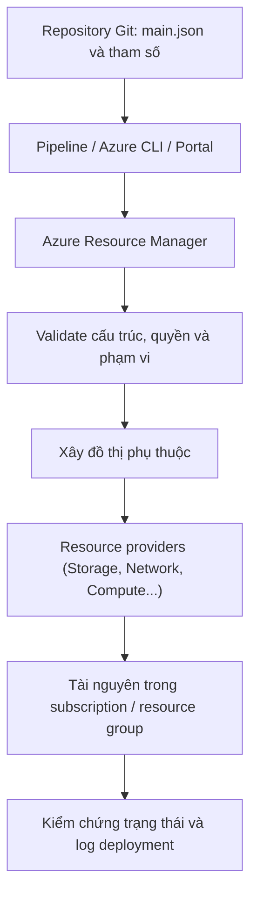
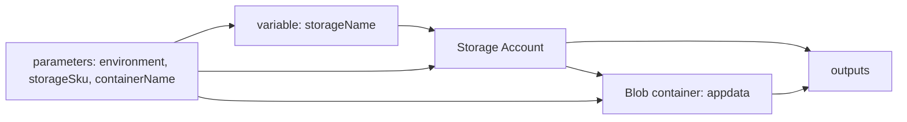
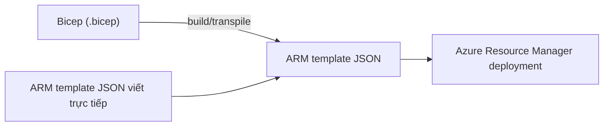
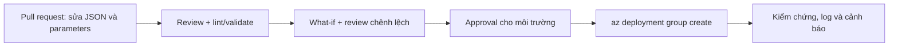

# Mô hình khai báo tài nguyên bằng ARM template

## 1. Mục tiêu và bối cảnh

Trong chương **Hạ tầng dưới dạng mã (Infrastructure as Code — IaC)** của module **CLOUD_PROVIDERS_AZURE**, chúng ta tìm hiểu cách mô tả hạ tầng Azure dưới dạng cấu hình có thể lưu phiên bản, đánh giá và triển khai lặp lại. Đây là nền tảng để xây dựng kiến trúc ứng dụng trên Azure từ subscription, resource group và Microsoft Entra ID đến mạng ảo, dịch vụ tính toán, lưu trữ, dữ liệu, giám sát, bảo mật và quản lý chi phí.

Giả sử một ứng dụng cần Storage Account chứa tệp, blob container lưu dữ liệu và sau này thêm App Service, mạng, giám sát. Tạo từng tài nguyên bằng cách bấm trên Azure Portal có thể phù hợp cho thử nghiệm, nhưng khó đảm bảo môi trường dev, test và production được cấu hình nhất quán. **Azure Resource Manager (ARM) template** cho phép khai báo các tài nguyên và thuộc tính mong muốn trong tệp JSON, sau đó yêu cầu Azure Resource Manager triển khai bản khai báo đó.

Sau bài học, người học có thể:

- Giải thích mô hình **khai báo trạng thái mong muốn** khác với việc viết các bước tạo tài nguyên tuần tự.
- Đọc cấu trúc ARM template gồm `$schema`, `contentVersion`, `parameters`, `variables`, `resources` và `outputs`.
- Viết và triển khai một ARM template JSON có tài nguyên cha/con, phụ thuộc triển khai, tham số hóa môi trường và cấu hình bảo mật cơ bản.
- Sử dụng Azure CLI để **validate → what-if → create → kiểm chứng** và hiểu cách tái triển khai tác động tới trạng thái tài nguyên.
- Nhận biết giới hạn về drift, chế độ triển khai, dữ liệu nhạy cảm, quyền RBAC và vòng đời hạ tầng.

**Phạm vi ví dụ:** Azure public cloud, triển khai ở **resource group scope**. Các tên `rg-arm-demo`, `appdata`, `dev` là giả định để minh họa; chúng không đại diện cho tài nguyên sẵn có trong tài khoản của bạn. Để chạy thực hành cần Azure CLI, subscription có quyền phù hợp và chính sách tổ chức cho phép tạo Storage Account.

## 2. Tư duy khai báo: mô tả “cái gì”, để Azure thực hiện “như thế nào”

Một kịch bản dạng mệnh lệnh thường nói “tạo resource group; tạo Storage Account; tạo container; cập nhật thuộc tính…”. ARM template nói “trong resource group này phải có Storage Account với tên, SKU, cấu hình bảo mật và container như mô tả”. **ARM** nhận template, kiểm tra cú pháp và điều kiện triển khai, dựng quan hệ phụ thuộc, rồi gửi yêu cầu tới các **resource provider** để tạo hoặc cập nhật tài nguyên.

| Khía cạnh | Tiếp cận bằng các lệnh mệnh lệnh | Tiếp cận khai báo bằng ARM template |
| --- | --- | --- |
| Đầu vào chính | Chuỗi thao tác “tạo/sửa” theo trình tự | Cấu hình mô tả loại tài nguyên và thuộc tính mong muốn |
| Quan hệ phụ thuộc | Người viết script tự đảm bảo thứ tự | ARM phân tích graph phụ thuộc từ `dependsOn` và tham chiếu tài nguyên |
| Tái sử dụng | Cần điều kiện xử lý tài nguyên đã tồn tại | Có thể tái triển khai cùng template/tham số để đồng bộ thuộc tính được quản lý |
| Kiểm tra trước khi áp dụng | Tùy script tự xây dựng | Hỗ trợ validation và `what-if` |
| Review, audit | Review script và biến chạy | Review JSON, tham số và thay đổi dự kiến trong pipeline |
| Điểm cần lưu ý | Script phải xử lý idempotency | Template vẫn phải được thiết kế đúng; Azure có thể giới hạn thay đổi bất biến hoặc gây tác động khi cập nhật |

**Khai báo không có nghĩa là “Azure tự giữ trạng thái mong muốn liên tục”.** ARM template là **đầu vào của một lần triển khai**. Sau lần triển khai, ai đó vẫn có thể chỉnh sửa tài nguyên ngoài quy trình. Muốn phát hiện/cải thiện drift cần chạy lại deployment, dùng `what-if`, quản trị policy hoặc các cơ chế quản lý vòng đời thích hợp.

Một ARM deployment được đánh giá theo **scope**:

- **Resource group scope:** thường dùng cho một nhóm tài nguyên của ứng dụng; triển khai bằng `az deployment group ...`.
- **Subscription scope:** có thể tạo resource group, policy, role assignment và một số tài nguyên cấp subscription.
- **Management group / tenant scope:** dùng cho các tài nguyên quản trị tương ứng, với schema và cách triển khai theo scope.

Bài này sử dụng resource group scope, vì vậy các hàm `resourceGroup()` và `resourceId()` trong ví dụ có ngữ cảnh resource group đích.

## 3. ARM template nằm ở đâu trong kiến trúc Azure?



**Control plane** (ARM) tiếp nhận yêu cầu quản lý tài nguyên; **data plane** là nơi ứng dụng đọc/ghi dữ liệu thực tế, chẳng hạn blob trong Storage. Một template có thể khai báo container và quyền ở control plane, nhưng điều đó không đồng nghĩa template tự nạp dữ liệu, di chuyển dữ liệu hoặc kiểm thử ứng dụng.

Khi template mô tả hai tài nguyên độc lập, ARM có thể xử lý song song. Khi tài nguyên B cần A tồn tại, `dependsOn` (hoặc tham chiếu phụ thuộc được ARM suy ra trong những trường hợp phù hợp) xác định thứ tự. Thứ tự dòng trong mảng `resources` **không phải** hợp đồng thực thi.

## 4. Cấu trúc cốt lõi của ARM template JSON

ARM template truyền thống là đối tượng JSON. Một template tối giản có cấu trúc:

```json
{
  "$schema": "https://schema.management.azure.com/schemas/2019-04-01/deploymentTemplate.json#",
  "contentVersion": "1.0.0.0",
  "parameters": {},
  "variables": {},
  "resources": [],
  "outputs": {}
}
```

| Trường | Vai trò | Cách sử dụng |
| --- | --- | --- |
| `$schema` | Schema của template và phạm vi triển khai | Ví dụ ở trên dành cho resource group deployment. |
| `contentVersion` | Phiên bản nội dung template do nhóm tự quản lý | Hữu ích cho quy trình phát hành; không phải `apiVersion` của resource. |
| `parameters` | Các giá trị từ bên ngoài như môi trường, SKU, tên container | Giúp dùng cùng mã nguồn cho dev/test/prod và xác thực đầu vào. |
| `variables` | Biểu thức và giá trị trung gian trong template | Tránh lặp phép nối tên, tạo giá trị tính toán ổn định. |
| `resources` | Các loại tài nguyên, tên, thuộc tính, điều kiện và phụ thuộc | Phần chính mô tả trạng thái mong muốn. |
| `outputs` | Giá trị trả về sau triển khai | Dùng để truyền ID, endpoint hoặc tên tài nguyên sang bước khác; không xuất bí mật. |

Các thành phần nâng cao có thể gồm `metadata`, `functions` (hàm tự định nghĩa), `condition`, `copy` (lặp), nested/linked templates và tham chiếu tài nguyên. Chúng hữu ích khi kiến trúc lớn hơn, nhưng chưa cần cho lần triển khai đầu tiên.

### 4.1. Phân biệt ba “phiên bản” dễ nhầm

- `contentVersion`: phiên bản do nhóm gán cho **toàn bộ template**, ví dụ `1.0.0.0`.
- `apiVersion`: phiên bản API **resource provider** cho một loại tài nguyên, ví dụ `Microsoft.Storage/storageAccounts`. Nó quyết định schema và các thuộc tính provider hiểu tại thời điểm triển khai.
- Phiên bản của **Azure CLI**, task pipeline hoặc công cụ build: quyết định các khả năng của công cụ gửi deployment. Không thể thay thế `apiVersion` trong JSON.

### 4.2. Biểu thức ARM

Chuỗi dạng `"[...]"` là một **ARM expression**. Ví dụ:

```json
{
  "name": "[variables('storageName')]",
  "location": "[resourceGroup().location]"
}
```

Các hàm thường gặp:

| Hàm | Dùng để làm gì? |
| --- | --- |
| `parameters('environment')` | Đọc giá trị parameter trong lần triển khai |
| `variables('storageName')` | Đọc biến tính toán |
| `resourceGroup().location` | Lấy vùng metadata của resource group đang triển khai |
| `concat('st', 'demo')` hoặc `format('{0}-{1}', 'app', 'dev')` | Ghép tên theo quy tắc |
| `uniqueString(resourceGroup().id, 'dev')` | Tạo chuỗi băm **xác định** theo đầu vào để hỗ trợ đặt tên |
| `resourceId('Microsoft.Storage/storageAccounts', 'myaccount')` | Tạo resource ID đúng định dạng theo scope |
| `reference(...)` | Đọc thuộc tính runtime của resource được tham chiếu khi API hỗ trợ |
| `if(...)`, `equals(...)` | Tạo logic lựa chọn theo tham số |

**Chú ý:** `uniqueString` trả về cùng kết quả với cùng đầu vào, nhưng **không đảm bảo** tên tài nguyên có sẵn trên phạm vi toàn cầu. Với Storage Account, tên phải duy nhất toàn Azure, nên vẫn có thể gặp xung đột tên hoặc chính sách đặt tên.

## 5. Ví dụ hoàn chỉnh: Storage Account có blob container

Mục tiêu: dùng một template để tạo **StorageV2 Account** và container `appdata`, áp dụng cấu hình HTTPS/TLS và cấm blob public access. Chọn SKU qua tham số, xuất tên Storage Account và resource ID của container để các bước tiếp theo sử dụng.

Tệp minh họa: `main.json`.

```json
{
  "$schema": "https://schema.management.azure.com/schemas/2019-04-01/deploymentTemplate.json#",
  "contentVersion": "1.0.0.0",
  "metadata": {
    "description": "Storage Account va blob container cho bai hoc ARM template"
  },
  "parameters": {
    "environment": {
      "type": "string",
      "defaultValue": "dev",
      "allowedValues": ["dev", "test", "prod"],
      "metadata": {
        "description": "Moi truong duoc trien khai"
      }
    },
    "storageSku": {
      "type": "string",
      "defaultValue": "Standard_LRS",
      "allowedValues": ["Standard_LRS", "Standard_GRS"],
      "metadata": {
        "description": "Storage redundancy cho demo"
      }
    },
    "containerName": {
      "type": "string",
      "defaultValue": "appdata",
      "minLength": 3,
      "maxLength": 63,
      "metadata": {
        "description": "Ten blob container; provider kiem tra quy tac ky tu"
      }
    }
  },
  "variables": {
    "storageName": "[concat('st', uniqueString(resourceGroup().id, parameters('environment')))]"
  },
  "resources": [
    {
      "type": "Microsoft.Storage/storageAccounts",
      "apiVersion": "2023-05-01",
      "name": "[variables('storageName')]",
      "location": "[resourceGroup().location]",
      "sku": {
        "name": "[parameters('storageSku')]"
      },
      "kind": "StorageV2",
      "tags": {
        "environment": "[parameters('environment')]",
        "managedBy": "arm-template"
      },
      "properties": {
        "supportsHttpsTrafficOnly": true,
        "minimumTlsVersion": "TLS1_2",
        "allowBlobPublicAccess": false,
        "allowSharedKeyAccess": false
      }
    },
    {
      "type": "Microsoft.Storage/storageAccounts/blobServices/containers",
      "apiVersion": "2023-05-01",
      "name": "[format('{0}/default/{1}', variables('storageName'), parameters('containerName'))]",
      "dependsOn": [
        "[resourceId('Microsoft.Storage/storageAccounts', variables('storageName'))]"
      ],
      "properties": {
        "publicAccess": "None"
      }
    }
  ],
  "outputs": {
    "storageAccountName": {
      "type": "string",
      "value": "[variables('storageName')]"
    },
    "blobContainerResourceId": {
      "type": "string",
      "value": "[resourceId('Microsoft.Storage/storageAccounts/blobServices/containers', variables('storageName'), 'default', parameters('containerName'))]"
    }
  }
}
```

### 5.1. Đọc template từng phần

**Parameters.** `environment` nhận một trong `dev`, `test`, `prod`; `storageSku` được giới hạn về hai SKU minh họa; `containerName` có yêu cầu chiều dài. ARM kiểm tra ràng buộc parameter, còn resource provider tiếp tục kiểm tra quy tắc tài nguyên (ví dụ tên container phải tuân thủ quy tắc ký tự và dấu gạch nối).

**Variables.** `storageName` ghép tiền tố `st` với `uniqueString(resourceGroup().id, environment)`. Với cùng resource group và environment, tên sinh ra ổn định giữa các lần deploy. Tên không cố định sẵn trong tài liệu và vẫn phải vượt qua kiểm tra duy nhất toàn cầu của Azure Storage.

**Resources.** Tài nguyên thứ nhất khai báo Storage Account. `sku` ảnh hưởng đến mức dự phòng và chi phí; `location` lấy vùng của resource group; `tags` hỗ trợ truy vết/quản trị. Các thuộc tính `supportsHttpsTrafficOnly`, `minimumTlsVersion`, `allowBlobPublicAccess` và `allowSharedKeyAccess` minh họa một số thiết lập bảo vệ dữ liệu. Khi tắt shared key, các luồng truy cập dữ liệu cần dùng cơ chế xác thực phù hợp, ví dụ Microsoft Entra ID kết hợp **data-plane RBAC**.

**Tài nguyên cha/con.** Blob container là tài nguyên con có type đầy đủ `Microsoft.Storage/storageAccounts/blobServices/containers` và name gồm ba thành phần theo thứ tự: `<storage-account>/default/<container>`. `default` là blob service mặc định của Storage Account.

**Dependencies.** Container phụ thuộc Storage Account thông qua `dependsOn` với `resourceId(...)`. ARM sẽ triển khai Storage Account trước, sau đó mới triển khai container; thứ tự dòng của JSON không quyết định phụ thuộc.

**Outputs.** Tên Storage Account và resource ID của container được xuất ra để dùng cho bước sau, chẳng hạn cấu hình ứng dụng. Không xuất access key, connection string có secret hoặc token vì output có thể xuất hiện trong deployment history và log pipeline.

### 5.2. Đồ thị phụ thuộc của ví dụ



Ở đây `dependsOn` mô tả phụ thuộc triển khai **giữa resource**, còn mũi tên từ parameter/variable tới resource chỉ mô tả **nguồn dữ liệu cấu hình**. ARM không tự động tạo network security group, diagnostic settings hoặc policy nếu chúng chưa được khai báo hoặc áp dụng riêng.

## 6. Triển khai bằng Azure CLI theo trình tự an toàn

Giả sử bạn lưu JSON trên máy với tên `main.json` và đã đăng nhập Azure CLI. Các lệnh dưới đây minh họa việc chạy trong subscription và khu vực phù hợp; chúng **chỉ được thực thi khi bạn chủ động chạy**, bài học không tự tạo tài nguyên.

### 6.1. Chọn subscription và tạo resource group

```bash
az login

az account list --output table
az account set --subscription "<SUBSCRIPTION_ID>"

az group create \
  --name rg-arm-demo \
  --location southeastasia
```

Resource group là **scope chứa tài nguyên** của bài học. Khi dùng `resourceGroup().location`, Storage Account sẽ triển khai tại vùng metadata của resource group; trong kiến trúc thực, không phải mọi dịch vụ đều cần cùng vùng và có thể truyền location như parameter riêng.

### 6.2. Kiểm tra trước khi áp dụng

```bash
az deployment group validate \
  --resource-group rg-arm-demo \
  --template-file main.json \
  --parameters environment=dev storageSku=Standard_LRS containerName=appdata

az deployment group what-if \
  --resource-group rg-arm-demo \
  --template-file main.json \
  --parameters environment=dev storageSku=Standard_LRS containerName=appdata
```

- `validate` kiểm tra đầu vào, một số ràng buộc cấu hình, quyền và khả năng tiếp nhận yêu cầu deployment theo ARM.
- `what-if` dự báo tài nguyên sẽ **Create**, **Modify**, **Delete**, **NoChange** hoặc các loại kết quả khác tùy thay đổi và khả năng đánh giá. Kết quả là **dự báo**, cần được review; một số biểu thức/runtime property có thể không xác định hoàn toàn trước khi áp dụng.
- Nếu policy tổ chức, quyền RBAC, quota hoặc tính khả dụng của tên ngăn thao tác, deploy vẫn có thể thất bại dù JSON đúng cú pháp. Vì vậy, validate/what-if hữu ích nhưng không thay thế kiểm chứng sau deploy.

### 6.3. Thực hiện deployment và đọc outputs

```bash
az deployment group create \
  --name demo-arm-storage \
  --resource-group rg-arm-demo \
  --template-file main.json \
  --parameters environment=dev storageSku=Standard_LRS containerName=appdata

az deployment group show \
  --resource-group rg-arm-demo \
  --name demo-arm-storage \
  --query properties.outputs \
  --output json
```

Lần đầu deployment thường tạo Storage Account và container. Nếu lặp lại với **cùng template và tham số**, ARM đánh giá tài nguyên đích, áp dụng yêu cầu tương ứng và thường không cần tạo lại tài nguyên đang tồn tại với cấu hình phù hợp. Đây là giá trị của **idempotency ở cấp deployment**, nhưng không đảm bảo mọi lần chạy hoàn toàn không gây thay đổi: resource provider có thể áp dụng giá trị mặc định, cập nhật thuộc tính hoặc từ chối thuộc tính không thể thay đổi.

Để kiểm tra kết quả, có thể dùng Azure Portal hoặc Azure CLI để xem tên Storage Account vừa xuất ra, container `appdata`, cấu hình truy cập và Azure Activity Log. Việc template tạo tài nguyên thành công **không đảm bảo** ứng dụng đã được cấp quyền đọc/ghi blob: các role như **Storage Blob Data Reader** hoặc **Storage Blob Data Contributor** thuộc nhóm **data-plane permissions** cần được cấu hình riêng theo danh tính ứng dụng.

### 6.4. Tham số hóa qua tệp thay vì sửa template

Khi triển khai vào nhiều môi trường, nên giữ `main.json` bất biến và cung cấp bộ tham số tương ứng. Ví dụ một tệp ARM parameters kiểu `dev.parameters.json`:

```json
{
  "$schema": "https://schema.management.azure.com/schemas/2019-04-01/deploymentParameters.json#",
  "contentVersion": "1.0.0.0",
  "parameters": {
    "environment": {
      "value": "dev"
    },
    "storageSku": {
      "value": "Standard_LRS"
    },
    "containerName": {
      "value": "appdata"
    }
  }
}
```

Dùng tệp tham số:

```bash
az deployment group what-if \
  --resource-group rg-arm-demo \
  --template-file main.json \
  --parameters @dev.parameters.json

az deployment group create \
  --name demo-arm-storage \
  --resource-group rg-arm-demo \
  --template-file main.json \
  --parameters @dev.parameters.json
```

Bộ tham số dành cho production có thể dùng `environment=prod`, SKU khác, tag và scope riêng. Đừng đưa password, key hoặc connection string thô vào tệp parameter được commit vào Git.

## 7. Điều gì xảy ra khi chạy lại template?

Xét ba trường hợp:

| Thay đổi đầu vào hoặc trạng thái | Kết quả cần dự kiến | Điều cần kiểm chứng |
| --- | --- | --- |
| Không đổi JSON và tham số | Azure thường duy trì cùng tài nguyên; những thuộc tính được gửi vẫn có thể được áp dụng lại | Chạy `what-if`, kiểm tra trạng thái và provider defaults |
| Đổi `storageSku` từ `Standard_LRS` sang `Standard_GRS` | ARM yêu cầu cập nhật SKU của Storage Account đang có | Kiểm tra tính hợp lệ của chuyển đổi redundancy, vùng hỗ trợ, chi phí, thời gian và tác động dữ liệu |
| Đổi `environment` từ `dev` sang `prod` trong cùng resource group | Biểu thức `storageName` tạo **tên khác**, khiến Azure xem đây là Storage Account **khác** | Kiểm tra tài nguyên dev cũ còn tồn tại; không suy luận rằng ARM tự xóa tài nguyên cũ |

### 7.1. Chế độ incremental

**Incremental** là chế độ triển khai thông dụng và mặc định của ARM template ở resource group scope. Nó tạo/cập nhật các tài nguyên có trong template; **tài nguyên bị bỏ khỏi template thường không bị xóa chỉ vì deployment incremental mới không nhắc tới chúng**.

Tuy nhiên, cần phân biệt **bỏ cả resource khỏi template** và **bỏ một property của resource vẫn còn trong template**. Với resource còn được triển khai, thuộc tính bị bỏ có thể được provider đưa về giá trị mặc định hoặc thay đổi theo hành vi API. Vì vậy, không thể coi việc xóa một dòng JSON là cách an toàn để “giữ nguyên cấu hình đang có”.

### 7.2. Chế độ complete và quản lý vòng đời

Một số tài liệu/hệ thống cũ có đề cập **Complete deployment mode** để xử lý tài nguyên không còn được khai báo, nhưng cách này có rủi ro xóa tài nguyên và hiện không phải hướng thiết kế nên chọn cho quy trình mới. Khi cần quản lý việc gỡ tài nguyên khỏi vòng đời ứng dụng, hãy xem xét **deployment stacks** hoặc một quy trình xóa có review rõ ràng, xác nhận các phụ thuộc và sao lưu dữ liệu cần thiết.

**Không có “rollback tự động tuyệt đối”** chỉ vì dùng ARM template. Một deployment có thể thành công một phần trước khi gặp lỗi. Muốn quay về trạng thái trước, nhóm phải thiết kế chiến lược khôi phục, bảo vệ dữ liệu và kiểm chứng khả năng tái triển khai.

### 7.3. Drift không tự biến mất

Ví dụ một quản trị viên bật public access ngoài pipeline. Một lần chạy ARM template sau đó **có thể** đưa thuộc tính được khai báo về `false`, nếu resource provider cho phép và template thực sự gửi thuộc tính đó. Nhưng nếu không có lần triển khai nào chạy, ARM template không liên tục giám sát để sửa drift. Azure Policy, change tracking, định kỳ `what-if` và quy trình review có thể bổ sung khả năng phát hiện thay đổi ngoài mong muốn.

## 8. Quan hệ phụ thuộc, tham chiếu và tổ chức template lớn

### 8.1. `dependsOn` biểu diễn đồ thị, không biểu diễn thứ tự mã nguồn

Ví dụ container cần Storage Account, vì vậy template dùng:

```json
{
  "dependsOn": [
    "[resourceId('Microsoft.Storage/storageAccounts', variables('storageName'))]"
  ]
}
```

Tránh khai báo phụ thuộc không cần thiết: nó có thể ngăn ARM xử lý song song và làm deployment chậm. Ngược lại, nếu resource yêu cầu một resource khác đã sẵn sàng mà không có dependency phù hợp, deployment có thể thất bại do chạy đồng thời.

Trong một số biểu thức `reference()` hoặc các dạng truy cập tài nguyên, ARM có thể suy ra implicit dependency; tuy vậy phải hiểu đúng cách ARM xử lý từng kiểu tham chiếu thay vì nghĩ mọi ID string đều tạo ra dependency. `resourceId()` tự nó chỉ **tạo chuỗi ID**, không tự đảm bảo trình tự khởi tạo.

### 8.2. `condition` và `copy`

- `condition` cho phép khai báo có điều kiện, ví dụ chỉ tạo một loại resource ở môi trường production. Cần hiểu rõ tương tác của condition với tham chiếu, phụ thuộc và việc tái triển khai.
- `copy` hỗ trợ triển khai nhiều instance của một khai báo theo số lượng, chẳng hạn nhiều cấu hình tương tự nhau. Tên tài nguyên phải hợp lệ và duy nhất trong scope phù hợp.
- **Nested/linked templates** chia giải pháp thành nhiều phần và cho phép tái sử dụng. Việc quản lý URI, phiên bản nội dung và quyền truy cập các template được liên kết cần nằm trong quy trình CI/CD.

Với hệ thống lớn, nên nhóm template theo vòng đời: **nền tảng chung**, **mạng**, **định danh và phân quyền**, **dịch vụ ứng dụng**, **quan sát/giám sát**. Mỗi scope deployment nên có trách nhiệm rõ, để giảm nguy cơ một thay đổi nhỏ tác động tới toàn bộ subscription.

### 8.3. ARM JSON và Bicep

**Bicep** là ngôn ngữ khai báo mức cao dành cho Azure; trình biên dịch Bicep chuyển nội dung thành ARM template JSON để triển khai qua Azure Resource Manager. Vì vậy:



Học JSON ARM giúp hiểu mô hình tài nguyên, property, API version, scope và dependency dù sau này viết Bicep cho dễ bảo trì. Lựa chọn Bicep không làm thay đổi các nguyên tắc về Azure RBAC, vòng đời dữ liệu hoặc các giới hạn của provider.

## 9. An toàn, quyền truy cập và quản trị chi phí

### 9.1. Truy cập control plane và data plane

Để tạo Storage Account qua ARM, danh tính triển khai cần quyền tương ứng trên **scope** đích, chẳng hạn role phù hợp ở resource group. Nếu pipeline chỉ có quyền Reader, `what-if` hoặc việc đọc resource có thể hoạt động trong một số tình huống, nhưng lệnh `create` cần quyền ghi tương ứng.

Truy cập blob data là câu chuyện khác: sau khi tạo container, ứng dụng muốn đọc/ghi blob phải có data-plane access. Không cấp quyền rộng trên subscription chỉ để giải quyết lỗi truy cập blob; hãy xác minh loại quyền cần thiết và scope, sau đó dùng Entra ID/managed identity và các role dữ liệu thích hợp.

### 9.2. Bảo vệ thông tin nhạy cảm

- Tham số nhạy cảm nên sử dụng kiểu `secureString` hoặc `secureObject` khi phù hợp, đồng thời truyền từ cơ chế quản lý secret được kiểm soát (ví dụ Azure Key Vault hoặc pipeline secrets). **Kiểu secure không thay thế kiểm soát log, lịch sử shell và quyền người dùng**.
- Không đặt secret trong `variables` thông thường, `outputs` hoặc Git repository. Tránh dùng những hàm có thể trả về khóa như `listKeys()` để xuất dữ liệu nhạy cảm ra output.
- Dùng danh tính không cần secret dài hạn cho pipeline khi có thể, ví dụ workload identity federation; gán Azure RBAC tối thiểu và kiểm soát người có quyền thay template hoặc chạy deployment.
- Cấu hình bảo mật trong template phải xem xét theo từng dịch vụ: network restrictions, private endpoints, TLS, diagnostic settings, encryption và policy tổ chức. Bài mẫu chỉ đề cập một phần các thuộc tính lưu trữ.
- Không tin tuyệt đối vào file JSON được tải từ nguồn không rõ ràng: review resource type, role assignment, nested/linked template URL và các script có thể được deployment thực thi.

Ví dụ khai báo parameter nhạy cảm trong ARM JSON:

```json
{
  "parameters": {
    "adminPassword": {
      "type": "secureString",
      "metadata": {
        "description": "Vi du cu phap; khong su dung trong template Storage ben tren"
      }
    }
  }
}
```

Đoạn trên là **fragment minh họa**, không thêm vào `main.json` của ví dụ Storage Account vì Storage Account không cần admin password.

### 9.3. Chi phí và resource lifecycle

Template tạo ra tài nguyên thật và có thể phát sinh phí ngay cả khi chưa chạy ứng dụng. Đặc biệt:

- `Standard_LRS` và `Standard_GRS` có đặc tính dự phòng/giá khác nhau; lựa chọn đúng dựa trên nhu cầu và vùng khả dụng.
- Đặt `tags` như `environment`, `owner` hoặc `costCenter` nhất quán để hỗ trợ Cost Management. Tag không tự giới hạn chi phí và không phải mọi dòng chi phí đều kế thừa tag như mong đợi.
- Thiết lập ngân sách và cảnh báo chi phí phù hợp; kiểm tra quota, policy, SKU và region trước khi deploy.
- Với môi trường thực hành, xác minh tài nguyên không còn cần thiết trước khi xóa resource group. **Xóa resource group làm mất toàn bộ tài nguyên bên trong**, có thể gồm cả dữ liệu của tài nguyên không thuộc bài học nếu nhóm dùng chung scope.

## 10. Quy trình CI/CD với ARM template

Một pipeline triển khai hạ tầng có thể gồm:



Repository thường lưu template cùng bộ parameter theo môi trường. Pipeline dùng service connection hoặc workload identity federation để xác thực, kiểm tra Azure RBAC và chạy deployment ở scope cho phép. Với production, thiết kế approval cho thay đổi hạ tầng quan trọng, đặc biệt là networking, storage, quyền truy cập, xóa hoặc thay thế resource.

Một nguyên tắc vận hành quan trọng: **đầu ra `what-if` phải được so sánh với template và chính sách trước khi chấp thuận**. Chênh lệch “Modify” trên Storage Account có thể ảnh hưởng redundancy hoặc kết nối ứng dụng; chênh lệch “Delete” phải được xem xét như thay đổi có thể mất dữ liệu.

## 11. Lỗi thường gặp và cách khoanh vùng

| Dấu hiệu | Nguyên nhân có thể | Hướng xử lý |
| --- | --- | --- |
| Template báo lỗi JSON hoặc schema | Dấu phẩy, dấu ngoặc, trường sai vị trí, `$schema` không phù hợp scope | Kiểm tra cú pháp JSON và `az deployment group validate`; đối chiếu schema scope. |
| `InvalidTemplate` hoặc `InvalidTemplateDeployment` | Biểu thức ARM không hợp lệ, tham số sai, provider/policy/quota từ chối triển khai | Đọc nội dung lỗi chi tiết trong deployment operations; xử lý đúng thành phần báo lỗi. |
| `AuthorizationFailed` / HTTP 403 | Danh tính không có quyền triển khai ở resource group/subscription | Kiểm tra principal, role assignment và scope; không tự nâng quyền quá mức. |
| `StorageAccountAlreadyTaken` hoặc tên không hợp lệ | Tên Storage Account đã bị dùng trên Azure hoặc vi phạm quy tắc đặt tên | Đổi đầu vào dùng để tạo tên, kiểm tra length/charset và chạy lại what-if. |
| `NoRegisteredProviderFound` hoặc loại/API không hỗ trợ | Provider chưa được đăng ký hoặc `apiVersion`/region/SKU không được hỗ trợ | Xác nhận resource provider, API version, vùng và chính sách subscription. |
| Storage Account có nhưng container triển khai lỗi | Container name sai, phụ thuộc/role/policy hoặc Storage provider từ chối request | Kiểm tra `dependsOn`, tên đầy đủ `account/default/container` và deployment operations. |
| Chạy lại template tạo Storage Account mới | Biểu thức tên hoặc parameter `environment`/resource group thay đổi | So sánh đầu vào và `what-if`; giữ tên tài nguyên ổn định khi cần tái sử dụng. |
| Bỏ tài nguyên khỏi template mà tài nguyên vẫn còn | Deployment đang ở chế độ **Incremental** | Lập kế hoạch vòng đời/xóa có chủ đích; không mặc định ARM sẽ dọn mọi thứ. |
| Deploy thành công nhưng ứng dụng không ghi được blob | Chưa có data-plane RBAC, sai network/TLS hoặc cấu hình xác thực | Kiểm tra identity ứng dụng, Storage Blob Data role, firewall/private endpoint và auth. |

Khi một deployment thất bại, ưu tiên xem **deployment operations** và **Azure Activity Log** để tìm resource type, mã lỗi và request ID thực tế. Không phỏng đoán rằng mọi lỗi đều nằm ở JSON: cùng một template có thể thành công ở môi trường này nhưng bị policy, quota hoặc phân quyền chặn tại môi trường khác.

## 12. Bài thực hành có hướng dẫn

**Đề bài:** Nhóm ứng dụng cần cấp Storage Account + container cho môi trường dev bằng ARM template, rồi chuẩn bị cùng mẫu để chạy ở test và production.

1. Đọc `main.json` ở mục 5 và giải thích vai trò của từng khối `parameters`, `variables`, `resources`, `outputs`.
2. Tạo resource group thực hành riêng. Chạy `validate` và `what-if` với `environment=dev` trước khi triển khai.
3. Chạy `az deployment group create` sau khi xem xét chênh lệch. Ghi lại tên Storage Account và resource ID của container từ outputs.
4. Chạy lại `what-if` với cùng tham số. Giải thích vì sao kết quả có thể không yêu cầu tạo mới những tài nguyên tương ứng.
5. Thử thay `storageSku` thành `Standard_GRS` trong **what-if**; phân tích chi phí, tính hỗ trợ của SKU/vùng và tác động nếu thực sự áp dụng. Không cần triển khai thay đổi để hoàn thành câu hỏi.
6. Chạy `what-if` với `environment=test` trong cùng resource group và dự đoán điều xảy ra với tên Storage Account. Thảo luận vì sao production thường có resource group riêng.
7. Đề xuất cách truyền parameters cho pipeline, bảo vệ quyền deploy và theo dõi drift. Viết phần giải thích ngắn phân biệt ARM control-plane permission với quyền đọc/ghi blob của ứng dụng.

**Tiêu chí đạt:** Người học hiểu chính xác cấu trúc template, quan hệ phụ thuộc, ràng buộc parameter; giải thích được `what-if`; và phân biệt rõ tài nguyên được tạo/cập nhật với tài nguyên bị bỏ khỏi một deployment incremental. Nếu thực hành trên subscription thật, phải đánh giá chi phí và dọn dẹp có kiểm soát theo phạm vi đã cấp.

## 13. Câu hỏi tự kiểm tra

**Câu 1. Nếu mảng `resources` liệt kê container trước Storage Account, ARM có nhất thiết tạo container trước không?**  
Không. ARM triển khai theo graph phụ thuộc. `dependsOn` trong ví dụ yêu cầu Storage Account được xử lý trước container.

**Câu 2. Vì sao cần `apiVersion` trên từng resource dù đã có `contentVersion`?**  
`contentVersion` là phiên bản nội dung template do nhóm quản lý; `apiVersion` chọn giao diện mà resource provider dùng để hiểu loại tài nguyên và thuộc tính.

**Câu 3. Sau khi xóa khai báo container khỏi template và chạy deployment incremental, container có chắc chắn bị xóa không?**  
Không. Ở incremental mode, resource không còn khai báo thường vẫn tồn tại. Việc xóa đòi hỏi kế hoạch quản lý vòng đời riêng.

**Câu 4. Nếu triển khai thành công nhưng ứng dụng nhận lỗi 403 khi tải blob, nên kiểm tra gì?**  
Kiểm tra danh tính ứng dụng, Storage Blob data-plane role, scope role assignment và các giới hạn network/auth. Quyền triển khai control plane không tự động cấp quyền truy cập dữ liệu.

**Câu 5. `what-if` báo không có thay đổi đáng kể; như vậy có bảo đảm không phát sinh chi phí hoặc lỗi sau deploy không?**  
Không. `what-if` là dự báo trạng thái resource, không thay thế việc kiểm tra phí sử dụng, quota, chính sách, trạng thái dịch vụ và kiểm chứng vận hành sau deploy.

## 14. Tài liệu chính thức để tra cứu

- Microsoft Learn — [ARM templates overview](https://learn.microsoft.com/azure/azure-resource-manager/templates/overview): khái niệm, công cụ, scope và quy trình triển khai.
- Microsoft Learn — [ARM template structure and syntax](https://learn.microsoft.com/azure/azure-resource-manager/templates/syntax): các trường và biểu thức JSON trong template.
- Microsoft Learn — [ARM deployment what-if](https://learn.microsoft.com/azure/azure-resource-manager/templates/deploy-what-if): xem trước thay đổi hạ tầng.
- Microsoft Learn — [ARM deployment modes](https://learn.microsoft.com/azure/azure-resource-manager/templates/deployment-modes): incremental, complete và lưu ý quản lý vòng đời.
- Microsoft Learn — [Bicep overview](https://learn.microsoft.com/azure/azure-resource-manager/bicep/overview): mối quan hệ giữa Bicep và ARM template.

API version và thuộc tính của mỗi Azure resource provider thay đổi theo thời gian. Trước khi đưa template vào hệ thống thật, đối chiếu schema cho đúng API version, kiểm tra bảo mật và quy trình rollback, sau đó chạy validate/what-if trong môi trường phù hợp.
