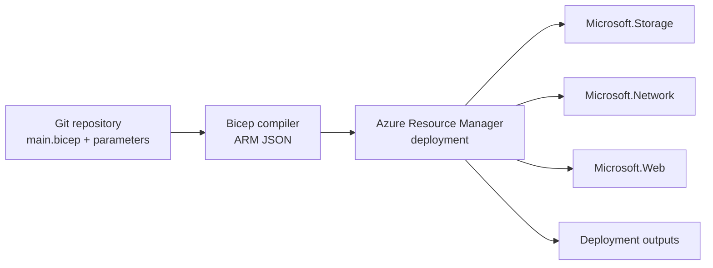
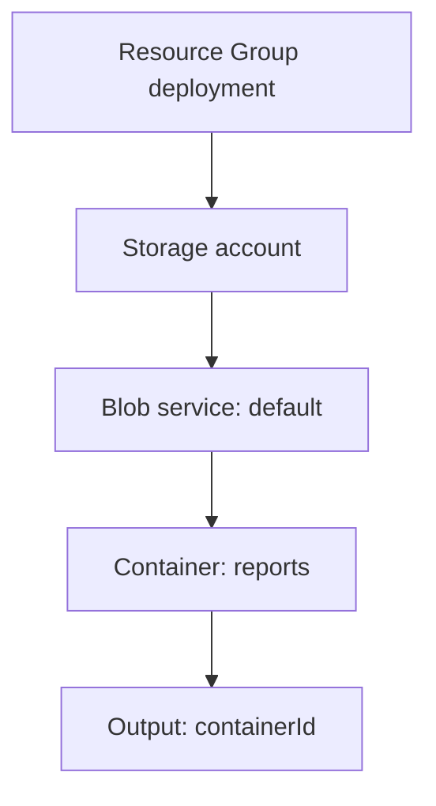
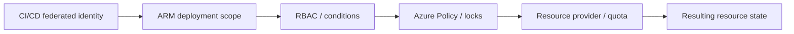
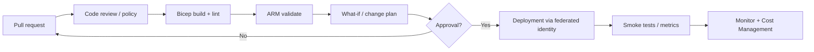
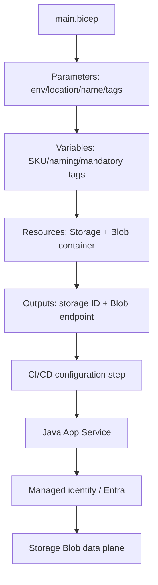

# Bicep với resource, parameter, variable và output

Một nhóm phát triển ứng dụng Java/Spring Boot trên Microsoft Azure cần môi trường **development**, **staging** và **production** có cấu trúc hạ tầng nhất quán: resource group, Storage account, App Service, mạng và những cài đặt bảo mật tối thiểu. Nếu mọi thành viên tạo tài nguyên bằng Azure portal theo trí nhớ, chỉ một khác biệt như mở public Blob access ở production, đổi region hoặc quên tag quản lý chi phí đã có thể làm tăng rủi ro. **Infrastructure as Code (IaC)** mô tả hạ tầng bằng mã để triển khai có thể lặp lại, kiểm tra thay đổi và quản lý trong quy trình phát hành.

**Bicep** là ngôn ngữ khai báo để định nghĩa tài nguyên Azure thông qua **Azure Resource Manager (ARM)**. Bốn thành phần nền tảng nhất là:

- **`resource`:** khai báo tài nguyên Azure cần tạo/cập nhật hoặc tham chiếu tài nguyên có sẵn.
- **`param` (parameter):** đầu vào được truyền tại thời điểm triển khai, ví dụ tên môi trường, region và SKU.
- **`var` (variable):** biểu thức/giá trị trung gian được tính trong template để giảm lặp.
- **`output`:** giá trị trả ra từ deployment, ví dụ resource ID, hostname hoặc URL để các bước sau sử dụng.

Trong module **CLOUD_PROVIDERS_AZURE**, người học tìm hiểu Microsoft Azure từ subscription, resource group, Microsoft Entra ID đến mạng ảo, tính toán, lưu trữ, dữ liệu, triển khai, giám sát, bảo vệ và kiểm soát chi phí kiến trúc ứng dụng. Bài thuộc chương **Hạ tầng dưới dạng mã**, đi sâu chính xác vào **“Bicep với resource, parameter, variable và output”**: cách viết Bicep có cấu trúc, tham chiếu tài nguyên, triển khai bằng Azure CLI, bảo vệ dữ liệu nhạy cảm và kiểm tra kết quả.

> **Lưu ý:** Bicep khai báo **desired state** nhưng deployment vẫn có thể làm thay đổi tài nguyên thật và phát sinh chi phí. Các tên, SKU, vùng, loại resource và API version trong ví dụ dành cho lab. Xác minh khả năng của subscription/region, chính sách Azure Policy, RBAC và phiên bản Bicep/CLI thực tế trước khi chạy lệnh tạo/cập nhật/xóa.

## 1. Mục tiêu học tập

Sau khi hoàn thành, bạn có thể:

1. Giải thích **Bicep → ARM template → Azure Resource Manager → Resource Provider** và sự khác biệt giữa khai báo với script mệnh lệnh.
2. Đọc cú pháp **`targetScope`, `param`, `var`, `resource`, `output`**, định kiểu và property expression.
3. Tạo Storage account với những thuộc tính an toàn cơ bản, tags và một Blob container thử nghiệm.
4. Khai báo parameter có **type, default, `@description`, `@allowed`, `@minLength`, `@maxLength`, `@secure`**.
5. Sử dụng variable để tính tên, tags, SKU theo environment mà không dùng biến để che giấu secrets.
6. Trả ra **ID và endpoint không nhạy cảm** bằng `output`; phân biệt output với credential.
7. Hiểu **symbolic name**, tên resource thật, API version, property access, implicit/explicit dependency.
8. Tham chiếu **`existing`** resource; biết ranh giới **scope**, module và resource-group deployment.
9. Tạo file **`.bicepparam`**, chạy build/lint/validate/what-if và triển khai có phê duyệt.
10. Kiểm soát an toàn thông qua Azure RBAC, Azure Policy, secure parameters, Key Vault và kiểm soát chi phí.
11. Chẩn đoán lỗi template, sai loại dữ liệu, resource name collision, policy deny và deployment failure.
12. Thiết kế một bài thực hành end-to-end có tiêu chí kiểm tra và rollback rõ ràng.

## 2. Bicep là gì và đứng ở đâu trong Azure?

Khi viết Bicep, bạn không mô tả từng lệnh “hãy bấm nút tạo Storage account, chờ, rồi bấm tiếp”. Bạn mô tả **những tài nguyên cần tồn tại và các thuộc tính mong muốn**. Bicep compiler tạo ARM template JSON; Azure Resource Manager triển khai qua các Resource Providers như `Microsoft.Storage`, `Microsoft.Network` hay `Microsoft.Web`.



### Khai báo khác mệnh lệnh

| Góc nhìn | Bicep/ARM declarative | Chuỗi Azure CLI imperative |
|---|---|---|
| Ý định | Nói **cần trạng thái gì** | Nói **chạy bước gì, theo thứ tự nào** |
| Tái sử dụng | Template + parameters/modules | Scripts + variables |
| Kiểm tra thay đổi | Build, lint, validate, what-if và review diff | Kiểm tra script/kết quả lệnh |
| Dependency | ARM suy ra từ references, hỗ trợ explicit dependency | Script thường phải tự điều phối |
| Bảo trì | Resource properties định nghĩa tập trung | Dễ phát sinh logic if/else phức tạp |
| Rủi ro | Sai template có thể cập nhật tài nguyên quy mô lớn | Sai command cũng có thể cập nhật tài nguyên |

**Bicep không phải Terraform**: Bicep tận dụng deployment engine của ARM và **không duy trì state file riêng giống một số công cụ IaC khác**. Điều này không có nghĩa Azure giữ mọi trạng thái “không thể sai lệch”; tài nguyên vẫn có thể bị sửa ngoài quy trình, policies/permissions thay đổi và những thuộc tính cần được reconcile.

### Một Bicep file làm gì?

```bicep
targetScope = 'resourceGroup'

@description('Azure region để triển khai tài nguyên')
param location string = resourceGroup().location

@description('Tên Storage account toàn cục duy nhất')
param storageName string

var commonTags = {
  owner: 'java-platform'
  environment: 'lab'
}

resource storage 'Microsoft.Storage/storageAccounts@2023-05-01' = {
  name: storageName
  location: location
  sku: {
    name: 'Standard_LRS'
  }
  kind: 'StorageV2'
  tags: commonTags
  properties: {
    minimumTlsVersion: 'TLS1_2'
    supportsHttpsTrafficOnly: true
    allowBlobPublicAccess: false
  }
}

output storageId string = storage.id
output blobEndpoint string = storage.properties.primaryEndpoints.blob
```

Đây là **một Bicep template minh họa có thể dùng ở scope resource group** sau khi truyền tên Storage account hợp lệ, xét hỗ trợ API/region và quyền. Chỉ một tài nguyên đã giúp bạn quan sát cả bốn khái niệm: `param` nhận đầu vào, `var` tính tags, `resource` định nghĩa tài nguyên, `output` trả ID/endpoint.

## 3. Điều kiện thực hành và an toàn triển khai

Để thử trên Azure, cần:

- Một Azure subscription/resource group **được cho phép sử dụng trong lab**.
- Azure CLI và Bicep CLI (thường được Azure CLI tích hợp/hỗ trợ cài đặt) tương thích.
- Danh tính Microsoft Entra ID đã đăng nhập, có quyền **deploy resources ở đúng scope**.
- Khả năng sử dụng loại resource/region/SKU được chọn, quota và Azure Policy phù hợp.
- Quy ước đặt tên/tag và ngân sách lab, kế hoạch dọn tài nguyên tạo trong quá trình thực hành.

### Khởi tạo ngữ cảnh CLI

```bash
az login
az account list --output table
az account set --subscription "<lab-subscription-id>"
az account show \
  --query "{subscription:id,tenant:tenantId,name:name}" \
  --output json

# Kiểm tra Bicep CLI qua Azure CLI.
az bicep version
```

Nếu lệnh phiên bản báo không có Bicep, hãy cài theo quy trình được tổ chức duyệt (ví dụ khả năng `az bicep install`) và xác minh bản đã dùng. **Không yêu cầu Owner trên toàn subscription** chỉ để triển khai một Storage account; phân quyền deployment ở resource group khi đủ.

### Lệnh tạo resource group là thay đổi thật

```bash
# Chỉ chạy khi được phép tạo resource group trong lab:
az group create \
  --name "rg-bicep-lab" \
  --location "southeastasia" \
  --tags environment=lab owner=java-platform
```

Nếu resource group đã tồn tại do admin/IaC tạo, chỉ cần kiểm tra bằng `az group show`; **không tạo trùng hoặc đặt lại tags** ngoài trách nhiệm. Các ví dụ tiếp theo sử dụng group `rg-bicep-lab` và những tên resources minh họa, không giả định group này đã tồn tại.

## 4. Cấu trúc cú pháp Bicep

Bicep có cách viết ngắn gọn, **không dùng dấu phẩy giữa các properties của object** như JSON. Một template thường có:

```bicep
targetScope = 'resourceGroup'

@description('Môi trường triển khai')
@allowed([
  'dev'
  'staging'
  'prod'
])
param environment string = 'dev'

param location string = resourceGroup().location

var isProduction = environment == 'prod'
var tags = {
  environment: environment
  managedBy: 'bicep'
}

resource sampleStorage 'Microsoft.Storage/storageAccounts@2023-05-01' = {
  name: 'st${uniqueString(resourceGroup().id, environment)}'
  location: location
  tags: tags
  sku: {
    name: 'Standard_LRS'
  }
  kind: 'StorageV2'
  properties: {
    minimumTlsVersion: 'TLS1_2'
    supportsHttpsTrafficOnly: true
    allowBlobPublicAccess: false
  }
}

output resourceId string = sampleStorage.id
output isProd bool = isProduction
```

**Đọc từng khối:**

1. `targetScope` cho biết phạm vi deployment.
2. `@description`/`@allowed` trang trí và ràng buộc `environment`.
3. `param` tạo interface đầu vào.
4. `var` tạo giá trị tính toán.
5. `resource` định nghĩa thực thể Azure và cấu hình.
6. `output` xuất kết quả.

### Dùng chuỗi và biểu thức

| Thành phần | Ví dụ | Ý nghĩa |
|---|---|---|
| Chuỗi | `'dev'` | String literal |
| Boolean | `true`, `false` | Giá trị luận lý |
| Số nguyên | `3` | Integer |
| Object | `{ owner: 'team-a' }` | Key/value fields |
| Array | `['dev', 'prod']` | Danh sách |
| Truy cập property | `resourceGroup().location` | Biểu thức |
| Nội suy string | `'st${uniqueString(resourceGroup().id)}'` | Tạo chuỗi từ biểu thức |
| Điều kiện | `isProduction ? 'Standard_GRS' : 'Standard_LRS'` | Chọn giá trị |

**Cú pháp Bicep khác JSON/YAML**: không thêm dấu phẩy vào array/object trong code Bicep; dấu ngoặc nhọn/thụt dòng thể hiện object. Bicep không sử dụng các directive dạng `terraform init` và không tạo các tài nguyên con chỉ bằng cách viết một JSON body không được provider hỗ trợ.

## 5. Tìm hiểu `resource`: khai báo desired state

Cú pháp tổng quát:

```bicep
resource symbolicName 'ResourceProvider/type@apiVersion' = {
  name: 'actual-azure-resource-name'
  location: 'southeastasia'
  properties: {
    // Các trường phụ thuộc resource type/API version.
  }
}
```

### Năm phần quan trọng

| Thành phần | Ý nghĩa | Ví dụ |
|---|---|---|
| `resource` | Khai báo một resource | `resource storage ...` |
| Symbolic name | Tên nội bộ trong file Bicep | `storage` |
| Resource type | Loại ARM resource | `Microsoft.Storage/storageAccounts` |
| API version | Schema/resource API được sử dụng | `2023-05-01` trong ví dụ |
| Resource body | Tên thật, region, SKU, tags và properties | `name`, `location`, `properties` |

**Symbolic name không phải tên resource trên Azure.** Bạn có thể đổi `storage` thành `reportStorage` trong Bicep mà tên thật vẫn là `stexample123` nếu thuộc tính `name` không đổi. Symbolic name dùng để các biểu thức khác tham chiếu, ví dụ `storage.id`.

### Resource Provider và API version

```bicep
resource vault 'Microsoft.KeyVault/vaults@2023-07-01' = {
  name: 'kv-example-lab'
  location: resourceGroup().location
  properties: {
    tenantId: subscription().tenantId
    sku: {
      family: 'A'
      name: 'standard'
    }
    accessPolicies: []
    enableRbacAuthorization: true
  }
}
```

Ví dụ Key Vault minh họa việc provider/schema khác Storage. **Không triển khai nguyên bản** khi chưa thiết kế quyền, soft delete/purge protection, networking và policy. API version không phải “version của Bicep” mà là API contract của từng loại resource; phải chọn API được Azure hỗ trợ và phù hợp tính năng cần dùng.

### Tại sao schema quan trọng?

Trường `minimumTlsVersion` của Storage account không thể tự mang sang một App Service `properties` mà kỳ vọng compile. Bicep type system và linter có thể báo lỗi tại build; ngay cả khi compile thành công, ARM/provider có thể từ chối giá trị không hợp lệ ở thời điểm deployment.

## 6. Resource symbolic name, ID và property access

Giả sử:

```bicep
param storageName string
param location string = resourceGroup().location

resource reportsStorage 'Microsoft.Storage/storageAccounts@2023-05-01' = {
  name: storageName
  location: location
  sku: {
    name: 'Standard_LRS'
  }
  kind: 'StorageV2'
  properties: {
    minimumTlsVersion: 'TLS1_2'
    supportsHttpsTrafficOnly: true
    allowBlobPublicAccess: false
  }
}

output actualName string = reportsStorage.name
output resourceId string = reportsStorage.id
output blobUrl string = reportsStorage.properties.primaryEndpoints.blob
```

**Phân biệt:**

- `reportsStorage`: symbolic name dùng bên trong Bicep.
- `reportsStorage.name`: actual resource name do Azure dùng.
- `reportsStorage.id`: ARM resource ID chứa subscription/resource group/provider/type/name.
- `reportsStorage.properties.primaryEndpoints.blob`: endpoint mà provider trả về sau khi tạo, **không phải account key**.

### Azure resource ID

Ví dụ hình thức:

```text
/subscriptions/<subscription-id>
/resourceGroups/rg-bicep-lab
/providers/Microsoft.Storage/storageAccounts/stexample123
```

Trong giá trị thật ID được viết thành **một chuỗi liên tục**, không có dấu xuống dòng ở các đoạn. ID thường có ích để cấp quyền, truy vấn tài nguyên hoặc truyền vào module khác; **không tự mang quyền truy cập dữ liệu**.

### Reference lúc deploy

Một số properties chỉ được provider trả về khi deploy/runtime. Bicep xử lý references cho nhiều thuộc tính được hỗ trợ, nhưng **không phải mọi property luôn tồn tại ở mọi API version**. Trước khi output một path dài, kiểm tra type completion, provider schema và kết quả lab.

## 7. Khai báo `param`: đầu vào có kiểu

Parameter cho phép sử dụng cùng template ở nhiều môi trường mà không sửa code:

```bicep
@description('Tên môi trường triển khai')
param environment string = 'dev'

@description('Vùng triển khai tài nguyên')
param location string = resourceGroup().location

@description('Tên Storage account hợp lệ, duy nhất toàn Azure')
param storageName string

@description('Bật diagnostic collection khi đã có cấu hình đi kèm')
param diagnosticsEnabled bool = false

@description('Số instance tối thiểu của workload, nếu phù hợp tài nguyên')
param minimumInstances int = 1

@description('Tags do deployment pipeline cung cấp')
param additionalTags object = {}
```

### Bảng kiểu cơ bản

| Kiểu | Ví dụ | Ý nghĩa |
|---|---|---|
| `string` | `'dev'` | Văn bản |
| `int` | `2` | Số nguyên |
| `bool` | `false` | Boolean |
| `object` | `{ owner: 'team-a' }` | Tập properties |
| `array` | `['dev', 'prod']` | Danh sách |
| `string?` | Giá trị có thể `null` (khi syntax/version hỗ trợ) | Kiểu nullable |

Không dùng `string` cho mọi thứ rồi tự ép kiểu tùy tiện; ví dụ `enablePublicAccess` phải là `bool` để tránh truyền chuỗi `'false'` không phù hợp. Khi dùng kiểu nâng cao như user-defined types, unions hoặc nullable types, xác minh Bicep compiler version.

### Bắt buộc và mặc định

```bicep
param storageName string
param environment string = 'dev'
```

- Không có default: caller phải cung cấp giá trị (trừ cơ chế khác hỗ trợ).
- Có default: caller có thể bỏ qua và template dùng default.
- Default **không có nghĩa là an toàn**: production nên buộc caller chỉ rõ environment/SKU khi chính sách yêu cầu.
- Parameter values có thể đến từ CLI, JSON parameter file hoặc `.bicepparam`.

### Parameter khác resource property

`param storageName string` **không tạo Storage account**. Chỉ khi tên được đưa vào `resource ... { name: storageName }` và deployment chạy tại scope hợp lệ, Azure mới thực hiện thay đổi được mô tả.

## 8. Parameter decorators: mô tả và chặn giá trị không hợp lệ

Bicep có **decorators** bắt đầu bằng ký tự `@` để chú thích và ràng buộc đầu vào:

```bicep
@description('Môi trường được phê duyệt')
@allowed([
  'dev'
  'staging'
  'prod'
])
param environment string = 'dev'

@description('Tên Storage account, chỉ dùng chữ thường và số')
@minLength(3)
@maxLength(24)
param storageName string

@description('Số replicas trong ngữ cảnh workload có scale')
@minValue(1)
@maxValue(10)
param replicaCount int = 1

@description('Tenant và billing metadata ở dạng object')
param commonTags object = {
  owner: 'java-team'
}
```

### Decorator nên dùng khi nào?

| Decorator | Tác dụng | Ví dụ |
|---|---|---|
| `@description('...')` | Thuyết minh đầu vào/đầu ra | Cách chọn SKU |
| `@allowed([...])` | Giới hạn tập giá trị chấp nhận | `dev`, `staging`, `prod` |
| `@minLength(n)` / `@maxLength(n)` | Giới hạn độ dài chuỗi/array theo khả năng hỗ trợ | Storage name |
| `@minValue(n)` / `@maxValue(n)` | Giới hạn numeric value | Replica count |
| `@secure()` | Đánh dấu parameter chứa dữ liệu nhạy cảm | Secret/config object |

**Ràng buộc độ dài không tương đương regex**. Một tên Storage dài 15 ký tự nhưng chứa dấu gạch nối vẫn có thể vi phạm quy tắc Azure Storage account. Bicep decorators giảm lỗi sớm, nhưng resource provider/Azure Policy tiếp tục kiểm tra các ràng buộc thực.

### Lựa chọn location bằng `@allowed`

```bicep
@allowed([
  'southeastasia'
  'eastasia'
])
param location string = 'southeastasia'
```

Đây là ví dụ chính sách của một nhóm, không phải danh sách region Azure hỗ trợ toàn cầu. Không phải mọi loại resource/SKU đều có mặt tại cả hai vùng đó; **`@allowed` chỉ kiểm tra input**, không làm tăng capacity hoặc bật feature ở vùng không hỗ trợ.

## 9. Parameter nhạy cảm: `@secure()` và Key Vault

Một số tài nguyên cần thông tin nhạy cảm, chẳng hạn mật khẩu quản trị SQL/VM hoặc token API bên thứ ba. Bicep hỗ trợ **secure parameters** nhằm hạn chế tiết lộ giá trị khi quản lý deployment.

```bicep
@description('Ví dụ bí mật chỉ khi resource API thực sự cần')
@secure()
param adminPassword string

@description('Ví dụ tập hợp config nhạy cảm')
@secure()
param sensitiveSettings object
```

### Những điều `@secure()` có và không có

- Thông báo cho ARM rằng giá trị phải được xử lý như **secure parameter**.
- Giảm nguy cơ giá trị xuất hiện trực tiếp trong một số bề mặt deployment metadata/parameter history.
- **Không** tự mã hóa mọi secret trong source Git, CI/CD logs hoặc trong resource được tạo.
- **Không** tự cấp quyền Key Vault; identity của deployment vẫn cần permission tương ứng.
- **Không** bảo đảm secrets không lộ nếu code nối chúng vào resource name, tag, output hoặc nonsecure property.

### Quy tắc an toàn

**Không bao giờ**:

```bicep
// ANTI-PATTERN: KHÔNG làm theo.
@secure()
param adminPassword string

output leakedPassword string = adminPassword
```

Deployment outputs **không phải nơi lưu bí mật**. Chỉ xuất resource ID, hostname, URI không chứa token hoặc metadata đã được phép. Nếu cần truyền secret giữa services, ưu tiên Azure Key Vault và Microsoft Entra managed identity khi dịch vụ hỗ trợ, thay vì in qua pipeline logs.

### Thay secrets bằng identity khi có thể

Thay vì truyền `storageAccountKey` vào ứng dụng Java, hãy cân nhắc:

1. Bicep tạo Storage account với public Blob access bị vô hiệu hóa.
2. Bicep/IaC tạo managed identity hoặc sử dụng identity của App Service đã có.
3. Deployment identity với permission phù hợp tạo Azure RBAC role assignment **Storage Blob Data Contributor/Reader** theo nhu cầu.
4. Java dùng `DefaultAzureCredential` hoặc `ManagedIdentityCredential` để truy cập storage data plane.

Identity/RBAC là kiến trúc riêng cần review theo scope. **Role assignment được tạo thành công không bảo đảm kết nối network đã đúng**.

## 10. Thời điểm truyền parameter và giá trị mặc định

Bicep parameter thường được khai báo trong template, còn **giá trị** được truyền vào từ:

- Command line của `az deployment ... create` hoặc `what-if`.
- ARM JSON parameter file.
- Bicep parameters file `.bicepparam`.
- Pipeline/CD workflow có cơ chế bảo vệ secrets.
- Module caller trong một template Bicep khác.

### Cùng template, hai môi trường

```bicep
@allowed([
  'dev'
  'prod'
])
param environment string

param location string = resourceGroup().location

var storageSku = environment == 'prod'
  ? 'Standard_GRS'
  : 'Standard_LRS'
```

Khi caller truyền `environment='dev'`, variable `storageSku` trở thành `Standard_LRS`; khi truyền `prod`, kết quả là `Standard_GRS` trong ví dụ. **Đây chỉ là chính sách minh họa**, vì chọn GRS ảnh hưởng chi phí, replication và khả năng đáp ứng yêu cầu dữ liệu/region. Production không nên chỉ dựa vào một toán tử điều kiện nếu cần zone redundancy hoặc điều kiện failover đặc biệt.

### Default là quyết định governance

Với production:

```bicep
@allowed([
  'dev'
  'staging'
  'prod'
])
param environment string
```

Không có default khiến người deploy **bắt buộc chọn environment**. Điều này an toàn hơn mặc định `prod` khi ai đó chạy lệnh thử. Với những giá trị luôn an toàn như `location = resourceGroup().location` có thể dùng default để giảm trùng lặp.

## 11. `var`: tạo giá trị trung gian thay vì lặp biểu thức

Biến là một **giá trị/biểu thức được định nghĩa bên trong template**:

```bicep
param environment string
param teamName string = 'java-platform'
param location string = resourceGroup().location

var environmentShort = environment == 'prod' ? 'prd' : 'dev'
var namePrefix = 'java-${environmentShort}'
var commonTags = {
  environment: environment
  owner: teamName
  managedBy: 'bicep'
}

output prefix string = namePrefix
output tags object = commonTags
```

### Parameter và variable khác nhau thế nào?

| `param` | `var` |
|---|---|
| Caller truyền vào deployment | Được tính từ code/template |
| Tạo interface của template/module | Giảm lặp và biểu đạt logic nội bộ |
| Có thể có default/decorators | Không thay vai trò parameter validation |
| Ví dụ region/environment/SKU được phép chọn | Ví dụ name prefix, merged tags, computed SKU |

Một variable không phải biến trạng thái mutable kiểu Java:

```java
int count = 0;
count++;
```

Bicep là ngôn ngữ khai báo: **không viết vòng lặp cập nhật `count++`** hoặc tự điều khiển deployment theo trạng thái chương trình. Dùng Bicep expressions và loop syntax khi cần tạo nhiều resources.

### Không lạm dụng variable

Không nhất thiết tạo `var name1 = name2` cho mọi dòng vì sẽ khiến template khó đọc. Tạo variable khi nó có **ý nghĩa business**, được tái sử dụng hoặc giúp giảm lỗi cấu hình. Đừng dùng `var secret = ...` để biến literal secret thành “an toàn”; variable không phải secret store.

## 12. Kỹ thuật tạo tên và nội suy chuỗi

Tên tài nguyên phải tuân theo quy tắc riêng của mỗi provider. Ví dụ Storage account cần tên **globally unique**, gồm ký tự chữ thường và số, độ dài phù hợp. Một template có thể tạo tên bằng prefix và hash ổn định:

```bicep
param environment string = 'dev'
param location string = resourceGroup().location

var suffix = uniqueString(resourceGroup().id, environment)
var storageName = 'st${suffix}'

output generatedStorageName string = storageName
```

**`uniqueString(...)` tạo chuỗi tương đối ổn định từ inputs**, không phải UUID ngẫu nhiên, không phải secret và **không bảo đảm tên chưa ai khác dùng trên toàn Azure**. Nếu đã có account có tên đó ở subscription khác, deployment có thể gặp name collision.

### Tên ổn định giúp idempotency

Khi chạy lại cùng template với cùng resource group/environment, tên sinh ra thường giữ nguyên và ARM có thể **cập nhật tài nguyên cũ** thay vì tạo tài nguyên có tên ngẫu nhiên mới. Đây là lợi ích lớn cho môi trường lâu dài.

### Đừng để tên quá dài

```bicep
param applicationName string = 'long-enterprise-application-name'
var fullName = 'st${applicationName}-${uniqueString(resourceGroup().id)}'
```

Tên trên có thể **vi phạm giới hạn Storage account** do dấu gạch nối và độ dài. Nếu quy tắc đặt tên phức tạp, chuẩn hóa/truncate với hàm phù hợp, đặt kiểm tra trước khi deploy và giữ một cơ chế naming ổn định. Không dùng `uniqueString()` như lối thoát bỏ qua quy tắc provider.

## 13. Tạo tags bằng parameter và variable

Tags giúp theo dõi ownership, environment, chargeback và governance. Bicep có thể ghép tags đã có và tags bổ sung:

```bicep
@description('Môi trường')
param environment string = 'dev'

@description('Nhóm chịu trách nhiệm')
param team string = 'java-platform'

@description('Tags bổ sung từ pipeline')
param extraTags object = {}

var baseTags = {
  environment: environment
  owner: team
  managedBy: 'bicep'
}

var tags = union(extraTags, baseTags)

output effectiveTags object = tags
```

### Tại sao thứ tự `union` quan trọng?

Khi hai objects có cùng key, **độ ưu tiên merge** phụ thuộc hàm và thứ tự arguments. Ví dụ `union(extraTags, baseTags)` hướng tới việc giữ các tags quan trọng từ `baseTags` nếu trùng key theo semantics của hàm. Trong governance nghiêm ngặt, **không cho caller tùy ý ghi đè `environment`/`owner`** qua `extraTags`. Kiểm tra kết quả bằng build/test trước khi đưa vào pipeline.

### Tags không phải access control

Một resource có tag `environment=prod` không được Azure tự khóa quyền truy cập chỉ dựa trên tag. Dùng **Azure RBAC, Azure Policy, network controls và identity** theo nhu cầu; tags phục vụ metadata, quản trị và chi phí.

## 14. `output`: trả dữ liệu sau triển khai

Output có cú pháp:

```bicep
output outputName string = someExpression
```

Một template thực tế:

```bicep
param storageName string
param location string = resourceGroup().location

resource storage 'Microsoft.Storage/storageAccounts@2023-05-01' = {
  name: storageName
  location: location
  sku: {
    name: 'Standard_LRS'
  }
  kind: 'StorageV2'
  properties: {
    minimumTlsVersion: 'TLS1_2'
    supportsHttpsTrafficOnly: true
    allowBlobPublicAccess: false
  }
}

output storageId string = storage.id
output storageAccountName string = storage.name
output blobServiceEndpoint string = storage.properties.primaryEndpoints.blob
```

### Output hữu ích cho bước tiếp theo

| Output | Ví dụ sử dụng |
|---|---|
| Resource ID | Gắn dependency, đọc resource, cấp RBAC scope |
| Endpoint/hostname | Cấu hình `AZURE_STORAGE_BLOB_ENDPOINT` cho Java app |
| Resource name | Đối chiếu Azure portal, query metrics/diagnostics |
| Environment/region metadata | Smoke tests, logging deployment |

**Output không tạo biến môi trường trong App Service tự động.** Pipeline hoặc module caller phải đọc output và truyền đến bước cấu hình kế tiếp nếu cần. Output xuất hiện trong deployment metadata/history theo cơ chế của ARM, nên không trả:

- Account keys/SAS tokens;
- Database admin passwords hoặc connection strings chứa secrets;
- API bearer tokens;
- Private key/certificate contents;
- Nội dung user PII hoặc secrets lấy từ Key Vault.

### Một lỗi bảo mật nguy hiểm

```bicep
// ANTI-PATTERN: không triển khai.
@secure()
param dbPassword string

output password string = dbPassword
```

`@secure()` trên parameter không khiến output `password` thành secure. **Không output secrets**; để ứng dụng nhận secrets theo Key Vault/managed identity hoặc cơ chế trao đổi được phê duyệt.

## 15. Biểu thức Bicep và đánh giá tại deployment

Các hàm/cú pháp thường gặp:

| Biểu thức | Công dụng | Lưu ý |
|---|---|---|
| `resourceGroup().location` | Lấy region của resource group deployment | Dùng ở scope resourceGroup phù hợp |
| `resourceGroup().id` | Resource group ID | Ổn định trong group |
| `subscription().subscriptionId` | Subscription hiện hành | Không tạo quyền mới |
| `uniqueString(...)` | Hash deterministic cho tên | Không tuyệt đối globally unique |
| `toLower('ABC')` | Chuẩn hóa chữ thường | Không xóa ký tự không hợp lệ |
| `length('abc')` | Lấy độ dài | Không tự enforce provider rules |
| `union(objectA, objectB)` | Ghép objects | Xem precedence khi trùng keys |
| `condition ? a : b` | Toán tử điều kiện | Hai nhánh cần type phù hợp |
| `contains(array, value)` | Kiểm tra tồn tại | Type/semantics cần chính xác |

### Biểu thức trong resource

```bicep
@allowed([
  'dev'
  'prod'
])
param environment string = 'dev'

param location string = resourceGroup().location

var skuName = environment == 'prod' ? 'Standard_GRS' : 'Standard_LRS'
var accountName = 'st${uniqueString(resourceGroup().id, environment)}'

resource storage 'Microsoft.Storage/storageAccounts@2023-05-01' = {
  name: accountName
  location: location
  sku: {
    name: skuName
  }
  kind: 'StorageV2'
  properties: {
    minimumTlsVersion: 'TLS1_2'
    supportsHttpsTrafficOnly: true
    allowBlobPublicAccess: false
  }
}

output name string = storage.name
output sku string = skuName
```

**Cảnh báo chi phí:** `Standard_GRS` thường có đặc tính/cost khác `Standard_LRS`. Đây không phải “production luôn nên dùng GRS”; lựa chọn replication phải dựa vào RPO/RTO, chính sách data residency, availability và ngân sách.

### Thời điểm evaluation

Một số biểu thức được xác định ngay khi compile từ literal/parameters, trong khi tham chiếu thuộc tính do provider trả về có thể chỉ sẵn sàng ở **runtime deployment**. Bicep/ARM tự quản lý điều này trong những trường hợp được hỗ trợ, nhưng đừng dùng một runtime-only property ở chỗ yêu cầu giá trị có thể biết trước nếu compiler báo lỗi.

## 16. Quan hệ phụ thuộc giữa các resources

Nếu một Blob container nằm bên trong Storage account, Azure phải có Storage account trước khi tạo container. Bicep có thể **suy ra dependency** từ tham chiếu symbolic resource, ví dụ thuộc tính `parent`:

```bicep
param storageName string
param containerName string = 'reports'

resource storage 'Microsoft.Storage/storageAccounts@2023-05-01' = {
  name: storageName
  location: resourceGroup().location
  sku: {
    name: 'Standard_LRS'
  }
  kind: 'StorageV2'
  properties: {
    minimumTlsVersion: 'TLS1_2'
    supportsHttpsTrafficOnly: true
    allowBlobPublicAccess: false
  }
}

resource blobService 'Microsoft.Storage/storageAccounts/blobServices@2023-05-01' = {
  parent: storage
  name: 'default'
}

resource reportsContainer 'Microsoft.Storage/storageAccounts/blobServices/containers@2023-05-01' = {
  parent: blobService
  name: containerName
  properties: {
    publicAccess: 'None'
  }
}

output containerId string = reportsContainer.id
```



Trong ví dụ trên, `parent: storage` và `parent: blobService` thể hiện quan hệ resource; engine biết các ranh giới phụ thuộc cần thiết. **Không cần thêm `dependsOn` chỉ để lặp lại quan hệ đã có**.

### `dependsOn` tường minh

Khi có dependency thực sự không được thể hiện qua property/reference, Bicep cho phép khai báo:

```bicep
resource first 'Microsoft.Storage/storageAccounts@2023-05-01' = {
  name: 'st${uniqueString(resourceGroup().id, 'first')}'
  location: resourceGroup().location
  sku: {
    name: 'Standard_LRS'
  }
  kind: 'StorageV2'
}

resource second 'Microsoft.Storage/storageAccounts@2023-05-01' = {
  name: 'st${uniqueString(resourceGroup().id, 'second')}'
  location: resourceGroup().location
  sku: {
    name: 'Standard_LRS'
  }
  kind: 'StorageV2'
  dependsOn: [
    first
  ]
}
```

Đoạn này minh họa **cú pháp** chứ không phải dependency nghiệp vụ nên có. Hai Storage accounts độc lập không nên bị ép tạo tuần tự nếu không có lý do. Dùng `dependsOn` quá mức làm giảm parallelism, kéo dài deployment và khiến một resource không liên quan chặn tài nguyên khác.

### Dependency không phải dữ liệu

`dependsOn` chỉ điều phối thứ tự triển khai, không truyền endpoint, password hay role assignment vào resource khác. Muốn dùng một giá trị, tham chiếu properties hoặc dùng module output đúng cách.

## 17. `existing` resource: tham chiếu mà không tạo lại

Nhiều dự án có Storage account, Key Vault hoặc VNet đã do đội nền tảng tạo. Ứng dụng chỉ cần **tham chiếu** chúng thay vì sở hữu việc tạo mới:

```bicep
param existingStorageName string

resource storage 'Microsoft.Storage/storageAccounts@2023-05-01' existing = {
  name: existingStorageName
}

output storageResourceId string = storage.id
output accountName string = storage.name
```

Với `existing`, ARM/Bicep **không triển khai lại Storage account** từ declaration này. Nhưng resource vẫn phải tồn tại ở đúng scope và resource ID; nếu dùng properties cần truy vấn runtime mà resource không có, deployment/reference có thể thất bại.

### Tham chiếu qua resource group khác

```bicep
param sharedResourceGroupName string
param sharedStorageName string

resource sharedStorage 'Microsoft.Storage/storageAccounts@2023-05-01' existing = {
  name: sharedStorageName
  scope: resourceGroup(sharedResourceGroupName)
}

output sharedStorageId string = sharedStorage.id
```

Ở đây `resourceGroup(sharedResourceGroupName)` chọn resource group **trong subscription phù hợp** theo deployment context. Khi truy cập cross-subscription, sử dụng overload/scope tương ứng được Bicep hỗ trợ và quyền của deployment identity; không giả định mọi subscription cùng tenant/permission.

### Có thể làm gì với existing resource?

- Trả resource ID cho output/module.
- Dùng ID làm scope tham chiếu trong những tài nguyên hỗ trợ.
- Đọc một số properties được provider công bố khi cần.
- Tạo tài nguyên con theo quyền và resource scope phù hợp.

### Điều không nên nhầm

**`existing` không tự tạo hoặc cập nhật tài nguyên được tham chiếu.** Nếu yêu cầu bật phiên bản TLS mới của Storage account có sẵn, chỉ khai báo `existing` mà không có resource configuration/update tương ứng sẽ không thay đổi thuộc tính đó.

## 18. `targetScope` và ranh giới deployment

Bicep có thể triển khai ở một số scope ARM:

- **Resource group**: phổ biến cho ứng dụng.
- **Subscription**: ví dụ tạo resource groups, policy/role assignments phù hợp.
- **Management group**: một số governance resources.
- **Tenant**: những resource types hỗ trợ tenant-level deployment.

### Scope resource group

```bicep
targetScope = 'resourceGroup'

param location string = resourceGroup().location

output deploymentRegion string = location
```

Triển khai bằng nhóm lệnh `az deployment group ...`.

### Scope subscription

```bicep
targetScope = 'subscription'

param location string = 'southeastasia'
param resourceGroupName string

resource appRg 'Microsoft.Resources/resourceGroups@2022-09-01' = {
  name: resourceGroupName
  location: location
  tags: {
    managedBy: 'bicep'
  }
}

output groupId string = appRg.id
```

Triển khai bằng nhóm lệnh `az deployment sub ...` với **deployment location** phù hợp cho deployment record. **Không chạy template subscription-scope bằng `az deployment group create`**. Scope càng rộng, quyền và blast radius càng lớn.

### Không truyền targetScope như một parameter

`targetScope` là khai báo ở mức template, khác với `param location`. Bạn không thể tùy tiện đặt `targetScope = environment` để đổi giữa resourceGroup và subscription trong cùng template; hãy thiết kế entrypoint/module rõ ràng cho từng deployment scope.

## 19. Resource IDs và scope: vì sao quyền truy cập có thể chặn deployment?

Một identity có quyền **Contributor** tại resource group A có thể tạo Storage account trong A nhưng không thể mặc định:

- Tạo resource group mới ở subscription nếu thiếu quyền phù hợp;
- Gán Azure RBAC role (cần `Microsoft.Authorization/roleAssignments/write`, thường gắn với Role Based Access Control Administrator/User Access Administrator/Owner theo scope và điều kiện thích hợp);
- Đọc hoặc cấu hình Key Vault thuộc resource group B;
- Vượt Azure Policy đang chặn public IP hoặc loại SKU.



### Lỗi “template hợp lệ nhưng deploy fail”

Bicep build kiểm tra ngôn ngữ/schema ở mức có thể. ARM deployment phải đi qua authorization, policy, quota, provider registration và network/service capability. Vì vậy **build PASS không chứng minh deployment sẽ PASS**.

### Một nguyên tắc quản trị

Tách **deployment identity** có quyền tạo/cập nhật hạ tầng khỏi **runtime managed identity** của ứng dụng Java. API checkout không cần quyền tạo Storage accounts hay gán Azure RBAC chỉ để upload file.

## 20. Bài lab cốt lõi: một template dùng cả bốn thành phần

Chúng ta sẽ xây một **Storage account** và **Blob container** private với:

1. Parameters cho environment, location, account name, container name, tags.
2. Variables tính Storage account name khi caller không chỉ định, SKU và tags.
3. Resources cho account, blob service và container.
4. Outputs trả ID/name/Blob endpoint/container ID **không trả secrets**.

### File minh họa `main.bicep`

```bicep
targetScope = 'resourceGroup'

@description('Môi trường triển khai')
@allowed([
  'dev'
  'staging'
  'prod'
])
param environment string

@description('Vùng tài nguyên')
param location string = resourceGroup().location

@description('Tên account tự chọn; để rỗng dùng tên deterministic')
param storageNameOverride string = ''

@description('Tên Blob container dùng cho báo cáo')
@minLength(3)
@maxLength(63)
param containerName string = 'reports'

@description('Nhóm chịu trách nhiệm')
param owner string = 'java-platform'

@description('Tags bổ sung không ghi đè tags quản trị')
param additionalTags object = {}

var generatedName = 'st${uniqueString(resourceGroup().id, environment)}'
var storageName = empty(storageNameOverride)
  ? generatedName
  : storageNameOverride

var storageSku = environment == 'prod'
  ? 'Standard_GRS'
  : 'Standard_LRS'

var mandatoryTags = {
  environment: environment
  owner: owner
  managedBy: 'bicep'
  workload: 'java-learning'
}

var allTags = union(additionalTags, mandatoryTags)

resource storage 'Microsoft.Storage/storageAccounts@2023-05-01' = {
  name: storageName
  location: location
  tags: allTags
  sku: {
    name: storageSku
  }
  kind: 'StorageV2'
  properties: {
    minimumTlsVersion: 'TLS1_2'
    supportsHttpsTrafficOnly: true
    allowBlobPublicAccess: false
  }
}

resource blobService 'Microsoft.Storage/storageAccounts/blobServices@2023-05-01' = {
  parent: storage
  name: 'default'
}

resource reports 'Microsoft.Storage/storageAccounts/blobServices/containers@2023-05-01' = {
  parent: blobService
  name: containerName
  properties: {
    publicAccess: 'None'
  }
}

output storageAccountName string = storage.name
output storageAccountId string = storage.id
output blobEndpoint string = storage.properties.primaryEndpoints.blob
output reportsContainerId string = reports.id
output selectedSku string = storageSku
```

### Bốn nhóm có mặt ở đâu?

| Thành phần | Trong `main.bicep` | Nhiệm vụ |
|---|---|---|
| `param` | `environment`, `location`, `storageNameOverride`, `containerName`, `owner`, `additionalTags` | Khả năng tùy chỉnh khi deploy |
| `var` | `generatedName`, `storageName`, `storageSku`, `mandatoryTags`, `allTags` | Tính giá trị tái sử dụng |
| `resource` | `storage`, `blobService`, `reports` | Khai báo thực thể Azure |
| `output` | `storageAccountName`, `storageAccountId`, `blobEndpoint`, `reportsContainerId`, `selectedSku` | Trả kết quả cho người dùng/pipeline |

### Các lớp bảo vệ đã áp dụng

- Không cấp public anonymous Blob access ở account/container.
- Bật HTTPS-only và yêu cầu minimum TLS version.
- Không khai báo account key hay SAS trong output.
- Gắn tags giúp nhận diện workload/chi phí.
- Tên Storage account tự sinh theo resource group/environment để có tính ổn định.

**Chưa có** Private Endpoint, firewall restriction, Azure Policy, Key Vault, RBAC cho ứng dụng Java, customer-managed keys hoặc advanced monitoring. Vì vậy template trên là **lab có baseline bảo mật**, không phải kiến trúc Storage production hoàn chỉnh. Storage vẫn có thể có public network endpoint cho các clients đã xác thực nếu không cấu hình network rules; `allowBlobPublicAccess: false` không đồng nghĩa public network bị tắt.

## 21. Giải thích từng phần của template lab

### Phần A — đầu vào môi trường

```bicep
@allowed([
  'dev'
  'staging'
  'prod'
])
param environment string
```

Không có default: pipeline **bắt buộc** chỉ rõ environment. Ràng buộc `@allowed` ngăn giá trị typo như `prodd` ở bước validation.

### Phần B — tên deterministic

```bicep
var generatedName = 'st${uniqueString(resourceGroup().id, environment)}'
var storageName = empty(storageNameOverride)
  ? generatedName
  : storageNameOverride
```

Với `storageNameOverride = ''`, dùng tên generated. Khi truyền tên cố định, dùng override; caller chịu trách nhiệm tên duy nhất/hợp lệ và chủ sở hữu tài nguyên.

### Phần C — SKU theo môi trường

```bicep
var storageSku = environment == 'prod'
  ? 'Standard_GRS'
  : 'Standard_LRS'
```

Cách làm cho thấy variable giúp thể hiện quy tắc nhưng **không thay quyết định hạ tầng**. Khi doanh nghiệp yêu cầu ZRS/GZRS hoặc cấm một loại replication, phải điều chỉnh policy và kiểm tra hỗ trợ vùng/chi phí.

### Phần D — parent/child resource

```bicep
resource blobService 'Microsoft.Storage/storageAccounts/blobServices@2023-05-01' = {
  parent: storage
  name: 'default'
}

resource reports 'Microsoft.Storage/storageAccounts/blobServices/containers@2023-05-01' = {
  parent: blobService
  name: containerName
  properties: {
    publicAccess: 'None'
  }
}
```

`reports` ở đây là **symbolic name**, còn actual container name là `containerName`, mặc định `reports`. Bạn có thể đổi symbolic name thành `reportContainer` mà không đổi container trong Azure.

### Phần E — outputs

```bicep
output storageAccountId string = storage.id
output blobEndpoint string = storage.properties.primaryEndpoints.blob
```

Hai outputs có thể được pipeline dùng để cấu hình ứng dụng. **Không output** `listKeys(...)` hoặc password.

## 22. Thử thêm resource properties an toàn

Storage account còn nhiều tùy chọn: networking, soft delete, blob versioning, access tiers, encryption, replication. Không nên chép hàng loạt vào template mà chưa hiểu.

Ví dụ thêm một số thuộc tính được API version hỗ trợ:

```bicep
// Snippet — đặt trong resource storage.properties của một template thích hợp.
properties: {
  minimumTlsVersion: 'TLS1_2'
  supportsHttpsTrafficOnly: true
  allowBlobPublicAccess: false
}
```

Đây là **snippet property block**, không phải template đầy đủ. Đối với container, vẫn cần `publicAccess: 'None'` và chính sách authorization của data plane; đối với private-only service phải thiết kế publicNetworkAccess/Private Endpoint/Private DNS.

### Đừng sửa nhiều cấu hình trong một deployment chưa có kiểm thử

Nếu bạn đồng thời đổi SKU, DNS, encryption policy, versioning và network access, khi app không upload được sẽ khó tìm nguyên nhân. Với IaC, ưu tiên **mỗi thay đổi rõ ý định, what-if preview, test staging và rollout từng bước**.

## 23. Parameter files: tách code khỏi giá trị môi trường

Template `main.bicep` nên định nghĩa **cấu trúc**, còn môi trường truyền **giá trị**. Trong Bicep CLI hiện đại, file `.bicepparam` có cú pháp dễ đọc:

### File minh họa `dev.bicepparam`

```bicep
using './main.bicep'

param environment = 'dev'
param location = 'southeastasia'
param containerName = 'reports'
param owner = 'java-platform'
param additionalTags = {
  costCenter: 'learning'
  project: 'azure-bicep'
}
```

### File minh họa `prod.bicepparam`

```bicep
using './main.bicep'

param environment = 'prod'
param location = 'southeastasia'
param containerName = 'reports'
param owner = 'commerce-platform'
param additionalTags = {
  costCenter: 'commerce'
  criticality: 'high'
}
```

**Hai files trên là ví dụ nằm trong bài học**, không được tạo ngoài hai file do Prime giao. Trong một dự án thật, bạn sẽ đặt `main.bicep` và parameter files trong source repository rồi quản lý qua PR.

### Lợi ích của Bicep params

- Review giá trị môi trường **tách** khỏi template.
- Dễ dùng cùng module ở dev/staging/prod.
- Editor/Bicep compiler kiểm tra type, missing/unused parameters theo khả năng.
- Không phải ghép một chuỗi CLI khổng lồ.

### Cảnh báo secrets

`.bicepparam` cũng là **văn bản** có thể commit nhầm. Không ghi trực tiếp:

```bicep
// ANTI-PATTERN: Không commit secret vào bicepparam.
param adminPassword = 'MyVerySecretPassword!'
```

Thay vào đó, ưu tiên workload identity, Key Vault reference hoặc secure parameter injection qua CI/CD được phê duyệt. Nếu dùng Key Vault `getSecret` trong `.bicepparam` với features/compiler hỗ trợ, hãy kiểm tra permissions, syntax và cách deployment pipeline bảo vệ giá trị; đừng giả định mọi version đều hỗ trợ cùng cách.

## 24. JSON ARM parameters còn được dùng không?

Có. Một file `dev.parameters.json` theo ARM parameters schema có dạng:

```json
{
  "$schema": "https://schema.management.azure.com/schemas/2019-04-01/deploymentParameters.json#",
  "contentVersion": "1.0.0.0",
  "parameters": {
    "environment": {
      "value": "dev"
    },
    "location": {
      "value": "southeastasia"
    },
    "containerName": {
      "value": "reports"
    },
    "owner": {
      "value": "java-platform"
    },
    "additionalTags": {
      "value": {
        "costCenter": "learning",
        "project": "azure-bicep"
      }
    }
  }
}
```

JSON parameter file và `.bicepparam` là hai định dạng truyền values, **không phải hai loại tài nguyên khác nhau**. Chọn format phù hợp toolchain/CI/CD và tránh copy values thủ công qua nhiều nơi.

### Giữ thông tin nhạy cảm ngoài parameters file công khai

JSON parameters có cơ chế tham chiếu Key Vault trong những kịch bản ARM hỗ trợ, nhưng việc tham chiếu và quyền truy cập phụ thuộc resource/schema. **Không sử dụng literal passwords** trong một file parameter được commit hay lưu thành build artifact công khai.

## 25. Từ Bicep đến ARM JSON: build và lint

Bicep được compile thành ARM JSON, cho phép ARM hiểu những resources đã khai báo.

```bash
# Giả sử trong repository dự án thật đã có main.bicep:
az bicep version

# Kiểm tra cú pháp và biên dịch.
az bicep build --file main.bicep

# Nếu toolchain hỗ trợ linter, build có thể phát các warnings.
# Để xuất ra thư mục build theo lựa chọn:
az bicep build --file main.bicep --outfile out/main.json
```

**Tất cả lệnh trên là minh họa**, không được chạy trong công việc worker này. Với lệnh `--outfile`, thư mục đích phải tồn tại/được cấu hình phù hợp và file xuất ra có thể trở thành artifact CI.

### Build PASS chứng minh điều gì?

- Cú pháp Bicep phần lớn hợp lệ theo compiler.
- Compiler có thể kiểm tra nhiều kiểu và API schemas.
- Các expressions/sections có thể được chuyển thành ARM JSON.

Build **không chứng minh**:

- Account name globally unique;
- Resource Provider/SKU tồn tại tại region được chọn;
- Identity có RBAC phù hợp;
- Azure Policy không chặn;
- Tên subnet/IP address không trùng;
- Giá tiền đúng ngân sách;
- Không có drift hoặc dữ liệu sản xuất bị ảnh hưởng.

### Đọc warning và linter như một phần review

Đừng tắt toàn bộ linter vì nhiều warnings. Một cảnh báo về hard-coded secrets, thiếu decorators, location không hợp lý hoặc resource property nhạy cảm có thể chỉ ra vấn đề thật. Tuy nhiên linter không thay threat model và security review.

## 26. Validate, what-if và create: ba bước không được nhầm

### Validate

```bash
RG="rg-bicep-lab"

az deployment group validate \
  --resource-group "$RG" \
  --template-file main.bicep \
  --parameters environment=dev \
               location=southeastasia
```

Đây là bước kiểm tra **template/parameters/deployment authorization và điều kiện ARM khả dụng** tùy loại validation. Không nhất thiết kiểm tra mọi lỗi xảy ra khi resource thực sự được provision.

### What-if

```bash
az deployment group what-if \
  --resource-group "$RG" \
  --template-file main.bicep \
  --parameters environment=dev \
               location=southeastasia
```

`what-if` giúp dự báo changes (create/modify/delete/no-change theo khả năng) trước khi chạy deployment thực. **What-if là preview chứ không phải bảo đảm 100%**: một số properties có thể được provider trả về sau deploy, nên what-if có thể hiển thị noise hoặc không xác định chính xác toàn bộ thay đổi.

### Create

```bash
az deployment group create \
  --name "bicep-lab-storage-001" \
  --resource-group "$RG" \
  --template-file main.bicep \
  --parameters environment=dev \
               location=southeastasia \
  --output json
```

**`create` là thay đổi thật**: có thể tạo/cập nhật resources và phát sinh phí. Chạy **chỉ khi đã được phê duyệt** và đã review target subscription/resource group/what-if. Nếu tên Storage generated bị trùng với tên đã có toàn cục, deployment có thể fail và không phải mọi resource nhất thiết rollback toàn bộ về trạng thái ban đầu.

### Nếu dùng `.bicepparam`

Azure CLI/Bicep version hỗ trợ có thể triển khai bằng file parameter chứa `using './main.bicep'`:

```bash
az deployment group what-if \
  --resource-group "rg-bicep-lab" \
  --parameters ./dev.bicepparam

az deployment group create \
  --resource-group "rg-bicep-lab" \
  --parameters ./dev.bicepparam
```

Xác minh phiên bản Azure CLI/Bicep và cú pháp `.bicepparam` tương thích trước khi chạy; với một số toolchains cũ, có thể cần dùng `--template-file main.bicep` cùng JSON parameters thay vì truyền `.bicepparam`.

## 27. Đọc deployment outputs bằng Azure CLI

Sau deployment thành công, ARM lưu metadata và outputs ở record của deployment.

### Xem outputs của deployment đã đặt tên

```bash
az deployment group show \
  --resource-group "rg-bicep-lab" \
  --name "bicep-lab-storage-001" \
  --query "properties.outputs" \
  --output json
```

Ví dụ định dạng kết quả (mô phỏng):

```json
{
  "storageAccountName": {
    "type": "String",
    "value": "stxxxxxxxxxxxxx"
  },
  "storageAccountId": {
    "type": "String",
    "value": "/subscriptions/.../resourceGroups/.../providers/Microsoft.Storage/storageAccounts/..."
  },
  "selectedSku": {
    "type": "String",
    "value": "Standard_LRS"
  }
}
```

### Lấy một output cụ thể

```bash
STORAGE_NAME=$(az deployment group show \
  --resource-group "rg-bicep-lab" \
  --name "bicep-lab-storage-001" \
  --query "properties.outputs.storageAccountName.value" \
  --output tsv)

echo "Deployed storage account: $STORAGE_NAME"
```

**Chỉ echo tên tài nguyên không nhạy cảm.** Không đưa bất kỳ `password`/`sas`/`privateKey` nào vào output/template rồi đọc bằng CLI/CI logs. CI/CD pipelines có thể lưu command output và deployment JSON thành artifacts nếu cấu hình sai.

### Output không đồng nghĩa resource luôn sẵn sàng cho workload

Deployment status `Succeeded` chứng minh ARM hoàn tất operations được triển khai theo provider, không bảo đảm:

- Quyền RBAC data plane đã propagate;
- DNS/private endpoint đã resolve đúng;
- App Service Java có configuration tương thích;
- Dữ liệu đã sẵn sàng hoặc business smoke test đã PASS.

Cần integration test sau khi triển khai.

## 28. Resource deployment modes và drift

Một template mô tả **những resources được khai báo**. Khi triển khai lại cùng resource group, ARM so trạng thái và cập nhật theo chế độ/khả năng đã chọn.

### Incremental deployment

Chế độ incremental thông thường nhằm tạo/cập nhật resources có trong template; những resources không nằm trong template **không tự động bị xóa chỉ vì vắng mặt** theo semantics incremental. Tuy nhiên, **properties của resource có thể bị đặt lại/thay đổi** theo full resource declaration và API behavior. Vì vậy không nên tin “incremental luôn chỉ thêm không bao giờ sửa/xóa dữ liệu”.

### Tránh hiểu sai Complete mode

Đừng dùng một lệnh template “complete mode để mọi thứ tự xóa cho sạch” ở production khi chưa hiểu phạm vi/khả năng và ảnh hưởng. Với hệ thống lớn, xem xét **deployment stacks** hoặc cơ chế quản lý lifecycle có explicit deny/delete policies theo khả năng Azure thay vì dựa vào mẹo dọn tài nguyên nguy hiểm.

### Drift

**Drift** xảy ra khi tài nguyên thực bị sửa ngoài IaC: ai đó đổi TLS, tag, firewall rule hoặc SKU qua Azure portal. Hậu quả:

1. Template trong Git không còn phản ánh đúng production.
2. Deployment kế tiếp có thể ghi đè thay đổi thủ công.
3. Security/cost assumptions bị phá vỡ.

Sử dụng Azure Policy, Activity Log, what-if, review và process quản lý thay đổi để phát hiện/hạn chế drift.

## 29. Giới thiệu module để tách trách nhiệm khi template lớn

Nếu cùng template có Storage account, VNet, SQL, App Service và Application Insights, file có thể dài và khó review. Bicep hỗ trợ **`module`** giúp chia nhỏ.

```bicep
// File minh họa app.bicep, dùng một module storage.bicep
// mà nội dung phải được quản lý trong repository dự án thật.
param environment string
param location string = resourceGroup().location

module reportsStorage './storage.bicep' = {
  name: 'deploy-reports-storage'
  params: {
    environment: environment
    location: location
  }
}

output storageAccountId string = reportsStorage.outputs.storageAccountId
```

### Module và resource khác nhau

- `resource` khai báo một ARM resource.
- `module` gọi một Bicep template khác như một nested deployment.
- `params` của module truyền đầu vào cho template con.
- `module.outputs.<name>` đọc output của template con.
- Modules có thể có `scope` riêng theo ranh giới Bicep/ARM được hỗ trợ.

**Đoạn code trên chỉ minh họa**, vì file `storage.bicep` chưa được cung cấp; module sẽ compile lỗi nếu file không tồn tại. Trong công việc bài học này, **không tạo thêm file trong workspace**. Khi tự luyện tập, tạo module thật và đồng bộ interface parameters/outputs.

### Một nguyên tắc thiết kế

Một module không nên vừa tạo VNet, vừa cấp mọi quyền quản trị, vừa lưu secrets, vừa triển khai database schema không liên quan. Tách theo **lifecycle, ownership và trust boundary**, nhưng cũng tránh chia thành hàng trăm modules quá nhỏ mà không có lợi ích.

## 30. `if` và loop: mở rộng sau khi hiểu bốn thành phần

Bicep có conditional resource declarations và vòng lặp để tạo nhiều tài nguyên theo danh sách.

### Tạo container khi được bật

```bicep
param containerName string = 'reports'
param createContainer bool = true
param storageName string

resource storage 'Microsoft.Storage/storageAccounts@2023-05-01' existing = {
  name: storageName
}

resource blobService 'Microsoft.Storage/storageAccounts/blobServices@2023-05-01' existing = {
  parent: storage
  name: 'default'
}

resource reportContainer 'Microsoft.Storage/storageAccounts/blobServices/containers@2023-05-01' = if (createContainer) {
  parent: blobService
  name: containerName
  properties: {
    publicAccess: 'None'
  }
}
```

Khi `createContainer=false`, resource declaration có điều kiện không yêu cầu tạo container mới. **Tham chiếu output trực tiếp đến resource có điều kiện** cần xử lý nullability/conditional execution phù hợp; không output `reportContainer.id` vô điều kiện rồi giả định container luôn tồn tại.

### Loop tạo nhiều containers

```bicep
param storageName string
param containerNames array = [
  'reports'
  'invoices'
]

resource storage 'Microsoft.Storage/storageAccounts@2023-05-01' existing = {
  name: storageName
}

resource blobService 'Microsoft.Storage/storageAccounts/blobServices@2023-05-01' existing = {
  parent: storage
  name: 'default'
}

resource containers 'Microsoft.Storage/storageAccounts/blobServices/containers@2023-05-01' = [
  for containerName in containerNames: {
    parent: blobService
    name: containerName
    properties: {
      publicAccess: 'None'
    }
  }
]
```

**Kiểm tra** tên containers hợp lệ và không trùng; duplicate names có thể gây deployment errors. Loops phụ thuộc giới hạn ARM/Bicep và resource provider, không chạy một vòng lặp mệnh lệnh tự tăng state. Trong bài này `if`/loop là mở rộng, trọng tâm vẫn là **`resource` + `param` + `var` + `output`**.

## 31. Bảo mật Bicep: secret, identity, network và least privilege

Bicep giúp mô tả hạ tầng nhất quán, nhưng **template không tự an toàn** nếu định nghĩa quyền rộng hoặc mở public endpoints. Cần phân biệt:

| Lớp | Ví dụ kiểm soát |
|---|---|
| **Source control** | PR review, không commit bí mật, branch protection |
| **Deployment identity** | Entra federation/RBAC tối thiểu theo resource scope |
| **Resource properties** | TLS, public access, encryption, secure configuration |
| **Runtime identity** | Managed identity cho Java app/worker |
| **Network** | Private Endpoint, subnet, DNS, NSG, firewall/egress policy |
| **Data plane** | Storage Blob Data Reader/Contributor, Key Vault Secrets User |
| **Governance** | Azure Policy, locks khi cần, tags và audit trail |

### Ví dụ sai: dùng account key làm đầu ra

```bicep
// ANTI-PATTERN: không sử dụng template kiểu này.
param storageName string

resource storage 'Microsoft.Storage/storageAccounts@2023-05-01' existing = {
  name: storageName
}

output storageKey string = listKeys(storage.id, storage.apiVersion).keys[0].value
```

Về kỹ thuật, một số ARM functions có thể cho phép truy cập keys nếu deployment identity đủ quyền, nhưng **đây là anti-pattern nghiêm trọng**: output có thể được lưu trong deployment metadata/pipeline logs. Mô hình tốt hơn là cấp **Microsoft Entra RBAC data plane** cho ứng dụng.

### Role assignments trong IaC cần quyền riêng

Để triển khai `Microsoft.Authorization/roleAssignments`, identity của pipeline phải có quyền gán role tại scope thích hợp, thường tách khỏi quyền tạo resource thông thường. **Contributor không mặc nhiên đủ quyền gán Azure RBAC role**. Thiết kế:

1. Platform deployment identity tạo resources.
2. Authorized role-assignment identity/phê duyệt tạo bindings data-plane.
3. Runtime managed identity của app chỉ truy cập Storage/Key Vault theo nhiệm vụ.

Không hard-code **principal IDs** của một App Service system-assigned identity rồi tái sử dụng tại mọi môi trường; principal ID có thể đổi khi resource bị xóa và tạo lại.

### Public access là hai khái niệm

`allowBlobPublicAccess: false` ngăn truy cập Blob ẩn danh theo policy, nhưng **không đóng public network endpoint**. Nếu doanh nghiệp yêu cầu private-only, phải cấu hình network rules/Private Endpoint/DNS phù hợp với service/region.

### Các bước bảo mật trước khi merge

- Kiểm tra **secrets trong parameters/outputs/tags**.
- Xác minh scope và các tài nguyên có thể bị thay đổi.
- Review các thay đổi network hoặc data retention.
- Chạy Bicep compiler/linter, ARM validate và what-if.
- Kiểm tra Azure Policy và least-privilege role assignments.
- Có test công khai/riêng tư cho HTTP/Storage access sau triển khai.

## 32. Kiểm soát chi phí khi dùng `resource` và `param`

Một template có thể tạo đúng các resources nhưng **lựa chọn SKU tốn nhiều tiền hơn dự kiến**. Ví dụ:

- Storage `Standard_GRS` có đặc tính/chi phí khác `Standard_LRS`.
- Một App Service Plan có số instances hoặc tier cao hơn nhu cầu.
- Log Analytics retention tăng quá dài.
- Một SQL Database chọn vCore/service tier không phù hợp.
- Public IP, Private Endpoint hoặc cross-region traffic phát sinh phí.

### Mô hình quyết định

```bicep
@allowed([
  'dev'
  'staging'
  'prod'
])
param environment string

var storageSku = environment == 'prod'
  ? 'Standard_GRS'
  : 'Standard_LRS'

output selectedSku string = storageSku
```

Đây **không phải công thức tối ưu chi phí**, chỉ giúp kiểm soát lựa chọn theo môi trường. Khi thay SKU, phải xem throughput/availability/RPO/RTO, service limitations và dự báo chi phí.

### Chi phí không thể suy ra chỉ bằng `what-if`

`what-if` dự báo resource changes; nó không bảo đảm cho bạn hóa đơn chính xác theo dung lượng, request volume, egress hoặc retention tương lai. Hãy kết hợp:

1. Azure Pricing Calculator theo region/service/tier.
2. Cost Management/budget và tags sau deployment.
3. SLO/usage metrics để điều chỉnh capacity.
4. Báo cáo review thay đổi từ template/parameters.

### Xóa resource không giống xóa phí hoặc dữ liệu ngay lập tức

Nếu lab tạo Storage account, deletion có thể gây **mất dữ liệu vĩnh viễn hoặc chịu ràng buộc soft-delete/locks/retention**. Dọn tài nguyên chỉ do lab sở hữu, sau khi kiểm tra mọi dependency và chính sách doanh nghiệp. Không dùng lệnh xóa cả resource group dùng chung chỉ để “hoàn thành bài thực hành”.

## 33. Bicep trong CI/CD: từ PR đến Azure

Một quy trình triển khai có kiểm soát:



### Những kiểm tra nên tự động hóa

- **Syntax/type check** cho Bicep.
- **Lint/security**: secrets/secure parameter warnings và naming conventions.
- **Policy-as-code** theo quy định Azure Policy/organization.
- **Parameter validation**: dev/staging/prod có values/allowed sets phù hợp.
- **What-if review**: có resource create/delete/modify bất ngờ?
- **Least privilege**: pipeline identity có đúng scope?
- **Smoke tests**: hostnames/IDs đúng, app có access hợp lệ.

### Không dùng client secret dài hạn nếu có OIDC federation

CI/CD chạy GitHub Actions/Azure DevOps hoặc hệ khác có thể dùng **workload identity federation** theo support của nền tảng, tránh lưu service principal client secret dài hạn. Tuy nhiên **pipeline identity không phải runtime managed identity của App Service**; mỗi principal có quyền và lifecycle riêng.

### Thực tế: staging trước production

Đổi `minimumTlsVersion`, network settings hoặc SKU trên một môi trường staging tương đồng, kiểm tra Java SDK, rồi mới deploy production có approval. **Build/what-if PASS không thay kiểm thử tính tương thích ứng dụng**.

## 34. Quản lý thay đổi, rollback và tính lặp lại

Một deployment IaC có thể **Succeeded** nhưng làm ứng dụng mất kết nối; một deployment lỗi cũng có thể đã tạo một phần resources. Vì vậy cần rollback strategy rõ ràng:

1. Ghi **version của Bicep** và parameter values (không chứa secrets) đã deploy.
2. Ghi deployment name/time, subscription, resource group và người/chủ thể triển khai.
3. Lưu what-if/change approval.
4. Thực hiện smoke tests trên resource thật.
5. Nếu xảy ra sự cố, triển khai lại **last known good template/parameters** khi an toàn hoặc thực hiện remediation cụ thể.
6. Xác minh dữ liệu/storage state không bị hỏng trước khi chạy lại.

### Rollback không phải always automatic undo

Nếu template mới **đổi SKU, xóa tài nguyên, thay networking hoặc thay dữ liệu**, deploy lại template cũ **không nhất thiết tự khôi phục dữ liệu đã xóa** hay trả mọi property về đúng trạng thái ban đầu. Một số thao tác có thể không đảo ngược và cần backup/restore, migration hoặc support process riêng.

### Tính lặp lại cần đặt tên ổn định

Nếu mỗi deployment tạo `storageName = 'st' + randomString()`, có thể tạo thêm Storage account ngoài dự kiến. Sử dụng deterministic names như `uniqueString(resourceGroup().id, environment)` và quản lý ownership để tái triển khai tương đối nhất quán.

## 35. Các lỗi phổ biến và cách xử lý

| Triệu chứng | Nguyên nhân | Hướng chẩn đoán |
|---|---|---|
| `BCP... expected token` | Sai cú pháp Bicep | Kiểm tra dấu ngoặc, array/object, string interpolation |
| Property unknown/invalid | API version/resource schema sai | Xác minh resource provider và API version |
| Parameter missing | Không có default và caller chưa truyền | Kiểm tra `.bicepparam`/CLI values |
| Parameter không đúng type | Truyền `'false'` thay vì boolean, object sai | Dùng `bool`/`int`/`object` và validate |
| `@allowed` validation failed | Input ngoài danh sách | Kiểm tra environment/region policy |
| Storage name invalid | Ký tự gạch nối/chữ hoa/độ dài sai | Tuân thủ quy tắc Storage name |
| Storage name unavailable | Tên đã tồn tại toàn cục | Chọn naming strategy khác hoặc dùng account đã được cấp |
| SKU not available | Region/subscription/tier không hỗ trợ | Xem khả dụng, quota, policy, thay SKU được phép |
| AuthorizationFailed | Deployment identity thiếu RBAC | Xem scope và quyền thao tác resource |
| PolicyViolation/RequestDisallowedByPolicy | Azure Policy deny | Xem policy assignment và noncompliant property |
| Provider not registered | Resource provider chưa sẵn sàng | Dùng quy trình đăng ký được phép |
| `ResourceNotFound` khi dùng `existing` | Sai tên/scope/region | Kiểm tra resource ID và subscription/group |
| Child resource deployment fail | Sai `parent`, provider/schema, thiếu quyền | Kiểm tra parent ID và API version |
| Circular dependency | Resources tham chiếu vòng | Tách dependency, dùng outputs/module hợp lý |
| `what-if` báo modify không mong muốn | Provider computed/read-only fields hoặc drift | So properties, thử validate, kiểm tra noise |
| Output missing/null | Deployment chưa thành công, conditional resource | Kiểm tra deployment status và branch conditional |
| Output chứa secret | Thiết kế template sai | Xóa output nhạy cảm, incident response nếu đã lộ |
| App Java không truy cập được Blob | Thiếu data RBAC, firewall/Private DNS | Kiểm tra managed identity và networking |
| Chi phí tăng sau deploy | SKU/replicas/retention thay đổi | So parameter diff, pricing, Cost Management |
| Deployment lại tạo thêm tài nguyên | Tên generated không ổn định | Dùng deterministic names và review scope |
| Resource vẫn còn dù bỏ khỏi Bicep | Incremental deployment semantics | Kiểm tra ownership, lifecycle và quy trình xóa |

### Thứ tự điều tra

```text
1. Đúng subscription / resource group / targetScope chưa?
2. Input parameters / decorators / template version đúng chưa?
3. Bicep build/lint có lỗi nào?
4. ARM validate/what-if dự kiến thay đổi gì?
5. Azure RBAC, Policy, quota, provider có chặn không?
6. Resource name, API version, property types hợp lệ không?
7. Deployment operations/error details nói gì?
8. Sau deploy: application RBAC/network, smoke test, cost?
```

**Đừng “sửa” lỗi AuthorizationFailed bằng cách tự cấp Owner trên subscription** nếu quyền đã được phân tách. Deployment identity và data-plane identity là hai lớp khác nhau; phải điều tra chính xác quyền nào đang thiếu.

## 36. Case study: chuẩn hóa hạ tầng cho API xử lý báo cáo

### Yêu cầu nghiệp vụ

Một nhóm Java xây API tạo báo cáo cho khách hàng. Ứng dụng trên App Service cần:

- Ghi báo cáo vào Blob container `reports`.
- Mở rộng từ dev tới production ở subscription/region được phép.
- Không cho anonymous Blob access.
- Dùng managed identity thay vì account key.
- Có tags và outputs để pipeline cấu hình endpoint.
- Hạn chế thay đổi SKU hay network ngoài quy trình được phê duyệt.

### Thiết kế



### Phân chia ownership

| Thành phần | Người chịu trách nhiệm |
|---|---|
| Bicep template và naming policy | Platform/IaC team |
| Environment parameters | Platform + application owners |
| RBAC role assignment | Authorized identity admin/IaC |
| Java SDK Storage access | Application team |
| Network/Private Endpoint/DNS | Network/platform team |
| Monitoring/budget/retention | SRE + FinOps + Security |

### Quy trình triển khai

1. Dev chỉnh template, không ghi secrets.
2. PR build/lint/validate, reviewer so API version/SKU/parameters.
3. Pipeline chạy what-if trên dev, xem tạo Storage/container và cost implications.
4. Người được phép phê duyệt rồi triển khai dev.
5. Pipeline đọc `blobEndpoint` output, truyền làm Java app setting **không nhạy cảm**.
6. Admin/IaC gán **Storage Blob Data Contributor** cho runtime managed identity đúng scope.
7. Java app upload file test bằng Entra token, không dùng connection string account key.
8. Staging/prod dùng parameter values riêng, thay đổi có approval.
9. Monitor throughput, errors, Storage costs và application telemetry.

### Các lỗi business thường gặp

**Lỗi 1 — Dùng endpoint như secret:** Endpoint `https://st...blob.core.windows.net` không phải bearer credential; Java phải xác thực bằng managed identity/RBAC.

**Lỗi 2 — Public access hiểu sai:** `allowBlobPublicAccess: false` không tự triển khai Private Endpoint; nếu cần private networking, phải viết module/config riêng và kiểm chứng DNS.

**Lỗi 3 — Dev/prod dùng cùng tên Storage:** Storage name globally unique. Cần naming strategy phù hợp và ownership/account ID rõ.

**Lỗi 4 — Xóa resource group khi dọn lab:** Nếu resource group dùng chung, hành động đó có thể xóa database/network của nhóm khác; chỉ dọn đúng resources được phép.

### Kết quả đánh giá

Một bài lab thành công không chỉ là `az deployment ... create` trả status `Succeeded`. Cần chứng minh **ID/endpoint đúng, tags đúng, Blob anonymous access bị chặn, Java managed identity upload thành công, network đúng, what-if không có thay đổi bất ngờ và chi phí được kiểm soát**.

## 37. Bài tập và câu hỏi tự kiểm tra

### A. Phân biệt bốn khái niệm

Trong template:

```bicep
param environment string
var namePrefix = 'api-${environment}'
resource storage 'Microsoft.Storage/storageAccounts@2023-05-01' = {
  name: 'st${uniqueString(resourceGroup().id, environment)}'
  location: resourceGroup().location
  sku: {
    name: 'Standard_LRS'
  }
  kind: 'StorageV2'
}
output storageId string = storage.id
```

Hãy xác định dòng nào là **parameter, variable, resource và output**. Giải thích vì sao `namePrefix` hiện chưa ảnh hưởng tài nguyên.

*Gợi ý:* Parameter/variable chỉ có tác dụng đến resource khi tham chiếu thực. `namePrefix` chưa được dùng để tạo tên hoặc property.

### B. Symbolic name và resource name

Đổi `resource storage` thành `resource reportsStorage` nhưng giữ `name` tương tự. Azure có tạo Storage account khác không?

*Gợi ý:* Đổi symbolic name chỉ làm đổi identifier trong template; resource identity dựa trên type/scope/actual name. Phải cập nhật mọi references `storage.id` thành `reportsStorage.id`.

### C. Parameter default

Tại sao `param environment string = 'prod'` có thể nguy hiểm trong template dùng cho developer labs?

*Gợi ý:* Ai quên truyền parameter có thể tự chọn production SKU/region/rules ngoài ý muốn. Với môi trường quan trọng nên yêu cầu caller chọn rõ và có approval.

### D. Resource Provider type

Đoạn sau có vấn đề gì?

```bicep
resource myStorage 'Microsoft.Storage/storageAccounts@2023-05-01' = {
  name: 'stexample'
  location: 'southeastasia'
  sku: {
    name: 'Standard_LRS'
  }
  kind: 'StorageV2'
  properties: {
    someUnrecognizedProperty: true
  }
}
```

*Gợi ý:* Bicep type system có thể cảnh báo property không thuộc provider API; nếu schema chấp nhận runtime sai, ARM/provider cũng có thể từ chối. Xem đúng API version/tài liệu property.

### E. Tên Storage account

Một người truyền `storageName='My-Storage-Account'`. Vì sao `@minLength(3)`/`@maxLength(24)` chưa đủ?

*Gợi ý:* Storage account không chấp nhận dấu gạch nối/chữ hoa và còn yêu cầu globally unique; validate theo resource provider.

### F. Secret output

Ứng dụng cần Storage key. Một kỹ sư viết `output storageKey string = listKeys(...).keys[0].value`. Có nên làm không?

*Gợi ý:* Không. Dùng Entra ID/managed identity và data roles khi có thể; nếu bắt buộc secret thì dùng store/cơ chế truyền bảo vệ, không output.

### G. `existing`

Khi Bicep khai báo `resource sharedStorage ... existing`, deployment có tự tạo Storage account nếu chưa tồn tại không?

*Gợi ý:* Không. Template tham chiếu resource đã có; name/scope sai có thể làm reference thất bại.

### H. Dependency

Bạn tạo container dùng `parent: blobService`. Có cần thêm `dependsOn: [blobService]` không?

*Gợi ý:* Thường không; tham chiếu parent đã thể hiện dependency. Tránh explicit dependencies dư thừa.

### I. Deployment scope

Một file `targetScope = 'subscription'` được gọi bằng `az deployment group create`. Điều gì sai?

*Gợi ý:* Scope không phù hợp. Dùng nhóm lệnh deployment đúng scope và quyền subscription được phê duyệt.

### J. Parameter file

Hai environments dùng cùng `main.bicep`. Hãy viết `dev.bicepparam` và `prod.bicepparam` với `environment`, `owner` và `location` riêng. Phần nào không nên xuất hiện trong Git?

*Gợi ý:* Không commit plaintext password/client secret/SAS/token; values công khai như region/environment/tags có thể review.

### K. What-if

`what-if` dự báo một modification của Storage SKU. Có nên chạy create ngay vì compile PASS?

*Gợi ý:* Không. Review replication/SLA/cost, dữ liệu, region và impact; cần approval.

### L. Output/role

Pipeline lấy `storageId` output và gọi role assignment cho Java managed identity. Vì sao pipeline có thể bị `AuthorizationFailed` dù tạo Storage account thành công?

*Gợi ý:* Quyền tạo resources không mặc định bao gồm `roleAssignments/write`. Cần identity/phê duyệt đúng scope.

### M. Tính lặp lại

Bạn dùng random suffix mới cho Storage name mỗi lần chạy template. Điều gì có thể xảy ra sau 10 lần deployment?

*Gợi ý:* Tạo nhiều resources không dự kiến, khó cleanup/cost; dùng deterministic naming phù hợp.

### N. Chi phí

Dev dùng `Standard_LRS`, prod dùng `Standard_GRS`. Có thể kết luận prod luôn an toàn hơn trong mọi trường hợp không?

*Gợi ý:* Không. Phải cân nhắc data residency, replication, RPO/RTO, availability requirements, region/tier/cost.

### O. Bài tập mở rộng

Thiết kế template có parameters cho Storage, Key Vault và Java hosting plan, variables cho mandatory tags và outputs chỉ gồm IDs/endpoints. Liệt kê các kiểm soát cần review trước khi thêm **Private Endpoint/RBAC**.

*Gợi ý:* Tách scopes/modules, least privilege, DNS, network routing, region, Policy, safe outputs, what-if, budget và rollback.

## 38. Lab end-to-end: viết, kiểm tra và triển khai template Bicep

**Mục tiêu:** Từ một resource group lab đã được cấp phép, sử dụng `main.bicep` ở mục 20 để tạo Storage account/container, rồi đọc outputs và kiểm tra các thuộc tính. Các bước trong bài **chỉ mô tả thực hành**, worker không chạy Azure CLI hoặc tạo thêm file nào.

### Chuẩn bị

| Thành phần | Ví dụ lab | Cần xác minh |
|---|---|---|
| Subscription | `<lab-subscription-id>` | Có quyền hợp lệ |
| Resource group | `rg-bicep-lab` | Tài nguyên do lab sở hữu |
| Region | `southeastasia` | SKU/account có sẵn |
| Bicep template | `main.bicep` | Nội dung mục 20 |
| Parameters | `dev.bicepparam` hoặc CLI | `environment=dev` |
| Người thực hiện | Deployment principal được phép | Quyền tạo Storage/container |
| Cost budget | Lab budget được phê duyệt | Có kế hoạch dọn dẹp |

### Bước 1 — Kiểm tra CLI và scope

```bash
az login
az account set --subscription "<lab-subscription-id>"
az account show --output json
az group show --name "rg-bicep-lab" --output json
az bicep version
```

**Không tiếp tục** nếu subscription/resource group không đúng. Không dùng production subscription để thử template đầu tiên.

### Bước 2 — Build template

Lưu ví dụ `main.bicep` vào repository lab khi tự học, rồi:

```bash
az bicep build --file main.bicep
```

Nếu có lỗi, sửa trong template lab. Chỉ tiếp tục khi build pass, xem linter warnings và chắc chắn không có giá trị secret trong source.

### Bước 3 — Validate và what-if

```bash
RG="rg-bicep-lab"

az deployment group validate \
  --resource-group "$RG" \
  --template-file main.bicep \
  --parameters environment=dev location=southeastasia

az deployment group what-if \
  --resource-group "$RG" \
  --template-file main.bicep \
  --parameters environment=dev location=southeastasia
```

Review dự báo tạo đúng **một Storage account**, Blob service/container liên quan và không có thao tác bất ngờ tới tài nguyên ngoài lab. Lưu thay đổi/approval theo policy nếu cần.

### Bước 4 — Deploy có kiểm soát

```bash
az deployment group create \
  --name "bicep-storage-lab-001" \
  --resource-group "rg-bicep-lab" \
  --template-file main.bicep \
  --parameters environment=dev location=southeastasia \
  --output json
```

Lệnh này **có tác động và có thể phát sinh phí**. Chỉ chạy sau khi được cho phép. Nếu thất bại, xem deployment operations/error details; không tự đổi tên hoặc scope trong production để thử cho đến khi “thấy chạy”.

### Bước 5 — Đọc outputs

```bash
az deployment group show \
  --resource-group "rg-bicep-lab" \
  --name "bicep-storage-lab-001" \
  --query "properties.outputs" \
  --output json
```

Kiểm tra `storageAccountName`, `storageAccountId`, `blobEndpoint` và `reportsContainerId`. Không mong có account key/password/SAS trong outputs.

### Bước 6 — Xác minh Azure resource

```bash
STORAGE_NAME=$(az deployment group show \
  --resource-group "rg-bicep-lab" \
  --name "bicep-storage-lab-001" \
  --query "properties.outputs.storageAccountName.value" \
  --output tsv)

az storage account show \
  --resource-group "rg-bicep-lab" \
  --name "$STORAGE_NAME" \
  --query "{name:name,location:location,sku:sku.name,httpsOnly:enableHttpsTrafficOnly,allowBlobPublicAccess:allowBlobPublicAccess,tags:tags}" \
  --output json
```

Tên fields trong response có thể khác theo Azure CLI/API version. Kiểm tra kết quả và property names thực nếu query trả null; **không suy diễn null là false hoặc true**. Có thể dùng Azure portal để xác minh container private access và tags.

### Bước 7 — Kiểm thử redeploy (idempotency)

Chạy lại what-if bằng cùng parameters:

```bash
az deployment group what-if \
  --resource-group "rg-bicep-lab" \
  --template-file main.bicep \
  --parameters environment=dev location=southeastasia
```

Đánh giá có create resource mới ngoài dự kiến không, có modify noise không, và lý do. Không mặc định what-if trống tuyệt đối: provider-computed properties có thể sinh diff. Nếu muốn thử thay tag, làm trên lab rồi xác minh change preview.

### Bước 8 — Dọn tài nguyên lab một cách an toàn

Khi bài lab hoàn thành, ghi lại resources **do chính lab tạo**, xác nhận không có dữ liệu dùng chung và dùng quy trình cleanup được phê duyệt. **Không xóa toàn bộ resource group nếu có resources của nhóm khác**; nếu organization yêu cầu cleanup bằng IaC/deployment stack, làm theo đúng quy trình.

### Báo cáo lab mẫu

```text
Lab ID: azure-bicep-four-primitives-001
Subscription/Resource Group: <lab-only>
Template: main.bicep
Parameters: environment=dev, location=southeastasia

Bicep build/lint: <PASS/FAIL>
ARM validate: <PASS/FAIL>
What-if reviewed: <PASS/FAIL>
Deployment status: <SUCCEEDED/FAILED/NOT_RUN>
Storage account name: <value>
Resource ID output: <value>
Blob endpoint output: <value>
Container private access: <VERIFIED/NOT_VERIFIED>
HTTPS/TLS settings: <VERIFIED/NOT_VERIFIED>
Secrets in outputs: <NONE/REQUIRES_REVIEW>
Cost estimate/budget: <details>
Cleanup status: <details>
Blockers: <details or NONE>
```

Đây là **khuôn báo cáo**, không phải kết quả một deployment đã thực hiện. Chỉ ghi `SUCCEEDED` và `VERIFIED` sau khi thực sự kiểm chứng ở subscription lab.

## 39. Checklist trước khi đưa Bicep vào production

### Resource và template

- [ ] `targetScope` đúng với deployment pipeline và quyền được phép.
- [ ] Mọi `resource` có provider/type/API version được hỗ trợ.
- [ ] Symbolic names rõ nghĩa; actual Azure resource names ổn định, hợp lệ và không va chạm.
- [ ] Resource properties có secure defaults (TLS, public access, network, encryption khi phù hợp).
- [ ] Child resources được gắn `parent`/dependency đúng; không dùng `dependsOn` thừa.
- [ ] `existing` chỉ tham chiếu tài nguyên có thật ở đúng scope.
- [ ] Không thay đổi/xóa tài nguyên ngoài ownership theo template.

### Parameter và variable

- [ ] Parameters có type rõ, `@description` và validation decorators cần thiết.
- [ ] Production parameters không có default nguy hiểm.
- [ ] `.bicepparam`/JSON params không chứa plaintext secrets.
- [ ] Variables chỉ dùng cho logic nội bộ, không giấu credentials.
- [ ] Naming và tags được kiểm tra về cardinality/độ dài/collision, không cho ghi đè mandatory tags.
- [ ] Dev/staging/prod có values, regions, SKUs và chi phí riêng.

### Output và bảo mật

- [ ] Outputs chỉ chứa identifiers/metadata không nhạy cảm.
- [ ] Không output SAS, account keys, connection strings có passwords, bearer tokens.
- [ ] Runtime app dùng managed identity/data RBAC khi có thể.
- [ ] Deployment identity có least privilege, quyền role assignment tách rõ.
- [ ] Network Private Endpoint/DNS và public access rules được review khi cần.
- [ ] Azure Policy, audit logs và locks/cross-subscription implications được xác minh.

### Deployment và vận hành

- [ ] Build/lint/validate/what-if đã chạy trong pipeline thật và có bằng chứng.
- [ ] What-if delete/modify changes được review bởi owner có quyền.
- [ ] Có approval, drift detection và release version tracking.
- [ ] Có smoke tests sau deploy, không coi ARM Succeeded là business SLO đạt.
- [ ] Có rollback/restore plan cho stateful resources.
- [ ] Có tags, Cost Management/budgets và cảnh báo chi phí.
- [ ] Có kế hoạch dọn resources chỉ thuộc sở hữu của mình.
- [ ] Có tài liệu ownership, dependencies và sự khác biệt environment.

## 40. Kết luận

**Bicep với `resource`, `param`, `var` và `output`** là nền tảng để chuyển việc cấu hình Azure từ thao tác thủ công khó tái lập thành một quy trình hạ tầng có thể review và kiểm soát. **`resource`** mô tả desired state của tài nguyên; **`param`** xác định interface đầu vào; **`var`** tính các giá trị trung gian để giảm trùng lặp; **`output`** cung cấp ID/endpoint không nhạy cảm cho những bước sau deployment. Symbolic names, API versions, dependencies, scopes và file `.bicepparam` giúp liên kết những thành phần này thành một template có cấu trúc.

Một template **compile thành công** mới chỉ là bước đầu. Trước khi triển khai phải kiểm tra **RBAC, Azure Policy, region/SKU, what-if, chi phí, network, bảo mật secrets và khả năng phục hồi**. Sau triển khai cần xác minh tài nguyên, runtime identity, data-plane access và application smoke tests; tránh dùng deployment outputs cho credentials hoặc coi ARM Succeeded là chứng minh toàn hệ thống an toàn.

Khi nắm chắc bốn thành phần cốt lõi và dùng chúng cùng **CI/CD, least privilege, review, Cost Management và observability**, bạn có thể xây dựng môi trường Azure **nhất quán, lặp lại được, dễ kiểm tra thay đổi và giảm rủi ro cấu hình sai** từ development tới production.
