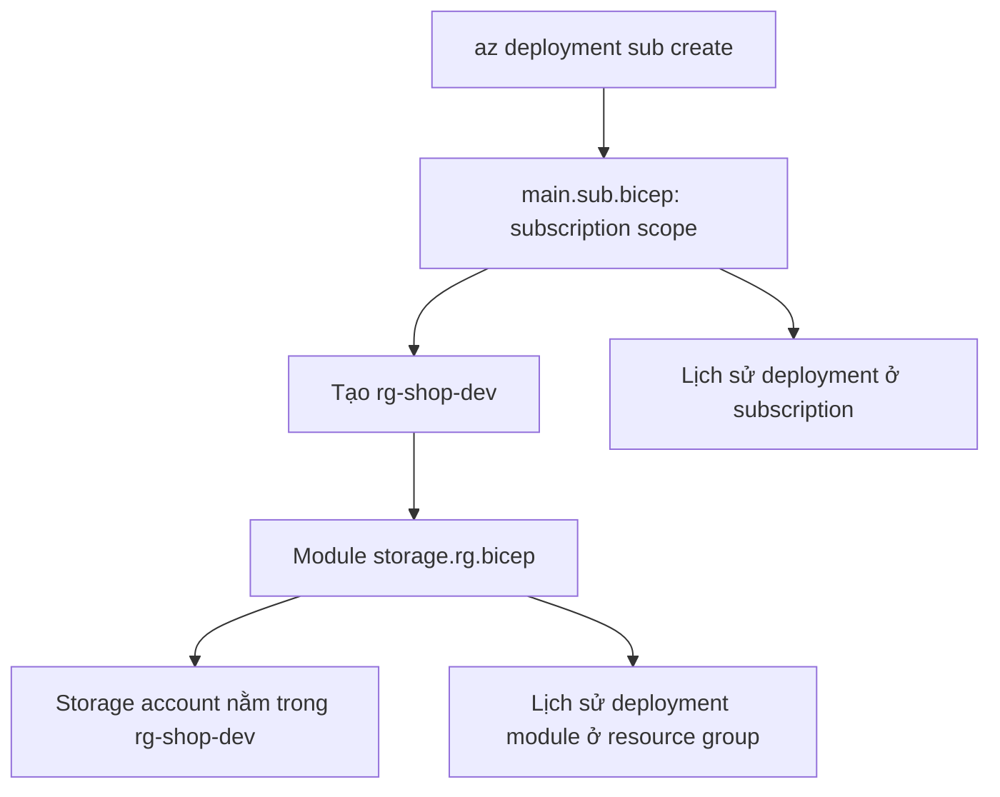
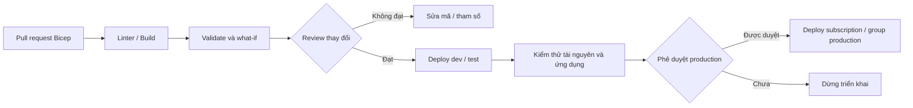

# Triển khai theo phạm vi resource group và subscription

## 1. Bài toán và mục tiêu học tập

Khi mô tả hạ tầng bằng mã (*Infrastructure as Code* – IaC) trên Microsoft Azure, một câu hỏi quan trọng xuất hiện trước cả việc định nghĩa tài nguyên: **bản triển khai sẽ chạy ở phạm vi nào?** Một storage account thuộc resource group, trong khi thao tác tạo resource group hoặc áp chính sách ở cấp subscription phải thực hiện ở phạm vi rộng hơn. Chọn sai phạm vi khiến template không hợp lệ, quyền triển khai không đủ, hoặc tài nguyên được tạo ở vị trí ngoài dự kiến.

Trong chương **Hạ tầng dưới dạng mã** của mô-đun `CLOUD_PROVIDERS_AZURE`, chúng ta sẽ dùng **Bicep**, **Azure Resource Manager (ARM)** và **Azure CLI** để triển khai đúng hai phạm vi phổ biến: **resource group** và **subscription**. Đây là một phần nền tảng khi tổ chức ứng dụng Azure từ subscription, resource group, Microsoft Entra ID đến mạng, dịch vụ tính toán, lưu trữ, giám sát, bảo mật và quản lý chi phí.

Hoàn thành bài học, bạn có thể:

- Phân biệt phạm vi triển khai, phạm vi quản lý tài nguyên và phạm vi cấp quyền Azure RBAC.
- Chọn `targetScope = 'resourceGroup'` hoặc `targetScope = 'subscription'` theo loại tài nguyên muốn tạo.
- Viết Bicep tạo storage account trong một resource group hiện có.
- Viết Bicep ở cấp subscription để **tạo resource group** và gọi module triển khai vào group vừa tạo.
- Sử dụng `az deployment group ...` và `az deployment sub ...` với bước validate, what-if và create.
- Nhận diện vấn đề về subscription đang chọn, region, quyền, Azure Policy, sự trùng tên và thay đổi ngoài dự kiến.

**Tình huống xuyên suốt:** đội phát triển ứng dụng `Shop API` muốn tạo `rg-shop-dev` trong một subscription Azure, sau đó cấp phát một storage account riêng cho môi trường dev. Khi mở rộng sang test và production, đội muốn tái sử dụng cùng module hạ tầng nhưng vẫn giữ ranh giới phân quyền và cấu hình rõ ràng.

## 2. Hiểu đúng phạm vi trong Azure Resource Manager

Hệ thống Azure có cấu trúc quản lý theo thứ bậc:

```mermaid
flowchart TD
    T[Tenant Microsoft Entra ID] --> MG[Management group (có thể có nhiều cấp)]
    MG --> S[Subscription]
    S --> RG1[Resource group: rg-shop-dev]
    S --> RG2[Resource group: rg-shop-prod]
    RG1 --> R1[Storage account]
    RG1 --> R2[App Service]
    RG2 --> R3[Storage account production]
```

Trong mô hình này, một tài nguyên ARM như storage account có định danh dạng:

```text
/subscriptions/<subscription-id>
  /resourceGroups/<resource-group-name>
  /providers/Microsoft.Storage/storageAccounts/<storage-account-name>
```

Một resource group cũng là một tài nguyên ARM, nhưng được tạo ở **subscription scope**. Các thành phần quản trị như policy assignment hoặc role assignment có thể tồn tại ở nhiều phạm vi, tùy loại tài nguyên, API và quyền của người triển khai.

| Phạm vi | Bicep `targetScope` | Lệnh Azure CLI | Dùng khi | Ví dụ |
|---|---|---|---|---|
| Resource group | `'resourceGroup'` (mặc định) | `az deployment group ...` | Tạo/cập nhật tài nguyên bên trong một resource group **đã tồn tại** | Storage account, virtual network, App Service |
| Subscription | `'subscription'` | `az deployment sub ...` | Tạo resource group hoặc cấu hình tài nguyên quản trị tại cấp subscription | Resource group, một số policy/role assignment và budget |
| Management group | `'managementGroup'` | `az deployment mg ...` | Quản trị nhiều subscription theo cấu trúc tổ chức | Policy assignment ở management group |
| Tenant | `'tenant'` | `az deployment tenant ...` | Một số cấu hình ARM cấp tenant | Một số tài nguyên/quyền quản trị đặc thù |

Bài học tập trung vào hai hàng đầu. Các phạm vi management group và tenant được giới thiệu để thấy rằng subscription không phải tầng cao nhất. **Không phải loại tài nguyên nào cũng được hỗ trợ ở mọi phạm vi**: ví dụ, storage account được tạo ở resource group; việc gán `targetScope = 'subscription'` không biến storage account thành tài nguyên cấp subscription.

### Phân biệt ba khái niệm dễ nhầm

1. **Deployment scope:** nơi ARM thực thi deployment và ghi nhận lịch sử của deployment; quyết định tài nguyên/module nào có thể khai báo trực tiếp.
2. **Resource scope:** nơi tài nguyên được sở hữu, chẳng hạn storage account nằm trong `rg-shop-dev` dù được kích hoạt từ một deployment cấp subscription thông qua module.
3. **Authorization scope:** nơi danh tính được cấp quyền qua Azure RBAC. Quyền `Contributor` tại một resource group không tự cho phép tạo resource group mới ở subscription.

Thêm một phân biệt quan trọng: **`location` của deployment cấp subscription là vùng lưu metadata deployment**, còn `location` bên trong định nghĩa storage account hoặc resource group là vùng đặt tài nguyên tương ứng. Chúng có thể khác nhau và phải được chỉ định có chủ đích.

## 3. Chuẩn bị môi trường thực hành

Bạn cần có một Azure subscription được phép sử dụng, Azure CLI đã cài và đăng nhập, tiện ích Bicep tương thích với Azure CLI, cùng quyền thích hợp để triển khai. Với một môi trường đào tạo, dùng subscription sandbox hoặc resource group được cấp riêng để hạn chế chi phí và tránh tác động hệ thống thật.

Đăng nhập và **xác nhận subscription** trước khi chạy lệnh:

```bash
az login
az account list --output table

# Thay bằng subscription ID được phép sử dụng.
SUBSCRIPTION_ID="<subscription-id>"
az account set --subscription "$SUBSCRIPTION_ID"
az account show --query '{name:name,id:id,tenantId:tenantId}' --output table

# Xác minh Bicep CLI hoạt động.
az bicep version
```

Khi chạy tự động trong CI/CD, nên truyền thêm `--subscription "$SUBSCRIPTION_ID"` ở từng lệnh triển khai để không phụ thuộc vào subscription mặc định của phiên làm việc. Sử dụng Managed Identity hoặc federated identity với OIDC thay cho việc lưu thông tin đăng nhập dài hạn vào pipeline.

Các ví dụ dùng vùng `southeastasia` (mã vùng Azure). Dịch vụ, SKU, chính sách và quota cần được kiểm tra theo subscription, region và tổ chức của bạn. Tên storage account phải dài **3–24 ký tự**, chỉ gồm chữ thường và chữ số, đồng thời **duy nhất trên toàn Azure**.

## 4. Triển khai trực tiếp ở phạm vi resource group

### 4.1. Khi nào chọn `resourceGroup`?

Đây là lựa chọn phù hợp nếu resource group đã được tạo sẵn, đội phát triển chỉ được quản lý tài nguyên trong group đó, hoặc một module cần tái sử dụng cho nhiều môi trường. Trong phạm vi này, Bicep có thể gọi `resourceGroup()` để lấy thông tin group đích.

Tạo tệp minh họa **`storage.rg.bicep`** với nội dung:

```bicep
targetScope = 'resourceGroup'

@description('Tên storage account: 3-24 ký tự chữ thường hoặc số, duy nhất toàn Azure.')
param storageName string

@allowed([
  'dev'
  'test'
  'prod'
])
@description('Môi trường triển khai.')
param environment string

@description('Region đặt storage account.')
param location string = resourceGroup().location

resource storage 'Microsoft.Storage/storageAccounts@2023-05-01' = {
  name: storageName
  location: location
  tags: {
    environment: environment
    managedBy: 'bicep'
  }
  sku: {
    name: 'Standard_LRS'
  }
  kind: 'StorageV2'
  properties: {
    allowBlobPublicAccess: false
    minimumTlsVersion: 'TLS1_2'
    supportsHttpsTrafficOnly: true
  }
}

output storageAccountId string = storage.id
output storageAccountName string = storage.name
```

**Giải thích:**

- `targetScope = 'resourceGroup'` xác định nơi triển khai. Có thể bỏ dòng này vì đây là scope mặc định của Bicep, nhưng viết tường minh giúp người đọc không nhầm với deployment cấp subscription.
- `resourceGroup().location` lấy region metadata của resource group; nó không buộc mọi tài nguyên phải ở đúng region đó. Ở ví dụ, ta chọn dùng cùng region để đơn giản hóa.
- `Microsoft.Storage/storageAccounts@2023-05-01` là kiểu tài nguyên và API version dùng cho ví dụ; chọn API version được Azure hỗ trợ khi áp dụng vào dự án thật.
- `tags` hỗ trợ tìm kiếm, báo cáo và phân loại; chúng không tự giới hạn chi phí hay cấp quyền truy cập.
- `output` trả về ID và tên tài nguyên, thuận tiện để kiểm tra hoặc truyền cho bước tiếp theo của pipeline.

### 4.2. Tạo group trước rồi triển khai

Vì group deployment yêu cầu resource group **đã tồn tại**, có thể tạo group bằng Azure CLI trước:

```bash
RG_NAME="rg-shop-dev"
RG_LOCATION="southeastasia"
STORAGE_NAME="<ten-storage-hop-le-va-duy-nhat>"

az group create \
  --subscription "$SUBSCRIPTION_ID" \
  --name "$RG_NAME" \
  --location "$RG_LOCATION"

az deployment group validate \
  --subscription "$SUBSCRIPTION_ID" \
  --resource-group "$RG_NAME" \
  --template-file storage.rg.bicep \
  --parameters storageName="$STORAGE_NAME" environment=dev

az deployment group what-if \
  --subscription "$SUBSCRIPTION_ID" \
  --resource-group "$RG_NAME" \
  --template-file storage.rg.bicep \
  --parameters storageName="$STORAGE_NAME" environment=dev

az deployment group create \
  --subscription "$SUBSCRIPTION_ID" \
  --resource-group "$RG_NAME" \
  --name shop-storage-dev \
  --template-file storage.rg.bicep \
  --parameters storageName="$STORAGE_NAME" environment=dev
```

Thay giá trị `STORAGE_NAME` bằng một tên thực sự hợp lệ, ví dụ kết hợp prefix, mã môi trường và hậu tố hash ổn định; không dùng nguyên ký tự `<` hoặc `>` trong tên. Lệnh `az group create` tự thân là thao tác cấp subscription và cần quyền tương ứng; nếu bạn chỉ có quyền tại resource group đã được quản trị viên tạo, hãy **bỏ qua** lệnh này và dùng group sẵn có.

Sau deployment, kiểm tra tài nguyên thực tế:

```bash
az deployment group show \
  --subscription "$SUBSCRIPTION_ID" \
  --resource-group "$RG_NAME" \
  --name shop-storage-dev \
  --query '{state:properties.provisioningState,outputs:properties.outputs}'

az storage account show \
  --subscription "$SUBSCRIPTION_ID" \
  --resource-group "$RG_NAME" \
  --name "$STORAGE_NAME" \
  --query '{id:id,location:location,kind:kind}'
```

`validate` kiểm tra tính hợp lệ và điều kiện triển khai mà dịch vụ có thể xác minh trước. `what-if` dự báo thay đổi có thể xảy ra; **chỉ `create` mới yêu cầu ARM thực hiện triển khai**. What-if không phải cam kết tuyệt đối: các biểu thức phụ thuộc trạng thái runtime hoặc hành vi provider có thể làm kết quả khác dự kiến, vì vậy vẫn phải giám sát deployment thật.

## 5. Triển khai ở phạm vi subscription và gọi module cấp resource group

### 5.1. Vì sao cần subscription deployment?

Nếu một pipeline phải cấp phát cả resource group lẫn các tài nguyên trong group, deployment bắt đầu từ subscription scope là phù hợp. Từ phạm vi này có thể tạo `Microsoft.Resources/resourceGroups`, sau đó gọi một **Bicep module** có `targetScope = 'resourceGroup'` vào group vừa tạo.

Mô hình thực thi:



### 5.2. Tệp Bicep điều phối ở subscription

Tạo **`main.sub.bicep`** bên cạnh `storage.rg.bicep`:

```bicep
targetScope = 'subscription'

@allowed([
  'dev'
  'test'
  'prod'
])
param environment string

@description('Region đặt resource group và storage account.')
param rgLocation string = 'southeastasia'

@description('Tên ứng dụng, dùng cho quy ước tên tài nguyên.')
param workload string = 'shop'

var rgName = 'rg-${workload}-${environment}'
var storageName = 'st${uniqueString(subscription().id, rgName)}'

resource appRg 'Microsoft.Resources/resourceGroups@2022-09-01' = {
  name: rgName
  location: rgLocation
  tags: {
    workload: workload
    environment: environment
    managedBy: 'bicep'
  }
}

module storageModule './storage.rg.bicep' = {
  name: 'deploy-storage-${environment}'
  scope: appRg
  params: {
    storageName: storageName
    environment: environment
    location: rgLocation
  }
}

output resourceGroupName string = appRg.name
output storageAccountId string = storageModule.outputs.storageAccountId
```

Ở đây có hai lớp triển khai:

1. `appRg` là resource group được khai báo **trực tiếp tại subscription scope**.
2. `storageModule` có `scope: appRg`, nghĩa là thực thi tệp `storage.rg.bicep` tại resource group vừa tạo. Bicep suy ra quan hệ phụ thuộc cần thiết: module chỉ triển khai sau khi group sẵn sàng.

Hàm `uniqueString(subscription().id, rgName)` sinh hậu tố **ổn định** dựa trên đầu vào, giúp giảm nguy cơ trùng tên khi tái triển khai. Tuy nhiên, hậu tố này không phải công cụ đăng ký tên toàn cục và không đảm bảo tuyệt đối không xung đột; khi có tên bị chiếm, cần đổi chiến lược đặt tên hoặc tham số theo quy ước của tổ chức. Trong ví dụ `st` cộng hậu tố 13 ký tự tạo ra tên hợp lệ về độ dài và bộ ký tự.

### 5.3. Validate, what-if rồi tạo ở subscription

```bash
az bicep build --file main.sub.bicep

az deployment sub validate \
  --subscription "$SUBSCRIPTION_ID" \
  --location southeastasia \
  --template-file main.sub.bicep \
  --parameters environment=dev rgLocation=southeastasia

az deployment sub what-if \
  --subscription "$SUBSCRIPTION_ID" \
  --location southeastasia \
  --template-file main.sub.bicep \
  --parameters environment=dev rgLocation=southeastasia

az deployment sub create \
  --subscription "$SUBSCRIPTION_ID" \
  --location southeastasia \
  --name shop-dev-platform \
  --template-file main.sub.bicep \
  --parameters environment=dev rgLocation=southeastasia
```

`--location` ở các lệnh `deployment sub` là tham số cần thiết để ARM lưu thông tin deployment cấp subscription. `rgLocation` mới là tham số mô tả nơi đặt resource group và storage account trong Bicep. Khi triển khai lại với **cùng tên deployment**, hãy giữ nhất quán region metadata; đổi region của deployment nhưng giữ nguyên tên có thể gây lỗi `InvalidDeploymentLocation`.

Xem kết quả:

```bash
az deployment sub show \
  --subscription "$SUBSCRIPTION_ID" \
  --name shop-dev-platform \
  --query '{state:properties.provisioningState,outputs:properties.outputs}'

az group show \
  --subscription "$SUBSCRIPTION_ID" \
  --name rg-shop-dev \
  --query '{name:name,location:location,tags:tags}'
```

Kết quả mong đợi là deployment cấp subscription có trạng thái `Succeeded`, group `rg-shop-dev` tồn tại, và output `storageAccountId` trỏ đến storage account nằm trong group đó. Nếu Bicep báo lỗi về subscription scope, hãy kiểm tra `targetScope`, loại tài nguyên khai báo trực tiếp và thuộc tính `scope` của module.

## 6. Tái sử dụng module cho nhiều môi trường và subscription

Cùng một tệp `storage.rg.bicep` có thể phục vụ nhiều môi trường bằng cách đổi tham số thay vì sao chép ba phiên bản mã:

| Môi trường | Subscription được chọn | Resource group | Mục tiêu quản trị |
|---|---|---|---|
| dev | Sandbox / non-production | `rg-shop-dev` | Dễ thử nghiệm, chi phí có giới hạn |
| test | Non-production (có thể chung subscription với dev) | `rg-shop-test` | Kiểm thử có dữ liệu và quyền tách biệt |
| production | Subscription production riêng nếu tổ chức yêu cầu | `rg-shop-prod` | Quyền tối thiểu, policy, giám sát và khôi phục nghiêm ngặt |

Khi chuyển deployment sang subscription khác, **phải chỉ rõ subscription ID** và xác minh danh tính có quyền tại đó. Ví dụ để kiểm tra hạ tầng production trước khi tạo:

```bash
PROD_SUBSCRIPTION_ID="<production-subscription-id>"

az deployment sub what-if \
  --subscription "$PROD_SUBSCRIPTION_ID" \
  --location southeastasia \
  --template-file main.sub.bicep \
  --parameters environment=prod rgLocation=southeastasia
```

Để module ở một deployment truy cập resource group thuộc **subscription khác**, Bicep có cơ chế xác định scope bằng `resourceGroup(subscriptionId, resourceGroupName)` trong ngữ cảnh hỗ trợ. Tuy vậy, việc khai báo cross-subscription deployment **không tự cấp quyền**: pipeline phải có quyền ARM tương ứng ở subscription nguồn, subscription đích và phạm vi tài nguyên liên quan. Cần quản lý deployment history, audit, dependency và lỗi trên từng subscription.

Một thực hành hữu ích là dùng **Bicep parameter file** (`.bicepparam`) cho mỗi môi trường để lưu tham số không nhạy cảm như region, SKU, tên và tags; bí mật nên được lấy qua cơ chế secret được hỗ trợ, chẳng hạn Key Vault, thay vì hard-code vào tham số hoặc lưu token trong mã nguồn.

## 7. Quyền, chính sách và an toàn khi triển khai

### 7.1. Azure RBAC hoạt động theo phạm vi

| Công việc | Phạm vi quyền cần xét | Lưu ý |
|---|---|---|
| Tạo storage account trong group sẵn có | Resource group đích hoặc phạm vi cha phù hợp | Role như `Contributor` tại group thường đủ cho tài nguyên thông dụng, nhưng Azure Policy có thể chặn |
| Tạo resource group mới | Subscription đích | Quyền chỉ tại một resource group không đủ để tạo group mới |
| Tạo role assignment bằng IaC | Scope của role assignment | Cần quyền `Microsoft.Authorization/roleAssignments/write` được cấp thích hợp, không suy ra từ `Contributor` thông thường |
| Áp policy/lock ở subscription | Subscription | Cần quyền thao tác policy/lock tương ứng; role deployment cơ bản có thể chưa đủ |
| Chạy module sang subscription khác | Scope đích ở subscription khác | Federated credential hoặc tài khoản pipeline phải được cấp quyền riêng |

**Microsoft Entra ID** xác thực danh tính; **Azure RBAC** xác định danh tính đó được làm gì ở scope nào. Azure Policy đánh giá tính phù hợp với quy định tổ chức, ví dụ chặn region không cho phép hoặc đòi tags bắt buộc. Resource lock có thể ngăn xóa/sửa, kể cả khi danh tính có quyền ghi phù hợp; cần dự trù cách quản lý lock trong vòng đời triển khai.

Vì module cấp subscription có khả năng ảnh hưởng diện rộng, nên tách danh tính hoặc pipeline **bootstrap subscription** khỏi danh tính chỉ triển khai ứng dụng trong resource group. Cấp quyền tối thiểu, giới hạn người phê duyệt thay đổi production và lưu nhật ký ai đã tạo, sửa hoặc xóa tài nguyên.

### 7.2. Kiểm soát drift và vòng đời tài nguyên

IaC lý tưởng phải có tính **idempotent**: áp dụng lại cùng đầu vào nhiều lần tạo ra trạng thái mong muốn tương đương, không liên tục sinh tài nguyên mới ngoài chủ đích. Tuy vậy, idempotency còn phụ thuộc vào quy tắc đặt tên, cấu hình provider và việc có thành viên sửa trực tiếp trên Azure Portal hay không.

- **What-if trước create:** rà soát mục `Create`, `Modify`, `Delete` và các thay đổi cấp quyền; nếu khác ngoài dự kiến, dừng lại điều tra.
- **Deployment mặc định theo hướng incremental:** tài nguyên không còn khai báo trong template thường **không tự động bị xóa** chỉ vì bị bỏ khỏi mã. Muốn quản lý xóa có kiểm soát, hãy đánh giá tính phù hợp của Azure Deployment Stacks hoặc quy trình hủy tài nguyên riêng.
- **Drift:** thay đổi thủ công sau deployment có thể tạo sai lệch. Đối chiếu trạng thái thực tế bằng what-if, Azure Resource Graph, Policy compliance và nhật ký thay đổi phù hợp.
- **Locks và dữ liệu:** tránh xóa group chứa dữ liệu quan trọng chỉ vì muốn làm sạch môi trường; xác nhận backup, retention và tài nguyên phụ thuộc trước khi xóa.

Chú ý rằng triển khai Bicep không có khả năng “undo” giao dịch tổng thể. Một deployment thất bại giữa chừng có thể để lại tài nguyên đã tạo thành công. Khi khôi phục, hãy đọc trạng thái từng operation và chạy lại template đã sửa hoặc thực hiện kế hoạch rollback có kiểm soát.

## 8. Tích hợp vào pipeline CI/CD

Trong hệ thống thực tế, triển khai IaC nên là quy trình có thể kiểm toán:



Với `Shop API`, nhóm nền tảng có thể sở hữu `main.sub.bicep` để tạo resource group, thiết lập nền tảng quản trị và phân quyền. Nhóm ứng dụng sở hữu module cấp resource group nhằm tạo storage, web app và các thành phần ứng dụng. Pipeline phải áp dụng đúng **cùng phiên bản template đã được review** và tham số được duyệt cho từng môi trường.

Ở bước production, nên ghi rõ người phê duyệt, subscription ID, deployment name, template commit, kết quả what-if, thay đổi dự báo, thời gian và kết quả deployment. Không lưu secrets trong output deployment, log CLI hay artifact của pipeline. Ưu tiên xác thực CI/CD qua OIDC với Microsoft Entra ID hoặc Managed Identity nếu runner hỗ trợ.

Đừng trộn lẫn “triển khai được tài nguyên” với “ứng dụng sẵn sàng phục vụ”: sau khi tạo resource, còn cần cấu hình networking, DNS, quyền truy cập dữ liệu, ứng dụng, telemetry, alerts, backup và smoke test phù hợp.

## 9. Sự cố thường gặp và cách chẩn đoán

| Triệu chứng | Nguyên nhân có thể gặp | Cách kiểm tra/xử lý |
|---|---|---|
| `ResourceGroupNotFound` ở group deployment | Resource group chưa được tạo hoặc sai subscription | Kiểm tra `az account show`, `--subscription`, `az group show`; tạo group qua subscription scope nếu được phép |
| `AuthorizationFailed` khi tạo resource group | Danh tính chỉ có quyền trong resource group cũ | Kiểm tra scope của role assignment; nhờ quản trị viên cấp quyền cần thiết tại subscription |
| Bicep báo kiểu tài nguyên không hợp lệ tại subscription | Khai báo storage account trực tiếp trong `targetScope = 'subscription'` | Chuyển tài nguyên xuống module `targetScope = 'resourceGroup'` và đặt `scope` vào group đích |
| `InvalidDeploymentLocation` | Tên deployment cấp subscription đã tồn tại với location metadata khác | Dùng lại location metadata ban đầu hoặc chọn deployment name mới sau khi xem lịch sử |
| `StorageAccountAlreadyTaken` / tên không hợp lệ | Storage account name trùng toàn cục hoặc sai quy tắc ký tự | Chọn tên chữ thường/số dài 3–24 ký tự; thêm hậu tố xác định phù hợp |
| `RequestDisallowedByPolicy` | Subscription có Azure Policy chặn region, SKU, tags hoặc cấu hình | Kiểm tra policy assignment và điều chỉnh template theo yêu cầu quản trị |
| `ScopeLocked` / lỗi xóa hoặc sửa tài nguyên | Có resource lock hoặc deny assignment | Kiểm tra lock/deny ở scope hiện tại và scope cha; chỉ thay đổi qua quy trình được phép |
| What-if không đúng kỳ vọng | Tham số sai, drift, thuộc tính runtime hoặc provider chưa thể dự đoán chính xác | So sánh tham số và trạng thái thực tế; xem deployment operations và tài liệu API của tài nguyên |

Để điều tra một deployment bị lỗi, bắt đầu từ danh sách operation thay vì chỉ nhìn thông báo tổng quát:

```bash
# Với deployment resource group:
az deployment operation group list \
  --subscription "$SUBSCRIPTION_ID" \
  --resource-group "$RG_NAME" \
  --name shop-storage-dev \
  --output table

# Với deployment subscription:
az deployment operation sub list \
  --subscription "$SUBSCRIPTION_ID" \
  --name shop-dev-platform \
  --output table
```

Kết hợp thông tin operation với **Azure Activity Log**, Azure Policy và cấu hình quyền của principal triển khai để tìm đúng nguyên nhân. Một lỗi quyền ở module resource group có thể xuất hiện sau khi resource group cấp subscription đã tạo thành công; không được suy ra rằng toàn bộ deployment đã rollback.

## 10. Thực hành tổng hợp

**Yêu cầu:** xây dựng nền tảng hạ tầng dev/test cho `Shop API` bằng hai tệp Bicep trong bài. Thực hiện trong subscription thử nghiệm được phép dùng và tự đặt tên storage account hợp lệ.

1. **Nhận diện scope:** giải thích vì sao tạo `rg-shop-dev` yêu cầu subscription deployment, còn storage account nằm trong resource group. Nêu điểm khác nhau giữa deployment location và resource location.
2. **Thực hiện ở group:** tạo `rg-shop-dev` trước (hoặc dùng group có sẵn), chạy `storage.rg.bicep` với `validate`, `what-if`, `create`; xác nhận output trả về storage account đúng subscription/group.
3. **Thực hiện ở subscription:** dùng `main.sub.bicep` với `environment=test`; kiểm tra kết quả what-if, tạo `rg-shop-test` và module storage tương ứng. Xác nhận hai môi trường không dùng chung storage account.
4. **Kiểm tra idempotency:** chạy lại what-if với đúng tham số vừa áp dụng; giải thích các thay đổi còn được dự báo (nếu có) trước khi quyết định chạy create lần nữa.
5. **Kiểm tra lỗi có kiểm soát:** thử validate với một storage name không hợp lệ trong phạm vi group; đọc thông báo lỗi và điều chỉnh. Không cố tình xóa hoặc thay đổi tài nguyên production.
6. **Thiết kế phân quyền:** đề xuất các role/scope cho tài khoản platform bootstrap và tài khoản deploy ứng dụng, nêu cách chặn tài khoản dev tạo resource group hoặc sửa tài nguyên production.

**Tiêu chí hoàn thành:** giải thích đúng hai phạm vi; Bicep có `targetScope` phù hợp; tài nguyên trong group tạo ra đúng nơi; lệnh group và sub hoạt động sau bước kiểm tra; hiểu rõ quyền và subscription đang sử dụng; có cách đọc kết quả what-if và operation khi lỗi.

**Câu hỏi tự kiểm tra:**

- Có thể chạy `az deployment group create` để tạo chính resource group chưa tồn tại không? Vì sao?
- Vì sao một template tại subscription scope phải sử dụng module riêng khi muốn tạo storage account trong resource group?
- Khi `az deployment sub create --location` bằng `southeastasia`, có phải mọi resource trong template đều nằm tại vùng đó không?
- Quyền `Contributor` trên `rg-shop-dev` có cho phép tạo `rg-shop-test` không? Nếu không, cần xem quyền ở đâu?
- Nếu xóa định nghĩa storage account khỏi Bicep rồi chạy lại deployment incremental, có thể khẳng định storage account sẽ bị xóa không?

## 11. Tài liệu để đọc thêm

- Microsoft Learn – [Deployment scopes trong Azure Resource Manager](https://learn.microsoft.com/azure/azure-resource-manager/templates/deploy-to-resource-group).
- Microsoft Learn – [Tạo resource ở subscription scope với Bicep](https://learn.microsoft.com/azure/azure-resource-manager/bicep/deploy-to-subscription).
- Microsoft Learn – [Tạo resource ở resource group scope với Bicep](https://learn.microsoft.com/azure/azure-resource-manager/bicep/deploy-to-resource-group).
- Microsoft Learn – [Module Bicep](https://learn.microsoft.com/azure/azure-resource-manager/bicep/modules).
- Microsoft Learn – [What-if deployment](https://learn.microsoft.com/azure/azure-resource-manager/bicep/deploy-what-if).
- Microsoft Learn – [Azure RBAC scopes](https://learn.microsoft.com/azure/role-based-access-control/scope-overview).

