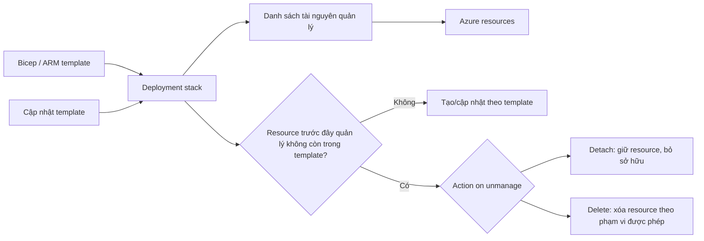
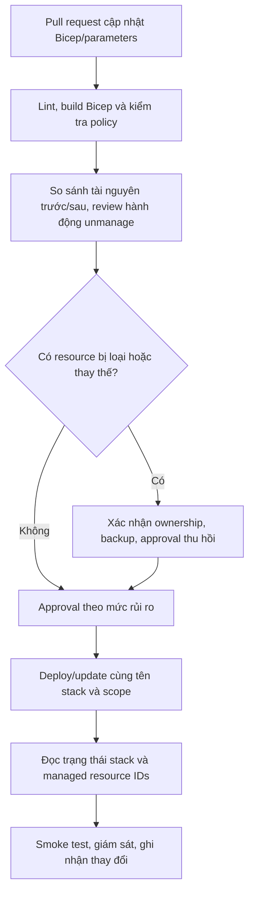

# Deployment stack và quản lý vòng đời tập tài nguyên

> **Chương:** Hạ tầng dưới dạng mã (Infrastructure as Code — IaC)  
> **Mô-đun:** `CLOUD_PROVIDERS_AZURE` — học cách thiết kế, triển khai, giám sát, bảo vệ và kiểm soát chi phí hệ thống trên Microsoft Azure, từ subscription, resource group và Microsoft Entra ID đến mạng, tính toán, lưu trữ và dữ liệu.

## Mục tiêu bài học

Sau bài này, người học có thể:

1. Giải thích **Azure Deployment Stacks** giải quyết vấn đề vòng đời tài nguyên nào trong quy trình dùng ARM template và Bicep.
2. Phân biệt **stack**, **deployment** thông thường, **resource group**, **Azure Policy**, **RBAC** và **resource lock**.
3. Nhận diện **tập tài nguyên do stack quản lý**, điều gì xảy ra khi thêm, cập nhật, loại bỏ tài nguyên khỏi định nghĩa hoặc xóa cả stack.
4. Lựa chọn có chủ đích các hành động **`detachAll`**, **`deleteResources`** và **`deleteAll`**, đặc biệt đối với tài nguyên lưu dữ liệu.
5. Hiểu các chế độ bảo vệ **`none`**, **`denyDelete`** và **`denyWriteAndDelete`**, cùng ảnh hưởng đến thay đổi ngoài quy trình IaC.
6. Tạo và cập nhật một stack minh họa bằng Bicep/Azure CLI, đối chiếu tài nguyên thực tế với cấu hình mong muốn và lên kế hoạch thu hồi an toàn.

## 1. Vì sao cần quản lý vòng đời theo tập tài nguyên?

Một ứng dụng trên Azure có thể bao gồm App Service, Storage Account, Azure SQL, Key Vault, mạng ảo, Application Insights và các cấu hình liên quan. Nhóm triển khai thường quản lý chúng bằng **Bicep** hoặc **ARM template**. Khi ứng dụng lớn dần, có ba câu hỏi xuất hiện:

- **Tập nào thuộc về một lần triển khai?** Cùng một resource group có thể chứa tài nguyên do nhiều nhóm quản lý, tài nguyên tạo thủ công và các dịch vụ dùng chung.
- **Khi bỏ một tài nguyên khỏi mã IaC, nó có biến mất khỏi Azure không?** Với triển khai ARM thông thường ở chế độ incremental, việc xóa dòng khai báo không có nghĩa tài nguyên cũ bị xóa.
- **Làm sao bảo vệ những tài nguyên đã được IaC quản lý?** Một người hoặc một pipeline khác có thể thay đổi/xóa tài nguyên trực tiếp, tạo sai lệch giữa mã nguồn và trạng thái thực.

**Azure Deployment Stacks** cung cấp một tài nguyên quản lý tập hợp các Azure resources được triển khai từ một ARM template hoặc Bicep. Stack theo dõi các tài nguyên thuộc tập quản lý, hỗ trợ xử lý **resource bị loại khỏi tập** và có thể áp dụng **deny settings** để hạn chế thay đổi trực tiếp.

Hình dung stack như một **ranh giới sở hữu vòng đời** của các tài nguyên được khai báo. Nó không thay thế template: template vẫn mô tả cấu hình mong muốn; stack bổ sung thông tin về **tài nguyên nào đang được quản lý** và **làm gì khi tài nguyên không còn được quản lý**.

### Tình huống

Nhóm `orders` sở hữu ba resource trong một resource group: App Service Plan, Web App và Storage Account. Nhóm nền tảng cũng có một Key Vault dùng chung trong cùng resource group. Khi nhóm `orders` ngừng dùng Storage Account:

- **Triển khai incremental thông thường:** Storage Account có thể tiếp tục tồn tại dù không còn trong template.
- **Deployment Stack với `detachAll`:** Storage Account rời danh sách quản lý của stack nhưng vẫn tồn tại trên Azure.
- **Deployment Stack với chế độ xóa phù hợp:** Storage Account có thể bị xóa theo hành động được yêu cầu khi nó không còn do stack quản lý.

Chính sách thứ hai hoặc thứ ba phải là **quyết định có chủ đích**, dựa trên quyền sở hữu dữ liệu, phương án sao lưu và kế hoạch thu hồi tài nguyên.

## 2. Các khái niệm và ranh giới

| Khái niệm | Vai trò | Điều không nên nhầm |
|---|---|---|
| **Bicep / ARM template** | Mô tả trạng thái cấu hình mong muốn của các resource | Không tự ghi nhớ đầy đủ quyền sở hữu vòng đời của một nhóm resource qua các lần chạy |
| **ARM deployment thông thường** | Thực thi template trên scope chỉ định | Xóa khai báo khỏi một incremental deployment thường không xóa tài nguyên Azure đã tồn tại |
| **Deployment stack** | Là tài nguyên Azure theo dõi và quản lý một tập tài nguyên từ template, kèm lựa chọn xử lý khi bỏ quản lý | Không đồng nhất với resource group hoặc một lần chạy CI/CD |
| **Resource group** | Container logic cho Azure resources và điểm đặt RBAC, policy, lifecycle ở mức group | Không có nghĩa mọi resource trong group đều do cùng một stack sở hữu |
| **Azure RBAC** | Xác định principal nào có quyền hành động trên scope | Không tự triển khai trạng thái Bicep và không thay thế deny settings |
| **Azure Policy** | Kiểm tra/cưỡng chế quy tắc quản trị tài nguyên theo assignment | Không phải danh sách sở hữu resource do một stack khai báo |
| **Resource lock** | Khóa xóa hoặc sửa tài nguyên ở cấp quản trị bằng lock | Là cơ chế khác với deny assignments do deployment stack tạo |

**Stack là resource riêng:** nó có tên, scope, trạng thái triển khai và danh sách resource do nó quản lý. Đừng coi tên stack tương đương tên resource group: hai đối tượng có vòng đời khác nhau.

**Managed resource** là resource mà stack theo dõi. Resource cùng nằm trong resource group nhưng không thuộc template hoặc không còn được quản lý bởi stack có thể nằm ngoài tập này. Một tài nguyên được bỏ khỏi định nghĩa có thể trở thành **unmanaged** sau lần cập nhật stack, dẫn tới detach hoặc delete tùy cấu hình.

### Phân biệt cấu hình mong muốn và trạng thái thực



Stack **không chạy liên tục để tự sửa mọi thay đổi ngoài quy trình**. Việc áp lại template diễn ra khi có deployment/update; deny settings có thể giúp ngăn một số thay đổi ngoài luồng. Cần dùng thêm Azure Activity Log, giám sát cấu hình và quy trình review để phát hiện sai lệch.

## 3. Phạm vi của deployment stack

Azure triển khai tài nguyên theo **scope**. Deployment stack hỗ trợ mô hình vận hành ở cấp **resource group**, **subscription** và **management group** phù hợp với loại tài nguyên được triển khai và quyền được cấp.

| Scope đặt stack | Tình huống sử dụng | Điều cần kiểm tra |
|---|---|---|
| **Resource group** | Một ứng dụng/đơn vị vận hành một số resource trong resource group | Tài nguyên trong group, quyền tạo/cập nhật/xóa ở group, ranh giới với resource nhóm khác |
| **Subscription** | Một tập hạ tầng gồm nhiều resource group hoặc tài nguyên cấp subscription | Quyền ở subscription và các scope đích, tác động khi xử lý resource group được quản lý |
| **Management group** | Quản trị các cấu hình/tài nguyên phù hợp scope tổ chức | Quyền cấp quản trị, hậu quả trên nhiều subscription và kế hoạch thay đổi tập trung |

Không nên chọn scope cao hơn chỉ để tiện triển khai. Scope rộng kéo theo rủi ro lớn hơn khi template hoặc hành động xóa bị cấu hình sai.

**Nguyên tắc thiết kế:** mỗi stack nên có mục đích và nhóm chịu trách nhiệm rõ ràng; tránh dùng nhiều stack hoặc các pipeline độc lập để quản lý chồng lấn cùng một resource. Với tài nguyên dùng chung, xác định người sở hữu riêng và dùng tham chiếu đến resource hiện có thay vì vô tình đưa nó vào vòng đời xóa của ứng dụng.

Các **module Bicep** giúp tổ chức mã thành thành phần tái sử dụng. Tuy nhiên, **module không phải stack riêng** chỉ vì nó có file riêng: danh sách tài nguyên được stack quản lý phụ thuộc deployment thực tế và phạm vi của nó.

## 4. Vòng đời của một tập tài nguyên

### 4.1. Tạo stack lần đầu

Bạn cung cấp template, parameters, scope, tên stack, hành động khi resource không còn được quản lý và deny settings. Azure Resource Manager xử lý deployment rồi ghi nhận các resource thuộc tập quản lý.

Nếu template khai báo `web-app` và `storage`, một stack có thể quản lý cả hai. Những resource tình cờ có mặt trong cùng resource group nhưng không thuộc tập triển khai không mặc nhiên trở thành managed resource.

### 4.2. Cập nhật một resource vẫn nằm trong template

Ví dụ thay đổi cấu hình của App Service từ gói nhỏ sang gói lớn hoặc cập nhật tags. Khi cập nhật stack từ Bicep mới, ARM thực thi thay đổi trên resource còn thuộc tập quản lý, tùy loại resource, quyền và ràng buộc của Azure.

Đây là tình huống **update bình thường**; `actionOnUnmanage` không phải chính sách áp lên mọi thay đổi thuộc tính. Hành động đó dành cho resource không còn được quản lý hoặc cho lúc xóa stack.

### 4.3. Thêm resource mới

Khi Bicep được bổ sung Key Vault thuộc quyền sở hữu ứng dụng, lần cập nhật stack có thể tạo Key Vault và đưa nó vào tập quản lý. Kiểm tra trước xem tên hoặc resource ID đã tồn tại và có được quản lý bởi hệ thống khác hay chưa.

### 4.4. Bỏ resource khỏi template hoặc ngừng quản lý

Đây là khác biệt cốt lõi. Giả sử phiên bản trước có `storage`, phiên bản mới không còn khai báo resource đó. Sau khi update thành công, stack xác định resource cũ không còn thuộc danh sách mới và áp dụng lựa chọn **action on unmanage**.

| Chế độ | Khi resource rời tập quản lý | Khi xóa stack | Phù hợp khi |
|---|---|---|---|
| **`detachAll`** | Giữ resource trong Azure, ngừng theo dõi bởi stack | Bỏ stack, giữ các resource trước đó được quản lý | Di chuyển ownership, thử nghiệm an toàn, dữ liệu chưa được xác minh khả năng xóa |
| **`deleteResources`** | Xóa resource không còn quản lý; giữ resource group thuộc diện được quản lý | Xóa các resource được quản lý nhưng giữ resource group liên quan | Thu hồi tài nguyên ứng dụng mà vẫn duy trì container group |
| **`deleteAll`** | Xóa resource không còn quản lý và xóa cả managed resource group khi áp dụng | Xóa resource và managed resource group trong phạm vi khả dụng | Thu hồi toàn bộ một tập hạ tầng do stack sở hữu hoàn toàn |

**Điểm dễ nhầm:** `deleteAll` không có nghĩa sẽ tự xóa bất kỳ resource group nào chỉ vì stack đang được đặt trong đó. Chẳng hạn, một stack đặt **ở resource-group scope** không sở hữu resource group chứa nó như một resource được khai báo; việc xóa container group là thao tác vòng đời riêng. Phạm vi xóa phụ thuộc vào tài nguyên thực sự được stack quản lý.

**Rủi ro dữ liệu:** xóa Storage Account, Azure SQL hoặc Key Vault có thể làm mất dữ liệu, dịch vụ và khóa truy cập. Soft delete, backup và retention tùy dịch vụ là lớp phục hồi bổ sung, không phải lý do để bỏ qua review trước khi xóa.

### 4.5. Xóa cả stack

Xóa stack là một hành động với hậu quả phụ thuộc **action on unmanage**. Nếu chọn detach, các resource được giữ; nếu chọn chế độ xóa, Azure có thể xóa tài nguyên trong danh sách managed. Đây là hai kịch bản khác biệt rõ rệt dù cùng có thao tác “delete stack”.

Trước khi xóa, cần đối chiếu **toàn bộ danh sách managed resource IDs**, xác minh bản sao lưu và phụ thuộc của tài nguyên, lựa chọn action phù hợp, quyền của operator và ghi nhận quyết định thay đổi.

## 5. Deny settings: bảo vệ tài nguyên do stack quản lý

Deployment Stacks có thể tạo **deny assignments** giúp hạn chế chỉnh sửa hoặc xóa resource trực tiếp thông qua Azure Resource Manager. Đây là biện pháp quản trị bổ sung ở cấp tài nguyên quản lý, bên cạnh RBAC và việc bảo vệ pipeline.

| `deny-settings-mode` | Tác động khái quát | Ví dụ |
|---|---|---|
| **`none`** | Không tạo bảo vệ deny tương ứng từ stack | Phù hợp lab hoặc giai đoạn thử nghiệm, vẫn có Azure RBAC |
| **`denyDelete`** | Chặn thao tác xóa trên tài nguyên được bảo vệ theo deny assignment | Hạn chế người khác xóa App Service production ngoài quy trình |
| **`denyWriteAndDelete`** | Chặn cả ghi/thay đổi và xóa theo deny assignment | Buộc các thay đổi vào hệ thống IaC được quản trị |

Cấu hình deny có thể liên quan tới phạm vi con, các principal hoặc action được loại trừ khỏi deny assignment. **Đừng tạo ngoại lệ rộng** chỉ để chữa lỗi cấp quyền; mỗi ngoại lệ cần người chịu trách nhiệm và lý do rõ ràng.

### Deny settings khác gì RBAC và resource lock?

- **RBAC** cho phép hành động nếu principal có role tương ứng ở scope thích hợp, nhưng một **deny assignment** có thể chặn hành động ngay cả khi role vốn cho phép. Chỉ một số danh tính/hành động theo cấu hình ngoại lệ mới có thể được xử lý khác.
- **Azure resource lock** là cấu hình khóa tài nguyên riêng (`CanNotDelete` hoặc `ReadOnly`) với cách quản trị khác. Đừng nhầm việc xóa lock với quyền chỉnh sửa deny assignment do stack tạo.
- **Azure Policy** quyết định tài nguyên có tuân thủ quy tắc tổ chức hay không; không cung cấp cùng danh sách resource lifecycle thuộc một stack.

Deny settings mạnh có thể cản trở thao tác vận hành khẩn cấp hoặc công cụ giám sát/cấu hình cần ghi vào resource. Vì vậy phải thử các luồng cập nhật, backup, khôi phục, rotating secrets và scale thực tế trước khi áp dụng rộng.

### Phân quyền ai được quản trị stack

Operator cần quyền quản lý resource `Microsoft.Resources/deploymentStacks` tại scope stack, quyền triển khai/chỉnh sửa resource đích và quyền bổ sung cần thiết để áp dụng hoặc quản lý deny assignments nếu có. **Một role Contributor thông thường ở resource group không bảo đảm đủ mọi quyền cho mọi cấu hình stack**.

Trong production nên tách người sửa Bicep, người duyệt thay đổi, danh tính CI/CD triển khai và người quản trị quyền. Pipeline production nên dùng service connection với danh tính/permission rõ ràng, được bảo vệ bởi approvals and checks; đồng thời giới hạn Azure RBAC đúng scope đích.

## 6. Bài thực hành: stack Bicep quản lý Storage Account

Mục tiêu là tạo một **stack ở resource-group scope** với chế độ an toàn `detachAll`, xác minh resource do stack quản lý, rồi thử thay đổi template. Ví dụ dùng Azure CLI và Bicep (có thể chạy bằng Azure Cloud Shell hoặc máy cài Azure CLI).

> **Chi phí và dữ liệu:** Storage Account có thể phát sinh phí. Chỉ dùng subscription/lab được cấp quyền, tên tài nguyên riêng và dữ liệu không quan trọng. Không áp dụng ví dụ thu hồi resource lên môi trường có dữ liệu thật.

### 6.1. Tệp Bicep

Tạo tệp `main.bicep` sau đây **trong bài thực hành của bạn**:

```bicep
targetScope = 'resourceGroup'

@description('Tiền tố chữ thường, chỉ gồm chữ và số; nên dài 3-11 ký tự.')
param namePrefix string = 'iaclab'

@description('Đặt false để mô phỏng resource không còn được quản lý.')
param createStorage bool = true

param location string = resourceGroup().location

var storageName = toLower('${namePrefix}${uniqueString(resourceGroup().id)}')

resource storage 'Microsoft.Storage/storageAccounts@2023-05-01' = if (createStorage) {
  name: storageName
  location: location
  sku: {
    name: 'Standard_LRS'
  }
  kind: 'StorageV2'
  tags: {
    purpose: 'deployment-stack-lab'
    owner: 'training'
  }
  properties: {
    supportsHttpsTrafficOnly: true
    minimumTlsVersion: 'TLS1_2'
    allowBlobPublicAccess: false
  }
}
```

**Giải thích mã:**

- `targetScope = 'resourceGroup'` phù hợp với lệnh tạo stack trong resource group.
- Tên Storage Account phải duy nhất toàn Azure, dài 3–24 ký tự, dùng chữ thường/chữ số. Biểu thức kết hợp tiền tố với `uniqueString(resourceGroup().id)` để giảm khả năng trùng; vẫn cần chọn tiền tố hợp lệ.
- Khi `createStorage = true`, template khai báo Storage Account. Khi `false`, ARM không triển khai resource có điều kiện đó; ở lần cập nhật stack, resource trước đây được quản lý có thể trở thành **unmanaged** và chịu tác động của `actionOnUnmanage`.
- Những thuộc tính như HTTPS, TLS và không cho phép blob public access là cấu hình bảo vệ cơ bản; chúng không thay cho network isolation, RBAC và chính sách dữ liệu của ứng dụng thật.

### 6.2. Tạo resource group

Đăng nhập Azure bằng tài khoản được cấp quyền và kiểm tra subscription hiện tại:

```bash
az login
az account show --query "{subscription:id, name:name}" --output table

az group create --name rg-stack-lab --location southeastasia
```

Resource group này được tạo riêng bằng Azure CLI **trước** khi triển khai stack; nó không tự động trở thành một managed resource của stack nằm trong chính group đó. Trong lab có thể chọn tên/region khác phù hợp chính sách của tổ chức.

### 6.3. Tạo stack lần đầu

Chạy ở thư mục chứa `main.bicep`:

```bash
az stack group create \
  --name ds-storage-lab \
  --resource-group rg-stack-lab \
  --template-file main.bicep \
  --parameters namePrefix=iaclab createStorage=true \
  --action-on-unmanage detachAll \
  --deny-settings-mode none
```

Ở đây:

- `group create` chọn **resource-group scope** cho stack.
- `--template-file` tham chiếu Bicep định nghĩa resource.
- `--action-on-unmanage detachAll` giữ resource nếu sau này không còn được stack quản lý; đây là lựa chọn phù hợp để bắt đầu lab.
- `--deny-settings-mode none` giúp việc quan sát/thử nghiệm đơn giản hơn; production có thể cần chế độ deny nghiêm ngặt hơn sau khi kiểm tra quyền và tác động.

Azure CLI và tính năng deployment stacks có thể cập nhật tùy phiên bản; nếu lệnh hoặc parameter không khớp môi trường đang dùng, kiểm tra `az stack group create --help` và phiên bản Azure CLI trước khi thực thi. Không tự chuyển sang chế độ xóa chỉ vì command báo thiếu tham số.

### 6.4. Xác minh stack quản lý tài nguyên nào

```bash
az stack group show \
  --name ds-storage-lab \
  --resource-group rg-stack-lab \
  --output json

az resource list \
  --resource-group rg-stack-lab \
  --output table
```

Đối chiếu thông tin stack (trạng thái provisioning, danh sách managed resources, scope, action/deny settings) với danh sách resource thực tế. Cần phân biệt:

1. Stack `ds-storage-lab` là **một đối tượng quản lý**.
2. Storage Account là **resource được stack quản lý**.
3. Resource group `rg-stack-lab` là **container** đặt stack và Storage Account.

Một resource mới do người khác tạo thủ công vào `rg-stack-lab` sẽ không tự động thuộc danh sách quản lý của `ds-storage-lab`.

### 6.5. Mô phỏng loại một tài nguyên khỏi stack

Với dữ liệu lab an toàn, cập nhật cùng stack nhưng chuyển `createStorage=false`:

```bash
az stack group create \
  --name ds-storage-lab \
  --resource-group rg-stack-lab \
  --template-file main.bicep \
  --parameters namePrefix=iaclab createStorage=false \
  --action-on-unmanage detachAll \
  --deny-settings-mode none
```

**Kết quả mong đợi:** template không còn khai báo Storage Account, stack cập nhật tập resource quản lý và **Storage Account được giữ trên Azure** nhờ `detachAll`. Xác minh lại bằng hai lệnh `show` và `resource list`; không suy ra thành công chỉ từ exit code của lệnh deployment.

Nếu thay `detachAll` bằng `deleteResources` hoặc `deleteAll`, hành vi đối với unmanaged resource có thể dẫn đến **xóa Storage Account**. Không thử với resource chứa dữ liệu quý giá.

### 6.6. Dọn lab có kiểm soát

Khi hoàn thành, quyết định rõ mục tiêu:

- **Giữ resource, bỏ quản lý:** dùng thao tác xóa stack với action `detachAll` và xác minh Azure resource còn tồn tại. Nếu bạn đã detach ở bước 6.5, Storage Account không còn là managed resource của stack; nó cần kế hoạch thu hồi riêng.
- **Thu hồi resource:** chỉ xóa Storage Account khi đã xác minh không chứa dữ liệu quan trọng, không có phụ thuộc và đã chọn đúng resource ID. Resource group tạo ngoài stack trong lab cũng cần được quản lý/xóa bằng quy trình riêng nếu không còn sử dụng.

Lệnh minh họa cho **xóa stack và giữ các resource còn do stack quản lý**:

```bash
az stack group delete \
  --name ds-storage-lab \
  --resource-group rg-stack-lab \
  --action-on-unmanage detachAll \
  --yes
```

Sau lệnh, kiểm tra lại resource thực tế. **Xóa stack không đồng nghĩa với xóa Storage Account đã detach**. Hãy xem kỹ trợ giúp CLI và danh sách tài nguyên trước thao tác thu hồi; tránh tự động xóa cả resource group nếu còn resource của người khác.

## 7. Quy trình thay đổi an toàn trước khi update hoặc delete

Một deployment stack có thể chứa tài nguyên có trạng thái như dữ liệu, secret hoặc kết nối mạng. Mọi thay đổi tạo ra resource bị “unmanaged” cần review kỹ.

### Bảng ra quyết định

| Thay đổi dự kiến | Kiểm tra trước khi áp dụng | Lựa chọn an toàn thường gặp |
|---|---|---|
| Thay đổi tag hoặc SKU của resource còn trong template | Kiểm tra hỗ trợ thay đổi in-place, downtime, chi phí và quyền | Update stack theo pipeline chuẩn |
| Thêm resource mới | Kiểm tra tên/ID trùng, chính sách và quota | Update, xác nhận resource mới trong danh sách managed |
| Bỏ một resource không có trạng thái | Xác định ownership, phụ thuộc, khả năng tái tạo | Có thể xóa sau review nếu không còn cần |
| Bỏ Storage/Database/Key Vault | Sao lưu, retention, người sở hữu dữ liệu, khả năng rollback | Ưu tiên `detachAll` trước khi có quyết định xóa riêng |
| Đổi tên resource | Azure có thể coi là resource ID mới và resource cũ không còn quản lý | Xem như thay thế tài nguyên, kiểm tra kỹ old/new ID |
| Chuyển quyền sở hữu sang stack khác | Xác định rõ điểm bàn giao và đường đi của resource ID | Detach ở stack cũ rồi mới quản lý ở stack mới theo quy trình |
| Xóa stack ứng dụng production | Liệt kê toàn bộ resource đang quản lý, dependency và dữ liệu | Review hành động xóa/detach; yêu cầu approval thích hợp |

**Lưu ý về what-if:** một lệnh what-if của ARM template có thể hữu ích để nhận diện thay đổi resource do template thể hiện, nhưng **không nên coi kết quả của một incremental deployment what-if là mô phỏng đầy đủ hành vi unmanage của deployment stack**. Trước khi chạy thay đổi có xóa, cần dùng khả năng preview/what-if dành cho deployment stack nếu công cụ và phiên bản đang sử dụng hỗ trợ, kết hợp so sánh danh sách resource được quản lý trước/sau.

### Quy trình CI/CD khuyến nghị



Để mỗi lần chạy có thể truy vết, lưu trong release record: commit Bicep, bộ parameters, scope/stack name, danh sách resource sẽ tạo/sửa/bỏ quản lý, action on unmanage, deny settings, người duyệt và kết quả deployment.

Với các môi trường `dev`, `test` và `prod`, nên dùng stack riêng tương ứng, các file parameter riêng và danh tính CI/CD được giới hạn quyền đúng scope. Đừng để một thay đổi ngoài ý muốn ở dev sử dụng action xóa trên resource production.

## 8. Những lỗi hay gặp

| Triệu chứng | Khả năng nguyên nhân | Hướng xử lý |
|---|---|---|
| Bỏ resource khỏi Bicep nhưng Azure resource vẫn còn | Stack dùng `detachAll`, hoặc thực ra bạn chạy ARM deployment thông thường | Xem loại deployment, cấu hình action và managed resources; quyết định thu hồi riêng |
| Resource bị xóa khi update stack | `deleteResources`/`deleteAll` đã được chọn; resource không còn trong tập định nghĩa | Khôi phục theo khả năng dịch vụ, kiểm tra lịch sử deployment và thay đổi IaC; sửa quy trình phê duyệt |
| Không thể sửa/xóa resource bằng portal | Deny assignment của stack hoặc khóa/chính sách khác đang tác động | Kiểm tra deny settings, RBAC, resource locks, Policy; thay đổi có kiểm soát qua stack |
| Create/update báo thiếu quyền | Principal thiếu quyền stack, quyền resource đích hoặc quyền quản lý deny | Xác định hành động/scope bị từ chối; cấp vai trò tối thiểu thay vì dùng Owner rộng |
| Thêm resource vào stack bị xung đột ownership | Resource đã nằm trong quy trình hoặc stack khác quản lý | Thống nhất ownership, review ID và lập kế hoạch chuyển giao |
| Resource group còn sau xóa stack | Group được tạo ngoài stack hoặc không nằm trong tập managed | Quản lý vòng đời group riêng, không tự động coi là rò rỉ |
| Stack thành công nhưng ứng dụng hỏng | Template deployment không thay thế kiểm thử ứng dụng và dữ liệu | Chạy smoke test, health check, metrics, logs và rollback có kế hoạch |
| Chi phí vẫn phát sinh sau detach | Resource giữ lại tiếp tục hoạt động và tính phí | Gắn owner/tag, theo dõi Azure Cost Management, tạo công việc thu hồi |

### Drift và cập nhật ngoài quy trình

Nếu ai đó thay đổi trực tiếp một thuộc tính (ví dụ SKU), lần chạy stack tiếp theo có thể áp lại giá trị trong template nếu resource đó vẫn được khai báo và ARM hỗ trợ cập nhật. Nếu cần ngăn người dùng thay đổi, áp dụng deny settings phù hợp và thiết kế quyền. Azure Resource Graph, Activity Log, Policy và công cụ kiểm tra trạng thái có thể hỗ trợ phát hiện sự thay đổi; chúng không thay cho owner và quy trình release.

### Khi nào không nên dùng chế độ xóa tự động?

Không chọn xóa tự động cho resource có dữ liệu lâu dài, tài nguyên dùng chung hoặc resource chưa rõ quyền sở hữu. Ví dụ: Storage Account chứa dữ liệu khách hàng, Key Vault giữ khóa mã hóa, Private DNS zone dùng chung nhiều ứng dụng. Khi chưa rõ hậu quả, **detach** là lựa chọn giữ tài nguyên và cho phép xử lý trong một thay đổi riêng có kiểm soát.

## 9. Bài tập tình huống

**Bối cảnh:** Một nhóm đang vận hành hệ thống thương mại điện tử trong subscription `sub-prod`. Stack `orders-prod` khai báo Web App, App Service Plan, Storage Account chứa hóa đơn và một Log Analytics Workspace. Bây giờ nhóm muốn bỏ Storage khỏi Bicep vì chuyển sang dịch vụ khác, đồng thời bảo vệ Web App khỏi việc xóa thủ công.

**Yêu cầu:** Đề xuất scope, action on unmanage, deny mode và quy trình thực hiện, trả lời các câu hỏi sau:

1. Nếu chọn `deleteAll` rồi cập nhật Bicep không còn Storage Account, rủi ro chính là gì?
2. Nếu chọn `detachAll`, điều gì phải làm tiếp để Storage không bị bỏ quên và tiếp tục phát sinh chi phí?
3. Nếu dùng `denyDelete`, thay đổi cấu hình Web App có còn được phép không? Nó khác `denyWriteAndDelete` ra sao?
4. Nhóm cần kiểm tra gì trước khi cho stack quản lý một Private DNS zone đang dùng chung?
5. Làm sao chứng minh bản cập nhật production đã dùng đúng phiên bản Bicep, đúng scope, đúng action và đã được duyệt?

**Hướng giải gợi ý:** Với Storage có dữ liệu hóa đơn, nên ưu tiên **detach**, bàn giao ownership bằng tài liệu/resource ID, xác minh backup/migration và xử lý xóa bằng quy trình riêng sau khi hết thời hạn lưu trữ. Áp dụng `denyDelete` hoặc chế độ mạnh hơn cho tài nguyên thực sự cần bảo vệ sau khi thử các tác vụ vận hành. Tách resource dùng chung sang chủ sở hữu riêng. CI/CD cần kiểm tra what-if/managed resource diff, yêu cầu approval đối với thay đổi xóa và ghi lại release evidence.

## 10. Tổng kết kiến thức

Azure Deployment Stacks thêm **quản lý quyền sở hữu và vòng đời theo tập resource** vào cách triển khai hạ tầng bằng Bicep/ARM. Điểm quyết định nằm ở hai chính sách:

- **Action on unmanage**: khi resource rời template hoặc stack bị xóa, chọn **giữ resource và bỏ quản lý** (`detachAll`) hay **xóa resource/group được quản lý theo phạm vi** (`deleteResources`, `deleteAll`).
- **Deny settings**: kiểm soát khả năng người khác **ghi hoặc xóa tài nguyên thuộc stack** qua Azure Resource Manager (`none`, `denyDelete`, `denyWriteAndDelete`).

Với Azure production, hãy xem việc xóa khỏi Bicep là một **thay đổi vòng đời có thể ảnh hưởng dữ liệu**, luôn đối chiếu managed resource IDs, kiểm tra quyền và phê duyệt hành động trước khi triển khai. Stack giúp hạ tầng IaC có vòng đời rõ ràng; chất lượng thiết kế vẫn phụ thuộc vào người sở hữu tài nguyên, phân quyền, backup và khả năng khôi phục.
